# （6）AIGC组成原理(下)

> 来源：[https://waytoagi.feishu.cn/docx/MIiNdswP2ogoHZxf757cyvdVnhf](https://waytoagi.feishu.cn/docx/MIiNdswP2ogoHZxf757cyvdVnhf)

> 作者：小A，aaronxic，[知乎个人主页](https://www.zhihu.com/people/aaronxic)

> 发表时间：2023年7月8日

> 原文地址：https://zhuanlan.zhihu.com/p/646219589


# 开篇

大家好，我是小A。上一篇 [（5）AIGC组成原理(上)](https://ywh1bkansf.feishu.cn/wiki/KmkAwqnXPisrvfkK7RJcK9GqnAf) 中我们介绍了常见的4大类生成算法，包括了VAE、GAN、Flow Model和Diffusion Model。从这一篇开始我们将深入具体的应用中，看看这4种算法是如何应用在Image生成，Video生成，Audio生成和3D生成中的。

PS: 长文预警，本篇约1w字，关注&收藏后电脑上阅读体验更加哦~ (^_^)

提纲如下，共4个章节

+   Image生成。重点介绍了VAE系列和Diffusion系列，各选了3种方法

+   VAE系列。[VQ-VAE(2017.11)](https://arxiv.org/abs/1711.00937)把VAE的隐空间变成了离散的；[dVAE(2021.02)](https://arxiv.org/abs/2102.12092)使用gumbel softmax[ trick提高了VQ-VAE](https://arxiv.org/abs/2102.12092)的随机性；DALL-E(2021.02)分别建模了    和    完成了文生图的任务。

+   Diffusion系列。[GLIDE(2021.12)](https://arxiv.org/abs/2112.10741)贯彻了classifier-free的思[路，完成了文生](https://arxiv.org/abs/2204.06125)图和带文字的图片编辑任务；DALL-E2(2022.04)把GLIDE和DALL-E结合在一起，把效果做出了圈；ControlNet(2023.02)用旁路网络和zero convolution的方式把多种condition植入stable diffusion模型，得到了广泛的应用

+   Video生成。来自Google的两篇工作，分别使用了VAE和Diffusion算法。

+   VAE方法。Phenaki(2022.10)整合了C-ViViT和MASK-GIT方法，利用前者做编码和解码，利用后者做隐空间下的完形填空预测未来。

+   Diffusion方法。imagen Video(2022.10)使用了7段级联的模型，首先生成低分辨率和低帧率的初始视频，然后通过3级空间超分和3级时间超分最终输出5秒左右的24帧率的720P视频片段

+   Audio生成。

+   speech生成。AudioLM(2022.09)借鉴了SoundStream和w2v-BERT两种方法对原始音频信号进行声学特征和长时语义特征抽取，最终用3阶段seq2seq方法生成高质量的speech音频。

+   music生成。MusicLM(2023.01)同样使用了SoundStream和w2v-BERT，再加上有Audio界的CLIP之称的MuLan模型，共3个模型联合训练完成了文字生成音乐的任务

+   3D生成。介绍了[NeRF(2020.03)](https://arxiv.org/abs/2003.08934)的基本原理，然后展示了DreamFusion(2022.09)是如何利用NeRF和训练好的文生图Diffusion模型，得到文生3D的结果

# Image生成

首先聊聊受众最广的图片生成任务，这个任务老少咸宜喜闻乐见，是toC的主力应用。例如前段时间出圈的MidJourney，以及最近在国内爆火的妙鸭相机，背后都使用了图片生成的技术。

另外大家还记得这幅《太空歌剧院》吗？这是首次AI生成的图片打败了人类选手，夺得了艺术博览会数字艺术类别冠军，幕后的杀手级应用就[是Midjourney](https://zhuanlan.zhihu.com/p/627492190)。小A之前也利用了ChatGPT和Midjourney，深度体验了一把插画师，感兴趣的同学可以参看《AI插画师体验小记》

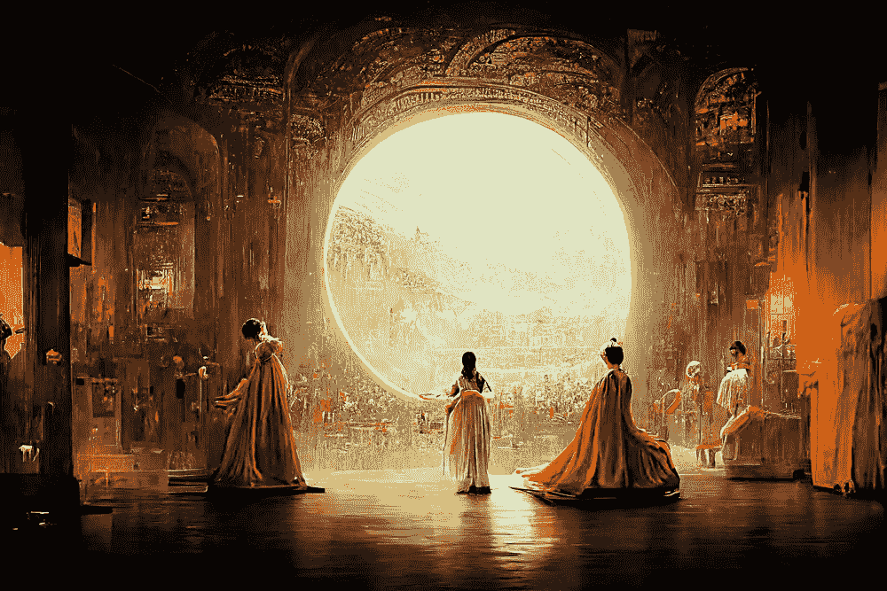

本节将重点介绍VAE系列和Diffusion系列，分别选了3种方法

+   VAE系列。VQ-VAE，dVAE和DALL-E

+   Diffusion系列。GLIDE，DALL-E2和ControlNet

## **VQ-VAE**

从上一篇[（5）AIGC组成原理(上)](https://ywh1bkansf.feishu.cn/wiki/KmkAwqnXPisrvfkK7RJcK9GqnAf) 我们知道VAE的隐空间    是连续的多元高斯分布，而VQ-VAE将其离散化，网络结构类似UNet，如下所示

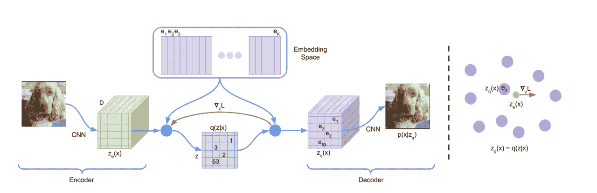

+   Step1：输入图片经过编码器下采样到    ，例如对于ImageNet数据集   。特征图上每个格点

+   Step2：设置大小为K的可学习码本   ，其中每个码字

+   Step3：找到   中每个格点   的在码本   中最近的码字   ，用其替换掉   ，最终得到

+   Step4：   经过解码器上采样，输出重建图片

可见其实就是把   做个聚类，变成离散的类中心，并且用类中心替换。最终loss如下

+   第一项是常规的重建误差，极大似然项。这一项对编码器和解码器都有梯度更新。注意由于Step3过程不可导，一般用   的方法让重建误差导数能反传回到编码器网络

+   第二项和第三项是正则化项。这里演变成了对类中心的距离的约束，分成了两项，前面一项是对类中心做梯度更新，即更新码本；后面一项是对编码器的输出做梯度更新。其中   是stop gradient

最终训练完成之后，抛弃编码器。为了对   做联合分布的建模，使用了PixelCNN。简单来说就是从左到右，从上到下做码字的挨个预测，类似RNN的auto-regressive过程。网络结果可以用LSTM，也可以用带特定mask掩码的CNN。

## **dVAE**

dVAE是尝试解决VQ-VAE中存在的两个问题

+   采样随机性不够强，生成任务不友好

+   使用了   做梯度近似，不够准确

解决思路如下

+   把VQ-VAE的Step1编码器的输出变成了   ，过了softmax之后   代表了每个格点位置   在码本中K个码字的概率分布（是不是有点attention那味了）

+   为了引入随机性，基于   用gumbel softmax trick做分类分布(Categorical distribution)的随机采样

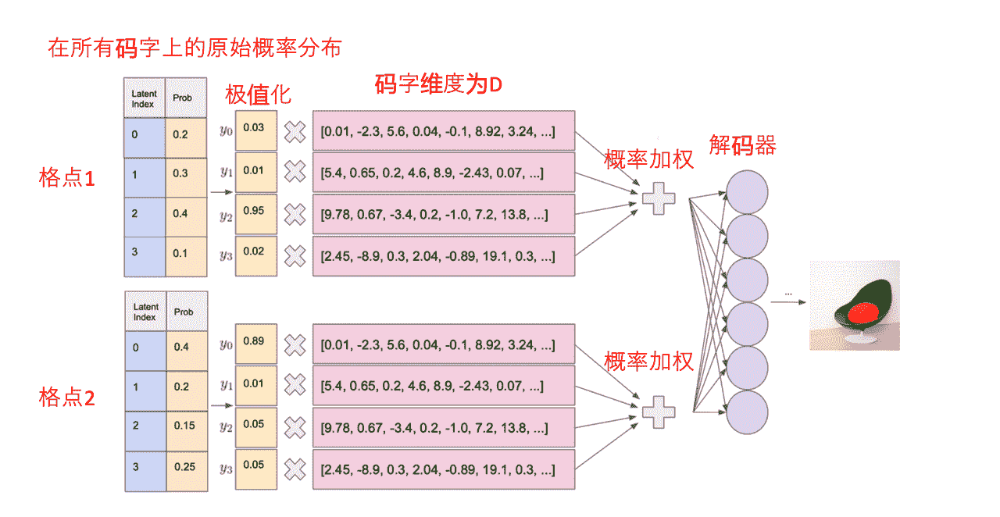

gumbel softmax trick

类似高斯分布生成的方法，同属于重参数化的一种，gumbel softmax解决的是的Categorical distribution的随机采样问题。输入和输出如下

输入：多分类的概率向量

其中

输出：满足上述概率向量   的one-hot向量采样结果   ，例如   或   等

gumbel softmax的推导过程在这里略去，主要介绍方法结论

这里由于   是不可导的，所以一般用带温度系数的softmax替代，如下所示

pytorch伪代码如下

```
def sample_gumbel(shape, eps=1e-20):
    U = torch.rand(shape)
    U = U.cuda()
    return -torch.log(-torch.log(U + eps) + eps)

def gumbel_softmax_sample(logits, temperature=1):
    y = logits + sample_gumbel(logits.size())
    return F.softmax(y / temperature, dim=-1)

def gumbel_softmax(logits, temperature=1, hard=False):
    y = gumbel_softmax_sample(logits, temperature)
    if not hard:
        return y

    shape = y.size()
    _, ind = y.max(dim=-1)
    y_hard = torch.zeros_like(y).view(-1, shape[-1])
    y_hard.scatter_(1, ind.view(-1, 1), 1)
    y_hard = y_hard.view(*shape)
    # Set gradients w.r.t. y_hard gradients w.r.t. y
    y_hard = (y_hard - y).detach() + y
    return y_hard
```

## **DALL-E**

DALL-E的名称来自 “WALL-E” 和 “Salvador Dalí”的组合，前者是皮克斯的动画角色，后者是超现实主义，代表作如下右图《永恒的记忆》

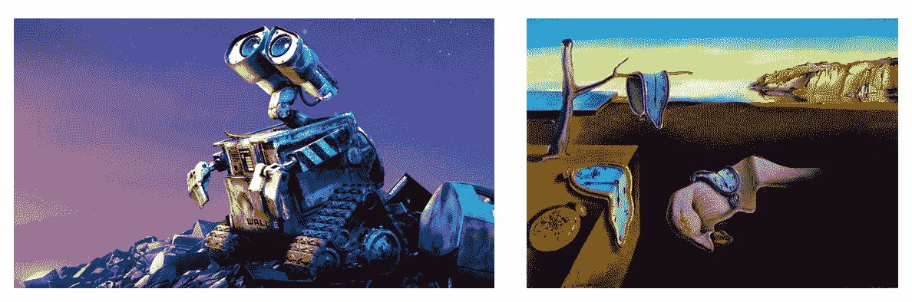

DALL-E主要完成了文生图的功能，假设图片为   ，文字为   ，图片隐空间为   ，则我们的任务是给定文字的情况下求图片的分布

推导Hint

+      和   一一对应，因此

+      生成只跟   有关，跟   无关，因此

因此关键是得到    和    ，正好对应算法的2个训练阶段

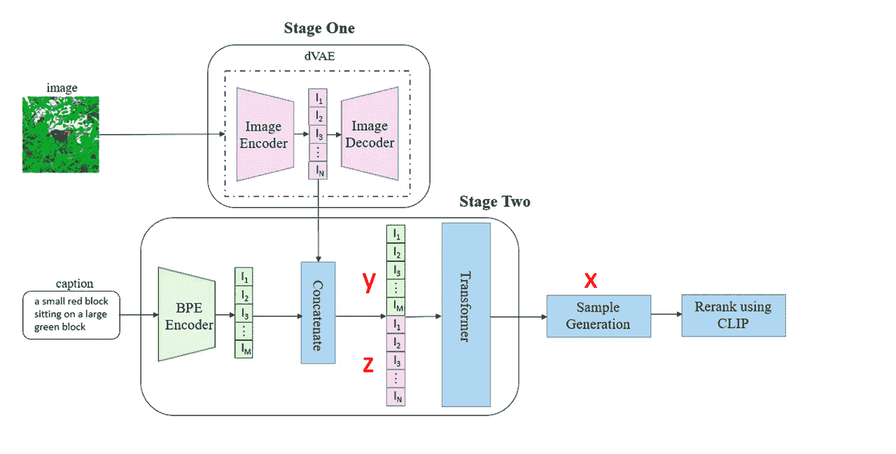

+   阶段1：训练图片dVAE，使用无标注纯图片数据集。最终得到图片编码器，离散码本和图片解码器   。图片被编码成1024个token，且token集合大小为8192

+   阶段2：训练transformer来建模   ，使用图文配对数据集。

+   对文字调用BPE编码，得到

+   对图片调用dVAE图片编码器，得到

+      跟   拼接，用decoder-only的transformer学习

另外在推理的时候，还会在生成的若干图片里面，用CLIP模型做图文的打分，排[序后选择匹配性比较高的](https://zhuanlan.zhihu.com/p/643969218)图片最为最终生成图片（如果对CLIP生疏的可以回看本系列的《多模态的大一统之路》）

## **GLIDE**

GLIDE基于guidance-free的工作，主要做了3方面工作

+   CLIP-guidance文生图任务

+   CLIP-guidance-free文生图任务。把20%的。

+   带文字提示的图片编辑任务

CLIP-guidance文生图

针对文生图任务，引入了CLIP的guidance，其中CLIP是抗噪特供版noisy-CLIP模型

对于噪声图片和文字描述对   ，分别灌入CLIP模型的图片编码器和文字编码器，使用contrastive loss作为监督指导信息。    和    为网络预测的原始均值和方差

这里的text编码输出长度为K的特征，用处有两个

+   结尾的 EOS token 对应的输出作为整个text的feature，替代原来class embedding位置灌入网络

+   长度为K的文本特征，会被混合进网络中间层的attention层里面

CLIP-guidance-free文生图

基于第一阶段的网络做guidance-free的finetune，具体来说把20%的本文数据drop掉，置为空序列输入，让网络直接学习

**带文字提示的图片编辑任务**

基于第一阶段的网络做带文字图片编辑任务的finetune，具体来说，新增了4通道的输入，包括了3个RGB通道和1个mask通道。训练的时候随机选择区域mask，给定文字描述，要求带噪声图片输出mask区域的像素。

3种设置的示例效果如下

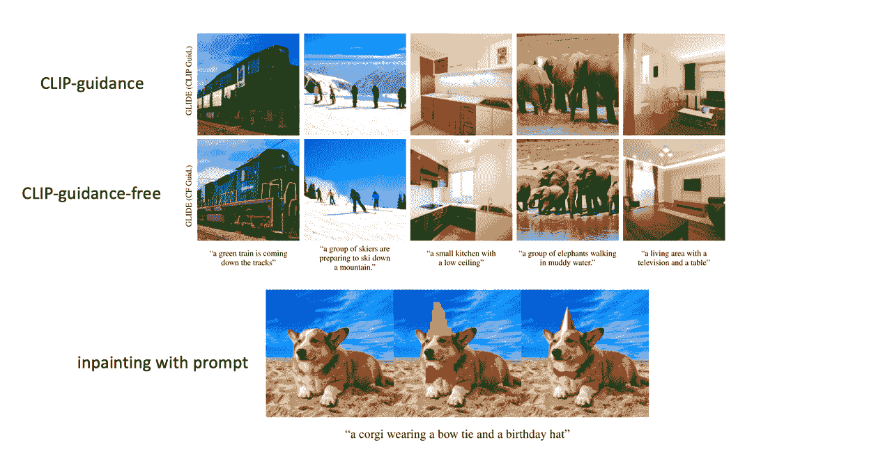

## **DALL-E2**

也叫unCLIP，因为CLIP是把图片变成feature，DALL-E2是把feature变成图片。DALL-E2基本可以看成是DALL-E和GLIDE的合体。

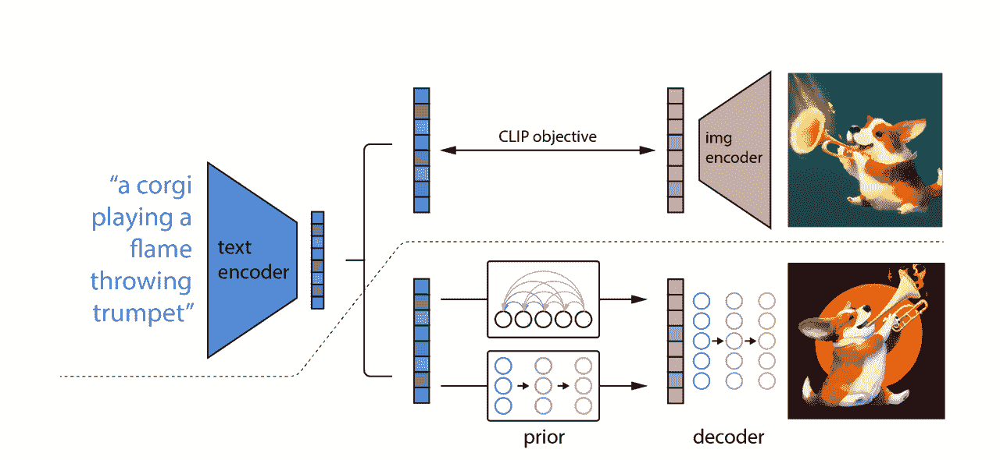

问题建模很直接，跟DALL-E一样是两阶段方法

+   Stage1: 通过caption得到CLIP image embedding的prior过程。方式要么用DALL-E中的autoregressive方法，要么用另外一个diffusion模型来做

+   Stage2: 通过CLIP image embedding到生成图片的diffusion decoder。这个过程带有较强的随机性，多样性比DALL-E中的dVAE要好

先说Stage2的Decoder的训练

+   本质是个Diffusion模型，细节借鉴了GLIDE。每一次传播过程都会把CLIP text embedding拼接在timestamp embedding后面，CLIP text embedding代表了text全局信息

+   类似GLIDE，把caption原始序列也加入attention里，希望能补充CLIP text embedding没有捕捉到的NLP信息，但是发现效果一般。

+   为了得到大图，还学习了两个upsample-diffusion-model，分别从   到   ，以及    到

+   使用了guidance-free的方式，10%的概率随机擦除CLIP text embedding输入，50%概率随机丢弃caption输入

再说Stage1的Prior训练

+   方法1：AR方法。

+   跟DALL-E的思路很接近，用decoder-only网络做序列预测

+   caption原始序列和CLIP text embedding在最前面，CLIP image embedding紧跟在后

+   DALL-E2还尝试在图片序列前面插入图片和文字量化离散后的相似度$z_i \cdot z_t$值，发现效果有提升

+   CLIP image embedding本身是1024维，作者通过PCA降维成原来的1/3至319维

+   方法2：Diffusion方法。

+   也是decoder-only的网络做序列预测

+   输入拼接顺序为caption原始序列，CLIP text embedding，timestamp embedding，noised CLIP image embedding(相当于   )和unnoised CLIP image embedding(相当于   ，其中unnoised CLIP image embedding作为输出的位置。

+   这里没有用UNet，需要保留unnoised CLIP image embedding的输出token位置。如果用UNet则直接输出即可

+   建模   直接预测   ，而不是预测    噪声

+   用MSE作为损失函数，表达式如下

+

应用上有趣的是可以在图片prompt的embedding层面做插值，然后再生成中间过渡的图片，或者文本的embedding层面做插值

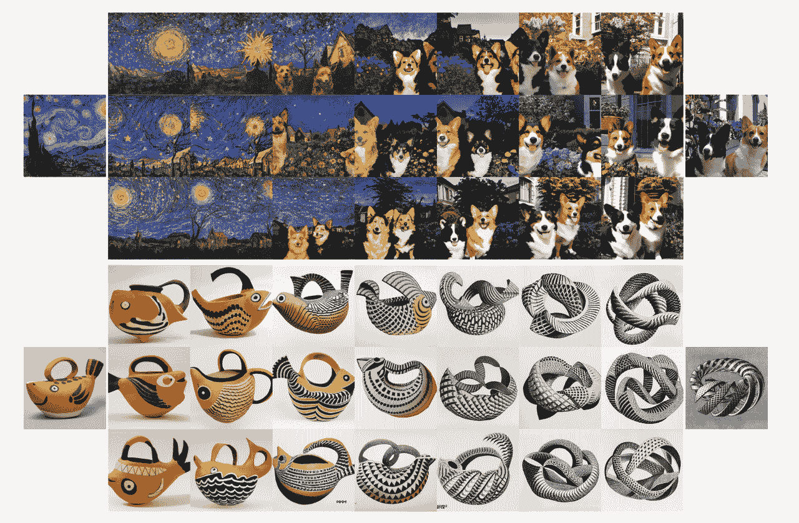

**局限性**

+   主要是CLIP模型本身的问题，导致空间位置，大小等等抽象概念比较难捕捉

+   同时图片的文字生成也不理想

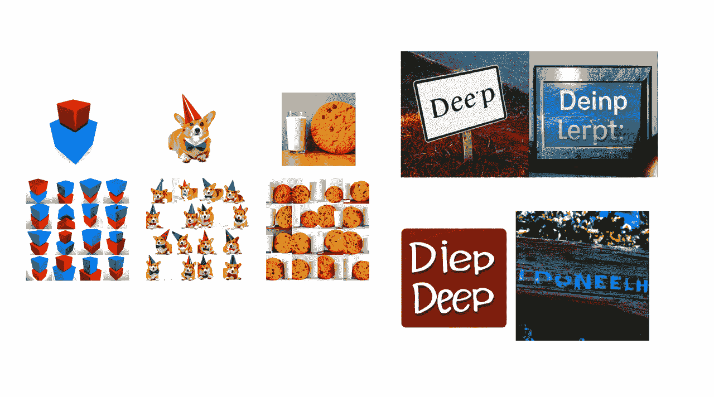

## **ControlNet**

ControlNet基于Stable Diffusion (SD)网络，支持多种condition形式，例如Canny Edge和User Sketching等，下面先简单介绍一下SD网络

Stable Diffusion

+   把DM(Diffusion Mode)里常见的pixel space切换到了latent space，这样降低计算量小，训练效率高

+   通过transformer的cross-attention机制，引入多种condition输入

+      网络负责把原始图片下采样映射到   的隐空间，   网络把隐空间特征映射回到图片像素空间

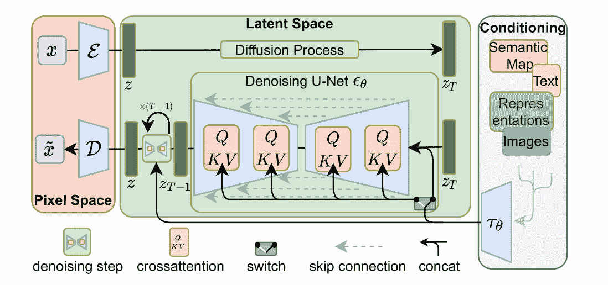

**ControlBlock设计**

+   Block设计遵循zero-convolution思想，固定住原始的SD网络，增加旁路学习残差。旁路前后被零初始化的1x1 卷积包裹，同时接受新的condition的输入

+   虽然   和   初始化为0，但是对   和   的梯度不为0，因为卷积层的输入不为0，因此模型参数可以正常接收梯度更新

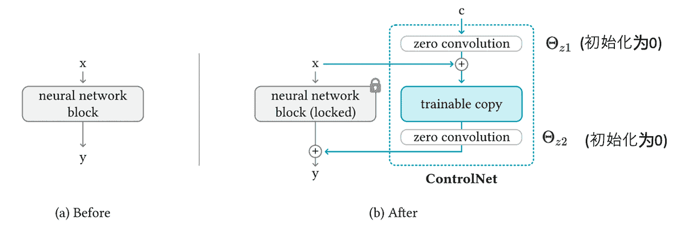

**ControlNet设计**

+   ControlNet接收当前步数   的编码，带噪声图   ，文字提示   和条件提示   ，最终输出    ，结合DDPM的均值公式算出    ，传递到步数   。

+   图片原始是   大小，经过输入层下采样1/8，变成   ，这样也匹配原版SD里面的latent feature的输入大小

+   ControlNet本身没有decoder的上采样，每个stage接zero convolution之后残差加回到对应分辨率的decoder网络里面

+   整个网络可以理解为多个ControlNet依次叠加到对应分辨率的SD上

+   跟原始SD网络相比，少了decoder部分，新增若干卷积层。SD固定部分无梯度显存额外消耗很少，整体显存消耗和训练时长只会分别增加23%和34%

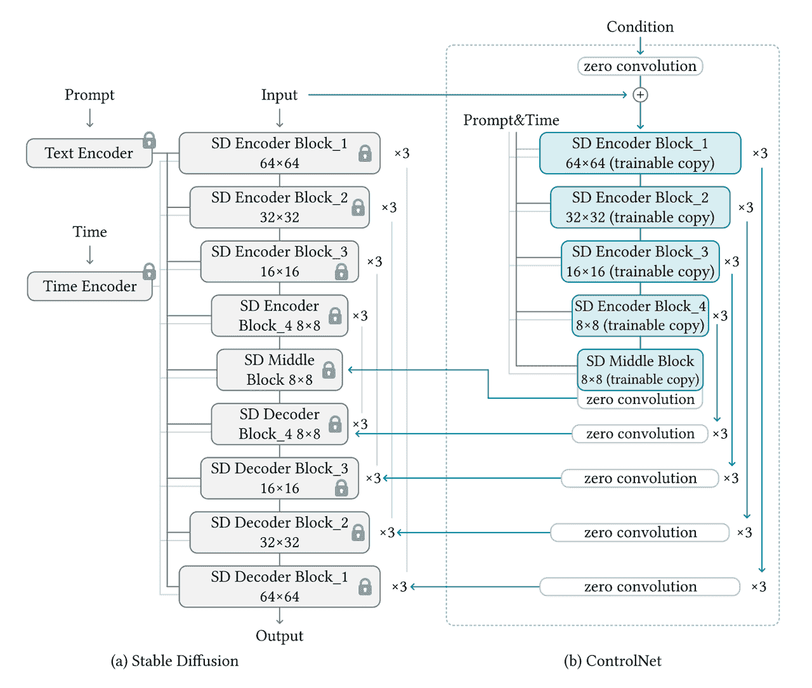

**训练过程**

+   需要原始SD模型预训练，然后固定不动，在condition数据集下finetune新增的ControlNet部分

+   加入guidance-free，方式以50%的概率随机移除文字提示prompt，目的是希望网络更关注条件提示condition

+   从前面知道ControlNet输入为当前步数   的编码，带噪声图   ，文字提示   和条件提示   ，输出为噪声估计   。整体训练loss如下

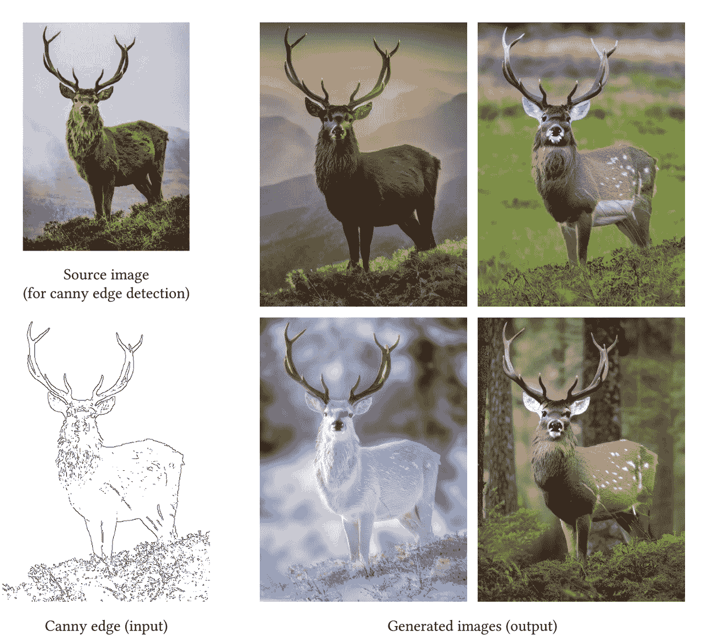

## **小结**

本节介绍了VAE系列和Diffusion系列，主要介绍了下面几种方法

# Video生成

视频生成的很多技术也是来自图片生成，本节介绍两篇来自Google的工作Phenaki和imagen Video，分别使用了VAE和Diffusion的生成技术。

## **Phenaki**

+   来自GoogleBrain的视频生成方法，可以通过文字描述生成可变长度的视频

+   主要依赖两方面能力

+   视频像素生成能力。依赖VQ-VAE的，主要借鉴了C-ViViT方法

+   隐空间token预测能力。依赖encoder-only的双向transformer的完形填空能力，主要借鉴了MaskGIT方法

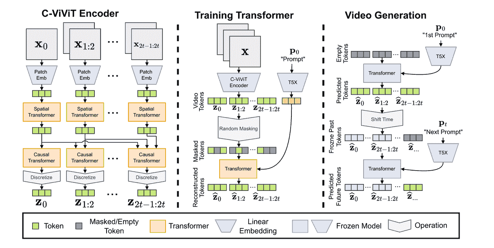

**C-ViViT**

训练第一个阶段参考了ViViT的做法，主要用VQ-VAE方法训练得到encoder、码本和decoder三个部件

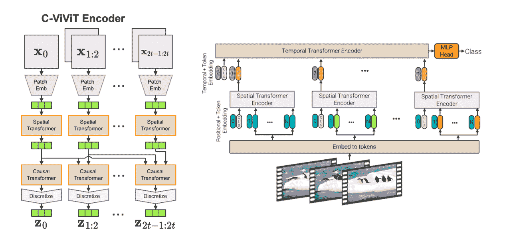

+   attention的方式是先做spatial的attention，然后做temporal的attention

+   C-ViViT做patch partition的时候，先把   帧堆叠在一起形成    的输入

+   做没有overlap的时间和空间切分。每个patch在时间维度上，除了第一帧只有一帧，其余每个stride是包含连续的   帧。因此第一帧的patch小方块大小为    ，其余patch的小方块大小为   。经过线性映射层后统一变成了长度为   的feature

+   一共可以得到的token数为   个，注意video视觉任务比LLM的sequence要长，因为每一帧都包含大量patch（例如256，512）

+   C-ViViT把spatial和temporal的 CLS token 都去掉了，并且增加了causal transform的decoder-only的mask，这样可以在计算复杂度不爆表的情况下产生任意长度的

+   C-ViViT decoder设计跟encoder反过来，先过temporal的attention，然后再是spatial的attention。训练使用VQ-VAE方式重建训练，训练结束得到离散的codebook，这样输入的video经过encoder转化为离散的codebook向量，然后再经过decoder得到pixel视频

+   训练的loss除了重建误差    ，还有逐像素L2损失   ，图片感知损失    (image perceptual loss)，视频感知损失    ，还有styleGAN里面的对抗损失

Bidirectional Transformer

训练第二个阶段参考了MaskGIT的做法，让模型有预测未知帧的隐空间token的能力

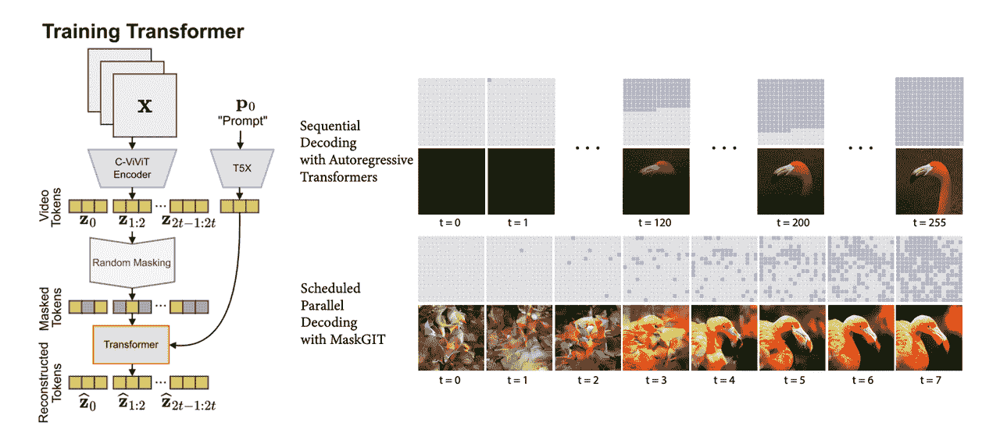

+   本质是个seq2seq的任务，从text prompt token生成video token，通过mask-and-predict方法做无监督训练

+   拿到C-ViVT encoder的输出，经过一个双向完整的attention transformer，做mask-and-predict任务。

+   不使用decoder-only做auto-regressive，原因是这样只能串行执行，由于每一帧视频的视觉token会比LLM大很多，哪怕用了cache采样时间也是线性增长，推理时间比较慢

+   训练和推理保持一致的mask采样策略，来自MaskGIT

+   Step1: 初始的时候设置输入都是 MASK token

+   Step2: 经过transformer forward得到输出token

+   Step3: 考察所有输出token跟码本codebook中向量的最近cosine距离，看做是概率值，从大到小排序

+   Step4: 保留前   比例的token，对剩余的进行re-mask

+   Step5: 重复Step2到Step4，   逐渐从0增大到1，最终结束

+   MaskGIT采样能使得最终采样的次数能比原始auto-regressive降低一个数量级，从几百次降低到20次左右

+   这个阶段训练可以把海量图文数据也加入，在mask的时候只mask第一帧即可。如果单纯靠视频-文字描述数据不够大，有些概念学不到，例如铅笔画。

Long Video Inference

推理阶段可以产生长视频，即可能包含一个或者多个text prompt的视频。步骤如下

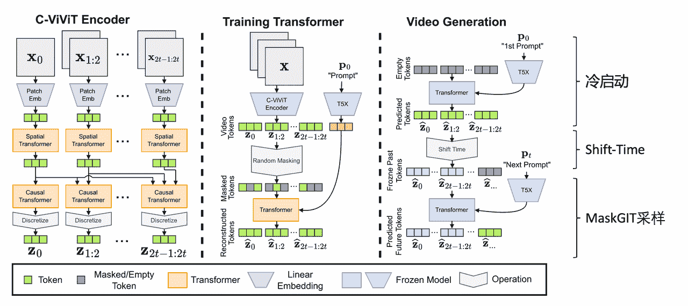

+   冷启动：首先从全 MASK token开始，在1st prompt的输入下，按照MaskGIT的采样方式生成第一段视频

+   Shift Time: 就是把前一段最后K帧视频，经过C-ViViT的encoder得到codebook编码

+   MaskGIT: 把当前段剩余的video token置为MASK token ，并且在Next Prompt的输入下，做MaskGIT采样补全，生成第二段视频

+   重复Shift Time和MaskGIT，直到结束

## **imagen Video**

姊妹篇是imagen，用于图片生成，本篇imagen Video用于视频生成。整体架构如下，除去T5的text特征提取网络，一共有7个独立训练的DM

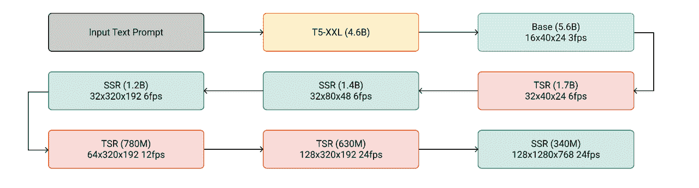

+   Base网络生成   的初始结果。经过TSR(Temporal Super Resolution)和SSR(Spatial Super Resolution)做逐级放大，最终生成约5秒左右的24帧率的720P视频片段

+   对于每个DM，所有视频帧都是同时做扩散传播的，并不是逐帧做。

+   类似Phenaki，先做单帧空间上的信息汇聚，然后做多帧时间上的信息汇聚。

+   空间汇聚部分包括了convolution和transformer attention两种操作。在分辨率较低的时候混合使用两种操作，当分辨率较大的时候，节省显存角度考虑只使用convolution操作

+   时间汇聚部分只使用了convolution操作，原因是transformer attention不仅更消耗显存且没有明显收益

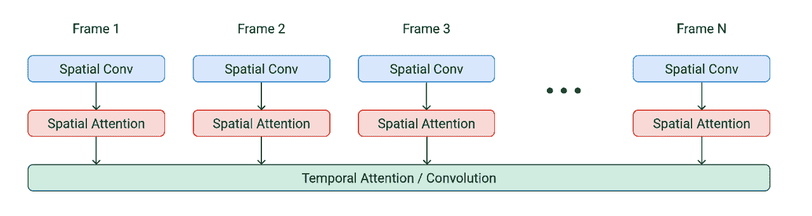

+   对于TSR或者SSR模型，输入除了噪声图$z_t$，还会拼接前一级的输出video。这里对于TSR的时间扩增会先拼接duplicate的图片，对于SSR时间扩增会先拼接resize的图片

+   训练使用了private的14M图-视频配对数据和60M图-文配对数据，以及public的 LAION-400M图文数据

imagen Video提到了3个比较重要的训练技巧

**-prediction目标函数**

原始的DDPM或者DDIM都是   -prediction方式，即用   预测   ，然后根据不同采样算法求解下一步

-prediction来自[这篇论文](https://www.notion.so/imagen-be64c4326d0246da965679de8295a273?pvs=21)，尝试用   预测   ，其中

作者发现   -prediction在细节上比   -prediction要好不少

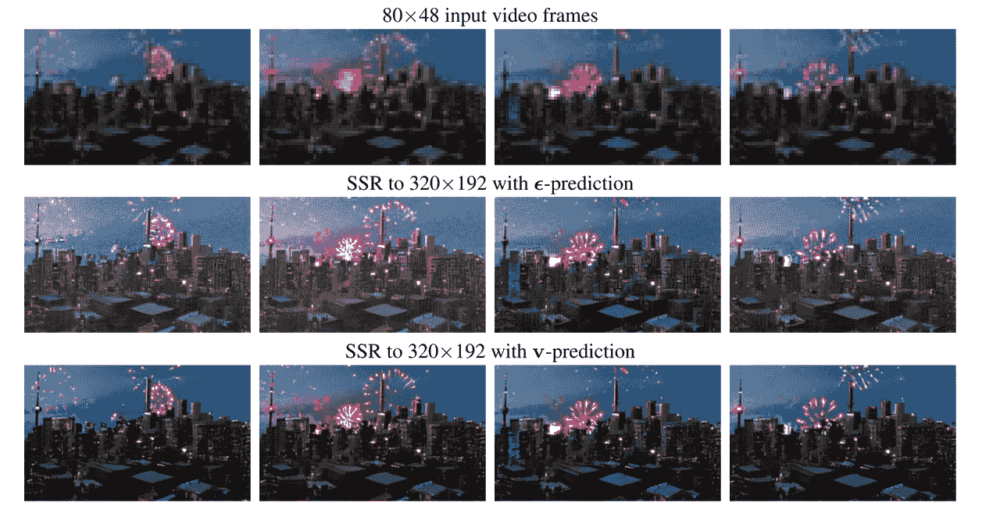

classifier-free guidance

训练的时候以固定概率随机将文字提示条件置为空   ，在推理采样的时候使用下列公式

conditioning augmentation

对于多个级联的DM，condition增广是比较重要的，这样有利于各个SD模型的鲁棒性，最终级联在一起能相互匹配，泛化性更好。

具体来说，训练的时候对condition的视频添加一定信噪比的高斯噪声，推理采样的时候也添加SNR为3-5的噪声，实操起来能减少artifacts

# Audio生成

audio生成一般分为speech生成和music生成，这一节我们介绍两篇同样来自Google的工作，AudioLM和MusicLM，分别在speech生成和music生成上取得不错的效果。

## **AudioLM**

AudioLM借鉴了SoundStream和w2v-BERT两种方法对原始音频信号进行特征抽取

+   用SoundStream抽取声学特征，得到acoustic tokens，有利于高保证度的音频还原

+   用w2v-BERT抽取长时语义特征，得到semantic tokens，有利于长时语义一致性

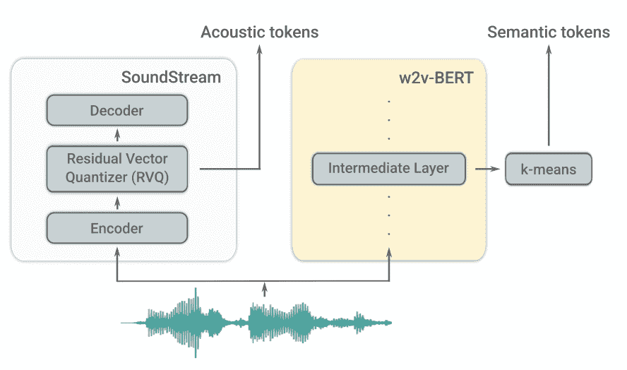

原始音频信号是有一定采样频率的一维离散信号，例如16kHZ。可见原始音频信号的序列长度非常长，比LLM的序列都要长，因此必须想办法先做下采样。AudioLM使用的编码器是SoundStream，下面简单介绍一下SoundStream是如何做到极致编码的。

**SoundStream**

SoundStream希望在保证恢复质量的前提下，追求更低的比特率，降低传输带宽。网络结构如下

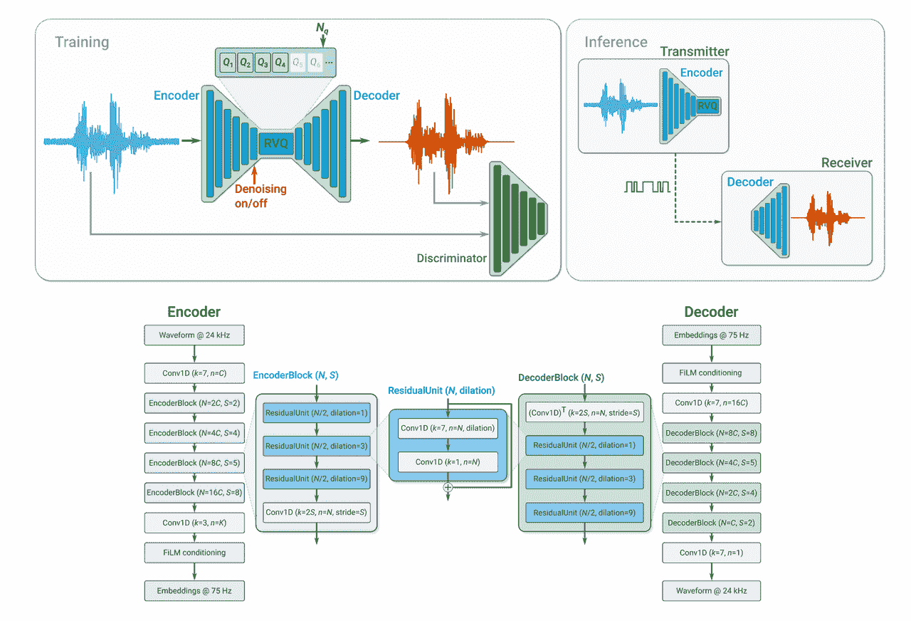

+   使用了类似VQ-GAN的训练方式，在VQ-VAE的基础上加上Discriminator做正负样本分类，如下所示

+   原始音频输入是1维信号，encoder和decoder都使用1D的卷积，下采样步长分别为   ，那么输出长度为原来的   。因此24kHz的原始输入音频信号被映射成75Hz的隐特征。

下面考虑如何对这75Hz的隐特征进行编码

+   假如要求码率是6000bps，那么每帧能分配到80比特，能表达   种离散值，但这样也意味着要存储大小   的码本

+   考虑残差编码方式，选取   个层次的编码，每次对残差编码。例如当   的时候，每次编码器的码本大小为   大小。编码算法如下所示

+   这样码本大小为   ，但是计算过程复杂了，相当于时间换空间

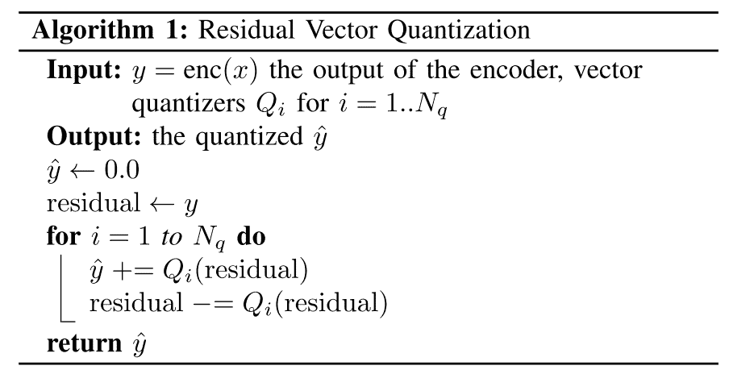

**w2v-BERT**

w2v-BERT网络可以简单理解为一个特征抽取网络，能生成长时语义特征，并且输出下采样   。训练过程使用了无监督的方式，也有类似多模态里面的对比学习Contrastive Loss和完形填空Masked Language Loss。最终得到的就是包含丰富语义的feature，这里不做详细展开。

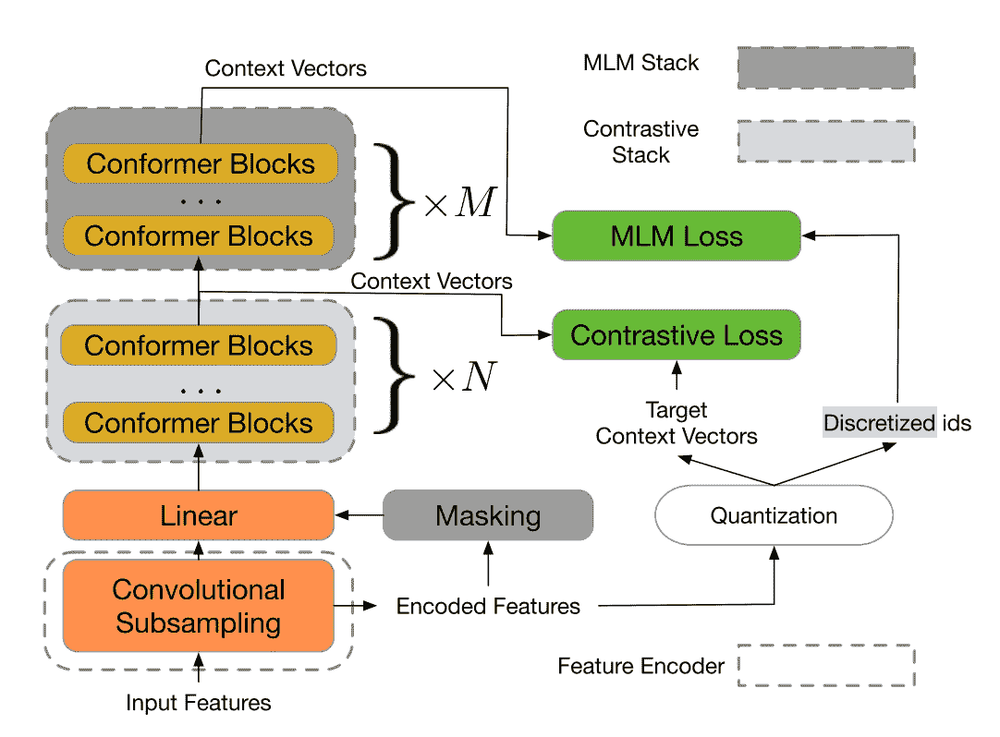

**三阶段训练**

由上文可以知道

+   SoundStream能得到长度下采样   的声学特征序列，假如输入是   ，输出是   。假如使用   个层级的编码，每个层级码本大小   ，那么输出码率为     。

+   因此输出acoustic tokens的尺寸为   ，展开铺平可以写成     ，其中

+   w2v-BERT能得到长度下采样   的长时语义特征，假如输入是   ，输出是   。AudioLM对该特征做了k-means聚类，类别数为   ，那么输出码率是

+   因此semantic tokens的尺寸为

有了acoustic tokens和semantic tokens后，AudioLM进行3阶段的训练

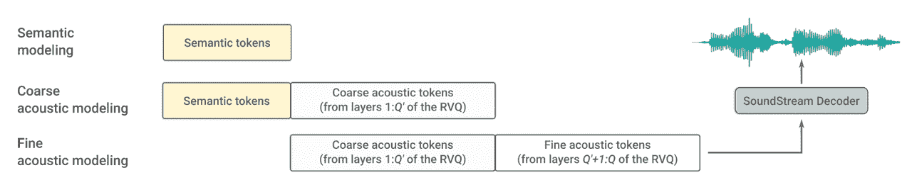

+   阶段1: semantic modeling。调用w2v-BERT网络返回semantic序列

+   阶段2: coarse acoustic modeling。从   里面选择一个量化器   ，尝试用   去恢复出前   ’阶的acoustic序列，即用decoder-only网络学习序列

+   阶段3: fine acoustic modeling。基于前   阶的acoustic序列，尝试恢复   至   阶的acoustic序列，即用decoder-only网络学习序列

训练完成后有多种使用方式。其中比较实用的是续写，就是给定一段人说话的音频，然后让AudioLM续写。步骤如下

+   通过SoundStream的encoder得到acoustic tokens

+   通过acoustic tokens预测出完整的   阶semantic tokens

+   经过SoundStream的decoder把semantic tokens映射回到音频空间

## **MusicLM**

音乐生成界的DALL-E2，模型结构和训练过程如下所示

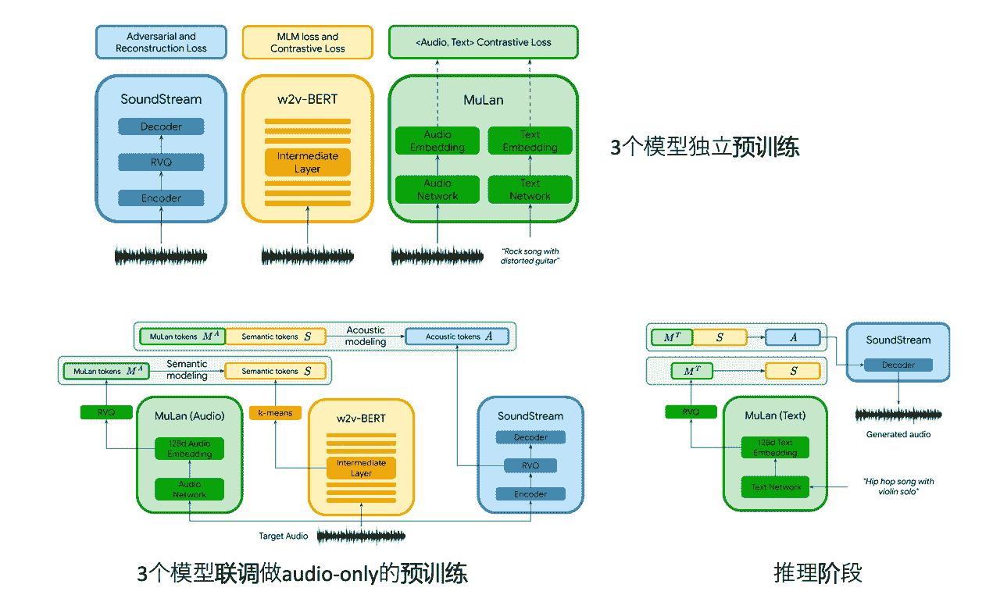

+   有三个独立模型，分别是SoundStream，w2v-BERT和MuLan，预训练阶段独立训练这3个模型

+   SoundStream和w2v-BERT在AudioLM里面已经介绍过，分别用于编码声学特征和长时语义特征

+   MuLan相当于audio领域的CLIP模型，也是用配对的声音和文字做无监督训练，这样MuLan text embedding和MuLan audio embedding就在同一个特征空间了

+   3个模型串联在一起，audio-only的数据上做进一步预训练。具体来说

+   Audio经过MuLan得到MuLan audio embedding

+   用MuLan audio embedding做decoder-only的auto-regressive回归预测出w2v-BERT的semantic tokens

+   用MuLan audio embedding和semantic tokens预测acoustic tokens，跟AudioLM一样分为了coarse和refine两个阶段。其中acoustic tokens真值来自SoundStream直接对原始音频的编码结果

+   最后3个模型串联做推理

+   输入歌词Text，用MuLan抽取MuLan text embedding

+   由于MuLan text embedding和MuLan audio embedding已经在同一个特征空间了，所以直接用audio-only阶段训练的模型，把MuLan text embedding喂入得到semantic tokens

+   继续调用audio-only阶段训练的模型得到acoustic tokens

+   把acoustic tokens喂入SoundStream decoder还原回到音频数据

# 3D生成

个人认为3D生成难度比video和audio都要大，首先3D数据的表征就存在很多种，主要分为欧式法(Euclidean)和非欧式法(non-Euclidean)

+   欧式法是指有全局的坐标系统，包含潜在的网格体系，能比较方便地迁移2D深度学习的技术

+   Voxel Grid。3D空间网格，可以直接使用卷积神经网络

+   Multi-view Images。3D采集很贵，一般都是多个视角下的同一物体

+   非欧式法是指没有全局坐标系统，没有网格体系，比较难迁移2D深度学习技术

+   Meshes。用三角面片等多边形表示，用图神经网络可以处理

+   Point Clouds。离散3D坐标点，可以用PointNet处理

+   Neural Fields。用神经网络全部或者部分表示，推理很快，但是训练速度非常慢，并且对于复杂光照场景处理得不够好

本节主要侧重介绍Neural Field的表示方法，首先介绍一下开山之作NeRF算法。

## **NeRF**

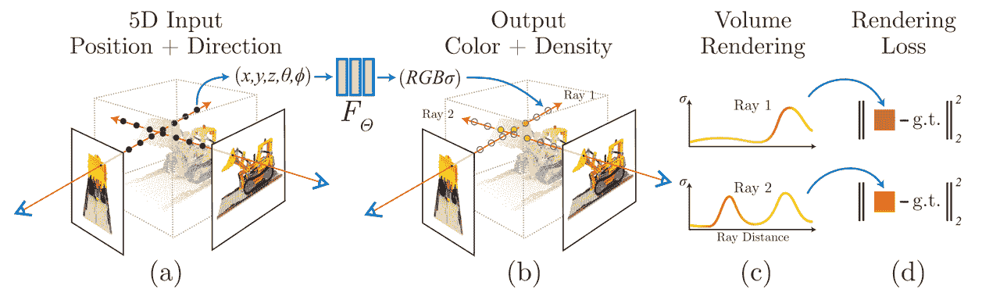

NeRF尝试用神经网络对3D物体进行表征。我们从先inference阶段开始

+   通过3d位置   来得到该位置的密度函数   ，即光线在该点被阻碍的概率密度

+   通过3d位置   和观察射线方向   来得到该位置的RGB颜色

将上述两个映射合并成下面公式，并且用MLP网络学习

有了上述函数之后，当给定同场景任意视角时，我们通过下面方法模拟像素生成过程

+   对于某个像素点   ，可以通过相机外参和内参，映射到空间中的一条穿过光心   的射线   ，这样射线上的点   可以用方程

+   射线上任意一点的RGB值，可以通过下面的公式计算得到

公式中

+   积分范围是从   的near位置到   的far位置

+   体密度函数   前面已经介绍过，由位置   确定，光线在该点被阻碍的概率密度

+   颜色函数   前面也介绍过，由位置   和观察射线方向   共同确定

+      可以看成是从near地方到当前位置的体密度函数积分，即累积透明度含义。也就是从near位置到当前t位置，光线没有碰撞到任何物体的概率

由于连续积分没法数值计算，所以变成离散求和。先定义采样点如下，含义是从   到   做均匀划分，然后再每个划分的区间内随机采样一个点

带入可以得到

推导Hint

+      ，相当于离散点间隔

+   可以证明   ，因此

**NeRF网络细节**

由前面知道，通过MLP神经网络完成    的映射之后，再由    表达式就能求出射线对应像素点的像素值了，接着再跟真值做MSE的损失函数，即可完成训练。

输入本来是5维变量，但是实操发现增加高频变量有利于网络学习，因此引入了   函数做映射，把单个浮点数映射成   维的向量

因此输入预处理为

+      。选择   ，因此是     维的向量，即

+      。先变成球面坐标   ，选择   ，因此是     维的向量，即

网络结构如下所示

+      从网络开头输入，同时跟中间层feature做concat，预测

+      跟中间层feature做concat，预测

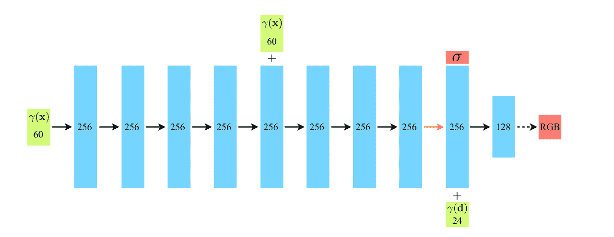

## **Dreamfusion**

Dreamfusion基于NeRF，初看会觉得很神奇，没有任何数据，直接就能学，结构如下

+   思路非常直接，就是把NeRF的输出作为   ，用训练好的且权重固定的文生图Diffusion模型直接做梯度回传

+   每次针对一种text prompt训练专属的NeRF来建模3D模型，并且text最好包含视角信息，例如在prompt里添加overhead view等描述信息

+   使用classifier-free技巧，引导权重   取得比较大，大概100了 ，一般文生图是30-50

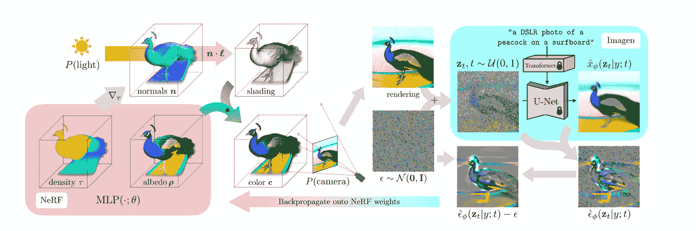

本文的另外一个创新是对梯度做了分析，如下所示，先给出原始Loss的表达式

其中

+      是人工定的系数

+   跟DDPM里面假设一致，

把NeRF网络的输出   代入上式，并且对NeRF的参数   求导，可得

其中

+        吸收到了   里面

+        是残差项

+        是U-Net网络的梯度，计算量大，Dreamfusion尝试去掉

+      是NeRF的网络梯度

Dreamfusion中选择去掉了U-Net网络梯度，得到的loss称为SDS (Score Distillation Sampling)

最终模型结果如下所示

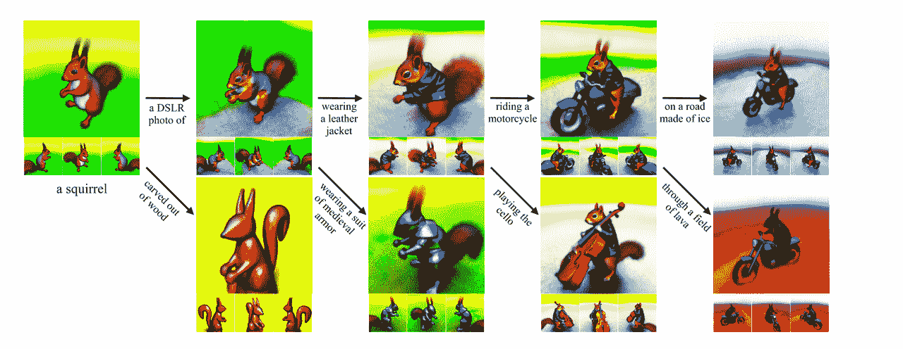

# 写在最后

本文一共分了4个小节，简单介绍了生成算法是如何使用在各个领域中的

+   Image生成。重点介绍了VAE系列和Diffusion系列，各选了3种方法

+   VAE系列。[VQ-VAE(2017.11)](https://arxiv.org/abs/1711.00937)把VAE的隐空间变成了离散的；[dVAE(2021.02)](https://arxiv.org/abs/2102.12092)使用gumbel softmax[ trick提高了VQ-VAE](https://arxiv.org/abs/2102.12092)的随机性；DALL-E(2021.02)分别建模了    和     完成了文生图的任务。

+   Diffusion系列。[GLIDE(2021.12)](https://arxiv.org/abs/2112.10741)贯彻了classifier-free的思[路，完成了文生](https://arxiv.org/abs/2204.06125)图和带文字的图片编辑任务；DALL-E2(2022.04)把GLIDE和DALL-E结合在一起，把效果做出了圈；ControlNet(2023.02)用旁路网络和zero convolution的方式把多种condition植入stable diffusion模型，得到了广泛的应用

+   Video生成。来自Google的两篇工作，分别使用了VAE和Diffusion算法。

+   VAE方法。Phenaki(2022.10)整合了C-ViViT和MASK-GIT方法，利用前者做编码和解码，利用后者做隐空间下的完形填空预测未来。

+   Diffusion方法。imagen Video(2022.10)使用了7段级联的Diffusion模型，首先生成低分辨率和低帧率的初始视频，然后通过3级空间超分和3级时间超分最终输出5秒左右的24帧率的720P视频片段

+   Audio生成。

+   speech生成。AudioLM(2022.09)借鉴了SoundStream和w2v-BERT两种方法对原始音频信号进行声学特征和长时语义特征抽取，最终用3阶段seq2seq方法生成高质量的speech音频。

+   music生成。MusicLM(2023.01)同样使用了SoundStream和w2v-BERT，再加上有Audio界的CLIP之称的MuLan模型，共3个模型联合训练完成了文字生成音乐的任务

+   3D生成。先介绍了[NeRF(2020.03)](https://arxiv.org/abs/2003.08934)的基本原理，然后展示了DreamFusion(2022.09)是如何利用NeRF和训练好的文生图Diffusion模型，得到文生3D的结果

预告：计划下一篇为《分布式训练的3D并行是什么？》，敬请期待。

PS：由于笔者小A并没有亲手撸过上述内容的所有细节，大部分是通过研究代码和精读优秀文章的方式 bottom-up 总结而来，本质上是个拾人牙慧的知识搬运工，所以终究是纸上谈兵。因此希望各方有实际经验的大佬猛锤，思维碰撞才生火花，真理越辩越明。

**如果想了解transformer在NLP/多模态/AIGC的算法知识，分布式**训练的知识，以及如何在TVM上做PTQ量化和部署，可以关注我aaronxic哟~

# 系列文章导览

+   [（1）Perplexity指标究竟是什么?](https://ywh1bkansf.feishu.cn/wiki/E1pjwy9OMirKTdkFQDEcDDlfnTh)

+   [（2）初探LLM基座模型](https://ywh1bkansf.feishu.cn/wiki/UU9pwtOFtiKIqAkQiSVc3Zdun7e)

+   [（3）ChatBot是怎么炼成的?](https://ywh1bkansf.feishu.cn/wiki/HRnLw588DiTDLPkSTXCcKit8nbD)

+   [（4）多模态的大一统之路](https://ywh1bkansf.feishu.cn/wiki/ReVzwZUr0ivgWfkaQ91cXrYUnoh)

+   [（5）AIGC组成原理(上)](https://ywh1bkansf.feishu.cn/wiki/KmkAwqnXPisrvfkK7RJcK9GqnAf)

# 参考资料

+   [AIGC的一些记录](https://zhuanlan.zhihu.com/p/615522634)

+   PyTorch 32.Gumbel-Softmax Trick

+   [DALL](https://www.bilibili.com/video/BV17r4y1u77B)[·E 2（内含扩](https://www.bilibili.com/video/BV17r4y1u77B)散模型介绍）【论文精读】哔哩哔哩bilibili