# （7）LLM分布式训练面面观

> 来源：[https://waytoagi.feishu.cn/docx/HoEIdZjjaoIoCjxR0UkcziYJnDd](https://waytoagi.feishu.cn/docx/HoEIdZjjaoIoCjxR0UkcziYJnDd)

> 作者：小A，aaronxic，[知乎个人主页](https://www.zhihu.com/people/aaronxic)

> 发表时间：2023年7月8日

> 原文地址：https://zhuanlan.zhihu.com/p/664604792

# 开篇

大家好，我是小A。前面几篇我们感受了Transformer在LLM、多模态和AIGC等算法领域的应用，从这一篇开始我们把目光转向工程部分。本文将围绕LLM里面分布式训练，回答下面4个问题

+   分布式通信原语有哪些？

+   3D并行都是怎么做的？

+   ZeRO是如何降低数据并行的显存占用的？

+   Alpa是如何用自动化搜索方式逼近人工设计的最优方案的？

PS: 长文预警，本篇约2w字，关注&收藏后电脑上阅读体验更加哦~ (^_^)

# 分布式通信原语

LLM分布式训练需要用到多机多卡，通信是个最基础的问题。因此在正式介绍并行算法之前，我们先了解一下常用分布式通信源语(primitives)有哪些。

分布式通信一般有两种

+   点对点通信(Point-to-point Communication, P2P): 两个节点间通信

+   集合通信(Collective Communication, CC): 在一组节点内通信

使用最为广泛的分布式通信库有MPI和NCCL，在工程实践中通常CPU上用MPI，GPU上用NCCL

## **MPI**

MPI(Message Passing Interface)全称是是消息传递接口，定义了一套接口，比较流行的开源实现是OpenMPI。常用于计算集群，超算上。针对CPU之间的通信做了很多优化。

目前MPI广泛用于节点的管理，但是GPU之间的通信优化得不好，MPI没有针对性的做优化

编译带mpi的c文件的时候，需要用 mpicxx 编译器

## **NCCL**

NCCL(NVIDIA Collective Communication Library) 是NV专门针对自家的计算卡和网络的集合通信库，完成单机多卡和多机多卡的高速互联通信

这里[repo](https://github.com/muriloboratto/NCCL)包含了简单易懂的所有NCCL使用示例，感兴趣的可以移步学习。注意在编译nccl相关的cu文件时候，需要加上 -lnccl 的库

## **点对点通信原语**

点对点的操作比较简单，只有发送和接收两个操作

+   发送的时候需要指定发送buffer和发送给哪个peer对象编号

+   接收的时候需要指定接收buffer和数据来自哪个peer对象编号

NCCL和MPI的接口如下所示

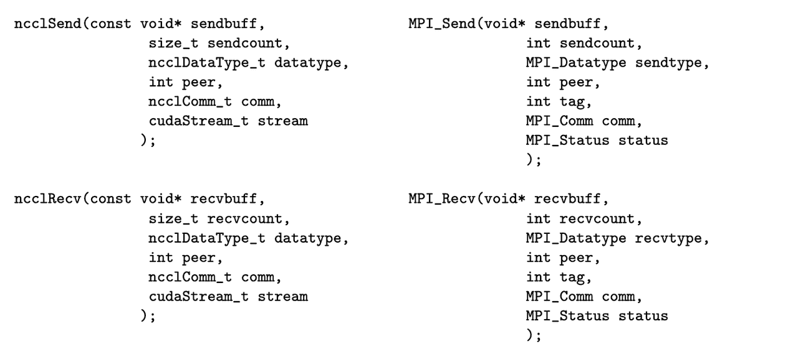

## **集合通信常用原语**

集合通信是在一组节点内相互通信，在MPI中大致分成三种

+   一对多。例如Broadcast和Scatter等。

+   多对一。例如Reduce和Gather等

+   多对多。例如AllReduce、AllGather、ReduceScatter和AllToAll

值得注意的是在NCCL中，原语种类比MPI要少，只包含了5种，分别为Broadcast、Reduce、AllGather、ReduceScatter和AllReduce

Broadcast和Scatter

Broadcast是把同一份1份数据广播给N个节点，Scatter是把N份数据发给N个节点。他们的相同点都是从一个节点发给多个节点，区别就是Broadcast发送的是同一份数据，Scatter发送的是不同的数据

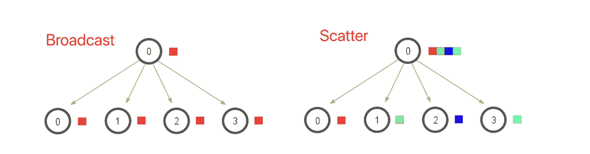

**Reduce和Gather**

+   Reduce是搜集N个节点的数据，并且对这些数做reduce操作，例如SUM/MIN/MAX/PROD等

+   Gather是搜集N个节点的数据，得到长度为N的数组

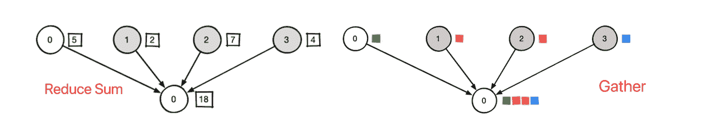

**AllGather**

每个节点各有1分独特数据，相互交换让N个节点有N份数据

+   Naive实现: 通过gather+broadcast来实现

+   SOTA实现: 直接并行发送

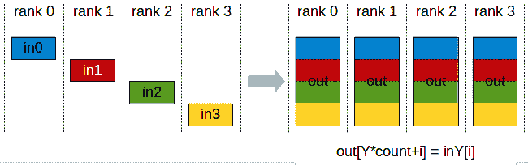

**ReduceScatter**

有N个节点，每个节点有长度为N的数据，首先做reduce得到长度为N的数据，然后scatter分发给N个节点，每个节点得到长度为1的数据

+   Naive实现: 通过Reduce+Scatter实现

+   SOTA实现: 直接并行发送

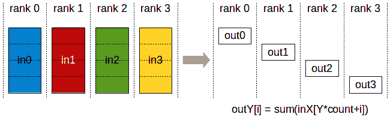

**AllReduce**

搜集N个节点数据，得到数组做reduce之后，再发给N个节点。

+   Naive实现：通过Reduce+Broadcast来实现

+   SOTA实现：ReduceScatter + AllGather

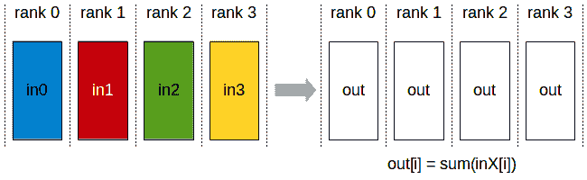

**AllToAll**

跟AllGather类似，但是AllGather是每个节点拿到的结果最终是一样的，而AllToAll的每个节点拿到的结果是不一样的

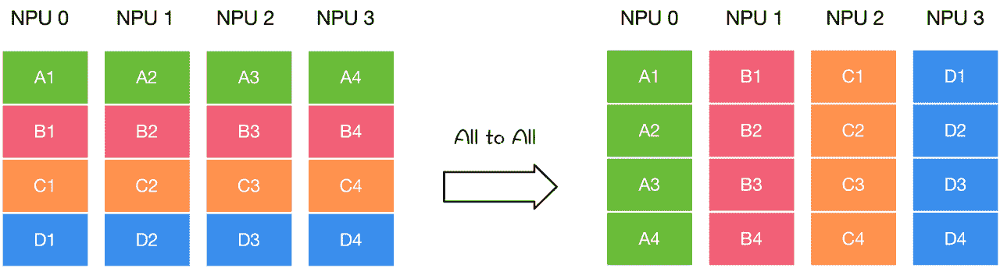

# 数据并行(DP)

数据并行(Data Parallel)是使用最为广泛的并行方法，加速性能非常好，原因是各个数据切片可以做到完全解耦，只需要在最后每个mini-batch结束的时候做一下梯度的all-reduce既可。

数据并行可以分为中心化方式的和无中心化方式的，对应于pytorch里面的DataParallel和DistributedDataParallel

这两种方式最大的区别是gradient和reduce计算过程

+   DataParallel是要在forward之后把所有输出gather到0号卡上，计算完loss之后再scatter到各个设备上，然后做backward独立计算gradient，最后搜集gradient到0号卡。因此需要在forward和backward间插入一次通信

+   DistributedDataParallel是每张卡独立的做forward和backward，然后对各卡的gradient做all-reduce。因此forward和backward间无需通信

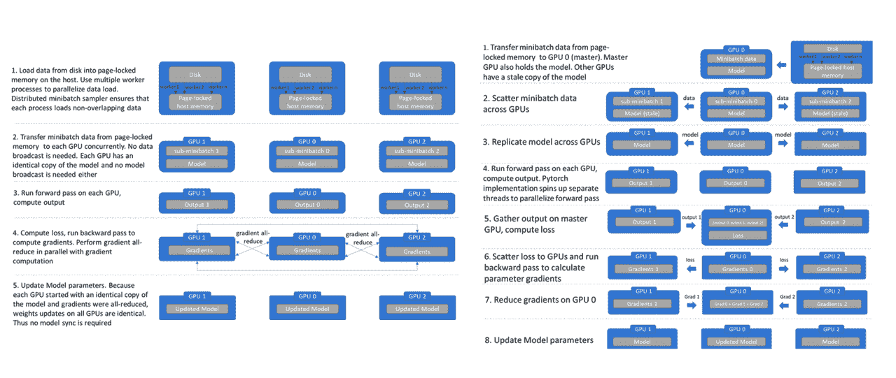

# 流水线并行(PP)

当模型参数量太大，一张卡不能完全放下的情况下，就必须对模型进行切分了，流水线并行(Pipeline Parallel)就是一种切分方法。具体来说

+   沿着模型的拓扑序，切分成 段，每一段为一个stage，因此可以形成逻辑上相互串联的 个stage

+   将大小为 的mini-batch进一步切分为 个大小为 的micro-batch，因此

+   这些micro-batch依次进入上述 个stage

我们首先研究一下流水线并行切分之后，每个stage的耗时跟原来相比会有什么变化，如下所示

+   假设1：算力为 的节点，处理完整模型的1个micro-batch，前向和反向耗时分别是 和

+   推论1：算力为 的节点，处理完整模型的1个micro-batch，前向和反向耗时分别是 和

+   推论2：算力为 的节点，处理 模型的1个micro-batch，前向和反向耗时分别是 和

+   推论3：算力为 的节点，处理 模型的1个micro-batch，前向和反向耗时分别是 和

因此根据推论3可知，所有算力处理整个模型的耗时，跟 的算力处理 段模型的耗时，是一致的。

下面开始讨论各种策略下的耗时情况。

## **理论上界**

我们先考虑理想最优情况。此时显存无限大，不需要pipeline并行，一把梭直接对mini-batch的样本做前向和反向，耗时正比于样本数量。由假设1不难算出 耗时为

## **朴素串行**

下面考虑最朴素的串行方式，类似于CPU的单周期处理器时代。每个micro-batch串行逐个做前向和反向，如下所示

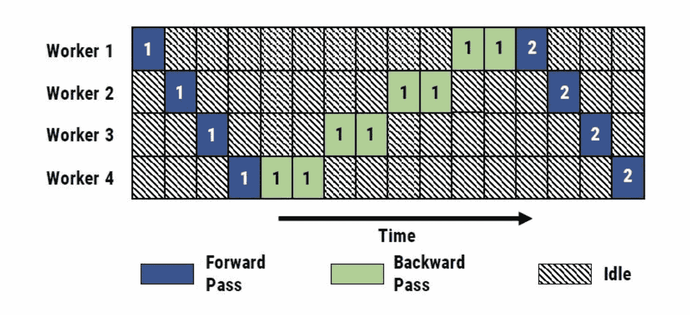

这里蓝色是前向过程，绿色是反向过程，粗略认为反向过程是前向的2倍耗时。此时由推论3知道一个micro-batch的耗时是 ，那么1个mini-batch的耗时 是

可见耗时是理论上界的$p$倍，其中有大量的计算资源在闲置空载，硬件利率用很低

## **Gpipe**

接着考虑Gpipe的朴素流水线并行，类似于CPU的流水线处理器时代。所有micro-batch用 级流水线并行做前向和反向，注意需要等所有micro-batch都计算完才能执行反向过程

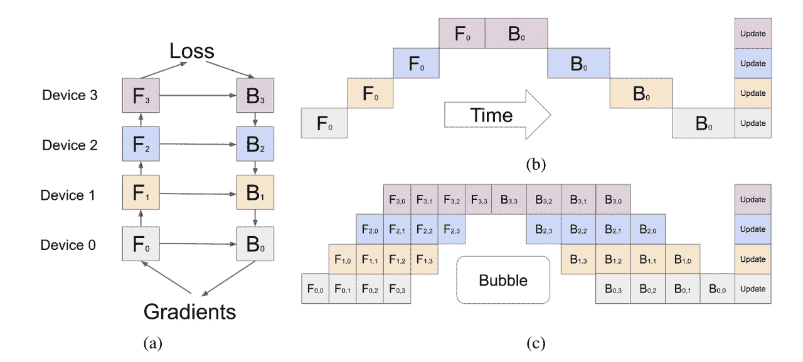

分析发现此时总耗时 为

## **bubble分析**

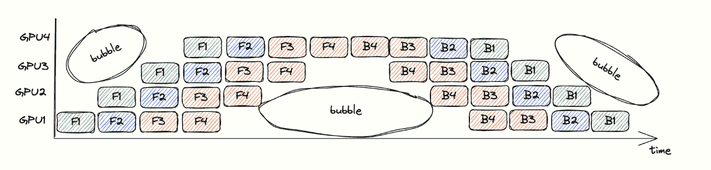

[盗图](https://siboehm.com/articles/22/pipeline-parallel-training)一张，不难发现 比  会多出不少耗时，这部分在上图中也能看出来，就是3个部分的气泡空腔bubble。bubble越多，代表硬件闲置越多，因此一般定义bubble ratio来衡量流水线算法对硬件的浪费程度，值越小说明流水线效率越高。

bubble ratio的计算有两种方式，物理含义就是空腔的面积占整体面积的比例

计算方式1：用 和  来计算

计算方式2：看图计算空腔比例，等价于1减去满载比例

由上述公式可以看出， 相比于 越大，气泡空腔的面积就越小，经验上认为 的时候就基本可以忽略了。

## Re-materialization

在Gpipe里面，为了减少显存的占用，可以使用checkpoint技术，也叫re-materialization技术。即只保留每个stage的输入activation，backward需要各层的activation的时候从stage开头重新forward一遍，因此一共forward两遍

## PipeDream (Non-Interleaved 1F1B)

为了进一步压缩气泡空腔，可以继续增加micro-batch的个数 ，但是我们发现Gpipe的里面，所有的micro-batch要forward攒齐了才做backward，这里会缓存大量的中间activation结果。

因此类似于数据并行里面从DataParallel变成DistributedDataParallel，我们可以解耦同一个mini-batch的不同micro-batch，让他们独立的做forward和backward。只是要求在最后一个micro-batch完成backward之后对各个micro-batch的gradient取个平均后执行optimization_step。

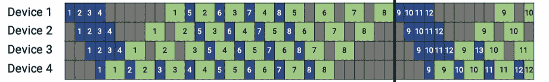

PipeDream这样做的好处，是可以进一步降低显存的使用，从而把 中的 进一步放大，降低了气泡空腔的比例。

但值得注意的是，在PipeDream的原始论文里面，并行的颗粒度是mini-batch之间，而不是micro-batch之间。因此对于每个device而言，会存在多个mini-batch交替进行异forward-backward和梯度更新，因此需要存储多个权重的版本。

对PipeDream的显存进一步优化的工作有PipeDream-2BW和PipeMare，感兴趣的可自行

## Interleaved 1F1B

Interleaved 1F1B是源自Megatron-LM中的方法，希望进一步提高 来降低气泡空腔比率。思路是用前面的推论2，即对于每个device，固定算力，将micro-batch和流水线切分更细，使得每个device负责的流水线级数翻倍。这样跟原来相比，每个device上stage的耗时成倍减少的同时，stage数量也成倍增多。

举个具体的例子，如下所示

+   有4个micro-batch，每个micro-batch由blue和gray两部分组成，例如1由blue1(简称b1)和gray1(简称g1)组成

+   有4个device(简称d1-d4)

那么原来Non-Interleaved 1F1B中数据和device的对应关系为

新的Interleaved 1F1B的对应关系为

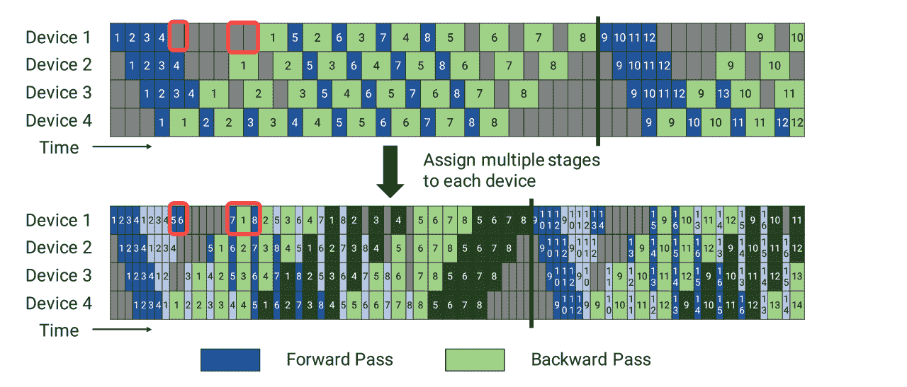

直观上想这样一增一减的折腾貌似没啥用，但仔细分析发现切分更细之后，原来的气泡空闲变得有事可干了，如上图红色部分。

这样做当然也不是免费的，代价就是更多的通信量，但最终端到端效果看是利大于弊

# 张量并行(TP)

当模型参数继续增大，除了用流水线并行之外，还可以用张量并行(Tensor Parallel)来缓解，就是以前常说的模型并行(Model Parallel)。

这里拿最基础的矩阵乘举例。对于激活值矩阵A和权重矩阵B相乘，考虑对B做列切分或者行切分，会有两种方案

+   方案1：按列切分。A不变，这样每一列独立计算，最后结果concat在一起

+   方案2：按行切分。A对应列切分，这样两部分独立计算，最后结果sum在一起

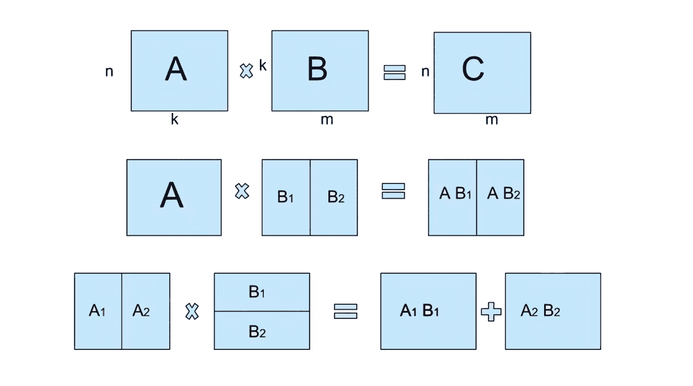

## **Megatron**

在Megatron里面，作者详细分析了Transformer结构中每个部件的具体切分方案，如下所示

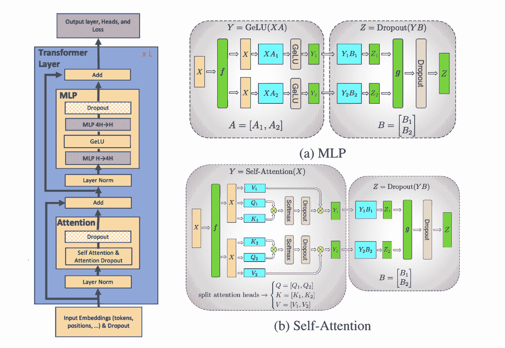

FFN-expansion矩阵乘

+   FFN第一个expansion矩阵乘之后会接element-wise的GELU，所以

+   如果是方案2的话那么需要先做同步AllReduce然后再做GELU

+   如果是方案1的话，可以分开分别做GELU，推迟到很后面才做AllReduce

+   所以是方案1更好

FFN-contraction矩阵乘

+   经过FFN-expansion阶段后的输出此时新激活值的shape为 ，并且使用了方案1对列4D做了切分

+   因此FFN-contraction阶段只需要对FFN-contraction的权重矩阵做行切分，就能满足上述方案2

+   最后做AllReduce Sum既可

**f和g**

这里的f和g是对偶的过程

+   在前馈过程中，f是identity，g是AllReduce

+   在反馈过程中，g是identity，f是AllReduce

**MHA**

+   每个head天然已经在第0维切开了，完全独立计算

+   跟FNN类似选择方案1，然后做完input proj和attention之后，对output_proj的权重矩阵做行切分

+   最后做AllReduce Sum既可

**输入embedding**

+   假设word embedding矩阵是 ，其中 是feature维度， 是单词本大小

+   一般是 ，因此可以用方案2，即 ，

+   对得到结果的AllReduce Sum即可

**输出embedding**

+   输出的时候每个token要跟单词本的向量做点积过softmax返回最大概率的词，即

+   其中 是 尺寸，  是 尺寸， 是 尺寸

+   由于接下来要计算softmax，此时naive方法是做通信整个 的矩阵，但是由于 很大，通信量很大

+   优化的策略就是各自求出softmax的指数分母的和，得到长度为 的和向量，对和向量做AllReduce，然后再计算softmax的值，这样通信量就从 降低到了

## **通信量问题**

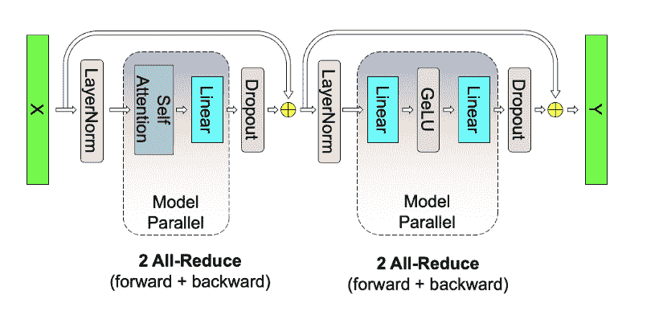

宏观上看，每个Transformer结构内有两个带参数的模块，MHA和FFN。在张量并行模式下，这两个模块内的参数均匀分布在多个node上，模块之间需要AllReduce串行等待，每次forward和backward一共需要4次AllReduce。并且计算和通信没法并行。

因此相比于流水线并行中每个stage间才通信不同，张量并行每个Layer内都得通信，因此张量并行的通信量远大于流水线并行，一般在高速互联的同一个island内才使用张量并行

# ZeRO

ZeRO的出发点是希望优化数据并行里显存占用。因为在数据并行里面，每个device上都有完整的权重信息，梯度信息和优化器状态信息，这个其实是比较冗余的。

## **GPT2显存占用分析**

在具体介绍ZeRO的显存优化方案之前，我们先仔细分析一下如果用naive的训练策略，GPT2模型是如何在32G的单卡上，以32的batch size大小训练起来的。

已知基本的参数如下

+   GPT2模型的参数量 ，序列长度 ，batch size大小是 ，feature维度是 ，一共 个transformer block

+   GPU的显存大小是

显存占用大致可以分成4部分，参数+梯度+优化器+激活值，大小为

详细数值拆解如下

+   参数parameters(fp16):

+   梯度gradients (fp16):

+   优化器optimizer states: 一般是 ，不同优化方式的系数 不一样，例如adam的话是

+   parameters(fp32):

+   momentum(fp32):

+   variance(fp32):

+   激活值等residual states (约为 )

+   activation(fp16): 1个transformer block的激活值总量至少为 ，那么12个为 个激活值，大概7.2G显存

+   temporary buffers: 包括了all_reduce的空间等

+   fragmented memory: 内存碎片

## **显存放不下怎么办**

假设模型继续增大，一张卡就放不下了，自然需要从权重和激活值两大方面砍预算，常见思路如下

+   Paramater Server(PS)，参数服务器思想，权重在整个集群集中存储一份，其他worker按需所取。

+   Pipeline Parallelism(PP)，按网络深度延伸方向切分网络成若干段，每一段的权重放在不同卡上，典型代表GPipe

+   Tensor Parallelism(TP)，把矩阵乘做矩阵分解，从而把权重矩阵均匀拆成若干份放在不同卡上，典型代表Megatron-LM

+   re-materize技术。可以把显存降低到 ，但是引入了额外一次forward，占用大概原始的33%的计算

+   CPU-offloading。把激活值直接放到cpu上，BP的时候再加载回来

ZeRo借鉴了上述方法中的部分思路，分别就权重和激活值两个方面入手优化显存，分别称为ZeRO-DP和ZeRO-R

## **ZeRO-DP显存优化**

ZeRO-DP的显存优化有三个层级，ZeRO-1，ZeRO-2和ZeRO-3

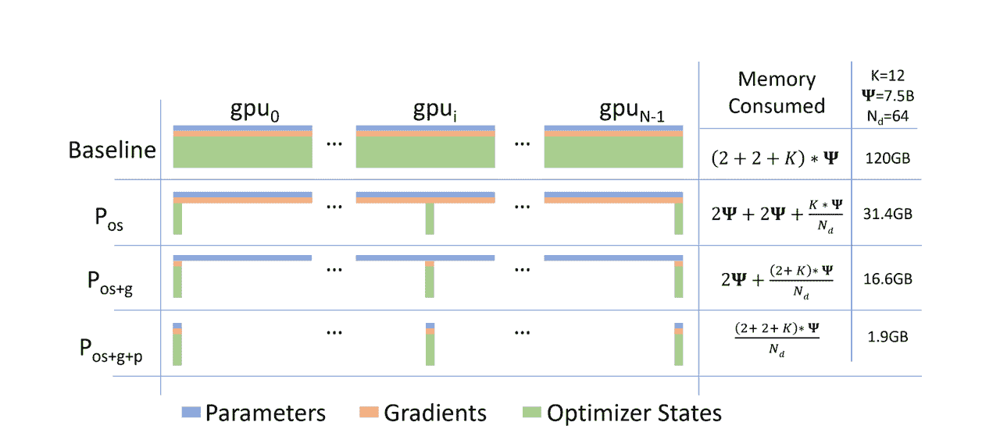

下面分析各种策略下的通信量和显存优化情况

策略1: naive DP的通信量

+   沿用前面数据并行的DistributedDataParallel，只在gradient更新的时候AllReduce一次，然后各卡上并行跑optimizer步骤

+   对gradient做AllReduce，使用ReduceScatter和AllGather方式，于是通信量是

+   显存方面没有任何优化，参数、梯度和优化器状态在各卡都有一份，显存占用

**策略2: Zero-1方案**** **

+    对优化器状态optimizer state做partition

+   每张卡gradient算完之后用ReduceScatter发送到对应的卡上即可，通信量为

+   在各卡做完optimizer state更新权重之后，把权重做AllGather，通信量为

+   因此总的通信量为 ，跟naive DP一致

+   显存方面，参数和梯度跟naive DP一样，优化器状态降到了 ，因此显存占用为 ，约为策略1的

**策略3: ZeRo-2方案**** **

+     对optimizer state和gradient做partition，情况跟  类似，通信量也是 ，因此跟naive DP一致

+   显存方面，参数跟naive DP一样，梯度和优化器状态都降到了 ，因此显存占用为 ，约为naive DP的

**策略4: ZeRo-3方案**** **

+   ** **对optimizer state，gradient和weight都做了partition

+   前馈过程中，weight需要做一次AllGather才能算出各层的activation，通信量

+   反馈过程中，weight也要做一次AllGather才能算出各层的gradient，通信量

+   各层gradient需要ReduceScatter发送到对应的卡上，通信量

+   因此总的通信量为 ，为naive DP的1.5倍，增加50%通信量

+   显存方面，参数、梯度和优化器状态都降到 ，因此显存占用为 ，约为naive DP的

不同尺寸模型在不同DP并行度下，不同ZeRO策略的显存占用如下所示

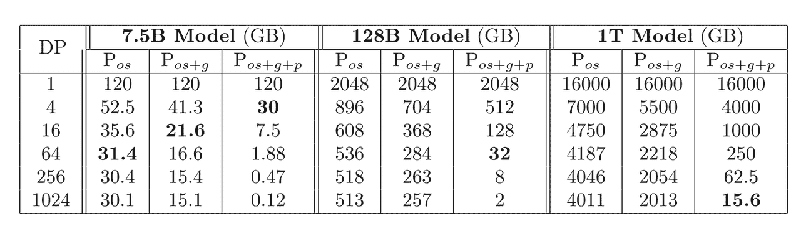

## **ZeRO-R显存优化**

R这里指Residual States，就是除了参数、梯度和优化器状态的其他显存占用，包括以下几方面

+   activation。用已经切块之后的activation checkpointing技术，就是re-materialization技术

+   temporary buffers。用一个固定大小的buffer

+   fragmented memory。on-the-fly策略调配显存位置，消除碎片，具体来说

+   前馈过程: 保留的activation(long live)和删掉的activation(short live)交替出现而留下的碎片

+   反馈过程: 相对于weight的梯度(long live)和计算weight梯度需要的输入(short live)

# DP/PP/TP小结

+   DP的优势是计算和通信效率都很友好，但是权重的显存不友好，每张卡都有一份。因此ZeRO对此进行大刀阔斧优化，借鉴了Parameter Server的思路，ZeRO-3让每张卡只维护一部分的网络权重、梯度和优化器状态

+   PP的问题是要求mini-batch里面batch size足够大才能掩盖住流水线带来的overhead。batch size如果过大，会增大激活显存的占用

+   TP的优势是权重显存非常友好，没有冗余。但是计算和通信效率不友好，通信量要求很大，在超出了一个island的时候性能下降很快。

# Alpa

前面说的方法都是人工设计的并行策略，而Alpa是一种自动化搜索并行策略的方法，很大程度上借鉴了AI编译器的思想。该文的一作就是TVM里面自动化搜索方法Ansor的一作。

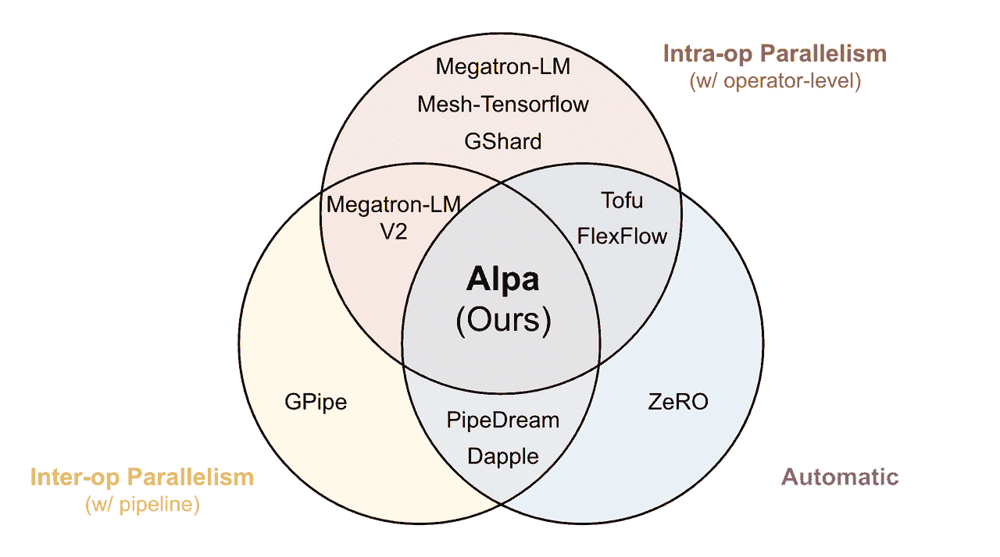

Alpa主要针对计算图和硬件集群之间的分配问题，提出了Inter-op和Intra-op两阶段的自动并行策略搜索算法。这个算法整体是两层循环，先感性理解一下，如下图所示

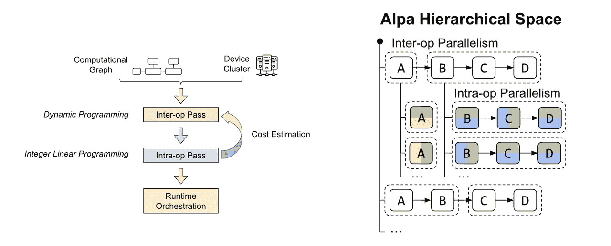

+   外层循环(Inter-op)：将计算图op序列切分成不同的stage，同时将硬件集群也划分为不同的mesh网格，形成若干个stage-mesh对

+   内层循环(Intra-op)：对于每一种个stage-mesh对，用整数规划方法估计出计算和通信cost

+   运行编排(Runtime Orchestration)：插入必要的within-mesh和cross-mesh的通信收发等节点，编译出完整可以跑的运行文件，得到完整端到端速度

## **问题定义**

个人认为Alpa最大的贡献是对计算图和硬件集群分配问题做了数学建模，并且使用合理的简化和对应数学手段求解这个数学问题。下面我们先简单介绍一下计算图和硬件集群分配问题。

+   假设一个计算图有 个结点，并且是个DAG，拓扑序依次为

+   假设一个计算集群有  个计算设备。一般来说每一行是一个高速互联的island，不同行之间的链接会稍微慢一点，例如

+   GPU集群里面就是单机8卡，

+   TPU集群里面就是最大512个TPU组成的Pod，

分布式计算本质上就是找到一个分配策略把 个结点首先切分为 个阶段，每个阶段包含计算图算子集合 ；同时把计算集群也切分为 块，每一块大小为 ，记为 。然后把 分配到 进行计算。如下所示

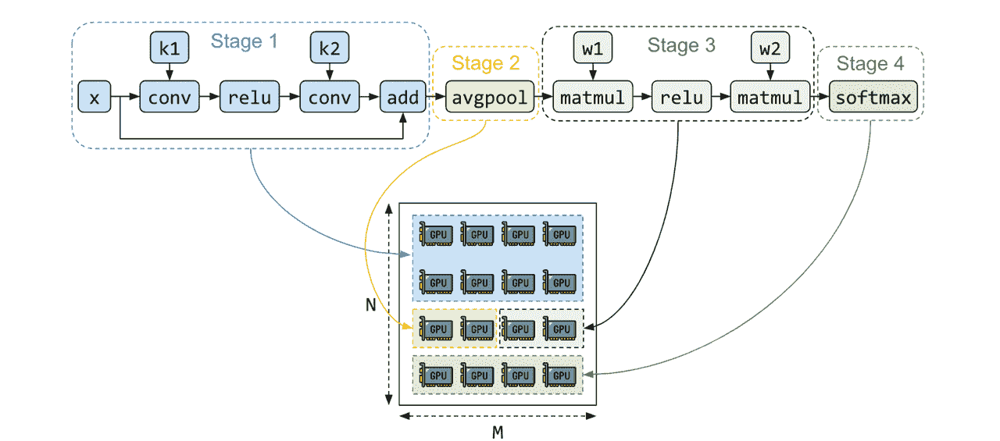

这里注意 被规定为 的矩形块，形状只有两种

+   一维情况:   或者 或者 或者 ，即高为1，宽为2的整数次幂

+   二维情况:  或者 或者 ，即高任意正整数，宽为固定

可以证明对于任意形状的 计算集群，总能进一步切分为一系列 计算网格，这些子网格是可以无重无漏地完整覆盖原始计算机群的。

因此计算图和硬件集群分配问题的求解过程，可以

+   先定义内层循环Intra-op的耗时接口为

+   然后外层循环Inter-op通过不停地枚举切分方式和调用Intra-op的耗时接口

+   最终找到一个端到端耗时最短的分配策略

下面我们就先详细了解一下内层循环Intra-op的细节，然后看外层循环Inter-op是如何做切分搜索的

## **Intra-op**

Intra-op模块的输入是计算图 和计算资源 ，输出的是最优分配策略和对应的实际耗时。由于我们使用的是SPMD的计算方式，因此 内的所有device是对等peer关系，对每个op的执行都是一样的。因此我们可以转变为贪心算法，只需要依次确定 里面的每个op的输入tensor是如何被切分发送到这 个device上进行计算，那整个 和 的分配策略就确定了。

这里岔个话题简单介绍分布式里常见的几个名词，SIMD、SIMT和SPMD

+   SIMD(Single Instruction Multiple Data)，就是我们常说的向量化指令集，一个指令可以处理多个数据。例如X86的SSE/AVX和ARM的NEO等

+   SIMT(Single Instruction Multiple Data)，一个线程块的多个thread线程执行同样的程序，最常见的就是CUDA编程了

+   SPMD(Single Program Multiple Device)，多个device上执行相同的程序，完全对等peer关系，然后用过collective communication的方式做信息交互

回到Intra-op的逐op切分过程。对于每个op，我们只需要关注输入tensor的切分选择既可，一般来说三选一，分别为Row-partitioned、Column-Partitioned和Replicated

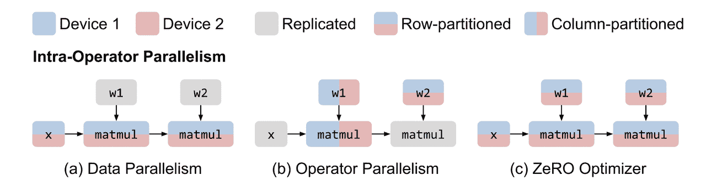

拿matmul举例

+   数据并行情况下。输入是Row-partitioned，权重是Replicated

+   张量并行情况下。输入是Replicated，权重是Row-partitioned或者Column-partitioned

为了方便地描述tensor到device的切分方式，我们引入Sharding spec概念。类比于op的layout，例如conv2d有NHWC和NCHW两种layout，当前一个op输出layout不满足当前op输入layout要求的时候，我们做个layout转换既可。

举例2维tensor被切分到2x2的device mesh的情况，alpa定义了如下的9种Sharding spec

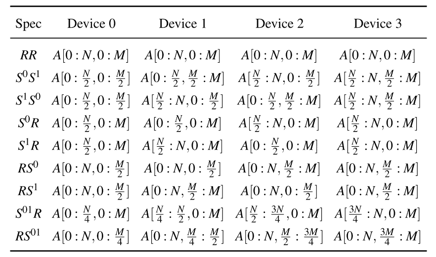

符号含义如下

+   字母个数跟tensor维度保持一致，字母含义只有两种，R代表Replicated，S代表Split。因此RR就是Replicated，SR就是按行切分，RS就是按列切分，SS就是行列都切分

+   为了描述device的映射，用上标数字代表被切分后映射到device mesh的哪个维度。因此只有S字母有上标数字，特殊的 代表把tensor沿着行均匀分成4分，同理得到

+   表格种每一列是原始tensor A被分配到各个device上的具体情况

有了上述的Sharding Spec，那么当出现不匹配的时候，引入Spec转换既可，即Resharding。但是注意这里跟layout 转换出现内存重排一样，Spec转换可能出现额外通信开销，如下所示

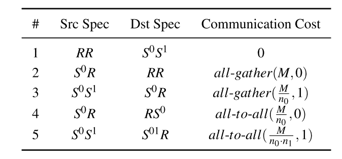

由上可知，每个op的每个tensor都有若干种Sharding spec，如果spec不匹配还会出现Resharding的额外通信开销。这个问题可以归约为整数规划问题，目标函数定义如下

其中

+    可以看成所有待确定spec的tensor， 代表其中任意一个tensor

+    代表这个tensor所有的spec选择的one-hot向量，对应的 和 就是相应spec选择的通信代价和计算代价

+    就是Resharding代价矩阵，衡量相邻 和 的通信代价

接下来就是如何求解上述目标函数，本质上是个数学问题。这里有若干技巧

+   把二次项的矩阵 做flatten变成1维的，然后转化成跟第一项类似的线性one-hot选择，于是整数规划问题转化为了整数线性规划问题(ILP)，有成熟的python package可以调用

+   仿照前人做法，将计算代价 设置为0，原因是

+   对于计算密集型算子，不允许用replicated方式，因此SPMD下任何一种切分计算量都是一致的，因此可以置为0

+   对于非计算密集型算子，计算量本身可以忽略不计，因此也可以置为0

+   通信代价用通信量除以带宽近似计算

至此给定计算子图 和计算网格 ，对应的最优耗时 可以通过上述ILP过程求解得到

## **Inter-op**

如何将原计算图切分为 个子图 ，以及如何将 的计算网格切分成 个子计算网格 ，这是接下来Inter-op需要解决的问题。

切分计算图其实就是流水线并行的过程，我们考虑Gpipe或者synchronous 1F1B的流水线方式。假设网络被分成了4段，每一段分别放在不同的算力节点上，逻辑上串联形成流水线并行，如下所示

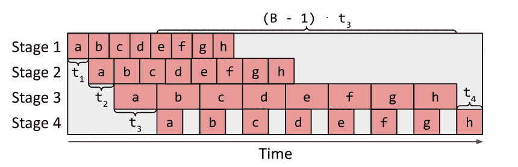

由于网络每一段的计算吞吐不完全一样，因此有快有慢。假设各段前向过程耗时为 ，那么容易知道整个mini-batch的总前向耗时为

其中 其实就是寻找最慢的stage。

泛化到一般情况，可以知道当切分为 个子图后，整体端到端的耗时为

其中 是子图 的执行时间，B是流水线并行中micro-batch的大小，在上图例子中

上式求解非常困难，因为切分方式未知，并且还有个求最大值过程。仔细分析，如果我们假定所有stage最大值是 ，即第二项是已知的，那么只需重点考察第一个求和项了。因此可以把原问题转换为带最大值约束的最优化问题，如下所示

为了进一步考虑子图和计算资源的划分，我们用DP动态规划求解，并且定义3维状态方程

+   含义为把从 到 的计算图切分为 个子图，并且放在 个device上的最低耗时分配方案。

+   注意原始原图共 个op，拓扑序为

+   要求约束每个子图最大耗时为

由 可以得到状态转移方程为

方程比较复杂，含义如下

+   考虑把 从中间 切开，前面 到 部分形成新的stage，并且放置到 ，这个耗时调用前面的Intra-op

+   剩下的子问题

+   注意这里的 会穷举所有可能的值，只要

因此我们不难发现

上述三维的DP过程复杂度很高，有些tricks可以降低复杂度

+    在从小到大的穷举过程中，如果  已经大于当前的 了，那么可以提前剪枝停止算法了

+   提前对原计算图中的非密集型算子(如ReLU)等做算子融合，可以极大减少搜索空间

## Runtime Orchestration

为了的得到最终可运行的二进制文件，还需要做一些后处理，例如within-mesh和cross-mesh的通信算子。这里corss-mesh是指不同stage之间的通信，由于往往他们之间的通信带宽不高，因此需要用一定的优化策略，如下所示

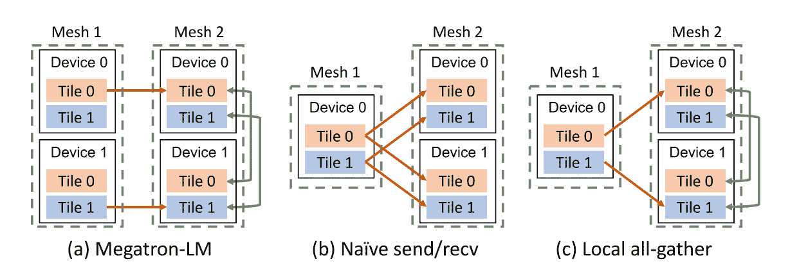

红色边是跨mesh的较慢通信线路，绿色是mesh内的快速通信线路

对于mesh内的通信

+   如果前后两个mesh是相等尺寸的话，用(a)的scatter-gather方式

+   如果是不等尺寸的话，用(c)的all-gather方案

## **实验结果**

alpa比Megatron-LM、Inter-op Only和Intra-op only策略都要好一点，但是跟最优秀的人工设计相比还是略差一点

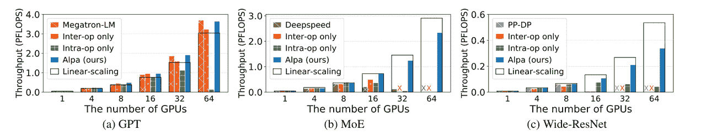

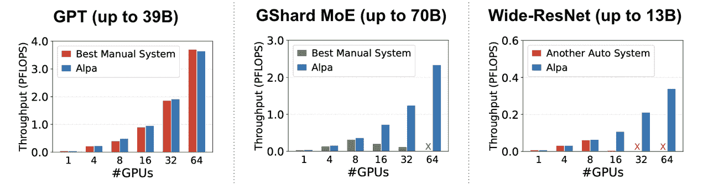

最后还可视化了一下Wide-ResNet在16GPU上的搜索结果

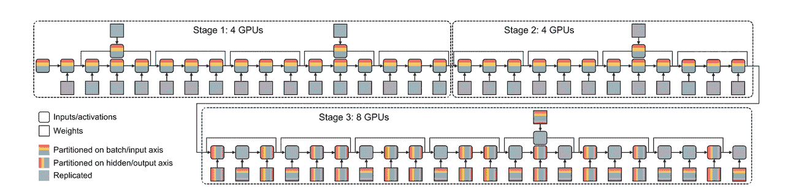

# 写在最后

最后小结一下，本文主要有4部分内容

+   分布式通信原语包括了点对点通信和集合通信的方法。其中集合通信包括了一对多的Broadcast和Scatter，多对一的Reduce和Gather，多对多的AllReduce、AllGather、ReduceScatter和AllToAll

+   3D并行包括了数据并行(DP)、流水线并行(PP)和模型并行(TP)

+   DP的优势是计算和通信效率都很友好，但是权重的显存不友好，每张卡都有一份

+   PP的问题是要求mini-batch里面batch size足够大才能掩盖住流水线带来的overhead。batch size如果过大，会增大激活显存的占用

+   TP的优势是权重显存非常友好，没有冗余。但是计算和通信效率不友好，通信量要求很大，在超出了一个island的时候性能下降很快。

+   ZeRO针对数据并行显存占用大的问题，借鉴了Parameter Server的思路，提出了ZeRO-1，ZeRO-2和ZeRO-3的优化。其中ZeRO-2让每张卡只维护一部分的梯度和优化器状态，显存占用减少到原来的$1/8$，通信带宽保持不变

+   Alpa鉴了AI编译器的思路，对3D并行进行建模，用自动化搜索的方式得到了仅次于手工最优的并行策略

PS：由于笔者小A并没有亲手撸过上述内容的所有细节，大部分是通过研究代码和精读优秀文章的方式bottom-up总结而来，本质上是个拾人牙慧的知识搬运工，所以终究是纸上谈兵。因此希望各方有实际经验的大佬猛锤，思维碰撞才生火花，真理越辩越明。

**如果想了解transformer在NLP/多模态/AIGC的算法知识，分布式**训练的知识，以及如何在TVM上做PTQ量化和部署，可以关注我aaronxic哟~

# 系列文章导览

[[Transformer 101系列](https://zhuanlan.zhihu.com/p/633757727)] Perplexity指标究竟是什么?

[Transformer 101系列] 初探LLM基座模型

[Transformer 101系列] ChatBot是怎么炼成的?

[Transformer 101系列] 多模态的大一统之路

[Transformer 101系列] AIGC组成原理(上)

# 参考资料

Transformer Math 101

[大语言模型（LLM）分布式训练框架总结_P](https://blog.csdn.net/c9Yv2cf9I06K2A9E/article/details/130570164)aperWeekly的博客-CSDN博客

[NLP（十二）：DeepSpeed Infe](https://zhuanlan.zhihu.com/p/629085568?utm_medium=social&utm_oi=29233275469824&utm_psn=1642573008278724608&utm_source=wechat_session)rence 在 LLM 推理上的优化探究

[DeepSpeed ZeRO++：降低4倍网络通信，显著](https://zhuanlan.zhihu.com/p/639002087)提高大模型及类ChatGPT模型训练效率

常见的分布式并行策略 - OneFlow

[大语言模型（LLM）分布式训练框架总结_P](https://blog.csdn.net/c9Yv2cf9I06K2A9E/article/details/130570164)aperWeekly的博客-CSDN博客

AI框架之分布式系统-上（笔记）

[Collective Operations — NCCL ](https://docs.nvidia.com/deeplearning/nccl/user-guide/docs/usage/collectives.html)2.18.1 documentation

Tutorials · MPI Tutorial

[D](https://www.telesens.co/2019/04/04/distributed-data-parallel-training-using-pytorch-on-aws/)istributed data parallel training using Pytorch on AWS

[P](https://siboehm.com/articles/22/pipeline-parallel-training)ipeline-Parallelism: Distributed Training via Model Partitioning

CPU流水线 - myseries - 博客园

[A](https://medium.com/nerd-for-tech/an-overview-of-pipeline-parallelism-and-its-research-progress-7934e5e6d5b8)n Overview of Pipeline Parallelism and its Research Progress

大模型训练 Pipeline Parallel 流水并行性能分析

[实践] Pipeline Parallel（精简版）

DeepSpeed之ZeRO系列：将显存优化进行到底

[https://docs.google.com/presentation/d/1CQ4S1ff8yURk9XmL](https://docs.google.com/presentation/d/1CQ4S1ff8yURk9XmL5lpQOoMMlsjw4m0zPS6zYDcyp7Y/edit#slide=id.g136a86a0982_0_234)5lpQOoMMlsjw4m0zPS6zYDcyp7Y/edit#slide=id.g136a86a0982_0_234

[https://www.youtube.com](https://www.youtube.com/watch?v=oVC3SB3GqrI)/watch?v=oVC3SB3GqrI

[【整数规划(十)】二次整数规划](https://www.zhihu.com/tardis/zm/art/465088321?source_id=1003)

【整数规划(一)】整数规划问题综述