# （8）LLM模型量化世界观(上)

> 来源：[https://waytoagi.feishu.cn/docx/CxFAdogFzob81fxM5lEc3ygInje](https://waytoagi.feishu.cn/docx/CxFAdogFzob81fxM5lEc3ygInje)

> 🔗 原文链接： h[ttps://zhuanlan.zh](https://zhuanlan.zhihu.com/p/686232369)ihu.com/p/686232...

> 作者：小 A

## 更新记录

| 更新时间 | 更新内容 |
| --- | --- |
| 2024.03.10 | 完成第一版 |

## 开篇

大家好，我是小A。好久没见，前段时间确实太忙，拖更了1个Q。本系列会持续更新，绝不太监，立flag为证~废话不多说，坐稳我们发车~

上篇介绍了分布式相关的基础知识，这一篇开始，我们开始详细介绍部署相关的话题。本期将深入LLM量化过程的各个方面，主要围绕下面7个问题展开

+   浮点数和定点数本质区别是什么？

+   QAT是如何学习scale的？

+   Weight-only常规比特量化有什么常见方法，二阶导方法如何推导？

+   Weight-only极低比特量化有什么开脑洞的方法？

+   Activation+Weight量化中交叉维的均衡化都有哪些玩法？

+   FP8 量化效果究竟怎么样？

+   KV Cache量化都有哪些方法？

内容比较多，计划拆成上下两篇，上篇覆盖前3个问题，下篇覆盖后4个问题。

## 量化统一视角

量化(Quantization)，一般指定点数量化，也就是小数点的位置是固定的，与之相对应的就是常见的浮点数。

为了更好的理解LLM定点量化的过程，本小节会拆成三部分

+   第一部分介绍浮点数的基本知识

+   第二部分介绍定点量化的过程

+   第三部分选择GEMM为切入点，详细介绍per-token/per-channel/per-group等量化都是怎么回事。并且尝试从数学角度对他们统一建模，让大家更好的理解定点量化的本质。

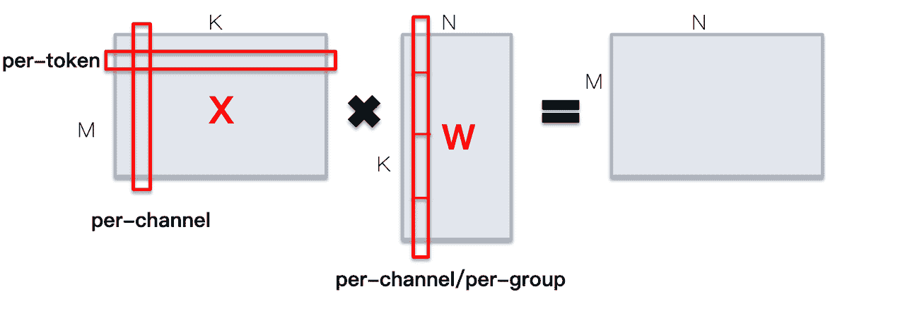

### 从浮点数聊起

浮点数是当今计算的carry王者，设计初衷是解决计算机不能表示任意实数的问题。其标准来源于IEEE 754，如下图所示(以FP32为例)

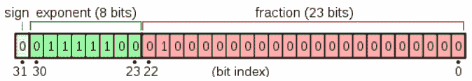

浮点数左边是高位，右边是低位。从高低到低一般由三部分组成，正负号(Sign)，指数(Exponent)和尾数(Mantissa/Fraction)三部分组成

数学化表达为

其中

+   s是符号位数，e 是指数位数

+   0<=p<2^e是指数值

+   b是指数的偏移，一般b=2^{e-1}-1，例如fp32就是127

+   d_i \in \{0, 1\}是第i个尾数

原始二进制小数转化成尾数有几个额外规则

+   隐藏高位1。二进制的科学计数法，默认是 1.xxx 的方式，因此 1. 是固定的，一般省略

+   低位补0。尾数的低位用0补齐

因此 0100 1000 0000 0000 000 转换回二进制小数需要去掉低位补的0，还原高位隐藏的1，得到 1.01001

### INTx量化入门

从浮点数的格式定义我们不难发现，浮点正如其名，小数点的实际位置是浮动的。如果我们从实数轴角度看，浮点数就是把数轴按[2^x,2^{x+1}]  进行分段，相邻段的长度是指数增长的，但是每一段内是均匀切分的，切分段数由尾数位数决定。因此浮点数在靠近0的地方特别稠密，在远离0的地方比较稀疏。

相比之下，定点数量化，即INTx量化，是对实数轴进行平均采样，超出部分直接截断，如下所示。

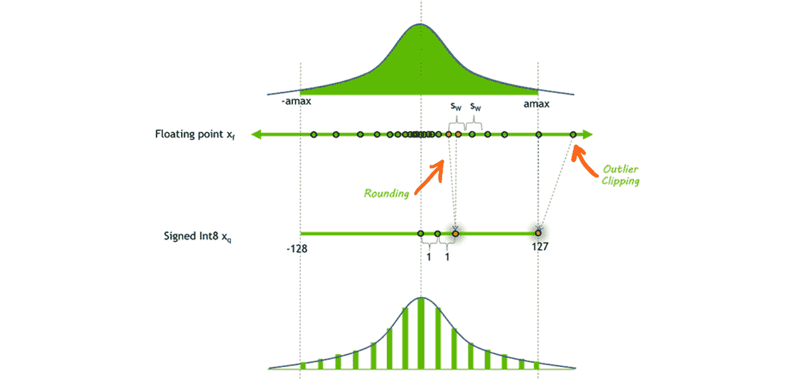

介绍定点量化的文章网上非常多，这里就稍微数学化表达一下定点数量化的过程。一般来说对于标量 x  ，我们定义了缩放系数  s和零点  z∈Z z\in \mathbb{Z}  ，满足

其中 \text{min\_value}和   \text{max\_value}由比特位数和是否有符号决定，例如8bit有符号数(    )

一般来说

+   零点   z=0，此时变成了线性对称量化

+   标量   x x 一般扩展为多维张量   X X ，他们共享同一个缩放系数 s

+   零点 ，此时变成了线性对称量化

+   标量 一般扩展为多维张量 ，他们共享同一个缩放系数

### GEMM量化统一视角

从前文对浮点数和定点数的介绍可以知道

+   浮点数是每个数字都有独立的小数点(指数位    )

+   定点数是一组数共享共一个小数点(缩放系数s )

那自然而然的想法是，如果我们提高定点量化精度，是否可以设置更多的缩放系数呢？答案是肯定的，这就是当前层出不穷量化方式的思路，如下所示

+   对输入 而言，例如   (BL, Ad)

+   per-token。每一行的token设置独立的量化系数。

+   per-channel。每一列的channel设置独立的量化系数

+   对权重参数   W W 而言，例如   (Ad,Ad) (Ad, Ad)

+   per-channel。每一列的输出channel设置独立量化系数

+   per-group。每一列连续的g个元素为一组设置独立量化系数

下面从数学角度进行统一表达，考虑比较复杂的情况

+   矩阵 ，做per-token和per-channel量化

+   矩阵 ，做per-channel量化

则对于GEMM运算而言

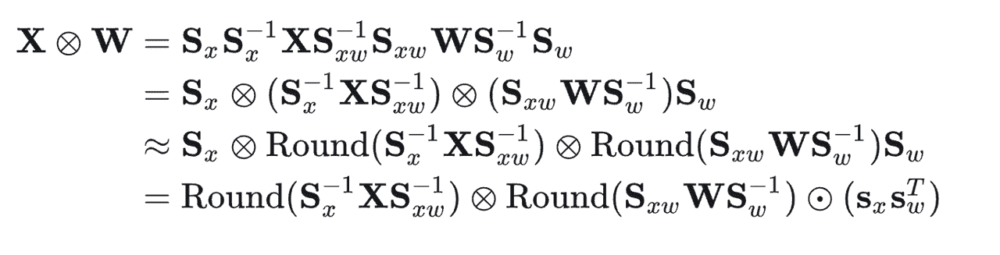

其中

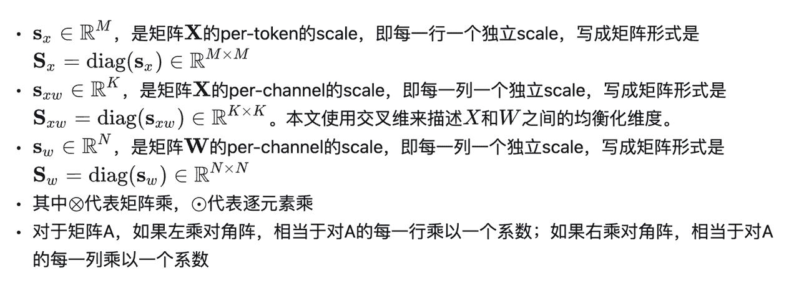

从这个统一的数学表达式我们可以看出

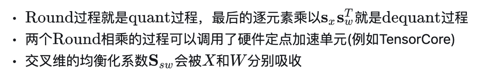

总结一下，定点量化过程除了要确定缩放系数  外，还得确定用多少个缩放系数来表征张量，因此自由度也是量化过程需要重点考虑的因素。

## QAT基础介绍

QAT(Quantization Aware Training)就是用训练的过程来微调量化系数s，这里涉及到了对s的梯度回传。下面我们从数学上推到一下，回顾前面的量化和反量化过程 (忽略零点)

那么

进一步展开化简之后就是

可视化如下左图，其中    。可见是锯齿形状的梯度。

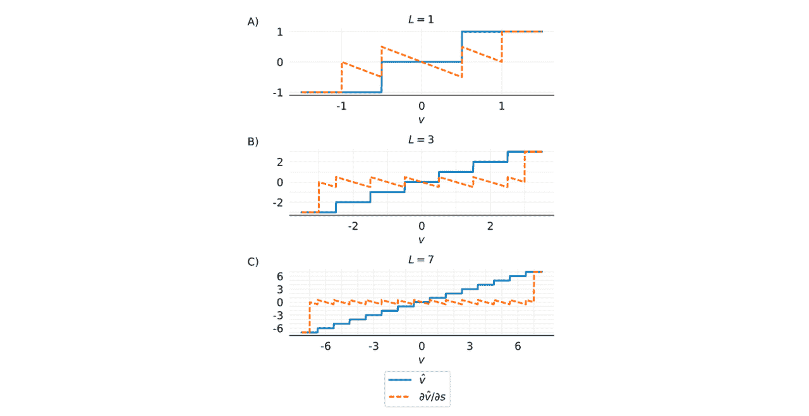

上述方法最早在LSQ(Learned Step Size Quantization)论文中提出，该文还就   可能学习不稳定的问题，设置了单独的lr的scale，所有激活值共享一个，所有权重共享一个。

有了梯度公式，就可以按正常训练流程做QAT训练了。

## Weight-Only常规比特量化

LLM模型最大的特点就是参数量巨大，服务化部署的前提是能加载进显存，因此尺寸压缩就是首当其冲要解决的问题。有一系列的方法就是研究如何把weight权重存储空间给压下来，这样加载进显存后，可以on-the-fly还原回到高精度的fp16的进行计算。

下面我们介绍当前weight-only主流的二阶导数方法流派，主要包括了经典的OBS/OBQ/GPTQ系列，带均衡化的AWQ方法，以及OWQ方法。

### OBS

Optimal Brain Surgeon (OBS)是1992年的经典老文，从数学角度推导了该如何做模型剪枝。下面我们就以模型量化为目标，重新梳理一下OBS的推导过程。

容易知道神经网络的损失函数E是关于网络权重\mathbf{w}的函数(这里\mathbf{w}是把所有网络参数拉直成列向量)。当网络收敛至\mathbf{w}_0的时候，此时E应该获得极小值。而量化过程可以看做在\mathbf{w}_0周围做了扰动\Delta_w，即量化后的值\mathbf{w}_q=\mathbf{w}_0+\Delta_w

考虑在w_0周边做2阶泰勒展开，如下所示

容易知道\frac{\partial E}{\partial \mathbf{w}}\biggr\vert_{\mathbf{w}=\mathbf{w}_0}=0，同时忽略高阶无穷小量，可以简化为

因此

这里的\Delta_E就是损失函数量化误差，\Delta_w就是量化后\mathbf{w}_q相比于量化前\mathbf{w}的变化值，即\Delta_w=\mathbf{w}_q-\mathbf{w}_0

一般的量化方法是一次性把整个\mathbf{w}_0变成\mathbf{w}_q，但如果我们考虑逐个元素转化的话，不妨假设当前选中了第k个元素做量化。此时问题转化为，当对第k个元素做了量化后，剩余元素该如何变化，才能使得损失函数的量化误差\Delta_E达到最小。

这里数学化描述对第k个元素做量化，如下所示

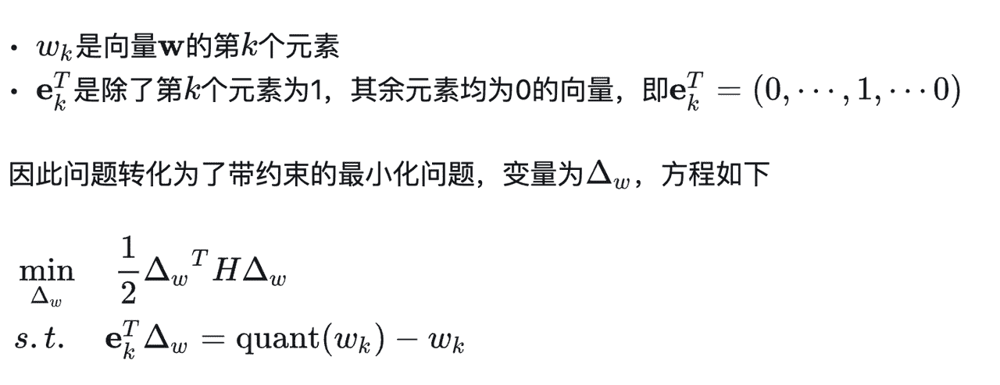

其中

使用拉格朗日乘子法，可以得到如下无约束问题

分别对\Delta_w和\lambda求导，可以得到如下联立方程

因为H是个对称矩阵，所以H=H^T，因此

观察后发现可以先通过(4)式得到

将(6)式带入(5)式，解出\lambda，如下所示

再将(7)式子带入(6)式子，解出\Delta_w，如下所示

此时的损失函数量化误差为

假如\mathbf{w}_0的维度为d，那我们需要首先用O(d^3)计算出H^{-1}，然后花O(d)遍历所有元素，找出使得\Delta_E最小的元素w_k。然后以此类推直到所有d个元素量化完成。整体复杂度为

显然这个对于LLM这种随便就好几个B参数个数的神经网络是不切实际，因此急需加速近似算法。

### OBQ

OBQ(Optimal Brain Quantization)针对原始OBS计算慢的问题，做了算法近似和加速

+   把损失函数task loss换成了layer-wise 的重建L2误差，海森矩阵  H 规模可以大幅度缩减

+   给出了  H^{-1} 的递推求解方法，复杂度降低到了  O(d^2) ，其中  d=d_\text{row}\cdot d_\text{col}

+   在搜索哪个  w_k 该被选中的时候，用并行计算然后reduce loss的方式挑选结果

**优化1：重建L2误差**

原始OBS的损失函数是  E(\mathbf{w}_0) ，其中  E 也称为task loss，具体表达式随着任务的不同千变万化，求  H 更是雪上加霜基本不可能。常见的解决办法就是转变为逐层的重建误差量化，量化完一层再量化下一层。每层的重建误差如下所示。

E(W)=||WX-\hat{W}X||_2^2

这里

+    W 的尺寸是  d_\text{row} \cdot d_\text{col} ，是二维矩阵形式，不是前面OBS推导时候用的  \mathbf{w}_0 向量形式，但原理上是相通的

+   为了跟原论文和代码保持一致，使用了  Y=WX 的方式，因此交叉维变成了  W 的列和  X 的行

注意由于损失函数变成了重建误差的  F 范数形式，所有元素的求和形式可以拆解为所有行的和相加的方式，如下所示。

E(W)=\sum_{i=1}^{d_\text{row}}||W_{i,:}X-\hat{W}_{i,:}X||_2^2

因此容易知道

+   海森矩阵  H 变成下列对角形式，非零元素围绕在对角线附近，其他元素都是零。

+   每个非零元素块的大小都是  d_\text{col}\cdot d_\text{col} ，一共有  d_\text{row} 个块

+   第  i 个非零元素块可以通过  H_i=2XX^T 的方式求解，大小为  d_\text{col}\cdot d_\text{col}

回顾OBS中  \Delta_w 的更新公式，发现

+   选择第  k 个权重  w_k 只会影响  W 同行的其他元素，跨行的元素在  \Delta_w 更新后并不会发生变化。

+   每个非零元素块能独立地进行权重选择，也就是每行可以独立运行OBS算法

+   每行OBS算法元素个数是  d_\text{col} ，因此每行的复杂度是  O(d_\text{col}^4)

+   所有行的总复杂度是  O(d_\text{row}\cdot d_\text{col}^4)

+   用原始的task loss的损失函数，复杂度将是  O(d_\text{row}^4\cdot d_\text{col}^4)

优化2：  H^{-1} 的递推求解

修改损失函数虽然把整体复杂度降低了，但是每行的OBS过程本身复杂度并没有降低，因为还是得每次直接求解  H^{-1} 。想进一步降低复杂度可以用递推，数学证明略过，如下所示

（H_{-k})^{-1}=(H^{-1}-\frac{1}{[H^{-1}]_{kk}}H_{:,k}^{-1}H_{k,:}^{-1})_{-k}

这里

+   下标  H_{-k} 的意思是矩阵去除第  k 行和第  k 列，原因是已经量化的权重不应该再变更

+   输入是海森矩阵的逆  H^{-1} ，输出是去掉第  k 行和第  k 列的海森矩阵的逆  H_{-k}^{-1}

+   海森矩阵的逆计算复杂度从  O(d_\text{col}^3) 降低到了  O(d_\text{col}^2) ，整体复杂度从  O(d_\text{row}\cdot d_\text{col}^4) 降低到了  O(d_\text{row}\cdot d_\text{col}^3)

这里再捋一下每个非零元素块的OBS流程，假如剪枝是执行  k 步(量化是执行  d_\text{col} 步)

+   Step1: 根据公式(9)从候选下标中选择使得误差函数最小的元素下标  p

+   Step2: 根据公式(8)计算新的权重  \mathbf{w}

+   Step3: 计算剔除了下标  p 的新海森矩阵的逆  H^{-1}

+   Step4: 把  p 从候选下标中剔除

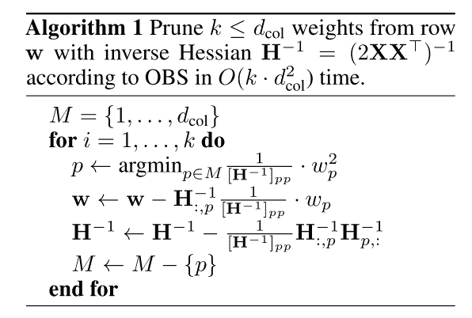

**优化3：行间并行**

前面已经分析过了每行其实是独立的，因此完全可以并行计算。这里注意

+   虽然每个非零元素块的  H_i=2XX^T 一开始是一样的，但是随着每个块的权重下标选择不同，逐渐每个  H_i 就长得不一样了

+   最终把  d_\text{row} 行量化结果做拼接即得到最终量化结果

虽然OBQ方法基于OBS做了上述的3点优化，但是在每行内依旧会按照OBS方法会按顺序串行量化每个weight，耗时比较长，对于100参数以上的网络PTQ过程耗时就过长了

### GPTQ

GPTQ基于OBQ方法继续做了近似和加速，主要贡献

+   计算的快，对于OPT-175B模型只需要4GPU小时即可

+   可以推广到极低比特，例如2bit或者3值情况

这里算的快，是基于OBC计算做了3点近似优化

+   Arbitrary Order Insight。下标的选择顺序不是按照最小化量化误差变化来挑选，而是人为任意指定，因此可以规定所有行的下标顺序一致

+   Lazy Batch-Updates。为了使得GPU上的workload更加友好，可以攒batch的方式lazy更新，计算量不变，运行速度更快

+   Cholesky Reformulation。对  H^{-1} 做Cholesky，能简化相当多的计算，具体看后文推导。

优化1：所有行的下标选择完全一致

回顾前面OBC知道，每个非零元素块除了开始状态的  H_i 是一样的，后面每行的下标选择不同导致  H_i 各不相同。为了减少  H^{-1} 的计算，一种暴力的方法就是固定所有行的下标选择顺序，这样

+   每步只需要递推计算一次  H^{-1} 就能多行共享了

+   每步的算法复杂度一下子从  O(d_\text{row} \cdot d_\text{col}^2) 变成了  O(d_\text{col}^2)

+   总的算法复杂度从  O(d_\text{row}\cdot d_\text{col}^3) 降到了  O( d_\text{col}^3)

**优化2：逐块做更新**

由于OBS算法一共要迭代  d_\text{col} 步，每一步的计算量很小，这个不利于发挥GPU的算力。因此一种加速做法是攒batch，具体来说

+   下标的顺序参照自然顺序从  0 到  d_\text{col}-1

+   设置batch大小  B=128

OBC算法中的Step2和Step3理论上每步都要更新，但是由于我们使用了自然下标，当前步  k 一定不会再影响前小于  k 的结果，只会影响大于  k 的结果。因此更新时候可以用lazy策略

+   当前步骤迭代到了白条所在的第  k 步

+   对于  k 之前的所有相关  W ，不必理会，因为已经量化过，固定住了

+   对于当前  B 内相关的后续  W ，每一步都要更新，如下面黑框中白条后面的部分

+   对于当前  B 之外的后续  W ，可以到达  B 的最后一步的时候再统一更新，当前步也不必理会

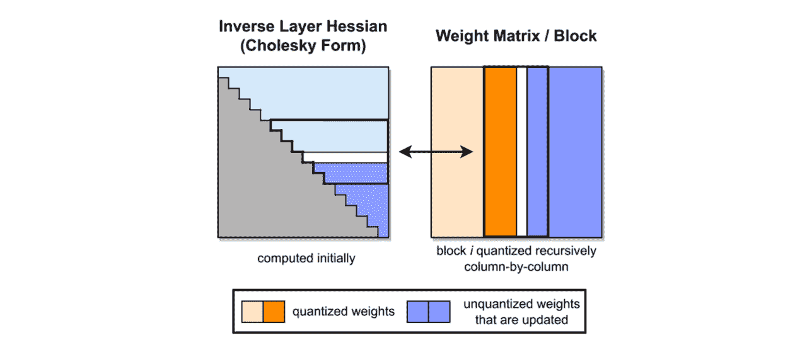

这样从计算复杂度上并没有本质变化，但是对于GPU kernel的实现会更加友好，因此执行速度更快

优化3：对  H^{-1} 做Cholesky分解

当参数规模变大的时候，  H 往往不是正定矩阵，因此求逆的数值过程不稳定。常见做法是对角线添加噪声项  \lambda ，强度  \lambda 一般等于特征值均值的  1\% 。论文中给出的最终算法如下

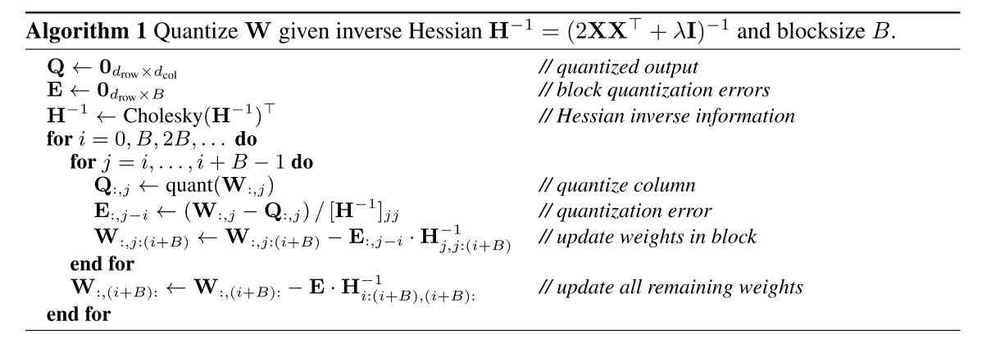

不难发现这里最大的变化是对  H^{-1} 的更新凭空消失了，并且  H^{-1} 已经换了Cholesky分解的上三角矩阵  L^T 。原论文中对此解释一带而过，参阅了知乎很多文章貌似都没有说清楚这一步的原因。于是小A尝试从前面Step2和Step3最重要的两个公式出发，尝试把  H^{-1} 替换成  L L^T ，终于看出了些端倪。

首先了解Cholesky分解是说，对于正定矩阵  A 一定可以表示为  A=LL^T ，其中  L 是下三角矩阵

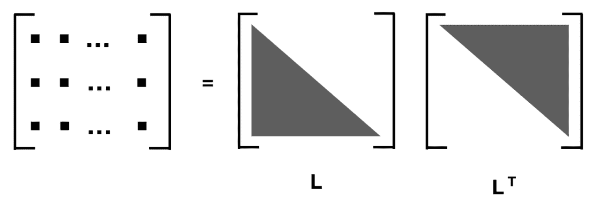

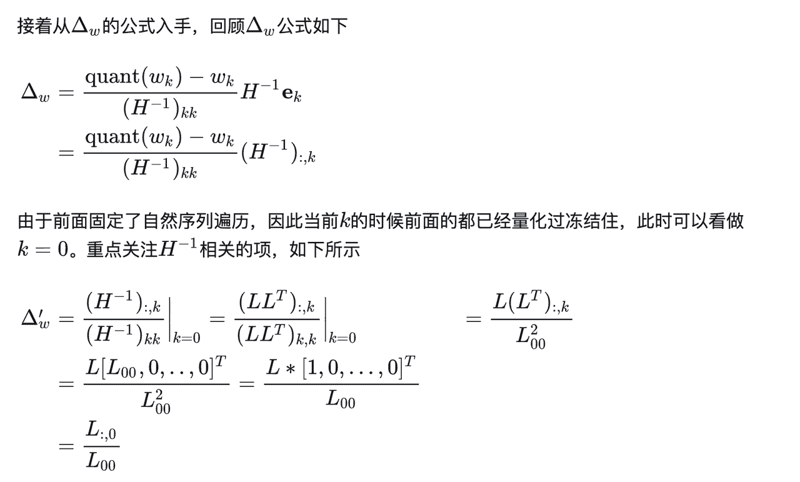

上述推导可以得到简洁的只跟  L 的第0列相关的表达式

接着所以类似方法重新  H^{-1} 的递推公式

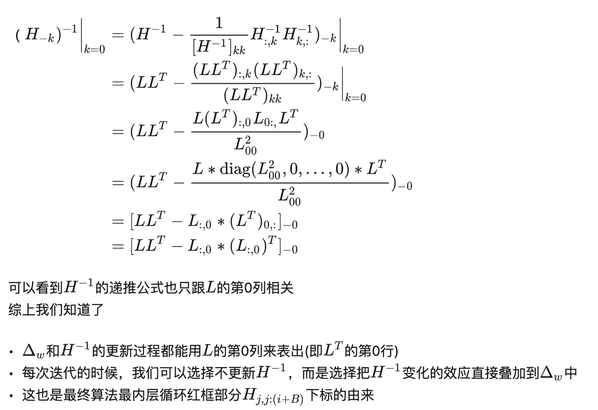

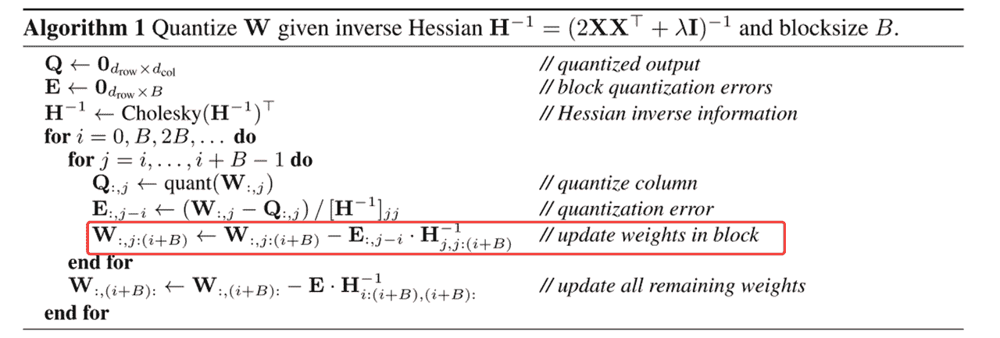

### OWQ

OWQ很大程度上参考了LLM.int8(后面Activation+Weight量化会介绍)，认为weight交叉维的某些channel特别敏感，最好使用fp16来存储。但是OWQ的筛选的方法是通过海森矩阵，不是LLM.int8的outlier feature统计。

跟GPTQ方法类似，对于Y=WX的过程，如果用逐层的重建损失函数，可以知道W的每一行是完全独立的，各行之间海森矩阵为0，并且每行自己的海森矩阵完全一样，如下所示

其中H^{(i)} \in \mathbb{R}^{C_\text{in} \times C_\text{in}}，X \in \mathbb{R}^{C_\text{in} \times N_\text{Samples}}， C_\text{in}就是W交叉维的feature长度

此时也可以写出量化前后的误差函数为

可以进一步把中间二次型部分展开，并且忽略H^{(i)}的非对角线元素，即当j \neq k的时候有H^{(i)}_{j,k}=0，如下所示。

其中\Delta W \in \mathbb{R}^{C_\text{out} \times C_\text{in}}，\Delta W_{i,:} \in \mathbb{R}^{1 \times C_\text{in}}

可见量化误差可以看成W的每列量化误差用海森矩阵对角线元素加权后的结果，因此OWQ对交叉维的每个channel计算敏感度指标

选择敏感度最大的top-k看成weak columns转化为fp16存储，其余部分用低比特存储(例如3比特)。具体来说

+   把原始W转换成全量的低比特矩阵，weak column用0填充

+   单独额外存储fp16的weak columns列，并且把列号附在最后一个元素后面

OWQ整体流程图如下所示

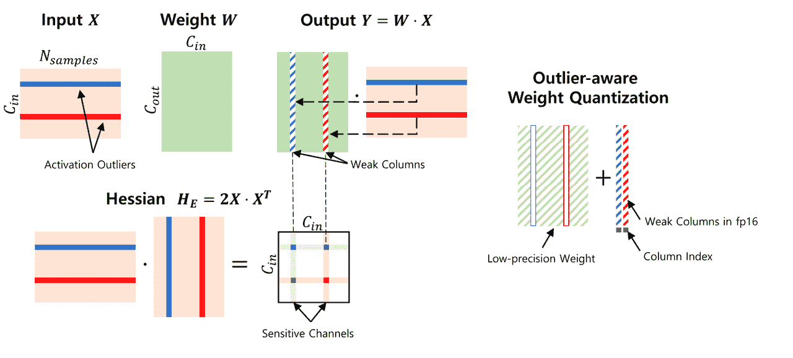

注意这里的\Delta W的获取可以用带零点的线性量化方法，weight使用per-channel/per-group均可

OWQ一直对标GPTQ方法

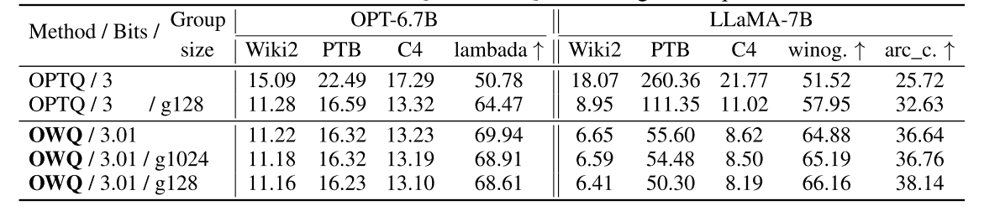

### AWQ

AWQ很大程度上参考了SmoothQuant(后面Activation+Weight量化会介绍)，先做交叉维的均衡化，再做weight-only的量化

+   均衡化的思路，以单层重建误差为目标对  s 做启发式搜索。

+   其中  s 建立在对  X 和  W 的统计值上，最终归约成对单个参数  \alpha 的搜索

AWQ首先尝试在交叉维使用混合精度(  Y=XW 形式)，如下所示

+   第一列FP16就是act和weight都是fp16的baseline，基本可以认为跟fp32一致

+   第二列RTN(Round to Nearest)就是常见的group-wise量化，列优先顺序每128个元素共享1个量化scale，量化比特位为int3

+   第三列选取  X 的norm较大的若干列置为fp16，其余为int3 (  W 相应选中的行也置为fp16，其余为int3)

+   第四列选取  W 的norm较大的若干行置为fp16，其余为int3(  X 相应选中的列也置为fp16，其余为int3)

+   第五列是random选择交叉维的通道

+   可见从  X 的norm较大的列入手能取得更好的PPL结果(越小越好)

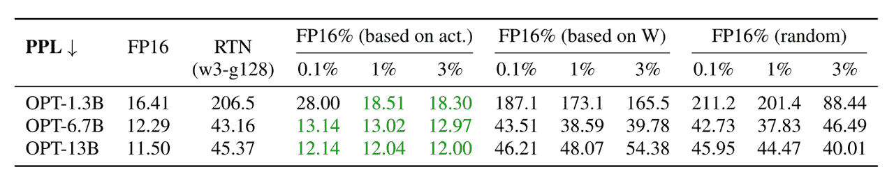

第三列的方案虽然精度高，但是对于底层kernel实现不友好，是混合精度的GEMM，但这里能沉淀的insight是，从  X 的outlier入手比  W 的outlier更好。

于是一种等价的想法是，对  X 的norm较大的列除以系数  s ，压制outlier的值；同时根据矩阵乘原理对  W 相应的行乘以系数  s ，使得最终GEMM结果不变。如下图(c)所示。

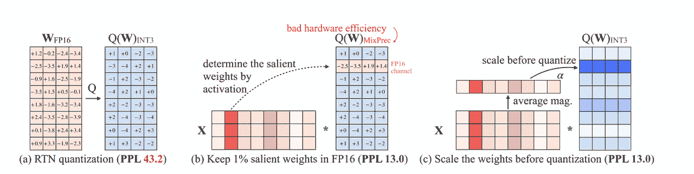

容易知道这里的系数  s 应该大于1。作者首先启发式的设置  s ，发现确实会涨点，如下第三列(Heuristic scaling)所示。

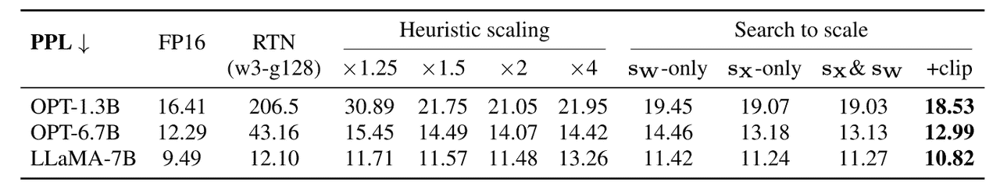

不难发现这个其实就是SmoothQuant的思路，不同的是

+   SmoothQuant的直接人工调参系数  s

+   AWQ用了重建误差作为损失函数，对系数  s 做了启发式搜索

下面用数学符号重写一下重建误差公式，如下所示

这里的S是个K \times K的方阵，是向量\mathbf{s}的对角化扩展，即\mathbf{S}=\text{diag}(\mathbf{s})

关于向量\mathbf{s}的选取，AWQ里面分别从X和W角度计算，公式如下

其中

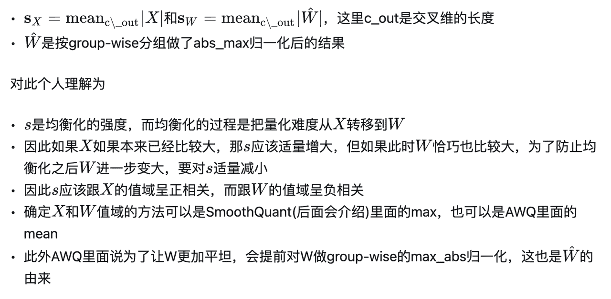

从源码看，有些实现细节论文中没有提到

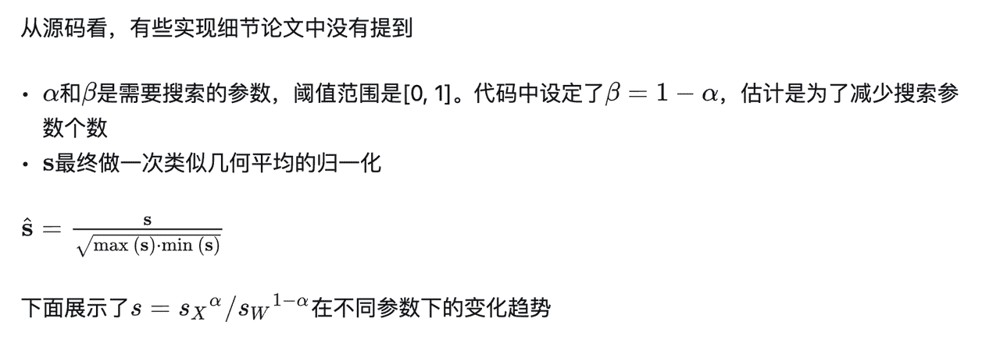

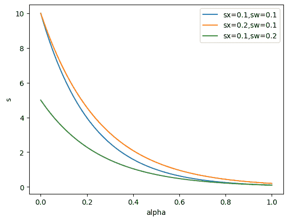

注意，对  X 均衡化后的系数，可以吸收到前面的LayerNorm里面，这样  X 在量化的时候依旧保持per-tensor即可。

## 小结

本小节我们介绍了Weight-only在处理大于4bit常用的几种方法。虽然有些方法也能量化到2bit，但是精度其实损失已经非常大了，因此一般认为用他们处理大于4bit是可行的。

下面对本小节介绍的方法做总结和对比，如下所示

| 方法名称 | 对X的处理 | 对W的量化方式 | 是否使用海森矩阵 | 主要贡献点 |
| --- | --- | --- | --- | --- |
| OBS | 无 | per-tensor | 是 | 数学推导了用二阶导最小化量化误差过程 |
| OBQ | 无 | per-channel | 是 | 用单层重建误差替换任务损失函数 |
| GPTQ | 无 | per-group | 是 | 固定搜索order次序 |
| OWQ | 无 | per-group | 是 | 用H来筛选交叉维的weak column |
| AWQ | 均衡化转移到LayerNorm上 | per-group | 否 | 交叉维均衡化，最小化单层重建误差 |

## 写在最后

定点量化方法千奇百怪，但是归结下来都可以用下面的公式和图描述。

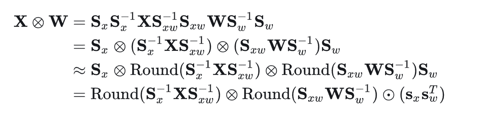

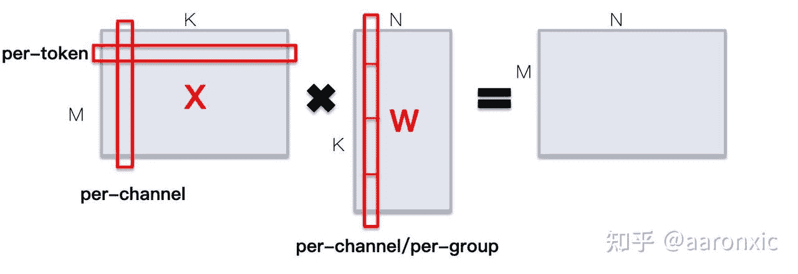

Weight-only的定点量化更多的是对  W 做per-channel/per-group的量化，对  X 也仅限于交叉维的均衡化。在下一篇中我们会介绍Activation+Weight的量化，到时候对  X 的per-token也将纳入考虑。

PS：由于笔者小A并没有亲手撸过上述内容的所有细节，大部分是通过研究代码和精读优秀文章的方式bottom-up总结而来，本质上是个拾人牙慧的知识搬运工，所以终究是纸上谈兵。因此希望各方有实际经验的大佬猛锤，思维碰撞才生火花，真理越辩越明。

**如果想了解transformer在NLP/多模态/AIGC的算法知识，LLM分布式训练的知识**，以及LLM量化/推理加速/部署服务化相关的知识，可以关注我aaronxic哟~

## 参考资料

量化那些事之FP8与LLM-FP4

FP8 量化-原理、实现与误差分析

IEEE754规范: 四, 非规格数, ±infinity, NaN

[Achieving FP32 Accuracy for INT8 Inference Using Quantization](https://link.zhihu.com/?target=https%3A//developer.nvidia.com/blog/achieving-fp32-accuracy-for-int8-inference-using-quantization-aware-training-with-tensorrt/) Aware Training with NVIDIA TensorRT | NVIDIA Technical Blog

Optimal Brain Surgeon公式推导

AWQ模型量化实践-CSDN博客