#  （9）LLM模型量化世界观(下)

> 来源：[https://waytoagi.feishu.cn/docx/BFhWdanmJoDwnRx5UOFcK96knje](https://waytoagi.feishu.cn/docx/BFhWdanmJoDwnRx5UOFcK96knje)

> 🔗 原文链接： h[ttps://zhuanlan.zh](https://zhuanlan.zhihu.com/p/691415664)ihu.com/p/691415...

> ⏰ 发布时间：2024-06-06 12:51:29 (UTC+8)

> 公式部分因格式转化困难，建议访问上述知乎链接查看

## 更新记录

| 更新时间 | 更新内容 |
| --- | --- |
| 2024.04.09 | 完成正式版第一版 |

## 开篇

大家好，我是小A。围绕LLM模型量化的7个问题，我们在上一篇 《LLM模型量化世界观(上)》 中介绍了前面3个，这一篇开始我们讨论剩余的4个问题

+   问题1：浮点数和定点数本质区别是什么？

+   问题2：QAT是如何学习scale的？

+   问题3：Weight-only常规比特量化有什么常见方法，二阶导方法如何推导？

+   问题4：Weight-only极低比特量化有什么开脑洞的方法？

+   **问题5：Activation+Wei**ght量化中交叉维的均衡化都有哪些玩法？

+   问题6：FP8 量化效果究竟怎么样？

+   问题7：KV Cache量化都有哪些方法？

## Weight-Only极低比特量化

常用的OBS/OBQ/GPTQ/OWQ/AWQ等方法一般用作不小于4bit的量化场景，当比特数进一步下降到小于4bit的时候，往往需要重新审视量化问题，回归压缩存储的初衷。本小节将介绍3种方法

+   SpQR用分治方法分离出敏感权重，然后对非敏感权重采用二级压缩方法，转化为3bit存储

+   SqueezeLLM也是先把极端值分离出来，对剩余的权重用加权的k-means聚类的非均匀量化方法

+   AQLM直接借鉴了近似搜索的方案，利用码本和码字来重新建模量化过程

### SpQR

SpQR主要采取分治方法，分成两步

+   第一步，把敏感的权重挑选出来，用FP16高精度存储

+   第二步，对剩余权重用二级压缩方式，转换成3bit存储

**挑选敏感权重**

敏感权重的计算参照了OBS里面的结论，即

\begin{aligned}\Delta_E=\frac{(\text{quant}(w_k)-w_k)^2}{2(H^{-1})_{kk}}\end{aligned}

这里使用了逐层的重建误差，因此  H 相对容易得到。按误差从大到小排，选取前1%认为是敏感值，使用fp16的方式存储

**二级压缩**

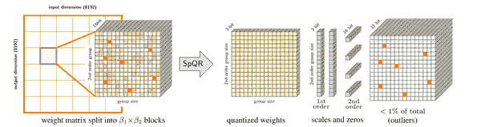

对于剩下的非敏感值，SpQR对输入采用了group-wise量化，其中  \beta_1 \in[8,16] ，远小于常用的128。这导致保存scales和zeros本身的大小不可忽略，因此作者进一步把scales和zeros做了量化，形成二级压缩。具体来说，选择  \beta_2=16 个连续的一阶scales和zeros，用3bit表示；他们共享二阶scales和zeros，用半精度表示。

走Llama上的结果如下

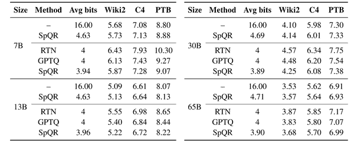

### SqueezeLLM

SqueezeLLM尝试解决内存墙访存问题，认为权重加载是性能瓶颈，因此将权重压缩到极低比特比较重要，具体策略为

+   用加权的k-mean方法做聚类，使用非均匀量化

+   用分治法把outlier识别出来转为高精度存储

作者首先测试了不同比特权重的端到端性能，如下所示，计算部分保持fp16。可见随着比特位数下降，执行速度近似线性提高

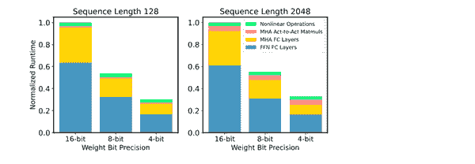

当小于4bit的时候，有两个比较重要的insight

+   量化slot非常宝贵，均匀量化不是最优选择

+   outlier不可避免，需要分离出来回退到高精度存储

**非均匀量化**

在3bit的时候，只有8个量化slot，因此需要谨慎选择量化值。一种常见的思路就是用k-mean聚类，这里的关键是损失函数的定义。作者尝试用task loss，而不是简化版的单层重建误差。从前文OBS知道，量化后的task loss误差经过泰勒二阶展开可以如下所示

\Delta_E=E(\mathbf{w}_q)-E(\mathbf{w}_0)=\frac{1}{2}{\Delta_w}^TH\Delta_w

这里[的 ](https://zhuanlan.zhihu.com/p/228099600) H 求解还是太贵了，作者使用了费舍尔信息矩阵(FIM, fisher information matrix)矩阵来替换，具体来说就是计算一阶梯度的协方差，相关的数学证明可以参照 这里

H\approx F = \frac{1}{|D|}\sum_{d\in D} g_d g_d^T

其中  g_d 就是一阶梯度，另外均值认为是0

随后作者进一步做假设，把  F 的非对角线元素置为0，表示为  \text{diag}(F) 。这样最终表达式可以化简为

\begin{aligned} L(W_Q)&\approx (W-W_Q)^T \text{diag}(F)(W-W_Q)\\&= \sum_{i=1}^N F_{ii} (w_i-Q(w_i))\end{aligned}

因此对于每个  Q(w_i) ，可以使用k-means算法，最小化上面的  L(W_Q) 损失误差，最终得到  k 个离散的一维浮点值。这里3比特的时候  k=8

k-means的结果可视化如下图所示

+   绿色是原始weight的分布情况，红色是通过FIM矩阵计算的前20个敏感权重

+   紫色是k-means收敛后的聚类中心，可以看出相比于绿色的均匀量化点，离前20个敏感权重更近了

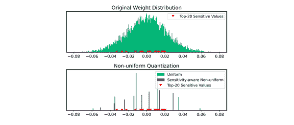

**极端值检测**

作者分析了一下MHA的输出proj矩阵和FFN的contraction矩阵的权重分布，如下所示，发现

+   99.9%的权重挤在最大区间的10%以内的地方

+   剩下0.1%的权重在最大区间的10%-90%的地方，属于outlier

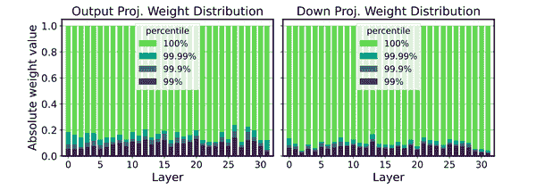

作者采取了比较直接的分治法思路，定义了阈值  T_\text{min} 和  T_\text{max} ，将权重分成两组

\left\{\begin{aligned}W&=D+S \\ WX&=WD+WS \\D&=W[T_\text{min}\leq w \leq T_\text{max}] \\S&=W[w <T_\text{min} \text{ or } w>T_\text{max}]\end{aligned}\right.

分解之后的sparse矩阵用 CSR(Compressed sparse row)格式存储，同时dequant的时候cuda kernel要做对应的定制化，例如3/4bit 的 CUDA LUT-based kernel

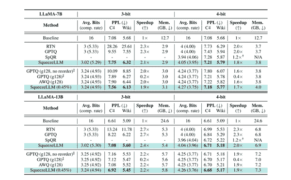

### AQLM

AQLM主要基于码本的向量压缩策略，能把比特数推到2bit，精度达到SOTA。

**基本建模**

整体思路比较直接，部分借鉴了近似搜索的思路，尝试把一个feature做加性的量化拆解(Additive Quantization)。具体来说，对于下列GEMM操作

Y=WX, \quad W\in \mathbb{R}^{d_\text{out}\times d_\text{in}}, \quad X\in \mathbb{R}^{d_\text{in}\times n}

+   对weight使用group-wise的量化，行优先顺序，每  g 个元素为一组，看成维度为  g 的feature。因此原始weight可以拆成  d_\text{out}\times d_\text{in}/g 个长度为  g 的向量  \mathbf{w}_i

+   对于每个向量  \mathbf{w}_i ，看成由  M 个大小为  2^B 的码本组合而来，即

\mathbf{w}_i=\sum_{m=1}^M C_m \mathbf{b}_m

其中

+    C_m \in \mathbb{R}^{g \times2^B} 代表第  m 个码本，每一列是个码本向量

+    \mathbf{b}_m 代表了长度为  2^B 的one-hot的列向量，代表了选择码本  C_m 的某一个码本向量

+    \sum_{m=1}^M 代表把选出来的这  M 个码本向量相加

图示过程如下所示

+   左侧绿色的各自就是按group分组之后的  W ，其中蓝色框是  \mathbf{w}_i

+   中间的就是若干  \sum_{m=1}^M 过程

+   虚框内的绿色的就是  M 个码本

+   最靠右的蓝色的就是二进制的ont-hot向量，这里把二进制转换成了十进制下标

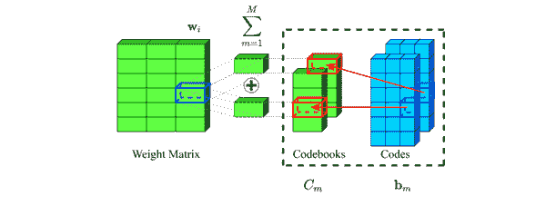

据此我们可以计算一下占用空间大小了(假设浮点数值都用半精度存储)

+   码本占用大小：跟输入大小无关，  g \cdot 2^B \cdot M \cdot 16

+   码字占用大小：跟输入大小相关，  d_\text{out} \cdot (d_\text{in} / g) \cdot B \cdot M

+   scale系数: 权重的per-channel的系数，  d_\text{out} \cdot 16

因此可以算出平均每个权重占用的空间大小

\begin{aligned}\bar{b}=\frac{\text{size in bits}}{\text{number of parameters}}&=\frac{g \cdot 2^B \cdot M \cdot 16+d_\text{out} \cdot (d_\text{in} / g) \cdot B \cdot M+d_\text{out} \cdot 16}{d_\text{out} \cdot d_\text{in}} \\&=\frac{g \cdot 2^B \cdot M \cdot 16}{d_\text{out} \cdot d_\text{in}} + \frac{B\cdot M}{g} + \frac{16}{d_\text{in}}\end{aligned}

在LLM的权重非常大的时候，第一项和第三项基本可以忽略，重点就是第二项。作者对于不同比特设置的超参数也不同

+   2比特。  B=16 且  M=1 且  g=8 ，此时  \bar{b} \approx 2

+   3比特。  B=12 且  M=2 且  g=8 ，此时  \bar{b} \approx 3

+   4比特。  B=16 且  M=2 且  g=8 ，此时  \bar{b} \approx 4

**优化求解**

所有的  \mathbf{w}_i 拼接起来就是最终的量化后权重  \hat{W}

\left\{\begin{aligned}\hat{W}&=\mathbf{w}_i \oplus \cdots \oplus \mathbf{w}_{d_\text{out}\cdot d_\text{in}/g}\\\mathbf{w}_i&=\sum_{m=1}^M C_m \mathbf{b}_m\end{aligned}\right.

损失误差还是用逐层的重建误差，即

\arg\min_{\hat{W}} ||WX-\hat{W}X||_2^2

由于这里用的是  F 范数，因此不失一般性可以简化成  d_\text{out}=1 和  g=d_\text{in} 来考虑，因此损失函数变成了

\begin{aligned}&||WX-\sum_{m=1}^M C_m b_m X||_2^2\\=\quad& ||WX||^2_2-2\sum_{m=1}^M \langle W,C_mb_m \rangle_{XX^T}+\sum_{i=1}^M\sum_{j=1}^M \langle C_i b_i, C_j b_j \rangle_{XX^T}\end{aligned}

其中符号自定义  \langle A, B \rangle_{XX^T} \overset{\text{def}}{=} \langle AXX^T, B \rangle

由于要求解的是整体码本  C_m 和码字  \mathbf{b}_m ，整个训练过程可以分成了三个阶段

+   阶段一，学习码字  \mathbf{b}_m 。这里本质上是个整数规划问题，作者采用了beam search的策略，每一步都尝试其中  k 个码本所有可能组合共  2^B \cdot k 个，然后从中选出损失函数最小的前  k 个

+   阶段二，学习码本  C_m 。当  \mathbf{b}_m 固定之后，对  C_m 其实可以有闭式解，但是求逆计算量很大，因此作者使用了full-batch的梯度下降

+   阶段三，block-wise微调。就是对一个block内的连续若干层，用重建误差做整体梯度更新

2比特下比GPTQ好很多

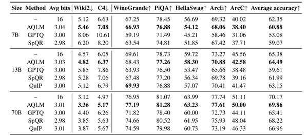

### 小结

对于小于4bit的weight-only量化

+   SpQR和SqueezeLLM都是要先把outlier分离出来用高精度存储，然后对剩余的权重做量化

+   SpQR的二级量化方法本质上是为了弥补group-wise量化中group设置太小带来的scales和zeros存储过大问题

+   SqueezeLLM发现直接用k-means做非均匀量化效果不好，需要让聚类中心更加倾向于敏感的权重，因此用了加权k-means的方法

+   AQLM彻底放飞自我，看成普通的压缩存储问题，用近似搜索中的加性的量化技巧(Additive Quantization)重新建模

## Activation+Weight量化

前面的常规比特(不小于4bit)和极低比特(小于4bit)的weight-only量化本质上解决的是模型如何塞入显存的问题，在GEMM计算时用的还是高精度的FP16。

本小节我们开始介绍如何对激活值也做量化，在调用INT8 GEMM TensorCore的同时，精度损失可控。方法主要包括了ZeroQuant/LLM.int8()/SmoothQuant/Outlier Suppression系列和RPTQ方法。

+   ZeroQuant对激活值做了online的per-token量化，这个也是ZeroQuant中Zero由来，weight保持group-wise量化

+   LLM.int8()将激活值中的敏感channel分离出来用FP16进行计算，对于剩余部分使用INT8计算

+   SmoothQuant关注交叉维的均衡化问题，将部分激活值的量化难度转移到权重上

+   Outlier Suppression系列关注的是激活值每个channel的分布差异

+   v1认为差异来源于前面LayerNorm的  \gamma 系数，因此系数先后移到激活值，然后均衡化到权重

+   v2额外考虑了每个channel的均值差异，因此增加了shift平移拉齐

+   RPTQ同样从激活值的channel入手，用聚类方法重排channel顺序，对应权重的交叉维也做调整。

### ZeroQuant

这里的Zero含义是对activation做zero-shot的量化，其实就是在runtime的时候online dynamic计算scale，这样要求quantize和dequantize算子重写

作者首先测试了Activation和Weight在不同比特数下的精度情况，可以看出Activation比Weight要敏感很多

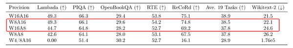

接着作者首先画了两个图

+   分析了一下in_proj的激活范围，按per-token统计。如下左图所示，发现取值范围差异很大，并且觉得传统静态的per-token量化方式并不能很好的解决输入本身每个样本方差大的问题。

+   分析了一下out_proj的权重范围，按per-row统计(  Y=WX 形式)。如下右图所示，发现取值范围差异也很大。

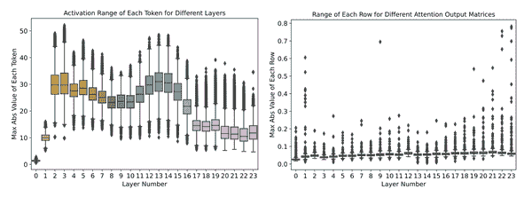

据此作者提出两个改进

+   针对activation提出了动态的per-token，也就是每个样本现场计算量化参数，这个要求修改kernel，并且做non-trivial的kernel fusion

+   针对weight使用了per-group量化方法，并且在低比特的使用用浮点蒸馏(KLD)的方式做轻量版的QAT

这里KLD的具体方式就是从前往后蒸馏，每次只蒸馏一层，并且用MSE的重建误差作为损失函数。如下所示，当对第  L 层做蒸馏的时候，此时前面的  L-1 已经蒸馏完成。

\mathcal{L}_{\text{LKD,k}}=\text{MSE}(L_k \cdot L_{k-1} \cdot L_{k-2} \cdot ... \cdot L_1(X)- \hat{L}_k \cdot L_{k-1} \cdot L_{k-2} \cdot ... \cdot L_1(X))

最后作者做了些ablation

+   第一行，对weight和activation都做per-tensor的量化，结果直接挂掉

+   第二行，对weight做group-wise量化，可以拿到non-trivial的结果了

+   第三行，进一步对activation做per-token能提高14个点

+   第四行，继续对weight做LKD蒸馏可以提高0.56个点

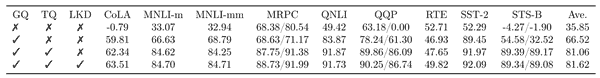

### LLM.int8()

作者先是使用了  X 的per-token和  W 的per-channel量化(  Y=XW 形式)，发现在模型参数逐渐变大的过程中，在6B到6.7B之间会出现outlier激增的现象，导致量化方式不work，如下图所示。

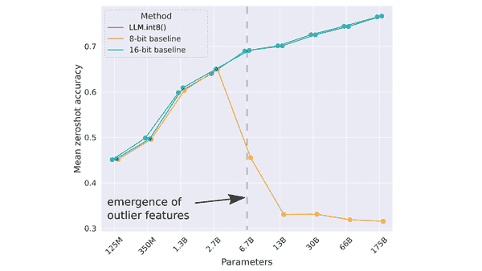

作者首先定义了outlier就是绝对值大于超参数  \alpha=6.0 的元素个数，意外地发现

+   outlier只存在于MHA的in_proj和out_proj映射矩阵的输入中，以及FFN的第一个expansion矩阵输入中

+   6.7B模型虽然有150k个这样的值，但是分布极其有规律，只存在于其中6个交叉维特征  h_i 中

+   统计受outlier值影响的layer或者token比例，横轴是网络尺寸的话，出现了emergence现象，如下左图(a)所示

+   如果把网络尺寸变成C4 Perplexity，变成了单调递增趋势，说明Perplexity更能揭示outlier出现背后的原因，如下右图(b)所示

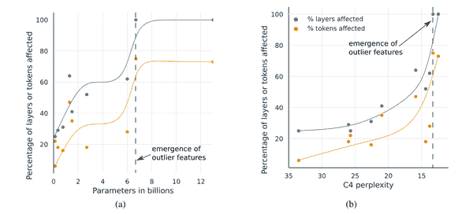

作者进一步分析outlier的数值大小和outlier channel个数，发现

+   随着Perplexity变小，端值的大小呈现emergence现象，如下左图(a)

+   随着Perplexity变小，outlier channel的个数是缓慢上升的，如下右图(b)

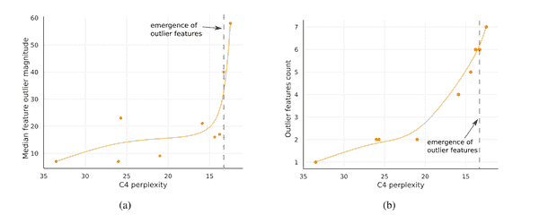

据此自然想到干脆把这些outlier channel用fp16来计算得了，也就是交叉维通道分离，如下所示。

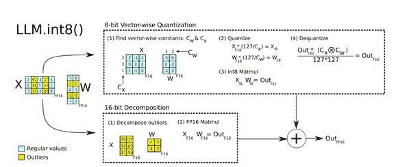

其实比较直观，就是抽取出outlier channel的列，剩下的继续用  X 的per-token和  W 的per-channel量化，最终把两部分加起来，数学表达如下

C_{f16} \approx \sum_{h \in O} X_{f16}^h W_{f16}^h + S_{f16} \cdot \sum_{h \not\in O}X_{i8}^h W_{i8}^h

### SmoothQuant

SmoothQuant首先想弄清楚LLM里面activation量化究竟对哪个维度更敏感。如下图所示，通过模拟发现了对activation做per-channel效果非常接近FP16(  Y=XW 形式)，这个也验证了LLM.int8()的发现。但是直接对  X 做per-channel会面临无法使用INT8 GEMM Kernel的窘境。

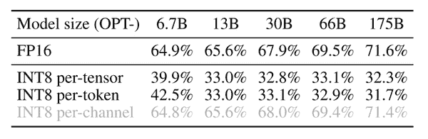

于是一种自然的想法就是在交叉维做均衡化，具体来说就是对activation的每一列乘以不同的scale，把activation分布拉齐之后再做per-tensor，如下所示

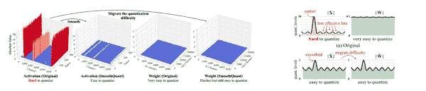

这里的关键是如何搜索每一列的scale。这里计算有很多种方式，例如可以把activation的所有列的最大值拉成一样，也就是把act的量化难度转移到weight上。即除以

\mathbf{s}_j=\max{(\lvert \mathbf{X}_j \rvert)}

或者把weight的每一列的的最大值拉成一样，也就是把weight的量化难度转移到act上。即除以

\mathbf{s}_j=\frac{1}{\max{(\lvert \mathbf{W}_j \rvert)}}

于是做了做balance，最终可以用

\mathbf{s}_j=\max{(\lvert \mathbf{X}_j \rvert)}^\alpha / \max{(\lvert \mathbf{W}_j \rvert)}^\alpha

这样其实相当于把act和weight对应通道用双方的最大值做了均衡化，act的通道  j 的最大值变成了

\max{(\lvert \mathbf{X}_j \rvert)}^{1-\alpha} \cdot \max{(\lvert \mathbf{W}_j \rvert)}^\alpha

weight的通道  j 的最大值变成了

\max{(\lvert \mathbf{X}_j \rvert)}^{\alpha} \cdot \max{(\lvert \mathbf{W}_j \rvert)}^{1-\alpha}

随着  \alpha 的变化，作者发现精度变化如下

+   当  \alpha 大于0.5越来越大的时候，相当于把act的量化难度转移到了weight上，此时如果weight的比特位比较多，例如W16A8，精度曲线还能保持住

+   当  \alpha 小于0.5越来越小的时候，相当于把weight的量化难度转移到了act上，此时如果act的比特位比较多，例如W8A16，精度曲线还能保持住

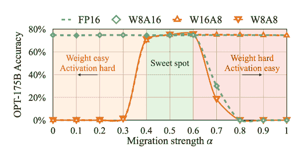

对于已经做了均衡化之后的网络，对weight直接使用per-tensor，对activation使用per-token或者per-tensor，效果如下。效果提升了很多，间接说明了均衡化的作用

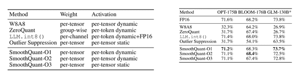

### Outlier Suppression

+   做了W8A8的量化，跟SmoothQuant的思路类似，都使用了均衡化

+   文本发现LN的  \gamma 会对channel起到outlier放大作用，因此希望能吸收到后面的weight里面去

+   对于  X 本身的量化scale搜索，基于per-token的最大值排序，挨个尝试，最后阶段回到grid搜索

**Gamma Migration**

作者对  XW 中  X 每一列的特征维度做了拆解分析，发现  X 出现outlier的地方往往  \gamma 也是比较大的值，于是推测  \gamma 会加剧  X 中的元素差异程度。

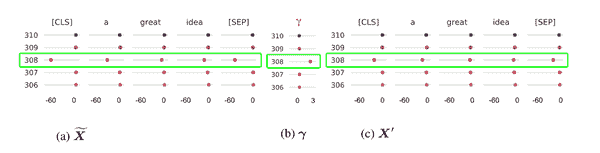

一种自然的想法就是把  \gamma 后置，原来LayerNorm中的  \gamma 直接去掉，LN表达式如下

X'_{t,j} = \frac{X_{t,j}-\mu_t}{\sqrt{\sigma_t^2+\epsilon}}+\frac{\beta_j}{\gamma_j}

\gamma 后置，可以吸收到后续Linear层的weight里面。需要注意这里的shortcut分支，接DeQuant在转换回到fp32/fp16的时候把系数还原回去。

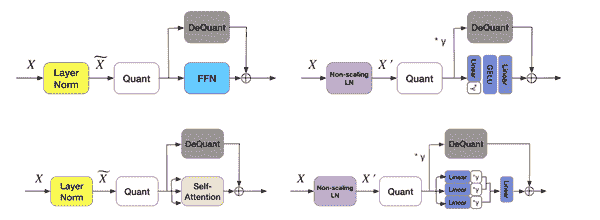

论文中有个完整大图不错

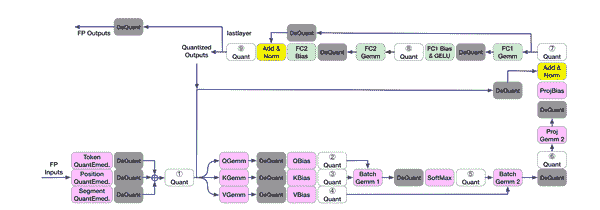

Token-Wise Clipping

做了  \gamma 的后置之后，  X 本身也会有outlier，Suppression论文统计每个token的最大值，然后从大到小排序，对截断位置进行挨个搜索。搜索的损失函数就是启发式的最后一层的输出激活值的L2误差。

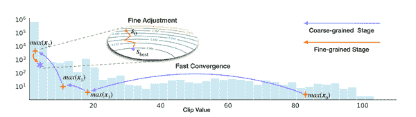

发现排在前面的几个outlier之间间隔非常大， 去掉之后往往对最终损失函数影响很小。

最终到了快收敛的地方，改成了更小间隔的grid搜索，达到最终的  s_\text{best}

实验主要是在encoder-only的网络结构RoBERTa上做的，并且尝试推到了6bit

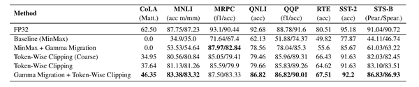

**局限性**

+   不考虑非对称情况，后续工作会进一步加上shift操作

+   无脑均衡化到weight上，不考虑weight的承受能力

### Outlier Suppression+

+   尽可能把各channel的分布拉齐，做了shift和scale两步

+   shift的计算就是中间值，scale的计算转化为了求解全局截断值  t ，极大地降低了搜索复杂度

**表达式改写**

本文尝试解决activation量化过程中的各channel分布差异太大的问题，如下所示

+   8725号channel，值域  [-97, -58]

+   相比之下6354号channel，值域是  [5.7, 43]

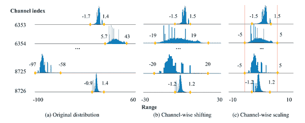

比较直观的做法是逐个channel做零点对齐，然后做缩放，即平移(shift)和缩放(scale)。从经典的Linear层开始考虑，表达式为

\begin{align*} Y=\text{Linear}(X)=XW+\mathbf{b} \tag{1} \end{align*}

其中

+    Y\in\mathbb{R}^{m \times d} ，  X\in\mathbb{R}^{m \times d} ，  W\in\mathbb{R}^{d \times n}

+    \mathbf{b}\in\mathbb{R}^{1\times d}

如果对  X 做平移和缩放，可以得到

\begin{align*}X'=(X-\mathbf{z})\oslash\mathbf{s} \tag{2}\end{align*}

其中

+    X'\in\mathbb{R}^{m \times n} ，  \mathbf{z}\in\mathbb{R}^{1\times n} ，  \mathbf{s}\in\mathbb{R}^{1\times n}

+    \oslash 代表逐元素除法(会自动broadcast)

用  X' 表示  X ，带入Linear表达式，可以得到

\begin{align*}Y=(X'\odot s+z)W+b=X'(s^T\odot W)+(zW+b) \tag{3}\end{align*}

其中  \odot 代表逐元素乘法(会自动broadcast)

另外一方面，  X 本身一般是  \text{LN} 的输出，如下所示

\begin{align*}X=\text{LN}(X'')=\text{Norm}(X'')\odot \mathbf{\gamma} +\mathbf{\beta} \tag{4}\end{align*}

其中

+    X''\in\mathbb{R}^{m \times d}

+    \mathbf{\gamma}\in\mathbb{R}^{1\times d} ，  \mathbf{\beta}\in\mathbb{R}^{1\times d}

把(4)式带入(2)式，可以得到

\begin{aligned}X'&=(\text{LN}(X'')-z)\oslash s \\&=(\text{Norm}(X'')\odot \gamma+\beta-z) \oslash s \\&=\text{Norm}(X'') \odot (\gamma\oslash s) + (\beta-z)\oslash s\end{aligned}

因此最后可得

\begin{aligned}\left\{\begin{aligned}X'&=\text{Norm}(X'') \odot (\gamma\oslash s) + (\beta-z)\oslash s \\ Y&=X'(s^T\odot W)+(zW+b)\end{aligned}\right.\end{aligned}

图示如下

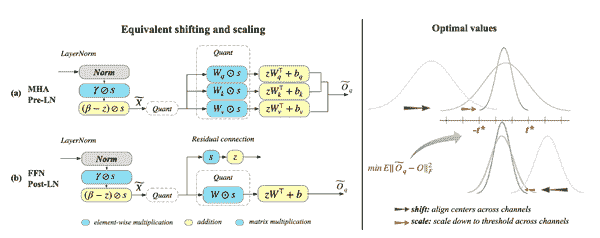

**确定z和s**

我们希望所有channel的零点尽可能对齐，一种启发式方法就是直接用中间点来表示  z ，即

z_j = \frac{\max({X_{:, j}})+\min({X_{:, j}})}{2}

一般来说确定  s 比较复杂，但论文中没有对  s 中的每个分量逐个搜索，而是转化为统一截断值  t ，只需要对  t 搜索一次。

这里  t 从所有零点对齐之后的激活值的最大值开始  K 网格搜索，如下所示

t = \max(X-z) \cdot \frac{k}{K},\quad k=1,\cdots,K

有了全局的截断值  t 之后，就可以算出每个分量的scale值，如下所示

s_j=\max(1.0, \frac{X_{:,j}-z_j}{t})

完整算法流程如下所示

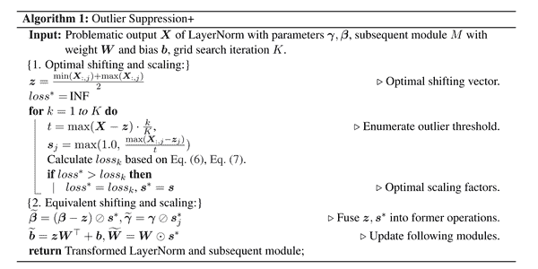

伪代码里的Eq.(6)和Eq.(7)就是重建误差和softmax输出误差，这里暂时略过

### RPTQ

来自后摩智能的论文，通过对交叉维的channel做聚类实现channel重排，然后对weight使用GPTQ量化，对activation使用分cluster的量化

**重排方法**

计算交叉维每个channel的min值和max值，看成ndim=2的样本点，然后做k-means聚类，如下图中(d)所示

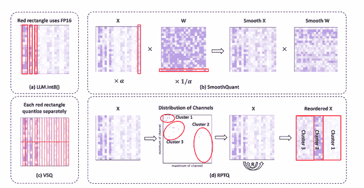

方法比较朴实，细节上有几个要注意的点

+   LayerNorm后面有reorder操作的时候，可以做kernel-fusion一步到位输出(repo里面也写了专门的cuda算子)

+   Q和K由于要做bmm计算，因此R2需要保持一致

+   short-cut由于要把前面层的输出做融合，因此一般不做channel重排

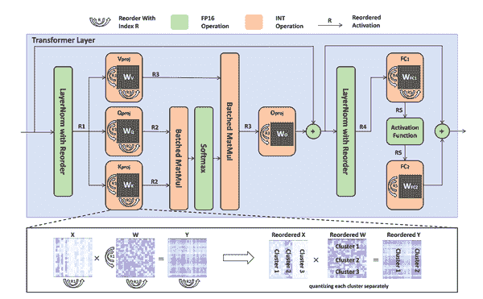

重排之后，对weight做了GPTQ的量化，对activation分组做带零点的线性量化。注意

+   由于GTPQ会使用group-wise的量化，因此重排对每个gropu的邻居是有影响的，可能使得量化效果变好

+   对activation做分组量化，沿着交叉维上被切分了很多组，每组的量化scale和零点都不同，在实际加速中，要彻底用上INT8_GEMM的kernel，需要比较复杂的系数交换。例如BMM(Q,K)操作，Q和K交叉维的分组scale需要转移到各自projection过程的权重上。

### 小结

激活值的异常值比权重多很多的，因此量化难度也大很多

+   早期ZeroQuant使用per-token的方法，但由于输入长度不确定，因此使用online统计的方式处理变长问题

+   后来大家逐渐意识到了激活值量化的关键是per-channel的分布差异，因此要么把量化系数往前放到LayerNorm的  \gamma 上，要么放到旁边的权值里面去。

+   Outlier Suppression+额外考虑了shift平移，更加符合直观理解

+   RPTQ脑洞属于比较大的，直接通过聚类把channel顺序做调整

## FP8量化

FP8是前几年英伟达重点推广的新格式，目前也逐渐被工业界使用起来，本节回顾FP8的几篇经典工作，主要包含以下几个方面

+   FP8基础知识。主要介绍规格数、非规格数和特殊数的概念。

+   FP8 Nvidia。基于IEEE-754魔改了一下E4M3，挤压了特殊数的位置，让值域更大

+   FP8 Qualcomm。主要详细介绍了FP8的fake-quantization的过程。

+   FP8 AMD。主要探究了不同FP8格式在PTQ场景下的优劣，考察了CV和NLP的各种任务。

+   FP8 Microsoft。完善了Nvidia的TE库的FP8功能，从分布式通信、优化器和分布式策略三方面做扩充。

### FP8基础知识

浮点数包含有三种

+   规格数 (normal number)。指数位不全为0且不全为1。

+   非规格数 (subnormal number)。指数位全0。

+   特殊数 (non-number)。指数位全1。

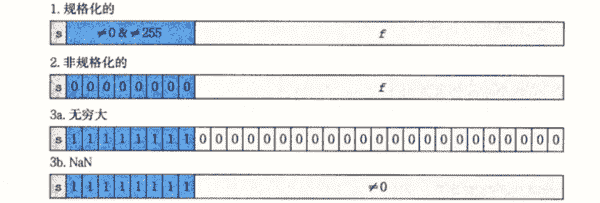

**规格数**

+   规格数的指数位不全为0且不全为1，因此指数位取值是  [1,254] ；指数偏置是127，因此值域是  [-126,127]

+   前面知道尾数高位隐藏的是1，所以尾数从 1.00xx000 - 1.11xx111 ，转化为十进制就是  [1,2)

+   综上知道规格数的范围是  \pm [1,2)\cdot 2^{[-126,127]} ，全域展开如下

(-2\cdot 2^{127}, -1\cdot 2^{-126}] \cup [1\cdot 2^{-126}, 2\cdot 2^{127})

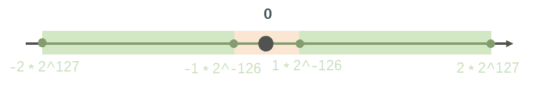

**非规格数**

+   容易知道规格数不能表达0和0附近的数，因此非规格数就是充当补位的作用

+   非规格数的指数全为0，减去指数偏置127，因此理应是-127；但是考虑渐进特性，设置成了-126，后面会进一步解释

+   非规格数的隐藏位高位是0，不是1，所以尾数从 0.00xx000 - 0.11xx111 ，转化为十进制就是  [0,1)

+   综上知道非规格数的范围是  \pm [0, 1)\cdot 2^{126} ，全域展开如下，指数设置成-126才能恰好填补了中间的部分。

(-1\cdot 2^{-126}, 0] \cup[0, 1 \cdot 2^{-126})=(-1 \cdot 2^{-126}, 1 \cdot 2^{126})

**特殊数**

+   指数位全1，包括了无穷(如正无穷)和NaN(如除以0的结果)

+   注意NaN一般不区分+NaN和-NaN

### FP8 Nvidia

NV的FP8主要贡献点是对FP8的E4M3格式做了细微的变化，增加其表示范围，原始论文是《FP8 Formats for Deep Learning》

相比于IEEE-754标准，E5M2几乎没有做修改，但是E4M3做了部分修改。如下所示

+   原始的IEEE-754会把指数的  2^e-1 取值留给特殊数，NV为了扩大E4M3的表示范围，想办法削减特殊数的占用

+   取消了Inf值的表示，NaN的表示只保留了一种

+   最大规范数的指数多了1，从  2^4-2-7=7 增加到了  2^4-1-7=8

+   最大规范数的尾数减少一个slot，从  (1.111)_2=1.875 变成  (1.110)_2=1.75

+   因此最大规范数从IEE-754的  1.875\cdot2^7=240 增加到了  1.75\cdot 2^7=448

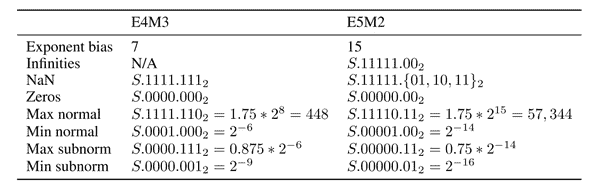

本文还给出了FP8常用的训练和推理流程

+   训练

+   所有GEMM的输入都转化为FP8格式，保证GEMM过程是FP8操作，输出保留高精度

+   权重和前馈激活值用E4M3，反馈梯度用E5M2

+   注意在MobileNet-v2上还有比较明显的掉点

+   推理。

+   使用E4M3的FP8格式

+   激活值用per-tensor的缩放系数，权重用per-channel的缩放系数，缩放方式为abs_max

+   常规GEMM不加缩放系数也有不错的精度，但是对于残差连接等操作，必须用缩放系数

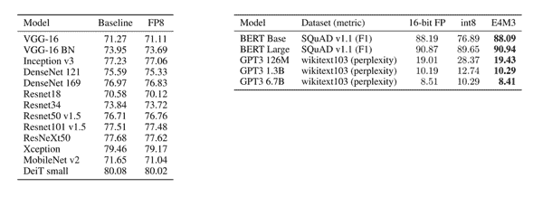

### FP8 Qualcomm

高通的FP8算是早期将FP8应用在CV主干网络和NLP的BERT的工作，并且给出了在PTQ和QAT场景下的基本方案，原始论文是《FP8 Quantization: The Power of the Exponent》

本文比较有价值的地方是说清楚了如何做FP8的模拟量化。

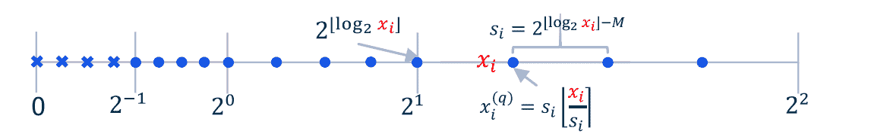

如上所示，浮点数本质上以指数增长的区间长度来划分数轴，因此给定正实数  x_i ，首先可以下面式子来确定所属的区间

x_i \in [2^{\lfloor \log_2 x_i \rfloor}, 2^{\lfloor \log_2 x_i \rfloor+1})

在上述区间内进一步做均匀划分，如果尾数位是  m ，那么均匀分成  2^m 段，每一段的间隔可以通过下面式子算出

s_i=\frac{2^{\lfloor \log_2 x_i \rfloor+1}-2^{\lfloor \log_2 x_i \rfloor}}{2^m}=2^{\lfloor \log_2 x_i \rfloor-m}

有了量化间隔，就可以将  x_i 转化为对应的浮点数  x_i^{(q)} ，如下所示

\begin{aligned}x_i^{(q)}&=\lfloor \frac{x_i-2^{\lfloor \log_2 x_i \rfloor}}{s_i} \rceil \cdot s_i + 2^{\lfloor \log_2 x_i \rfloor} \\&=\lfloor \frac{x_i}{s_i}-\frac{2^{\lfloor \log_2 x_i \rfloor}}{s_i} \rceil \cdot s_i + 2^{\lfloor \log_2 x_i \rfloor} \\&=\lfloor \frac{x_i}{s_i}\rceil \cdot s_i -\frac{2^{\lfloor \log_2 x_i \rfloor}}{s_i} \cdot s_i + 2^{\lfloor \log_2 x_i \rfloor} \\&=\lfloor \frac{x_i}{s_i}\rceil \cdot s_i\end{aligned}

注意上面  2^{\lfloor \log_2 x_i \rfloor} / s_i 是整数，因此可以直接从  \lfloor \cdot \rceil 中提出来

跟定点数量化一样，我们还得考虑边界条件。假设浮点的指数位是  e ，尾数位是  m ，那么一般情况下

+   最大规范正数  c_1=(2-2^{-m}) \cdot 2^{2^e-1-b} ，其中指数部分为  2^e-1 ，指数偏置是  b

+   最小规范正数  c_2=1 \cdot 2^{1-b}=2^{1-b} ，其中指数部分为  1 ，指数偏置是  b

+   最小非规范正数  c_3=2^{-m} \cdot 2^{0-(b-1)}=2^{1-b-m} ，其中指数部分最小取值是  0 ，但是由于非规范数的渐进特性，指数偏置变成  b-1

在FP8的使用过程中往往会加上per-tensor的缩放系数  \gamma ，即

x_i = \gamma \cdot x_i '

这意味着对原始输入  x_i 先除以系数  \gamma 得到  x_i' ，然后再用FP8的格式来表示  x_i' 。

此时  x_i' 的量化间隔  s_i' 为

s_i'=2^{\lfloor \log_2 x_i' \rfloor-m}

那么原始  x_i 的量化间隔为

\begin{align*}s_i&=\gamma s_i'=\gamma \cdot 2^{\lfloor \log_2 x_i/\gamma \rfloor-m} \\ &= 2^{\lfloor \log_2 x_i - \log_2 \gamma \rfloor+ \log_2 \gamma -m} \\&= 2^{\lfloor \log_2 x_i +(b- \log_2 \gamma) \rfloor- (b-\log_2 \gamma) -m} \tag{5}\end{align*}

另一方面，容易知道  x_i' 的量化间隔  s_i' 在进入非规范数的时候会强行变成最小非规范数  c_3=2^{1-b-m} ，因此转化成  x_i 就是

c_3'=\gamma \cdot2^{1-b-m} = 2^{1-(b-\log_2 \gamma)-m} \tag{6}

进一步研究进入非规范数的条件，为

2^{\lfloor \log_2 x_i' \rfloor} < c_2=2^{1-b}

即

\begin{align*}\lfloor \log_2 x_i - \log_2 \gamma \rfloor +b < 1 \\\Rightarrow \lfloor \log_2 x_i +(b- \log_2 \gamma) \rfloor < 1 \tag{7}\end{align*}

将式子(5)(6)和(7)整合起来，并且用  \hat{b}=b-\log_2 \gamma 和  p_i=\log_2 s_i 做变量替换，可以得到

p_i=\log_2 s_i=\left\{\begin{aligned}\lfloor \log_2 x_i +\hat{b} \rfloor- \hat{b} -m, &\text{ if } \lfloor \log_2 x_i + \hat{b} \rfloor \ge 1 \\1-\hat{b}-m , &\text{ otherwise }\end{aligned}\right.

至此我们就得到了FP8模拟量化的完整表达式，这里的  \gamma 可以看成可学习的指数偏置  \hat{b}

作者发现在QAT的时候，与其学习  \gamma ，不如学习  c_1 ，这样数值更稳定。从上可以知道他们直接是可以相互换算的。

PTQ在CV和NLP任务上的结果

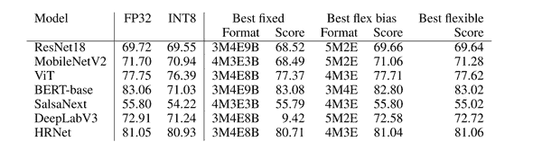

### FP8 AMD

AMD的FP8主要探究了不同FP8格式在PTQ场景下的优劣，考察了CV和NLP的各种任务。原始论文是《Efficient Post-training Quantization with FP8 Formats》

首先直观上展示了不同FP8格式和INT8的slot情况，以MSE指标看，E3M4比较适中

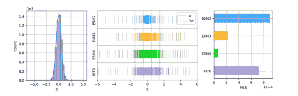

本文的流程框图如下所示，其中重点关注的是2个部件

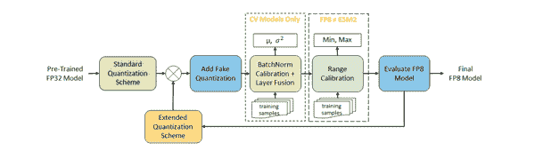

+   标准量化流程(Standard Quantization Scheme)

+   跟INT8类似，对于weight用了额外的per-channel的缩放系数，activation用了per-tensor的缩放系数

+   缩放系数的选取就是用普通的abs_max值

+   对于CV模型跳过了第一层和最后一层的量化

+   扩展量化流程(Extend Quantization Scheme)

+   对于LayerNorm/BatchNorm/Element-wise操作，使用了FP8数据类型做运算

+   混合精度。对于Activation和Weight的不同分布特点，使用不同格式的FP8格式。具体如下，NLP的激活值范围很广，属于range-bound，所以用E5M2的格式；CV的激活，以及CV和NLP的权重，分布趋近于高斯，属于precision-bound，所以用E3M4格式。

+   direct/static/dynamic量化。E5M2格式数值范围广，不需要scaling过程，direct量化；E3M4，可以选择static量化，提前calibration好scaling参数，也可以选用dynamic量化，动态确定scaling参数

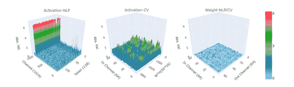

作者对比了混合精度相比于固定格式的FP8的优势

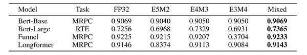

### FP8 MS

NV的TE库里只有对GEMM的FP8支持，缺少了分布式通信、优化器和分布式训练的支持。因此MS的FP8完善了上述FP8的相关组件，做到了真-FP8训练。原始论文是《FP8-LM: Training FP8 Large Language Models》

**FP8分布式通信**

回忆BP16的混合精度训练，梯度由BF16计算得到，但是在all-reduce的时候往往转化成FP32来做。如果使用FP8，并且不想在all-reduce的时候提高精度，此时无论是pre-scale还是post-scale都会出现问题。

对于pre-scaling，如下所示，每张卡的梯度在除以N的时候容易会下溢出

g=g_1/N+g_2/N+\cdots+g_N/N

对于post-scaling，如下所示，每张卡的梯度在累加的时候容易上溢出

g=(g_1+g_2+\cdots+g_N)/N

因此作者用了auto-scaling，每张卡的梯度绑定一个系数  s_i ，即

g_i'=s_i \cdot g_i

这里  g_i' 会用FP8格式来表示，其中  s_i 是会做动态更新，具体来说

+   当  g_i' 中达到FP8最大值的比例超过某个阈值(例如0.001%)，那么将  s_i 缩小一半，即  s_i \leftarrow s_i /2

+   当  g_i' 中达到FP8最大值的比例小于该阈值超过固定步数(例如1000步)，那么将  s_i 增大一倍，即  s_i \leftarrow s_i\cdot 2

因此在做all-reduce之前，会得到各个卡的梯度和对应的系数，即一系列  (g_i', s_i) 值。此时可以选择最小的一个系数

\begin{aligned}s_g=\text{min}(s_1, s_2, \cdots, s_N)\end{aligned}

然后把各自的梯度做重新归一化

g_i''=\text{FP8}(s_g\cdot(g_i'/s_i))

最后再做FP8的all-reduce

g=g_1''+g_2''+\cdots +g_N''

这里最终的系数  s=N \cdot s_g

**FP8优化器**

在BF16混合精度训练中，优化器一般选用Adam，里面包含了

+   master weight和一阶和二阶统计量，他们都是FP32的格式

+   gradient是BF16，但是通信前转成了FP32，grad_buffer使用FP32表示

因此每个权重在优化器中的显存占用为16bytes

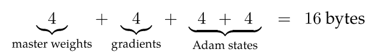

在FP8训练场景中

+   master weight依旧需要高精度，因为有时候gradient更新量非常小，master weight需要高精度捕捉这些微小的变动

+   gradient用上述的FP8分布式通信方式，可以用FP8存储

+   Adam中的一阶统计量用FP8，二阶统计量用FP16

因此每个权重在优化器中的显存占用为

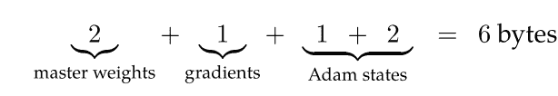

**FP8分布式策略**

分布式策略包括常见的4D并行，即DP/TP/PP和SP(Sequence Parallel)。其中DP和PP在FP8下跟原来的混合精度方案没有差别，但是在TP和SP会有不同，如下所示

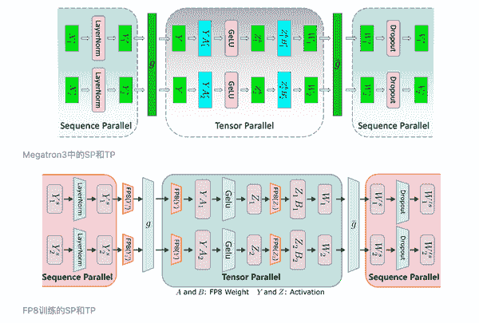

### 小结

FP8有E5M2和E4M3等多种格式，适用于不同的场景

+   E5M2是标准的IEEE-754设计的格式，而E4M3是压缩了特殊数的空间，让值域范围更大

+   FP8的量化模拟比定点数复杂很多，需要考虑规范数和非规范数的边界条件

+   在极端的训练场景下，FP8复杂程度跟QAT不相上下，每个tensor还得绑定学习对应的scale，也就是指数bias，模型不容易收敛

+   在推理场景，FP8对于精度的保持效果还不错，常规PTQ策略基本能达到不掉点的水平

## KV Cache 量化

在超长序列场景中，KV Cache往往会占用更多的显存容量。一般来说我们都用FP8做KV Cache的量化，但如果想要进一步降低比特数，则需要一些特殊的方法。本小节介绍一篇比较新的WKVQuant论文，对KV Cache做了4比特的量化。

### WKVQuant

本文针对所有weight和KV-cache做INT4量化，主要创新点有3方面

+   提出了POQ (Past Only Quantization)，即保留当前token的activation为FP16，将过去的KV-cache做INT4量化

+   二维量化(Two-dimensional Quantization)，即对KV-cache同时使用per-token和per-channel量化

+   提出了CRC (Cross-block Reconstruction Regularization)，即把跨越多个block的重建误差为损失函数对超参进行finetune

首先作者的目的是对所有计算过程沿用FP16(包括GEMM和BatchMatMul)，但是对所有weight和KV-cache做INT4的量化，这个也是标题WKVQuant的由来。如下所示

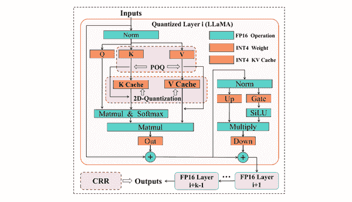

Past Only Quantization

这个比较简单，就是在decode阶段，对于当前token的激活值，使用FP16的值，计算完成后才量化成INT4存储下来。示意图如下，比较直观就不赘述了

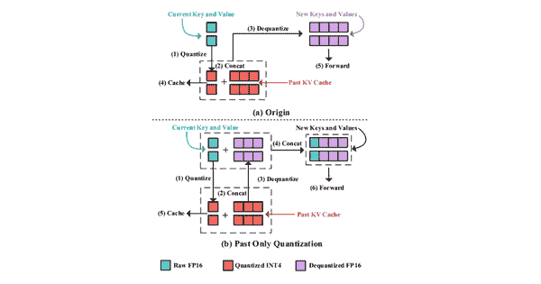

Two-dimensional Quantization

对于QKV的input_project计算过程，假设  X \in \mathbb{R}^{T \times C_\text{in}} ，  W \in \mathbb{R}^{C_\text{in} \times C_\text{out}} 以及  B \in \mathbb{R}^{1 \times C_\text{out}} 。则输出KV-cache为  Y \in \mathbb{R}^{T \times C_\text{out}} ，表达式如下

Y=XW+B

可以对  Y 做逐channel的shift偏移和scale缩放，参数分别为  \delta \in \mathbb{R}^{1\times C_\text{out}} 和  s\in \mathbb{R}^{1\times C_\text{out}} ，因此

\left\{\begin{align*}Y &= XW+B \tag{8}\\ Y' &= (Y-\delta)\ \oslash s \tag{9}\\Y'' &= Q(Y') \odot s + \delta \quad \tag{10}\\ Z &= f(Y'') \tag{11}\end{align*}\right.

这里的(8)和(9)联立可以得到

\begin{aligned}Y'=(XW+B-\sigma) \oslash s&=X(W\oslash s) + (B-\sigma)\oslash s \\&=X W'+B'\end{aligned}

这里我们可以看到

+   可以将(9)中  Y' 的shift偏移和scale缩放计算吸收到前面的input_project里面，相当于对  Y 做的per-channel量化吸收到了前面  W 的per-channel量化中

+   (10)的  Q(Y') 就是对  Y' 做per-token的量化

+   (11)中的  f(Y'') 代表了网络后续的操作

这里对  W 的量化使用了Omniquant中的量化方式，是一种带zero point的量化，如下所示

\left\{\begin{aligned}W_q&=\text{clamp}(\lfloor\frac{W}{h}\rceil+z, 0, 2^{N-1}) \\h&=(\gamma \text{max}(W)-\beta \text{min}(W))/2^{N-1} \\z&=-\lfloor\beta \text{min}(W)/h \rceil\end{aligned}\right.

**Cross-block Reconstru**ction Regularization

有上可以知道需要确定参数有4个，分别是  \sigma ，  s ，  \gamma 和  \beta 。这里用了跨多层的重建误差为损失函数，对上述4个参数做优化，如下所示

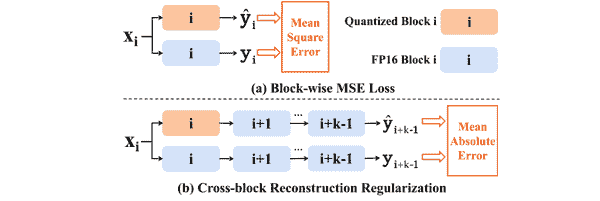

数学表达式为

\arg\min_{\sigma,s,\gamma,\beta} \text{ MAE}(\hat{y}_{i+k-1}, y_{i+k-1})

## 写在最后

至此，针对LLM量化开头提到的7个问题，我们这里可以进行简单总结

+   浮点数和定点数。本质上定点数就是一组元素集合共享量化参数，组的划分方式决定了是per-tensor/per-token/per-channel还是per-group量化，极端情况下当集合元素只有一个的时候，那跟浮点数表达能力一致

+   QAT对scale的学习。只需要使用链式法则进行直接推导，便可以得到中间锯齿两边截断的梯度形式

+   Weight-only常规比特量化。二阶方法从数学严谨的OBS出发，不断进行条件放松和数学近似，演变到求解速度可以接受的GPTQ和OWQ，同时AWQ也借鉴SmoothQuant的思路，把均衡化思想带到了Weight-only量化。

+   Weight-only极低比特量化。比特位数低于4比特之后，量化异常值一般单独对待处理，例如SpQR和SqueezeLLM，而AQLM更是把量化问题看成常规压缩问题，用近似搜索中的加性的量化技巧(Additive Quantization)重新建模

+   Activation+Weight量化。从早期ZeroQuant关注per-token量化，到后续工作都意识到channel的分布差异才是激活值量化的关键，后续Outlier Suppression v2更是同时考虑了shift偏移和scale缩放。

+   FP8量化。FP8量化在训练场景还有不低的使用门槛，但是在推理场景基本都能比较轻松的做到精度不掉

+   KV Cache量化。常规8比特(如FP8 KV Cache)基本都是开箱即用，但是更低比特(例如4比特)则需要用权重量化和激活量化的方法进行组合使用(例如per-token和per-channel)

PS：由于笔者小A并没有亲手撸过上述内容的所有细节，大部分是通过研究代码和精读优秀文章的方式bottom-up总结而来，本质上是个拾人牙慧的知识搬运工，所以终究是纸上谈兵。因此希望各方有实际经验的大佬猛锤，思维碰撞才生火花，真理越辩越明。

**如果想了解transformer在NLP/多模态/AIGC的算法知识，LLM分布式训练的知识**，以及LLM量化/推理加速/部署服务化相关的知识，可以关注我aaronxic哟~

##

## 参考资料

量化那些事之FP8与LLM-FP4

FP8 量化-原理、实现与误差分析