# （10）深入LLM投机采样(上)

> 来源：[https://waytoagi.feishu.cn/docx/JVMjdZb1XoXeQJx0xwZcNwUpnld](https://waytoagi.feishu.cn/docx/JVMjdZb1XoXeQJx0xwZcNwUpnld)

> 🔗 原文链接： h[ttps://zhuanlan.zh](https://zhuanlan.zhihu.com/p/701465989)ihu.com/p/701465...

> ⏰ 发表时间：2024-06-04 09:21:17 (UTC+8)

> 公式部分因格式转化困难，建议访问上述知乎链接查看

## 更新记录

| 更新时间 | 更新内容 |
| --- | --- |
| 2024.06.04 | 完成正式版第一版 |

## 开篇

大家好，我是小A。前面花了两章篇幅介绍LLM部署中量化相关的知识，这一章开始我们接着介绍另一个重要的部署加速技巧，投机采样(Speculative Sampling)。同样将分上下两篇来详细介绍，其中

+   上篇。介绍基础的采样策略，包括了确定性采样、随机性采样和截断采样。然后详细介绍朴素版本的投机采样和数学原理，并且列举了2种优化方向的代表性方法。

+   下篇。我们将了解自投机采样的原理，包括讨论比较多的美杜莎采样。最后会介绍Jacobi解码算法和改进思路。

今天我们将介绍上篇，坐稳我们发车了~

PS: 长文预警，本篇约1w字，欢迎点赞&关注后电脑上阅读体验更佳哦~ (^_^)

## 常用采样策略

我们知道LLM模型的输出是在词表上的概率分布，采样策略直接决定了我们得到怎么样的输出效果。有时候我们希望得到完全确定的结果，有时候希望得到更加丰富有趣的结果。下面我们介绍两大类采样方式，确定性采样和概率性采样。此外会重点介绍一下概率性采样中有深刻洞察的截断采样。

### 确定性采样

确定性采样顾名思义就是输出结果是确定性的，本质上是搜索过程。常见的如贪[心搜索](https://link.zhihu.com/?target=https%3A//deci.ai/blog/from-top-k-to-beam-search-llm-decoding-strategies/)(Greedy Search)和集束搜索(Beam Search)。借用 这里 的图，如下所示

+   Greedy Search。每次选取概率最高的token输出，非常容易陷入复读机循环。

+   Beam Search。维护beam的大小为   k k ，对当前beam中的所有path做下个token的展开，选取累积概率最高的前   k k 个path，作为新的beam，以此类推。计算量增大，但是输出有一定确定性同时更加丰富。容易发现   k=1 k=1 的时候退化成Greedy Search。

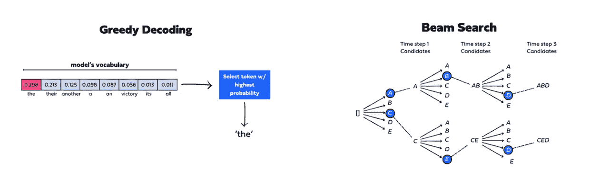

### 概率性采样

概率性采样会基于概率分布做采样，常见的有以下3种

+   Multinomial采样。直接基于概率分布做纯随机采样，容易采到极低概率的词。

+   Top-k采样。在概率排名前   k k

的候选集中做随机采样，注意采样前做重新归一化。Top-k的参数   k k 是固定的，不容易调参

+   Top-p采样。也叫Nucleus采样，先对输出概率做从大到小的排序，然后在累积概率达到   p p 的这些候选集中做随机采样，同样需要做重新归一化。动态版的Top-k，实战中高频使用。

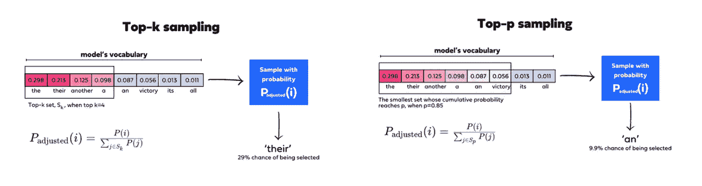

### 截断采样

前面说到Top-p这种带动态截断的采样在实战中效果比较好，但也会有badcase。例如设置   p=0.95 p=0.95 **，结果第一个词概率是0.**96，第二个词概率是0.03，剩下的总和是0.01。那么按照p采样的策略，第二个词会被扔掉。但实际上第二个词在剩余词里面概率相对比较大的，应该纳入考量才对。

截断采样(Truncation Sampling as Language Model Desmoothing)尝试从更加本质的角度理解LLM学习的概率分布特点，针对上述的例子做优化改进。这里有个重要的insight，就是认为LLM的输出其实是 真实分布和平滑分布的叠加

+   真实的分布应该是有截断的，有些词就是不会出现，概率严格为0

+   LLM是神经网络，输出是连续且平滑的，因此会把原来有带截断的真实分布拖出长尾

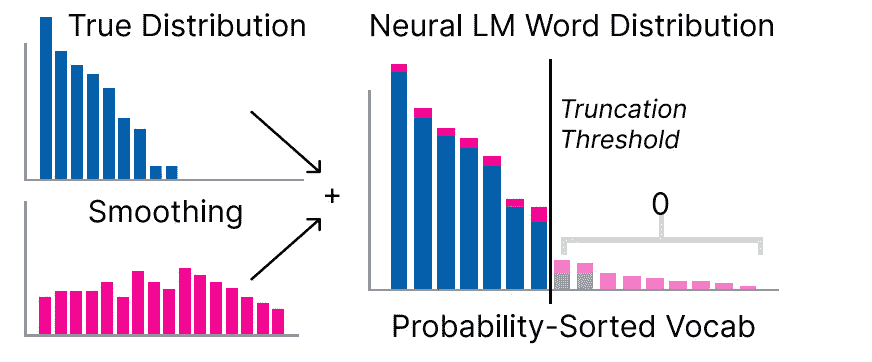

这里关于为什么LLM输出会平滑分布，我们首先可以观察训练LLLM的CrossEntropy损失函数

CE(P,Q)=−∑xP(x)log⁡Q(x) \text{CE}(P,Q)=-\sum_x P(x)\log Q(x)

其中   P(x) P(x) 是真值分布，   Q(x) Q(x) 是LLM预测分布。假如   P(x) P(x) 的真实分布是双峰的，如下所示

+   那么当   Q(x) Q(x) 只能cover其中一个的时候，   CE \text{CE} 损失会在   P(x)≠0 P(x) \neq0 但是   Q(x)≈0 Q(x)\approx 0 的地方引入巨大误差，如下左图所示

+   此时LLM网络会倾向于学习得到下右图的分布，即平滑分布

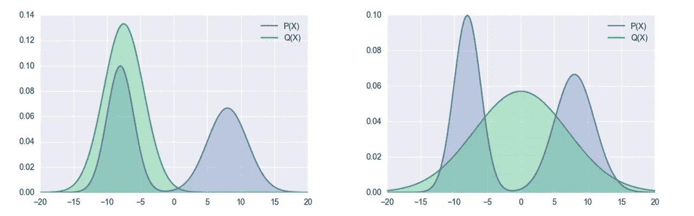

综上我们知道

+   CrossEntropy(Forward KL其实也一样)会强迫神经网络在真实分布   P(x)≠0 P(x) \neq 0 的词上，预测对应的   Q(x) Q(x) 值

+   这要求LLM能准确预测哪些词   P(x)≠0 P(x)\neq0 ，这比较难。因此LLM选择的方式就是每个词都输出一点点概率

+   于是最后得到了平滑分布   Q(x) Q(x)

回到原始的采样问题，假如我们认可了LLM输出分布是真实分布和平滑分布的叠加。那么其实问题就变成了 已知LLM的输出分布，如何还原真实分布，然后基于真实分布做采样 。

这里先给出结论，方法是先计算LLM的熵   hθ(x<i) h_\theta(x_{<i}) ，取   ϵ=0.0009 \epsilon=0.0009 和   α=0.03 \alpha=0.03 ，按下列公式计算出   η \eta 。最后以   η \eta 为截断阈值，筛选出候选集，做重新归一化后随机采样。

η=min(ϵ,αexp⁡(−hθ(x<i))) \eta=\min(\epsilon, \alpha\exp(-h_\theta(x_{<i})))

对数学推导感兴趣的可以继续看，不感兴趣的可以直接跳过推导直接进入下一节。

首先可以数学化拆解LLM模型的输出概率，如下形式 (跟原论文表达式不同)

Pθ(Xi|x<i)=(1−λx<i)⋅P∗(Xi|x<i)+λx<i⋅Q(Xi|x<i) P_\theta(X_i|x_{<i})=(1-\lambda_{x<i}) \cdot P^*(X_i|x_{<i}) + \lambda_{x<i} \cdot Q(X_i|x_{<i})

其中

+     Prob(Xi|x<i) \text{Prob}(X_i|x_{<i}) 代表了给定了位置   i i 前面token的前提下，位置   i i 输出token的概率分布

+   于是   Pθ(Xi|x<i) P_\theta(X_i|x_{<i}) 代表了LLM输出概率分布，   P∗(Xi|x<i) P^*(X_i|x_{<i}) 代表真实分布，   Q(Xi|x<i) Q(X_i|x_{<i}) 代表平滑概率分布

+     λx<i \lambda_{x<i} 代表平滑强度，值越大强度越大，取值范围是   λx<i∈[0,1) \lambda_{x<i} \in [0, 1)

+   此外定义第二项   Q′(Xi|x<i)=λx<i⋅Q(Xi|x<i) Q'(X_i|x_{<i})=\lambda_{x<i} \cdot Q(X_i|x_{<i}) 为被平滑强度   λx<i \lambda_{x<i} 调制后的平滑分布

这里   Pθ(Xi|x<i) P_\theta(X_i|x_{<i}) 是LLM做一次前馈即可得到的，   P∗(Xi|x<i) P^*(X_i|x_{<i}) 比较难直接获取，而   Q(Xi|x<i) Q(X_i|x_{<i}) 需要做一定先验假设，本文假设是在词表   V \mathcal{V} 上的均匀分布，有一定波动区间，即

Q(Xi|x<i)∈(1−δ|V|,1+δ|V|) Q(X_i|x_{<i}) \in (\frac{1-\delta}{|\mathcal{V}|},\frac{1+\delta}{|\mathcal{V}|})

我们的目标是想办法得到   Q′(Xi|x<i)=λx<i⋅Q(Xi|x<i) Q'(X_i|x_{<i})=\lambda_{x<i} \cdot Q(X_i|x_{<i}) 的概率密度   η \eta ，这样当   Pθ(Xi|x<i) P_\theta(X_i|x_{<i}) 中出现小于   η \eta 的词概率，我们就直接truncated掉即可，这样能保证被truncated掉的词的最大概率不会超过   η \eta

Q′(Xi|x<i) Q'(X_i|x_{<i}) 的表达会跟   λx<i \lambda_{x<i} 系数相关，此时对于   λx<i \lambda_{x<i} 的选取，有两种方式

+     λ¯ \bar{\lambda} ，上下文无关的绝对概率(context-independent)。就是定义固定比较小，例如   λ¯=0.2 \bar{\lambda}=0.2

+     λ¯x<i \bar{\lambda}_{x<i} ，上下文相关的相对概率(context-dependent)。这里作者的insight是，真实分布   P∗(Xi|x<i) P^*(X_i|x_{<i}) 的熵如果越大越均匀，那么平滑强度   λ¯x<i \bar{\lambda}_{x<i} 应该越小

这里作者引入了比较巧妙的先验，就是把context-dependent情况下的平滑强度跟真实分布的熵联系在一起。具体来说，假设希望   λx<i \lambda_{x<i} 调制后的平滑概率分布的   Q′(Xi|x<i) Q'(X_i|x_{<i}) 的熵和   P∗(Xi|x<i) P^*(X_i|x_{<i}) 的熵呈正相关，并且假设   Q′(Xi|x<i) Q'(X_i|x_{<i}) 仍然是个均匀分布，那么

H(Q′)=−∑j=1N1Nln⁡1N∝H(P∗)=h(x<i) H(Q')=-\sum_{j =1} ^{N} \frac{1}{N} \ln \frac{1}{N} \propto H(P^*)=h(x_{<i})

因此可以得到   Q′(Xi|x<i) Q'(X_i|x_{<i}) 的概率密度为

Q′(Xi|x<i)=1N∝exp⁡(−h(x<i)) Q'(X_i|x_{<i})=\frac{1}{N} \propto \exp(-h(x_{<i}))

也就是

Q′(Xi|x<i)=αexp⁡(−h(x<i)) Q'(X_i|x_{<i})=\alpha\exp(-h(x_{<i}))

又因为已知   Q(Xi|x<i) Q(X_i|x_{<i}) 最大概率密度为

Q(Xi|x<i)=1+δ|V| Q(X_i|x_{<i}) =\frac{1+\delta}{|\mathcal{V}|}

定义最终的平滑强度是绝对概率和相对概率两种情况的最小值

λx<i=min(λ¯,λ¯x<i) \lambda_{x<i}=\min(\bar{\lambda}, \bar{\lambda}_{x<i})

进而可以得到   Q′(Xi|x<i) Q'(X_i|x_{<i}) 的概率密度为

η=λx<i⋅Q(Xi|x<i)=min(λ¯⋅Q(Xi|x<i),λ¯x<i⋅Q(Xi|x<i))=min(λ¯⋅(1+δ)|V|,Q′(Xi|x<i))=min(λ¯⋅(1+δ)|V|,αexp⁡(−h(x<i))) \begin{aligned}\eta&=\lambda_{x<i}\cdot Q(X_i|x_{<i})\\&=\min(\bar{\lambda}\cdot Q(X_i|x_{<i}), \bar{\lambda}_{x<i}\cdot Q(X_i|x_{<i})) \\&=\min(\frac{\bar{\lambda}\cdot (1+\delta)}{|\mathcal{V}|}, Q'(X_i|x_{<i})) \\&=\min(\frac{\bar{\lambda}\cdot (1+\delta)}{|\mathcal{V}|}, \alpha\exp(-h(x_{<i})))\end{aligned}

但是，我们发现   min \min 中的两项都不太好求，这里作者就索性开始近似了。其中

+   第一项直接用   ϵ \epsilon 来替代

+   第二项把   h(x<i) h(x_{<i}) 换成了   hθ(x<i) h_\theta(x_{<i})

因此最终的概率密度阈值为

η=min(ϵ,αexp⁡(−hθ(x<i))) \eta=\min(\epsilon, \alpha\exp(-h_\theta(x_{<i})))

一般来说   ϵ=0.0009 \epsilon=0.0009 且   α=ϵ \alpha=\sqrt{\epsilon}

### 小结

本节介绍了基础的确定性采样方式(Greedy Search和Beam Search等)和随机性采样方式(Top-k/Top-p等)，并且重点介绍了截断采样方法。其中截断采样有两个重要insight

+   LLM的输出其实是真实分布和平滑分布的叠加

+   真实分布的熵如果越大越均匀，那么平滑强度应该越小

## 朴素投机采样

LLM的推理分为prefill和decode两个阶段，前者速度可以1k-50k token/sec，后者速度往往只有10-500 token/sec，最大相差两个数量级。制约decode速度的最大瓶颈就是GEMV计算访存比太低了。

投机采样(Speculative Sampling)引入draft和verify两阶段方法，在verify阶段尝试同时推理多个token，改变worklog，提高计算访存比。

### 基本思想

投机采样几乎同时被Google和Deepmind的两个独立工作提出，核心出发点是观察到在decoding生成过程中，不同位置token生成的难度是显著不同的，即有时候换个小模型来也是生成那个token，有时候必须由大模型来生成效果才更好。

这样的话，在decoding阶段，维护大小两个模型，让小模型做decoding快速生成一个block，然后把这个block喂入大模型，让大模型判别是否要接受小模型的结果。

如下所示，绿色token是小模型产生的proposal结果，此时一次性喂入大模型，然后从左往右挨个检查，红色token就是发现的第一个拒绝的token，然后基于一定的采样规则重新采样用蓝色token替代。

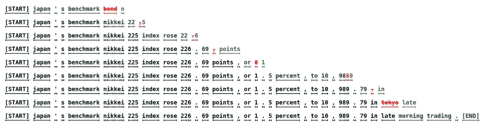

可以看出，投机采样的本质上并没有减少大模型推理的总计算量，但是把计算访存比的密度提高了。大模型一次性推理1个token时间，约等于推理一个block的时间，此时加速部分缘于榨取了GPU的硬件使用率。理想情况下如果小模型的接受率很高，那么能成倍的减少推理时间，非常精妙。

下面我们就详细看看接受和拒绝的策略，伪代码如下所示

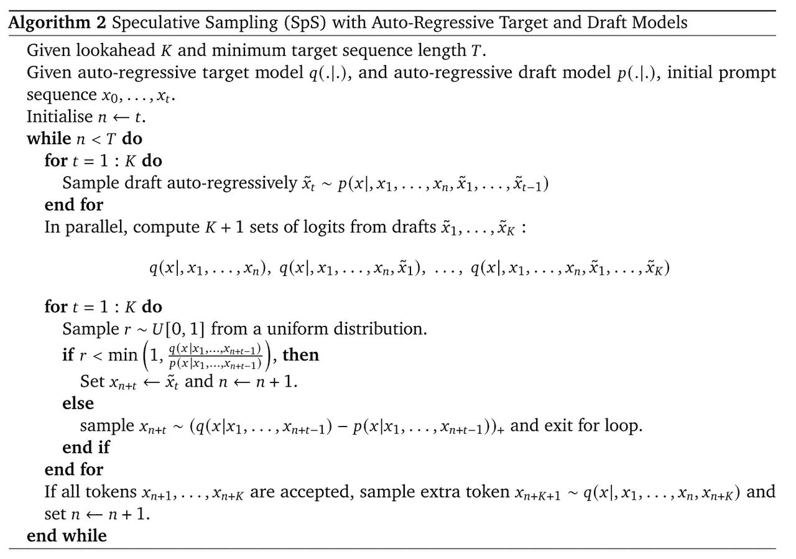

其中

+     q(⋅|⋅) q(\cdot|\cdot) 是大模型的输出概率分布，   p(⋅|⋅) p(\cdot|\cdot) 是小模型输出概率分布

+   小模型一次性生成长度为   K K 的token，即block大小为   K K

+   接受条件

+   如果小模型采样出了某个词   x~ \tilde{x} ，此时大模型的概率   q(x~) q(\tilde{x}) 大于小模型概率   p(x~) p(\tilde{x}) ，直觉上认为该词被大模型采样出的概率不应该比现在的更低，因此接受这个词的概率应该更高

+   定量刻画这个概率，可以用   r0=min(1,q(x~)p(x~)) r_0=\min(1, \frac{q(\tilde{x})}{p(\tilde{x})}) 来表示

+   抛掷   r=U[0,1] r=U[0, 1] 的骰子，如果   r r 小于   r0 r_0 则接受，如果   r r 大于   r0 r_0 则拒绝

+   重采样方式

+   直接抛出结论: 当发生拒绝的时候，筛选出所有   q(x) q(x) 大于   p(x) p(x) 的词，对这些词的概率做归一化，在归一化后的概率分布上做采样

+   定量刻画这个过程，如下所示

P(x=x~)=max(q(x~)−p(x~),0)∑x′max(q(x′)−p(x′),0) P(x=\tilde{x})=\frac{\max(q(\tilde{x})-p(\tilde{x}), 0)}{\sum_{x'}\max(q(x')-p(x'), 0)}

### 核心过程推导

下面我们沿用DeepMind版本《Accelerating Large Language Model Decoding with Speculative Sampling》的数学符号，完整推导一遍投机采样过程。

本质上我们想考察的是   P(x=x~) P(x=\tilde{x}) 的概率，在使用了上述复杂的一套策略之后，是否还依然等于我们的原始概率   q(x=x~) q(x=\tilde{x}) ，即   q(x~) q(\tilde{x})

概率拆解思路如下

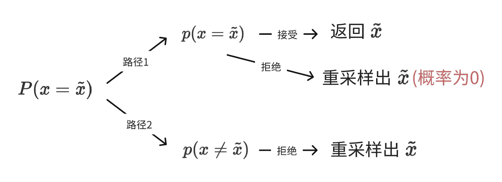

有两种可能采样出   x~ \tilde{x}

+   路径1: 小模型   p(⋅|⋅) p(\cdot|\cdot) 上来就采样出了   x~ \tilde{x} ，并且成功的接受了

+   路径2: 小模型   p(⋅|⋅) p(\cdot|\cdot) 采样得到了其他值   x≠x~ x\neq\tilde{x} ，并且发生了拒绝，此时重采样得到   x~ \tilde{x}

**注意对**于路径1，如果对   x~ \tilde{x} 发生了拒绝，此时是不可能通过重采样得到   x~ \tilde{x} 。原因是发生拒绝说明   q(x~) q(\tilde{x}) 小于   p(x~) p(\tilde{x}) ，因此在重采样中   max(q(x~)−p(x~),0) \max(q(\tilde{x})-p(\tilde{x}), 0) 为0，因此不可能重采样出   x~ \tilde{x}

下面我们分别对两个路径做计算

路径1

P1=p(x~)⋅min(1,q(x~)p(x~))=min(p(x~),q(x~)) P_1=p(\tilde{x})\cdot \min(1, \frac{q(\tilde{x})}{p(\tilde{x})})=\min(p(\tilde{x}), q(\tilde{x}))

**路径2**

P2=∑x′≠x~p(x′)[1−min(1,q(x′)p(x′))]⋅max(q(x~)−p(x~),0)∑x″max(q(x″)−p(x″),0)=∑x′≠x~p(x′)−min(p(x′),q(x′))]⋅max(q(x~)−p(x~),0)∑x″max(q(x″)−p(x″),0)=∑x′≠x~max(p(x′)−q(x′),0)⋅max(q(x~)−p(x~),0)∑x″max(q(x″)−p(x″),0) \begin{align*}P_2&=\sum_{x' \neq\tilde{x}} p(x')[1-\min(1, \frac{q(x')}{p(x')})]\cdot \frac{\max(q(\tilde{x})-p(\tilde{x}), 0)}{\sum_{x''} \max(q(x'')-p(x''), 0)} \\&=\sum_{x' \neq\tilde{x}} p(x')-\min(p(x'), q(x'))]\cdot \frac{\max(q(\tilde{x})-p(\tilde{x}), 0)}{\sum_{x''} \max(q(x'')-p(x''), 0)} \\&=\sum_{x' \neq\tilde{x}} \max(p(x')-q(x'), 0)\cdot \frac{\max(q(\tilde{x})-p(\tilde{x}), 0)}{\sum_{x''} \max(q(x'')-p(x''), 0)} \\\end{align*}

上式比较复杂，观察可以发现

+   积分项少了   x′=x~ x'=\tilde{x} ，但是由于下式成立，因此可以添加一项   x′=x~ x'=\tilde{x}

max(p(x~)−q(x~),0)⋅max(q(x~)−p(x~),0)=0 \max(p(\tilde{x})-q(\tilde{x}), 0) \cdot \max(q(\tilde{x})-p(\tilde{x}), 0)=0

+   后面的重采样的分子和分母都跟前面求和项的   x′ x' 无关，所以可以提取公因子到前面

因此可以整理   P2 P_2 如下

(1)P2=max(q(x~)−p(x~),0)∑x″max(q(x″)−p(x″),0)⋅∑x′max(p(x′)−q(x′),0) \begin{align*}P_2&= \frac{\max(q(\tilde{x})-p(\tilde{x}), 0)}{\sum_{x''} \max(q(x'')-p(x''), 0)} \cdot \sum_{x'} \max(p(x')-q(x'), 0)\tag{1}\end{align*}

接下来要证明一个反直觉但是正确的引理

(2)∑xmax(p(x)−q(x),0)=∑xmax(q(x)−p(x),0) \begin{align*}\sum_{x} \max(p(x)-q(x), 0)=\sum_{x} \max(q(x)-p(x), 0)\tag{2}\end{align*}

这里给个提示，感兴趣的可以自行推导一下。从公式(3)出发，分别把   1 1 代换成   ∑xp(x) \sum_x p(x) 和   ∑xq(x) \sum_x q(x) ，然后正常展开化简既可。

(3)1−∑xmin(p(x),q(x)) \begin{align*}1-\sum_{x}\min(p(x), q(x))\tag{3}\end{align*}

有了公式(2)之后，带入公式(1)，我们就可以很容易化简   P2 P_2 ，可以得到

P2=max(q(x~)−p(x~),0) P_2=\max(q(\tilde{x})-p(\tilde{x}), 0)

把路径1和路径2相加，可以得到

P(x=x~)=P1+P2=min(p(x~),q(x~))+max(q(x~)−p(x~),0)=q(x~) \begin{align*}P(x=\tilde{x})&=P_1+P_2\\&=\min(p(\tilde{x}), q(\tilde{x}))+\max(q(\tilde{x})-p(\tilde{x}), 0) \\&=q(\tilde{x})\end{align*}

### 核心指标推导

Google版本《Fast Inference from Transformers via Speculative Decoding》包含了很多核心指标的推导，这里统一梳理一下。

**平均接受率**

根据前面投机采样算法可以计算平均接受率   α \alpha ，其中   q(x) q(x) 是大模型输出，   p(x) p(x) 是小模型输出

α=Ex∼p(x)(r0(x))=Ex∼p(x)(min(1,q(x)p(x)))=∑xmin(p(x),q(x)) \begin{aligned}\alpha&=\mathbb{E}_{x \sim p(x)}(r_0(x)) \\ &=\mathbb{E}_{x \sim p(x)}(\min(1, \frac{q(x)}{p(x)})) \\&= \sum_x \min(p(x), q(x))\end{aligned}

**平均生成长度**

如果把验证过程看成接受概率为   α \alpha 的连续   k k 次判定过程，从上述算法流程知道输出token的长度范围是   [1,k+1] [1, k+1] ，有以下3种情况

+   情况1：当第1个token就被大模型拒绝了，那么就直接用大模型的采样输出，生成长度为   L=1 L=1

+   情况2：当第   t t 个token被大模型接受，但是第   t+1 t+1 个token被大模型拒绝的时候，生成长度为   L=t+1 L=t+1 。注意此时   t≤k−1 t \leq k-1

+   情况3：当所有   k k 个token都被大模型接受，此时理应达到最大生成长度   L=k L=k 。但其实大模型在批量推理的时候顺带多forward一个，速度并不影响，因此最终生成长度   L=k+1 L=k+1

分析上述3种情况，可以发现情况1可以看成情况2的特例，此时   t=0 t=0 ，因此最终的平均生成长度为三种情况的和。

(4)L=E(#generated tokens)=∑t=0k−1αt(1−α)⋅(t+1)+αk(k+1) \begin{align*}L=\mathbb{E}(\text{#generated tokens})=\sum_{t=0}^{k-1}\alpha^t(1-\alpha)\cdot(t+1) + \alpha^k(k+1)\tag{4}\end{align*}

我们先关注第一项，即

(5)S≜∑t=0k−1αt(1−α)⋅(t+1)=(1−α)∑t=0k−1αt⋅(t+1) \begin{align*}S \triangleq\sum_{t=0}^{k-1}\alpha^t(1-\alpha)\cdot(t+1)=(1-\alpha)\sum_{t=0}^{k-1}\alpha^t \cdot (t+1)\tag{5}\end{align*}

上式左右乘以   α \alpha ，可以得到

(6)α⋅S=(1−α)∑t=0k−1αt+1⋅(t+1) \begin{align*}\alpha \cdot S =(1-\alpha)\sum_{t=0}^{k-1}\alpha^{t+1} \cdot (t+1)\tag{6}\end{align*}

(5)式和(6)式做差可以得到

(1−α)⋅S=(1−α)∑t=0k−1αt⋅(t+1)−(1−α)∑t=0k−1αt+1⋅(t+1)=(1−α)[∑t=0k−1αt⋅(t+1)−∑t=0k−1αt+1⋅(t+1)] \begin{aligned}(1-\alpha) \cdot S&= (1-\alpha)\sum_{t=0}^{k-1}\alpha^t \cdot (t+1)-(1-\alpha)\sum_{t=0}^{k-1}\alpha^{t+1} \cdot (t+1) \\&= (1-\alpha)[\sum_{t=0}^{k-1}\alpha^t \cdot (t+1)-\sum_{t=0}^{k-1}\alpha^{t+1} \cdot (t+1)]\end{aligned}

左右消除   1−α 1-\alpha ，同时对第二项做   t=t+1 t=t+1 的变量替换，可以得到

S=∑t=0k−1αt⋅t−∑t=1kαt⋅t=1+(∑t=1k−1αt)−αk⋅k=[1+(∑t=1k−1αt)]−αk⋅k(7)=∑t=0k−1αt−αk⋅k \begin{align*}S&=\sum_{t=0}^{k-1}\alpha^t \cdot t-\sum_{t=1}^{k}\alpha^{t} \cdot t \\&=1+(\sum_{t=1}^{k-1}\alpha^t) -\alpha^k\cdot k \\&=[1+(\sum_{t=1}^{k-1}\alpha^t)]-\alpha^k \cdot k \\&=\sum_{t=0}^{k-1}\alpha^t-\alpha^k \cdot k\tag{7}\end{align*}

(7)式带入(1)式，可以得到

L=E(#generated tokens)=S+αk(k+1)=∑t=0k−1αt−αk⋅k+αk(k+1)=1−αk+11−α \begin{aligned}L&=\mathbb{E}(\text{#generated tokens}) \\&= S + \alpha^k(k+1) \\&=\sum_{t=0}^{k-1}\alpha^t-\alpha^k \cdot k + \alpha^k(k+1) \\&=\frac{1-\alpha^{k+1}}{1-\alpha}\end{aligned}

可视化如下所示 (   γ \gamma 就是lookahead大小   k k )

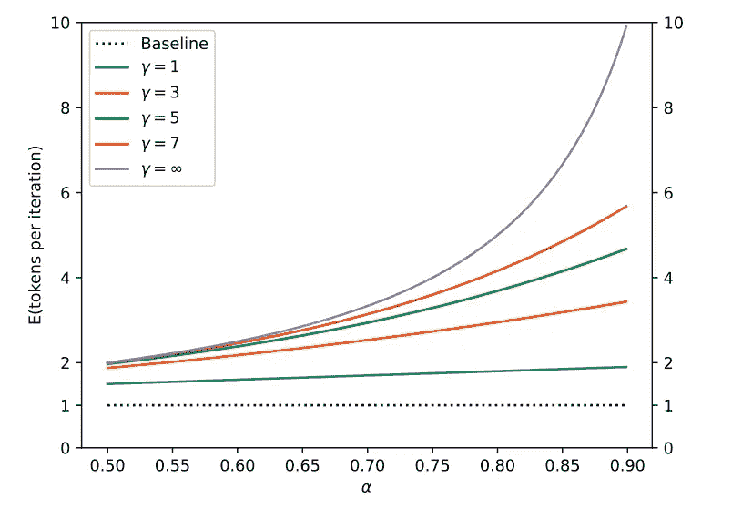

**理论加速比**

前面知道了平均生成的长度是

L=1−αk+11−α L=\frac{1-\alpha^{k+1}}{1-\alpha}

假设大模型解码1个token和并行解码   k k 个token的耗时都是   T T ，小模型解码一个token耗时是   c⋅T c\cdot T 。那么

+   投机采样的解码速度为   L/(c⋅T⋅k+T) L / (c\cdot T \cdot k + T)

+   原始算法的解码速度为   1/T 1/T

那么加速比为

η=L/(c⋅T⋅k+T)1/T=Lc⋅k+1=1−αk+1(1−α)(ck+1) \eta=\frac{L / (c\cdot T \cdot k + T)}{1/T}=\frac{L}{c\cdot k+1} =\frac{1-\alpha^{k+1}}{(1-\alpha)(ck+1)}

**最优lookahead长度**

固定   α \alpha 和   c c ，最优look head长度   k^ \hat{k} 应该是能使得   η \eta 最大的值，但是注意   k^ \hat{k} 是整数，因此可以绘图如下(纵轴   γ \gamma 就是最优长度   k^ \hat{k} )

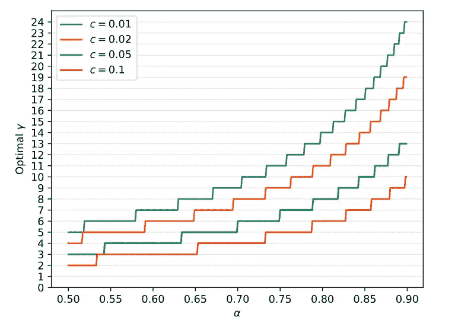

### 相关实验

DeepMind版本侧重超大模型的分布式场景。其中draft模型的选取4B，大模型选取70B。这里draft模型是个更宽更浅的”矮胖“型网络，这样如果做多机的TP并行的话通信开销会更小一点

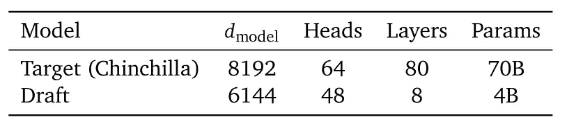

随着K的增大，考察固定128个token的总耗时，会出现先降再增的现象，XSum数据集上最优值是   k^=3 \hat{k}=3 。分析如下

+   如下中图，随着k的增大，接受概率会逐渐降低

+   如下右图，随着k的增大，平均每次调用的时长会增加，原因是小模型每次需要decode的K变大了。但此时大模型步长变大，当接受概率没有明显下降的时候，最终时长会出现下降，如下左图

+   编程数据集Human Eval上的接受率要明显高于XSum，推测是因为编程的字符搭配更加有规律，更好预测

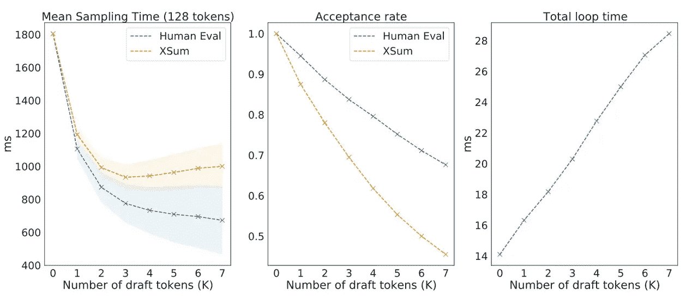

### 小结

本节主要介绍了投机采样相关的基础知识

+   投机采样引入的draft和verify两个阶段，其实draft过程是overhead，verify过程才是真正加速的部分。

+   详细推导了投机采样核心过程的数学原理。从统计意义上投机采样算法是数学上严格等价于原始过程的

+   基于数学过程可以得到核心指标的计算方式。包括了平均接受率、平均生成长度、理论加速比和最优lookahead长度

+   从初步的实验效果上看，lookahead长度选择是个至关重要的参数，过大和过小都不合适，在小bmk上的最优值是   k^=3 \hat{k}=3

## 优化投机采样

回顾前面的理论加速比公式，其中   α \alpha 是平均接受概率，   k k 是lookahead长度，   c c 是draft模型推理相比于原始LLM模型的比率

η=L/(c⋅T⋅k+T)1/T=Lc⋅k+1=1−αk+1(1−α)(ck+1) \eta=\frac{L / (c\cdot T \cdot k + T)}{1/T}=\frac{L}{c\cdot k+1} =\frac{1-\alpha^{k+1}}{(1-\alpha)(ck+1)}

不难发现，提高投机采样的两个方向分别是

+   提高draft的proposal接受率   α \alpha

+   减少draft过程推理时间   c c

本节将介绍经典的几种方法，如下所示

| 方法名称 | 概述 | 接受率 | 推理耗时 | 发表时间 |
| --- | --- | --- | --- | --- |
| SpecInfer | 增加draft候选数，提高接受率 | 较大提高 | 略微提高 | 2023.05 |
| Online Speculative Sampling | 在线更新draft模型，提高接受率 | 较大提高 | 基本不变 | 2023.10 |
| Cascade Speculative Drafting | 使用层级采样，加速drfat推理 | 基本不变 | 较大缩减 | 2023.11 |
| Decoding Speculative Decoding | 重新设计draft模型，加速draft推理 | 基本不变 | 较大缩减 | 2024.02 |
| TriForce | 层级解决128K长序列投机采样，加速draft推理 | 基本不变 | 较大缩减 | 2024.04 |

### SpecInfer

SpecInfer中主要将投机采样过程的draft候选序列数量做了扩增，变成了Tree结构，并且在验证Verification阶段使用并行化算法，提高了接收概率，从而提高了平均生成长度，从而提升了加速比。

跟传统的串行解码和投机采样解码的区别如下，右下角图为SpecInfer方法，主要区别就是Tree-based的投机过程(Speculator)和并行验证过程(Verifier)

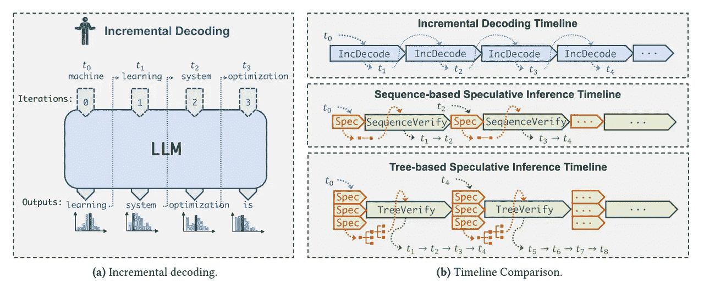

**Speculator**

投机过程使用的模型一般叫SSM(small speculative model)，朴素投机采样是用一个SSM生成单个序列，本文尝试生成多个序列，有以下几种方法

+   方法1：多个独立SSM。对于某些模型家族会有若干个小模型，例如OPT家族有OPT-125M和OPT-350M，每个SSM独立产生一个序列。

+   方法2：Expansion-based的token Tree。利用1个SSM的top-K，类似于beam search的树形展开，每一个从根节点到叶节点的路径就是一个序列。

+   方法3：Merged-based的token Tree。利用boosting的思路，首先有数据集和初始的   SSM1 \text{SSM}_1 ，把   SSM1 \text{SSM}_1 做错的样本搜集并单独训练   SSM2 \text{SSM}_2 ，以此类推，得到多个SSM。每个SSM产生一个序列。

方法2和方法3的示意图如下所示

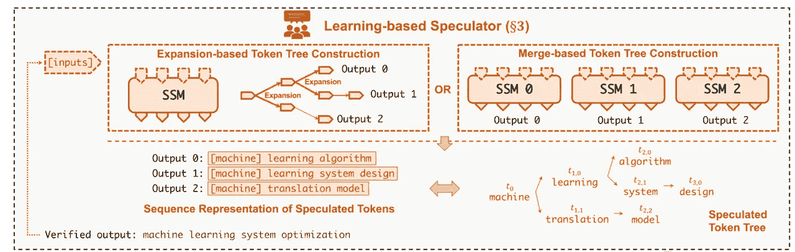

其中作者还探究了方法2中的TopK的超参数K对接受率的影响，发现随着K增大，正确答案在token tree里的概率能相应提高

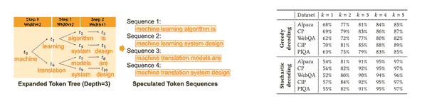

Tree-based Parallel Decoding

在朴素投机采样中，由于只有一个序列，所以只需要用原始模型解码一次即可。但是在SpecInfer里面，由于有多个投机候选序列，因此需要有高效的解码过程拿到原始模型在所有候选序列的预测值。

如果挨个串行执行候选序列，势必非常慢，这样就达不到加速的效果，因此SpecInfer利用了带mask的Tree-attention，如下所示

+   把Tree上的每个token单独拿出来，根据到根节点的路径依赖，可以找出所有相关的token

+   在attention mask把相关的token置为true，其余的置为无效

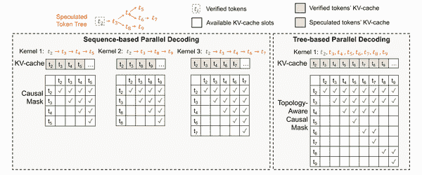

**Verifier**

验证过程跟采样策略有关

+   有确定性的Greedy Sampling。逐个做验证即可，但凡不满足  \text{argmax} ，那就停止，最终挑选出最长的序列

+   多样性更丰富的Stochastic Decoding。类似朴素投机采样中的概率策略，发生reject的时候可以调整概率重新采样一次。

下图展示的是Stochastic Decoding过程

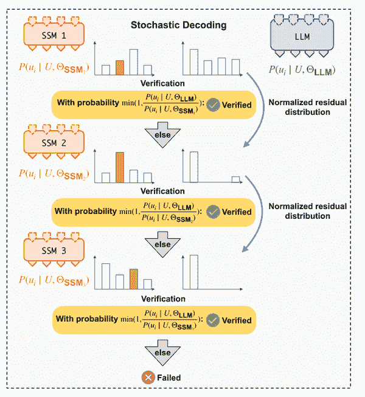

**实验结果**

虽然投机过程多个序列的产生会有一定的overhead，但是能大幅提高接受概率，进而提高了平均接受长度，从而得到更好的加速比，如下所示。加速比能到1.5-2.8倍。

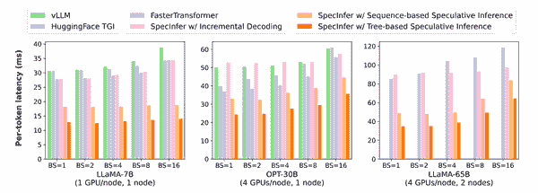

在Tree Expansion过程中，搜索宽度是个很重要的参数，平衡了平均生成长度和投机overhead，最终发现K太大或者太小效果都不好，适中(如K=3)比较好。

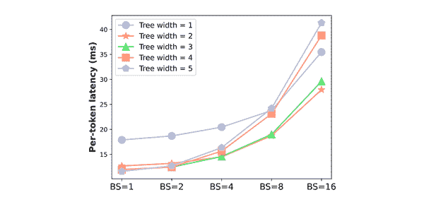

### Online Speculative Sampling

投机采样的实际效果跟draft模型精度非常相关，为了进一步提升draft模型被accept概率，本方法使用online蒸馏的思路。具体来说，搜集解码过程draft模型的badcase，然后积攒到一定数量后对drfat模型做一次更新，如下所示。

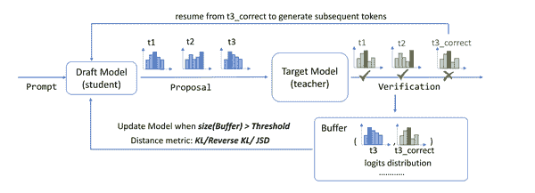

前面知道投机采样常用的平均生成长度和理论加速比公式如下所示

\mathbb{E}(|\tilde{y}|)=\frac{1-\alpha^{k+1}}{1-\alpha}, \quad \mathbb{E}(\text{speedup})=\frac{1-\alpha^{k+1}}{(1-\alpha)(kc+1)}

作者据此绘制了如下的曲线，想说明  \alpha 对性能提升还是非常重要

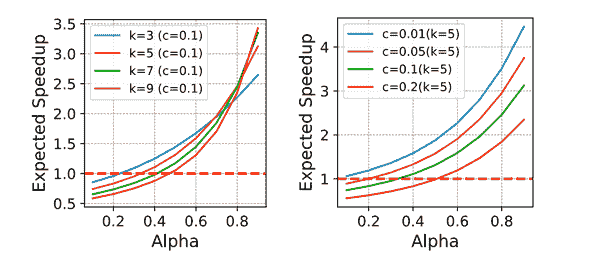

实验发现，在线蒸馏能提升接受率在10-65%，相应加速比为1.2-3.1倍

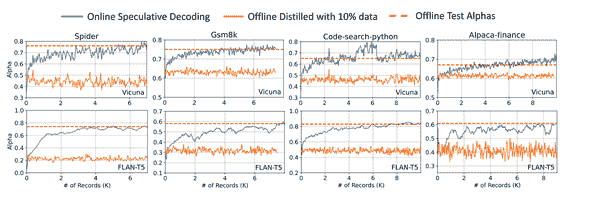

实际执行起来会比较复杂，一方面训练和部署框架往往是不是一个，另一方面部署阶段模型已经做了量化，要finetune可能还得上QLora的方案，比较麻烦。

### Cascade Speculative Drafting

使用Cascade的投机采样，把原始draft模型按垂直和水平方向进一步拆解，如下所示

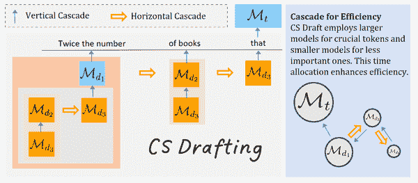

**水平方向**

作者首先分析了不同token位置的接受率，容易知道越靠后的token位置被接受概率呈指数下降，原因是前面的token被拒绝了就轮不到后面的token了，如下所示

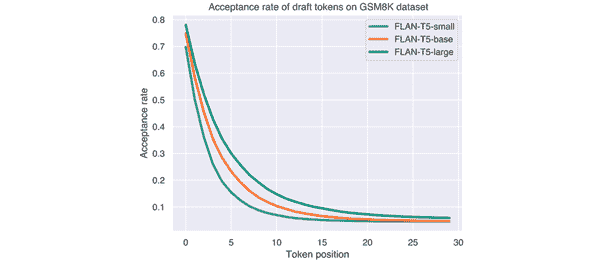

作者的想法是既然后面被接受的概率低，那么就用更小的模型，于是draft模型越靠近前面模型尺寸越大，越靠近后面尺寸越小。如前面图的  M_{d_1} 是最大的，  M_{d_2} 是次之，  M_{d_3} 是最小的

**垂直方向**

如果draft模型不够快，那么就给draft模型配更小的draft-mini模型，也就是使用了递归的方式，上图中针对中间of books位置的tokens，除了有  M_{d_2} 之外，还有更小的  M_{d_3} 来作为draft-mini模型

**复杂交织**

更有甚者，如上图左边负责预测Twice the number位置的draft模型，先做了垂直拆解  M_{d_1} \rightarrow M_{d_3} ，然后跟着水平拆解  M_{d_2} \rightarrow M_{d_3} ，你以为这样就完了，后面又接着垂直拆解  M_{d_2} \rightarrow M_{d_3}

**实验结果**

跟标准的投机采样(S Decoding)相比能进一步提高，但是并不显著，相比于新增的工程复杂度，感觉得不偿失

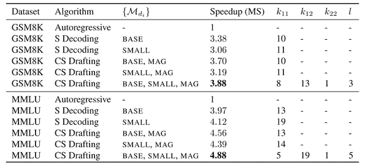

### Decoding Speculative Decoding

主要从draft模型的速度方面入手，提出了更宽更浅的网络能在平均生成长度(  \text{TAR} )持平的情况下，投机采样整体推理速度比baseline方法提升40%

前面知道提高投机采样加速有两个方向，一个是提高平均生成长度  L ，一个是降低draft模型时延  c

**提高TAR的难度**

作者首先分析了提高  \text{TAR} 的难度，如下所示

+   提高  \text{TAR} 一定程度要提高draft网络跟原始网络的输出一致性，直观的方法就是用更大的draft模型

+   以OPT-66B为原始模型，  \text{TAR} 要从5.0提升到6.0，需要从  \text{OPT-125m} 到  \text{OPT-6.7b} ，模型参数量提高50倍

+   此时分母跟着分子一起变大，为了使得分数值，也就是加速比跟  \text{OPT-125m} 保持一致，需要把  \text{OPT-6.7b} 的时延减少50%

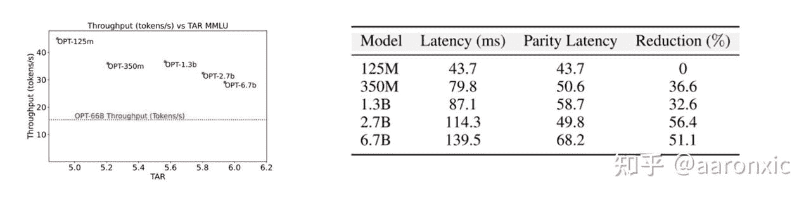

据此可以看出希望有一个保持  \text{TAR} 但是显著降低latency的模型结构，作者做了简单的网络结构探究

**同TAR的低时延网络**

作者简单分析网络宽度和深度对推理时延的影响，如下所示

+   左图是固定网络大小350M，增加层数的同时减少宽度，发现整体时延跟层数呈现正比

+   右图是固定宽度，线性增加层数，发现整体时延跟层数呈现正比

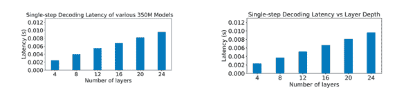

作者据此得到同等参数量的情况下，更宽更浅的网络推理速度更快。为了得到这样的网络，作者用了Sheared-LLAMA的剪枝框架，在MMLU数据集上剪枝，最后自己得到了如下NoFT-Wide-1.3B的新draft模型。  \text{TAR} 保持几乎一致的情况下时延降低一半，最终投机采样的速度从23.10到32.59，提升40%

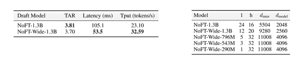

核心其实就是希望找到保持  \text{TAR} 的同时降低latency的网络结构，但是缺乏大规模数据精度验证，思路可以参考，但是结论还需要进一步verify

### TriForce

**算法原理**

TriForce主要针对128K长序列场景下的投机采样算法优化，主要思路是引入两级的投机采样，把128K长序列的采样消耗降下来，如下所示

+   第一级是橙色，用的是超小模型Llama-68M和超省KV-Cache算法StreamingLLM做个mini-draft投机采样，目标输出长度为  \gamma_1 个token

+   第二级是蓝色，用的是原始模型大小Llama-7B-128K和部分KV-Cache做个draft投机采样，目标输出长度为  \gamma_2 个token

+   第三极是绿色，用的是原始模型Llama-7B-128K和全量的128K-KV-Cache做最终验证

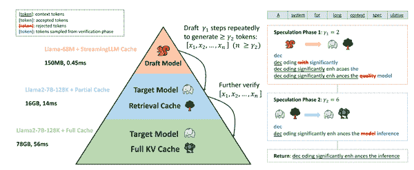

3个模型的互动如下所示，看起来复杂，其实就是两级投机采样，重点关注

+   KV-Cache有3种，第1级Streaming LLM的  C_q ，第2级retrieval的  C_r ，第3级的全量  C_p

+   模型有2种，超小模型Llama-68M的  M_q ，原始模型Llama-7B-128K的  M_p

+   红框部分是第1级和第2级做互动，第1级  M_q+C_q 做投机操作，每次投机  \gamma_1 个，然后拿去给  M_p+C_r 做验证，验证通过了  n 个，这里  n 最大是  \gamma_2 个

+   绿框部分是拿这  n 个做最终的  M_p+C_p 的验证

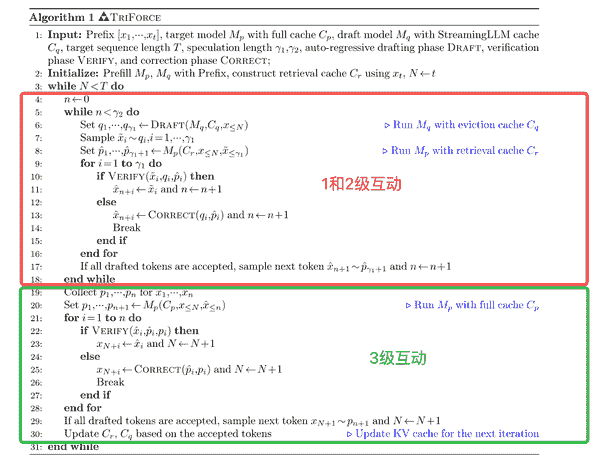

**Retrieval Cache**

和常规的多级投机采样算法相比，TriForce最大的创新是尝试解决128K长序列的KV-Cache问题。出发点其实就是KV-Cache的稀疏性特点，这个在StreamingLLM和  H_2O 等论文里已经观察到，总的来说就是只有一小部分的KV-Cache是至关重要的，绝大部分是可以丢弃，不同论文有不同的选择算法。这类方法的细节小A会在后面长序列专题里再详细展开。

这里假定输入序列是120K，输出256个token，每层KV-Cache的budget是4K。我们首先可以通过输出的256个GT token的attention score投票选取  \text{top-4k} 的KV-Cache，然后用这些选出来的KV-Cache来尝试重建这256个token。个人理解重建的含义就是看仅使用这挑出来的4k的KV-Cache，每个位置的最大预测值是否仍然为GT token。如下所示

+   图(a)中可以看出，除了前两层的成功重建率很低外，其余层只需要4K个KV-Cache基本都能恢复原来的输出。这说明前两层不能做KV Cache的裁剪，更高层可以做裁剪

+   图(c)也能观察到类似的结论，横轴是输出token的个数，Layer1尤为敏感，其它层随着输出token个数变多而非常缓慢变化

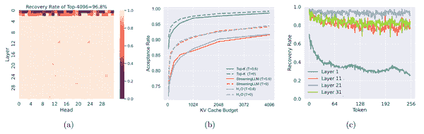

作者本来想直接用StreamingLLM和  H_2O 方法，结果测了一下真实Benchmark的效果，不尽人意，如下所示。PG-19是个Deepmind开源的长文测试集，Needle Retrieval就是大海捞针测试。可以看出两种方法都会比较大的精度损失，其中  \text{Top-k} 方法是oracle视角的理论上界。

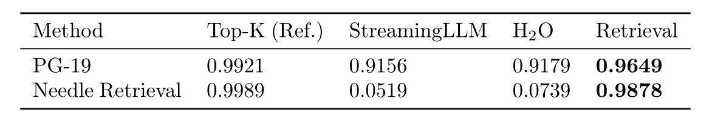

作者对此提出了Retrieval的改进方法，思路也比较简单，就是对120K的KV-Cache先分chunk，然后选取相关度最大的几个chunk里的所有token作为选中的结果。这里chunk的feature特征是由归属的所有KV-Cache直接取平均得到，如下所示

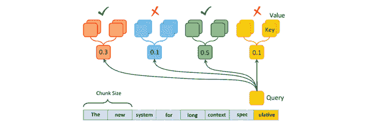

容易知道chunk size是个超参数，过大和过小都不合适，作者通过消融实验发现居中最好

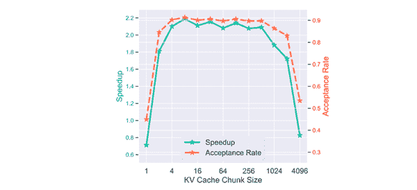

总的来说

+   对于长序列，Retrieval Cache的思路比较简单，看起来有一定效果

+   两级投机采样给工程实现带来了较大挑战

### 小结

本节主要从提高接受率  \alpha 和减少draft推理耗时  c 两个角度介绍优化方法，主要有5种，如下所示

| 方法名称 | 概述 | 接受率 | 推理耗时 | 发表时间 |
| --- | --- | --- | --- | --- |
| SpecInfer | 增加draft候选数，提高接受率 | 较大提高 | 略微提高 | 2023.05 |
| Online Speculative Sampling | 在线更新draft模型，提高接受率 | 较大提高 | 基本不变 | 2023.10 |
| Cascade Speculative Drafting | 使用层级采样，加速drfat推理 | 基本不变 | 较大缩减 | 2023.11 |
| Decoding Speculative Decoding | 重新设计draft模型，加速draft推理 | 基本不变 | 较大缩减 | 2024.02 |
| TriForce | 层级解决128K长序列投机采样，加速draft推理 | 基本不变 | 较大缩减 | 2024.04 |

## 写在最后

总的来说本篇比较重要的几个洞察如下

+   Beam Search在  k=1 的时候退化成Greedy Search

+   截断采样是Top-k和Top-p的理论建模，且有比较重要的两个假设，一个是LLM输出其实是真实分布和平滑分布的叠加；另一个是真实分布的熵如果越大越均匀，那么平滑强度应该越小

+   朴素投机采样的算法是可以从数学上做严谨证明完全等价的，其中比较重要的超参数是lookhead长度  k ，太大和太小都不合适，需要根据数据集精细调参

+   投机采样的收益本质上要看理论加速比，跟接受率  \alpha 和draft推理时延  c 紧密相关

+   提升接收概率  \alpha 的方法有

+   SpecInfer。将投机采样过程的draft候选序列数量做了扩增，变成了Tree结构，并且在验证Verification阶段使用并行化算法，提高了接收概率，从而提高了平均生成长度，从而提升了加速比。

+   Online Speculative Sampling。使用online蒸馏的思路。搜集解码过程draft模型的badcase，然后积攒到一定数量后对draft模型做一次更新

+   减少推理时延  c 的方法有

+   Cascade Speculative Drafting。使用Cascade的投机采样，把原始draft模型按垂直和水平方向进一步拆解。

+   Decoding Speculative Decoding。提出了更宽更浅的网络能在平均生成长度(  \text{TAR} )持平的情况下，投机采样整体推理速度比baseline方法提升40%

+   TriForce。针对128K长序列场景下的投机采样算法优化，主要思路是引入两级的投机采样，把128K长序列的采样消耗降下来

PS：由于笔者小A并没有亲手撸过上述内容的所有细节，大部分是通过研究代码和精读优秀文章的方式bottom-up总结而来，本质上是个拾人牙慧的知识搬运工，所以终究是纸上谈兵。因此希望各方有实际经验的大佬猛锤，思维碰撞才生火花，真理越辩越明。

**如果想了解transformer在NLP/多模态/AIGC的算法知识，LLM分布式训练的知识**，以及LLM量化/推理加速/部署服务化相关的知识，可以关注我aaronxic哟~

##

## 参考资料

[GitHub - DefTruth/Awesome-LLM-Inference: A curated list of Awesome LLM Inference Paper with codes](https://link.zhihu.com/?target=https%3A//github.com/DefTruth/Awesome-LLM-Inference%3Ftab%3Dreadme-ov-file%23Parallel-Decoding-Sampling), TensorRT-LLM, vLLM, streaming-llm, AWQ, SmoothQuant, WINT8/4, Continuous Batching, FlashAttention, PagedAttention etc.

Attention Required! | Cloudflare

[K](https://link.zhihu.com/?target=https%3A//agustinus.kristia.de/techblog/2016/12/21/forward-reverse-kl/)L Divergence: Forward vs Reverse? - Agustinus Kristiadi

[Truncation Sampling as Langua](https://link.zhihu.com/?target=https%3A//arxiv.org/abs/2210.15191)ge Model Desmoothing

[A](https://link.zhihu.com/?target=https%3A//arxiv.org/abs/2302.01318)ccelerating Large Language Model Decoding with Speculative Sampling

[F](https://link.zhihu.com/?target=https%3A//arxiv.org/abs/2211.17192)ast Inference from Transformers via Speculative Decoding

[marsggbo：贝叶斯优化(Bayesi](https://zhuanlan.zhihu.com/p/53826787)an Optimization)深入理解

[贝](https://link.zhihu.com/?target=https%3A//blog.csdn.net/Leon_winter/article/details/86604553)叶斯优化(BayesianOptimization)_bayesian optimization-CSDN博客