# 沃尔夫勒姆：人工智能能解决科学问题吗？

> 来源：[https://waytoagi.feishu.cn/docx/Tzhadv3Ylo2uXKxWqf8cwzusnyd](https://waytoagi.feishu.cn/docx/Tzhadv3Ylo2uXKxWqf8cwzusnyd)

> 原文：https://writings.stephenwolfram.com/2024/03/can-ai-solve-science/

> 译文链接： [https://mp.weixin.](https://mp.weixin.qq.com/s/UhgOGO-DuDMqsnyBObQgLA)qq.com/s/UhgOGO-D...

> 译者：花猫舰长巡海纪

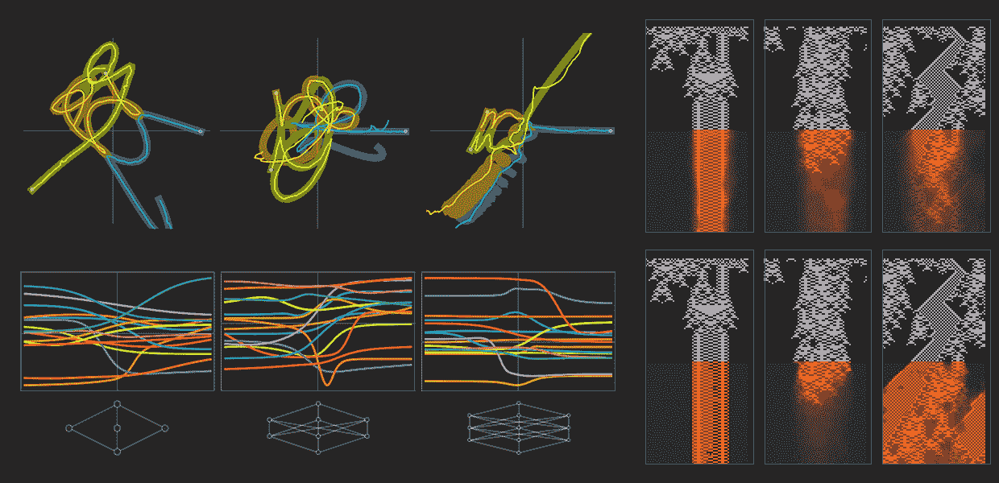

## 人工智能最终会不会无所不能？

Won’t AI Eventually Be Able to Do Everything?

Particularly given its recent surprise successes, there’s a somewhat widespread belief that eventually AI will be able to “do everything”, or at least everything we currently do. So what about science? Over the centuries we humans have made incremental progress, gradually building up what’s now essentially the single largest intellectual edifice of our civilization. But despite all our efforts, there are still all sorts of scientific questions that remain. So can AI now come in and just solve all of them?

特别是考虑到它最近取得的令人惊讶的成功，人们普遍相信人工智能最终将能够“做一切”，或者至少是我们目前所做的一切。那么科学又如何呢？几个世纪以来，我们人类取得了渐进的进步，逐渐建造了现在基本上是我们文明中最大的智力大厦。但尽管我们付出了一切努力，仍然存在各各样的科学问题。那么人工智能现在可以介入并解决所有这些问题吗？

To this ultimate question we’re going to see that the answer is inevitably and firmly no. But that certainly doesn’t mean AI can’t importantly help the progress of science. At a very practical level, for example, LLMs provide a new kind of linguistic interface to the computational capabilities that we’ve spent so long building in the Wolfram Language . And through their knowledge of “conventional scientific wisdom” LLMs can often provide what amounts to very high-level “autocomplete” for filling in “conventional answers” or “conventional next steps” in scientific work.

对于这个终极问题，我们将看到答案不可避免且坚决是否定的。但这当然并不意味着人工智能不能重要地帮助科学进步。例如，在非常实用的层面上，LLMs 为我们花了很长时间在 Wolfram 语言中构建的计算功能提供了一种新的语言接口。通过他们的“传统科学智慧”知识 LLMs 通常可以提供相当于非常高水平的“自动完成”，用于填写科学工作中的“传统答案”或“传统的后续步骤”。

But what I want to do here is to discuss what amount to deeper questions about AI in science. Three centuries ago science was transformed by the idea of representing the world using mathematics. And in our times we’re in the middle of a major transformation to a fundamentally computational representation of the world (and, yes, that’s what our Wolfram Language computational language is all about). So how does AI stack up? Should we think of it essentially as a practical tool for accessing existing methods, or does it provide something fundamentally new for science?

但我在这里想做的是讨论人工智能在科学中的更深层次问题。三个世纪前，科学被用数学代表世界的想法所改变。在我们这个时代，我们正处于向世界的基本计算表示的重大转变之中（是的，这就是我们的 Wolfram 语言计算语言的全部内容）。那么人工智能的表现如何呢？我们是否应该将其本质上视为访问现有方法的实用工具，或者它是否为科学提供了一些全新的东西？

My goal here is to explore and assess what AI can and can’t be expected to do in science. I’m going to consider a number of specific examples, simplified to bring out the essence of what is (or isn’t) going on. I’m going to talk about intuition and expectations based on what we’ve seen so far. And I’m going to discuss some of the theoretical—and in some ways philosophical—underpinnings of what’s possible and what’s not.

我的目标是探索和评估人工智能在科学领域可以做什么、不能做什么。我将考虑一些经过简化的具体示例，以揭示正在发生（或未发生）的本质。我将根据我们迄今为止所看到的情况来谈谈直觉和期望。我将讨论什么是可能的、什么是不可能的一些理论基础——在某种程度上是哲学基础。

So what do I actually even mean by “AI” here? In the past, anything seriously computational was often considered “AI”, in which case, for example, what we’ve done for so long with our Wolfram Language computational language would qualify—as would all my “ruliological” study of simple programs in the computational universe. But here for the most part I’m going to adopt a narrower definition—and say that AI is something based on machine learning (and usually implemented with neural networks), that’s been incrementally trained from examples it’s been given. Often I’ll add another piece as well: that those examples include either a large corpus of human-generated scientific text, etc., or a corpus of actual experience about things that happen in the world—or, in other words, that in addition to being a “raw learning machine” the AI is something that’s already learned from lots of human-aligned knowledge.

那么我在这里所说的“人工智能”到底是什么意思呢？在过去，任何认真计算的东西通常都被认为是“人工智能”，在这种情况下，例如，我们长期以来使用 Wolfram 语言计算语言所做的事情就符合资格——就像我对简单程序的所有“规则学”研究一样。计算宇宙。但在这里，我将在很大程度上采用更狭义的定义，并说人工智能是基于机器学习（通常通过神经网络实现）的东西，它是根据给出的示例进行增量训练的。我通常还会添加另一件事：这些例子要么包括人类生成的科学文本的大型语料库等，要么包括关于世界上发生的事情的实际经验的语料库，或者换句话说，是在除了作为“原始学习机器”之外，人工智能还可以从大量与人类相关的知识中学到东西。

OK, so we’ve said what we mean by AI. So now what do we mean by science, and by “doing science”? Ultimately it’s all about taking things that are “out there in the world” (and usually the natural world) and having ways to connect or translate them to things we can think or reason about. But there are several, rather different, common “workflows” for actually doing science. Some center around prediction: given observed behavior, predict what will happen; find a model that we can explicitly state that says how a system will behave; given an existing theory, determine its specific implications. Other workflows are more about explanation: given a behavior, produce a human-understandable narrative for it; find analogies between different systems or models. And still other workflows are more about creating things: discover something that has particular properties; discover something “interesting”.

好的，我们已经说了人工智能的含义。那么现在我们所说的科学和“做科学”是什么意思呢？最终，这一切都是为了获取“世界上”（通常是自然世界）的事物，并找到方法将它们连接或转化为我们可以思考或推理的事物。但实际上进行科学研究有几种截然不同的常见“工作流程”。有些以预测为中心：给定观察到的行为，预测将会发生什么；找到一个我们可以明确说明系统将如何运行的模型；给定现有理论，确定其具体含义。其他工作流程更多的是解释：给定一个行为，为其生成一个人类可以理解的叙述；寻找不同系统或模型之间的类比。还有一些工作流程更多的是关于创建事物：发现具有特定属性的事物；发现一些“有趣”的东西。

In what follows we’ll explore these workflows in more detail, seeing how they can (or cannot) be transformed—or informed—by AI. But before we get into this, we need to discuss something that looms over any attempt to “solve science”: the phenomenon of computational irreducibility .

接下来，我们将更详细地探讨这些工作流程，看看它们如何能够（或不能）被人工智能改造或通知。但在讨论这个问题之前，我们需要讨论任何“解决科学问题”的尝试中都存在的一些问题：计算不可约性现象。

## 计算不可约性的硬极限

The Hard Limit of Computational Irreducibility

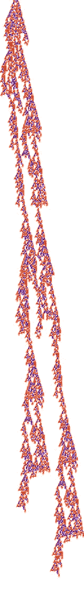

Often in doing science there’s a big challenge in finding the underlying rules by which some system operates. But let’s say we’ve found those rules, and we’ve got some formal way to represent them, say as a program. Then there’s still a question of what those rules imply for the actual behavior of the system. Yes, we can explicitly apply the rules step by step and trace what happens. But can we—in one fell swoop—just “solve everything” and know how the system will behave?

在科学研究中，寻找某些系统运行的基本规则常常面临着巨大的挑战。但假设我们已经找到了这些规则，并且我们有一些正式的方式来表示它们，比如作为一个程序。那么仍然存在一个问题：这些规则对系统的实际行为意味着什么。是的，我们可以明确地逐步应用规则并跟踪发生的情况。但我们能否一举解决“解决所有问题”并知道系统将如何运行？

To do that, we in a sense have to be “infinitely smarter” than the system. The system has to go through all those steps—but somehow we can “jump ahead” and immediately figure out the outcome. A key idea—ultimately supported at a foundational level by our Physics Project —is that we can think of everything that happens as a computational process. The system is doing a computation to determine its behavior. We humans—or, for that matter, any AIs we create—also have to do computations to try to predict or “solve” that behavior. But the Principle of Computational Equivalence says that these computations are all at most equivalent in their sophistication. And this means that we can’t expect to systematically “jump ahead” and predict or “solve” the system; it inevitably takes a certain irreducible amount of computational work to figure out what exactly the system will do. And so, try as we might, with AI or otherwise, we’ll ultimately be limited in our “scientific power” by the computational irreducibility of the behavior.

要做到这一点，从某种意义上说，我们必须比系统“无限聪明”。系统必须经历所有这些步骤，但我们可以以某种方式“跳过”并立即找出结果。一个关键思想——最终在我们的物理项目的基础层面上得到了支持——是我们可以将发生的一切视为一个计算过程。系统正在进行计算以确定其行为。我们人类——或者我们创造的任何人工智能——也必须进行计算来尝试预测或“解决”这种行为。但计算等效原理表明，这些计算在复杂程度上至多是等效的。这意味着我们不能期望系统地“跳跃”并预测或“解决”系统；不可避免地需要一定数量的不可减少的计算工作来弄清楚系统到底会做什么。因此，无论我们如何尝试，无论是人工智能还是其他方式，我们的“科学力量”最终都会受到行为的计算不可约性的限制。

But given computational irreducibility, why is science actually possible at all? The key fact is that whenever there’s overall computational irreducibility, there are also an infinite number of pockets of computational reducibility. In other words, there are always certain aspects of a system about which things can be said using limited computational effort. And these are what we typically concentrate on in “doing science”.

但考虑到计算的不可约性，为什么科学实际上是可能的呢？关键事实是，只要存在整体计算不可约性，就会存在无数个计算可约性。换句话说，系统的某些方面总是可以用有限的计算量来描述。这些就是我们“做科学”时通常关注的内容。

But inevitably there are limits to this—and issues that run into computational irreducibility. Sometimes these manifest as questions we just can’t answer, and sometimes as “surprises” we couldn’t see coming. But the point is that if we want to “solve everything” we’ll inevitably be confronted with computational irreducibility, and there just won’t be any way—with AI or otherwise—to shortcut just simulating the system step by step.

但不可避免地存在局限性，并且会遇到计算不可约性的问题。有时这些表现为我们无法回答的问题，有时表现为我们看不到的“惊喜”。但关键是，如果我们想“解决所有问题”，我们将不可避免地面临计算不可约性，而且无论是人工智能还是其他方式，都没有任何方法可以走捷径，一步步模拟系统。

There is, however, a subtlety here. What if all we ever want to know about are things that align with computational reducibility? A lot of science—and technology—has been constructed specifically around computationally reducible phenomena. And that’s for example why things like mathematical formulas have been able to be as successful in science as they have.

然而，这里有一个微妙之处。如果我们想知道的只是与计算可简化性一致的事情怎么办？许多科学和技术都是专门围绕计算可简化现象构建的。这就是为什么像数学公式这样的东西能够在科学上取得如此成功的原因。

But we certainly know we haven’t yet solved everything we want in science. And in many cases it seems like we don’t really have a choice about what we need to study; nature, for example, forces it upon us. And the result is that we inevitably end up face-to-face with computational irreducibility.

但我们当然知道我们还没有解决科学上我们想要的一切。在很多情况下，我们似乎并没有真正选择我们需要学习什么；我们只能选择学习什么。例如，大自然将其强加于我们。结果是我们不可避免地要面对计算不可约性。

As we’ll discuss, AI has the potential to give us streamlined ways to find certain kinds of pockets of computational reducibility. But there’ll always be computational irreducibility around, leading to unexpected “surprises” and things we just can’t quickly or “narratively” get to. Will this ever end? No. There’ll always be “more to discover”. Things that need more computation to reach. Pockets of computational reducibility that we didn’t know were there. And ultimately—AI or not—computational irreducibility is what will prevent us from ever being able to completely “solve science”.

正如我们将讨论的，人工智能有潜力为我们提供简化的方法来找到某些类型的计算可简化性。但总会存在计算的不可约性，导致意想不到的“惊喜”以及我们无法快速或“叙述性”到达的事情。这会结束吗？不，总会有“更多有待发现”。需要更多计算才能达到的东西。我们不知道存在一些计算可简化性。最终，无论是否有人工智能，计算的不可约性将阻止我们完全“解决科学问题”。

There’s a curious historical resonance to all this . Back at the beginning of the twentieth century, there was a big question of whether all of mathematics could be “mechanically solved”. The arrival of Gödel’s theorem, however, seemed to establish that it could not. And now that we know that science also ultimately has a computational structure, the phenomenon of computational irreducibility—which is, in effect, a sharpening of Gödel’s theorem—shows that it too cannot be “mechanically solved”.

这一切都有一种奇怪的历史共鸣。早在二十世纪初，就有一个大问题：是否所有数学都可以“机械地解决”。然而，哥德尔定理的出现似乎证明了事实并非如此。现在我们知道科学最终也有计算结构，计算不可约性现象——实际上是哥德尔定理的强化——表明它也无法“机械地解决”。

We can still ask, though, whether the mathematics—or science—that humans choose to study might manage to live solely in pockets of computational reducibility. But in a sense the ultimate reason that “math is hard” is that we’re constantly seeing evidence of computational irreducibility: we can’t get around actually having to compute things. Which is, for example, not what methods like neural net AI (at least without the help of tools like Wolfram Language ) are good at.

不过，我们仍然可以问，人类选择研究的数学（或科学）是否可以仅仅生活在计算可简化性的范围内。但从某种意义上说，“数学很难”的最终原因是我们不断看到计算不可约性的证据：我们无法回避实际必须计算的事情。例如，这并不是神经网络 AI 等方法（至少在没有 Wolfram 语言等工具的帮助下）所擅长的。

## 过去有效的事情

Things That Have Worked in the Past

Before getting into the details of what modern machine-learning-based AI might be able to do in “solving science”, it seems worthwhile to recall some of what’s worked in the past—not least as a kind of baseline for what modern AI might now be able to add.

在详细了解现代基于机器学习的人工智能在“解决科学问题”方面可能能够做什么之前，似乎有必要回顾一下过去的一些行之有效的方法——尤其是作为现代人工智能可能实现的目标的一种基准。现在可以添加了。

I myself have been using computers and computation to discover things in science for more than four decades now. My first big success came in 1981 when I decided to try enumerating all possible rules of a certain kind （elementary cellular automata） and then ran them on a computer to see what they did:

我自己已经使用计算机和计算来发现科学事物已有四十多年了。我的第一次巨大成功是在 1981 年，当时我决定尝试枚举某种类型（基本元胞自动机）的所有可能规则，然后在计算机上运行它们，看看它们做了什么：

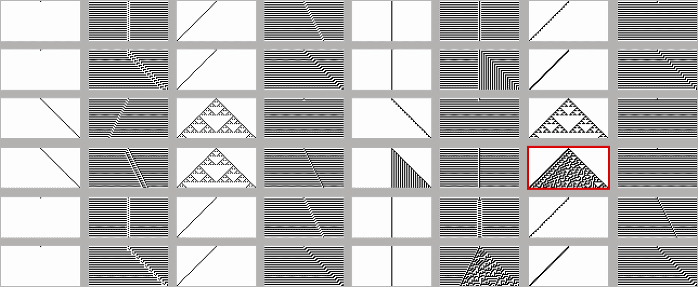

I’d assumed that with simple underlying rules, the final behavior would be correspondingly simple. But in a sense the computer didn’t assume that: it just enumerated rules and computed results. And so even though I never imagined it would be there, it was able to “discover” something like rule 30 .

我原本以为只要有简单的基本规则，最终的行为就会相应地简单。但从某种意义上说，计算机并没有这样假设：它只是枚举规则并计算结果。因此，尽管我从未想象过它会在那里，但它能够“发现”像规则 30 这样的东西。

Over and over again I have had similar experiences: I can’t see how some system can manage to do anything “interesting”. But when I systematically enumerate possibilities, there it is: something unexpected, interesting—and “clever”—effectively discovered by computer.

我一次又一次地有过类似的经历：我看不出某些系统如何能够做到任何“有趣”的事情。但当我系统地列举可能性时，结果就在那里：一些意想不到的、有趣的——而且“聪明的”——被计算机有效地发现了。

In the early 1990s I wondered what the simplest possible universal Turing machine might be. I would never have been able to figure it out myself. The machine that had held the record since the early 1960s had 7 states and 4 colors. But the computer let me discover just by systematic enumeration the 2-state， 3-color machine

在 20 世纪 90 年代初，我想知道最简单的通用图灵机可能是什么。我自己永远无法弄清楚。自 20 世纪 60 年代初以来一直保持这一记录的机器有 7 种状态和 4 种颜色。但计算机让我通过系统枚举发现了 2 态 3 色机器

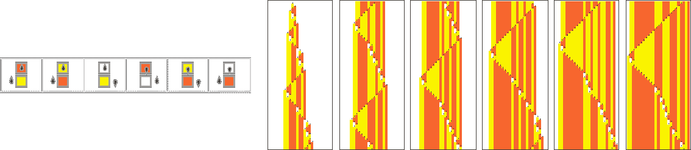

that in 2007 was proved universal (and, yes, it’s the simplest possible universal Turing machine).

2007 年被证明是通用的（是的，它是最简单的通用图灵机）。

In 2000 I was interested in what the simplest possible axiom system for logic (Boolean algebra) might be. The simplest known up to that time involved 9 binary ( Nand ) operations. But by systematically enumerating possibilities, I ended up finding the single 6-operation axiom

(which I proved correct using automated theorem proving). Once again, I had no idea this was “out there”, and certainly I would never have been able to construct it myself. But just by systematic enumeration the computer was able to find what seemed to me like a very “creative” result.

2000 年，我对逻辑（布尔代数）最简单的公理系统可能是什么感兴趣。当时已知的最简单的操作涉及 9 个二进制 （ Nand ） 操作。但通过系统地枚举可能性，我最终找到了单个 6 操作公理

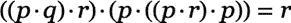

（我使用自动定理证明证明了它是正确的）。我再一次不知道这是“在那里”，当然我自己也永远无法建造它。但仅仅通过系统枚举，计算机就能找到在我看来非常“有创意”的结果。

In 2019 I was doing another systematic enumeration, now of possible hyper graph rewriting rules that might correspond to the lowest-level structure of our physical universe . When I looked at the geometries that were generated I felt like as a human I could roughly classify what I saw. But were there outliers? I turned to something closer to “modern AI” to do the science—making a feature space plot of visual images :

2019 年，我正在进行另一次系统枚举，现在是可能对应于我们物理宇宙最低层结构的超图重写规则。当我看到生成的几何图形时，我感觉作为一个人我可以对我所看到的进行粗略的分类。但有异常值吗？我转向更接近“现代人工智能”的东西来进行科学研究——制作视觉图像的特征空间图：

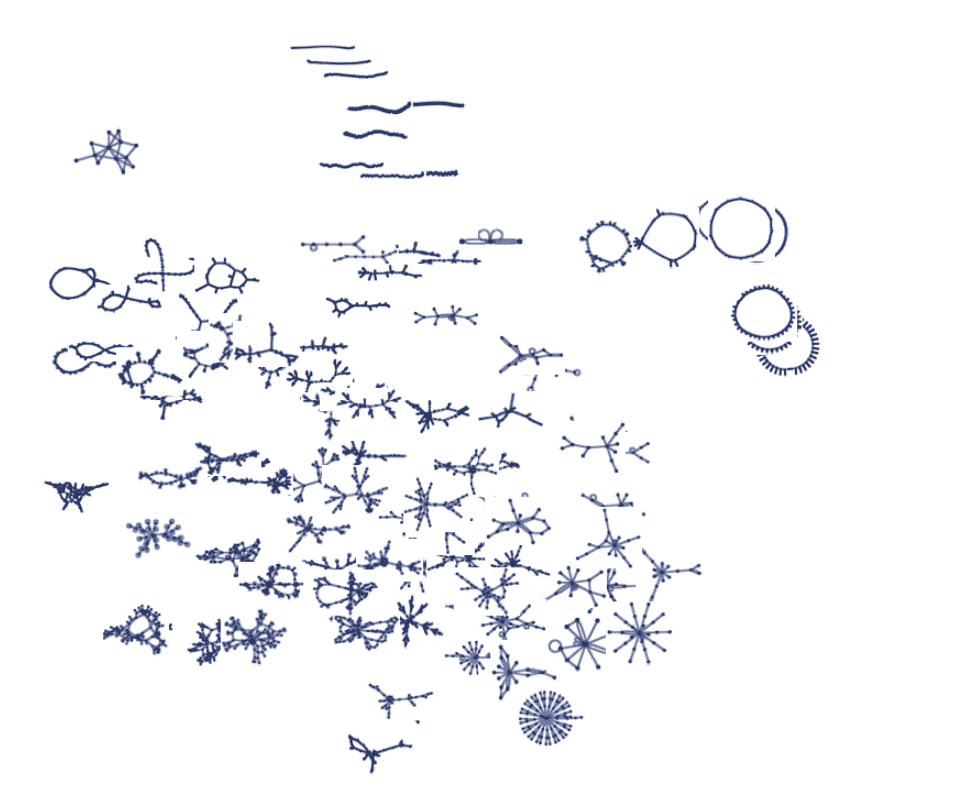

It needed me as a human to interpret it, but, yes, there were outliers that had effectively been “automatically discovered” by the neural net that was making the feature space plot.

它需要我作为一个人来解释它，但是，是的，有一些异常值实际上是由制作特征空间图的神经网络“自动发现”的。

I’ll give one more example—of a rather different kind—from my personal experience. Back in 1987—as part of building Version 1.0 of what’s now Wolfram Language —we were trying to develop algorithms to compute hundreds of mathematical special functions over very broad ranges of arguments. In the past, people had painstakingly computed series approximations for specific cases. But our approach was to use what amounts to machine learning, burning months of computer time fitting parameters in rational approximations. Nowadays we might do something similar with neural nets rather than rational approximations. But in both cases the concept is to find a general model of the “world” one’s dealing with (here, values of special functions)—and try to learn the parameters in the model from actual data. It’s not exactly “solving science”, and it wouldn’t even allow one to “discover the unexpected”. But it’s a place where “AI-like” knowledge of general expectations about smoothness or simplicity lets one construct the analog of a scientific model.

我将再举一个与我个人经历截然不同的例子。早在 1987 年，作为构建现在的 Wolfram 语言 1.0 版本的一部分，我们就试图开发算法来计算数百个具有广泛参数范围的数学特殊函数。过去，人们煞费苦心地计算特定情况下的级数近似值。但我们的方法是使用相当于机器学习的东西，花费数月的计算机时间来以有理近似拟合参数。如今，我们可能会用神经网络而不是有理近似来做类似的事情。但在这两种情况下，概念都是找到一个人正在处理的“世界”的通用模型（这里是特殊函数的值），并尝试从实际数据中学习模型中的参数。这并不完全是“解决科学问题”，甚至不允许人们“发现意想不到的事情”。但在这个地方，“类似人工智能”的关于流畅性或简单性的普遍期望的知识可以让人们构建科学模型的模拟。

## 人工智能可以预测会发生什么吗？

Can AI Predict What Will Happen?

It’s not the only role of science—and in the sections that follow we’ll explore others. But historically what’s often been viewed as a defining feature of successful science is: can it predict what will happen? So now we can ask: does AI give us a dramatically better way to do this?

这并不是科学的唯一作用，在接下来的部分中我们将探索其他作用。但从历史上看，通常被视为成功科学的一个决定性特征是：它能预测将会发生什么吗？所以现在我们可以问：人工智能是否为我们提供了一种更好的方法来做到这一点？

In the simplest case we basically want to use AI to do inductive inference. We feed in the results of a bunch of measurements, then ask the AI to predict the results of measurements we haven’t yet done. At this level, we’re treating the AI as a black box; it doesn’t matter what’s happening inside; all we care about is whether the AI gives us the right answer. We might think that somehow we can set up the AI up so that it “isn’t making any assumptions”—and is just “following the data”. But it’s inevitable that there’ll be some underlying structure in the AI, that makes it ultimately assume some kind of model for the data.

在最简单的情况下，我们基本上想用人工智能来做归纳推理。我们输入一系列测量结果，然后要求人工智能预测我们尚未完成的测量结果。在这个层面上，我们将人工智能视为一个黑匣子；里面发生什么并不重要；我们关心的只是人工智能是否给出了正确的答案。我们可能会认为，我们可以通过某种方式设置人工智能，使其“不做出任何假设”，而只是“遵循数据”。但人工智能中不可避免地会存在一些底层结构，这使得它最终假设某种数据模型。

Yes, there can be a lot of flexibility in this model. But one can’t have a truly “model-less model”. Perhaps the AI is based on a huge neural network, with billions of numerical parameters that can get tweaked. Perhaps even the architecture of the network can change. But the whole neural net setup inevitably defines an ultimate underlying model.

是的，这个模型可以有很大的灵活性。但不可能有一个真正的“无模型模型”。也许人工智能是基于一个巨大的神经网络，有数十亿个可以调整的数值参数。也许甚至网络的架构也可以改变。但整个神经网络设置不可避免地定义了一个最终的底层模型。

Let’s look at a very simple case. Let’s imagine our “data” is the blue curve here—perhaps representing the motion of a weight suspended on a spring—and that the “physics” tells us it continues with the red curve:

让我们看一个非常简单的案例。让我们想象我们的“数据”是这里的蓝色曲线——也许代表悬挂在弹簧上的重物的运动——并且“物理学”告诉我们它继续是红色曲线：

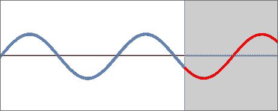

Now let’s take a very simple neural net

现在让我们来看一个非常简单的神经网络

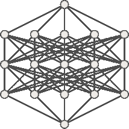

and let’s train it using the “blue curve” data above to get a network with a certain collection of weights:

让我们使用上面的“蓝色曲线”数据来训练它，以获得具有特定权重集合的网络：

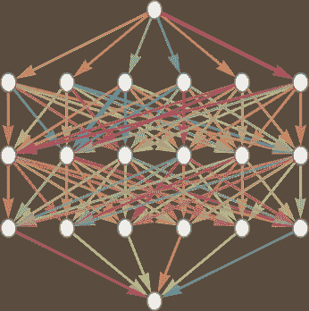

Now let’s apply this trained network to reproduce our original data and extend it:

现在让我们应用这个经过训练的网络来重现我们的原始数据并扩展它：

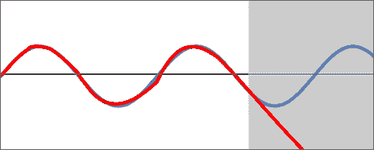

And what we see is that the network does a decent job of reproducing the data it was trained on, but when it comes to “predicting the future” it basically fails.

我们看到的是，网络在复制其训练数据方面做得不错，但当涉及到“预测未来”时，它基本上失败了。

So what’s going on here? Did we just not train long enough? Here’s what happens with progressively more rounds of training:

那么这是怎么回事呢？是我们训练的时间不够长吗？以下是逐步进行更多轮次训练时会发生的情况：

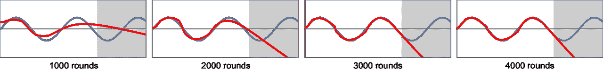

It doesn’t seem like this helps much. So maybe the problem is that our network is too small. Here’s what happens with networks having a series of sizes:

这似乎没有多大帮助。所以也许问题是我们的网络太小了。以下是具有一系列大小的网络会发生的情况：

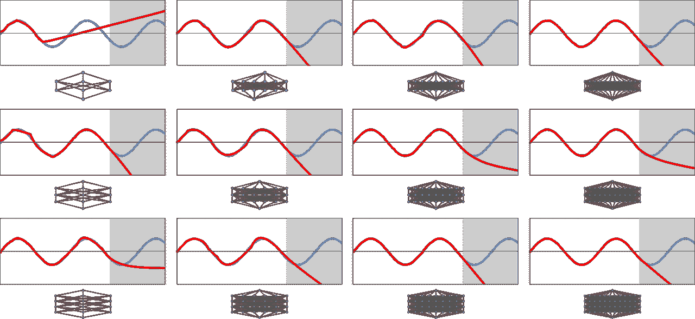

And, yes, larger sizes help. But they don’t solve the problem of making our prediction successful. So what else can we do? Well, one feature of the network is its activation function: how we determine the output at each node from the weighted sum of inputs. Here are some results with various （popular） activation functions :

是的，更大的尺寸会有所帮助。但它们并没有解决让我们的预测成功的问题。那么我们还能做什么呢？网络的一个特征是它的激活函数：我们如何根据输入的加权和确定每个节点的输出。以下是各种（流行）激活函数的一些结果：

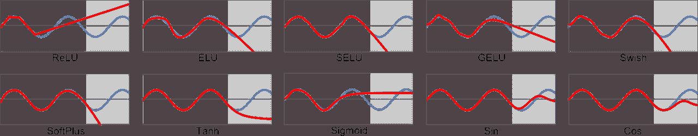

And there’s something notable here—that highlights the idea that there are “no model-less models”: different activation functions lead to different predictions, and the form of the predictions seems to be a direct reflection of the form of the activation function. And indeed there’s no magic here; it’s just that the neural net corresponds to a function whose core elements are activation functions.

这里有一点值得注意——强调了“不存在无模型模型”的想法：不同的激活函数会导致不同的预测，而预测的形式似乎是激活函数形式的直接反映。事实上，这里并没有什么魔力。只是神经网络对应的函数，其核心要素是激活函数。

So， for example， the network

因此，例如，网络

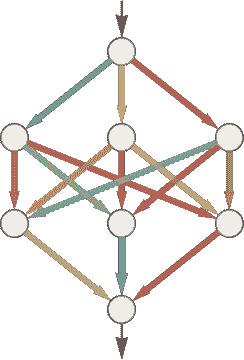

corresponds to the function

对应函数

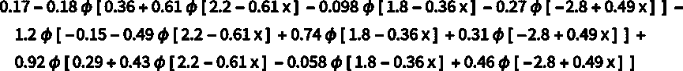

where ϕ represents the activation function used in this case.

其中 代表本例中使用的激活函数。

Of course, the idea of approximating one function by some combination of standard functions is extremely old (think: epicycles and before). Neural nets allow one to use more complicated (and hierarchical) combinations of more complicated and nonlinear functions, and provide a more streamlined way of “fitting all the parameters” that are involved. But at a fundamental level it’s the same idea.

当然，通过标准函数的某种组合来逼近一个函数的想法是非常古老的（想想：本轮和之前）。神经网络允许人们使用更复杂和非线性函数的更复杂（和分层）组合，并提供一种更简化的“拟合所涉及的所有参数”的方法。但从根本上讲，这是相同的想法。

And for example here are some approximations to our “data” constructed in terms of more straightforward mathematical functions :

例如，这里是根据更简单的数学函数构建的“数据”的一些近似值：

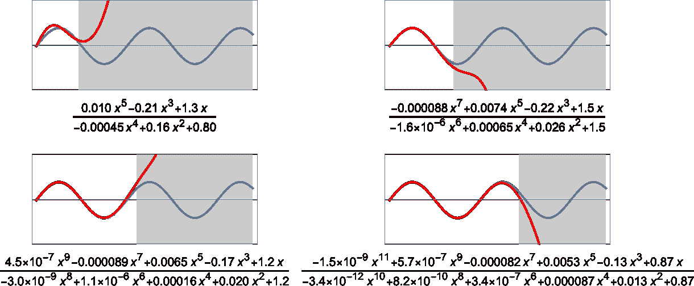

These have the advantage that it’s quite easy to state “what each model is” just by “giving its formula”. But just as with our neural nets, there are problems in making predictions.

这些的优点是，只需“给出其公式”就可以很容易地陈述“每个模型是什么”。但就像我们的神经网络一样，预测也存在问题。

(By the way, there are a whole range of methods for things like time series prediction , involving ideas like “ fitting to recurrence relations ”—and, in modern times, using transformer neural nets . And while some of these methods happen to be able to capture a periodic signal like a sine wave well, one doesn’t expect them to be broadly successful in accurately predicting functions.）

（顺便说一句，对于时间序列预测之类的事情有各种各样的方法，涉及诸如“拟合递归关系”之类的想法，并且在现代，使用变压器神经网络。虽然其中一些方法恰好能够为了很好地捕获正弦波等周期性信号，人们并不期望它们在准确预测函数方面取得广泛成功。)

OK, one might say, perhaps we’re trying to use—and train—our neural nets in too narrow a way. After all, it seems as if it was critical to the success of ChatGPT to have a large amount of training data about all kinds of things, not just some narrow specific area. Presumably, though, what that broad training data did was to let ChatGPT learn the “general patterns of language and common sense” , which it just wouldn’t be able to pick up from narrower training data.

好吧，有人可能会说，也许我们试图以一种过于狭隘的方式使用和训练我们的神经网络。毕竟，拥有大量有关各种事物的训练数据，而不仅仅是某些狭窄的特定领域，似乎对 ChatGPT 的成功至关重要。不过，据推测，广泛的训练数据的作用是让 ChatGPT 学习“语言和常识的一般模式”，而它无法从更窄的训练数据中获取这些模式。

So what’s the analog for us here? It might be that we’d want our neural net to have a “general idea of how functions work”—for example to know about things like continuity of functions, or, for that matter, periodicity or symmetry. So, yes, we can go ahead and train not just on a specific “window” of data like we did above, but on whole families of functions—say collections of trigonometric functions, or perhaps all the built-in mathematical functions in the Wolfram Language.

那么我们这里的类比是什么？我们可能希望我们的神经网络有一个“函数如何工作的一般概念”——例如了解函数的连续性，或者就此而言，周期性或对称性。所以，是的，我们不仅可以像上面那样在特定的数据“窗口”上进行训练，还可以在整个函数系列上进行训练——比如三角函数的集合，或者 Wolfram 中的所有内置数学函数语言。

And, needless to say, if we do this, we’ll surely be able to successfully predict our sine curve above—just as we would if we were using traditional Fourier analysis with sine curves as our basis. But is this “doing science”?

而且，不用说，如果我们这样做，我们肯定能够成功预测上面的正弦曲线 - 就像我们使用以正弦曲线为基础的传统傅里叶分析一样。但这是“做科学”吗？

In essence it’s saying, “I’ve seen something like this before, so I figure this is what’s going to happen now”. And there’s no question that can be useful; indeed it’s an automated version of a typical thing that a human experienced in some particular area will be able to do. We’ll return to this later. But for now the main point is that at least when it comes to things like predicting functions, it doesn’t seem as if neural nets—and today’s AIs—can in any obvious way “see further” than what goes into their construction and training. There’s no “emergent science”; it’s just fairly direct “pattern matching”.

本质上，它是在说，“我以前见过类似的事情，所以我认为这就是现在会发生的事情”。毫无疑问，这个问题是有用的。事实上，它是人类在某个特定领域经历过的典型事情的自动化版本。我们稍后再讨论这一点。但目前的要点是，至少在预测函数之类的事情上，神经网络和当今的人工智能似乎无法以任何明显的方式“看得更远”，而不是其构建和训练的过程。。不存在“新兴科学”；这只是相当直接的“模式匹配”。

## 预测计算过程

Predicting Computational Processes

Predicting a function is a particularly austere task and one might imagine that “real processes”—for example in nature—would have more “ambient structure” which an AI could use to get a “foothold” for prediction. And as an example of what we might think of as “artificial nature” we can consider computational systems like cellular automata. Here’s an example of what a particular cellular automaton rule does ， with a particular initial condition:

预测函数是一项特别严峻的任务，人们可能会想象“真实过程”（例如自然界中的过程）将具有更多“环境结构”，人工智能可以利用它来获得预测的“立足点”。作为我们可能认为的“人工自然”的一个例子，我们可以考虑像元胞自动机这样的计算系统。以下是特定元胞自动机规则在特定初始条件下的作用示例：

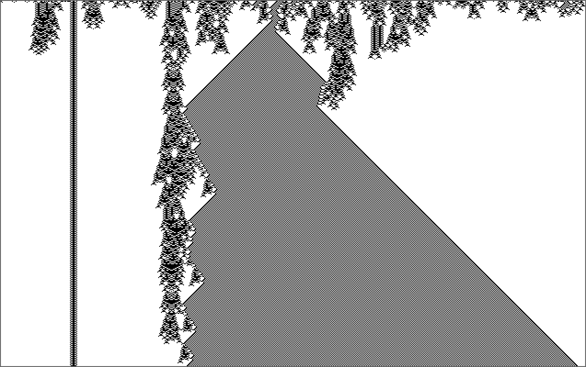

There’s a mixture here of simplicity and complexity. And as humans we can readily predict what’s going to happen in the simple parts, but basically can’t say much about the other parts. So how would an AI do?

这里既简单又复杂。作为人类，我们可以很容易地预测简单部分会发生什么，但基本上不能对其他部分说太多。那么人工智能会怎么做呢？

Clearly if our “AI” can just run the cellular automaton rule then it will be able to predict everything, though with great computational effort. But the real question is whether an AI can shortcut things to make successful predictions without doing all that computational work—or, put another way, whether the AI can successfully find and exploit pockets of computational reducibility.

显然，如果我们的“人工智能”能够运行元胞自动机规则，那么它将能够预测一切，尽管需要付出巨大的计算工作。但真正的问题是人工智能是否可以在不做所有计算工作的情况下走捷径来做出成功的预测，或者换句话说，人工智能是否可以成功地找到并利用计算可简化性的部分。

So, as a specific experiment, let’s set up a neural net to try to efficiently predict the behavior of our cellular automaton. Our network is basically a straightforward—though “modern”—convolutional autoencoder， with 59 layers and a total of about 800,000 parameters:

因此，作为一个具体的实验，让我们建立一个神经网络来尝试有效地预测元胞自动机的行为。我们的网络基本上是一个简单但“现代”的卷积自动编码器，有 59 层，总共大约 800,000 个参数：

It’s trained much like an LLM. We got lots of examples of the evolution of our cellular automaton, then we showed the network the “top half” of each one, and tried to get it to successfully continue this, to predict the “bottom half”. In the specific experiment we did, we gave 32 million examples of 64-cell-wide cellular automaton evolution. (And, yes, this number of examples is tiny compared to all

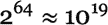

possible initial configurations.) Then we tried feeding in “chunks” of cellular automaton evolution 64 cells wide and 64 steps long—and looked to see what probabilities the network assigned to different possible continuations.

它的训练方式与 LLM 非常相似。我们得到了很多元胞自动机演化的例子，然后我们向网络展示了每个例子的“上半部分”，并试图让它成功地继续这一过程，以预测“下半部分”。在我们所做的具体实验中，我们给出了 3200 万个 64 细胞范围的元胞自动机进化的例子。（是的，与所有

可能的初始配置相比，这个例子的数量很小。）然后我们尝试输入元胞自动机进化的“块”，宽 64 个单元，长 64 步，然后看看网络分配给不同可能的延续的概率是多少。

Here are some results for a sequence of different initial conditions:

以下是一系列不同初始条件的一些结果：

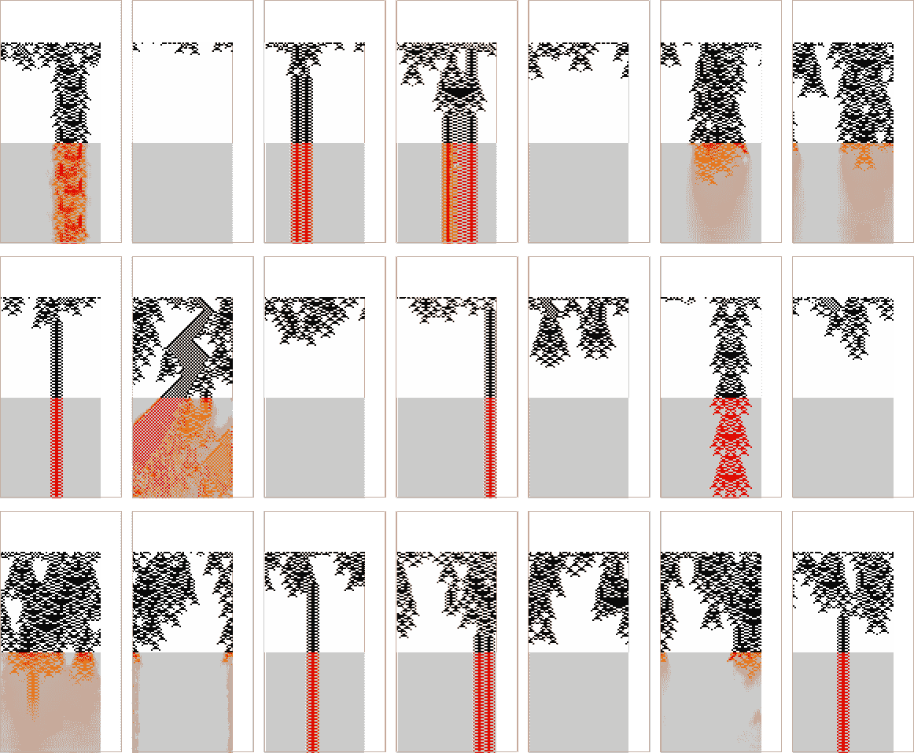

And what we see is what we might expect: when the behavior is simple enough, the network basically gets it right. But when the behavior is more complicated, the network usually doesn’t do so well with it. It still often gets it at least “vaguely right”—but the details aren’t there.

我们所看到的就是我们所期望的：当行为足够简单时，网络基本上会正确执行。但当行为更加复杂时，网络通常处理得不太好。它仍然常常至少“模糊地正确”——但细节不存在。

Perhaps, one might think, the network just wasn’t trained for long enough, or with enough examples. And to get some sense of the effect of more training， here’s how the predicted probabilities evolve with successive quarter million rounds of training:

人们可能会想，也许网络训练的时间不够长，或者没有足够的例子。为了了解更多训练的效果，以下是预测概率如何随着连续 25 万轮训练而变化：

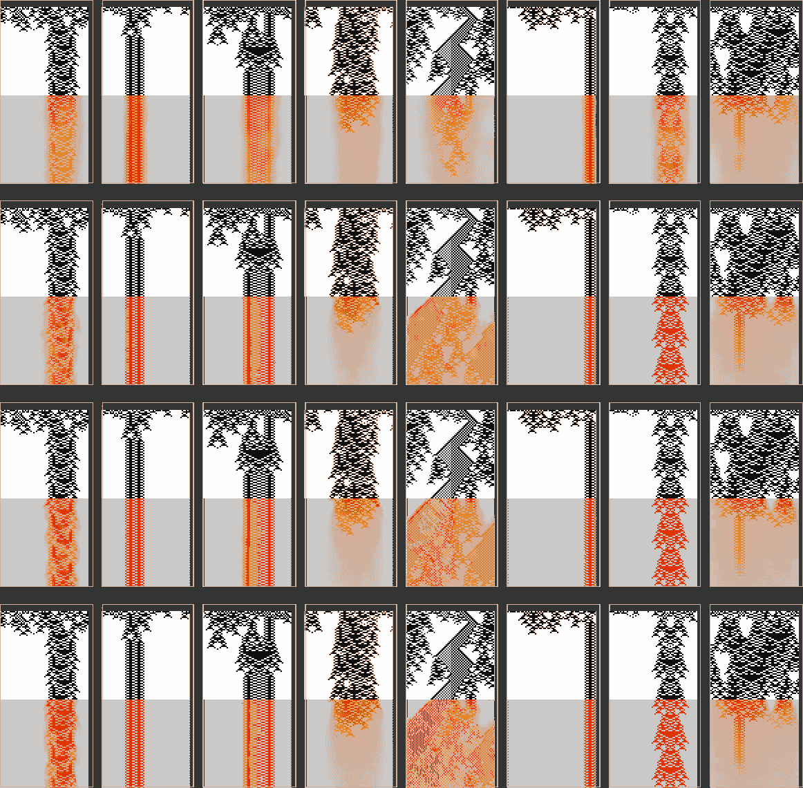

These should be compared to the exact result:

这些应该与确切的结果进行比较：

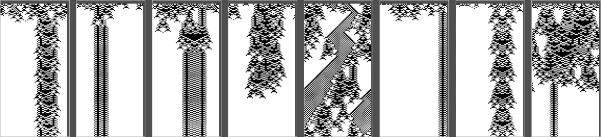

And, yes, with more training there is improvement, but by the end it seems like it probably won’t get much better. (Though its loss curve does show some sudden downward jumps during the course of training, presumably as “discoveries” are made—and we can’t be sure there won’t be more of these.)

是的，随着更多的训练，情况会有所改善，但到最后，情况似乎可能不会好多少。（尽管它的损失曲线在训练过程中确实显示出一些突然的向下跳跃，大概是随着“发现”的出现——我们不能确定不会有更多这样的情况。)

It’s extremely typical of machine learning that it manages to do a good job of getting things “roughly right”. But nailing the details is not what machine learning tends to be good at. So when what one’s trying to do depends on that, machine learning will be limited. And in the prediction task we’re considering here, the issue is that once things go even slightly off track, everything basically just gets worse from there on out.

机器学习的一个非常典型的特点就是它能够很好地让事情“大致正确”。但把握细节并不是机器学习所擅长的。因此，当一个人想要做什么取决于此时，机器学习就会受到限制。在我们在这里考虑的预测任务中，问题是，一旦事情稍微偏离轨道，一切基本上都会变得更糟。

## 识别计算可归约性

Identifying Computational Reducibility

Computational reducibility is at the center of what we normally think of as “doing science”. Because it’s not only responsible for letting us make predictions, it’s also what lets us identify regularities, make models and compressed summaries of what we see—and develop understanding that we can capture in our minds.

计算可还原性是我们通常认为的“做科学”的核心。因为它不仅能让我们做出预测，还能让我们识别规律、对我们所看到的进行模型和压缩总结，并发展我们可以在头脑中捕捉到的理解。

But how can we find computational reducibility ? Sometimes it’s very obvious. Like when we make a visualization of some behavior (like the cellular automaton evolution above) and immediately recognize simple features in it. But in practice computational reducibility may not be so obvious, and we may have to dig through lots of details to find it. And this is a place where AI can potentially help a lot.

但我们怎样才能找到计算可简化性呢？有时它非常明显。就像当我们对某些行为进行可视化（例如上面的细胞自动机进化）并立即识别其中的简单特征时。但在实践中，计算可简化性可能并不那么明显，我们可能需要挖掘大量细节才能找到它。这是人工智能可以提供很大帮助的地方。

At some level we can think of it as a story of “finding the right parametrization” or the “right coordinate system”. As a very straightforward example， consider the seemingly quite random cloud of points:

在某种程度上，我们可以将其视为“找到正确的参数化”或“正确的坐标系”的故事。作为一个非常简单的例子，考虑看似相当随机的点云：

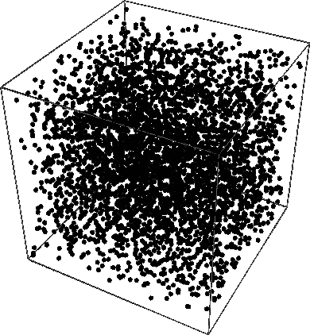

Just turning this particular cloud of points to the appropriate angle reveals obvious regularities :

只要将这个特定的点云旋转到适当的角度，就会发现明显的规律：

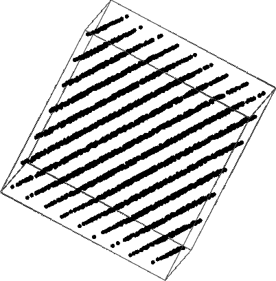

But is there a general way to pick out regularities if they’re there? There’s traditional statistics (“Is there a correlation between A and B?”, etc.). There’s model fitting (“Is this a sum of Gaussians?”). There’s traditional data compression (“Is it shorter after run-length encoding?”). But all of these pick out only rather specific kinds of regularities. So can AI do more? Can it perhaps somehow provide a general way to find regularities?

但如果存在规律的话，有没有一种通用的方法可以找出规律呢？有传统的统计数据（“A 和 B 之间是否存在相关性？”等）。有模型拟合（“这是高斯的总和吗？”) . 有传统的数据压缩（“游程编码后是否更短？”) . 但所有这些都只能挑选出相当特定的规律性。那么人工智能可以做得更多吗？它能否以某种方式提供一种寻找规律性的通用方法？

To say one’s found a regularity in something is basically equivalent to saying one doesn’t need to specify all the details of the thing: that there’s a reduced representation from which one can reconstruct it. So, for example, given the “points-lie-on-lines” regularity in the picture above, one doesn’t need to separately specify the positions of all the points; one just needs to know that they form stripes with a certain separation.

说一个人发现了某事物的规律性，基本上就等于说一个人不需要指定该事物的所有细节：存在一种可以重构它的简化表示。因此，例如，考虑到上图中的“点在线上”规律，我们不需要单独指定所有点的位置；人们只需要知道它们形成具有一定间隔的条纹即可。

OK, so let’s imagine we have an image with a certain number of pixels. We can ask whether there’s reduced representation that involves less data—from which the image can effectively be reconstructed. And with neural nets there’s what one might think of as a trick for finding such a reduced representation.

好的，假设我们有一张具有一定像素数的图像。我们可以问是否存在涉及更少数据的简化表示，从而可以有效地重建图像。对于神经网络，人们可能会认为这是找到这种简化表示的一种技巧。

The basic idea is to set up a neural net as an autoencoder that takes inputs and reproduces them as outputs. One might think this would be a trivial task. But it’s not, because the data from the input has to flow through the innards of the neural net, effectively being “ground up” at the beginning and “reconstituted” at the end. But the point is that with enough examples of possible inputs, it’s potentially possible to train the neural net to successfully reproduce inputs, and operate as an autoencoder.

基本思想是将神经网络设置为自动编码器，接收输入并将其再现为输出。人们可能会认为这是一项微不足道的任务。但事实并非如此，因为输入的数据必须流经神经网络的内部，实际上在开始时被“磨碎”，在最后被“重构”。但关键是，有了足够多的可能输入的例子，就有可能训练神经网络成功地再现输入，并作为自动编码器运行。

But now the idea is to look inside the autoencoder, and to pull out a reduced representation that it’s come up with. As data flows from layer to layer in the neural net, it’s always trying to preserve the information it needs to reproduce the original input. And if a layer has fewer elements, what’s present at that layer must correspond to some reduced representation of the original input.

但现在的想法是查看自动编码器的内部，并提取它所提出的简化表示。当数据在神经网络中从一层流向另一层时，它总是试图保留重现原始输入所需的信息。如果一个层的元素较少，则该层的元素必须与原始输入的某种简化表示相对应。

Let’s start with a standard modern image autoencoder , that’s been trained on a few billion images typical of what’s on the web. Feed it a picture of a cat， and it’ll successfully reproduce something that looks like the original picture:

让我们从标准的现代图像自动编码器开始，它已经过网络上典型的数十亿张图像的训练。给它喂一张猫的图片，它会成功地复制出看起来像原始图片的东西：

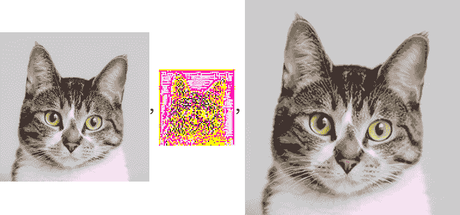

But in the middle there’ll be a reduced representation， with many fewer pixels—that somehow still captures what’s needed of the cat （here shown with its 4 color channels separated）:

但在中间会有一个减少的表示，像素少得多，但不知何故仍然捕捉到了猫的需要（这里显示了它的 4 个颜色通道分开）：

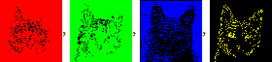

We can think of this as a kind of “black-box model” for the cat image. We don’t know what the elements (“features”) in the model mean, but somehow it’s successfully capturing “the essence of the picture”.

我们可以将其视为猫图像的一种“黑盒模型”。我们不知道模型中的元素（“特征”）意味着什么，但不知怎的，它成功地捕捉了“图片的本质”。

So what happens if we apply this to “scientific data”, or for example “artificial natural processes” like cellular automata? Here’s a case where we get successful compression:

那么，如果我们将其应用于“科学数据”，或者例如细胞自动机等“人工自然过程”，会发生什么呢？这是我们成功压缩的案例：

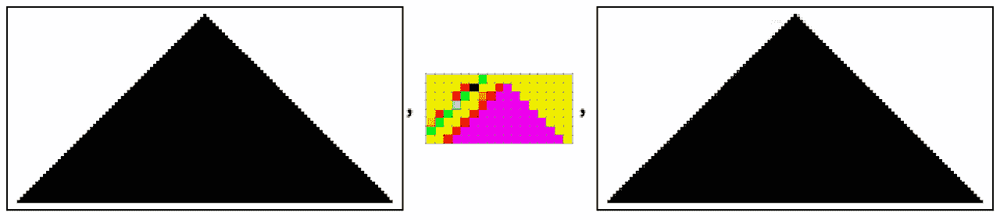

In this case it’s not quite so successful:

在这种情况下，它并不那么成功：

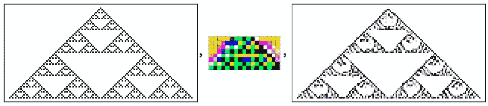

And in these cases—where there’s underlying computational irreducibility—it has trouble:

在这些存在潜在计算不可约性的情况下，它会遇到麻烦：

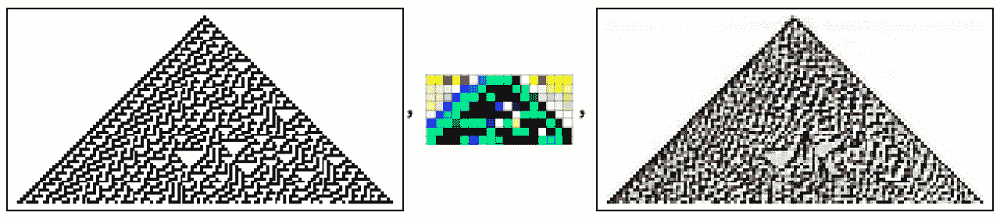

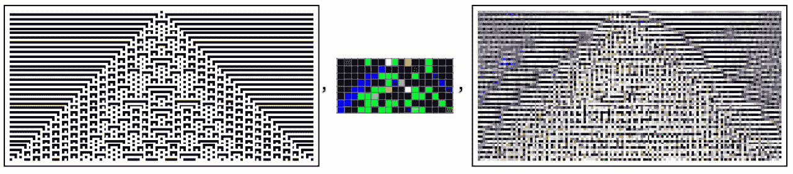

But there’s a bit more to this story. You see, the autoencoder we’re using was trained on “everyday images”, not these kinds of “scientific images”. So in effect it’s trying to model our scientific images in terms of constructs like eyes and ears that are common in pictures of things like cats.

但这个故事还有更多内容。你看，我们使用的自动编码器是针对“日常图像”进行训练的，而不是这些类型的“科学图像”。因此，实际上，它试图根据眼睛和耳朵等结构来模拟我们的科学图像，这些结构在猫等物体的图片中很常见。

So what happens if—like in the case of cellular automaton prediction above—we train an autoencoder more specifically on the kinds of images we want?

那么，如果像上面的元胞自动机预测一样，我们针对我们想要的图像类型更具体地训练自动编码器，会发生什么呢？

Here are two very simple neural nets that we can use as an “encoder” and a “decoder” to make an autoencoder:

这是两个非常简单的神经网络，我们可以将它们用作“编码器”和“解码器”来制作自动编码器：

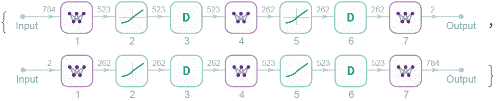

Now let’s take the standard MNIST image training set ， and use these to train the autoencoder:

现在让我们采用标准 MNIST 图像训练集，并使用它们来训练自动编码器：

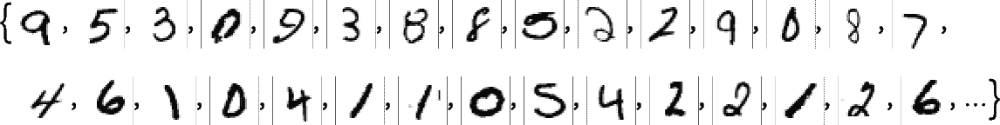

Each of these images has 28×28 pixels. But in the middle of the autoencoder we have a layer with just two elements. So this means that whatever we ask it to encode must be reduced to just two numbers:

这些图像中的每一个都有 28×28 像素。但在自动编码器的中间，我们有一个只有两个元素的层。所以这意味着我们要求它编码的任何内容都必须减少到只有两个数字：

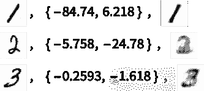

And what we see here is that at least for images that look more or less like the ones it was trained on, the autoencoder manages to reconstruct something that looks at least roughly right, even from the radical compression. If you give it other kinds of images， however， it won’t be as successful， instead basically just insisting on reconstructing them as looking like images from its training set:

我们在这里看到的是，至少对于看起来或多或少像它所训练的图像的图像，自动编码器设法重建看起来至少大致正确的东西，即使是从根本上的压缩。然而，如果你给它其他类型的图像，它就不会那么成功，而基本上只是坚持将它们重建为看起来像训练集中的图像：

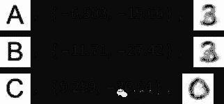

OK, so what about training it on cellular automaton images? Let’s take 10 million images generated with a particular rule:

好的，那么在元胞自动机图像上训练它怎么样？让我们看一下使用特定规则生成的 1000 万张图像：

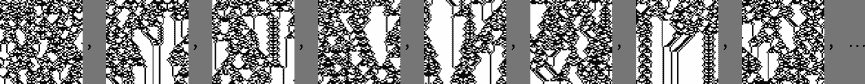

Now we train our autoencoder on these images. Then we try feeding it similar images:

现在我们在这些图像上训练我们的自动编码器。然后我们尝试向它提 供类似的图像：

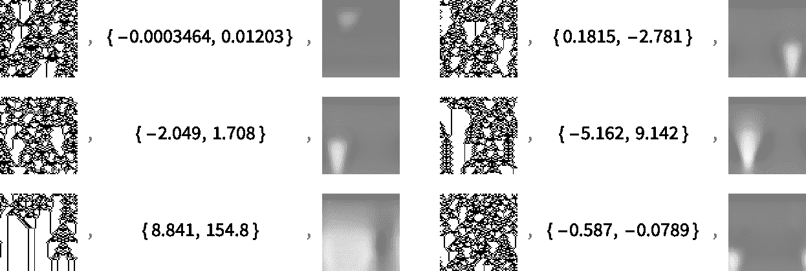

The results are at best very approximate; this small neural net didn’t manage to learn the “detailed ways of this particular cellular automaton”. If it had been successful at characterizing all the apparent complexity of the cellular automaton evolution with just two numbers, then we could have considered this an impressive piece of science. But, unsurprisingly, the neural net was effectively blocked by computational irreducibility.

结果充其量只是非常近似；这个小型神经网络无法学习“这个特定细胞自动机的详细方式”。如果它仅用两个数字就成功地描述了元胞自动机进化的所有明显复杂性，那么我们可以认为这是一项令人印象深刻的科学。但是，毫不奇怪，神经网络实际上被计算不可约性所阻碍。

But even though it can’t “seriously crack computational irreducibility” the neural net can still “make useful discoveries”, in effect by finding little pieces of computational reducibility, and little regularities. So， for example， if we take images of “noisy letters” and use a neural net to reduce them to pairs of numbers， and use these numbers to place the images， we get a “dimension-reduced feature space plot” that separates images of different letters:

但即使它不能“严重破解计算不可约性”，神经网络仍然可以“做出有用的发现”，实际上是通过发现计算可约性的小片段和规律性。因此，例如，如果我们拍摄“嘈杂字母”的图像并使用神经网络将它们简化为数字对，并使用这些数字来放置图像，我们就会得到一个将图像分开的“降维特征空间图”不同字母的：

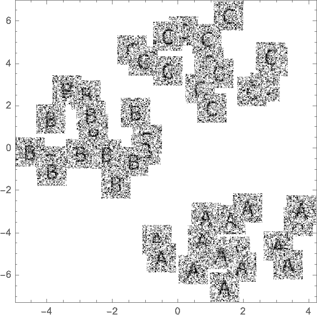

But consider， for example， a collection of cellular automata with different rules:

但是，例如，考虑具有不同规则的元胞自动机的集合：

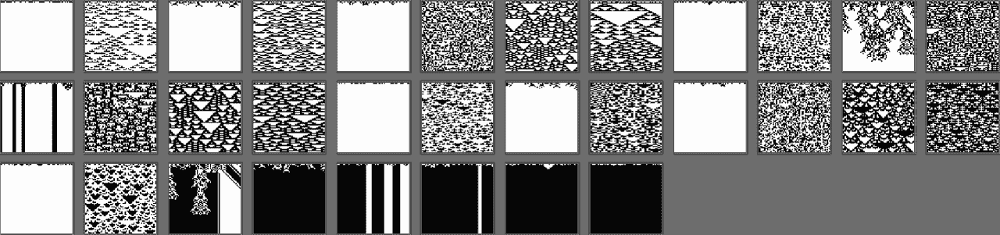

Here’s how a typical neural net would arrange these images in “feature space”:

以下是典型的神经网络如何在“特征空间”中排列这些图像：

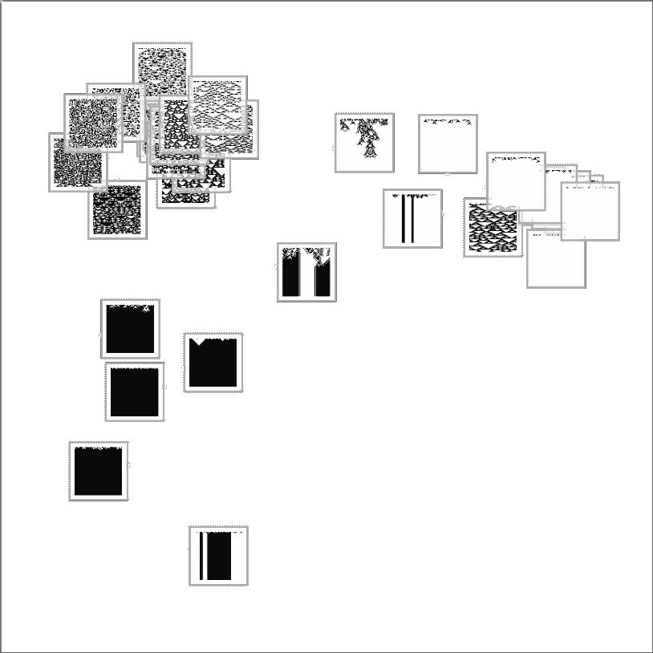

And, yes, this has almost managed to automatically discover the four classes of behavior that I identified in early 1983. But it’s not quite there. Though in a sense this is a difficult case, very much face-to-face with computational irreducibility. And there are plenty of cases (think: arrangement of the periodic table based on element properties; similarity of fluid flows based on Reynolds number; etc.) where one can expect a neural net to key into pockets of computational reducibility and at least successfully recapitulate existing scientific discoveries.

是的，这几乎成功地自动发现了我在 1983 年初确定的四类行为。但它还没有完全实现。尽管从某种意义上说，这是一个困难的情况，与计算不可约性非常面对面。在很多情况下（想想：基于元素属性的周期表排列；基于雷诺数的流体流动的相似性；等等），人们可以期望神经网络能够进入计算可简化性的口袋，并至少成功地重述现有的科学发现。

## 非人类世界中的人工智能

AI in the Non-human World

In its original concept AI was about developing artificial analogs of human intelligence. And indeed the recent great successes of AI—say in visual object recognition or language generation—are all about having artificial systems that reproduce the essence of what humans do. It’s not that there’s a precise theoretical definition of what makes an image be of a cat versus of a dog. What matters is that we can have a neural net that will come to the same conclusions as humans do.

在其最初的概念中，人工智能是关于开发人类智能的人工模拟。事实上，人工智能最近取得的巨大成功——比如在视觉对象识别或语言生成方面——都是关于拥有重现人类行为本质的人工系统。这并不是说对于猫和狗的图像是什么有一个精确的理论定义。重要的是我们可以拥有一个能够得出与人类相同的结论的神经网络。

So why does this work? Probably it’s because neural nets capture the architectural essence of actual brains. Of course the details of artificial neural networks aren’t the same as biological brains. But in a sense the big surprise of modern AI is that there seems to be enough universality to make artificial neural nets behave in ways that are functionally similar to human brains, at least when it comes to things like visual object recognition or language generation.

那么为什么这会起作用呢？可能是因为神经网络捕捉了实际大脑的结构本质。当然，人工神经网络的细节与生物大脑不同。但从某种意义上说，现代人工智能的最大惊喜在于，它似乎有足够的普遍性，使人工神经网络的行为方式与人脑的功能相似，至少在视觉对象识别或语言生成等方面如此。

But what about questions in science? At one level we can ask whether neural nets can emulate what human scientists do. But there’s also another level: is it possible that neural nets can just directly work out how systems—say in nature—behave? Imagine we’re studying some physical process. Human scientists might find some human-level description of the system, say in terms of mathematical equations. But the system itself is just directly doing what it does. And the question is whether that’s something a neural net can capture.

但是科学问题又如何呢？在某种程度上，我们可以问神经网络是否可以模仿人类科学家的工作。但还有另一个层面：神经网络是否有可能直接计算出系统（比如自然界）的行为方式？想象一下我们正在研究一些物理过程。人类科学家可能会找到一些对系统的人类水平的描述，比如数学方程。但系统本身只是直接做它所做的事情。问题是神经网络是否可以捕捉到这一点。

And if neural nets “work” on “human-like tasks” only because they’re architecturally similar to brains, there’s no immediate reason to think that they should be able to capture “raw natural processes” that aren’t anything to do with brains. So what’s going on when AI does something like predicting protein folding?

如果神经网络在“类似人类的任务”上“工作”只是因为它们在结构上与大脑相似，那么没有直接的理由认为它们应该能够捕获与人类无关的“原始自然过程”大脑。那么，当人工智能做出预测蛋白质折叠之类的事情时，会发生什么呢？

One part of the story, I suspect, is that even though the physical process of protein folding has nothing to do with humans, the question of what aspects of it we consider significant does. We don’t expect that the neural net will predict the exact position of every atom (and in natural environments the atoms in a protein don’t even have precisely fixed positions). Instead, we want to know things like whether the protein has the “right general shape”, with the right “identifiable features” (like, say, alpha helices), or the right functional properties. And these are now more “human” questions—more in the “eye of the beholder”—and more like a question such as whether we humans judge an image to be of a cat versus a dog. So if we conclude that a neural net “solves the scientific problem” of how a protein folds, it might be at least in part just because the criteria of success that our brains (“subjectively”) apply is something that a neural net—with its brain-like architecture—happens to be able to deliver.

我怀疑这个故事的一部分是，尽管蛋白质折叠的物理过程与人类无关，但我们认为其中哪些方面重要的问题却与人类无关。我们并不期望神经网络能够预测每个原子的确切位置（在自然环境中，蛋白质中的原子甚至没有精确固定的位置）。相反，我们想知道蛋白质是否具有“正确的一般形状”、是否具有正确的“可识别特征”（例如α螺旋）或正确的功能特性。现在，这些问题更加“人性化”——更多的是“情人眼里出西施”——而且更像是一个问题，比如我们人类是否判断图像是猫还是狗。因此，如果我们得出结论，神经网络“解决了蛋白质如何折叠的科学问题”，那么这可能至少部分是因为我们的大脑（“主观地”）应用的成功标准是神经网络——它的类脑架构恰好能够实现这一目标。

It’s a bit like producing an image with generative AI . At the level of basic human visual perception, it may look like something we recognize. But if we scrutinize it， we can see that it’s not “objectively” what we think it is:

这有点像用生成式人工智能生成图像。在人类基本视觉感知的水平上，它可能看起来像我们认识的东西。但如果我们仔细审视它，就会发现它并不是我们想象的那样“客观”：

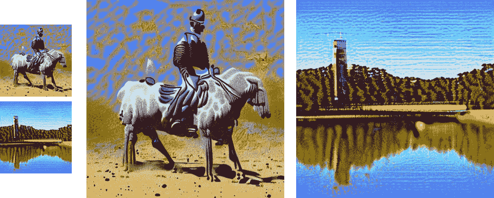

It wasn’t ever really practical with “first-principles physics” to figure out how proteins fold. So the fact that neural nets can get even roughly correct answers is impressive. So how do they do it? A significant part of it is surely effectively just matching chunks of protein to what’s in the training set—and then finding “plausible” ways to “stitch” these chunks together. But there’s probably something else too. One’s familiar with certain “pieces of regularity” in proteins (things like alpha helices and beta sheets). But it seems likely that neural nets are effectively plugging into other kinds of regularity; they’ve somehow found pockets of reducibility that we didn’t know were there. And particularly if just a few pockets of reducibility show up over and over again, they’ll effectively represent new, general “results in science” (say, some new kind of commonly occurring “meta-motif” in protein structure).

用“第一原理物理学”来弄清楚蛋白质如何折叠从来都不太实用。因此，神经网络甚至可以得到大致正确的答案，这一事实令人印象深刻。那么他们是如何做到的呢？其中一个重要部分肯定是有效地将蛋白质块与训练集中的内容相匹配，然后找到“合理”的方法将这些块“缝合”在一起。但可能还有其他原因。人们熟悉蛋白质中的某些“规律性片段”（例如α螺旋和β折叠）。但神经网络似乎正在有效地融入其他类型的规律性；他们以某种方式发现了我们不知道的可还原性。特别是如果只有少数可还原性反复出现，它们将有效地代表新的、普遍的“科学结果”（例如，蛋白质结构中某种新的常见“元基序”）。

But while it’s fundamentally inevitable that there must be an infinite number of pockets of computational reducibility in the end, it’s not clear at the outset either how significant these might be in things we care about, or how successful neural net methods might be in finding them. We might imagine that insofar as neural nets mirror the essential operation of our brains, they’d only be able to find pockets of reducibility in cases where we humans could also readily discover them, say by looking at some visualization or another.

但是，虽然最终必然存在无数个计算可简化性的部分，这从根本上是不可避免的，但从一开始就不清楚这些对我们关心的事情有多重要，或者神经网络方法在找到它们方面可能有多成功。我们可能会想象，只要神经网络反映了我们大脑的基本操作，它们就只能在我们人类也可以轻松发现它们的情况下找到可还原性的区域，比如通过查看某种可视化或其他可视化。

But an important point is that our brains are normally “trained” only on data that we readily experience with our senses: we’ve seen the equivalent of billions of images, and we’ve heard zillions of sounds. But we don’t have direct experience of the microscopic motions of molecules, or of a multitude of kinds of data that scientific observations and measuring devices can deliver.

但重要的一点是，我们的大脑通常只接受我们通过感官轻易体验到的数据进行“训练”：我们已经看到了相当于数十亿张图像，我们已经听到了无数声音。但我们没有分子微观运动的直接经验，也没有科学观察和测量设备可以提供的多种数据的直接经验。

A neural net, however, can “grow up” with very different “sensory experiences”—say directly experiencing “chemical space”, or, for that matter “ metamathematical space ”, or the space of financial transactions, or interactions between biological organisms, or whatever. But what kinds of pockets of computational reducibility exist in such cases? Mostly we don’t know. We know the ones that correspond to “known science”. But even though we can expect others must exist, we don’t normally know what they are.

然而，神经网络可以在非常不同的“感官体验”中“成长”——比如直接体验“化学空间”，或者就此而言“元数学空间”，或者金融交易的空间，或者生物有机体之间的相互作用，管他呢。但在这种情况下存在哪些类型的计算可简化性呢？大多数情况下我们不知道。我们知道那些与“已知科学”相对应的内容。但即使我们可以预期其他事物一定存在，我们通常也不知道它们是什么。

Will they be “accessible” to neural nets? Again, we don’t know. Quite likely, if they are accessible, then there’ll be some representation—or, say, visualization—in which the reducibility will be “obvious” to us. But there are plenty of ways this could fail. For example, the reducibility could be “visually obvious”, but only, say, in 3D volumes where, for example, it’s hard even to distinguish different structures of fluffy clouds. Or perhaps the reducibility could be revealed only through some computation that’s not readily handled by a neural net.

它们可以被神经网络“访问”吗？再说一遍，我们不知道。很可能，如果它们是可访问的，那么就会有一些表示——或者说，可视化——其中的可还原性对我们来说将是“显而易见的”。但有很多方法可能会失败。例如，还原性可能是“视觉上显而易见的”，但仅限于 3D 体积，例如，甚至很难区分蓬松云的不同结构。或者也许只能通过一些神经网络不易处理的计算来揭示可归约性。

Inevitably there are many systems that show computational irreducibility, and which—at least in their full form—must be inaccessible to any “shortcut method”, based on neural nets or otherwise. But what we’re asking is whether, when there is a pocket of computational reducibility, it can be captured by a neural net.

不可避免地，有许多系统表现出计算不可约性，并且至少在其完整形式下，任何基于神经网络或其他方式的“捷径方法”都无法访问这些系统。但我们要问的是，当存在一定的计算可简化性时，它是否可以被神经网络捕获。

But once again we’re confronted with the fact there are no “model-less models”. Some particular kind of neural net will readily be able to capture some particular kinds of computational reducibility; another will readily be able to capture others. And, yes, you can always construct a neural net that will approximate any given specific function. But in capturing some general kind of computational reducibility, we are asking for much more—and what we can get will inevitably depend on the underlying structure of the neural net.

但我们再次面临这样一个事实：不存在“无模型模型”。某些特定类型的神经网络将能够轻松捕获某些特定类型的计算可归约性；另一个将很容易捕获其他人。是的，您始终可以构建一个神经网络来近似任何给定的特定函数。但在捕获某种通用的计算可简化性时，我们要求的更多，而我们能得到的将不可避免地取决于神经网络的底层结构。

But let’s say we’ve got a neural net to successfully key into computational reducibility in a particular system. Does that mean it can predict everything? Typically no. Because almost always the computational reducibility is “just a pocket”, and there’s plenty of computational irreducibility—and “surprises”—“outside”.

但假设我们有一个神经网络可以成功地控制特定系统中的计算可简化性。这是否意味着它可以预测一切？通常不会。因为几乎总是计算可约性“只是一个口袋”，并且“外部”有大量计算不可约性和“惊喜”。

And indeed this seems to happen even in the case of something like protein folding. Here are some examples of proteins with what we perceive as fairly simple structures—and the neural net prediction （in yellow） agrees quite well with the results of physical experiments （gray tubes）:

事实上，即使在蛋白质折叠之类的情况下，这种情况似乎也会发生。以下是一些我们认为结构相当简单的蛋白质示例，神经网络预测（黄色）与物理实验的结果（灰色管）非常吻合：

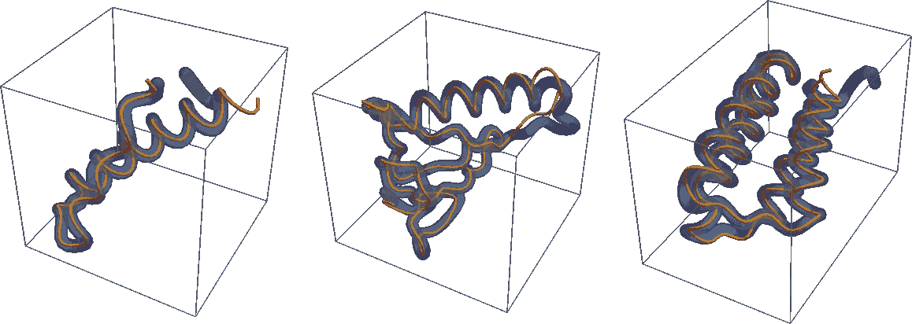

But for proteins with what we perceive as more complicated structures， the agreement is often not nearly as good:

但对于我们认为结构更复杂的蛋白质来说，一致性通常不太好：

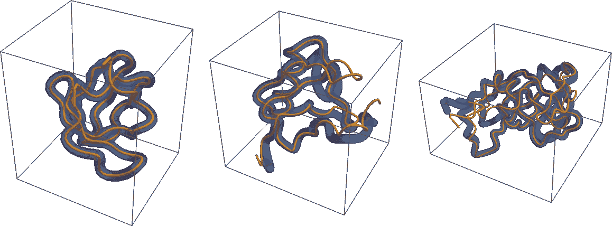

These proteins are all are at least similar to ones that were used to train the neural net. But how about very different proteins—say ones with random sequences of amino acids?

这些蛋白质至少都与用于训练神经网络的蛋白质相似。但对于非常不同的蛋白质（例如具有随机氨基酸序列的蛋白质）又如何呢？

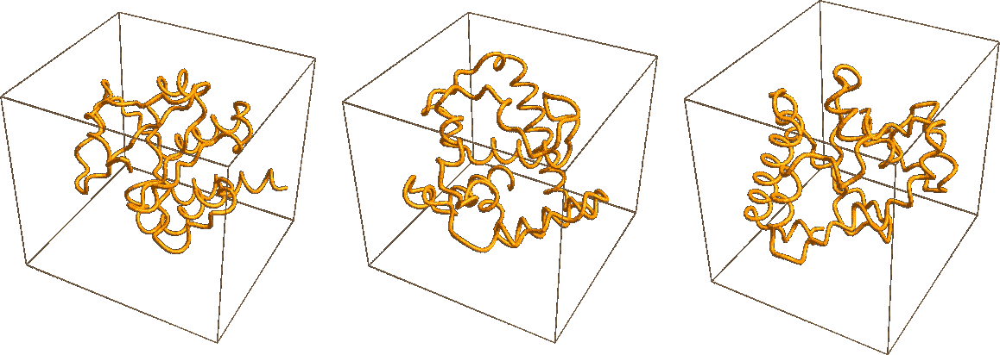

It’s hard to know how well the neural net does here; it seems likely that particularly if there are “surprises” it won’t successfully capture them. (Of course, it could be that all “reasonable proteins” that normally appear in biology could have certain features, and it could be “unfair” to apply the neural net to “unbiological” random ones—though for example in the adaptive immune system, biology does effectively generate at least short “random proteins”.）

很难知道神经网络在这里表现得如何；似乎特别是如果存在“惊喜”，它可能无法成功捕获它们。（当然，生物学中通常出现的所有“合理蛋白质”可能都具有某些特征，将神经网络应用于“非生物”随机蛋白质可能是“不公平的”——尽管例如在适应性免疫系统中，生物学确实有效地产生了至少短的“随机蛋白质”。)

## 用人工智能求解方程

Solving Equations with AI

In traditional mathematical science the typical setup is: here are some equations for a system; solve them to find out how the system behaves. And before computers, that usually meant that one had to find some “closed-form” formula for the solution. But with computers, there’s an alternative approach: make a discrete “numerical approximation”, and somehow incrementally solve the equations. To get accurate results, though, may require many steps and lots of computational effort. So then the question is: can AI speed this up? And in particular, can AI, for example, go directly from initial conditions for an equation to a whole solution?

在传统数学科学中，典型的设置是：这里是系统的一些方程；解决它们以了解系统的行为方式。在计算机出现之前，这通常意味着人们必须找到某种“封闭形式”的解决方案公式。但对于计算机来说，有一种替代方法：进行离散的“数值近似”，并以某种方式逐步求解方程。然而，要获得准确的结果，可能需要许多步骤和大量的计算工作。那么问题来了：人工智能能加速这一过程吗？特别是，例如，人工智能可以直接从方程的初始条件到整个解决方案吗？

Let’s consider as an example a classical piece of mathematical physics: the three-body problem . Given initial positions and velocities of three point masses interacting via inverse-square-law gravity, what trajectories will the masses follow? There’s a lot of diversity—and often a lot of complexity—which is why the three-body problem has been such a challenge :

让我们以数学物理学的经典部分为例：三体问题。给定通过平方反比定律引力相互作用的三个点质量的初始位置和速度，质量将遵循什么轨迹？存在很多多样性，而且通常也很复杂，这就是三体问题如此具有挑战性的原因：

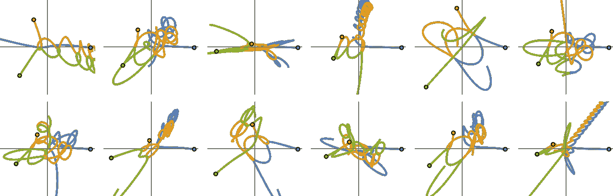

But what if we train a neural net on lots of sample solutions? Can it then figure out the solution in any particular case? We’ll use a rather straightforward “multilayer perceptron” network:

但是如果我们在大量样本解决方案上训练神经网络呢？那么它能在任何特定情况下找出解决方案吗？我们将使用一个相当简单的“多层感知器”网络：

We feed it initial conditions, then ask it to generate a solution. Here are a few examples of what it does， with the correct solutions indicated by the lighter background paths:

我们向它提供初始条件，然后要求它生成解决方案。以下是它的作用的几个示例，其中较浅的背景路径指示了正确的解决方案：

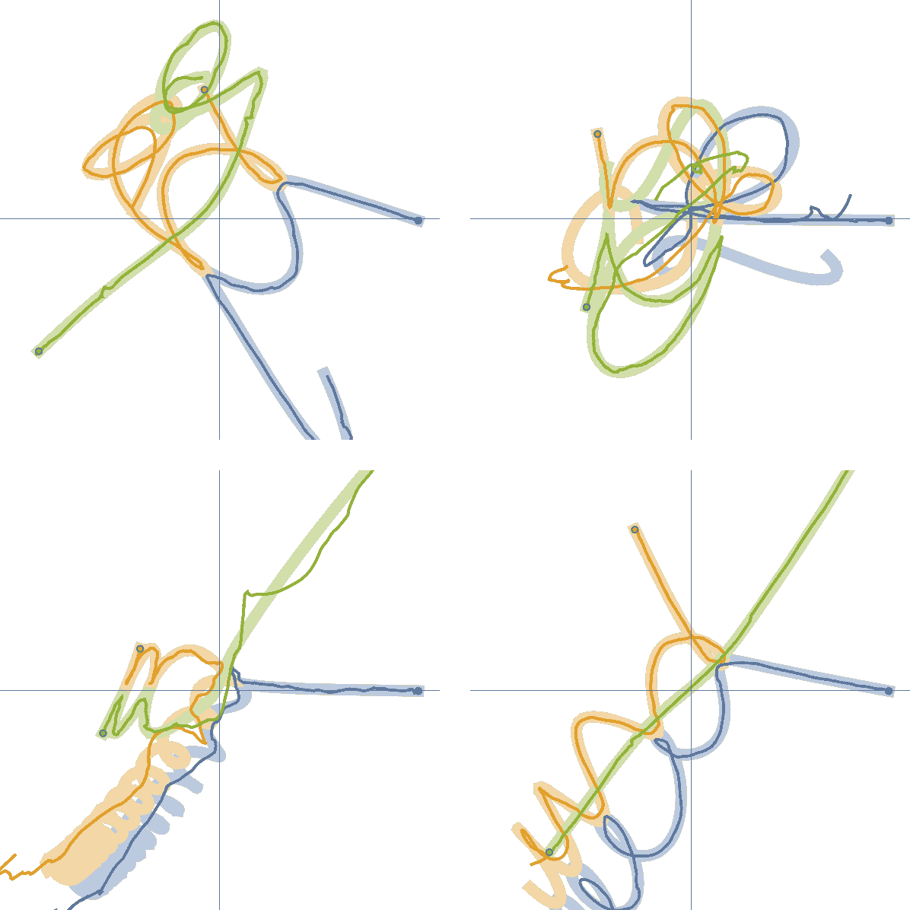

When the trajectories are fairly simple, the neural net does decently well. But when things get more complicated, it does decreasingly well. It’s as if the neural net has “successfully memorized” the simple cases, but doesn’t know what to do in more complicated cases. And in the end this is very similar to what we saw above in examples like predicting cellular automaton evolution (and presumably also protein folding).

当轨迹相当简单时，神经网络表现得相当好。但当事情变得更加复杂时，它的表现就会下降。就好像神经网络已经“成功记住”了简单的情况，但不知道在更复杂的情况下该怎么做。最后，这与我们在上面的例子中看到的非常相似，例如预测细胞自动机进化（大概还有蛋白质折叠）。

And, yes, once again this is a story of computational irreducibility. To ask to just “get the solution” in one go is to effectively ask for complete computational reducibility. And insofar as one might imagine that—if only one knew how to do it—one could in principle always get a “closed-form formula” for the solution, one’s implicitly assuming computational reducibility. But for many decades I’ve thought that something like the three-body problem is actually quite full of computational irreducibility.

是的，这又是一个计算不可约性的故事。要求一次性“得到解决方案”实际上就是要求完全的计算可简化性。只要人们可能想象，只要知道如何去做，原则上就可以始终得到解决方案的“封闭式公式”，这隐含地假设了计算可简化性。但几十年来，我一直认为像三体问题这样的问题实际上充满了计算不可约性。

Of course, had a neural net been able to “crack the problem” and immediately generate solutions, that would effectively have demonstrated computational reducibility. But as it is, the apparent failure of neural nets provides another piece of evidence for computational irreducibility in the three-body problem. (It’s worth mentioning, by the way, that while the three-body problem does show sensitive dependence on initial conditions , that’s not the primary issue here; rather, it’s the actual intrinsic complexity of the trajectories.）

当然，如果神经网络能够“破解问题”并立即生成解决方案，那么就有效地证明了计算的可简化性。但事实上，神经网络的明显失败为三体问题中的计算不可约性提供了另一个证据。（顺便说一句，值得一提的是，虽然三体问题确实表现出对初始条件的敏感依赖性，但这不是这里的主要问题；相反，这是轨迹的实际内在复杂性。)

We already know that discrete computational systems like cellular automata are rife with computational irreducibility. And we might have imagined that continuous systems—described for example by differential equations—would have more structure that would somehow make them avoid computational irreducibility. And indeed insofar as neural nets (in their usual formulation) involve continuous numbers, we might have thought that they would be able in some way to key into the structure of continuous systems to be able to predict them. But somehow it seems as if the “force of computational irreducibility” is too strong, and will ultimately be beyond the power of neural networks.

我们已经知道，像元胞自动机这样的离散计算系统充满了计算不可约性。我们可能会想象连续系统（例如由微分方程描述）将具有更多的结构，以某种方式使它们避免计算不可约性。事实上，就神经网络（按照其通常的表述）涉及连续数字而言，我们可能认为它们能够以某种方式输入连续系统的结构，从而能够预测它们。但不知何故，“计算不可约性的力量”似乎太强大了，最终将超出神经网络的能力。

Having said that, though, there can still be a lot of practical value to neural networks in doing things like solving equations. Traditional numerical approximation methods tend to work locally and incrementally (if often adaptively). But neural nets can more readily handle “much larger windows”, in a sense “knowing longer runs of behavior” and being able to “jump ahead” across them. In addition, when one’s dealing with very large numbers of equations (say in robotics or systems engineering), neural nets can typically just “take in all the equations and do something reasonable” whereas traditional methods effectively have to work with the equations one by one.

尽管如此，神经网络在解决方程等问题上仍然具有很多实用价值。传统的数值逼近方法倾向于局部和增量地工作（如果经常是自适应的）。但神经网络可以更容易地处理“更大的窗口”，从某种意义上说，“了解更长时间的行为”并能够“跳过”它们。此外，当处理大量方程时（例如在机器人或系统工程中），神经网络通常只能“接受所有方程并做一些合理的事情”，而传统方法必须有效地一一处理方程。

The three-body problem involves ordinary differential equations. But many practical problems are instead based on partial differential equations (PDEs), in which not just individual coordinates, but whole functions f [ x ] etc., evolve with time. And, yes, one can use neural nets here as well, often to significant practical advantage. But what about computational irreducibility? Many of the equations and situations most studied in practice (say for engineering purposes) tend to avoid it, but certainly in general it’s there (notably, say, in phenomena like fluid turbulence). And when there’s computational irreducibility, one can’t ultimately expect neural nets to do well. But when it comes to satisfying our human purposes—as in other examples we’ve discussed—things may look better.

三体问题涉及常微分方程。但许多实际问题都是基于偏微分方程 （PDE），其中不仅单个坐标，而且整个函数 f[x] 等都随时间演化。是的，人们也可以在这里使用神经网络，这通常会带来显着的实际优势。但是计算不可约性又如何呢？实践中（例如出于工程目的）研究最多的许多方程和情况都倾向于避免它，但一般来说它肯定是存在的（特别是在流体湍流等现象中）。当存在计算不可约性时，我们最终不能指望神经网络表现良好。但当谈到满足我们人类的目的时——正如我们讨论过的其他例子——事情可能看起来更好。

As an example, consider predicting the weather. In the end, this is all about PDEs for fluid dynamics (and, yes, there are also other effects to do with clouds, etc.). And as one approach, one can imagine directly and computationally solving these PDEs. But another approach would be to have a neural net just “learn typical patterns of weather” (as old-time meteorologists had to), and then have the network (a bit like for protein folding) try to patch together these patterns to fit whatever situation arises.

举个例子，考虑预测天气。最后，这都是关于流体动力学的偏微分方程（是的，还有其他与云有关的效应等）。作为一种方法，人们可以想象直接通过计算求解这些偏微分方程。但另一种方法是让神经网络“学习典型的天气模式”（就像过去的气象学家必须做的那样），然后让网络（有点像蛋白质折叠）尝试将这些模式拼凑在一起以适应任何情况情况出现。

How successful will this be? It’ll probably depend on what we’re looking at. It could be that some particular aspect of the weather shows considerable computational reducibility and is quite predictable, say by neural nets. And if this is the aspect of the weather that we care about, we might conclude that the neural net is doing well. But if something we care about (“will it rain tomorrow?”) doesn’t tap into a pocket of computational reducibility, then neural nets typically won’t be successful in predicting it—and instead there’d be no choice but to do explicit computation, and perhaps impractically much of it.

这将会有多成功？这可能取决于我们所关注的内容。天气的某些特定方面可能显示出相当大的计算可简化性，并且通过神经网络来说是相当可预测的。如果这是我们关心的天气方面，我们可能会得出结论：神经网络表现良好。但是，如果我们关心的事情（“明天会下雨吗？”）没有利用计算可简化性，那么神经网络通常不会成功地预测它 - 相反，我们别无选择，只能做显式计算，其中大部分可能不切实际。

## 多重计算人工智能

AI for Multicomputation

##

In what we’ve discussed so far, we’ve mostly been concerned with seeing whether AI can help us “jump ahead” and shortcut some computational process or another. But there are also lots of situations where what’s of interest is instead to shortcut what one can call a multicomputational process , in which there are many possible outcomes at each step, and the goal is for example to find a path to some final outcome.

在我们到目前为止所讨论的内容中，我们主要关心的是人工智能是否可以帮助我们“跳跃式前进”并简化某些计算过程或其他过程。但也有很多情况下，我们感兴趣的是缩短所谓的多重计算过程，其中每一步都有许多可能的结果，例如，目标是找到通向某些最终结果的路径。

As a simple example of a multicomputational process, let’s consider a multiway system operating on strings, where at each step we apply the rules {A → BBB, BB →A} in all possible ways:

作为多计算过程的一个简单示例，让我们考虑一个对字符串进行操作的多路系统，其中每一步我们都应用规则 {A → BBB， BB → A}方法：

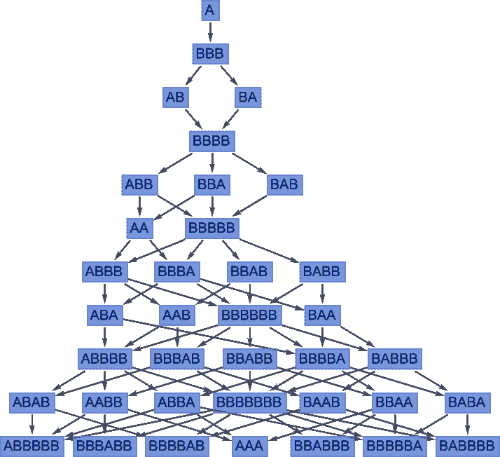

Given this setup we can ask a question like: what’s the shortest path from A to BABA? And in the case shown here it’s easy to compute the answer， say by explicitly running a pathfinding algorithm on the graph:

有了这个设置，我们可以问这样的问题：从 A 到 BABA 的最短路径是什么？在此处所示的情况下，很容易计算答案，例如通过在图上显式运行寻路算法：

{A,BBB,AB,BBBB,ABB,AA,ABBB,ABA,BBBBA,BABA}

There are many kinds of problems that follow this same general pattern. Finding a winning sequence of plays in a game graph . Finding the solution to a puzzle as a sequence of moves through a graph of possibilities. Finding a proof of a theorem given certain axioms. Finding a chemical synthesis pathway given certain basic reactions. And in general solving a multitude of NP problems in which many “nondeterministic” paths of computation are possible.

有许多种问题都遵循同样的一般模式。在游戏图中找到获胜的游戏序列。通过可能性图的一系列移动来寻找谜题的解决方案。在给定某些公理的情况下找到定理的证明。在给定某些基本反应的情况下寻找化学合成途径。一般来说，解决大量 NP 问题，其中许多“非确定性”计算路径都是可能的。

In the very simple example above, we’re readily able to explicitly generate a whole multiway graph. But in most practical examples, the graph would be astronomically too large. So the challenge is typically to suss out what moves to make without tracing the whole graph of possibilities. One common approach is to try to find a way to assign a score to different possible states or outcomes, and to pursue only paths with (say) the highest scores. In automated theorem proving it’s also common to work “downward from initial propositions” and “upward from final theorems”, trying to see where the paths meet in the middle. And there’s also another important idea: if one has established the “lemma” that there’s a path from X to Y, one can add X → Y as a new rule in the collection of rules.

在上面这个非常简单的例子中，我们很容易能够显式地生成整个多路图。但在大多数实际示例中，该图会太大。因此，挑战通常是在不追踪整个可能性图的情况下弄清楚要采取什么行动。一种常见的方法是尝试找到一种方法来为不同的可能状态或结果分配分数，并仅追求分数最高的路径。在自动定理证明中，“从初始命题向下”和“从最终定理向上”工作也很常见，试图找出路径在中间的交汇处。还有另一个重要的想法：如果建立了“引理”，即存在从 X 到 Y 的路径，则可以将 X→ Y 添加为规则集合中的新规则。

So how might AI help? As a first approach, we could consider taking something like our string multiway system above, and training what amounts to a language-model AI to generate sequences of tokens that represent paths (or what in a mathematical setting would be proofs). The idea is to feed the AI a collection of valid sequences, and then to present it with the beginning and end of a new sequence, and ask it to fill in the middle.

那么人工智能可以提供什么帮助呢？作为第一种方法，我们可以考虑采用类似于上面的字符串多路系统的东西，并训练相当于语言模型人工智能的东西来生成代表路径的标记序列（或者在数学设置中将是证明）。这个想法是向人工智能提供一组有效的序列，然后向它呈现一个新序列的开头和结尾，并要求它填充中间部分。

We’ll use a fairly basic transformer network:

我们将使用一个相当基本的变压器网络：

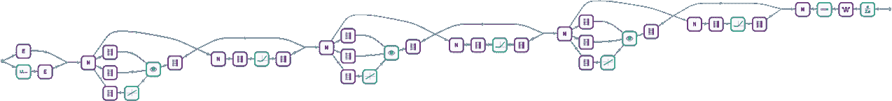

Then we train it by giving lots of sequences of tokens corresponding to valid paths （with E being the “end token”）

然后我们通过提供大量与有效路径相对应的标记序列来训练它（E 是“结束标记”）

A,BABA:BBB,AB,BBBB,ABB,AA,ABBB,ABA,BBBBAE

together with “netive examples” indicating the absence of paths:

与指示不存在路径的“反例”一起：

BABA,A:N

Now we “prompt” the trained network with a “prefix” of the kind that appeared in the training data, and then iteratively run “LLM style” (effectively at zero temperature, i.e. always choosing the “most probable” next token):

现在，我们使用训练数据中出现的那种“前缀”“提示”训练后的网络，然后迭代运行“LLM 样式”（在零温度下有效，即始终选择“最可能的” ” 下一个标记）：

A,BABA:B

A,BABA:BB

A,BABA:BBB

A,BABA:BBB,

A,BABA:BBB,A

A,BABA:BBB,AB

A,BABA:BBB,AB,

A,BABA:BBB,AB,B

...

A,BABA:BBB,AB,BBBB,ABB,AA,ABBB,A AB , A BBB B E

For a while, it does perfectly—but near the end it starts making errors, as indicated by the tokens shown in red. There’s different performance with different destinations—with some cases going off track right at the beginning:

有一段时间，它表现得很完美，但接近尾声时它开始出错，如红色标记所示。不同的目的地有不同的表现——有些情况一开始就偏离了轨道：

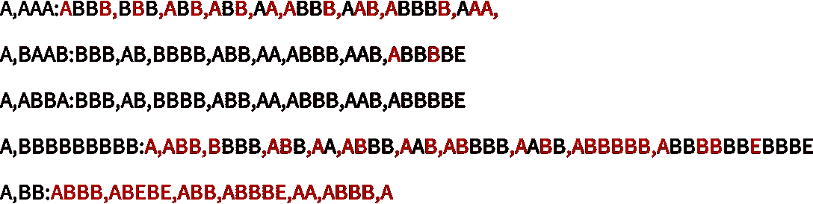

How can we do better? One possibility is at each step to keep not just the token that’s considered most probable, but a stack of tokens—thereby in effect generating a multiway system that the “LLM controller” could potentially navigate. (One can think of this somewhat whimsically as a “ quantum LLM ”, that’s always exploring multiple paths of history.）

我们怎样才能做得更好？一种可能性是在每个步骤中不仅保留被认为最有可能的令牌，而且保留一堆令牌，从而实际上生成“LLM 控制器”可以导航的多路系统。（人们可以异想天开地将其视为“量子 LLM”，它总是在探索历史的多条路径。)

(By the way, we could also imagine training with many different rules, then doing what amounts to zero-shot learning and giving a “pre-prompt” that specifies what rule we want to use in any particular case.）

（顺便说一句，我们还可以想象使用许多不同的规则进行训练，然后进行相当于零样本学习的操作，并给出一个“预先提示”，指定我们在任何特定情况下要使用的规则。)

One of the issues with this LLM approach is that the sequences it generates are often even “locally wrong”: the next element can’t follow from the one before according to the rules given.

这种 LLM 方法的问题之一是，它生成的序列甚至常常是“局部错误的”：根据给定的规则，下一个元素不能从前一个元素开始。

But this suggests another approach one can take. Instead of having the AI try to “immediately fill in the whole sequence”, get it instead just to pick “where to go next”, always following one of the specified rules. Then a simple goal for training is in effect to get the AI to learn the distance function for the graph , or in other words, to be able to estimate how long the shortest path is (if it exists) from any one node to any other. Given such a function, a typical strategy is to follow what amounts to a path of “steepest descent”—at each step picking the move that the AI estimates will do best in reducing the distance to the destination.

但这表明人们可以采取另一种方法。不要让人工智能尝试“立即填写整个序列”，而是让它只选择“下一步去哪里”，始终遵循指定的规则之一。那么训练的一个简单目标实际上是让人工智能学习图的距离函数，或者换句话说，能够估计从任何一个节点到任何其他节点的最短路径（如果存在）有多长。给定这样的函数，典型的策略是遵循“最陡下降”的路径——在每一步中选择人工智能估计最能缩短到目的地距离的移动。

How can this actually be implemented with neural networks? One approach is to use two encoders (say constructed out of transformers)—that in effect generate two embeddings, one for source nodes, and one for destination nodes. The network then combines these embeddings and learns a “metric” that characterizes the distance between the nodes:

这实际上如何用神经网络来实现？一种方法是使用两个编码器（例如由变压器构建），这实际上生成两个嵌入，一个用于源节点，一个用于目标节点。然后，网络结合这些嵌入并学习表征节点之间距离的“度量”：

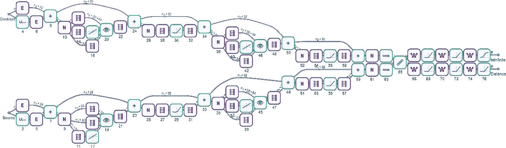

Training such a network on the multiway system we’ve been discussing—by giving it a few million examples of source-destination distances (plus an indicator of whether this distance is infinite)—we can use the network to predict a piece of the distance matrix for the multiway system. And what we find is that this predicted matrix is similar—but definitely not identical—to the actual matrix:

在我们一直在讨论的多路系统上训练这样的网络——通过给它提供几百万个源-目的地距离的例子（加上这个距离是否无限的指标）——我们可以使用该网络来预测一段距离多路系统的矩阵。我们发现这个预测矩阵与实际矩阵相似，但绝对不完全相同：

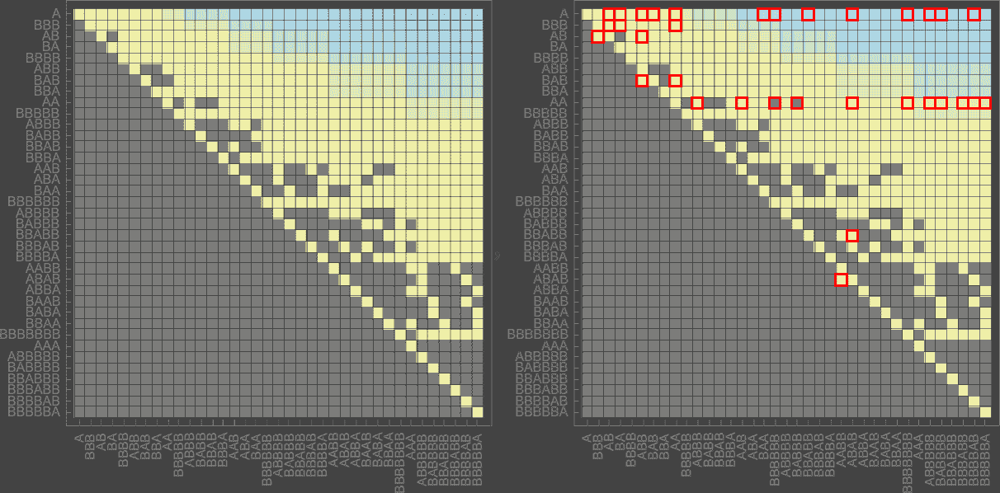

Still， we can imagine trying to build a path where at each step we compute the estimated distances-to-destination predicted by the neural net for each possible destination， then pick the one that “gets furthest”:

尽管如此，我们可以想象尝试构建一条路径，在每一步中我们计算神经网络为每个可能的目的地预测的到目的地的估计距离，然后选择“最远”的路径：

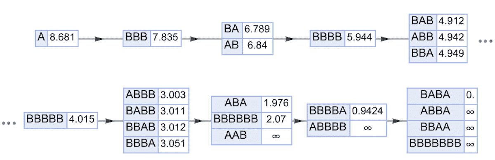

Each individual move here is guaranteed to be valid, and we do indeed eventually reach our destination BABA—though in slightly more steps than the true shortest path. But even though we don’t quite find the optimal path， the neural net has managed to allow us to at least somewhat prune our “search space”， by prioritizing nodes and traversing only the red edges:

这里的每一个单独的移动都保证是有效的，我们确实最终到达了目的地 BABA——尽管比真正的最短路径稍微多了一些步数。但即使我们没有完全找到最佳路径，神经网络已经成功地允许我们通过优先考虑节点并仅遍历红色边缘来至少在一定程度上修剪我们的“搜索空间”：

(A technical point is that the particular neural net we’ve used here has the property that all paths between any given pair of nodes always have the same length—so if any path is found, it can be considered “the shortest”. A rule like {A → AAB, BBA → B} doesn’t have this property and a neural net trained for this rule can end up finding paths that reach the correct destination but aren’t as short as they could be.)

（技术要点是，我们在这里使用的特定神经网络具有这样的属性，即任何给定节点对之间的所有路径始终具有相同的长度，因此如果找到任何路径，则可以将其视为“最短”。像 {A→AAB， BBA →B} 这样的规则不具有此属性，并且为此规则训练的神经网络最终可能会找到到达正确目的地的路径，但不是'尽可能短。)

Still, as is typical with neural nets, we can’t be sure how well this will work. The neural net might make us go arbitrarily far “off track”, and it might even lead us to a node where we have no path to our destination—so that if we want to make progress we’ll have to resort to something like traditional algorithmic backtracking.

不过，正如神经网络的典型情况一样，我们无法确定其效果如何。神经网络可能会让我们任意地“偏离轨道”，甚至可能引导我们到达一个没有路径到达目的地的节点——因此，如果我们想取得进展，我们就必须诉诸传统的方法算法回溯。

But at least in simple cases the approach can potentially work well—and the AI can successfully find a path that wins the game, proves the theorem, etc. But one can’t expect it to always work. And the reason is that it’s going to run into multicomputational irreducibility . Just as in a single “thread of computation” computational irreducibility can mean that there’s no shortcut to just “going through the steps of the computation”, so in a multiway system multicomputational irreducibility can mean that there’s no shortcut to just “following all the threads of computation”, then seeing, for example, which end up merging with which.

但至少在简单的情况下，这种方法可能会很好地发挥作用，并且人工智能可以成功地找到一条赢得比赛、证明定理等的路径。但人们不能指望它总是有效。原因是它将遇到多重计算不可约性。正如在单个“计算线程”中，计算不可约性可能意味着没有“执行计算步骤”的捷径，因此在多路系统中，多重计算不可约性可能意味着没有“遵循所有线程”的捷径计算”，然后看到，例如，哪个最终与哪个合并。

But even though this could happen in principle, does it in fact happen in practice in cases of interest to us humans? In something like games or puzzles , we tend to want it to be hard—but not too hard—to “win”. And when it comes to mathematics and proving theorems, cases that we use for exercises or competitions we similarly want to be hard, but not too hard. But when it comes to mathematical research, and the frontiers of mathematics, one doesn’t immediately expect any such constraint. And the result is then that one can expect to be face-to-face with multicomputational irreducibility—making it hard for AI to help too much.

但即使这在原则上可能发生，但在我们人类感兴趣的情况下，它实际上会在实践中发生吗？在游戏或谜题等游戏中，我们倾向于希望“获胜”很困难，但又不太难。当涉及到数学和证明定理、用于练习或竞赛的案例时，我们同样希望变得困难，但又不能太难。但当谈到数学研究和数学前沿时，人们不会立即想到任何这样的限制。结果就是人们可以期待面对面地面对多重计算的不可约性——这使得人工智能很难提供太多帮助。

There is, however, one footnote to this story, and it has to do with how we choose new directions in mathematics. We can think of a metamathematical space formed by building up theorems from other theorems in all possible ways in a giant multiway graph. But as we’ll discuss below, most of the details of this are far from what human mathematicians would think of as “doing mathematics”. Instead, mathematicians implicitly seem to do mathematics at a “higher level” in which they’ve “coarse grained” this “microscopic metamathematics”—much as we might study a physical fluid in terms of comparatively-simple-to-describe continuous dynamics even though “underneath” there are lots of complicated molecular motions.

然而，这个故事有一个脚注，它与我们如何选择数学的新方向有关。我们可以想象一个元数学空间，它是通过在一个巨大的多路图中以所有可能的方式从其他定理构建定理而形成的。但正如我们将在下面讨论的，其中的大部分细节与人类数学家所认为的“做数学”相去甚远。相反，数学家似乎隐含地在“更高水平”上进行数学研究，他们对这种“微观元数学”进行了“粗粒度”处理——就像我们可以用相对简单的连续动力学来研究物理流体一样。尽管“下面”有许多复杂的分子运动。

So can AI help with mathematics at this “fluid-dynamics-style” level? Potentially so, but mainly in what amounts to providing code assistance. We have something we want to express, say, in Wolfram Language . But we need help—“LLM style” —in going from our informal conception to explicit computational language. And insofar as what we’re doing follows the structural patterns of what’s been done before, we can expect something like an LLM to help. But insofar as what we’re expressing is “truly new”, and inasmuch as our computational language doesn’t involve much “boilerplate”, it’s hard to imagine that an AI trained on what’s been done before will help much. Instead, what we in effect have to do is some multicomputationally irreducible computation, that allows us to explore to some fresh part of the computational universe and the ruliad.

那么人工智能可以在这种“流体动力学风格”的水平上帮助数学吗？可能是这样，但主要是提供代码帮助。我们有一些想要表达的东西，比如说，用 Wolfram 语言。但我们需要帮助——“LLM 风格”——从我们的非正式概念转变为明确的计算语言。只要我们正在做的事情遵循之前所做的结构模式，我们就可以期待像 LLM 这样的东西来提供帮助。但就我们所表达的内容来说是“真正新的”，并且我们的计算语言不涉及太多“样板文件”，很难想象接受过以前做过的事情训练的人工智能会有多大帮助。相反，我们实际上要做的是一些多重计算的不可约计算，这使我们能够探索计算宇宙和 ruliad 的一些新鲜部分。

## 探索系统空间

Exploring Spaces of Systems

“Can one find a system that does X?” Say a Turing machine that runs for a very long time before halting. Or a cellular automaton that grows, but only very slowly. Or, for that matter, a chemical with some particular property.

“能找到一个能做某事的系统吗？”假设一台图灵机在停止之前运行了很长时间。或者是一个生长的元胞自动机，但生长速度非常缓慢。或者，就此而言，具有某种特定性质的化学物质。

This is a somewhat different type of question than the ones we’ve been discussing so far. It’s not about taking a particular rule and seeing what its consequences are. It’s about identifying what rule might exist that has certain consequences.

这是一个与我们迄今为止讨论的问题类型有所不同的问题。这并不是要采取特定的规则并看看其后果是什么。这是关于确定可能存在哪些规则会产生某些后果。

And given some space of possible rules, one approach is exhaustive search. And in a sense this is ultimately the only “truly unbiased” approach, that will discover what’s out there to discover, even when one doesn’t expect it. Of course, even with exhaustive search, one still needs a way to determine whether a particular candidate system meets whatever criterion one has set up. But now this is the problem of predicting a computation—where the things we said above apply.

考虑到一些可能的规则空间，一种方法是穷举搜索。从某种意义上说，这最终是唯一“真正公正”的方法，即使人们没有预料到，它也会发现有待发现的东西。当然，即使进行了详尽的搜索，人们仍然需要一种方法来确定特定的候选系统是否满足人们所建立的任何标准。但现在这是预测计算的问题——我们上面所说的事情都适用。

OK, but can we do better than exhaustive search? And can we, for example, find a way to figure out what rules to explore without having to look at every rule? One approach is to do something like what happens in biological evolution by natural selection: start, say, from a particular rule, and then incrementally change it (perhaps at random), at every step keeping the rule or rules that do best, and discarding the others.

好的，但是我们能做得比穷举搜索更好吗？例如，我们能否找到一种方法来找出要探索的规则，而不必查看每条规则？一种方法是像生物进化中通过自然选择发生的事情一样：从一个特定的规则开始，然后逐步改变它（可能是随机的），在每一步中保留最有效的一个或多个规则，并丢弃其他。

This isn’t “AI” as we’ve operationally defined it here (it’s more like a “genetic algorithm”)—though it is a bit like the inner training loop of a neural net. But will it work? Well, that depends on the structure of the rule space —and, as one sees in machine learning —it tends to work better in higher-dimensional rule spaces than lower-dimensional ones. Because with more dimensions there’s less chance one will get “stuck in a local minimum”, unable to find one’s way out to a “better rule”.

这不是我们在这里定义的“人工智能”（它更像是“遗传算法”）——尽管它有点像神经网络的内部训练循环。但这会起作用吗？嗯，这取决于规则空间的结构——正如人们在机器学习中看到的那样——它在高维规则空间中往往比在低维规则空间中工作得更好。因为维度越多，“陷入局部最小值”、无法找到“更好规则”的出路的可能性就越小。

And in general, if the rule space is like a complicated fractal mountainscape, it’s reasonable to expect one can make progress incrementally (and perhaps AI methods like reinforcement learning can help refine what incremental steps to take). But if instead it’s quite flat, with, say, just one “hole” somewhere (“golf-course style”), one can’t expect to “find the hole” incrementally. So what is the typical structure of rule spaces? There are certainly plenty of cases where the rule space is altogether quite large, but the number of dimensions is only modest. And in such cases (an example being finding small Turing machines with long halting times ) there often seem to be “isolated solutions” that can’t be reached incrementally. But when there are more dimensions, it seems likely that what amounts to computational irreducibility will more or less guarantee that there’ll be a “random-enough landscape” that incremental methods will be able to do well, much as we have seen in machine learning in recent years.

一般来说，如果规则空间就像一座复杂的分形山景，那么我们可以合理地期望人们可以逐步取得进展（也许像强化学习这样的人工智能方法可以帮助完善要采取的增量步骤）。但如果它非常平坦，比如说，某处只有一个“洞”（“高尔夫球场风格”），那么人们就不能指望逐步“找到洞”。那么规则空间的典型结构是怎样的呢？当然，在很多情况下，规则空间总体上相当大，但维数却很少。在这种情况下（例如寻找具有较长停机时间的小型图灵机），通常似乎存在无法逐步实现的“孤立解决方案”。但是，当维度更多时，计算不可约性似乎或多或少会保证存在增量方法能够做得很好的“足够随机的景观”，就像我们在机器中看到的那样近年来的学习。

So what about AI? Might there be a way for AI to learn how to “pick winners directly in rule space”, without any kind of incremental process? Might we perhaps be able to find some “embedding space” in which the rules we want are laid out in a simple way—and thus effectively “pre-identified” for us? Ultimately it depends on what the rule space is like, and whether the process of exploring it is necessarily (multi)computationally irreducible, or whether at least the aspects of it that we care about can be explored by a computationally reducible process. (By the way, trying to use AI to directly find systems with particular properties is a bit like trying to use AI to directly generate neural nets from data without incremental training.）

那么人工智能呢？是否有一种方法可以让人工智能学习如何“直接在规则空间中挑选获胜者”，而不需要任何增量过程？我们也许能够找到一些“嵌入空间”，在其中以简单的方式布置我们想要的规则，从而有效地为我们“预先识别”？最终，这取决于规则空间是什么样的，以及探索它的过程是否必然是（多）计算不可约的，或者至少我们关心的方面是否可以通过计算可约过程来探索。（顺便说一句，尝试使用人工智能直接找到具有特定属性的系统有点像尝试使用人工智能直接从数据生成神经网络而无需增量训练。)

Let’s look at a specific simple example based on cellular automata. Say we want to find a cellular automaton rule that—when evolved from a single-cell initial condition—will grow for a while, but then die out after a particular, exact number of steps. We can try to solve this with a very minimal AI-like “evolutionary” approach: start from a random rule, then at each “generation” produce a certain number of “offspring” rules, each with one element randomly changed—then keep whichever is the “best” of these rules. If we want to find a rule that “lives” for exactly 50 steps, we define “best” to be the one that minimizes a “loss function” equal to the distance from 50 of the number of steps a rule actually “lives”.

让我们看一个基于元胞自动机的具体简单示例。假设我们想要找到一个元胞自动机规则，当从单细胞初始条件进化时，该规则会增长一段时间，但在特定的、精确的步骤数后就会消失。我们可以尝试用一种非常简单的类似人工智能的“进化”方法来解决这个问题：从随机规则开始，然后在每个“一代”产生一定数量的“后代”规则，每个规则都有一个随机变化的元素，然后保留其中的一个是这些规则中“最好的”。如果我们想找到一条恰好“存活”了 50 步的规则，我们将“最佳”定义为最小化“损失函数”的规则，该损失函数等于与规则实际“存活”的步数 50 的距离。

So， for example， say we start from the randomly chosen （3-color） rule:

例如，假设我们从随机选择的（3 色）规则开始：

Our evolutionary sequence of rules (showing here only the 3^3 “outcome values”) might be:

我们的规则演化序列（此处仅显示 3^3 “结果值”）可能是：

If we look at the behavior of these rules， we see that—after an inauspicious start—they manage to successfully evolve to reach a rule that meets the criterion of “living for exactly 50 steps”:

如果我们观察这些规则的行为，我们会发现，在经历了一个不吉利的开始之后，它们成功地进化到了满足“恰好生活 50 步”标准的规则：

What we’ve shown here is a particular randomly chosen “path of evolution”. But what happens with other paths? Here’s how the “loss” evolves （over the course of 100 generations） for a collection of paths:

我们在这里展示的是一个特定的随机选择的“进化路径”。但其他路径会发生什么情况呢？以下是路径集合的“损失”如何演变（经过 100 代的过程）：

And what we see is that there’s only one “winner” here that achieves zero loss; on all the other paths, evolution “gets stuck”.

我们看到的是，这里只有一个“赢家”实现了零损失；在所有其他路径上，进化都会“陷入困境”。

As we mentioned above, though, with more “dimensions” one’s less likely to get stuck. So， for example， if we look at 4-color cellular automaton rules， there are now 64 rather than 27 possible elements （or effectively dimensions） to change， and in this case， many paths of evolution “get further”

不过，正如我们上面提到的，“维度”越多，陷入困境的可能性就越小。因此，举例来说，如果我们查看 4 色元胞自动机规则，现在有 64 个而不是 27 个可能的元素（或有效维度）需要更改，在这种情况下，许多进化路径“走得更远”

and there are more “winners” such as:

还有更多“赢家”，例如：

How could something like neural nets help us here? Insofar as we can use them to predict cellular automaton evolution, they might give us a way to speed up what amounts to the computation of the loss for each candidate rule—though from what we saw in an earlier section, computational irreducibility is likely to limit this. Another possibility is that—much as in the previous section—we could try to use neural nets to guide us in which random changes to make at each generation. But while computational irreducibility probably helps in making things “effectively random enough” that we won’t get stuck, it makes it difficult to have something like a neural net successfully tell us “which way to go”.

像神经网络这样的东西可以如何帮助我们呢？只要我们可以使用它们来预测元胞自动机的进化，它们可能会为我们提供一种方法来加速每个候选规则的损失计算——尽管从我们在前面的部分中看到的来看，计算不可约性可能会限制这。另一种可能性是，就像上一节一样，我们可以尝试使用神经网络来指导我们在每一代中进行哪些随机更改。但是，虽然计算不可约性可能有助于使事情“足够有效地随机”，使我们不会陷入困境，但它使得神经网络之类的东西很难成功地告诉我们“该走哪条路”。

## 科学作为叙事

Science as Narrative

In many ways one can view the essence of science—at least as it’s traditionally been practiced—as being about taking what’s out there in the world and somehow casting it in a form we humans can think about. In effect, we want science to provide a human-accessible narrative for what happens, say in the natural world.

在很多方面，人们可以将科学的本质（至少从传统上实践的角度来看）视为将世界上存在的事物以某种方式转化为我们人类可以思考的形式。实际上，我们希望科学能够为发生的事情（比如自然世界）提供一种人类可以理解的叙述。

The phenomenon of computational irreducibility now shows us that this will often ultimately not be possible. But whenever there’s a pocket of computational reducibility it means that there’s some kind of reduced description of at least some part of what’s going on. But is that reduced description something that a human could reasonably be expected to understand? Can it, for example, be stated succinctly in words, formulas, or computational language? If it can, then we can think of it as representing a successful “human-level scientific explanation”.

计算不可约性现象现在向我们表明，这通常最终是不可能的。但只要存在一定的计算可简化性，就意味着至少对正在发生的事情的某些部分有某种简化的描述。但这种简化的描述是人类可以合理理解的吗？例如，它可以用文字、公式或计算语言简洁地表述吗？如果可以，那么我们可以认为它代表了一个成功的“人类水平的科学解释”。

So can AI help us automatically create such explanations? To do so it must in a sense have a model for what we humans understand—and how we express this understanding in words, etc. It doesn’t do much good to say “here are 100 computational steps that produce this result”. To get a “human-level explanation” we need to break this down into pieces that humans can assimilate.

那么人工智能可以帮助我们自动创建这样的解释吗？要做到这一点，它在某种意义上必须有一个我们人类理解的模型，以及我们如何用语言表达这种理解等。说“这是产生这个结果的 100 个计算步骤”并没有多大用处。为了获得“人类水平的解释”，我们需要将其分解为人类可以吸收的部分。

As an example， consider a mathematical proof ， generated by automated theorem proving :

作为一个例子，考虑一个由自动定理证明生成的数学证明：

A computer can readily check that this is correct, in that each step follows from what comes before. But what we have here is a very “non-human thing”—about which there’s no realistic “human narrative”. So what would it take to make such a narrative? Essentially we’d need “waypoints” that are somehow familiar—perhaps famous theorems that we readily recognize. Of course there may be no such things. Because what we may have is a proof that goes through “ uncharted metamathematical territory ”. So—AI assisted or not—human mathematics as it exists today may just not have the raw material to let us create a human-level narrative.

计算机可以很容易地检查这是否正确，因为每一步都遵循之前的步骤。但我们这里所拥有的是一个非常“非人类的东西”——对此没有现实的“人类叙述”。那么，要怎样才能完成这样的叙述呢？本质上，我们需要某种熟悉的“路径点”——也许是我们很容易认识的著名定理。当然也可能没有这样的事情。因为我们可能拥有的是一个穿越“未知的元数学领域”的证明。因此，无论人工智能是否辅助，当今的人类数学可能只是没有原材料来让我们创造人类水平的叙述。

In practice, when there’s a fairly “short metamathematical distance” between steps in a proof, it’s realistic to think that a human-level explanation can be given. And what’s needed is very much like what Wolfram|Alpha does when it produces step-by-step explanations of its answers . Can AI help? Potentially, using methods like our second approach to AI-assisted multicomputation above.

在实践中，当证明中的步骤之间存在相当“短的元数学距离”时，认为可以给出人类水平的解释是现实的。所需要的与 Wolfram|Alpha 所做的非常相似，它会对其答案进行逐步解释。人工智能能帮忙吗？可能会使用类似于我们上面的第二种人工智能辅助多重计算方法的方法。

And, by the way, our efforts with Wolfram Language help too. Because the whole idea of our computational language is to capture “common lumps of computational work” as built-in constructs—and in a sense the process of designing the language is precisely about identifying “human-assimilable waypoints” for computations. Computational irreducibility tells us that we’ll never be able to find such waypoints for all computations. But our goal is to find waypoints that capture current paradigms and current practice, as well as to define directions and frameworks for extending these—though ultimately “what we humans know about” is something that’s determined by the state of human knowledge as it’s historically evolved.

顺便说一句，我们在 Wolfram 语言方面的努力也有帮助。因为我们计算语言的整体理念是将“常见的计算工作块”捕获为内置结构——从某种意义上说，设计语言的过程正是确定计算的“人类可同化的路径点”。计算不可约性告诉我们，我们永远无法为所有计算找到这样的路径点。但我们的目标是找到捕捉当前范式和当前实践的路径点，并定义扩展这些范式和实践的方向和框架——尽管最终“我们人类所知道的”是由人类知识在历史演变过程中的状态决定的。

Proofs and computational language programs are two examples of structured “scientific narratives”. A potentially simpler example—aligned with the mathematical tradition for science—is a pure formula. “It’s a power law”. “It’s a sum of exponentials”. Etc. Can AI help with this? A function like FindFormula is already using machine-learning-inspired techniques to take data and try to produce a “reasonable formula for it”.

证明和计算语言程序是结构化“科学叙述”的两个例子。一个可能更简单的例子——符合科学的数学传统——是一个纯粹的公式。“这是幂律”。“这是指数之和”。等等。人工智能可以帮助解决这个问题吗？像 FindFormula 这样的函数已经在使用机器学习启发的技术来获取数据并尝试为其生成“合理的公式”。

Here’s what it does for the first 100 primes:

以下是它对前 100 个素数的作用：

Going to 10,000 primes it produces a more complicated result:

如果有 10,000 个素数，则会产生更复杂的结果：

Or, let’s say we ask about the relation between GDP and population for countries. Then we can get formulas like:

或者，假设我们询问各国 GDP 与人口之间的关系。那么我们可以得到如下公式：

But what (if anything) do these formulas mean? It’s a bit like with proof steps and so on. Unless we can connect what’s in the formulas with things we know about (whether in number theory or economics) it’ll usually be difficult to conclude much from them. Except perhaps in some rare cases where one can say “yes， that’s a new， useful law”—like in this “derivation” of Kepler’s third law （where 0.7 is a pretty good approximation to 2/3）:

但这些公式意味着什么（如果有的话）？这有点像证明步骤等等。除非我们能够将公式中的内容与我们所知道的事物（无论是数论还是经济学）联系起来，否则通常很难从中得出很多结论。也许除了在某些罕见的情况下，人们可以说“是的，这是一个新的、有用的定律”——就像开普勒第三定律的“推导”一样（其中 0.7 是 2/3 的一个很好的近似值）：

There’s an even more minimal example of this kind of thing in recognizing numbers. Type a number into Wolfram|Alpha and it’ll try to tell you what “possible closed forms” for the number might be:

在识别数字方面还有一个更简单的例子。在 Wolfram|Alpha 中输入一个数字，它会尝试告诉您该数字的“可能的封闭形式”可能是什么：

There are all sorts of tradeoffs here, some very AI informed. What’s the relative importance of getting more digits right compared to having a simple formula? What about having simple numbers in the formula compared to having “more obscure” mathematical constants (e.g. π versus Champernowne’s number)? When we set up this system for Wolfram|Alpha 15 years ago, we used the negative log frequency of constants in the mathematical literature as a proxy for their “information content”. With modern LLM techniques it may be possible to do a more holistic job of finding what amounts to a “good scientific narrative” for a number.

这里有各种各样的权衡，其中一些是非常人工智能的。与使用简单的公式相比，正确输入更多数字的相对重要性是什么？与使用“更晦涩”的数学常数（例如 π 与 Champernowne 数）相比，公式中包含简单的数字怎么样？15 年前，当我们为 Wolfram|Alpha 建立这个系统时，我们使用数学文献中常数的负对数频率作为其“信息内容”的代理。借助现代 LLM 技术，也许可以更全面地找到对某个数字而言相当于“良好的科学叙述”的内容。

But let’s return to things like predicting the outcome of processes such as cellular automaton evolution. In an earlier section we discussed getting neural nets to do this prediction. We viewed this essentially as a “black-box” approach: we wanted to see if we could get a neural net to successfully make predictions, but we weren’t asking to get a “human-level understanding” of those predictions.

但让我们回到预测元胞自动机进化等过程的结果。在前面的部分中，我们讨论了如何让神经网络进行此预测。我们认为这本质上是一种“黑匣子”方法：我们想看看是否可以让神经网络成功地做出预测，但我们并不要求对这些预测有“人类水平的理解”。

It’s a ubiquitous story in machine learning. One trains a neural net to successfully predict, classify, or whatever. But if one “looks inside” it’s very hard to tell what’s going on. Here’s the final result of applying an image identification neural network :

这是机器学习中无处不在的故事。人们训练神经网络来成功地进行预测、分类或进行其他操作。但如果一个人“向内看”，就很难说出到底发生了什么。这是应用图像识别神经网络的最终结果：

And here are the “intermediate thoughts” generated after going through about half the layers in the network:

以下是经过网络中大约一半层后产生的“中间想法”：

Maybe something here is a “definitive signature of catness”. But it’s not part of our current scientific lexicon—so we can’t usefully use it to develop a “scientific narrative” that explains how the image should be interpreted.

也许这里的东西是“猫性的最终标志”。但它不是我们当前科学词典的一部分，因此我们无法有效地使用它来开发解释图像应如何解释的“科学叙述”。

But what if we could reduce our images to just a few parameters—say using an autoencoder of the kind we discussed above? Conceivably we could set things up so that we’d end up with “interpretable parameters”—or, in other words, parameters where we can give a narrative explanation of what they mean. For example, we could imagine using something like an LLM to pick parameters that somehow align with words or phrases (“pointiness”, “fractal dimension”, etc.) that appear in explanatory text from around the web. And, yes, these words or phrases could be based on analogies (“cactus-shaped”, “cirrus-cloud-like”, etc.)—and something like an LLM could “creatively” come up with these names.

但是，如果我们可以将图像减少到只有几个参数（例如使用我们上面讨论的那种自动编码器）会怎么样？可以想象，我们可以进行设置，以便最终得到“可解释的参数”，或者换句话说，我们可以对参数的含义进行叙述性解释。例如，我们可以想象使用 LLM 之类的东西来选择与网络上的解释性文本中出现的单词或短语（“pointiness”、“fractalDimension”等）一致的参数。是的，这些单词或短语可以基于类比（“仙人掌形状”、“卷云状”等），并且像 LLM 这样的东西可以“创造性地”想出这些名字。

But in the end there’s nothing to say that a pocket of computational reducibility picked out by a certain autoencoder will have any way to be aligned with concepts (scientific or otherwise) that we humans have yet explored, or so far given words to. Indeed, in the ruliad at large, it is overwhelmingly likely that we’ll find ourselves in “ interconcept space ”—unable to create what we would consider a useful scientific narrative.

但最终没有什么可说的，由某个自动编码器挑选出的一小部分计算可简化性将有任何方式与我们人类尚未探索过的概念（科学或其他）相一致，或者迄今为止给出的单词。事实上，在整个鲁利亚德中，我们极有可能会发现自己处于“概念间空间”——无法创造出我们认为有用的科学叙述。

This depends a bit, however, on just how we constrain what we’re looking at. We might implicitly define science to be the study of phenomena for which we have—at some time—successfully developed a scientific narrative. And in this case it’s of course inevitable that such a narrative will exist. But even given a fixed method of observation or measurement it’s basically inevitable that as we explore, computational irreducibility will lead to “surprises” that break out of whatever scientific narrative we were using. Or in other words, if we’re really going to discover new science, then—AI or not—we can’t expect to have a scientific narrative based on preexisting concepts. And perhaps the best we can hope for is that we’ll be able to find pockets of reducibility, and that AI will “understand” enough about us and our intellectual history that it’ll be able to suggest a manageable path of new concepts that we should learn to develop a successful scientific narrative for what we discover.

然而，这在一定程度上取决于我们如何限制我们所看到的内容。我们可能会含蓄地将科学定义为对现象的研究，对于这些现象，我们在某些时候成功地发展了科学叙述。在这种情况下，这样的叙述当然是不可避免的。但即使有了固定的观察或测量方法，当我们探索时，计算的不可约性也基本上不可避免地会导致“惊喜”，打破我们所使用的任何科学叙述。或者换句话说，如果我们真的要发现新的科学，那么无论是否是人工智能，我们都不能指望有一个基于预先存在的概念的科学叙述。也许我们能期望的最好的结果是，我们能够找到可还原性的部分，并且人工智能将充分“理解”我们和我们的思想史，从而能够为新概念提出一条可管理的路径，我们应该学会为我们的发现发展一个成功的科学叙述。

## 寻找有趣的事情

Finding What’s Interesting

A central part of doing open-ended science is figuring out “what’s interesting”. Let’s say one just enumerates a collection of cellular automata:

进行开放式科学的核心部分是弄清楚“什么是有趣的”。假设我们只是列举了一组元胞自动机：

The ones that just die out—or make uniform patterns—“don’t seem interesting”. The first time one sees a nested pattern generated by a cellular automaton, it might seem interesting (as it did to me in 1981 ). But pretty soon it comes to seem routine. And at least as a matter of basic ruliology, what one ends up looking for is “surprise”: qualitatively new behavior one hasn’t seen before. (If one’s concerned with specific applications, say to modeling particular systems in the world, then one might instead want to look at rules with certain structure, whether or not their behavior “abstractly seems interesting”.）

那些刚刚消失的——或者形成统一模式的——“看起来并不有趣”。当人们第一次看到元胞自动机生成的嵌套模式时，它可能看起来很有趣（就像 1981 年对我来说的那样）       。但很快这似乎就变得司空见惯了。至少作为基本规则学的问题，人们最终寻找的是“惊喜”：人们以前从未见过的性质上的新行为。（如果一个人关心特定的应用程序，比如对世界上的特定系统进行建模，那么人们可能会想查看具有某种结构的规则，无论它们的行为是否“抽象地看起来很有趣”。)

The fact that one can expect “surprises” (and indeed, be able to do useful, truly open-ended science at all) is a consequence of computational irreducibility. And whenever there’s a “lack of surprise” it’s basically a sign of computational reducibility. And this makes it plausible that AI—and neural nets—could learn to identify at least certain kinds of “anomalies” or “surprises”, and thereby discover some version of “what’s interesting”.

人们可以期待“惊喜”（事实上，能够做有用的、真正开放式的科学）这一事实是计算不可约性的结果。每当出现“缺乏惊喜”的情况时，这基本上就是计算可简化性的标志。这使得人工智能和神经网络可以学会识别至少某些类型的“异常”或“惊喜”，从而发现某种版本的“有趣的事情”。

Usually the basic idea is to have a neural net learn the “typical distribution” of data—and then to identify outliers relative to this. So for example we might look at a large number of cellular automaton patterns to learn their “typical distribution”， then plot a projection of this onto a 2D feature space， indicating where certain specific patterns lie:

通常基本思想是让神经网络学习数据的“典型分布”，然后识别与此相关的异常值。例如，我们可能会查看大量元胞自动机模式来了解它们的“典型分布”，然后将其投影到 2D 特征空间上，指示某些特定模式所在的位置：

Some of the patterns show up in parts of the distribution where their probabilities are high， but others show up where the probabilities are low—and these are the outliers:

有些模式出现在概率较高的分布部分，而另一些则出现在概率较低的部分，这些是异常值：

Are these outliers “interesting”? Well, it depends on your definition of “interesting”. And in the end that’s “in the eye of the beholder”. Here, the “beholder” is a neural net. And, yes, these particular patterns wouldn’t be what I would have picked. But relative to the “typical patterns” they do seem at least “somewhat different”. And presumably it’s basically a story like the one with neural nets that distinguish pictures of cats and dogs: neural nets make at least somewhat similar judgements to the ones we do—perhaps because our brains are structurally like neural nets.

这些异常值“有趣”吗？好吧，这取决于你对“有趣”的定义。最终这就是“情人眼里出西施”。在这里，“旁观者”是一个神经网络。是的，这些特定的模式不会是我会选择的。但相对于“典型模式”，它们看起来至少“ 有些不同”。据推测，这基本上是一个类似于神经网络区分猫和狗图片的故事：神经网络做出的判断至少与我们的判断有些相似——也许是因为我们的大脑在结构上类似于神经网络。

OK, but what does a neural net “intrinsically find interesting”? If the neural net is trained then it’ll very much be influenced by what we can think of as the “cultural background” it gets from this training. But what if we just set up neural nets with a given architecture, and pick their weights at random? Let’s say they’re neural nets that compute functions f(x) . Then here are examples of collections of functions they compute:

好的，但是神经网络“本质上有趣”是什么？如果神经网络经过训练，那么它将在很大程度上受到我们从训练中获得的“文化背景”的影响。但是，如果我们只是建立具有给定架构的神经网络，并随机选择它们的权重呢？假设它们是计算函数 f（x） 的神经网络。下面是他们计算的函数集合的示例：

Not too surprisingly, the functions that come out very much reflect the underlying activation functions that appear at the nodes of our neural nets. But we can see that—a bit like in a random walk process—“more extreme” functions are less likely to be produced by neural nets with random weights, so can be thought of as “intrinsically more surprising” for neural nets.

毫不奇怪，出现的函数很大程度上反映了神经网络节点上出现的底层激活函数。但我们可以看到，有点像随机游走过程，“更极端”的函数不太可能由具有随机权重的神经网络产生，因此可以被认为对于神经网络来说“本质上更令人惊讶”。

But, OK, “surprise” is one potential criterion for “interestingness”. But there are others. And to get a sense of this we can look at various kinds of constructs that can be enumerated, and where we can ask which possible ones we consider “interesting enough” that we’ve, for example, studied them, given them specific names, or recorded them in registries.

但是，好吧，“惊喜”是“有趣”的潜在标准之一。但还有其他的。为了了解这一点，我们可以查看可以枚举的各种结构，并且可以在其中询问我们认为“足够有趣”的可能结构，例如，我们研究了它们，给了它们特定的名称，或将它们记录在注册表中。

As a first example, let’s consider a family of hydrocarbon molecules: alkanes . Any such molecule can be represented by a tree graph with nodes corresponding to carbon atoms, and having valence at most 4. There are a total of 75 alkanes with 10 or fewer carbons, and all of them typically appear in standard lists of chemicals (and in our Wolfram Knowledgebase ). But with 10 carbons only some alkanes are “interesting enough” that they’re listed， for example in our knowledgebase （ aggregating different registries one finds more alkanes listed， but by 11 carbons at least 42 out of 159 always seem to be “missing”—and are not highlighted here）:

作为第一个例子，让我们考虑一族碳氢化合物分子：烷烃。任何这样的分子都可以用树形图来表示，其节点对应于碳原子，并且价数最多为 4。总共有 75 种具有 10 个或更少碳的烷烃，并且所有这些烷烃通常都出现在化学物质的标准列表中（并且在我们的 Wolfram 知识库中）。但是，对于 10 个碳，只有一些烷烃“足够有趣”，因此它们被列出，例如在我们的知识库中（汇总不同的注册表，人们会发现列出了更多烷烃，但对于 11 个碳，159 种中至少有 42 种似乎总是“缺失” ——这里没有突出显示）：

What makes some of these alkanes be considered “more interesting” in this sense than others? Operationally it’s a question of whether they’ve been studied, say in the academic literature. But what determines this? Partly it’s a matter of whether they “occur in nature”. Sometimes—say in petroleum or coal—alkanes form through what amount to “random reactions”, where unbranched molecules tend to be favored. But alkanes can also be produced in biological systems, through careful orchestration, say by enzymes. But wherever they come from, it’s as if the alkanes that are more familiar are the ones that seem “more interesting”. So what about “surprise”? Whether a “surprise alkane”—say made by explicit synthesis in a lab—is considered “interesting” probably depends first and foremost on whether it’s identified to have “interesting properties”. And that in turn tends to be a question of how its properties fit into the whole web of human knowledge and technology.

从这个意义上说，是什么让这些烷烃中的一些被认为比其他烷烃“更有趣”？从操作上来说，问题在于是否在学术文献中对它们进行过研究。但这是由什么决定的呢？部分原因在于它们是否“存在于自然界”。有时，例如在石油或煤炭中，烷烃是通过“随机反应”形成的，其中无支链分子往往更受欢迎。但烷烃也可以在生物系统中产生，通过仔细的协调，比如通过酶。但无论它们来自哪里，似乎人们更熟悉的烷烃似乎“更有趣”。那么“惊喜”又如何呢？一种“令人惊讶的烷烃”——比如在实验室中通过显式合成制成的——是否被认为是“有趣的”可能首先取决于它是否被认为具有“有趣的特性”。而这又往往是一个问题，即它的属性如何融入整个人类知识和技术网络。

So can AI help in determining which alkanes we’re likely to consider interesting? Traditional computational chemistry—perhaps sped up by AI—can potentially determine the rates at which different alkanes are “randomly produced”. And in a quite different direction, analyzing the academic literature—say with an LLM—can potentially predict how much a certain alkane can be expected to be studied or talked about. Or (and this is particularly relevant for drug candidates) whether there are existing hints of “if only we could find a molecule that does ___” that one can pick up from things like academic literature.

那么人工智能可以帮助确定我们可能感兴趣的烷烃吗？传统的计算化学——或许被人工智能加速——可以潜在地确定不同烷烃“随机产生”的速率。在一个完全不同的方向上，分析学术文献（例如使用 LLM）可以潜在地预测某种烷烃预计会被研究或谈论多少。或者（这对于候选药物尤其重要）是否存在“如果我们能找到一种具有 ___ 功能的分子”的现有暗示，人们可以从学术文献等中获取这些线索。

As another example, let’s consider mathematical theorems. Much like with chemicals, one can in principle enumerate possible mathematical theorems by starting from axioms and then seeing what theorems can progressively be derived from them. Here’s what happens in just two steps starting from some typical axioms for logic:

作为另一个例子，让我们考虑数学定理。就像化学一样，原则上我们可以通过从公理开始，然后看看可以从中逐步推导出哪些定理来列举可能的数学定理。从一些典型的逻辑公理开始，只需两步就会发生以下情况：

There are a vast number of “uninteresting” (and often seemingly very pedantic) theorems here. But among all these there are two that are interesting enough that they’re typically given names (“the idempotence laws”) in textbooks of logic. Is there any way to determine whether a theorem will be given a name? One might have thought that would be a purely historical question. But at least in the case of logic there seems to be a systematic pattern . Let’s say one enumerates theorems of logic starting with the simplest, and going on in a lexicographic order. Most theorems in the list will be derivable from earlier ones. But a few will not. And these turn out to be basically exactly the ones that are typically given names （and highlighted here）:

这里有大量“无趣”（而且通常看起来非常迂腐）的定理。但在所有这些定律中，有两个非常有趣，以至于它们通常在逻辑教科书中被命名（“幂等定律”）。有什么方法可以确定一个定理是否会被命名？人们可能认为这纯粹是一个历史问题。但至少在逻辑方面似乎存在一种系统模式。假设我们从最简单的开始，按照字典顺序列举逻辑定理。列表中的大多数定理都可以从早期的定理中推导出来。但也有少数人不会。事实证明，这些基本上就是通常给出的名称（并在此处突出显示）：

Or, in other words, at least in the rather constrained case of basic logic, the theorems considered interesting enough to be given names are the ones that “surprise us with new information”.

或者，换句话说，至少在基本逻辑相当有限的情况下，那些被认为足够有趣、值得命名的定理是“用新信息让我们感到惊讶”的定理。

If we look more generally in “metamathematical space” we can get some empirical idea of where theorems that have been “considered interesting” lie:

如果我们更广泛地观察“元数学空间”，我们可以得到一些关于“被认为有趣”的定理所在的经验想法：

Could an AI predict this? We could certainly create a neural net trained from the existing literature of mathematics, and its few million stated theorems. And we could then start feeding this neural net theorems found by systematic enumeration, and asking it to determine how plausible they are as things that might appear in mathematical literature. And in our systematic enumeration we could even ask the neural net to determine what “directions” are likely to be “interesting”—like in our second method for “AI-assisted traversal of multiway systems” above .

人工智能可以预测这一点吗？我们当然可以创建一个根据现有数学文献及其数百万条定理进行训练的神经网络。然后我们可以开始输入通过系统枚举发现的神经网络定理，并要求它确定它们与数学文献中可能出现的事物的合理性。在我们的系统枚举中，我们甚至可以要求神经网络确定哪些“方向”可能是“有趣的”——就像我们上面的“人工智能辅助遍历多路系统”的第二种方法一样。

But when it comes to finding “genuinely new science” (or math) there’s a problem with this—because a neural net trained from existing literature is basically going to be looking for “more of the same”. Much like the typical operation of peer review, what it’ll “accept” is what’s “mainstream” and “not too surprising”. So what about the surprises that computational irreducibility inevitably implies will be there? By definition, they won’t be “easily reducible” to what’s been seen before.

但当谈到寻找“真正的新科学”（或数学）时，这就存在一个问题——因为根据现有文献训练的神经网络基本上会寻找“更多相同的东西”。就像同行评审的典型操作一样，它“接受”的是“主流”和“不太令人惊讶”的东西。那么，计算不可约性不可避免地意味着会出现什么惊喜呢？根据定义，它们不会“轻易地还原”为以前所见过的。

Yes, they can provide new facts. And they may even have important applications. But there often won’t be—at least at first—a “human-accessible narrative” that “reaches” them. And what it’ll take to create that is for us humans to internalize some new concept that eventually becomes familiar. (And, yes, as we discussed above, if some particular new concept—or, say, new theorem—seems to be a “nexus” for reaching things, that becomes a target for a concept that’s worth us “adding”.）

是的，他们可以提供新的事实。它们甚至可能有重要的应用。但通常不会有——至少在开始时——能够“触及”他们的“人类可以理解的叙事”。创造这一点需要我们人类内化一些最终会变得熟悉的新概念。（是的，正如我们上面所讨论的，如果某个特定的新概念——或者说新定理——似乎是实现事物的“联系”，那么它就成为值得我们“添加”的概念的目标。)

But in the end, there’s a certain arbitrariness in which “new facts” or “new directions” we want to internalize. Yes, if we go in a particular direction it may lead us to certain ideas or technology or activities. But abstractly we don’t know which direction we might go is “right” ; at least in the first instance, that seems like a quintessential matter of human choice. There’s a potential wrinkle, though. What if our AIs know enough about human psychology and society that they can predict “what we’d like”? At first it might seem that they could then successfully “pick directions”. But once again computational irreducibility blocks us—because ultimately we can’t “know what we’ll like” until we “get there”.

但最终，我们想要内化的“新事实”或“新方向”存在一定的随意性。是的，如果我们朝某个特定方向前进，它可能会引导我们产生某些想法、技术或活动。但抽象地讲，我们不知道哪个方向是“正确的”；至少在第一个例子中，这似乎是人类选择的典型问题。不过，存在一个潜在的问题。如果我们的人工智能对人类心理学和社会有足够的了解，能够预测“我们想要什么”怎么办？乍一看，他们似乎可以成功地“选择方向”。但计算不可约性再次阻碍了我们——因为最终我们无法“知道我们会喜欢什么”，直到我们“到达那里”。

We can relate all this to generative AI , for example for images or text. At the outset, we might imagine enumerating images that consist of arbitrary arrays of pixels. But an absolutely overwhelming fraction of these won’t be at all “interesting” to us; they’ll just look to us like “random noise”:

我们可以将所有这些与生成人工智能联系起来，例如图像或文本。一开始，我们可能会想象枚举由任意像素数组组成的图像。但其中绝大多数对我们来说根本不“有趣”；他们在我们看来就像“随机噪音”：

By training a neural net on billions of human-selected images, we can get it to produce images that are somehow “generally like what we find interesting”. Sometimes the images produced will be recognizable to the point where we’ll be able to give a “narrative explanation” of “what they look like”:

通过在数十亿张人类选择的图像上训练神经网络，我们可以让它生成某种程度上“通常与我们认为有趣的图像相似”的图像。有时，生成的图像可以被识别到我们能够对“它们看起来像什么”给出“叙述性解释”：

But very often we’ll find ourselves with images “out in interconcept space” :

但我们经常会发现自己的图像“处于概念间空间”：

Are these “interesting”? It’s hard to say. Scanning the brain of a person looking at them, we might notice some particular signal—and perhaps an AI could learn to predict that. But inevitably that signal would change if some type of “interconcept image” become popular, and started, say, to be recognized as a kind of art that people are familiar with.

这些“有趣”吗？很难说。扫描一个人的大脑，我们可能会注意到一些特定的信号——也许人工智能可以学会预测这一信号。但如果某种类型的“概念间图像”变得流行，并开始被认为是人们熟悉的一种艺术，那么这种信号不可避免地会发生变化。

And in the end we’re back to the same point: things are ultimately “interesting” if our choices as a civilization make them so. There’s no abstract notion of “interestingness” that an AI or anything can “go out and discover” ahead of our choices.

最后我们又回到了同一点：如果我们作为一个文明的选择使事情变得如此，那么事情最终就会变得“有趣”。不存在人工智能或任何东西可以在我们做出选择之前“出去发现”的抽象概念“有趣性”。

And so it is with science. There’s no abstract way to know “what’s interesting” out of all the possibilities in the ruliad; that’s ultimately determined by the choices we make in “colonizing” the ruliad.

科学也是如此。没有抽象的方法可以从 ruliad 的所有可能性中知道“什么是有趣的”；这最终取决于我们在“殖民”ruliad 时所做的选择。

But what if—instead of going out into the “wilds of the ruliad”—we stay close to what’s already been done in science, and what’s already “deemed interesting”? Can AI help us extend what’s there? As a practical matter—at least when supplemented with our computational language as a tool—the answer is at some level surely yes. And for example LLMs should be able to produce things that follow the pattern of academic papers—with dashes of “originality” coming from whatever randomness is used in the LLM.

但是，如果我们不去探索“鲁利亚德的荒野”，而是继续关注科学领域已经完成的工作以及已经“被认为有趣”的事情呢？人工智能可以帮助我们扩展现有的功能吗？作为一个实际问题——至少在我们的计算语言作为工具的补充下——答案在某种程度上肯定是肯定的。例如，LLMs 应该能够产生遵循学术论文模式的东西 - 带有来自 LLM 中使用的任何随机性的“原创性”破折号。

How far can such an approach get? The existing academic literature is certainly full of holes. Phenomenon A was investigated in system X, and B in Y, but not vice versa, etc. And we can expect that AIs—and LLMs in particular—can be useful in identifying these holes, and in effect “planning” what science is (by this criterion) interesting to do. And beyond this, we can expect that things like LLMs will be helpful in mapping out “usual and customary” paths by which the science should be done. (“When you’re analyzing data like this, one typically quotes such-and-such a metric”; “when you’re doing an experiment like this, you typically prepare a sample like this”; etc.) When it comes to actually “doing the science”, though, our actual computational language tools—together with things like computationally controlled experimental equipment —will presumably be what’s usually more central.

这种方法能走多远？现有的学术文献无疑是漏洞百出的。现象 A 在系统 X 中进行了研究，现象 B 在系统 Y 中进行了研究，但反之则不然，等等。我们可以预期 AI，特别是 LLMs 可以用于识别这些漏洞，并且实际上“规划“科学（按照这个标准）有趣的事情”。除此之外，我们可以预期像 LLMs 这样的东西将有助于规划科学研究的“通常和习惯”路径。（“当你分析这样的数据时，通常会引用这样那样的指标”；“当你进行这样的实验时，通常会准备这样的样本”；等等）然而，实际上“做科学”，我们实际的计算语言工具——连同计算控制的实验设备之类的东西——可能通常是更核心的。

But let’s say we’ve defined some major objective for science (“figure out how to reverse aging”, or, a bit more modestly, “solve cryonics”). In giving such an objective, we’re specifying something we consider “interesting”. And then the problem of getting to that objective is—at least conceptually—like finding a proof of theorem or a synthesis pathway for a chemical. There are certain “moves we can make”, and we need to find out how to “string these together” to get to the objective we want. Inevitably, though, there’s an issue with (multi)computational irreducibility: there may be an irreducible number of steps we need to take to get to the result. And even though we may consider the final objective “interesting”, there’s no guarantee that we’ll find the intermediate steps even slightly interesting . Indeed, in many proofs—as well as in many engineering systems—one may need to build on an immense number of excruciating details to get to the final “interesting result”.

但假设我们已经为科学定义了一些主要目标（“弄清楚如何逆转衰老”，或者更谦虚一点，“解决人体冷冻学问题”）。在给出这样一个目标时，我们正在指定一些我们认为“有趣”的东西。然后，实现该目标的问题（至少在概念上）就像寻找定理证明或化学物质的合成途径。有一些“我们可以采取的行动”，我们需要找出如何“将这些行动结合在一起”以实现我们想要的目标。但不可避免的是，（多重）计算不可约性存在一个问题：我们可能需要采取不可约数量的步骤才能得到结果。尽管我们可能认为最终目标“有趣”，但不能保证我们会发现中间步骤甚至有点有趣。事实上，在许多证明以及许多工程系统中，人们可能需要建立在大量令人痛苦的细节上才能得到最终的“有趣的结果”。

But let’s talk more about the question of what to study—or, in effect, what’s “interesting to study”. “Normal science” tends to be concerned with making incremental progress, remaining within existing paradigms, but gradually filling in and extending what’s there. Usually the most fertile areas are on the interfaces between existing well-developed areas. At the outset, it’s not at all obvious that different areas of science should ultimately fit together at all. But given the concept of the ruliad as the ultimate underlying structure, this begins to seem less surprising. Still, to actually see how different areas of science can be “knitted together” one will often have to identify—perhaps initially quite surprising—analogies between very different descriptive frameworks. “A decidable theory in metamathematics is like a black hole in physics”; “concepts in language are like particles in rulial space”; etc.

但让我们更多地讨论学习什么的问题，或者实际上，什么是“学习有趣的”。“常规科学”倾向于关注渐进的进步，保持现有的范式，但逐渐填充和扩展现有的内容。通常最肥沃的地区位于现有发达地区之间的交界处。一开始，不同的科学领域最终应该融合在一起这一点并不明显。但考虑到 ruliad 的概念是最终的基础结构，这似乎就不那么令人惊讶了。尽管如此，要真正了解不同的科学领域如何“编织在一起”，人们通常必须识别（也许一开始相当令人惊讶）非常不同的描述框架之间的类比。“元数学中的可判定理论就像物理学中的黑洞”；“语言中的概念就像规则空间中的粒子”；等等

And this is an area where one can expect LLMs to be helpful. Having seen the “linguistic pattern” of one area, one can expect them to be able to see its correspondence in another area—potentially with important consequences.

LLMs 在这一领域可以提供帮助。看到一个领域的“语言模式”后，人们可以期望他们能够看到另一领域的对应关系——这可能会产生重要的后果。

But what about fresh new directions in science? Historically, these have often been the result of applying some new practical methodology (say for doing a new kind of experiment or measurement)—that happens to open up some “new place to look”, where people have never looked before. But usually one of the big challenges is to recognize that something one sees is actually “interesting”. And to do this often in effect involves the creation of some new conceptual framework or paradigm.

但是科学的新方向又如何呢？从历史上看，这些往往是应用一些新的实用方法（例如进行新的实验或测量）的结果，这恰好开辟了一些人们以前从未见过的“新的观察点”。但通常最大的挑战之一是认识到人们看到的东西实际上是“有趣的”。实际上，要做到这一点通常涉及创建一些新的概念框架或范式。

So can AI—as we’ve been discussing it here—be expected to do this? It doesn’t seem likely. AI is typically something trained on existing human material, intended to extrapolate directly from that. It’s not something built to “go out into the wilds of the ruliad”, far from anything already connected to humans.

那么，正如我们在这里讨论的那样，人工智能可以做到这一点吗？看来不太可能。人工智能通常是根据现有的人类材料进行训练的，旨在直接从中推断。它不是为了“进入鲁利亚德的荒野”而建造的，远离任何已经与人类相关的东西。

But in a sense that is the domain of “arbitrary computation”, and of things like the simple programs we might enumerate or pick at random in ruliology. And, yes, by going out into the “wilds of the ruliad” it’s easy enough to find fresh, new things not currently assimilated into science. The challenge, though, is to connect them to anything we humans currently “understand” or “find interesting”. And that, as we’ve said before, is something that quintessentially involves human choice, and the foibles of human history. There are an infinite collection of paths that could be taken. (And indeed, in a “ society of AIs ”, there could be AIs that pursue a certain collection of them.) But in the end what matters to us humans and the enterprise we normally call “science” is our internal experience . And that’s something we ultimately have to form for ourselves.

但从某种意义上说，这是“任意计算”的领域，以及我们在规则学中可能枚举或随机选择的简单程序之类的领域。是的，通过走进“鲁利亚德的荒野”，很容易发现目前尚未被科学吸收的新鲜事物。然而，挑战在于将它们与我们人类当前“理解”或“发现有趣”的任何事物联系起来。正如我们之前所说，这本质上涉及人类的选择和人类历史的弱点。可以采取的路径有无数条。（事实上，在“人工智能社会”中，可能会有人工智能追求其中的某些集合。）但最终对我们人类和我们通常称为“科学”的企业来说重要的是我们的内部经验。这就是我们最终必须为自己形成的东西。

##  超越“精确科学”

Beyond the “Exact Sciences”

In areas like the physical sciences we’re used to the idea of being able to develop broad theories that can do things like make quantitative predictions. But there are many areas—for example in the biological, human and social sciences—that have tended to operate in much less formal ways, and where things like long chains of successful theoretical inferences are largely unheard of.

在物理科学等领域，我们已经习惯了能够发展广泛的理论来完成诸如定量预测之类的事情。但有许多领域——例如生物科学、人类科学和社会科学——往往以不太正式的方式运作，并且诸如成功理论推论的长链之类的事情基本上是闻所未闻的。

So might AI change that? There seem to be some interesting possibilities, particularly around the new kinds of “measurements” that AI enables. “How similar are those artworks?” “How close are the morphologies of those organisms?” “How different are those myths?” These are questions that in the past one mostly had to address by writing an essay. But now AI potentially gives us a path to make such things more definite—and in some sense quantitative.

那么人工智能可能会改变这一点吗？似乎存在一些有趣的可能性，特别是围绕人工智能实现的新型“测量”。“那些艺术品有多相似？” “这些生物体的形态有多接近？” “这些神话有什么不同？”这些问题在过去大多需要通过写一篇论文来解决。但现在人工智能有可能为我们提供一条让这些事情变得更加明确的途径——并且在某种意义上是定量的。

Typically the key idea is to figure out how to take “unstructured raw data” and extract “meaningful features” from it that can be handled in formal, structured ways. And the main thing that makes this possible is that we have AIs that have been trained on large corpora that reflect “what’s typical in our world”—and which have in effect formed definite internal representations of the world, in terms of which things can for example be described (as we did above) by lists of numbers.

通常，关键思想是弄清楚如何获取“非结构化原始数据”并从中提取可以以正式、结构化方式处理的“有意义的特征”。使这一切成为可能的主要因素是，我们拥有经过大型语料库训练的人工智能，这些语料库反映了“我们世界的典型特征”，并且实际上已经形成了世界的明确内部表征，根据这些表征，事物可以示例可以通过数字列表来描述（就像我们上面所做的那样）。

What do those numbers mean? At the outset we typically have no idea; they’re just the output of some neural net encoder. But what’s important is that they’re definite, and repeatable. Given the same input data, one will always get the same numbers. And, what’s more, it’s typical that when data “seems similar” to us, it’ll tend to be assigned nearby numbers.

这些数字是什么意思？一开始我们通常不知道；它们只是某些神经网络编码器的输出。但重要的是它们是明确的、可重复的。给定相同的输入数据，人们总是会得到相同的数字。而且，通常情况下，当数据对我们来说“看起来相似”时，它往往会被分配到附近的数字。

In an area like physical science, we expect to build specific measuring devices that measure quantities we “know how to interpret”. But AI is much more of a black box: something is being measured, but at least at the outset we don’t necessarily have any interpretation of it. Sometimes we’ll be able to do training that associates some description we know, so that we’ll get at least a rough interpretation (as in a case like sentiment analysis). But often we won’t.

在物理科学等领域，我们期望构建特定的测量设备来测量我们“知道如何解释”的数量。但人工智能更像是一个黑匣子：正在测量某些东西，但至少在一开始我们不一定对它有任何解释。有时我们能够进行与我们知道的一些描述相关联的训练，这样我们至少能得到一个粗略的解释（就像情感分析这样的情况）。但我们常常不会。

(And it has to be said that something similar can happen even in physical science. Let’s say we test whether one material scratches the surface of another. Presumably we can interpret that as some kind of hardness of the material, but really it’s just a measurement, that becomes significant if we can successfully associate it with other things.）

（不得不说，即使在物理科学中也可能发生类似的情况。假设我们测试一种材料是否刮擦另一种材料的表面。大概我们可以将其解释为材料的某种硬度，但实际上这只是一种测量，如果我们能够成功地将它与其他事物联系起来，那就变得很重要。)

One thing that’s particularly notable about “AI measurements” is how they can potentially pick out “small signals” from large volumes of unstructured data. We’re used to having methods like statistics to do similar things on structured, numerical data. But it’s a different story to ask from billions of webpages whether, say, kids who like science typically prefer cats or dogs.

“人工智能测量”特别值得注意的一件事是它们如何从大量非结构化数据中挑选出“小信号”。我们习惯于使用统计等方法对结构化的数字数据执行类似的操作。但从数十亿个网页中询问喜欢科学的孩子通常喜欢猫还是狗，那就是另一回事了。

But given an “AI measurement” what can we expect to do with it? None of this is very clear yet, but it seems at least possible that we can start to find formal relationships. Perhaps it will be a quantitative relationship involving numbers; perhaps it will be better represented by a program that describes a computational process by which one measurement leads to others.

但有了“人工智能测量”，我们能用它做什么呢？这一切还不是很清楚，但看起来至少我们可以开始寻找正式的关系。也许是一种涉及数字的数量关系；也许用一个程序来更好地表示它，该程序描述了一个计算过程，通过该过程，一个测量结果可以得出其他测量结果。

It’s been common for some time in areas like quantitative finance to find relationships between what amount to simple forms of “AI measurements”—and to be concerned mainly with whether they work, rather than why they work, or how one might narratively describe them.

一段时间以来，在定量金融等领域，寻找简单形式的“人工智能测量”之间的关系已经很常见了，并且主要关注它们是否有效，而不是它们为什么有效，或者如何叙述性地描述它们。

In a sense it seems rather unsatisfactory to try to build science on “black-box” AI measurements that one can’t interpret. But at some level this is just an accelerated version of what we often do, say with everyday language. We’re exposed to some new observation or measurement. And eventually we invent words to describe it (“it looks like a fractal”, etc.). And then we can start “reasoning in terms of it”, etc.

从某种意义上说，试图在无法解释的“黑匣子”人工智能测量上建立科学似乎相当不令人满意。但在某种程度上，这只是我们经常做的事情（用日常语言来说）的加速版本。我们接触到一些新的观察或测量。最终我们发明了词语来描述它（“它看起来像分形”等）。然后我们就可以开始“据此推理”等等。

But AI measurements are potentially a much richer source of formalizable material. But how should we do that formalization? Computational language seems to be key. And indeed we already have examples in the Wolfram Language—where functions like ImageIdentity or TextCases (or, for that matter, LLMFunction ) can effectively make “AI measurements”, but then we can take their results, and work symbolically with them.

但人工智能测量可能是形式化材料的更丰富的来源。但我们应该如何进行形式化呢？计算语言似乎是关键。事实上，我们已经有了 Wolfram 语言中的示例，其中像 ImageIdentity 或 TextCases （或者，就此而言， LLMFunction ）这样的函数可以有效地进行“AI 测量” ”，但随后我们就可以获取他们的结果，并象征性地与他们合作。

In physical science we often imagine that we’re working only with “objective measurements” (though my recent “ observer theory ” implies that actually our nature as observers is crucial even). But AI measurements seem to have a certain immediate “subjectivity”—and indeed their details (say, associated with the particulars of a neural net encoder) will be different for every different AI we use. But what’s important is that if the AI is trained on very large amounts of human experience, there’ll be a certain robustness to it. In a sense we can view many AI measurements as being like the output of a “societal observer”—that uses something like the whole mass of human experience, and in doing so gains a certain “centrality” and “inertia”.

在物理科学中，我们经常想象我们只使用“客观测量”（尽管我最近的“观察者理论”暗示实际上我们作为观察者的本质甚至是至关重要的）。但人工智能测量似乎具有某种直接的“主观性”——事实上，对于我们使用的每种不同的人工智能，它们的细节（例如，与神经网络编码器的细节相关）都会有所不同。但重要的是，如果人工智能接受了大量人类经验的训练，它就会具有一定的鲁棒性。从某种意义上说，我们可以将许多人工智能测量视为“社会观察者”的输出——它使用类似于人类全部经验的东西，并在此过程中获得一定的“中心性”和“惯性”。

What kind of science can we expect to build on the basis of what a “societal observer” measures? For the most part, we don’t yet know. There’s some reason to think that (as in the case of physics and metamathematics ) such measurements might tap into pockets of computational reducibility. And if that’s the case, we can expect that we’ll be able to start doing things like making predictions—albeit perhaps only for the results of “AI measurements” which we’ll find hard to interpret. But by connecting such AI measurements to computational language, there seems to be the potential to start constructing “formalized science” in places where it’s never been possible before—and in doing so, to extend the domain of what we might call “exact sciences”.

我们可以期望在“社会观察者”测量的基础上建立什么样的科学？在大多数情况下，我们还不知道。有理由认为（就像物理学和元数学的情况一样）此类测量可能会利用计算可简化性。如果是这样的话，我们可以预期我们将能够开始做诸如预测之类的事情——尽管可能只是针对我们发现很难解释的“人工智能测量”的结果。但是，通过将此类人工智能测量与计算语言联系起来，似乎有可能开始在以前不可能的地方构建“形式化科学”，并在此过程中扩展我们所谓的“精确科学”的领域。

(By the way, another promising application of modern AIs is in setting up “repeatable personas”: entities that effectively behave like humans with certain characteristics, but on which large-scale repeatable experiments of the kind typical in physical science can be done.）

（顺便说一句，现代人工智能的另一个有前途的应用是建立“可重复的角色”：具有某些特征的有效行为像人类的实体，但可以在其上进行物理科学中典型的大规模可重复实验。)

## 那么……人工智能可以解决科学问题吗？

So… Can AI Solve Science?

At the outset, one might be surprised that science is even possible. Why is it that there is regularity that we can identify in the world that allows us to form “scientific narratives”? Indeed, we now know from things like the concept of the ruliad that computational irreducibility is inevitably ubiquitous—and with it fundamental irregularity and unpredictability. But it turns out that the very presence of computational irreducibility necessarily implies that there must be pockets of computational reducibility, where at least certain things are regular and predictable. And it is within these pockets of reducibility that science fundamentally lives—and indeed that we try to operate and engage with the world.

一开始，人们可能会对科学的可能性感到惊讶。为什么我们可以在世界上识别出规律性，从而使我们能够形成“科学叙事”？事实上，我们现在从诸如 ruliad 概念之类的事情中知道，计算不可约性不可避免地无处不在，并且随之而来的是根本上的不规则性和不可预测性。但事实证明，计算不可约性的存在必然意味着一定存在计算可约性的部分，其中至少某些事物是规则的和可预测的。科学从根本上就是在这些可还原性的范围内生存的——事实上，我们试图操作世界并与世界互动。

So how does this relate to AI? Well, the whole story of things like trained neural nets that we’ve discussed here is a story of leveraging computational reducibility, and in particular computational reducibility that’s somehow aligned with what human minds also use. In the past the main way to capture—and capitalize on—computational reducibility was to develop formal ways to describe things, typically using mathematics and mathematical formulas. AI in effect provides a new way to make use of computational reducibility. Normally there’s no human-level narrative to how it works; it’s just that somehow within a trained neural net we manage to capture certain regularities that allow us, for example, to make certain predictions.

那么这与人工智能有什么关系呢？好吧，我们在这里讨论的训练神经网络之类的事情的整个故事是一个利用计算可归约性的故事，特别是计算可归约性，它在某种程度上与人类思维所使用的东西是一致的。过去，捕获并利用计算可还原性的主要方法是开发描述事物的正式方法，通常使用数学和数学公式。人工智能实际上提供了一种利用计算可简化性的新方法。通常情况下，没有人性化的叙述来说明它是如何运作的。只是在经过训练的神经网络中，我们设法捕捉某些规律，从而使我们能够做出某些预测。

In a sense the predictions tend to be very “human style”, often looking “roughly right” to us, even though at the level of precise formal detail they’re not quite right. And fundamentally they rely on computational reducibility—and when computational irreducibility is present they more or less inevitably fail. In a sense, the AI is doing “shallow computation”, but when there’s computational irreducibility one needs irreducible, deep computation to work out what will happen.

从某种意义上说，这些预测往往非常“人性化”，在我们看来通常“大致正确”，尽管在精确的形式细节层面上它们并不完全正确。从根本上来说，它们依赖于计算可约性——当存在计算不可约性时，它们或多或少不可避免地会失败。从某种意义上说，人工智能正在进行“浅层计算”，但当存在计算不可约性时，就需要不可约的深度计算来计算出会发生什么。

And there are plenty of places—even in working with traditional mathematical structures—where what AI does won’t be sufficient for what we expect to get out of science. But there are also places where “AI-style science” can make progress even when traditional methods cannot. If one’s doing something like solving a single equation (say, ODE) precisely, AI probably won’t be the best tool. But if one’s got a big collection of equations (say for something like robotics) AI may successfully be able to give a useful “rough estimate” of what will happen, even when traditional methods would get utterly bogged down in details.

在很多地方，即使是在使用传统的数学结构时，人工智能所做的也不足以满足我们期望从科学中得到的结果。但也有一些地方，即使传统方法无法做到，“人工智能式科学”也能取得进展。如果一个人正在做诸如精确求解单个方程（例如 ODE）之类的事情，人工智能可能不会是最好的工具。但是，如果一个人有大量的方程（比如机器人等），即使传统方法完全陷入细节困境，人工智能也可能成功地对将要发生的事情做出有用的“粗略估计”。

It’s a general feature of machine learning—and AI—techniques that they can be very useful if an approximate (“80%”) answer is good enough. But they tend to fail when one needs something more “precise” and “perfect”. And there are quite a few workflows in science (and probably more that can be identified) where this is exactly what one needs. “Pick out candidate cases for something”. “Identify a feature that might important”. “Suggest a possible question to explore”.

机器学习和人工智能技术的一个普遍特征是，如果近似（“80%”）答案足够好，它们就会非常有用。但当人们需要更“精确”和“完美”的东西时，它们往往会失败。科学中有相当多的工作流程（可能还有更多可以识别的工作流程）正是人们所需要的。“为某事挑选候选案例”。“确定一个可能重要的功能”。“提出一个可能的问题来探索”。

There are clear limitations, though, particularly whenever there’s computational irreducibility. In a sense the typical AI approach to science doesn’t involve explicitly “formalizing things”. But in many areas of science formalization is precisely what’s been most valuable, and what’s allowed towers of results to be obtained. And in recent times we have the powerful new idea of formalizing things computationally—and in particular in using computational language to do this.

然而，存在明显的局限性，特别是当存在计算不可约性时。从某种意义上说，典型的人工智能科学方法并不涉及明确的“形式化事物”。但在科学的许多领域，形式化恰恰是最有价值的，并且能够获得大量的结果。最近，我们有了通过计算形式化事物的强大新想法，特别是使用计算语言来做到这一点。

And given such a computational formalization, we’re able to start doing irreducible computations that let us reach discoveries we have no way to anticipate. We can, for example, enumerate possible computational systems or processes, and see “fundamental surprises”. In typical AI there’s randomness that gives us a certain degree of “originality” in our exploration. But it’s of a fundamentally lower level than we can reach with actual irreducible computations.

有了这样的计算形式化，我们就能够开始进行不可约的计算，让我们获得我们无法预料的发现。例如，我们可以枚举可能的计算系统或过程，并看到“根本性的惊喜”。在典型的人工智能中，随机性给我们的探索带来了一定程度的“原创性”。但它的水平比我们通过实际的不可约计算所能达到的水平要低得多。

So what should we expect for AI in science going forward? We’ve got in a sense a new—and rather human-like—way of leveraging computational reducibility. It’s a new tool for doing science, destined to have many practical uses. In terms of fundamental potential for discovery, though, it pales in comparison to what we can build from the computational paradigm, and from irreducible computations that we do. But probably what will give us the greatest opportunity to move science forward is to combine the strengths of AI and of the formal computational paradigm. Which, yes, is part of what we’ve been vigorously pursuing in recent years with the Wolfram Language and its connections to machine learning and now LLMs.

那么，我们对人工智能在科学领域的发展有何期待？从某种意义上说，我们已经有了一种利用计算可归约性的新的、相当类似人类的方式。它是一种进行科学研究的新工具，注定有许多实际用途。然而，就发现的基本潜力而言，与我们可以从计算范式以及我们所做的不可约计算中构建的东西相比，它相形见绌。但或许，将人工智能和正式计算范式的优势结合起来，才是推动科学向前发展的最大机会。是的，这就是我们近年来通过 Wolfram 语言及其与机器学习的联系以及现在的 LLMs 大力追求的目标的一部分。

## 笔记

Notes

My goal here has been to outline my current thinking about the fundamental potential (and limitations) of AI in science—developing my ideas by using the Wolfram Language and its AI capabilities to do various simple experiments. I view what I’ve done here as just a beginning. Essentially, every experiment could, for example, be done in much more detail, and with much more analysis. (And just click any image to get the Wolfram Language that made it, so you can repeat or extend it.）

我的目标是概述我目前对人工智能在科学领域的基本潜力（和局限性）       的思考——通过使用 Wolfram 语言及其人工智能功能进行各种简单的实验来发展我的想法。我认为我在这里所做的只是一个开始。例如，基本上每个实验都可以进行得更详细，并进行更多的分析。（只需单击任何图像即可获取制作它的 Wolfram 语言，以便您可以重复或扩展它。)

“AI in science” is a hot topic these days in the world at large, and I am surely aware only of a small part of everything that’s been done. My own emphasis has been on trying to “do the obvious experiments” and trying to piece together for myself the “big picture” of what’s going on. I should emphasize that there’ve been a regular stream of outstanding and impressive “engineering innovations” in AI in recent times, and I won’t be at all surprised if experiments that haven’t worked well for me could be dramatically improved by future such innovations, conceivably even changing my “big-picture” conclusions from them.

“科学中的人工智能”是当今世界的热门话题，我当然只知道所有已经完成的事情的一小部分。我自己的重点是尝试“做明显的实验”，并尝试为自己拼凑出正在发生的事情的“大局”。我应该强调的是，近年来人工智能领域不断涌现出一系列杰出且令人印象深刻的“工程创新”，如果那些对我来说效果不佳的实验在未来能够得到显着改进，我一点也不会感到惊讶。这些创新，可以想象甚至改变了我从中得出的“大局”结论。

I must also offer an apology. While I’ve been exposed—though often basically just “through the grapevine”—to lots of things being done on “AI in science”, especially over the past year, I haven’t made any serious attempt to systematically study the literature of the field, or trace its history and the provenance of ideas in it. So I must leave it to others to make connections between what I’ve done here and what other people may (or may not) have done elsewhere. It’d be fascinating to do a serious analysis of the history of work on AI in science, but it’s not something I’ve had a chance to do.

我还必须道歉。虽然我已经接触过——尽管基本上只是“通过小道消息”——了解了许多关于“科学中的人工智能”的事情，特别是在过去的一年里，但我还没有做出任何认真的尝试来系统地研究人工智能的文献。领域，或追溯其历史和其中思想的起源。因此，我必须让其他人将我在这里所做的事情与其他人在其他地方可能（或可能没有）做过的事情联系起来。认真分析人工智能在科学领域的工作历史会很有趣，但这不是我有机会做的事情。

In my efforts here I have been greatly assisted by Wolfram Institute fellows Richard Assar (“Ruliad Fellow”) and Nik Murzin (“Fourmilab Fellow”). I’m also grateful to the many people who I’ve talked to—or heard from—about AI in science (and related topics) in recent times, including Giulio Alessandrini, Mohammed AlQuraishi, Brian Frezza, Roger Germundsson, George Morgan, Michael Trott and Christopher Wolfram.

在我的努力下，我得到了 Wolfram 研究所研究员 Richard Assar（“Ruliad 研究员”）和 Nik Murzin（“Fourmilab 研究员”）的大力协助。我还要感谢最近与我交谈过或听过有关科学人工智能（及相关主题）的许多人，包括 Giulio Alessandrini、Mohammed AlQuraishi、Brian Frezza、Roger Germundsson、George Morgan、Michael Trott and Christopher Wolfram。