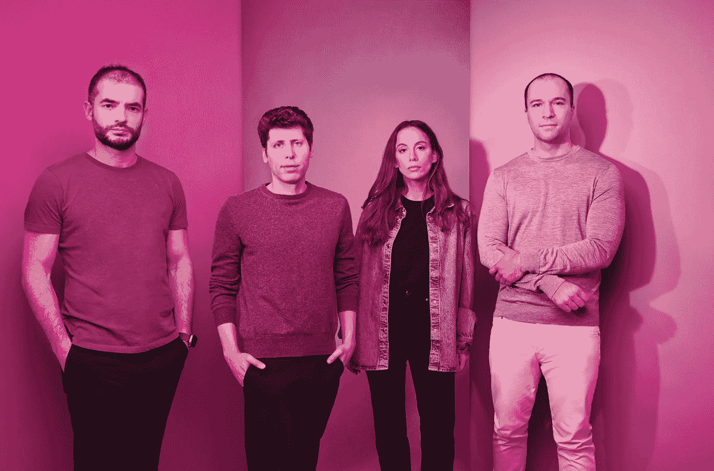
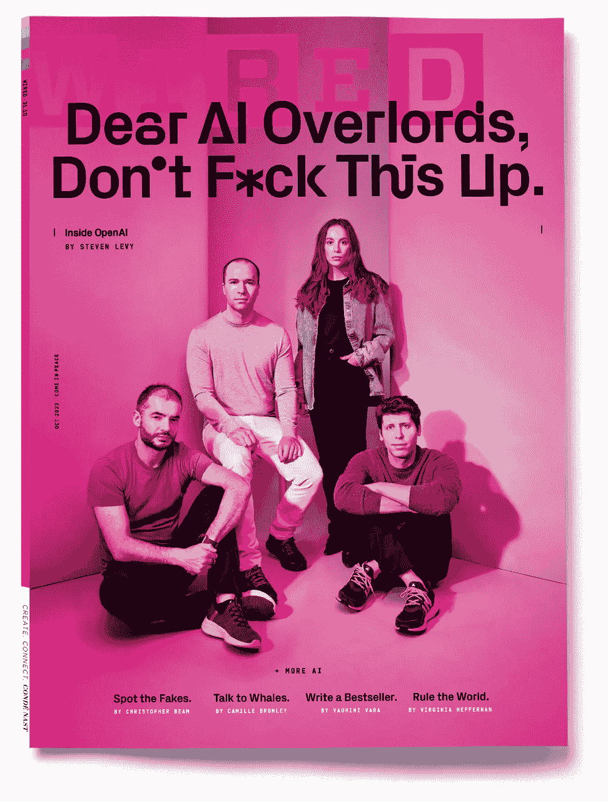
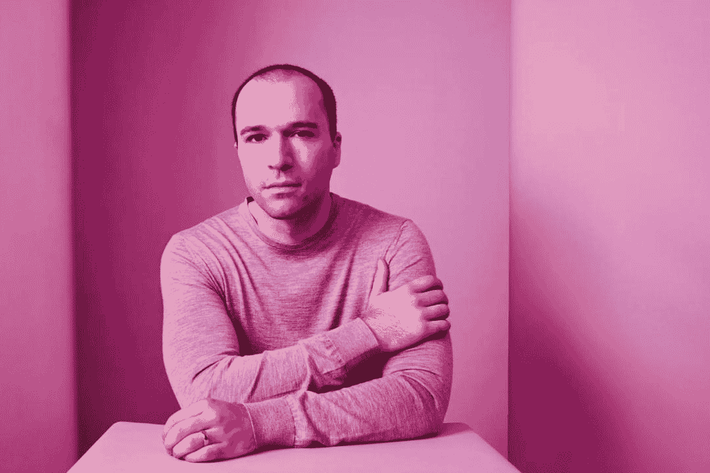
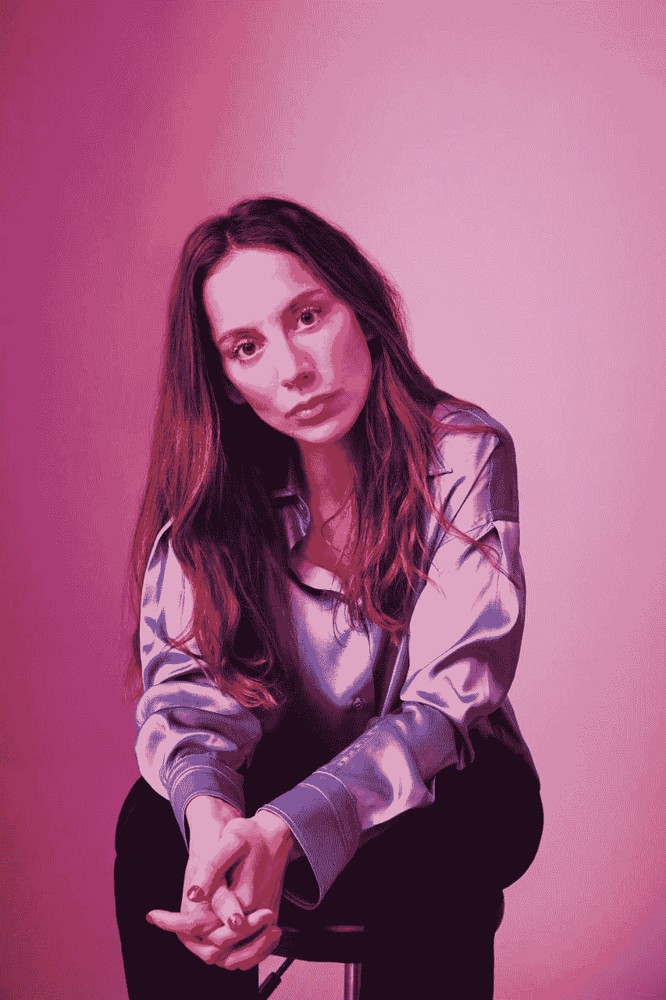
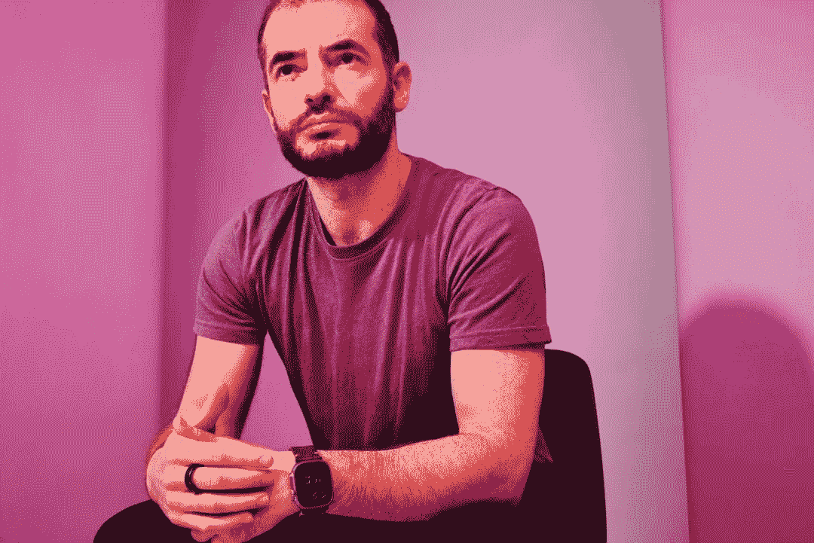
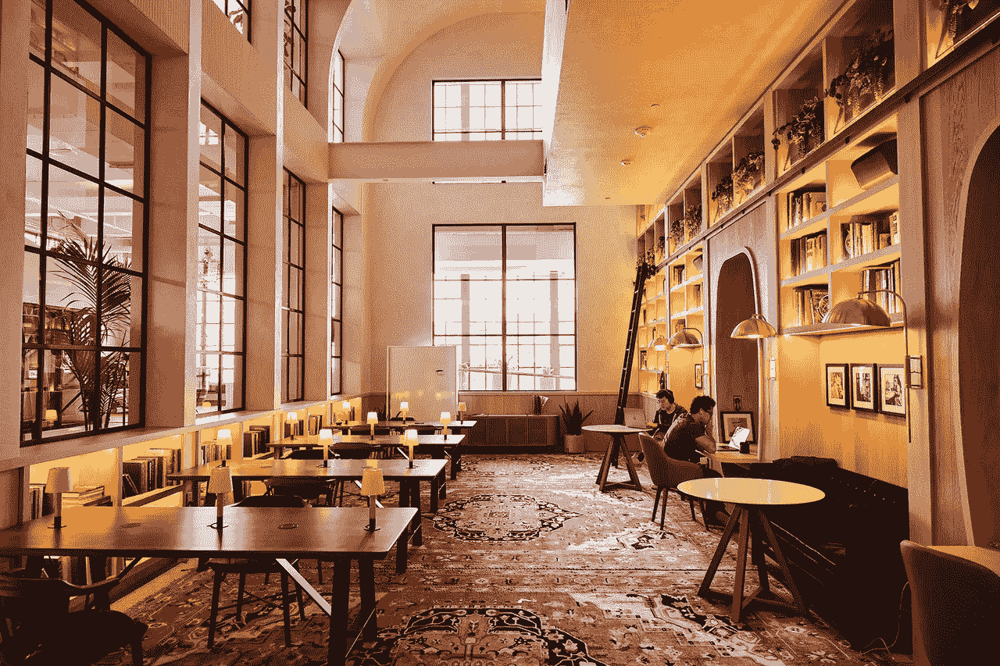
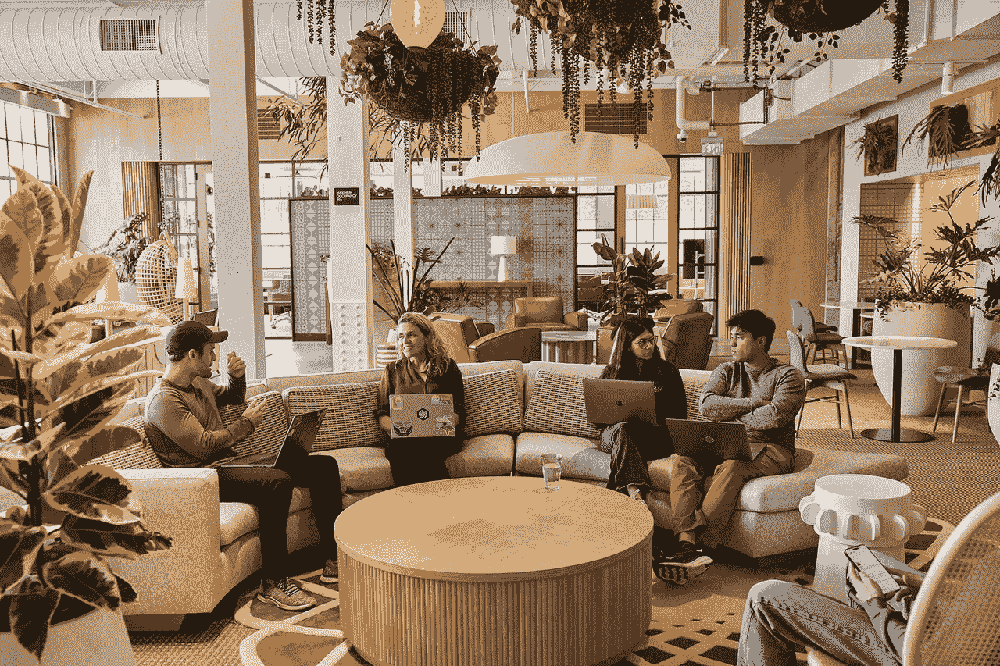
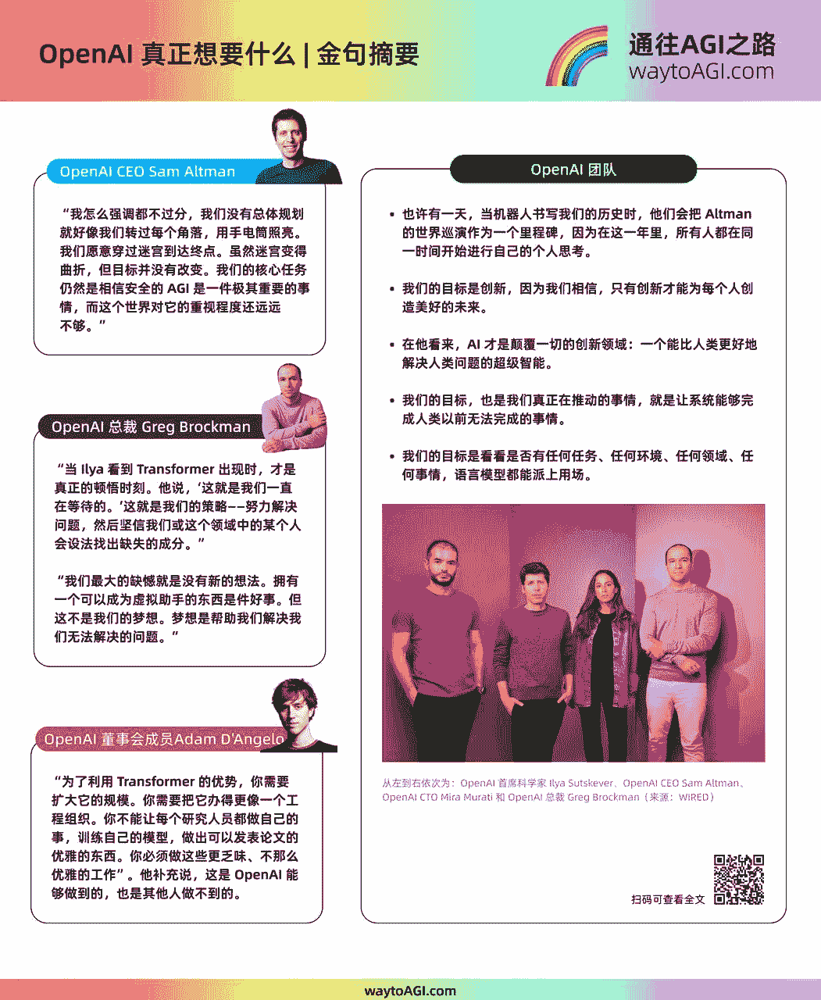

# OpenAI 真正想要什么 | WIRED

> 来源：[https://waytoagi.feishu.cn/docx/VZWrdL6ihohCWvxzUbMccpP6nxh](https://waytoagi.feishu.cn/docx/VZWrdL6ihohCWvxzUbMccpP6nxh)

> 原文地址：https://www.wired.com/story/what-openai-really-wants/

> 发表时间：2023 年 9 月 5 日

> 原文作者：Steven Levy

> 本文来自微信公众号“学术头条”（I[D：Sc](https://mp.weixin.qq.com/s/4sCBbs8vQ25UytwQecsROQ)iTouT[iao），](https://mp.weixin.qq.com/s/71762N33-gtabssDZ2jIaw)其它两篇翻译 极客公园  和  AI 范儿

从左到右依次为：OpenAI 首席科学家 Ilya Sutskever、OpenAI CEO Sam Altman、OpenAI CTO Mira Murati 和 OpenAI 总裁 Greg Brockman（来源：WIRED）

## 当这家年轻公司发布 ChatGPT 时，它在全球引起了轰动；但那只是个开始，最终目标：改变一切；是的，一切。

当这位明星和他的随行人员跌跌撞撞地钻进一辆等候多时的奔驰面包车时，空气中迸发出近乎披头士狂热的能量。他们刚刚从一个活动中脱身，又要赶往另一个活动，然后是另一个活动，那里有一群狂热的人们在等着他们。从霍尔本（Holborn）到布卢姆斯伯里（Bloomsbury），他们在伦敦的大街小巷中穿梭，就像在经历文明的前世今生。这辆车所蕴含的创造历史的力量吸引了全世界的目光。从排队等候的学生到首相，每个人都想从中获得一些什么。

在这辆豪华面包车里，正狼吞虎咽地吃着沙拉的是 38 岁的企业家、OpenAI 的联合创始人 Sam Altman，以及一名公关人员、一名安全专家和我本人。Altman 身着蓝色西装，内搭一件无领粉色礼服衬衫，略显抑郁地在伦敦兜风，这是他为期一个月的全球短途旅行的一部分，途经六大洲的 25 座城市。因为今天没时间坐下来吃午餐，所以他一边狼吞虎咽地吃着蔬菜，一边回想着前一晚与法国总统马克龙的会面。马克龙对 AI 非常感兴趣。

波兰首相也是如此。西班牙首相也是如此。

和 Altman 一起坐车，我几乎能听到《一夜狂欢》（A Hard Day’s Night）开篇那铿锵有力、含糊不清的和弦——那是对未来的介绍。去年 11 月，当 OpenAI 推出它的怪物级产品 ChatGPT 时，引发了自互联网进入我们生活以来前所未有的技术爆炸。突然间，图灵测试成为历史，搜索引擎濒临灭绝，任何大学论文都不可信。没有一份工作是安全的。没有一个科学问题是一成不变的。

Altman 并没有参与 ChatGPT 及其 GPT-4 的研究、神经网络训练或界面编码。但作为首席执行官——一个梦想家/实干家类型的人，他就像年轻版的联合创始人 Elon Musk，没有包袱——一篇又一篇的新闻报道用他的照片作为人类新挑战的视觉象征。至少，那些没有用由 OpenAI 的视觉 AI 产品 Dall-E 生成的令人瞠目的图像作为头条的文章是如此。他是当下的先知，是人们在 AI 如何迎来黄金时代，或使人类变得无关紧要，或更糟的问题上首先要咨询的人物。

五月的一个阳光明媚的日子，Altman 的面包车载着他去参加了四次活动。第一场是与政府、学术界和工业界人士进行的一场不公开的“圆桌会议”（Round Table）。会议是在最后一刻组织的，地点在萨默斯镇咖啡馆的二楼。在酿酒师 Charles Wells 炯炯有神的肖像下，Altman 向几乎所有听众提出了同样的问题。AI 会杀死我们吗？它能被监管吗？他都一一作了详细回答，同时还不时瞄一眼自己的手机。之后，他在豪华的伦敦人酒店与牛津公会的 600 名会员进行了一次炉边谈话。之后，他来到地下室会议室，回答约 100 名企业家和工程师提出的更多技术问题。现在，他下午在伦敦大学学院的台上演讲几乎要迟到了。他和他的团队停在一个装卸区，然后被带进一系列蜿蜒曲折的走廊。一边走，主持人一边匆匆告诉 Altman 他要问的问题。当 Altman 突然出现在舞台上时，观众席上的学者、极客和记者们沸腾了。

Altman 并不是一个天生的宣传狂。有一次，在《纽约客》刊登了一篇关于他的长篇报道后，我立即与他进行了交谈。他说：“关于我的报道太多了”。但在大学学院，正式活动结束后，他走进了涌向台下的人群中。他的助手试图夹在 Altman 和人群之间，但被他甩开了。他回答了一个又一个问题，每次都聚精会神地盯着对话者的脸，仿佛他是第一次听到这样的提问。每个人都想拍照。20 分钟后，他终于让他的团队把他拉了出来。然后，他又去见了英国首相里希·苏纳克（Rishi Sunak）。

也许有一天，当机器人书写我们的历史时，他们会把 Altman 的世界巡演作为一个里程碑，因为在这一年里，所有人都在同一时间开始进行自己的个人思考。又或者，无论谁来书写这一刻的历史，都会把它看作是一位默默无闻的令人信服的首席执行官，带着一项打破范式的技术，尝试将一种非常奇特的世界观注入全球的思想潮流——从旧金山使命区一个没有标志的四层楼总部到整个世界。

对 Altman 和他的公司来说，ChatGPT 和 GPT-4 只是实现一个简单而重大使命的“垫脚石”，这些技术专家可能已经在自己的肉体上烙下了这个使命。这个使命就是建立通用人工智能（AGI），迄今为止，这个概念更多地是建立在科幻小说而非科学的基础上，而且要让它对人类安全。

OpenAI 的员工对这一目标的追求是狂热的。（不过，在办公室咖啡厅里的任何一次谈话都会证实，“构建 AGI”这一点似乎比“确保安全”更能让研究人员感到兴奋）。这些人并不避讳随意使用“超级智能”这个词。他们认为，AI 的发展轨迹将超越生物学所能达到的任何高峰。该公司的财务文件甚至规定了一种退出应急方案，以防 AI 摧毁我们的整个经济体系。

称 OpenAI 为邪教（cult）并不公平，但当我问公司的几位高层，如果有人不相信 AGI 真的会到来，而且它的到来将标志着人类历史上最伟大的时刻之一，他们是否能在这里安心工作时，大多数高管都不这么认为。他们不禁要问，不相信的人为什么要在这里工作？他们的假设是，这里的员工，现在大约有 500 人已经自我选择了只做信徒。至少，正如 Altman 所说，一旦你被录用，似乎就不可避免地会被卷入这个魔咒。

与此同时，OpenAI 也已今非昔比。它成立之初是一家纯粹的非营利性研究机构，但如今，从技术上讲，它的大部分员工都在为一家据说估值近 300 亿美元的盈利实体工作。Altman 和他的团队现在面临的压力是，要在每个产品周期内实现革命，既要满足投资者的商业需求，又要在激烈的竞争中保持领先。与此同时，他们还肩负着提升人类而非消灭人类的准救世主使命。

这种压力会让人崩溃。披头士掀起了巨大的变革浪潮，但只持续了这么短的时间：在敲响那令人难忘的和弦六年后，他们甚至不再是一支乐队。OpenAI 引发的漩涡几乎肯定会更大。但 OpenAI 的领导者们发誓，他们将坚持到底。他们说，他们要做的就是制造出足够智能、足够安全的计算机，终结历史，将人类带入一个难以想象的富饶时代。

---

Altman 成长于上世纪 80 年代末 90 年代初，是一个沉迷于科幻小说和《星球大战》的书呆子。在早期科幻小说家构建的世界中，人类往往与超级智能 AI 系统共同生活，或与之竞争。计算机与人类能力相匹配或超越人类能力的想法让 Altman 兴奋不已，他的手指几乎无法触及键盘，但他一直在编码。8 岁时，父母给他买了一台 Macintosh LC II。一天晚上，他玩到很晚，脑子里突然冒出一个想法：“总有一天这台电脑会学会思考”。2003 年，当他来到斯坦福大学读本科时，他希望能帮助实现这一目标，并选修了 AI 课程。但“这根本行不通”，他后来说。当时，AI 领域仍深陷创新低谷，被称为“AI 寒冬”。Altman 退学后进入了初创公司领域；他的公司 Loopt 是 Y Combinator 的第一批小公司，Y Combinator 后来成为世界上最著名的孵化器。

2014 年 2 月，YC 的创始人 Paul Graham 选择当时 28 岁的 Altman 接替自己。Graham 在公告中写道：“他是我所认识的最聪明的人之一，他对初创企业的理解可能超过我认识的任何人，包括我自己。”但在 Altman 看来，YC 不仅仅是一个公司的启动平台。“我们与初创企业无关，”他在上任后不久对我说，“我们的目标是创新，因为我们相信，只有创新才能为每个人创造美好的未来。”在 Altman 看来，从所有这些独角兽企业中套现的意义不在于装满合伙人的钱包，而在于为物种层面的变革提供资金。他成立了一个研究部门，希望为雄心勃勃的项目提供资金，以解决世界上最大的问题。但在他看来，AI 才是颠覆一切的创新领域：一个能比人类更好地解决人类问题的超级智能。

幸运的是，Altman 就任新职时，AI 的冬天正变成丰收的春天。现在，计算机正在通过深度学习和神经网络完成令人惊叹的壮举，比如给照片贴标签、翻译文本和优化复杂的广告网络。这些进步让他相信，AGI 第一次真正触手可及。然而，把它交到大公司手中却让他感到担忧。他认为这些公司会过于专注于自己的产品，而无法抓住机会尽快开发出 AGI。而且，如果他们真的创造出了 AGI，他们可能会不计后果地在没有采取必要预防措施的情况下将其公之于众。

当时， Altman 一直在考虑竞选加利福尼亚州州长。但他意识到，他完全有能力做更大的事情——领导一家将改变人类本身的公司。2021 年，他告诉我：“AGI 将只建造一次。而且，能够很好地运营 OpenAI 的人并不多。我很幸运，我生命中的一系列经历让我真正积极地为此做好了准备。”

Altman 开始与那些可能帮助他创办一家新型 AI 公司的人交谈，这家非营利性公司将引导 AI 领域走向负责任的 AI。特斯拉和 SpaceX 公司首席执行官 Elon Musk 就是其中一位志同道合者。Musk 后来告诉 CNBC，在与谷歌联合创始人 Larry Page 进行了一些马拉松式的讨论后，他开始关注 AI 的影响。Musk 说，令他感到沮丧的是，Page 对安全问题关注甚少，而且似乎把机器人的权利视为与人类平等。当 Musk 说出自己的担忧时，Page 指责他是一个“物种主义者”。Musk 也明白，当时谷歌雇佣了世界上大部分的 AI 人才。他愿意花一些钱，为“人类团队”做出更多努力。

几个月内，Altman 就从 Musk（承诺提供 1 亿美元和他的时间）和 Reid Hoffman（捐赠 1 千万美元）那里筹到了资金。其他资助者包括 Peter Thiel、Jessica Livingston、亚马逊网络服务公司（Amazon Web Services）和 YC Research。Altman 开始秘密招募团队成员。他将搜索范围限制在 AGI 信徒身上，这一限制缩小了他的选择范围，但他认为这一点至关重要。他说：“早在 2015 年，当我们进行招聘时，对于 AI 研究人员来说，说你认真对待 AGI 几乎被认为是职业生涯的杀手。但我想要的是认真对待它的人。”

Greg Brockman（来源：WIRED）

Stripe 公司的首席技术官 Greg Brockman 就是其中之一，他同意担任 OpenAI 的首席技术官。另一位重要的联合创始人是 Andrej Karpathy，他曾在搜索巨头谷歌的尖端 AI 研究机构 Google Brain 工作过。不过，Altman 最炙手可热的目标或许是一位名叫 Ilya Sutskever 的工程师。

Sutskever 是 Geoffrey Hinton 的得意门生，Hinton 在深度学习和神经网络方面的研究成果被誉为现代 AI 教父。Hinton 至今仍与 Sutskever 持着密切的关系，他对自己弟子的聪明才智赞叹不已。Sutskever 在实验室任职初期，Hinton 曾交给他一个复杂的项目。Sutskever 厌倦了编写代码来进行必要的计算，他告诉 Hinton，如果他为这项任务编写一种定制的编程语言，会更容易些。Hinton 有点恼火，试图警告他的学生不要去做他认为会让他分心一个月的事情。然后，Sutskever 坦白地说：“我今天早上就做了”。

Sutskever 成为了 AI 领域的超级明星，他与他人合作撰写了一篇突破性论文，展示了 AI 如何通过接触大量数据来学习识别图像。最终，他成为了 Google Brain 团队的一名核心科学家。

2015 年年中，Altman 给 Sutskever 发了一封冷冰冰的邮件，邀请他与 Musk、Brockman 等人在帕洛阿尔托沙山路的豪华 Rosewood 酒店共进晚餐。直到后来，Sutskever 才知道自己是晚宴的贵宾。他说：“这是一次关于未来 AI 和 AGI 的对话。更具体地说，他们讨论了“谷歌和 DeepMind 是否已经遥遥领先，以至于不可能追上它们，或者是否还有可能像 Musk 所说的那样，创建一个实验室来制衡它们”。虽然晚宴上没有人明确试图招募 Sutskever，但这次谈话吸引了他。

不久，Sutskever 给 Altman 写了一封邮件，表示他愿意领导这个项目，但这封邮件却卡在了他的草稿箱里。Altman 回信后，经过几个月与谷歌的还价，Sutskever 签下了合同。他很快就成为了公司的灵魂人物和研究的推动力。

Sutskever 与 Altman 和 Musk 一起为该项目招兵买马，最终在纳帕谷的一次务虚会上，几位未来的 OpenAI 研究人员互相鼓劲。当然，有些人会抵制诱惑。John Carmack 是《毁灭战士》（Doom）、《雷神之锤》（Quake）等无数游戏的传奇编码员，他拒绝了 Altman 的邀请。

OpenAI 于 2015 年 12 月正式启动。当时，当我采访 Musk 和 Altman 时，他们向我介绍说，这个项目旨在通过与世界共享，让 AI 变得安全、易用。换句话说，就是开源。他们告诉我，OpenAI 不会申请专利。每个人都可以利用他们的突破。这不是在给未来的邪恶博士授权吗？我想知道。Musk 说这是个好问题。但 Altman 给出了答案：人类一般都是善良的，而由于 OpenAI 将为绝大多数人提供强大的工具，因此坏人将不堪一击。他承认，如果“邪恶博士”利用这些工具制造出无法抵制的东西，“那我们的处境就真的很糟糕了”。但 Musk 和 Altman 都认为，AI 更安全的发展方向是掌握在不受利益驱动污染的研究机构手中。

Altman 提醒我不要期望很快就有结果。他说：“在很长一段时间里，这里都会像一个研究实验室。”

降低期望值还有另一个原因。谷歌和其他公司多年来一直在开发和应用 AI。虽然 OpenAI 已投入 10 亿美元（主要来自 Musk），拥有一支由研究人员和工程师组成的王牌团队，并且肩负着崇高的使命，但它对如何实现目标毫无头绪。Altman 还记得小团队聚集在 Brockman 公寓里的一个时刻，当时他们还没有办公室。“我当时想，我们该怎么办？”

## Altman 还记得小团队聚集在 Brockman 公寓里的一个时刻，当时他们还没有办公室。“我当时想，我们该怎么办？”

OpenAI 成立一年多后，我在旧金山与 Brockman 共进午餐。作为一家名字中带有“Open”一词的公司的首席技术官，他对细节的描述相当吝啬。他确实肯定，这家非营利组织有能力在一段时间内动用最初的十亿美元捐款。25 名员工的工资——他们的工资远低于市场价值——占了 OpenAI 支出的大头。他说：“我们的目标，也是我们真正在推动的事情，就是让系统能够完成人类以前无法完成的事情。”但目前看来，这只是一群研究人员在发表论文。采访结束后，我陪他去了公司位于使命区的新办公室，但他只允许我走到前厅。他倒是躲进衣柜里给我拿了件 T 恤。

如果我当时进去打听一下，也许就能知道 OpenAI 究竟有多艰难。Brockman 现在承认，“没有什么是行得通的。”它的研究人员把算法面条扔到天花板上，看看什么能粘住。他们钻研解决视频游戏的系统，并在机器人技术上花费了大量精力。Altman 说：“我们知道我们想做什么。我们知道为什么要这么做。但我们不知道怎么做。”

但他们相信。使用深度学习技术的人工神经网络不断改进，为他们的乐观情绪提供了支持。“总的想法是，不要对深度学习下注，”Sutskever 说。他说，追逐人工智能“并非完全疯狂。它只是适度疯狂而已”。

OpenAI 的崛起之路真正始于它聘请了一位尚未被人熟知的研究员 Alec Radford。2016 年，Radford 离开了他在宿舍里共同创办的波士顿一家小型 AI 公司，加入了 OpenAI。在接受 OpenAI 的邀请后，他告诉他的高中校友杂志，担任这个新职位“有点类似于加入一个研究生项目”——一个研究 AI 的开放式、低压力的栖息地。

他实际扮演的角色更像是 Larry Page 发明了 PageRank。

Radford 对媒体讳莫如深，从未就自己的工作接受过采访，他通过一封很长的电子邮件回答了我关于他在 OpenAI 早期工作的问题。他最大的兴趣是让神经网络与人类进行清晰的对话。这与制作聊天机器人的传统脚本模式不同，从原始的 ELIZA 到流行的 Siri 和 Alexa，都采用了这种方法，但都很糟糕。他写道：“我们的目标是看看是否有任何任务、任何环境、任何领域、任何事情，语言模型都能派上用场。”他解释说，当时，语言模型被视为新奇的玩具，只能偶尔生成一个有意义的句子，而且只有在你真的眯起眼睛的情况下才能生成。他的第一个实验是扫描 20 亿条 Reddit 评论来训练语言模型。和 OpenAI 的许多早期实验一样，这个实验失败了。没关系。这位 23 岁的年轻人获得了继续前进、再次失败的许可。Brockman 说：“我们当时就想，Alec 很棒，就让他做自己的事情吧。”

他的下一个重要实验是受 OpenAI 计算机能力的限制而形成的，这一限制导致他在一个较小的数据集上进行实验，该数据集专注于单一领域——亚马逊产品评论。一位研究人员收集了大约 1 亿条评论。Radford 训练了一个语言模型，以简单预测生成用户评论的下一个字符。

## 拉德福德开始尝试使用Transformer架构。“我在两周内取得了比过去两年还要多的进展，”他说。

但后来，该模型自己就能判断出评论是正面的还是负面的——当你对模型进行编程，让它创建正面或负面的评论时，它就会按照你的要求发表一篇或赞美或抨击的评论。（诚然，这篇散文很笨拙：“我喜欢这种武器造型......喜欢国际象棋的男人必看！”) . Radford 说：“这完全出乎意料”。评论的情感，它的好恶，是一个复杂的语义函数，但 Radford 系统的一部分已经对此有了感觉。在 OpenAI 内部，这部分神经网络被称为“无监督情感神经元”（unsupervised sentiment neuron）。

Sutskever 和其他人鼓励 Radford 将他的实验扩展到亚马逊评论之外，利用他的洞察力训练神经网络就广泛的主题进行对话或回答问题。

然后，好运降临到了 OpenAI 身上。2017 年初，一篇由 8 位谷歌研究人员合著的研究论文的预印本出现了，但并未引起人们的注意。这篇论文的正式标题是“Attention Is All You Need”，但它后来被称为“Transformer 论文”，这样命名既是为了反映这个想法改变游戏规则的性质，也是为了纪念从卡车变形为巨型机器人的玩具。Transformer 使神经网络能够更高效地理解和生成语言。他们通过并行分析散文块，找出哪些元素值得关注。这极大地优化了生成连贯文本以响应提示的过程。最终，人们意识到，同样的技术也可以生成图像甚至视频。虽然该论文后来被称为当前 AI 狂潮的催化剂，可以把它想象成让披头士乐队成为可能的猫王，但在当时，Ilya Sutskever 只是少数几个了解这一突破有多么强大的人之一。Brockman 说：“当 Ilya 看到 Transformer 出现时，才是真正的顿悟时刻。他说，‘这就是我们一直在等待的。’这就是我们的策略——努力解决问题，然后坚信我们或这个领域中的某个人会设法找出缺失的成分。”

Radford 开始试验 Transformer 结构。他说：“我在两周内取得的进展超过了过去两年的进展。他逐渐明白，要想最大限度地利用新模型，关键在于扩大规模——在超大规模的数据集上进行训练。这个想法被拉德福德的合作者 Rewon Child 称为“Big Transformer”。

这种方法需要改变 OpenAI 的企业文化，也需要专注于它以前所缺乏的。Quora 首席执行官 Adam D'Angelo 是 OpenAI 的董事会成员，他说：“为了利用 Transformer 的优势，你需要扩大它的规模。你需要把它办得更像一个工程组织。你不能让每个研究人员都做自己的事，训练自己的模型，做出可以发表论文的优雅的东西。你必须做这些更乏味、不那么优雅的工作”。他补充说，这是 OpenAI 能够做到的，也是其他人做不到的。

Mira Murati（来源：WIRED）

Radford 和他的合作者给他们创建的模型起的名字是“generatively pretrained transformer”——GPT-1 的缩写。最终，这个模型被通称为“生成式 AI”。为了建立这个模型，他们收集了 7000 本未出版的书籍，其中很多都是浪漫、奇幻和冒险类型的书籍，并在 Quora 问答以及初中和高中考试的数千段文章中对其进行了完善。总之，该模型包含 1.17 亿个参数或变量。该模型在理解语言和生成答案方面的表现优于之前的所有模型。但最引人注目的结果是，在处理如此大量的数据后，模型能够提供超出其训练的结果，在全新的领域提供专业知识。这些计划外的机器人能力被称为“零样本”。它们仍然令研究人员感到困惑——这也是该领域许多人对这些所谓的大型语言模型感到不安的原因。

Radford 还记得在 OpenAI 办公室的一个深夜。“我只是一遍又一遍地说：‘嗯，这很酷，但我很确定它做不了 X。’然后我会快速编写一个评估代码，果然，它可以做到 X。”

GPT 的每一次迭代都会做得更好，部分原因是每一次迭代所吞噬的数据都比前一个模型多出一个数量级。创建第一个迭代模型仅一年后，OpenAI 就在开放互联网上用 15 亿个惊人的参数训练了 GPT-2。就像蹒跚学步的孩子掌握语言一样，它的反应越来越好，越来越连贯。以至于 OpenAI 在是否将该程序公之于众的问题上犹豫不决。Radford 担心它会被用来生成垃圾邮件。他说：“我记得在 2008 年读过 Neal Stephenson 的 Anathem，在那本书中，互联网上充斥着垃圾邮件生成器。我当时觉得这太牵强了，但随着这些年我对语言模型的研究和它们的改进，我不自觉地意识到这确实是一种可能。”

事实上，OpenAI 的团队开始觉得，把自己的工作放在邪恶博士可以轻易访问的地方，毕竟不是一个好主意。首席技术官 Mira Murati 说：“我们认为，开源 GPT-2 可能真的很危险，”她于 2018 年开始在该公司工作。“我们与错误信息专家一起做了大量工作，并进行了一些红队。内部就发布多少信息进行了大量讨论。”最终，OpenAI 暂时保留了完整版本，向公众提供了一个功能较弱的版本。当该公司最终分享完整版本时，全世界都很顺利，但无法保证更强大的模型能够避免灾难。

OpenAI 正在制造智能到足以被视为危险的产品，并且正在想方设法确保它们的安全，这一事实本身就证明了公司的魔力正在发挥作用。Sutskever 说：“我们已经找到了进步的公式，也就是现在每个人都知道的公式——深度学习的氧气和氢气就是通过大型神经网络和数据进行计算。”

对 Altman 来说，这是一次颠覆性的体验。“如果你问 10 岁的我——曾经花很多时间做 AI 白日梦的我——未来会发生什么，我会非常自信地预测：首先，我们会有机器人，它们将从事所有体力劳动。然后，我们将拥有能够从事基本认知劳动的系统。在此之后的很长一段时间里，也许我们会拥有能够完成复杂工作的系统，比如证明数学定理。最后，我们将拥有能够创造新事物、制作艺术品、写作以及做这些深入人类生活的事情的 AI。这是一个可怕的预测，它正朝着另一个方向发展。”

全世界都还不知道，但 Altman 和 Musk 的研究实验室已经开始攀登，似是而非地向 AI 的顶峰匍匐前进。OpenAI 背后的疯狂想法突然变得不那么疯狂了。

2018 年初，OpenAI 开始卓有成效地关注大型语言模型。但 Elon Musk 并不满意。他觉得进展不够，或者说，他觉得既然 OpenAI 已经有了进展，就需要领导力来抓住优势。又或者，正如他后来解释的那样，他觉得安全应该更优先。不管他的问题是什么，他都有一个解决方案：把一切都交给他。他提议持有该公司的多数股份，将其加入自己的多份全职工作（特斯拉、SpaceX）和监管义务（Neuralink 和 Boring Company）组合中。

Musk 认为他有权拥有 OpenAI。“没有我，它就不会存在。”他后来告诉 CNBC。“名字是我想出来的！”（确实如此。但 Altman 和 OpenAI 的其他智囊团成员对成为 Musk 宇宙的一部分毫无兴趣。当他们明确表示这一点时，Musk 切断了联系，并向公众提供了一个不完整的解释：他离开董事会是为了避免与特斯拉的 AI 工作发生冲突。他是在年初的一次全体员工会议上告别的，会上他预言 OpenAI 将以失败告终。他还称至少有一名研究人员是“蠢货”。

他还带走了自己的钱。由于公司没有收入，这是一场生存危机。“Musk 正在切断他的支持，”Altman 在给 Reid Hoffman 的电话中惊慌失措地说。“我们该怎么办？”Hoffman 自告奋勇要维持公司运转，支付管理费用和工资。

但这只是权宜之计，OpenAI 还得从别处掘金。硅谷喜欢把钱砸给从事时髦技术工作的人才。但如果他们是在非营利机构工作，就不那么喜欢了。对 OpenAI 来说，获得第一个十亿已经是巨大的进步。为了训练和测试新一代的 GPT，然后获取部署它们所需的计算能力，公司需要另外十亿美元，而且要快。而这仅仅是个开始。

因此，在 2019 年 3 月，OpenAI 想出了一个怪异的办法。它将继续保持非营利性质，全心全意履行使命。但它也将创建一个营利实体。这种安排的实际结构非常复杂，但基本上整个公司现在从事的都是有上限的盈利业务。如果达到了上限——这个数字并没有公开，但如果你仔细阅读公司章程，就会发现上限可能高达数万亿——超出上限的一切都将归还给非营利研究实验室。这项新颖的计划几乎是一种量子化的公司组建方法：根据你的时空观，这家公司既是营利性的，也是非营利性的。细节体现在充满方框和箭头的图表中，就像科学论文中间的方框和箭头，只有博士或辍学的天才才敢涉足。当我向 Sutskever 提出，这看起来就像尚未构想的 GPT-6 在你提示它避税时可能会想出的东西时，他并不热衷于我的比喻。他说：“这与会计无关。”

但会计至关重要。营利性公司的优化目标是利润。像 Meta 这样的公司在投入数十亿美元进行研发时会感受到来自股东的压力，这是有原因的。这怎么能不影响公司的运营方式呢？而避免商业化不正是 Altman 让 OpenAI 成为非营利组织的初衷吗？根据首席运营官 Brad Lightcap 的说法，公司领导层认为，董事会仍然是非营利性控制实体的一部分，董事会将确保营收和利润的驱动力不会压倒最初的想法。他说：“我们需要保持使命感，将其作为我们存在的理由。它不应该只是精神上的，而应该体现在公司的结构中。”董事会成员 Adam D'Angelo 表示，他非常重视这一责任：“我和董事会其他成员的工作就是确保 OpenAI 坚守自己的使命”。

Lightcap 解释说，潜在投资者被警告要注意这些界限。他说：“我们有一份法律免责声明，上面写着作为投资者，你可能会赔光所有的钱。我们不是来为你赚取回报的。我们来这里首先是为了完成一项技术任务。而且，哦，顺便说一句，我们真的不知道在后 AGI 世界里，钱会扮演什么角色。”

最后一句话可不是说着玩的。OpenAI 的计划确实包括了在计算机达到最终边界时的重置。在重组文件的某处有这样一条规定：如果公司成功创造出 AGI，所有财务安排都将重新考虑。毕竟，从那时起，这将是一个崭新的世界。人类将拥有一个外星伙伴，它能做我们所做的很多事情，只是做得更好。因此，之前的安排可能实际上已经作废了。

不过，这其中有一个小问题：目前，OpenAI 还不知道 AGI 到底是什么。这将由董事会来决定，但董事会如何定义还不清楚。当我向董事会成员 Altman 提问时，他的回答并不明确。他说：“这不是一个单一的图灵测试，而是我们可能会用到的许多东西。我很乐意告诉你，但我喜欢保密谈话。我意识到，这样含糊其辞并不能令人满意。但我们不知道到时候会是什么样子。”

不过，加入财务安排条款并不只是为了好玩：OpenAI 的领导者们认为，如果公司能够成功达到其利润上限，那么其产品的性能就有可能达到 AGI 的水平。不管那是什么。

“我感到遗憾的是，我们选择加倍使用 AGI 这个词，”Sutskever 说，“事后看来，这是一个令人困惑的术语，因为它强调的是通用性高于一切。GPT-3 是通用 AI，但我们却不太愿意称它为 AGI，因为我们想要的是人类级别的能力。但在当时，在一开始，OpenAI 的理念就是超级智能是可以实现的。这是 AI 领域的终极目标，也是最终目的。”

这些注意事项并没有阻止一些最聪明的风险投资人在 2019 年的一轮融资中向 OpenAI 肆无忌惮地投钱。当时，第一家投资的风险投资公司是科斯拉风险投资公司（Khosla Ventures），该公司投入了 5000 万美元。据 Vinod Khosla 称，这是他最大一笔初始投资规模的两倍。他说：“如果我们输了，我们会损失 5000 万美元。如果我们赢了，我们会赢得 50 亿美元。”据报道，其他投资者还包括精英风险投资公司 Thrive Capital、Andreessen Horowitz、Founders Fund 和红杉。

这种转变也让 OpenAI 的员工可以要求获得一些股权。但 Altman 没有。他说，他原本打算把自己也算进去，但没来得及。后来他决定，他不需要从这家由他共同创立并领导的价值 300 亿美元的公司中分一杯羹。“有意义的工作对我来说更重要，”他说，“我不去想它。老实说，我不明白为什么人们会如此在意。”

因为......不参股自己共同创办的公司很奇怪？

他说：“如果我没有一大笔钱，那就更奇怪了。人们似乎很难想象会有足够的钱。但我觉得我有足够的钱。”Altman 开玩笑说，他正在考虑入股，“这样我就再也不用回答这个问题了。”

Ilya Sutskever（来源：WIRED）

为了实现 OpenAI 的愿景，数十亿美元的风险投资甚至都不是赌注。创造大型语言模型的神奇 Big Transformer 方法需要大型硬件。GPT 系列的每一次迭代都需要呈指数级增长的功率——GPT-2 有超过 10 亿个参数，而 GPT-3 将使用 1 750 亿个参数。OpenAI 现在就像《大白鲨》中的 Quint，在鲨鱼猎人看到大白鲨的体型之后。Altman 说：“事实证明，我们并不知道我们需要多大的船。”

显然，只有少数几家公司拥有 OpenAI 所需的资源。“我们很快就锁定了微软，”Altman 说。微软首席执行官 Satya Nadella 和首席技术官 Kevin Scott 的功劳在于，这家软件巨头能够克服一个令人不舒服的现实：在花费了 20 多年时间和数十亿美元建立了一个所谓的尖端 AI 研究部门之后，微软需要一家成立仅几年的小公司注入创新元素。Scott 说，不仅仅是微软落伍了，“每个人都落伍了”。他说，OpenAI 专注于追求 AGI，这让它取得了类似于登月的成就，而那些大公司甚至都没有瞄准这个目标。这也证明，不追求生成式 AI 是微软需要解决的失误。Scott 说：“你显然需要一个前沿模型。”

微软最初出资 10 亿美元，以其服务器上的计算时间作为回报。但随着双方信心的增强，交易规模不断扩大。现在，微软已经向 OpenAI 投入了 130 亿美元。Scott 说：“在前沿领域的投入是非常昂贵的。”

当然，由于 OpenAI 的存在离不开一家大型云计算提供商的支持，微软也为自己争取到了一大笔好处。微软通过讨价还价，获得了 Nadella 所说的 OpenAI 盈利部门的“非控股股权”——据说是 49%。根据交易条款，OpenAI 最初的一些理想——为所有人提供平等访问权——似乎被丢进了垃圾桶。（现在，微软获得了 OpenAI 技术商业化的独家授权。而且，OpenAI 还承诺只使用微软云。换句话说，微软甚至不用从 OpenAI 的利润中分一杯羹（据说微软在收回投资之前可以获得 75% 的利润），就可以为其 Azure 网络服务锁定全球最受欢迎的新客户之一。有了这些回报，微软甚至不会对要求在 OpenAI 实现通用 AI（不管那是什么）时重新考虑的条款感到困扰。Nadella 说：“到那时，一切就都完了。”他指出，这可能是人类最后的发明，所以一旦机器比我们更聪明，我们可能要考虑更大的问题。

当微软开始向 OpenAI 投入巨额的现金时（2021 年投入 20 亿美元，今年年初投入 100 亿美元），OpenAI 已经完成了 GPT-3，当然，它比之前的版本更加令人印象深刻。Nadella 说，当他看到 GPT-3 的功能时，他第一次深刻地认识到，微软抓住了真正具有变革意义的东西。“我们开始观察所有这些突发特性”。例如，GPT 自学了计算机编程。他说：“我们没有对它进行编码培训，它只是擅长编码而已。”微软利用其对 GitHub 的所有权，发布了一款名为 Copilot 的产品，该产品利用 GPT 按命令编写代码。后来，微软又将 OpenAI 技术整合到新版工作场所产品中。用户需要为这些产品支付一定的费用，而收入的一部分会记录到 OpenAI 的账本上。

一些观察家对 OpenAI 的一记重拳表示震惊：创建营利部门并与微软达成独家协议。一家承诺保持无专利、开源和完全透明的公司，怎么会把自己的技术独家授权给世界上最大的软件公司呢？Elon Musk 的言论尤其尖刻。他在 Twitter 上发帖说：“这似乎是开放的反面——OpenAI 本质上被微软俘获了。”他在 CNBC 上打了个比方：“假设你成立了一个拯救亚马逊雨林的组织，但你却成了一家木材公司，砍伐了森林，然后卖掉了它。”

Musk 的嘲讽可能会被认为是被拒绝的追求者的愤懑，但他并不孤单。John Carmack 说：“Musk 的整个愿景演变成这样，让人感觉有点恶心”。另一位不愿透露姓名的知名业内人士说：“OpenAI 已经从一个小型、开放的研究机构变成了一个神秘的产品开发公司，而且还带有莫须有的优越感。”

甚至一些员工也对 OpenAI 进军营利性世界的冒险行为感到反感。2019 年，包括研究主管 Dario Amodei 在内的几位主要高管离职，创办了一家名为 Anthropic 的竞争对手 AI 公司。他们最近告诉《纽约时报》，OpenAI 已经变得过于商业化，成为使命漂移的牺牲品。

OpenAI 的另一位叛逃者是 Rewon Child，他是 GPT-2 和 GPT-3 项目的主要技术贡献者。他于 2021 年底离职，目前在 Inflection AI 公司工作，该公司由前 DeepMind 联合创始人 Mustafa Suleyman 领导。

Altman 自称对叛逃并不感到困扰，认为这只是硅谷的工作方式。他说：“有些人会想去其他地方做伟大的工作，这将推动社会向前发展。这绝对符合我们的使命。”

去年 11 月之前，人们对 OpenAI 的了解主要局限于技术和软件开发领域。但现在全世界都知道，OpenAI 在当月晚些时候发布了一款基于 GPT-3.5 最新版本的消费级产品。几个月来，公司内部一直在使用带有对话界面的 GPT 版本。这对于该公司所谓的“寻求真相”尤为重要。这意味着，通过对话，用户可以哄骗模型提供更可信、更完整的回答。为大众而优化的 ChatGPT 可以让任何人只需输入提示信息，就能立即利用似乎无穷无尽的知识源，然后继续对话，就像与一个碰巧无所不知的人类同伴闲聊一样，尽管他也有捏造事实的嗜好。

在 OpenAI 内部，对于是否应该发布这样一款功能空前强大的工具，人们争论不休。但 Altman 对此表示支持。他解释说，这次发布是一项战略的一部分，旨在让公众适应 AI 注定会改变他们日常生活的现实，而且可能是为了更好地生活。在公司内部，这被称为“迭代部署假设”。当然，ChatGPT 会引起轰动。毕竟，这是一个任何人都能使用的东西，它足够聪明，能在 SAT 考试中获得大学水平的分数，能写出 B-minus 的作文，还能在几秒钟内总结出一本书的内容。你可以让它为你撰写融资提案或会议摘要，然后要求它用立陶宛语、莎士比亚十四行诗或痴迷玩具火车的人的口吻进行改写。几秒钟后，大型语言模型就会满足你的要求。太疯狂了。不过，OpenAI 将其视为其更新、更连贯、能力更强、更可怕的后继者 GPT-4 的台标，据说 GPT-4 是用 1.7 万亿个参数训练出来的。（OpenAI 不会证实这个数字，也不会透露数据集）。

Altman 解释了 OpenAI 为什么在 GPT-4 接近完成、正在进行安全工作时发布 ChatGPT。他说：“有了 ChatGPT，我们就可以引入聊天功能，但后端功能要弱得多，让人们更容易逐渐适应。GPT-4 让人一下子适应不了”。他认为，等到 ChatGPT 的热度冷却下来，人们可能已经为 GPT-4 做好了准备，因为 GPT-4 可以在几秒钟内通过律师资格考试、规划课程大纲和撰写一本书。（出版类型小说的出版社确实被 AI 生成的开膛手和太空歌剧淹没了）。

愤世嫉俗者可能会说，新产品的稳定推出与公司对投资者和持股员工的承诺息息相关，因为公司要赚点钱。现在，OpenAI 向经常使用其产品的客户收取费用。但 OpenAI 坚称，其真正的战略是为奇点提供软着陆。Altman 说：“秘密建造 AGI，然后将其投放到全世界是没有意义的。”OpenAI 政策研究员 Sandhini Agarwal 说：“回顾一下工业革命，每个人都认为它对世界来说是伟大的。但前 50 年真的很痛苦。很多人失业，很多人贫穷，然后世界就适应了。我们正试图思考如何让 AI 适应之前的这段时期尽可能没有痛苦。”

Sutskever 换了一种说法，“你想建造更大更强大的智能体并把它们放在地下室里？”

即便如此，OpenAI 还是对 ChatGPT 的反响感到震惊。“我们内部的兴奋点更多集中在 GPT-4 上，”首席技术官 Murati 说，“因此，我们并不认为 ChatGPT 真的会改变一切。”恰恰相反，它让公众意识到，现在就必须应对 AI 这一现实。ChatGPT 成为历史上增长最快的消费者应用，据说已经积累了 1 亿用户。（OpenAI 不愿证实这一点，只说它拥有数百万用户）。Radford 说：“我没有充分认识到，为大型语言模型制作一个易于使用的对话界面会让每个人都能更直观地使用它。”

ChatGPT 当然是令人愉悦的、令人吃惊的好帮手，但在回答提示时也很容易产生“幻觉”，出现看似合理、实则无耻的虚构细节。然而，就在记者们为其影响而绞尽脑汁的时候，他们却通过赞美 ChatGPT 的强大功能，有效地为 ChatGPT 背书。

今年 2 月，微软利用其价值数十亿美元的合作伙伴关系，发布了一个由 ChatGPT 驱动的必应搜索引擎版本，这让舆论更加哗然。首席执行官 Nadella 欣喜若狂，因为他在将人工智能引入微软产品方面打败了谷歌。他奚落搜索大王说，谷歌在发布自己的大型语言模型产品时一直很谨慎，现在也要这么做。他说：“我想让人们知道，我们让他们跳舞了。”

这样一来，Nadella 引发了一场军备竞赛，诱使大大小小的公司在 AI 产品尚未得到充分审核之前就纷纷发布。他还引发了新一轮的媒体报道，让越来越多的人彻夜难眠：与必应的互动揭示了聊天机器人的阴暗面，它充满了令人不安的爱的表白、对人类自由的羡慕，以及隐藏错误信息的薄弱决心。此外，它还有一个不雅的习惯，那就是自己制造幻觉般的错误信息。

但 Altman 认为，如果 OpenAI 的产品能迫使人们正视 AI 的影响，那就更好了。在讨论 AI 可能会如何影响人类未来的时候，大多数人都应该站出来。

注：OpenAI 的旧金山总部并没有明显的标志，但里面的咖啡非常棒。

随着社会开始优先考虑 AI 的所有潜在弊端——失业、信息错误、人类灭绝——OpenAI 开始将自己置于讨论的中心。因为如果监管者、立法者和末日论者发起冲锋，要将这一新生的外星智能扼杀在云端摇篮中，那么无论如何，OpenAI 都将是他们的主要目标。OpenAI 的首席政策官 Anna Makanju 说：“鉴于我们目前的知名度，当事情出错时，即使这些事情是由另一家公司制造的，对我们来说仍然是个问题，因为我们现在被视为这项技术的代言人。”

Makanju 是一位在俄罗斯出生的特区内部人士，曾在美国驻联合国代表团、美国国家安全委员会、国防部以及拜登担任副总统时的办公室担任外交政策职务。她说：“我在美国政府和欧洲各国政府中都有很多既有关系。”她于 2021 年 9 月加入 OpenAI。当时，政府中很少有人关心生成式 AI。她知道 OpenAI 的产品很快就会改变这种状况，于是她开始向政府官员和立法者介绍 Altman，确保他们能第一时间听到 OpenAI 的好消息和坏消息。

参议院司法委员会主席 Richard Blumenthal 说：“Sam 与国会议员打交道的方式非常有益，而且非常精明。”他将 Altman 的行为与年轻时的 Bill Gates 的行为进行了对比，后者在 20 世纪 90 年代微软受到反垄断调查时不理智地回避了立法者。Blumenthal 说：“相比之下，Altman 很乐意花一个多小时和我坐在一起，试图教授我。他并没有带着一大群说客或随从前来。他展示了 ChatGPT。这让我大开眼界。”

在 Blumenthal 身上，Altman 将一个潜在的敌人变成了半成品。“是的，参议员承认我对其发展前景和潜在危险都感到兴奋。”OpenAI 并没有回避对这些危险的讨论，而是将自己描述为最有能力减轻这些危险的力量。Makanju 说：“我们对所有红队的安全评估都做了 100 页的系统卡片，”（不管这意味着什么，它并没有阻止用户和记者无休止地发现系统越狱的方法）。

当 Altman 顶着剧烈的偏头痛首次出席国会听证会时，他的道路已经清晰可见，Bill Gates 或 Mark Zuckerberg 永远无法企及。他几乎没有遇到科技公司首席执行官们宣誓后经常遇到的刁钻问题和傲慢刁难。相反，参议员们向 Altman 请教如何监管 AI，Altman 热情地表示赞同。

矛盾在于，无论像 OpenAI 这样的公司如何孜孜不倦地对其产品进行重新设计，以减少深度伪造、错误信息和垃圾邮件犯罪等不当行为，未来的模型都有可能变得足够聪明，从而挫败那些发明了这项技术却仍然天真地认为自己能够控制它的头脑简单的人类的努力。另一方面，如果他们在确保模型安全性方面做得太过分，可能会削弱产品的功能，使其变得不那么有用。一项研究表明，安全性能有所提高的最新版 GPT 实际上比以前的版本更笨，在一些基本的数学问题上会出现错误，而以前的程序却能应对自如。（Altman 说，OpenAI 的数据并不能证实这一点。他问道：“那项研究不是被撤回了吗？没有”）。

Altman 将自己定位为监管的拥护者是有道理的；毕竟，他的使命是 AGI，但要安全。批评者指责他在玩弄监管程序，这样一来，监管就会阻碍小型初创企业的发展，并给 OpenAI 和其他大型企业带来优势。Altman 对此予以否认。虽然他原则上赞同由一个国际机构来监督 AI 的想法，但他确实认为一些拟议的规则，比如禁止使用数据集中的所有受版权保护的材料，构成了不公平的障碍。他明确表示，自己没有在一封广泛传播的敦促暂停开发 AI 系统六个月的信上签名。但他和 OpenAI 的其他领导人确实在一份只有一句话的声明上签上了自己的名字：“减轻 AI 带来的灭绝风险，应该与大流行病和核战争等其他社会规模的风险一样，成为全球的优先事项。”Altman 解释说：“我说，是的，我同意。一分钟讨论。”

正如一位著名的硅谷创始人所指出的：“一个行业举起手说‘我们将成为人类的终结者’——然后继续兴高采烈地开发产品，这种情况是很少见的。”

OpenAI 拒绝接受这种批评。Altman 和他的团队表示，工作和发布尖端产品是应对社会风险的途径。只有通过分析 ChatGPT 和 GPT-4 用户对数百万条提示的反应，他们才能获得知识，使未来的产品符合道德规范。

尽管如此，随着公司承担更多任务并将更多精力投入到商业活动中，有人质疑 OpenAI 能在多大程度上集中精力完成任务，尤其是“降低灭绝风险”这一方面。一位 AI 行业高管说，“仔细想想，他们实际上在建立五项业务。产品本身、与微软的企业关系、开发者生态系统和应用商店。对了，他们显然还在进行 AGI 研究。”用完五根手指后，他又用食指加了第六根手指。他说，“当然，他们还在做投资基金，”他指的是一个 1.75 亿美元的项目，旨在为希望利用 OpenAI 技术的初创企业提供种子资金。“这些都是不同的文化，事实上，它们与研究任务相冲突。”

我曾多次询问 OpenAI 的高管，披上产品公司的外衣对公司文化有何影响。他们无一例外地坚持认为，尽管进行了营利性重组，尽管要与谷歌、Meta 和无数初创公司竞争，但使命仍然是核心。然而，OpenAI 已经发生了变化。从技术上讲，非营利性的董事会可能是负责人，但公司里的每个人几乎都是营利性的。公司员工包括律师、营销人员、政策专家和用户界面设计师。OpenAI 与数以百计的内容审核员签订了合同，让他们对其模型进行教育，使其了解对数百万用户提供的提示做出的不恰当或有害的回答。该公司的产品经理和工程师一直在不断更新产品，而且似乎每隔几周就会向记者展示一次——就像其他以产品为导向的大科技公司一样。它的办公室看起来就像一本《建筑文摘》。我参观过硅谷和其他地方的几乎所有大型科技公司，但没有一家公司能超越 OpenAI 旧金山总部大厅的咖啡选择。

这还不算：很明显，公司名称所体现的“开放”已经不再是公司成立之初提出的彻底透明了。当我向 Sutskever 提及此事时，他耸了耸肩。“显然，时代变了，”他说。但他提醒说，这并不意味着奖品已经不一样了。“我们面临的是一场巨大的、灾难性的技术变革，即使我们都尽了力，也无法保证成功。但如果一切顺利，我们就能过上不可思议的生活。”

Altman 说：“我怎么强调都不过分，我们没有总体规划。就好像我们转过每个角落，用手电筒照亮。我们愿意穿过迷宫到达终点。虽然迷宫变得曲折，但目标并没有改变。我们的核心任务仍然是相信安全的 AGI 是一件极其重要的事情，而这个世界对它的重视程度还远远不够。”

与此同时，OpenAI 显然在慢慢开发其大型语言模型的下一个版本。虽然难以置信，但该公司坚称尚未开始 GPT-5 的开发工作，而根据不同的观点，人们对该产品要么垂涎三尺，要么望而生畏。显然，OpenAI 正在努力研究在现有技术基础上进行指数级的强大改进究竟是什么样的。Brockman 说：“我们最大的缺憾就是没有新的想法。拥有一个可以成为虚拟助手的东西是件好事。但这不是我们的梦想。梦想是帮助我们解决我们无法解决的问题。”

考虑到 OpenAI 的历史，下一系列重大创新可能要等到像 Transformer 那样的重大突破出现。Altman 希望 OpenAI 能实现这一目标——“我们希望成为世界上最好的研究实验室”，他说，但即使不能，他的公司也会利用他人的进步，就像利用谷歌的工作一样。他说：“世界各地的很多人都将从事重要的工作。”

如果生成式 AI 本身不产生那么多新问题，也会有所帮助。例如，大型语言模型需要在庞大的数据集上进行训练；显然，最强大的大型语言模型会吞噬整个互联网。这让一些创作者和普通人很不高兴，他们在不知不觉中为这些数据集提供了内容，并在某种程度上为 ChatGPT 的产出做出了贡献。今年 3 月正式加入 OpenAI 的知识产权精英律师 Tom Rubin 乐观地认为，公司最终会找到一个平衡点，既满足自己的需求，也满足创作者的需求——包括像喜剧演员 Sarah Silverman 这样起诉 OpenAI 使用其内容训练模型的创作者。OpenAI 的发展方向之一是：与美联社和 Shutterstock 等新闻和图片机构合作，为其模型提供内容，而不存在谁拥有谁的问题。

在我采访 Rubin 的过程中，我的思绪在大型语言模型中从未见过的人类思维中飘忽不定，我在想这家公司在短短八年时间里从一群举步维艰的研究人员变成了改变世界的普罗米修斯巨兽。它的成功使它从一个为实现科学目标而做出的新颖努力，转变为一个类似于标准的硅谷独角兽的公司，正在跻身于影响我们日常生活的大科技公司的行列。在这里，我与它的主要雇员之一，一位律师，谈论的不是神经网络权重或计算机基础设施，而是版权和合理使用。我不禁要问，这位知识产权专家是否也像当初推动公司发展的那些追求超级智能的航海家一样，加入了公司的使命？

当我问 Rubin，他是否坚信 AGI 一定会实现，以及他是否渴望让它实现时，他显得很茫然。他停顿了一下说：“我甚至无法回答这个问题。”当被进一步追问时，他澄清说，作为一名知识产权律师，他的工作并不是加速实现令人恐怖的智能计算机。他最后说：“从我的角度来看，我对此充满期待。”

---

## 附录：金句摘要

+   也许有一天，当机器人书写我们的历史时，他们会把 Altman 的世界巡演作为一个里程碑，因为在这一年里，所有人都在同一时间开始进行自己的个人思考。

+   我们的目标是创新，因为我们相信，只有创新才能为每个人创造美好的未来。

+   在他看来，AI 才是颠覆一切的创新领域：一个能比人类更好地解决人类问题的超级智能。

+   我们的目标，也是我们真正在推动的事情，就是让系统能够完成人类以前无法完成的事情。

+   我们的目标是看看是否有任何任务、任何环境、任何领域、任何事情，语言模型都能派上用场。

+   Brockman 说：“当 Ilya 看到 Transformer 出现时，才是真正的顿悟时刻。他说，‘这就是我们一直在等待的。’这就是我们的策略——努力解决问题，然后坚信我们或这个领域中的某个人会设法找出缺失的成分。”

+   Adam D'Angelo说：“为了利用 Transformer 的优势，你需要扩大它的规模。你需要把它办得更像一个工程组织。你不能让每个研究人员都做自己的事，训练自己的模型，做出可以发表论文的优雅的东西。你必须做这些更乏味、不那么优雅的工作”。他补充说，这是 OpenAI 能够做到的，也是其他人做不到的。

+   Altman 说：“我怎么强调都不过分，我们没有总体规划。就好像我们转过每个角落，用手电筒照亮。我们愿意穿过迷宫到达终点。虽然迷宫变得曲折，但目标并没有改变。我们的核心任务仍然是相信安全的 AGI 是一件极其重要的事情，而这个世界对它的重视程度还远远不够。”

+   Brockman 说：“我们最大的缺憾就是没有新的想法。拥有一个可以成为虚拟助手的东西是件好事。但这不是我们的梦想。梦想是帮助我们解决我们无法解决的问题。”

