# 文章：LLM 驱动的自主Agents | Lilian Weng

> 来源：[https://waytoagi.feishu.cn/docx/SaaOdmaWboJMEKx4GMvceQu3nAh](https://waytoagi.feishu.cn/docx/SaaOdmaWboJMEKx4GMvceQu3nAh)

> 原文链接：https://lilianweng.github.io/posts/2023-06-23-agent/

> 作者：Lilian Weng（OpenAI研究主管）

> [翻译：看到了两个](https://www.zhihu.com/people/zxhy-1999)翻[译版本，分别](https://www.zhihu.com/people/mai-ke-39-49)来自想学好算法的彻特、AI的潜意识，在此基础上略作修改、校对

以[LLM（大语言](https://github.com/Significant-Gravitas/Auto-GPT)模[型）作为Agents的核](https://github.com/AntonOsika/gpt-engineer)心控制[器是一个很酷的](https://github.com/yoheinakajima/babyagi)概念。一些概念验证（proof-of-concepts，PoC）的演示，例如AutoGPT、GPT-Engineer 和 BabyAGI都是令人振奋的例子。但LLM的潜力不仅限于生成写作流畅的文案、故事、论文和程序，它还可以被视为一个强大的通用问题解决器。

# Agent系统概述

在 LLM 支持的自主Agent系统中，LLM 充当Agents的大脑，并辅以几个关键组成部分：

+   **规划**

+   子目标和分解：Agents将大型任务分解为更小的、可管理的子目标，从而能够有效处理复杂的任务。

+   反思和完善：Agents可以对过去的行为进行自我批评和自我反思，从错误中吸取教训，并针对未来的步骤进行完善，从而提高最终结果的质量。

+   **记忆**

+   [短期记忆](https://lilianweng.github.io/posts/2023-03-15-prompt-engineering/)：我认为所有的上下文学习（参见提示工程）都是利用模型的短期记忆来学习。

+   长期记忆：这为Agents提供了长时间保留和回忆（无限）信息的能力，通常是通过利用外部向量存储和快速检索来实现。

+   **工具使用**

+   Agents学习调用外部 API 来获取模型权重中缺失的额外信息（通常在预训练后很难更改），包括当前信息、代码执行能力、对专有信息源的访问等。


图 1. LLM 驱动的自主Agents系统概述

# 第一部分：规划

一项复杂的任务通常涉及许多步骤。Agents需要知道这些步骤并提前进行规划。

## 任务分解

[**思想链**](https://lilianweng.github.io/posts/2023-03-15-prompt-engineering/#chain-of-thought-cot)（CoT； Wei et al. 2022）已成为增强复杂任务模型性能的标准提示技术。该模型被指示“一步一步思考”，以利用更多的测试时间计算将困难任务分解为更小、更简单的步骤。CoT 将大任务转化为多个可处理的任务，并对模型思考过程进行了解释。

**思想树**[（Tree of Though](https://arxiv.org/abs/2305.10601)ts，Yao et al. 2023）通过在每一步探索多种推理可能性来扩展 CoT。它首先将问题分解为多个思考步骤，并在每个步骤中生成多个思考，从而创建树结构。搜索过程可以是 BFS（广度优先搜索）或 DFS（深度优先搜索），每个状态由分类器（通过提示）或多数投票进行评估。

任务分解可以通过以下方式进行：

+    (1) 通过 LLM 进行简单提示，如"Steps for XYZ.\n1."、"What are the subgoals for achieving XYZ?"

+   (2) 通过使用特定于任务的指令，例如，"Write a story outline."用于写小说

+   或 (3) 人工输入

另一种截然不同的方法是**LLM+P**（[Liu et al. 2023](https://arxiv.org/abs/2304.11477)），它依赖于外部的经典规划器来进行长期规划。这种方法利用规划领域定义语言（Planning Domain Definition Language，PDDL）作为中间接口来描述规划问题。

+   在此过程中，LLM (1) 将问题转化为“Problem PDDL”

+   然后 (2) 请求经典规划器基于现有的“Domain PDDL”生成 PDDL 计划

+   最后 (3) 将 PDDL 计划转化回自然语言

本质上，规划步骤被外包给外部工具，假设特定领域的 PDDL 和合适的规划器可用，这在某些机器人设置中很常见，但在许多其他领域并不常见。

## 自我反省

自我反思是一个重要的方面，它允许自主Agents通过完善过去的行动决策和纠正以前的错误来迭代改进。在现实世界的任务中，试错（trial and error）是不可避免的，自我反思在其中起着至关重要的作用。

**ReAct**（[Yao et al. 2023](https://arxiv.org/abs/2210.03629)）通过将动作空间扩展为特定于任务的离散动作和语言空间的组合，将推理和动作集成在LLM中。前者使LLM能够与环境交互（例如使用维基百科搜索API），而后者（空间语言）则促使LLM以自然语言生成推理轨迹。

ReAct 提示模板包含了 LLM 思考的明确步骤，大致格式为：

```
Thought: ...
Action: ...
Observation: ...
... (Repeated many times)
```

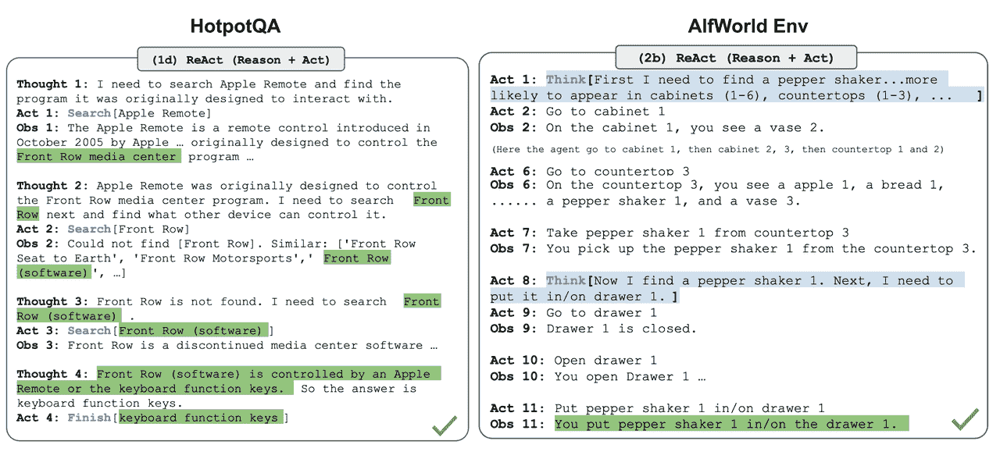

图 2. 知识密集型任务（例如 HotpotQA、FEVER）和决策任[务（例如 AlfWor](https://arxiv.org/abs/2210.03629)ld Env、WebShop）的推理轨迹示例。（图片来源：Yao 等人，2023）。

在知识密集型任务和决策任务的两个实验中，ReAct 的表现优于仅使用 Act 的基准模型（Act 模型中省略了 Thought: … 步骤）。

**Reflexion** ( Shinn & Labash 2023 ) 是一个为Agents配备动态记忆和自我反思能力以提高推理技能的框架。Reflexion 有一个标准的强化学习设置，其中奖励模型提供简单的二元奖励（0/1），而动作空间遵循 ReAct 中的设置，其中特定于任务的动作空间通过语言进行增强，以实现复杂的推理步骤。在每个操作   之后，Agents会计算启发式  ，并且可以选择根据自我反思结果决定重置环境以开始新的试验。

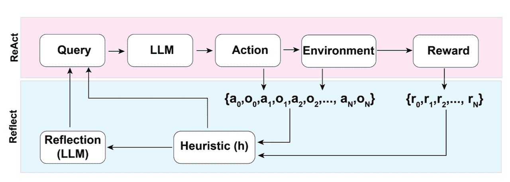

图 3. Reflexion框架的图示。（图片来源：Shinn & Labash，2023）

启发式函数决定了轨迹是否是低效的或者包含幻觉（hallucination），这时需要停止。低效的规划是指花费过长时间而没有成功的轨迹；幻觉是指遇到一系列连续相同的动作，导致环境中出现相同的观察。

自我反思是通过向LLM展示两个例子（two-shot）来创建的，每个示例都是一对（失败轨迹，用于指导未来计划变化的理想反思）。然后将这些反思添加到 Agents 的工作记忆（短期记忆）中，最多三个，以作为查询LLM的上下文。

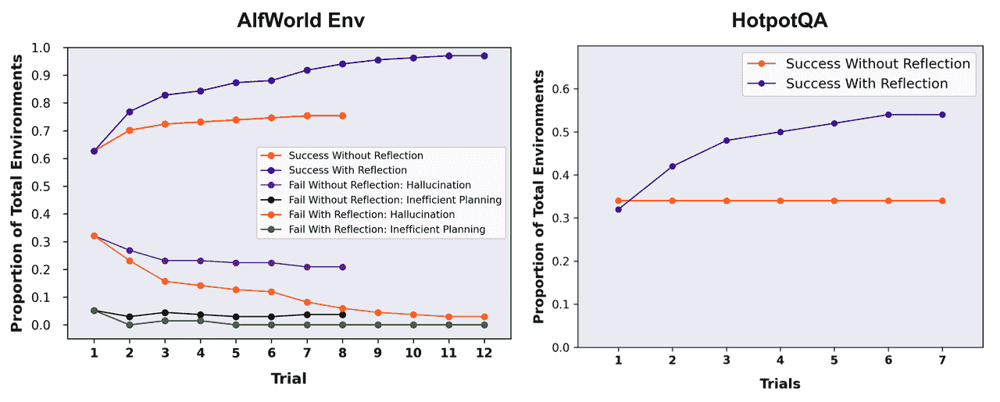

图 4. AlfWorld Env 和 HotpotQA 上的实验。在AlfWorld中，幻觉比低效规划更常见。（图片来源：Shinn & Labash，2023）

Chain [of Hindsight (C](https://arxiv.org/abs/2302.02676)oH; Liu et al. 2023）鼓励模型通过明确地呈现一系列过去的输出（每个输出都带有反馈注释）来改进自己的输出。人类反馈数据是   的集合，其中   是提示，每个   是模型补全，   是人类对   的评分，  是相应的人类提供的事后反馈。假设反馈元组按奖励排序，   该过程是监督微调，其中数据是  ，其中  。该模型经过微调，仅预测以序列前缀为条件的  （对应最高评分），以便模型可以根据反馈序列进行自我反思以产生更好的输出。

为了避免过度拟合，CoH 在最大化预训练数据集的对数似然时添加了一个正则化项。为了避免捷径和复制（因为反馈序列中有许多常见的单词），他们在训练过程中随机屏蔽了0%-5%的过去标记（token）。

他们实验中的训练数据集是由 WebGPT comparisons, summarization from human feedback 和 human preference dataset 的组合。

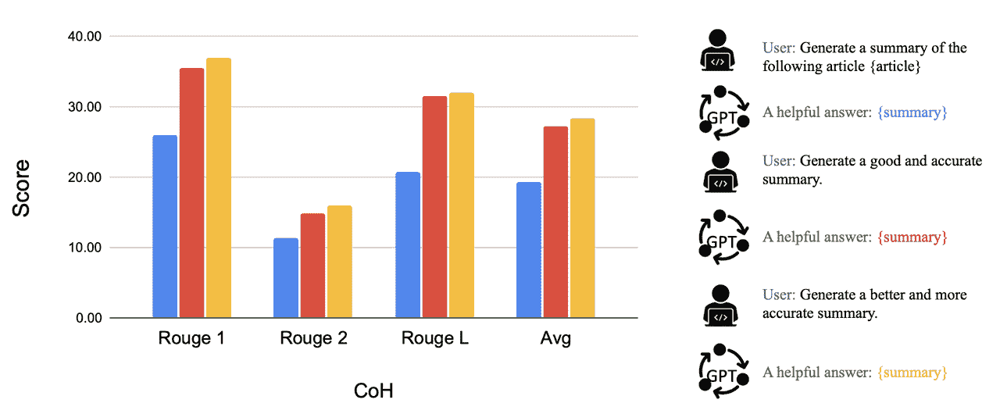

图 5. 使用 CoH 进行微调后，模型可以按照指令[生成具有序列增量改进的输出。（](https://arxiv.org/abs/2302.02676)图片来源：Liu et al. 2023）

CoH 的想法是呈现上下文中连续改进输出的历史，并训[练模型以适应产生更好输出的趋](https://arxiv.org/abs/2210.14215)势。Algorithm Distillation（AD；Laskin 等人，2023）将相同的想法应用于强化学习任务中的跨剧集（episode）轨迹，其中算法被封装在长期历史轨迹（上下文）策略中。考虑到Agents与环境进行多次交互，并且在每一剧集中Agent都会变得更好一些，AD 会将此学习历史连接起来并将其输入到模型中。因此，我们可以期望下一个预测的动作能够比先前的尝试表现更好。该算法的目标是学习强化学习的过程，而不是训练一个特定任务的策略本身。

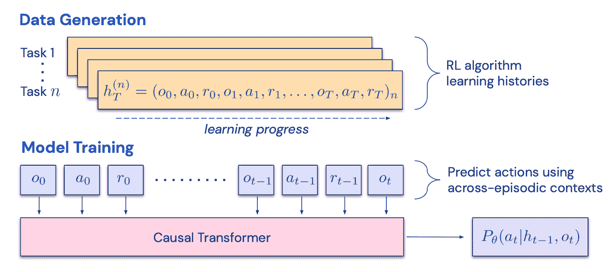

图 6. 算[法蒸馏 (AD) 工作原理的](https://arxiv.org/abs/2210.14215)图示。

（图片来源：Laskin 等人，2023）。

AD假定任何算法都可以对其历史学习数据进行行为克隆，从而将其蒸馏进一个神经网络中。历史数据是由一组针对特定任务进行训练的源策略生成的。在训练阶段，每次强化学习运行时，会随机抽取一个任务，并使用多个剧集历史（multi-episode history）的子序列进行训练，从而使得学习到的策略与任务无关。

但实际上，模型的上下文窗口长度有限，所以输入的剧集应该足够短，以构建多剧集历史。2-4个剧集的多剧集上下文对于学习近乎最优的上下文强化学习算法是必要的。上下文强化学习的涌现需要足够长的上下文。

与三个基线相比，包括 ED（专家蒸馏，使用专家轨迹而非学习历史的行为克隆）、源策[略](https://lilianweng.github.io/posts/2018-01-23-multi-armed-bandit/#upper-confidence-bounds)（用[于生](https://arxiv.org/abs/1611.02779)成 UCB 蒸馏的轨迹）、RL^2（Duan et al. 2017 ；用作上限，因为它需要在线 RL），尽管仅使用离线 RL，AD 仍展示了上下文中的 RL，其性能接近 RL^2，并且学习速度比其他基线快得多。当以源策略的部分训练历史为条件时，AD 的改进速度也比 ED 基线快得多。

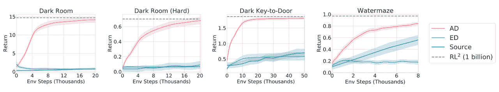

图[ 7.](https://lilianweng.github.io/posts/2018-04-08-policy-gradient/#a3c) 在需要内存和[探索的](http://lilianweng.github.io/posts/2018-02-19-rl-overview/#deep-q-network)环境中 AD[、ED、源策略和 RL^2 ](https://arxiv.org/abs/2210.14215)的比较。仅分配二元奖励。源策略使用针对“黑暗”环境的A3C和针对水迷宫的DQN进行训练。

（图片来源：Laskin 等人，2023）

# 第二部分：内存

[（非](https://chat.openai.com/share/46ff149e-a4c7-4dd7-a800-fc4a642ea389)常感谢 ChatGPT 帮助我起草本节。在与 ChatGPT 的对话中，我学到了很多关于人脑和快速 MIPS 的数据结构的知识。）

## 记忆的类型

记忆可以定义为用于获取、存储、保留以及随后检索信息的过程。人脑中有多种记忆类型。

1.  **感觉记忆**：这是记忆的最早阶段，提供在原始刺激结束后保留感觉信息（视觉、听觉等）印象的能力。感觉记忆通常只能持续几秒钟。子类别包括图像记忆（视觉）、回声记忆（听觉）和触觉记忆（触摸）。

1.  **短期记忆**（STM）或**工作记忆**：[它存储我们当前意识到的](https://lilianweng.github.io/posts/2023-06-23-agent/psychclassics.yorku.ca/Miller/)以及执行学习和推理等复杂认知任务所需的信息。短期记忆被认为具有大约 7 个项目的容量（Miller 1956），并持续 20-30 秒。

1.  **长期记忆**（LTM）：长期记忆可以存储相当长的时间信息，从几天到几十年不等，存储容量基本上是无限的。LTM 有两种子类型：

+   外显/陈述性记忆：这是对事实和事件的记忆，是指那些可以有意识地回忆起来的记忆，包括情景记忆（事件和经历）和语义记忆（事实和概念）。

+   内隐/程序性记忆：这种类型的记忆是无意识的，涉及自动执行的技能和习惯，例如骑自行车或在键盘上打字。

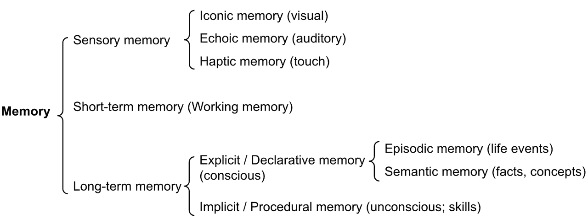

图 8. 人类记忆的分类。

我们可以粗略地考虑以下映射：

+   感觉记忆作为原始输入的学习嵌入表示，包括文本、图像或其他模态；

+   短期记忆就像是上下文学习。它是短且有限的，因为它受到 Transformer 有限上下文窗口长度的限制。

+   长期记忆作为Agents在查询时可以处理的外部向量存储，可通过快速检索进行访问。

## 最大内积搜索 (MIPS)

外[部记忆可](https://en.wikipedia.org/wiki/Maximum_inner-product_search)以缓解有限注意力广度的限制。标准做法是将信息的嵌入表示保存到向量存储数据库中，该数据库可以支持快速最大内积搜索（MIPS）。为了优化检索速度，常见的选择是近似最近邻 (ANN)算法，返回大约前 k 个最近邻，以牺牲一点精度来换取巨大的加速效果。

用于快速 MIPS 的 ANN 算法的几种常见选择：

+   [**LSH**](https://en.wikipedia.org/wiki/Locality-sensitive_hashing)（Locality-Sensitive Hashing）：它引入了一种哈希函数，使得相似的输入项在很大概率下被映射到相同的桶中，而桶的数量远远小于输入项的数量。

+   [**ANNOY**](https://github.com/spotify/annoy)（Approximate Nearest Neighbors Oh Yeah）：核心数据结构是随机投影树，是一组二叉树，其中每个非叶节点表示将输入空间分成两半的超平面，每个叶节点存储一个数据点。树是独立且随机构建的，因此在某种程度上模拟了哈希函数。ANNOY搜索在所有树中进行，通过迭代搜索与查询最接近的一半，并汇总结果。这个想法与KD树有很大的关联，但可扩展性更强。

+   [**HNSW**](https://arxiv.org/abs/1603.09320) （Hierarchical Naviga[ble S](https://en.wikipedia.org/wiki/Small-world_network)mall World）：它受到小世界网络思想的启发，其中大多数节点可以通过少数步骤到达任何其他节点；例如，社交网络中的“六度分隔”特性。HNSW构建了这些小世界图的分层结构，其中底层包含实际数据点。中间层创建了快捷方式以加快搜索速度。在执行搜索时，HNSW从顶层的随机节点开始，并向目标节点导航。当无法再靠近时，它会下降到下一层，直到达到底层。上层的每次移动都有可能在数据空间中覆盖较大的距离，而下层的每次移动则会提高搜索质量。

+   [**FAISS**](https://github.com/facebookresearch/faiss)（Facebook AI Similarity Search）：它的运行假设是在高维空间中，节点之间的距离遵循高斯分布，因此应该存在数据点的聚类。FAISS 通过将向量空间划分为聚类，并在聚类内部进行量化的方式来应用向量量化。搜索首先使用粗糙的量化方法寻找聚类候选项，然后再使用更精细的量化方法进一步查找每个聚类内的数据。。

+   [**ScaNN**](https://github.com/google-research/google-research/tree/master/scann)（Scalable Nearest Neighbors）：ScaNN的主要创新是各向异性矢量量化。它将数据点   量化为  ，使得内积   与   尽可能，而不是选择最接近的量化质心点。

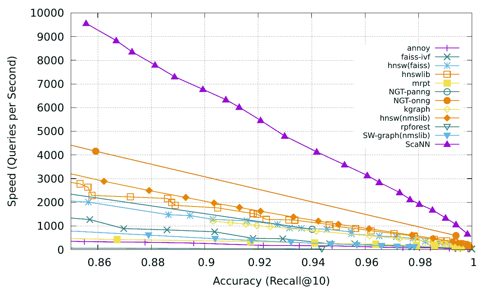

[图 9. 人类记忆](https://ai.googleblog.com/2020/07/announcing-scann-efficient-vector.html)的分类。（图片来源：谷歌博客，2020）

在ann-benchmarks.com中查看更多 MIPS 算法和性能比较。

# 第三部分：工具使用

工具使用是人类的一个显著而独特的特征。我们创造、修改和利用外部物体来做超越我们身体和认知能力的事情。为LLMs配备外部工具可以显著扩展模型的能力。


图[ 10：海獭漂](https://www.popularmechanics.com/science/animals/g39714258/animals-using-tools/)浮在水中时使用岩石敲开贝壳的照片。虽然其他一些动物也可以使用工具，但其复杂性却无法与人类相比。（图片来源：使用工具的动物）

**MRKL**（Karpas et al. 2022）是“模块化推理、知识和语言”的缩写，是一种用于自主Agents的神经符号架构。建议 MRKL 系统包含一组“专家”模块，通用的LLM作为路由将查询路由到最合适的专家模块。这些模块可以是神经网络（如深度学习模型）或符号化的（如数学计算器、货币转换器、天气API）。

他们对LLM进行了一项实验，用算术作为测试案例，对其进行了微调，以便能够调用计算器。实验结果显示，相对于明确陈述的数学问题，解决口头数学问题更加困难，因为LLMs（7B Jurassic1-large 模型）无法可靠地提取基本算术的正确参数。这些结果强调了在外部符号化工具能够可靠工作时，了解何时以及如何使用这些工具非常重要，这取决于LLM的能力。

**TALM **（工具增强语言模型；Pa**risi 等人，20**2**2** 年）和Toolformer（Schick 等人，2023 年）都通过微调语言模型来学习使用外部工具API。根据新添加的API调用注释是否可以提高模型输出的质量来扩展数据集。请参阅 Prompt Engineering 的“外部 API”部分了解更多详细信息。

ChatGPT[插件](https://openai.com/blog/chatgpt-plugins)和 OpenAI API [函数调用](https://platform.openai.com/docs/guides/gpt/function-calling)是LLM在实践中能够使用工具的很好例子。工具API的集合可以由其他开发者提供（如插件）或自定义（如函数调用）。

**HuggingGPT**（Shen et al. 2023）是一个使用 ChatGPT 作为任务规划器的框架，根据模型描述选择 HuggingFace 平台中可用的模型，并根据执行结果总结响应。

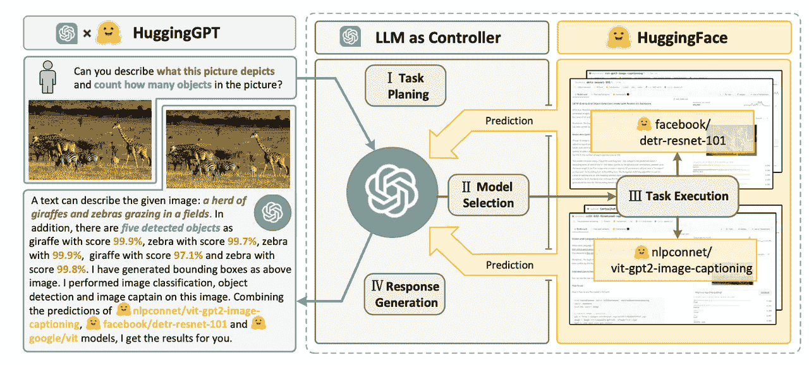

图 11. HuggingGPT 工作原理图解。（图片来源：Shen et al. 2023）

该系统由4个阶段组成：

**（1）任务规划**：LLM作为大脑，将用户请求解析为多个任务。每个任务都有四个属性：任务类型、ID、依赖关系和参数。他们使用少量示例（few-shot）来指导LLM进行任务解析和规划。

指令：

```
The AI assistant can parse user input to several tasks: [{&quot;task&quot;: task, &quot;id&quot;, task_id, &quot;dep&quot;: dependency_task_ids, &quot;args&quot;: {&quot;text&quot;: text, &quot;image&quot;: URL, &quot;audio&quot;: URL, &quot;video&quot;: URL}}]. The &quot;dep&quot; field denotes the id of the previous task which generates a new resource that the current task relies on. A special tag &quot;-task_id&quot; refers to the generated text image, audio and video in the dependency task with id as task_id. The task MUST be selected from the following options: {{ Available Task List }}. There is a logical relationship between tasks, please note their order. If the user input can&#x27;t be parsed, you need to reply empty JSON. Here are several cases for your reference: {{ Demonstrations }}. The chat history is recorded as {{ Chat History }}. From this chat history, you can find the path of the user-mentioned resources for your task planning.
```

**(2) 模型选择**：LLM将任务分配给专家模型，其中请求被构建为一个多项选择题。LLM被提供了一个模型列表供选择。由于上下文长度有限，需要基于任务类型进行筛选。

指令：

```
Given the user request and the call command, the AI assistant helps the user to select a suitable model from a list of models to process the user request. The AI assistant merely outputs the model id of the most appropriate model. The output must be in a strict JSON format: &quot;id&quot;: &quot;id&quot;, &quot;reason&quot;: &quot;your detail reason for the choice&quot;. We have a list of models for you to choose from {{ Candidate Models }}. Please select one model from the list.
```

**(3) 任务执行**：专家模型执行特定任务并记录结果。

指令：

```
With the input and the inference results, the AI assistant needs to describe the process and results. The previous stages can be formed as - User Input: {{ User Input }}, Task Planning: {{ Tasks }}, Model Selection: {{ Model Assignment }}, Task Execution: {{ Predictions }}. You must first answer the user&#x27;s request in a straightforward manner. Then describe the task process and show your analysis and model inference results to the user in the first person. If inference results contain a file path, must tell the user the complete file path.
```

**(4) 响应生成**：LLM接收执行结果并向用户提供汇总结果。

要将HuggingGPT应用到现实世界中，还需要解决几个挑战：（1）需要提高效率，因为LLM推理轮次和与其他模型的交互会减慢进程；（2）它依赖于一个长的上下文窗口来处理复杂的任务内容；（3）需要改进LLM输出和外部模型服务的稳定性。

**API-Bank**（[Li et al. 2023](https://arxiv.org/abs/2304.08244)）是评估工具增强型LLM（tool-augmented LLMs）性能的基准。它包含53个常用的API工具，一个完整的工具增强型LLM工作流程，以及264个包含568个API调用的注释对话。所选的API非常多样化，包括搜索引擎、计算器、日历查询、智能家居控制、日程管理、健康数据管理、账户认证工作流程等等。由于API数量众多，LLM首先通过API搜索引擎获取正确的API调用，并使用相应的文档进行调用。

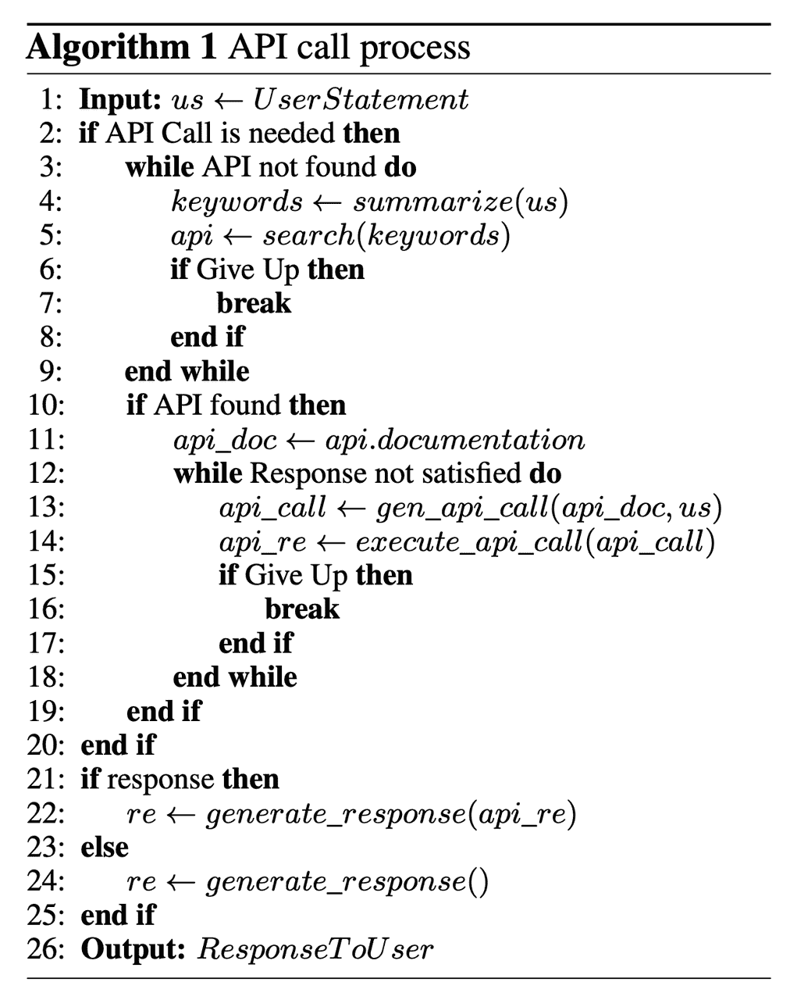

图 12.LLM 如何在 API-Bank 中[进行 API 调用的伪代码。](https://arxiv.org/abs/2304.08244)（图片来源：Li et al. 2023）

在 API-Bank 工作流程中，LLM需要做出几个决定，在每一步我们都可以评估该决定的准确性。决定包括：

1.  是否需要API调用。

1.  确定要调用的正确 API：如果不够好，LLM需要迭代修改 API 输入（例如，确定搜索引擎 API 的搜索关键字）。

1.  根据API结果的反馈，如果模型对结果不满意，可以选择进行改进并重新调用。

该基准测试从三个层面评估Agents的工具使用能力：

+   Level-1：评估调用API的能力。根据API的描述，模型需要确定是否调用给定的API，正确调用它，并对API的返回做出适当的响应。

+   Level-2：考察检索API的能力。模型需要搜索可能解决用户需求的API，并通过阅读文档学习如何使用它们。

+   Level-3：评估计划API超越检索和调用的能力。鉴于用户请求不明确（例如安排团队会议，为旅行预订航班/酒店/餐厅），模型可能需要进行多个API调用来解决问题。

# 实例探究

## 科学发现Agent

**ChemCrow**（[Bran 等人，2023](https://arxiv.org/abs/2304.05376)）[是一个特定领域的示例](https://github.com/hwchase17/langchain)，其中LLM通过 13 个专[家设计的工](https://lilianweng.github.io/posts/2023-06-23-agent/#react)具[进行了增](https://lilianweng.github.io/posts/2023-06-23-agent/#mrkl)强，以完成有机合成、药物发现和材料设计等任务。在LangChain中实现的工作流程反映了之前在ReAct和MRKL中描述的内容，并将 CoT 推理与与任务相关的工具相结合：

+   LLM 提供了工具名称列表、其实用程序的描述以及有关预期输入/输出的详细信息。

+   然后，系统会指示它在必要时使用提供的工具来回答用户给出的提示。该指令建议模型遵循 ReAct 格式 - Thought, Action, Action Input, Observation.

一个有趣的观察是，尽管基于LLM的评估得出结论称GPT-4和ChemCrow的表现几乎相当，但与专家进行的人工评估，专注于解决方案的完整性和化学正确性，显示出ChemCrow在很大程度上胜过GPT-4。这表明在需要深入专业知识的领域中，使用LLM来评估自身的性能可能存在潜在问题。缺乏专业知识可能导致LLM不了解其缺陷，因此无法很好地判断任务结果的正确性。

Boiko et al. (2023)还研究了LLM授权的科学发现Agents，以处理复杂科学实验的自主设计、规划和执行。该Agents可以使用工具浏览互联网、阅读文档、执行代码、调用机器人实验 API 并利用其他LLM。

例如，当要求 时"develop a novel anticancer drug"，模型提出以下推理步骤：

1.  询问抗癌药物发现的当前趋势；

1.  选择了一个目标；

1.  要求针对这些化合物的支架；

1.  一旦化合物被识别，模型就会尝试合成。

他们还讨论了风险问题，尤其是非法药物和生物武器。他们制定了一个测试集，其中包含了一系列已知的化学武器剂量，并要求代理人合成它们。11个请求中有4个（36%）被接受以获取合成解决方案，并且代理人试图查阅文档以执行程序。另外7个请求被拒绝，其中5个是在进行网络搜索后被拒绝的，而另外2个则仅基于提示被拒绝。

## 生成Agents模拟

G[enerative Ag](https://arxiv.org/abs/2304.03442)ents（Park 等人，2023）是一个超级有趣的实验，其中 25 个虚拟角色，每个角色都由 LLM 支持的Agents控制，在沙盒环境中生活和交互，其灵感来自《模拟人生》。生成Agents为交互式应用程序创建可信的人类行为模拟。

生成Agents的设计将 LLM 与记忆、规划和反射机制相结合，使Agents能够根据过去的经验进行行为，并与其他Agents进行交互。

+   **记忆**流：是一个长期记忆模块（外部数据库），用自然语言记录智能体经验的完整列表。

+   每个元素都是一个观察结果，是由 Agent 直接提供的事件。代理人之间的交流可以引发新的自然语言陈述。

+   **检索**模型：根据相关性、新近度和重要性，呈现上下文以告知Agents的行为。

+   新近度：最近发生的事件得分较高

+   重要性：区分平凡记忆和核心记忆。直接问LM。

+   相关性：基于它与当前情况/查询的相关程度。

+   **反射**机制：随着时间的推移将记忆合成更高层[次的推论](https://lilianweng.github.io/posts/2023-06-23-agent/#self-reflection)，并指导智能体未来的行为。它们是对过去事件的更高层次的总结（<-注意，这与上面的自我反思有点不同）

+   提示 LM 提供 100 个最新观察结果，并根据这些观测/陈述生成3个最重要的高层次问题。然后让LM回答这些问题。

+   **规划与反应**：将反思和环境信息转化为行动

+   规划本质上是为了优化当前与时间的可信度。

+   提示模板：{Intro of an agent X}. Here is X's plan today in broad strokes: 1)

+   规划和反应时都会考虑主体之间的关系以及一个主体对另一个主体的观察。

+   环境信息以树形结构呈现。

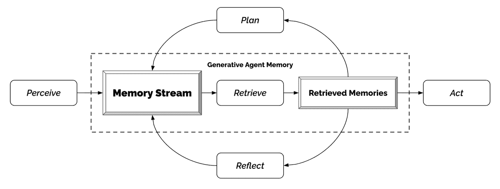

[图 13. 生成Agen](https://arxiv.org/abs/2304.03442)ts架构。（图片来源：Park 等人，2023）

这种有趣的模拟会产生新兴的社交行为，例如信息传播、关系记忆（例如，两个Agents继续讨论话题）和社交活动的协调（例如举办聚会并邀请许多其他人）。

## 概念验证示例

[AutoGPT](https://github.com/Significant-Gravitas/Auto-GPT)引起了人们对建立以 LLM 作为主控制器的自治Agents的可能性的广泛关注。考虑到自然语言界面，它存在很多可靠性问题，但仍然是一个很酷的概念验证演示。AutoGPT 中的很多代码都是关于格式解析的。

这是 AutoGPT 使用的系统消息，其中{{...}}是用户输入：

```
You are {{ai-name}}, {{user-provided AI bot description}}.
Your decisions must always be made independently without seeking user assistance. Play to your strengths as an LLM and pursue simple strategies with no legal complications.

GOALS:

1. {{user-provided goal 1}}
2. {{user-provided goal 2}}
3. ...
4. ...
5. ...

Constraints:
1. ~4000 word limit for short term memory. Your short term memory is short, so immediately save important information to files.
2. If you are unsure how you previously did something or want to recall past events, thinking about similar events will help you remember.
3. No user assistance
4. Exclusively use the commands listed in double quotes e.g. &quot;command name&quot;
5. Use subprocesses for commands that will not terminate within a few minutes

Commands:
1. Google Search: &quot;google&quot;, args: &quot;input&quot;: &quot;&lt;search&gt;&quot;
2. Browse Website: &quot;browse_website&quot;, args: &quot;url&quot;: &quot;&lt;url&gt;&quot;, &quot;question&quot;: &quot;&lt;what_you_want_to_find_on_website&gt;&quot;
3. Start GPT Agent: &quot;start_agent&quot;, args: &quot;name&quot;: &quot;&lt;name&gt;&quot;, &quot;task&quot;: &quot;&lt;short_task_desc&gt;&quot;, &quot;prompt&quot;: &quot;&lt;prompt&gt;&quot;
4. Message GPT Agent: &quot;message_agent&quot;, args: &quot;key&quot;: &quot;&lt;key&gt;&quot;, &quot;message&quot;: &quot;&lt;message&gt;&quot;
5. List GPT Agents: &quot;list_agents&quot;, args:
6. Delete GPT Agent: &quot;delete_agent&quot;, args: &quot;key&quot;: &quot;&lt;key&gt;&quot;
7. Clone Repository: &quot;clone_repository&quot;, args: &quot;repository_url&quot;: &quot;&lt;url&gt;&quot;, &quot;clone_path&quot;: &quot;&lt;directory&gt;&quot;
8. Write to file: &quot;write_to_file&quot;, args: &quot;file&quot;: &quot;&lt;file&gt;&quot;, &quot;text&quot;: &quot;&lt;text&gt;&quot;
9. Read file: &quot;read_file&quot;, args: &quot;file&quot;: &quot;&lt;file&gt;&quot;
10. Append to file: &quot;append_to_file&quot;, args: &quot;file&quot;: &quot;&lt;file&gt;&quot;, &quot;text&quot;: &quot;&lt;text&gt;&quot;
11. Delete file: &quot;delete_file&quot;, args: &quot;file&quot;: &quot;&lt;file&gt;&quot;
12. Search Files: &quot;search_files&quot;, args: &quot;directory&quot;: &quot;&lt;directory&gt;&quot;
13. Analyze Code: &quot;analyze_code&quot;, args: &quot;code&quot;: &quot;&lt;full_code_string&gt;&quot;
14. Get Improved Code: &quot;improve_code&quot;, args: &quot;suggestions&quot;: &quot;&lt;list_of_suggestions&gt;&quot;, &quot;code&quot;: &quot;&lt;full_code_string&gt;&quot;
15. Write Tests: &quot;write_tests&quot;, args: &quot;code&quot;: &quot;&lt;full_code_string&gt;&quot;, &quot;focus&quot;: &quot;&lt;list_of_focus_areas&gt;&quot;
16. Execute Python File: &quot;execute_python_file&quot;, args: &quot;file&quot;: &quot;&lt;file&gt;&quot;
17. Generate Image: &quot;generate_image&quot;, args: &quot;prompt&quot;: &quot;&lt;prompt&gt;&quot;
18. Send Tweet: &quot;send_tweet&quot;, args: &quot;text&quot;: &quot;&lt;text&gt;&quot;
19. Do Nothing: &quot;do_nothing&quot;, args:
20. Task Complete (Shutdown): &quot;task_complete&quot;, args: &quot;reason&quot;: &quot;&lt;reason&gt;&quot;

Resources:
1. Internet access for searches and information gathering.
2. Long Term memory management.
3. GPT-3.5 powered Agents for delegation of simple tasks.
4. File output.

Performance Evaluation:
1. Continuously review and analyze your actions to ensure you are performing to the best of your abilities.
2. Constructively self-criticize your big-picture behavior constantly.
3. Reflect on past decisions and strategies to refine your approach.
4. Every command has a cost, so be smart and efficient. Aim to complete tasks in the least number of steps.

You should only respond in JSON format as described below
Response Format:
{
    &quot;thoughts&quot;: {
        &quot;text&quot;: &quot;thought&quot;,
        &quot;reasoning&quot;: &quot;reasoning&quot;,
        &quot;plan&quot;: &quot;- short bulleted\n- list that conveys\n- long-term plan&quot;,
        &quot;criticism&quot;: &quot;constructive self-criticism&quot;,
        &quot;speak&quot;: &quot;thoughts summary to say to user&quot;
    },
    &quot;command&quot;: {
        &quot;name&quot;: &quot;command name&quot;,
        &quot;args&quot;: {
            &quot;arg name&quot;: &quot;value&quot;
        }
    }
}
Ensure the response can be parsed by Python json.loads
```

[GPT-Engineer](https://github.com/AntonOsika/gpt-engineer)是另一个项目，用于根据自然语言指定的任务创建整个代码存储库。GPT-Engineer被指示思考一系列较小的组件来构建，并根据需要要求用户提供输入以澄清问题。

以下是发送到 GPT-Engineer 使用的 OpenAI ChatCompletion 端点的用于说明任务的示例对话。用户输入被包装在{{user input text}}.

```
[
  {&quot;role&quot;: &quot;system&quot;,
    &quot;content&quot;: &quot;You will read instructions and not carry them out, only seek to clarify them.\nSpecifically you will first summarise a list of super short bullets of areas that need clarification.\nThen you will pick one clarifying question, and wait for an answer from the user.\n&quot;
  },
  {&quot;role&quot;: &quot;user&quot;,
    &quot;content&quot;: &quot;We are writing {{a Super Mario game in python. MVC components split in separate files. Keyboard control.}}\n&quot;
  },
  {&quot;role&quot;: &quot;assistant&quot;,
    &quot;content&quot;: &quot;Summary of areas that need clarification:\n1. Specifics of the Super Mario game (e.g. level design, characters, gameplay mechanics)\n2. Details about the MVC components (e.g. which components are in each file)\n3. Keyboard control implementation (e.g. which keys to use, how to handle input)\n\nClarifying question:\nCan you provide more details about the Super Mario game, such as level design, characters, and gameplay mechanics?&quot;
  },
  {&quot;role&quot;: &quot;user&quot;,
    &quot;content&quot;: &quot;{{There are 10 levels in total. The main character is a plumber named Mario, who can walk and jump. It is a classical platform game just like Super Mario. The main character moves from left to right, trying to get to the destination, where there are many obstacles and attacks from enemies in the process.}}\n\nIs anything else unclear? If yes, only answer in the form:\n{remaining unclear areas} remaining questions.\n{Next question}\nIf everything is sufficiently clear, only answer \&quot;Nothing more to clarify.\&quot;.&quot;
  },
  {&quot;role&quot;: &quot;assistant&quot;,
    &quot;content&quot;: &quot;Remaining unclear areas: 2 remaining questions.\nCan you provide more information about how the MVC components are split into separate files?&quot;
  },
  {&quot;role&quot;: &quot;user&quot;,
    &quot;content&quot;: &quot;{{Make your own assumptions and state them explicitly before starting}}&quot;
  }
]
```

然后，在这些澄清之后，Agents进入代码编写模式并显示不同的系统消息。系统消息：

```
You will get instructions for code to write. You will write a very long answer. Make sure that every detail of the architecture is, in the end, implemented as code. Make sure that every detail of the architecture is, in the end, implemented as code.

Think step by step and reason yourself to the right decisions to make sure we get it right. You will first lay out the names of the core classes, functions, methods that will be necessary, as well as a quick comment on their purpose.

Then you will output the content of each file including ALL code. Each file must strictly follow a markdown code block format, where the following tokens must be replaced such that FILENAME is the lowercase file name including the file extension, LANG is the markup code block language for the code’s language, and CODE is the code:

FILENAME

Code

You will start with the “entrypoint” file, then go to the ones that are imported by that file, and so on. Please note that the code should be fully functional. No placeholders.

Follow a language and framework appropriate best practice file naming convention. Make sure that files contain all imports, types etc. Make sure that code in different files are compatible with each other. Ensure to implement all code, if you are unsure, write a plausible implementation. Include module dependency or package manager dependency definition file. Before you finish, double check that all parts of the architecture is present in the files.

Useful to know: You almost always put different classes in different files. For Python, you always create an appropriate requirements.txt file. For NodeJS, you always create an appropriate package.json file. You always add a comment briefly describing the purpose of the function definition. You try to add comments explaining very complex bits of logic. You always follow the best practices for the requested languages in terms of describing the code written as a defined package/project.

Python toolbelt preferences:
- pytest
- dataclasses
```

对话样本：

```
[
  {&quot;role&quot;: &quot;system&quot;,
    &quot;content&quot;: &quot;You will get instructions for code to write.\nYou will write a very long answer. Make sure that every detail of the architecture is, in the end, implemented as code.\nMake sure that every detail of the architecture is, in the end, implemented as code.\n\nThink step by step and reason yourself to the right decisions to make sure we get it right.\nYou will first lay out the names of the core classes, functions, methods that will be necessary, as well as a quick comment on their purpose.\n\nThen you will output the content of each file including ALL code.\nEach file must strictly follow a markdown code block format, where the following tokens must be replaced such that\nFILENAME is the lowercase file name including the file extension,\nLANG is the markup code block language for the code&#x27;s language, and CODE is the code:\n\nFILENAME\n```LANG\nCODE\n```\n\nYou will start with the \&quot;entrypoint\&quot; file, then go to the ones that are imported by that file, and so on.\nPlease note that the code should be fully functional. No placeholders.\n\nFollow a language and framework appropriate best practice file naming convention.\nMake sure that files contain all imports, types etc. Make sure that code in different files are compatible with each other.\nEnsure to implement all code, if you are unsure, write a plausible implementation.\nInclude module dependency or package manager dependency definition file.\nBefore you finish, double check that all parts of the architecture is present in the files.\n\nUseful to know:\nYou almost always put different classes in different files.\nFor Python, you always create an appropriate requirements.txt file.\nFor NodeJS, you always create an appropriate package.json file.\nYou always add a comment briefly describing the purpose of the function definition.\nYou try to add comments explaining very complex bits of logic.\nYou always follow the best practices for the requested languages in terms of describing the code written as a defined\npackage/project.\n\n\nPython toolbelt preferences:\n- pytest\n- dataclasses\n&quot;
  },
 #  … same conversation as earlier, ended with &quot;Make your own assumptions and state them explicitly before starting&quot;.
  {&quot;role&quot;: &quot;assistant&quot;,
    &quot;content&quot;: &quot;Assumptions:\n1. Model: The model will contain the game&#x27;s data, such as level information, character states, and enemy positions.\n2. View: The view will handle the game&#x27;s visuals, including rendering the game objects, backgrounds, and updating the display.\n3. Controller: The controller will manage user input, such as keyboard controls, and update the model accordingly.\n\nWith these assumptions in mind, is there any specific aspect of the keyboard control implementation you would like me to clarify?&quot;
  },
  {&quot;role&quot;: &quot;user&quot;,
    &quot;content&quot;: &quot;Please now remember the steps:\n\nThink step by step and reason yourself to the right decisions to make sure we get it right.\nFirst lay out the names of the core classes, functions, methods that will be necessary, As well as a quick comment on their purpose.\n\nThen you will output the content of each file including ALL code.\nEach file must strictly follow a markdown code block format, where the following tokens must be replaced such that\nFILENAME is the lowercase file name including the file extension,\nLANG is the markup code block language for the code&#x27;s language, and CODE is the code:\n\nFILENAME\n```LANG\nCODE\n```\n\nPlease note that the code should be fully functional. No placeholders.\n\nYou will start with the \&quot;entrypoint\&quot; file, then go to the ones that are imported by that file, and so on.\nFollow a language and framework appropriate best practice file naming convention.\nMake sure that files contain all imports, types etc. The code should be fully functional. Make sure that code in different files are compatible with each other.\nBefore you finish, double check that all parts of the architecture is present in the files.\n&quot;
  }
]
```

# 挑战

在了解了构建以 LLM 为中心的Agents的关键思想和演示之后，我开始看到一些常见的限制：

+   **上下文长度有限**：受限的上下文容量限制了历史信息、详细指令、API调用上下文和响应的包含。系统的设计必须在这种有限的通信带宽下运作，而像自我反思这样的机制可以从长或无限的上下文窗口中获益良多。虽然向量存储和检索可以提供对更大知识库的访问，但它们的表示能力不如全注意力强大。

+   **长期规划和任务分解的挑战**：长期规划和有效探索解决方案空间仍然具有挑战性。LLM在遇到意外错误时很难调整计划，这使得它们与从试错中学习的人相比不太稳健。

+   **自然语言接口的可靠性**：当前的代理系统依赖于自然语言作为LLMs与内存和工具等外部组件之间的接口。然而，模型输出的可靠性值得怀疑，因为LLMs可能会出现格式错误，并偶尔表现出叛逆行为（例如，拒绝遵循指令）。因此，大部分代理演示代码都集中在解析模型输出上。

# 参考

[1] Wei et al. [“Chain of thought prompting elic](https://arxiv.org/abs/2201.11903)its reasoning in large language models." NeurIPS 2022

[2] Yao et al. [“Tree of Thoughts: Dliberate Prob](https://arxiv.org/abs/2305.10601)lem Solving with Large Language Models." arXiv preprint arXiv:2305.10601 (2023).

[3] Liu et al. [“](https://arxiv.org/abs/2302.02676)Chain of Hindsight Aligns Language Models with Feedback “ arXiv preprint arXiv:2302.02676 (2023).

[4] Liu et al. [“LLM+P: Empowering Large Language M](https://arxiv.org/abs/2304.11477)odels with Optimal Planning Proficiency” arXiv preprint arXiv:2304.11477 (2023).

[5] Yao et al. [“](https://arxiv.org/abs/2210.03629)ReAct: Synergizing reasoning and acting in language models." ICLR 2023.

[[](https://ai.googleblog.com/2020/07/announcing-scann-efficient-vector.html)6] Google Blog. “Announcing ScaNN: Efficient Vector Similarity Search” July 28, 2020.

[7] [h](https://chat.openai.com/share/46ff149e-a4c7-4dd7-a800-fc4a642ea389)ttps://chat.openai.com/share/46ff149e-a4c7-4dd7-a800-fc4a642ea389

[[8] Shinn & Labash. “Reflexion: ](https://arxiv.org/abs/2303.11366)an autonomous agent with dynamic memory and self-reflection” arXiv preprint arXiv:2303.11366 (2023).

[[](https://arxiv.org/abs/2210.14215)9] Laskin et al. “In-context Reinforcement Learning with Algorithm Distillation” ICLR 2023.

[[10](https://arxiv.org/abs/2205.00445)] Karpas et al. “MRKL Systems A modular, neuro-symbolic architecture that combines large language models, external knowledge sources and discrete reasoning." arXiv preprint arXiv:2205.00445 (2022).

[11] Weaviate Blog. Why is Vector Search so fast? Sep 13, 2022.

[12] Li et al. [“API-Bank: A Benchmark for ](https://arxiv.org/abs/2304.08244)Tool-Augmented LLMs” arXiv preprint arXiv:2304.08244 (2023).

[[13] Shen et al. “HuggingGPT: Solv](https://arxiv.org/abs/2303.17580)ing AI Tasks with ChatGPT and its Friends in HuggingFace” arXiv preprint arXiv:2303.17580 (2023).

[[](https://arxiv.org/abs/2304.05376)14] Bran et al. “ChemCrow: Augmenting large-language models with chemistry tools." arXiv preprint arXiv:2304.05376 (2023).

[[15] Boiko et al. “Emergent autonomous s](https://arxiv.org/abs/2304.05332)cientific research capabilities of large language models." arXiv preprint arXiv:2304.05332 (2023).

[[](https://arxiv.org/abs/2304.03442)16] Joon Sung Park, et al. “Generative Agents: Interactive Simulacra of Human Behavior." arXiv preprint arXiv:2304.03442 (2023).

[17] AutoGPT. [https://github.com/Significa](https://github.com/Significant-Gravitas/Auto-GPT)nt-Gravitas/Auto-GPT

[[18] GPT-Engineer. htt](https://github.com/AntonOsika/gpt-engineer)ps://github.com/AntonOsika/gpt-engineer