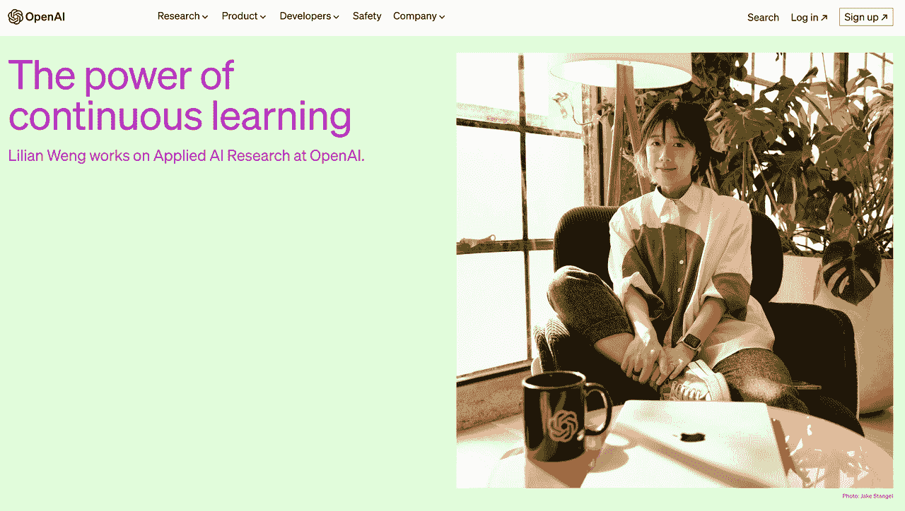

# 访谈：Lilian Weng | 持续学习的动力

> 来源：[https://waytoagi.feishu.cn/docx/IoEcdXdJHoBzksx92g9crZ1gnlf](https://waytoagi.feishu.cn/docx/IoEcdXdJHoBzksx92g9crZ1gnlf)

> 原地址：https://openai.com/blog/the-power-of-continuous-learning

> 发表时间：2022年12月23日

## 你最期待人工智能未来的哪些方面？

人工通用智能 (AGI) 应该在大多数经济有价值的工作中超越人类。我期待看到 AGI 用以下方式帮助人类社会：

1.  充分自动化或显著减少人类在重复和非创新任务上的努力。换句话说，AGI 应该大幅提高人类的生产力。

1.  极大地**加速新的科学突破的发现**，包括但不限于通过提供额外的分析和信息来促进人类的决策过程。

1.  有效、高效和安全地理解和**与物理世界互动**。

## 在OpenAI，你最为自豪的项目是什么？

我在OpenAI的前两年半里，我在机器人团队工作，致力于一个宏伟的想法：我们想教一个类人的机器人手玩魔方。这是一个极其令人[兴奋、](https://openai.com/blog/solving-rubiks-cube/)具有挑战性并且充满情感的经历。我们使用深度强化学习（RL）、大量的域随机化（DR），而无需真实世界训练数据的方式，解决了这个挑战。更重要的是，我们作为一个团队征服了这个挑战。

从[仿真和RL](https://en.wikipedia.org/wiki/Reality_distortion_field)训练到视觉感知和硬件固件，我们紧密合作，保持高度的凝聚力。那是一个令人震惊的实验，在那段时间里，我经常想到Steve Jobs的现实扭曲场：当你对某件事情有强烈的信仰，并持续不断地推进，你就可以实现那些看似不可能的事情。

从2021年开始，我开始领导应用人工智能研究团队。管理一个团队提出了一系列不同的挑战，并需要改变工作风格。我最为自豪的是与应用人工智能相关的几个关于语言模型安全的项目：

1.  我们设计并构建了一套评估数据和任务，以评估预训练语言模型生成仇恨、性或暴力内容的倾向。

1.  [我们创建了一个详](https://openai.com/blog/new-and-improved-content-moderation-tooling/)细的分类法，并构建了一个强大的分类器，用于检测不需要的内容以及内容为何不适当的原因。

1.  我们正在研究各种技术，使模型不太可能生成不安全的输出。

作为应用AI团队，我们致力于最佳方式来应用尖端的人工智能技术，如大型的预训练语言模型，我们看到[它们对实际](https://openai.com/charter/)任务来说是多么的强大和有用。我们也意识到安全部署这些技术的重要性，正如我们的规章中所强调的那样。

当前的深度学习模型并不完美。它们是通过由人类创建的大量数据进行训练的（例如，在互联网上、特定领域的数据搜集和文献中），并不可避免地吸收了我们社会中长期存在的许多缺陷和偏见。例如，当DALL·E被要求描绘一名护士时，它只会生成女性角色，或者对于教授，它只会生成白人。该模型捕获了真实世界统计数据中的偏见或我们训练数据中的偏见。

我受到激励，设计了一种缓解这种社会偏见的方法，并评估这种方法的效率。与团队一起，我们设计了一个减少此类偏见的流程，以及运行人机交互评估的工作流程。减少社会偏见不是一个简单的问题，因为它出现在我们生活的许多方面，有时可能难以察觉。但我很高兴DALL·E团队非常重视这个问题，并在很早的阶段采取行动。我们现在所拥有的只是一个开始，我们将继续取得进展。我很自豪能在这个领域工作，很高兴看到我们如何一步步使现代AI更加安全和更好。

### 不同主题或领域的想法常常能够激发新的创意，扩大潜在的解决方案空间。

## 在OpenAI的日常工作中，你如何将个人经验和价值观应用到工作中？

我相信学习的力量，而学习永远不会太迟。维护我的个人博客是保持这种好奇心，并定期了解深度学习社区新进展的好方法。我也鼓励我的团队不断学习，无论是与他们当前的项目是否相关。不同主题或领域中的想法经常可以激发新的想法，并扩大潜在的解决方案空间。

我也是团队合作的坚定信仰者。如果每个人都在他们最擅长的领域发光发热，我们会得到的是1+1>2的效果。与此同时，我们经常会遇到一些“琐碎”的工作，我个人非常愿意承担这些任务，因为只要那是最大的障碍或者那项任务可以为项目增加最大的价值，就没有什么应该被视为“琐碎”的或“不重要”的。我鼓励我周围的人也这样做，成为一个团队的一员，共同努力提高团队的生产力。

## 告诉我们关于你的博客！你为什么开始它？你希望它激发什么？

一切都始于一系列的个人学习笔记。我并没有很早进入深度学习领域，仍然认为自己是一个“新手”。最初，当我开始深入研究这么多的论文时，我被一个概念震撼到——即不是设计一个算法来解决问题，而是训练一个模型来学习解决问题的算法。我读得越多，就越感到好奇。实际上，组织我读过的所有论文和我学到的新概念变得非常困难。所以我决定开始一个博客，记录和整理我的学习笔记。我也相信，学习某件事的最好方法是确保你能正确并清晰地将知识教给他人。写作帮助我实现了这一点。

我没想到它会在机器学习社区变得这么受欢迎，但每当我收到一封感谢邮件或有人当面告诉我，他们从我的博客中学到了很多，我都感到非常荣幸和感激。自从我在2017年开始这个博客，已经快6年了，我会尽我所能继续下去。

## 你认为AI在我们的社会中可以解决的最紧迫的挑战是什么？

近年来，AI社区取得了很大的进展。在硬件、模型架构和数据的进步下，我们有可能训练出巨大的模型，因此我们持续看到更大的能力。我相信我们正走在通往AGI之路的正确道路，但扩展行不是唯一的方案。在我看来，目前最紧迫的挑战是对齐和安全性。在某种程度上，它们可能是关于可控性或可操纵性的同一个问题。

首先，即使我们已经掌握了一个非常强大的AI系统，如果我们不能有效地传达我们的目标，并确保模型与我们的需求保持一致，那么我们不可能创造出我们所需的价值。目前最强大的模型是通过大量的数据进行学习的，这些数据集不可避免地捕获了真实世界中的不完美、缺陷和偏见。在这方面，不对齐的模型带来了安全问题，因为它们并不知道什么是应该避免的。

### 我相信我们正走在通往AGI之路的正确道路，但扩展性不是唯一的解决方案。

### 目前最紧迫的挑战是对齐和安全性。

## 在OpenAI的职业生涯中，你收到的最佳建议是什么？

这**并不是某个特定人给我的建议，而是基于我在Ope**nAI的经验。那就是要拥有远大的目标（think big）。我们正在创造一些新的东西，因此我们应该充满雄心壮志、勇敢并保持足够的坚持，继续努力下去。

## 你从哪里找到灵感？

书籍。我通常会阅读深度学习领域以外的书籍，并从各个领域中获得灵感；例如，对于一个作家来说，持续50年的坚持有多么关键，对于一个外科医生来说，完美地注重细节有多么重要，对于一个企业家来说，拥有“疯狂的想法”有多么重要。

我身边的人。我很荣幸能与OpenAI的一大群极其有才华的同事一起工作。每个人都有自己独特的闪光点、鼓舞人心或值得尊敬之处，我喜欢从他们身上学习。

Lilian Weng博客链接lilianweng.github.io