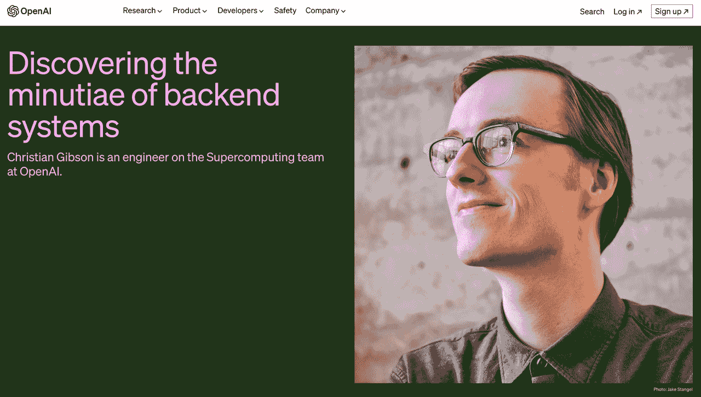

# 访谈：Christian Gibson | 探索后端系统的细节

> 来源：[https://waytoagi.feishu.cn/docx/WDvbdjxldoIgXdxvY35c8nS8n1g](https://waytoagi.feishu.cn/docx/WDvbdjxldoIgXdxvY35c8nS8n1g)

> 原地址：https://openai.com/blog/discovering-the-minutiae-of-backend-systems

> 访谈时间：2022年12月8日

> Christian Gibson 是 OpenAI 超算团队的一名工程师

## 最初是什么引起了你对工程的兴趣？

我很幸运在很年轻的时候就发现了编程，并用它作为一个入口去探索其他话题。在中学时，一个朋友向我介绍了BASIC编程语言的一种特殊风格，这种语言内置在德州仪器的计算器中（由于每个程序限制 27 个单字母变量并且严重依赖 GOTO 语句，我的代码可以预见地无法维护）。尽管如此，我们还是创建了一些简单的程序，比如基于文本的冒险游戏，一个用于连接计算器的聊天应用，以及常用的二次方程助手。

后来，我写了更复杂的程序：一个用于说明牛顿原理的可视化助手和一个用于估算行星及其卫星位置的轨道计算器，这引起了我学校Linux俱乐部的关注。不久后，我开始与NDISwrapper斗争，试图使我的CardBus基础的WiFi适配器工作，并使用Compiz设置我的桌面窗口！通过代码发现的这种模式在高中和之后的时期一直持续下去，导致了我今天对工程的兴趣。

## 什么使你来到OpenAI？

在我上一份工作中，我从后端角色转移到了全栈职位，只是为了发现我对前端工作和界面设计不感兴趣。我想回到一个更接近后端系统的角色，并且想念我在学术界享受的与Linux环境的交互。OpenAI提供了我所寻找的工作变化，而且还有更多；你很难找到一个比在OpenAI的超级计算集群上工作更适合我正在寻找的东西。

## 在OpenAI，你主要关注解决哪些问题？

探索性的AI工作流本质上是快节奏的；研究者希望能够从arXiv上获取预印本并测试新的方法，而不被他们在上面运行代码的平台所拖累。他们也是难以置信地复杂，研究者行为更像数学家——依赖他们在职业生涯中建立的直觉来设计解决方案，来解决本周引起他们关注的任何问题。这些运行时在世界上最大的一些超级计算机上执行，增加了另外一层复杂性，处理这倒数第二层是我团队参与的地方。我们努力在研究需求阻碍进展之前先发制人，如果做不到这一点，我们会与研究团队合作，尽快确定瓶颈并实施变通办法。

## 你认为在OpenAI从事超级计算与在其他地方有什么不同？

我们运营的规模，坦白说，是令人震惊的。第三方硬件供应商经常私下告诉我们，我们遇到的问题他们以前从未见过。这通常是因为我们的安装在单一连续的超级计算机中有更多的硬件，比他们的其他客户要多，尽管偶尔是因为我们的性能期望。大多数模型训练方法的同步特性导致了一个配置，其中整个集群实际上以最慢的节点的速度运行。

我们最著名的模型在价值十亿美元的超级计算机上进行训练，因此，我们最终追踪那些大多数其他人会忽略的性能降低。看到像单行更改这样的事情命中主线内核是令人兴奋的，知道它每周将节省约 6 天在我们的队列中的计算时间，或者在新的驱动程序版本上看到一个行项目，知道它是我们的发现导致了现在上游的修复，这是令人兴奋的。

## 对你来说，OpenAI的典型一天是怎样的？

我的日常通常包括一些编码、调查问题和参加会议。会议主导了我的星期二（谢天谢地，通常只有星期二），其余的时间则分为调试和编码。识别出的问题通常成为编码工作，例如，编写设计文档、快速修复PR分支的热修复，或添加被动运行状况检查逻辑，以保持有错误的硬件排除在我们的集群之外。

深入调查问题需要一些侦探工作。研究影响从模糊的（“我的工作似乎比昨天运行得慢”）到可怕具体的（“我认为如果我通过以太网NIC推送超过30Gbps，会导致内核恐慌？”）。这可能是一个熟悉的组合：在预期的日子里富有成效，当预期被打破时，你有机会学到新的东西，那是令人兴奋的。

### OpenAI 提供了深入挖掘其他公司会忽略计算方面的机会。

## 每天是什么让你充满活力？

我很少在没有需要首要考虑的事情情况下工作，我通常都知道从任务及时完成中受益的具体团队、项目和研究者。OpenAI 是我工作过的最大雇主，立即了解我工作的影响对我的日常动力至关重要。我也很喜欢发现系统的细节。OpenAI不是我第一个为后端系统工作的雇主，但这是我第一次在HPC领域工作。

我们工作的技术经常仅仅是由于这个领域特有的性能问题而存在。在之前的雇主那里，我不需要担心我们硬件的物理拓扑结构——例如，确保通信发生在相同的NUMA域内，或者一个GPU通过Nvidia的GPUDirect使用位于相同位置的NVME或InfiniBand设备，或者系统进程被固定到特定的CPU上，以避免与研究运行时的资源冲突。OpenAI提供了深入探讨其他地方忽略的计算方面的机会，这使我对手头的任务保持兴趣。

## 你从哪里找到灵感？

没有什么比看着我们的研究团队在改进模型方面取得进展更鼓舞人心的了。许多小组设置了Slack机器人或简单的playgrounds，你可以与之互动并测试仍在开发中的模型，让你看到模型随着训练的进行而得到改进！

我还使用流行的 meow_party 表情符号 来标记我们各种Slack频道中的激励或启发性内容。自从我在2020年中加入以来，我有超过400个 meow_party 表情符号标记的帖子，平均每周接近4个！