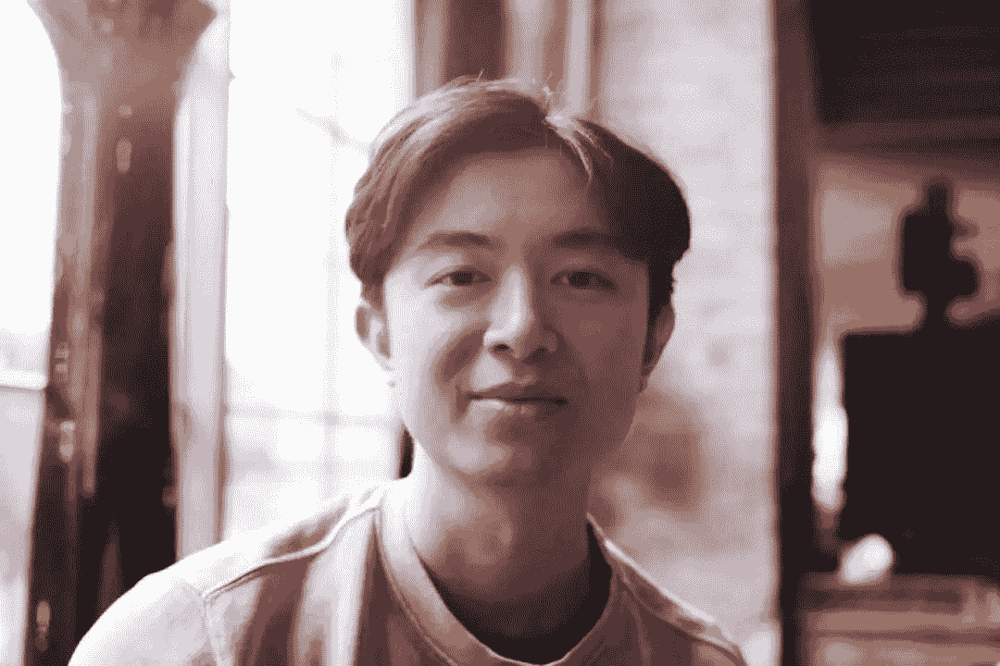
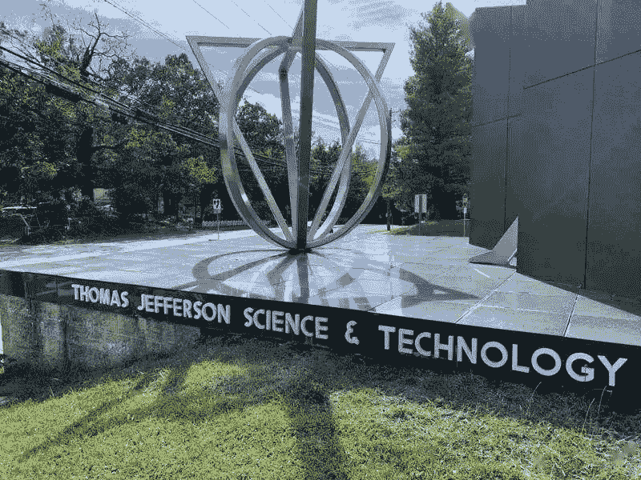
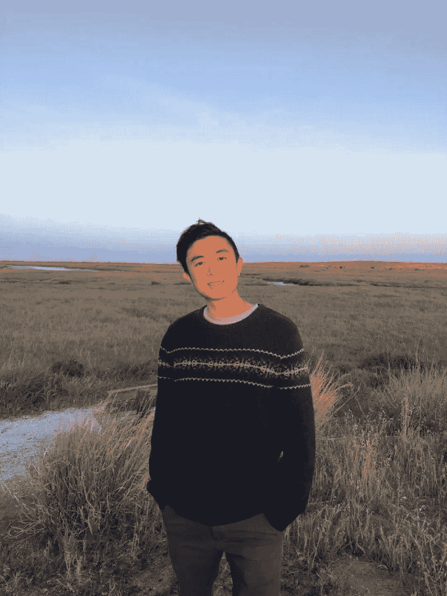
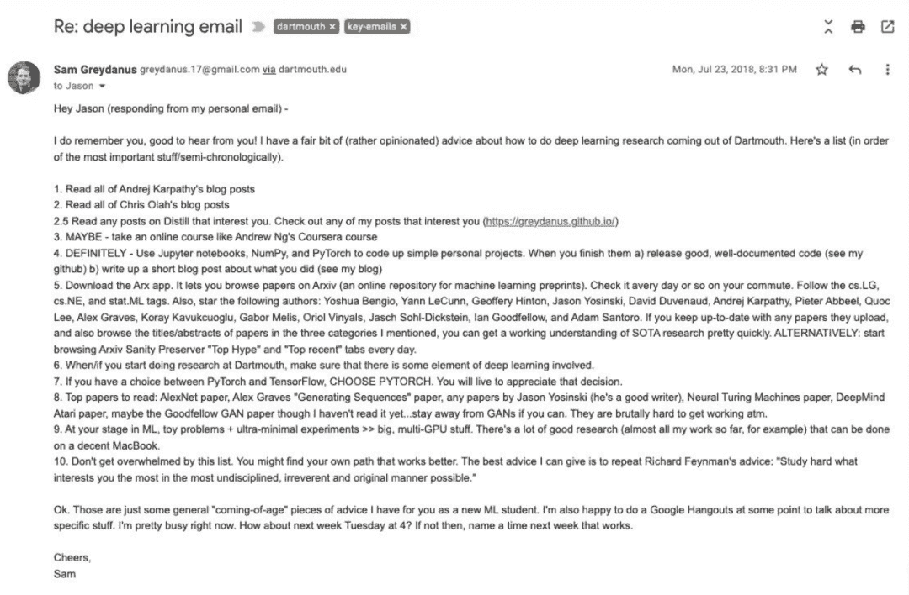
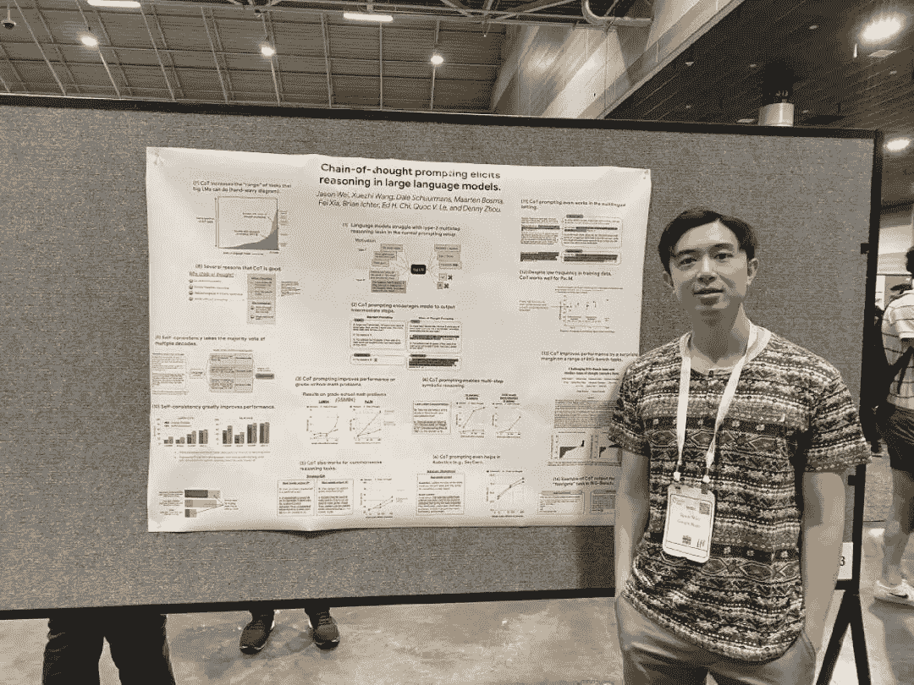
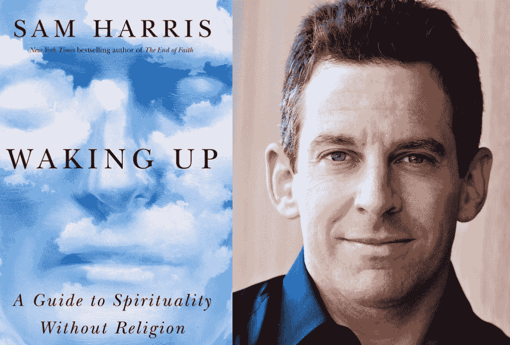
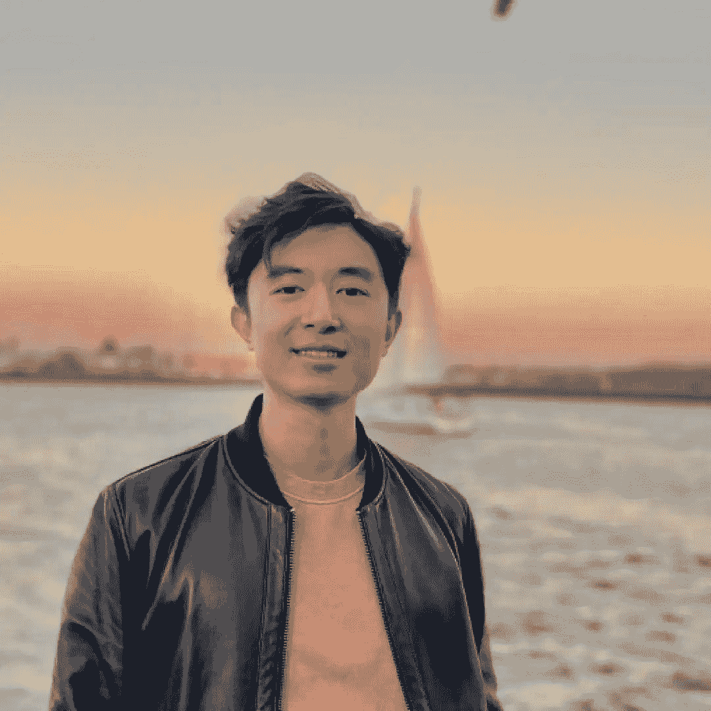

# 访谈：Jason Wei | 思维链灵感来源于冥想

> 来源：[https://waytoagi.feishu.cn/docx/QxFWdTgphoMJaTx8qHJcIkz4nJs](https://waytoagi.feishu.cn/docx/QxFWdTgphoMJaTx8qHJcIkz4nJs)

> 原文链接：https://mp.weixin.qq.com/s/sIrnDtpm8zsvpaMKN4U0ZQ

> 作者：智源社区，**采访&撰文  李梦佳**

## **导读**

**在**大模型的研发道路上，思维链、指令微调和智能涌现等关键思想备受关注。正是思维链技术（Chain of Thought）让大模型能够涌现出一系列神奇的能力，成为了现代大语言模型产生「涌现」的底层技术。思维链旨在通过向大语言模型展示少量的样例，并通过这些样例解释推理过程，让大语言模型学会在生成答案时展示推理过程，并引导其得到更准确的答案。相当于将黑盒深度学习的多步推理过程的中间步骤拆开，结耦了各个步骤的工作，简化了每一步工作上模型的压力，在提高可解释性的同时提升了模型性能。

研究灵感往往来自某次偶然的一瞥惊鸿，可遇而不可求。谈起思维链的灵光乍现，CoT提出者Jason Wei表示，他的灵感来源是一本叫做《Waking up》的冥想之书，该书作者为美国无神论者、公共知识分子Sam Harris，从灵修（spirituality）的角度讲述了思维、意识和自我的关系。

智源社区特别邀请到现任OpenAI科学家Jason Wei进行了独家专访，请他谈到了做研究的点点滴滴，以及在谷歌和OpenAI的工作经历。Jason Wei毕业于达特茅斯大学，在大模型研发领域拥有丰富的经验和杰出成就，在谷歌工作期间曾主导推广了大语言模型中包括思维链提示、指令微调和模型涌现在内一系列关键思想的诞生。

## 要点速览

+   对于当时的许多华人家庭来说，美国梦就是供孩子去读常春藤盟校，在华尔街谋求一份体面的工作，赚很多钱。而我成为了当时朋友圈中唯一一个从事人工智能研究的人。

+   早期的化学研究教会了我何为研究的本质，以及如何提出严格的假设并进行测试。

+   在2019年我创建了第一个对肺癌分类的神经网络。这也是我发表的一篇论文，在论文被接收前被拒了六次。

+   我对冥想很感兴趣。**冥想的作用是观测到你头脑中出现的所有想法，我称之为思想流（stream of thou**ght），连续不断流动的思想。参考人类内在的思考过程，我认为模型也可以有思想流。

+   这项技术上被称为思维链的原因是，思想流更像是杂乱无章地，随机在头脑中涌现的任何东西。而思维链则是一个更有逻辑或组织性质的思维过程。

+   从谷歌到OpenAI，最大的变化是每个人从做自己的研究、选择项目转变为在具有核心目标的更大团队中工作。

+   OpenAI 的员工工作非常努力，所有人都对通用人工智能 (AGI) 充满热情。大部分加入OpenAI的人都是想参与研究一些更庞大的事项，成为GPT这样项目的一员。

+   我不是非常擅长平衡工作和生活，也不认为每个人都应该渴望做到平衡。事实是，没有哪个超级成功的人是不努力工作的。我的策略是每周休息一天，其他日子都工作，到晚上10 点或 11 点左右。确保睡眠充足，且每周至少锻炼3次。

+   **关**于推广宣传，很多研究者做得还远远不够。贝尔实验室著名数学家Richard Hamming的建议是，应该花与实际工作（做实验写论文）一样多的时间来做宣传。

## **华尔街之梦，从银行家到神经网络**

Q：能描述下你早年的生活和成长经历，从何时开始接触科研的呢？

A：早年我在弗吉尼亚州的（小镇）上长大，上的公立小学，但考上了一所很有竞争力的高中，也就是Thomas Jefferson中学，那是一所你必须参加考试才能被录取的学校，学生SAT 的平均成绩非常高。

位于弗吉**尼**亚州的托马斯杰弗逊科技中学（Thomas Jefferson High School for Science and Technology），享有“全美第一公立高中”的美誉，全美排名前2%学校里的同学都很拔尖，高中几乎是我人生中最努力的阶段，基本上我在那里学到的最主要的东西就是要「全力拼搏」work hard。大多数人要么喜欢打比赛，要么喜欢研究，我属于后者，从高中阶段就开始做研究了。最初，我在美国海军研究实验室（Naval Research Lab，简称NRL）做了一些化学相关的研究。当时接触研究的机会还很少，但我会尽可能抓住机会。当然，我现在不再从事化学研究了。

Q：早期的化学研究在方法论或思维方式上影响了你后来的工作吗？

A：它教会了我何为研究的本质，以及如何提出严格的假设并进行测试。

**Q：了解到你最初的梦想是成为一名华**尔街银行家，这个梦想后来发生了哪些变化？

A：对，**过去我们常说美国梦（American dream）。基本上，对于当时的许多华人家庭**来说，美国梦就是让你的孩子去读常春藤盟校，在华尔街谋求一份体面的工作，赚很多钱。我去了达特茅斯，它是比较低调的常春藤盟校，达特茅斯本身和华尔街有很密切的联系，周围所有人都在卷金融去投行，而我大一时没有得到金融方面实习的机会，这就有点像偏离了轨道。正好我母亲有一个朋友在做人工智能初创公司。我联系上了他，于是决定尝试下做AI，因此我成为了朋友圈当中唯一一个从事人工智能研究的人，有点孤单。（编者注：美国梦通常代表经济上的成功或是企业家的精神。历史学者亚当斯在1931年将“美国梦”定义为，“无论每个人的社会阶层或出生环境如何，生活都应该变得更好，更丰富，更丰裕，每个人都有机会根据能力或成就而定”。）

Q：能分享更多在达特茅斯大学生活的经历和轶事吗？

A：**达特茅斯虽然是排名前100的**学校，但没有很多从事AI研究的教授。当时正好有一个机会做医学图像数据处理，于是我在2019年创建了第一个可以对肺癌进行分类的神经网络。这也是我试图发表的一篇论文，在论文被接收前我被拒了六次。当时的动机只是单纯地想发表论文，为了申请博士项目。在达特茅斯期间，我也曾经前往丹麦交换。

Q：谈谈你最喜欢的导师以及对你影响最大的人吗？

A：我的校友Sam Greydanus，他比我大三岁，我们大概交流过五次。他是在达特茅斯为数不多从事AI研究的人之一，和我一样后来也去了谷歌的AI Residency项目做出很多不错的工作。鉴于当时在达特茅斯AI氛围很一般的情况下，他的存在让我鼓舞人心。他给当时作为机器学习“新学徒”的我写了一封长邮件，列出了很多有用的建议，比如阅读Arxiv、经常发布代码并撰写有关研究的博客文章。具体建议如下：

嗨，Jason，我记得你，很高兴收到你的来信！关于如何进行深度学习研究，我有一些（相当固执己见的）建议。这是一个列表（按最重要的内容/半时间顺序排列）。

1.  阅读 Andrej Karpathy 的所有博客文章

1.  阅读 Chris Olah 的所有博客文章

1.  阅读你感兴趣的 Distill 上的任何帖子。或者看下我列出的帖子(https://Qreydanus.qithub.io/)

1.  也许 - 参加像 Andrew Ng 的 Coursera 课程这样的在线课程

1.  绝对 - 使用 Jupyter Notebook、NumPy 和 PyTorch 编写简单的个人项目。当你完成它们时

1.  发布良好的、记录良好的代码（参见我的 github）

1.  写一篇关于你所做的事情的简短博客文章（参见我的博客）

1.  下载Arx应用程序，浏览 Arxiv（机器学习预印本的在线存储库）上的论文。每天左右在通勤途中检查一下。遵循 cs.LG、cs.NE 和 stat.ML 标签。另外，请为以下作者加注星标：Yoshua Bengio、Yann LeCunn、Geoffery Hinton、Jason Yosinski、David Duvenaud、Andrej Karpathy、Pieter Abbeel、Quoc Lee、Alex Graves、Koray Kavukcuoglu、Gabor Melis、Oriol Vinyals、Jasch Sohl-Dickstein、Ian Goodfellow 和Adam Santoro。如果及时了解他们上传的论文，并浏览我提到的三个类别中论文的标题/摘要，就可以很快对 SOTA 研究有一个有效的了解。或者：开始每天浏览 Arxiv Sanity Preserver 的“热门炒作”和“最近热门”选项卡。

1.   当/如果你开始在达特茅斯进行研究时，请确保涉及深度学习的一些元素。

1.  如果可以在 PyTorch 和 TensorFlow 之间进行选择，请选择 PyTorch。你会终生感激这个决定。

1.  值得阅读的热门论文：AlexNet 论文、Alex Graves“生成序列”论文、Jason Yosinski（他是一位优秀作者）的任何论文、神经图灵机论文、DeepMind Atari 论文，也许还有 Goodfellow 的 GAN 论文，尽管我还没有读过。如果可以的话，远离 GAN。

1.  在 ML 阶段，简单问题 + 超简单实验 » 大型、多 GPU 的工作。有很多好的研究（例如，到目前为止我几乎所有的工作）都可以在一台像样的 MacBook 上完成。

1.  不要被这份清单淹没。你可能会找到更适合自己的道路。我能给出的最好建议就是重复Richard Feynman的建议：“以尽可能无纪律、无礼和原创的方式努力学习你最感兴趣的东西。”

Q：在研究道路上，关键的转折点、幸运时刻还有哪些？

A：最幸运的时刻还是加入谷歌AI Residency项目，这个项目的接收率大概是1%，帮助我直接进入工业界。这是一个为期 12 个月的研究项目，参与者不必拥有博士学位，但你可以作为研究人员进行研究。如果在这个项目中表现出色，就可以留在谷歌担任长期研究员。

## 思维链CoT，来源于深度冥想，让模型模仿人类的思维流动

**Q：在 Google Brain 工作感觉如**何，比如思维链的项目，是什么给了你灵感？

A：在 2022 年之前，在 Google Brain 工作被认为是最好的工作之一，当然现在仍然如此。在谷歌，你有很多自由和资源可以做任何你想做的事情。这相当理想。而且也可以发表很多论文，都会署名，也附带很多荣誉。我在的时期有点像AI研究的黄金时代，我非常爱谷歌。

**Q：关于思维链（Chain of Thought），**你给出的关键词是冥想。能详细说明一下吗？

A：对，我对冥想很感兴趣。冥想的作用是观测到你头脑中出现的所有想法，我称之为思想流（**s**tream of thought），基本上就是连续不断流动的思想，为此我写了一篇评论文章Artificial stream of thought has non-trivial connections to consciousness（https://jasonwei20.github.io/files/artificial_stream_of_thought.pdf），但当时没有受到多少关注，因为没有实验来证明。很多观点文章都认为，语言模型可以有思想流，也暗示着意识的存在。我想到可以参考人类如何解决数学问题的过程，在给出问题的答案之前，人类有一个内在的思考流程，于是我从数学问题出发，尝试改变prompt，发现了语言模型也可以具有内在推理能力（要求模型在回答之前进行一系列思考过程，也就是思维链）。起初效果并不好，和模型大小有关，后来更加强大的PalM出现了，模型越大CoT可以做得更好。后来我将这种思维链的技巧嫁接在解决其他类型的问题上，也表现得很好。技术上被称为思维链的原因是，思想流更像是杂乱无章地，随机在头脑中涌现的任何东西。而思维链则是一个更有逻辑或组织性质的思维过程。

Q：这种冥想的灵感是否和宗教有关？

A：不，我不信教，但我受到了**Sam Harris所写的《Waking up— A Guide** to Spirituality Without Religion》一书的启发。这就是我的灵感来源。（编者注：《Waking up》一书作者为美国无神论者、公共知识分子、脑神经科学家Sam Harris，这本书是写给美国人口百分之二十的”spiritual but not religious”，即相信灵性的存在，但是没有宗教信仰的人。该书强调如何通过冥想消除人类对于自我的幻象，试图用脑科学研究、思想实验来证明：1）人的思维有更高维度的存在，我们认为的自我、喜怒哀乐其实都是虚幻的，基本就是佛教的世界观 2）人可以籍由冥想练习来达到空性的体验）

[《觉醒：](https://www.amazon.com/Waking-Up-Spirituality-Without-Religion/dp/1451636024)通往灵性的非宗教指南》，Sam Harris著，阅读链接

**Q：在谷歌，你也领导了finetuni**ng（微调）项目，这项工作面临哪些挑战？

A：对当时我们参与了FLAN项目，那时我们还不知道如何对语言模型做微调，所以很难防止过拟合。我和团队不得不做的一件事就是为这些模型手动编写数百条不同的指令，以防止模型过拟合。其次，要弄清楚实验设计并正确进行实验，当时微调的运算量很大。因此我们必须做出规划，运行消融实验等。同时也考虑设计实验，来评估零样本任务。我们率先在 Google 内部尝试微调大语言模型以遵循指令。

Q：所以你们团队是指令微调的先驱？

A：OpenAI在我们之前就做过一些指令微调的工作，但他们没有发表相关论文。所以我们应该算是第一个在正式论文中提出指令微调（instruction tuning，原文链接：https://openreview.net/forum?id=gEZrGCozdqR）这个术语的团队。

Q：平时是如何组织团队，与最聪明的人一起开展项目的？

A：当你与真正优秀的合作者一起工作时，他们通常有非常高的标准。你需要不断强迫自己专注在重要的工作上，并拥有雄心勃勃的梦想。和他们一起工作时，每当你展示一个成果，他们都会不断地问，有什么方法可以做得比这个结果更好吗？他们通常会不断地push你做得更好。比如我的同事Quoc V. Le就经常对我说，如果你能用小10倍的模型来实现这个功能，那就太好了，这确实是一件很难实现的事情。

Q：你也写了很多关于涌现的文章，模型最让你兴奋的涌现能力是什么？

A：其中有三篇文章中提到的涌现能力最让我兴奋。

+   1) 上下文学习（In-context learning，https://arxiv.org/abs/2303.03846）。更大的语言模型实际上能进行“真正的”上下文学习，它们能够推理输入标签映射（input-label mappings），而不是仅仅遵循格式；

+   2) 思维链推理，尤其是分解。因为这意味着AI有一天可能能够解决极具挑战性的问题，例如气候变化；

+   3) U形缩放（U-shape Scaling：https://arxiv.org/abs/2211.02011）。

有时，语言模型会随着规模的扩大而变得更糟，你可能认为它们的表现会持续变得愈加糟糕。但如果继续扩大规模，这种趋势会发生改变。随着模型规模扩大，其性能开始变好。因此整体变化趋势呈现U形。

Q：如果继续沿着这条路走下去，未来可能会涌现什么样的模型能力？

A：我认为如果模型能具有规划能力会很有趣。如果你问它，解决这个数学问题需要哪5步，它很可能答不上来。可能单独的步骤能解决得好，但整体规划就做得很差。此外就是更好的通用性表现。当前最主要的问题是有时候语言模型不太可靠，在某些用例中你无法完全信任它，只有90%正确率。如果能跨过这个门槛，可能会非常有用。

## OpenAI的指针：无他，唯努力尔

**Q：你是如何从 Google Brain 过渡到OpenAI的？与在 **Google 工作相比，在 OpenAI 工作感觉如何？你喜欢那边的工作氛围吗？

A：我想体验下和不同的人一起工作，确实有很多人从谷歌离职了。在OpenAI的工作让人非常兴奋，所有人都对通用人工智能 (AGI) 充满热情。OpenAI 的员工工作非常努力，团队也很专注。你可以自由地从事自己想做的事情，当然大部分加入OpenAI的人都是想参与研究一些更庞大的事项，成为GPT这样项目的一员。

Q：在 OpenAI 和在 Google 工作最大的区别是什么？

A：谷歌最近也发生了很大的变化。因此很难进行同类比较。最大的变化就是从每个人都做自己的研究、选择项目转变为在核心目标更突出的庞大团队中工作。OpenAI非常专注于构建 AGI，尤其是安全的 AGI。

Q：你之前的工作和目前GPT-4一类的项目联系如何？

A：我以前研究过大型语言模型，现在我仍然研究大型语言模型，很多东西仍然相关，包括前面提及我主导的两篇工作（Chain-of-Thought Prompting Elicits Reasoning in Large Language Models，https://arxiv.org/abs/2201.11903；Emergent Abilities of Large Language Models，https://openreview.net/pdf?id=yzkSU5zdwD）我过去学到的主要技能，其中两个最重要的是注重优先级和沟通能力。我认为这两项技能仍然非常相关，即使我不再写论文了。我仍然在做研究，但并不是我所做的所有研究都发表了。另外，GPT-4的大部分工作是在我加入之前就已经完成了的，我在评估方面做了一点贡献。

Q：你自己的短期或长期研究目标是什么？

A：长期目标只是构建 AGI。我认为成为构建 AGI 的一员是一件非常深刻和令人兴奋的事情。

Q：所以AGI还有很长的路要走对吗？

A：取决于你对长的定义。

Q：构建AGI路径有很多，你在整个方案中AGI项目的工作定位是什么？

A：我想说这是一个很难回答的问题。我不知道通往AGI的道路。我认为我之前的一些工作更加关注语言模型可以进行推理的事实。而且，当你扩展语言模型时，你会获得这些你可能意想不到的新兴能力。我认为这是我在谷歌期间试图推广的两件事。

Q：如何看待人工智能的未来以及个人在该领域未来的研究方向？

A：我一直在思考的一件事是评估。很难进行模型评价的原因之一是：语言模型可以完成非常广泛的任务。它们生成这些非常长的补全内容，甚至人类也需要很长时间才能阅读。通常对于这些类型的任务来讲，没有明确的定义来说明什么样才是完美的实现效果。在某种程度上，评价指标是研究人员所要优化的目标函数。如果能深入了解模型的行为和局限性，就可以更好地引导研究人员做出正确的事情。

Q：关于涌现能力，未来的疯狂想象是什么？

A：我觉得未来重要的方向包括，更事实性不会产生幻觉的语言模型，可以使用工具与世界进行交互的多模态模型，以及一般意义上更加安全的模型。

Q：对于想要在这个领域开展职业生涯的人来说，你认为最重要的建议是什么？

A：工作真的要非常努力。不仅涉及研究本身，还涉及研究周期的所有部分，例如选择研究课题，并宣传这项工作，并且我有意识地努力与那些我真正钦佩并且能力非常强的人合作。在谷歌，对我影响很大的人是我的同事Barret Zoph、Liam Fedus。他们的研究品味深深影响了我，并教会了我很多关于如何思考事物的知识。

Q：你如何定义工作非常努力，意味着工作时间非常长？

A：工作的时长和专注程度一样重要。因此，你可以增加工作时间，也可以提升专注度。我认为大多数人都喜欢尝试增加时间，但有时增加专注度可能会更有效。我同时增加时间和专注度。

Q：你平时每天日程安排是什么样的？

A：**我可能早上 10 点左右开始工作，**工作到晚上 10 点或 11 点左右。也许每天会开几个小时的会议，当然还有中饭、晚饭以及回复电子邮件等其他事情。如果晚上有事情可能不工作。周末基本上工作一天，休息一天。睡眠和锻炼对我来说非常重要，我要确保自己每天睡眠充足，且每周至少锻炼3次。

**Q：你会给自己时间思考一些事情吗？像之前说的冥想，**工作间隙停下来思考一下，下一步该怎么做？

A：我可能应该这样做，但没来得及。我有点太忙了，然后停止冥想。

**Q：如何平衡职业生活与个人爱好、兴趣**？除了研究之外，你会利用空闲时间做什么？

A：我没有太多空余时间做其他事，不是非常擅长平衡工作和**生活，也不认为每个人都应该渴望做到平**衡。事实是，能够持续努力工作的人会更加成功。没有哪个超级成功的人是不努力工作的。我从别人那里听到的一个好策略是每周休息一天，其他日子都工作。当然有时上上推特，也见见朋友，但可能也只是每周几次这样。 不过我很喜欢旅行。在谷歌的时候几乎尝试参加所有外地会议，这会很有趣，而且这是结识新朋友和去新城市的好机会，非常酷。

## 对研究员的四点建议，推广与宣传不可忽视

Q：对于年轻研究人员如何更有效地发表论文有什么建议吗？

A：这篇博文（原文链接：https://www.jasonwei.net/blog/practicing-ai-research）包含了我对于那些想成为更好的研究人员的人的大部分建议。分为四个主要部分，第一，提出或选择一个研究想法；第二，进行实验；第三是写论文；第四是做宣传。研究者可以积极提升这四项技能中的每一项。

+   **首先，想法选择。**

提出或选择一个要研究的课题，即“研究品味” - 每个人都应该选择让自己感到满足的研究类型，但不同的研究口味的影响力并不相同。我喜欢简单、通用且经得起时间考验的研究课题，并尽量避免复杂、任务特定或短暂的项目。一个好的建议是要么（1）在一个热门课题上做得比其他人更好，要么（2）在可能成为下一个热门课题的领域上工作。策略一风险较低，需要非常努力。策略二风险较高，但潜在回报非常大。刚开始时，向经验丰富的研究人员询问他们的兴趣，并选择他们认为令人兴奋的课题是合理的。大多数人（包括我自己）在想法选择上会受益匪浅，因为优秀的想法选择可以极大地提升研究的影响力。相反，无论执行得多么出色，如果研究课题狭窄且发展空间有限，项目的影响力都会受到限制。我还学到了识别已投入成本谬误的重要性 - 当我意识到在医学影像人工智能研究中进展不大时，我完全放弃了那个方向，并开始进行自然语言处理的研究。

+   **技能二：实验设计和执行。**

在确定了研究课题之后，下一步是设计和执行实验，以证明一个想法有效，或者回答一个科学问题。实验设计通常是直接的，作为严谨性的检查，我喜欢向同事展示我的结果，并询问是否有遗漏的地方。快速执行实验是有益的，因为时间成本很高，而且可以向合作者表明你对项目的承诺。然而，为了速度而牺牲质量是不好的，因为重要的是树立做严谨和全面实验的声誉，即使是出色的想法也可能因为执行混乱而毁掉。

+   **技能三：撰写论文。**

论文的写作方式可以极大地改变它的接收结果。从宏观上讲，我仔细考虑如何将实验结果与该领域的广泛背景联系起来，以便读者知道结果的重要性。我努力确保论文的结构清晰，逻辑流畅，并遵循学术写作的规范。此外，我注重使用清晰而准确的语言，避免使用模糊或含糊不清的术语。我还会请同事或导师对论文进行审查，以获取反馈和改进建议。最后，我相信在撰写论文时要保持耐心和恒心，因为这是一个需要时间和精力的过程。

+   **技能四：影响力最大化。**

最终的技能主要在论文发表后出现，最大化你工作的影响力。尤其是关于推广工**作**这部分，很多人做得还远远不够。我认为这是最被低估的技能，也是最容易提高的技能。最大化影响力的方法有很多，在 Twitter 上宣传工作、发表演讲、在会议上发言、撰写后续论文、录制 YouTube 视频、撰写博客文章等。Twitter 上打广告可能是单位努力的最高回报。开源代码、数据或模型，以便其他人可以在此基础上运行实验也很重要。

**Q：许多研究者觉得推广和宣传工作干扰主线，但实**际上推广工作尽管费事，但却非常重要对吧。

A：很同意。虽然有点烦人，也不是研究中最有趣的部分，但贝尔实验室著名数学家Richard Hamming的建议是，应该花与实际工作（做实验写论文）一样多的时间来做宣传。（编者注：Richard Hamming原话曾经这样说，许多原本优秀的工作因为糟糕的宣传而石沉大海，后来又被其他人重新发现。很多时候，重要工作的发现者懒得把研究结果清楚地表达出来，导致工作的社会价值大打折扣。）