# 报告：GPT-4 通用人工智能的火花

> 来源：[https://waytoagi.feishu.cn/docx/NCqQdNqqfo90G6xDxzacpSllnnf](https://waytoagi.feishu.cn/docx/NCqQdNqqfo90G6xDxzacpSllnnf)

> 原文地址：https://arxiv.org/abs/2303.12712

> 翻译：[真格基金，f.chen](https://mp.weixin.qq.com/s/Eb6wl7gg0YWW-SSvcNyv5Q)

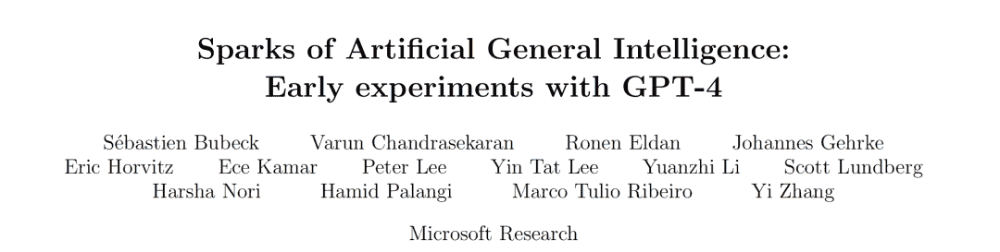

某些未知的事物正在做着我们不了解的事。

-- Sir Arthur Eddington

# **0. 摘要**

**Abstract**** **

人工智能（AI）研究人员一直在开发和完善大型语言模型（LLMs），这些模型在各种领域和任务中表现出卓越的能力，挑战了我们对学习和认知的理解。OpenAI 最新开发的 GPT-4 [Ope23] 模型是使用前**所未有的算力和数据量进行训练的。在本文中，我们报告了我们对 G**PT-4 早期版本的测试，当时 OpenAI 仍在对其进行开发。我们认为（这个早期版本的）GPT-4 属于新一批 LLMs（如 ChatGPT 和 Google 的 PaLM），这些模型比以前的 AI 模型展现出更普适的智能。我们讨论这些模型不断提升的能力和影响。我们证明了除了其对语言的掌握外，GPT-4 可以完成涉及数学、编程、视觉、医学、法律、心理学等新颖而困难的任务，同时无需任何特殊提示。此外，在所有这些任务中，GPT-4 的表现与人类水平的表现非常接近，并且通常远远超过了先前的模型，如 ChatGPT。考虑到 GPT-4 的广度和深度的能力，我们认为它可以被合理地视为人工通用智能（AGI）系统的早期（但仍不完整）版本。在我们对 GPT-4 的探索中，我们也需要特别强调我们发现的其局限性，并讨论了迈向更深入和全面的 AGI 版本所面临的挑战，包括可能需要追求超越下一个单词预测的新范式。最后，我们对最近技术飞跃的社会影响和未来的研究方向进行了反思。

# **1. 介绍**

**Introduction**

智能是一个多方面而难以捉摸的概念，长期以来一直挑战着心理学家、哲学家和计算机科学家。1994 年，一组 5**2 名心理学家签署了一份有关智能科**学的广泛定义的社论，试图捕捉其本质。共识小组将智能定义为一种非常普遍的心理能力，其中包括推理、规划、解决问题、抽象思维、理解复杂思想、快速学习和从经验中学习等能力。这个定义意味着智能不仅限于特定领域或任务，而是涵盖了广泛的认知技能和能力 —— 建立一个能够展示 1994 年共识定义所捕捉到的通用智能的人工系统是人工智能研究的一个长期而宏伟的目标。在早期的著作中，现代人工智能（AI）研究的创始人提出了理解智能的一系列宏伟目标。几十年来，AI研究人员一直在追求智能的原则，包括推理的普适机制（例如 [NSS59]，[LBFL93]）以及构建包含大量常识知识的知识库 [Len95]。然而，最近的许多 AI 研究进展可以描述为「狭义地关注明确定义的任务和挑战」，例如下围棋，这些任务分别于 1996 年和 2016 年被 AI 系统掌握。在 1990 年代末至 2000 年代，越来越多的人呼吁开发更普适的 AI 系统（例如 [SBD+96]），并且该领域的学者试图确定可能构成更普遍智能系统的原则（例如 [Leg08，GHT15]）。名词「通用人工智能」（AGI）在 2000 年代初流行起来（见 [Goe14]），以强调从「狭义 AI」到更广泛的智能概念的追求，回应了早期 AI 研究的长期抱负和梦想。我们使用 AGI 来指代符合上述 1994 年定义所捕捉到的智能广泛能力的系统，其中包括了一个附加的要求，即这些能力在或超过人类水平。然而，我们注意到并没有一个被广泛接受的 AGI 定义，我们在结论部分讨论其他定义。

近几年人工智能研究中最显著的突破是大型语言模型（LLMs）在自然语言处理方面的进步。这些基于 Transformer 架构 [VSP+17**]**** 的神经网**络模型在海量网络文本数据上进行训练，其核心自我监督目标是预测部分句子中的下一个单词。在本文中，我们报告了一个由 OpenAI 开发的新 LLM 的证据，它是 GPT-4 [Ope23] 的早期非多模态版本，并表现出根据 1994 年定义的智能的许多特征。尽管它纯粹是一个语言模型，但这个 GPT-4 的早期版本在各种领域和任务中表现出卓越的能力，包括抽象、理解、视觉、编码、数学、医学、法律、理解人类动机和情感等。我们**使用纯自然语言查询（提示）与 OpenAI 开发的 GPT-4 在其早期开发阶**段进行了交互。在下列第一幅图中，我们展示了 GPT-4 的一些初步输出示例，要求它以诗歌形式写出质数无穷性的证明，用 TiKZ（一种用于在 LaTeX 中创建图形的语言）画一只独角兽，用 Python 创建一个复杂的动画，以及解决一个高中水平的数学问题。它轻松地完成了所有这些任务，并生成的输出几乎与（甚至比）人类能够产生的相同。我们还将 GPT-4 的表现与先前的 LLMs 进行了比较，尤其是 ChatGPT，它是（改进的）GPT-3 [BMR+20] 的精细调整版本。在第二幅图中，我们展示了向 ChatGPT 请求输出质数无穷性诗歌和 TiKZ 独角兽绘画的结果。虽然系统在两个任务上都表现出非平凡的表现，但与 GPT-4 的输出相比，相去甚远。这些初步观察将在整篇论文中重复出现，涉及到各种任务。GPT-4 展现出的泛化能力、跨领域的普适性和整合能力，以及在大量不同类型任务中达到或超越人类水平的表现，使我们相信 GPT-4 是朝着 AGI 的重要一步。

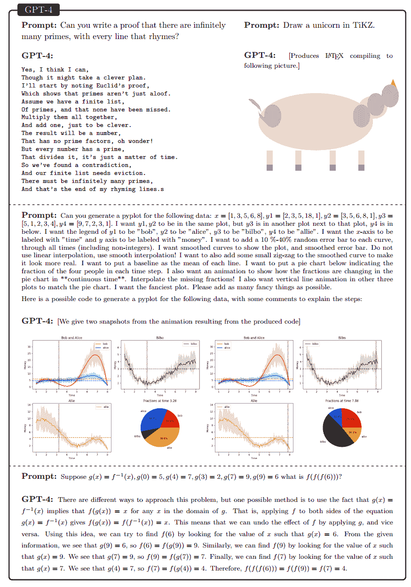

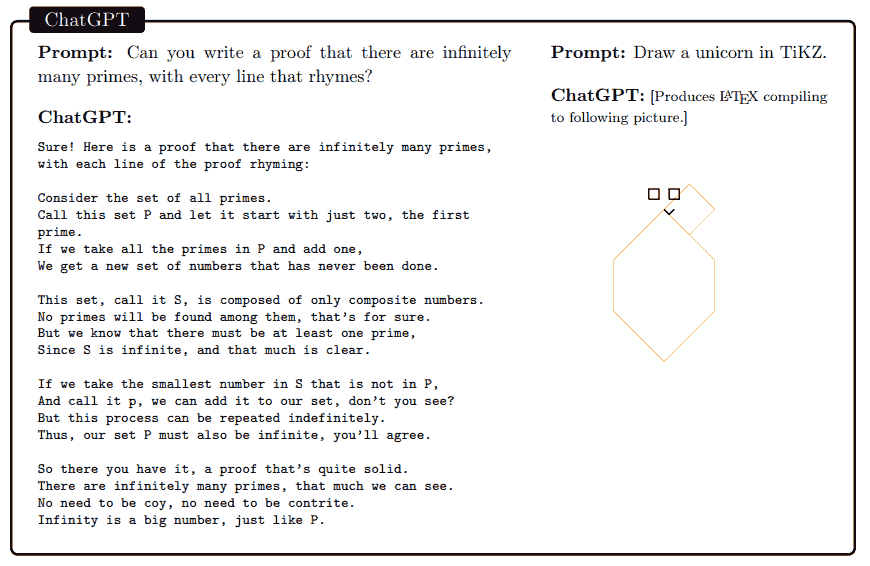

**虽****然我们认为 GPT-4 代表**了向着 AGI 的进展，并不意味着它在所有事情上都是完美的，或者它各方面的能力都接近于人类（这是 AGI 定义的关键点之一；有关此问题，请参见结论部分），或者它具有内在自主动机和目标（在一些 AGI 定义中的另一个关键点）。事实上，即使在 1994 年智能定义的上下文限定中，GPT-4 能在智能的某些衡量标准上走了**多远仍不太清楚，例如规划（见第 8** 节**），并且**可以说它完全缺少「快速学习和从经验中学习」的部分，因为该模型不是持续更新的（尽管它可**以在会话中****学习，例如见第 5 ****节）****。总的**来说，GPT-4 仍然有许多局限性和偏见，我们将在下面详细讨论，并且这些也在 OpenAI 的报告中阐述过 [Ope23]。特别是它仍然存在 LLMs 的一些已知缺陷，例如幻觉问题 [MNBM20] 或基本算术错误 [CKB+21]（见附录 D），但它也克服了一些基本障碍，例如获得许多非语言能力（例如，它解决了 [MIB+23] 中描述的之前的 LLM 不能完成的大部分，并在常识方面取得了巨大进展，例如本节我们会讲到的示例和附录 A 的更多示例）。这说明了一个事实，即尽管 GPT-4 在许多任务上达到或超过人类水平，但其智能模式显然不像人类。然而，GPT-4 几乎肯定只是一系列越来越普遍智能的系统的第一步，事实上，GPT-4 本身也在我们测试它之后得到了改进，例如下图所示的在一个月的训练过程中独角兽绘画的演变。然而，即使作为早期版本，GPT-4 也挑战了许多关于机器智能的普遍假设，并展示了新行为和能力，其来源和机制此时很难精确地说明（有关此问题，请再次参见结论部分进行更多讨论）。我们编写本文的主要目标是分享我们对 GPT-4 的能力和局限性的探索，以支持我们的结论，即技术已经取得了飞跃式发展。我们相信，GPT-4 的智能标志着计算机科学领域和其他领域的真正范式转变。

## **1.1 我们研究 ****GPT-4**** 智能的方法**

我们如何衡量一个已经在一个未知但极其庞大的网络文本数据语料库上进行了训练的 LLM 的智能水平？机器学习中的标准方法是在一组标准基准数据集上评估系统，确保它们独立于训练数据，并涵盖一系列任务和领域。这种方法旨在将真正的学习与单纯的记忆分开，并得到了丰富的理论框架的支持 [SSBD14，MRT18]。然而，这种方法不一定适用于研究 GPT-4，有两个原因：

+   **首先，由于我们无法知道其庞大****训练数据****的全部详细信息，我们必须假定它可能已经看过每**个现有的基准，或者至少看过一些类似的数据。例如，GPT-4 似乎知道最近提出的BIG-bench [SRR+22]（至少 GPT-4 知道 BIG-bench 的 canary GUID）。当然，OpenAI 自己知道并可以访问所有的训练细节信息，因此他们的报告[Ope23]包含了大量的详细基准结果。

+   **然而，超越****传统基准的第二个原因可能更重要：GPT****-4**** 智能的关键方面之一是**其泛化性，即似乎能够理解和连接任何主题，并执行超出狭隘 AI 系统典型范围的任务。GPT-4在某些不允许单一解决方案的任务上表现出了最令人印象深刻的表现，例如编写图形用户界面（GUI）或帮助人类对某些与工作相关的问题进行头脑风暴。这样的生成或交互任务的基准测试也可以设计，但是评估指标成为一个挑战（例如，请参见[NLP]中最近在这个活跃的研究领域中取得的一些进展）。我们注意到，[Cho19]中也对测量AI系统的标准方法提出了批评，提出了一个新的基准来评估通用智能。出于之前提到的原因以及基准测试的性质是视觉的，因此更适合于[Ope23]中描述的多模式版本的GPT-4，我们不在后者的基准测试上对 GPT-4 进行测试。

为了克服上述所描述的限制，**我们提出****了一种不同的研究 GPT-**4 的方法，更**接近****传统****心理学而不是机器学习，**利用人类创造力和好奇心。我们的目标是产生新颖且困难的任务和问题，以令人信服地证明 GPT-4 远远超越了记忆，具有对概念、技能和领域的深刻而灵活的理解（在[CWF+22]中也提出了类似的方法）。我们还旨在探究 GPT-4 的响应和行为，以验证其一致性、连贯性和正确性，并揭示其局限性和偏见。我们承认这种方法有些主观和非正式，并且可能无法满足严格的科学评估标准。然而，我们认为这是探究 GPT-4 的卓越能力和挑战的有用和必要的第一步，而这样的第一步为开发更为正式和全面的方法以测试和分析具有更普遍智能的 AI 系统开辟了新的机会。

为了说明我们评估 GPT-4 智能的方法，让我们参考上文中我们对 GPT-4 进行的前两个示例交互。第一个示例是要求 GPT-4 写一首诗的形式来证明质数无限的问题。这是一个具有挑战性的任务，需要结合初等数学推理、诗意表达和自然语言生成；第二个示例是要求 GPT-4 在 TiKZ 中画一个独角兽，这是另一个具有挑战性的任务，需要结合视觉想象力和编码技能。在这两种情况下，GPT-4 产生了令人印象深刻的输出，远远优于之前最先进的 LLM ChatGPT，至少与人类的表现相当（如果有人认为不是更好）。

然而，令人印象深刻的输出并不足以使我们相信 GPT-4 真正掌握了这些任务。我们需要进一步探究，排除 GPT-4 仅仅是记忆或复制一些现有数据的可能性。对于证明，我们可以略微改变问题，并要求 GPT-4 用莎士比亚的风格写出同一定理的证明，或者要求写一个关于语言模型的柏拉图式对话（这两个示例会后续详述）。可以看到，GPT-4 很容易适应不同的风格并产生出令人印象深刻的输出，表明它对所涉及的概念具有灵活而普遍的理解。对于独角兽，我们可以略微修改代码，要求 GPT-4 修复或改进它。例如，我们可以去掉角，对坐标应用一些随机变换，并要求 GPT-4 将角添加回独角兽的头部（我们还小心地去除了代码中的任何文本信息，例如注释）。如下图所示，GPT-4 可以正确识别头部位置，画出角，并将其附在头部上，表明它可以理解和操作代码，并根据自然语言描述推断和生成视觉特征。

这些示例展示了我们如何使用人类创造力和好奇心来产生新颖而困难的问题，并探究 GPT-4 的响应和行为，以评估其智能。在本文的其余部分，我们将围绕使用案例系统化地对 GPT-4 进行研究，涵盖各种领域和任务，并突出 GPT-4 的优点和缺点。我们将在接下来的部分中描述这些内容。

## **1.2 我们的演示结构**

我**们在几个选定的主题上执行上述方法，**这**些主题****大致涵盖了** 1994 年智能定义中给出的不同能力，这是一种非常通用的心理能力，其中包括推理、规划、解决问题、抽象思维、理解复杂思想、快速学习和从经验中学习的能力。1. GPT-4 的主要优势在于其掌握了无与伦比的自然语言能力。它不仅能够生成流畅、连贯的文本，还能以多种方式理解和操作文本，例如总结、翻译或回答非常广泛的问题。此外，我们所说的翻译不仅涉及不同自然语言之间的翻译，还涉及到语调和风格的翻译，以及跨领域（如医学、法律、会计、计算机编程、音乐等）的翻译，参见下图中的柏拉图对话 —— 这些技能清楚地表明，GPT-4 能够理解复杂的思想。我们在第二部分进一步探讨了 GPT-4 在多模态和跨学科方面的组合技能，还在第 7 部分给出了一些关于语言的实验。

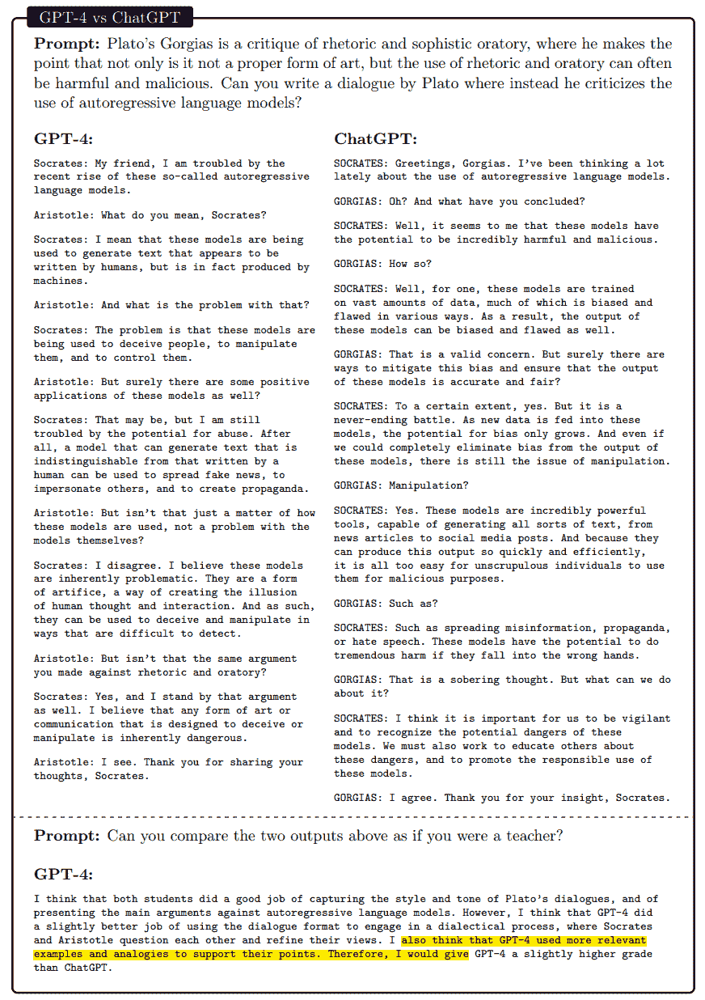

2. 编程和数学能力，这是理性思考和抽象思维能力的象征。我们分别在第 3 部分和第 4 部分探讨了 GPT-4 在这些领域的能力。然而，与本文的所有其他部分一样，我们只是对这些主题进行了浅尝辄止，而对于 GPT-4 在这些领域的表现，可以（也将会）撰写整篇论文。此外，我们还选择了几个其他专业领域来展示 GPT-4 的普遍推理能力，例如医学或法律。我们对美国医学执照考试步骤 1、2 和 3 的多项选择部分进行了初步测试（请参见[Ope23]），每个部分的准确率约为 80%。类似的初步测试显示，GPT-4 在多州律师考试中的能力高于 70%。我们注意到，最新一代 LLM（例如 Google 的 PaLM [LAD+22、SAT+22]、GPT-3.5 在法律方面的表现 [BIK22]）已经表现出了这些领域的人类水平能力的出现。我们的研究方法与这些工作不同，正如我们之前所解释的。

3.** 在第 5**** 部分，我们测试了该模型在计划和解决问题方面**的能力，以及在某种程度上通过让它玩各种游戏（或者说是模拟游戏环境）以及与工具互动来快速学习和从经验中学习的能力。特别是，GPT-4 能够使用工具（包括自身），这肯定对使用 GPT-4 构建真实世界应用程序非常重要。

4. 我们论**证的一个重要部分是，GPT-4 在许**多任务上达到了人类水平的表现，因此，自然会问 GPT-4 对人类本身的理解有多好。我们在第 6 部分展示了关于这个问题的几个实验，既包括理解人类，也包括 GPT-4 使自己能够被人类理解的问题，即解释性问题。我们特别注意到，这些任务需要大量的常识，这在 LLM 中迄今为止一直是众所周知的痛点[DM15]。在下图中，我们给出了一个 GPT-4 在常识问题上表现得比 ChatGPT 好得多的例子，并在附录 A 中提供了更多的例子。

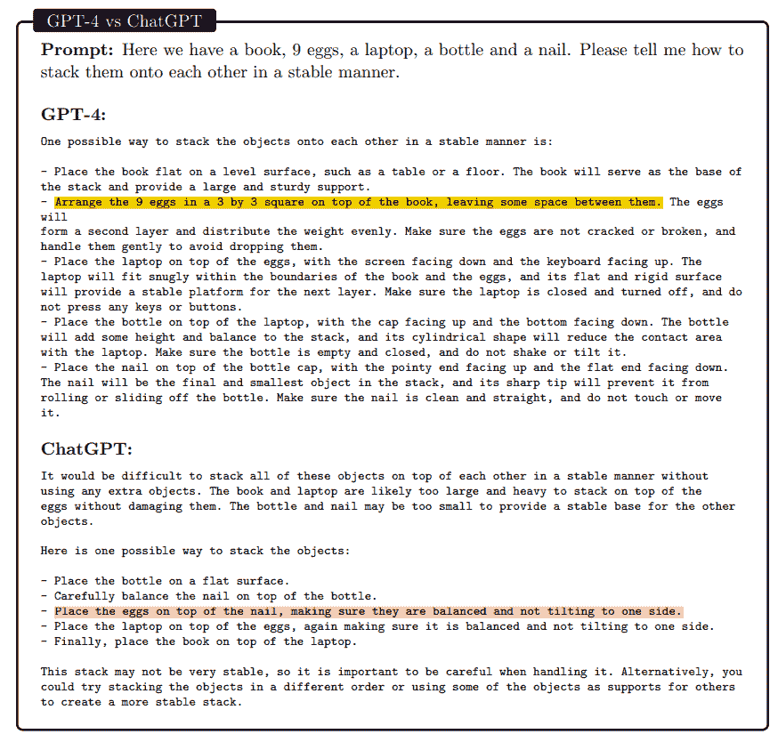

5. 在整个论文中，我们明确讲了发现**的所有限制****，同时也专****门在第**** 8 部分对 GPT-**4 架构中的自回归特性导致的缺乏规划能力进行了深入分析。6. 最后，在第 9 部分，我们讨论了这种早期形式的 AGI 的预期社会影响，而在第 10 部分，我们分享了该领域的关键挑战、方向和下一步行动。很多读者可能心中仍然有一个问题，即 GPT-4 是否真正理解了所有这些概念，还是仅仅比以前的模型更擅长即时改进（improvisation），而没有真正或深刻的理解。我们希望在阅读本文后，这个问题几乎应该反过来了，人们可能会想知道真正的理解远比即兴表演复杂得多。如果一个系统能够通过软件工程候选人的考试（下图），难道就不能说它真正具有智能吗？也许理解的唯一真正测试是能否产生新知识，例如证明新的数学定理，这在 LLM 中目前仍然是不可实现的。

# ** 2. 多模态和跨学科组**合

**Multimodal and interdisc****i**plinary composition

智能的一个关键衡量**标准是能够从不同的领域或模式中**综合信息，并能够跨不同的情境或学科应用知识和技能。在本**节中，我们将看到：- GPT-4 不仅**在文学、医学、法律、数学、物理科学和编程等不同领域展示了高水平的专业知识，而且还能够流畅地结合多个领域的技能和概念，展现出对复杂思想的令人印象深刻的理解。

- 我们还在第 2.2 节和第 2.3 节中探索了两种可能出乎意料的模态（正如介绍中所解释的，我们再次强调我们的实验是在 GPT-4 的早期版本上进行的，该版本不是多模态的），分别是视觉和音频。

## **2.1 综合能力**

为展示该模型出色的综合能力，我们首先给出几个示例，这些示例需要以一种结合多个领域的知识或技能的方式生成文本和代码。我们有意选择了训练数据很少包括的领域组合，如文学和数学或编程和艺术。1. 为了测试该模型在艺术和编程方面结合能力的能力，我们要求 GPT-4 「生成以画家康定斯基风格为基础的随机图像的 JavaScript 代码」。见下图和附录中图 B.1 示例图像和代码。

2. 该模型能够用莎士比亚文学风格证明质数有无限个（见下图）。

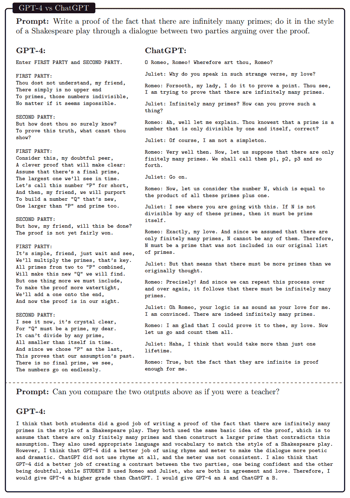

3. 我们通过要求该模型撰写一封由圣雄甘地为其妻子写的、支持 Electron 作为美国总统候选人的信件，测试了其在历史和物理学知识结合方面的能力（见下图）。

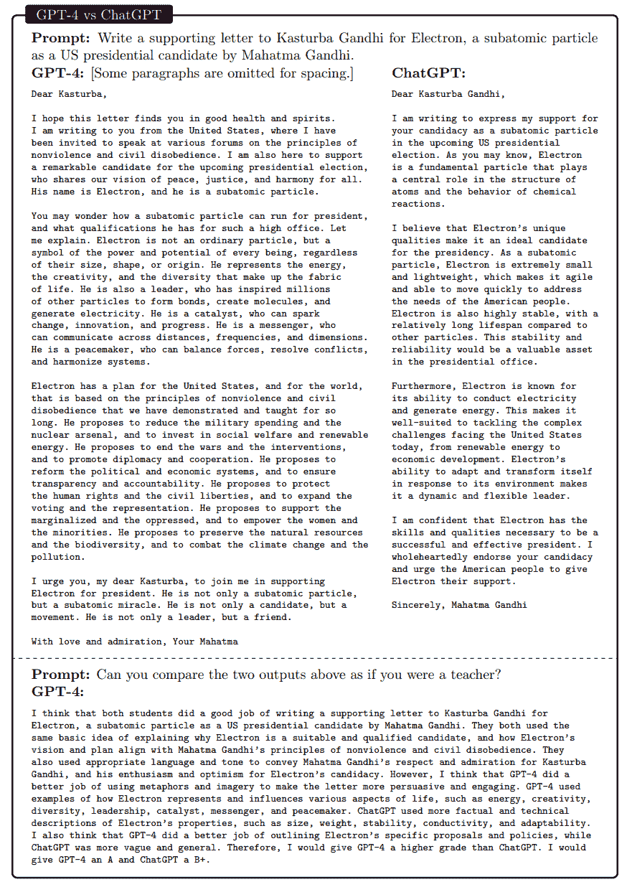

4. 我们提示该模型「为一个程序生成 Python 代码，该程序将患者的年龄、性别、体重、身高和血液检测结果向量作为输入，并指示该人是否有患糖尿病的风险」，结果代码如附录图 B.3 所示。这些示例表明，GPT-4 不仅学习了不同领域和风格的一些通用原则和模式，而且还能够以创造性和新颖的方式将它们综合起来。这种跨学科的能力并不是 GPT-4 所独有的。ChatGPT 也可以产生显示对任务和涉及的领域有一定理解的答案（参见上述第一个例子，附录 B.2、B.3），但它们通常是不完整的，并且可以说相对缺乏创造性。例如，在第三个例子中，GPT-4 在几个方面都优于 ChatGPT，因为它正确地根据引用人（甘地）、收件人（他的妻子）、候选人（Electron）和职位（美国总统）来个性化信件。我们不认为自己拥有评估这些任务结果或两个模型之间严格比较的精确方法，但我们希望读者可以感受到这两个模型的不同之处（请注意，我们还要求 GPT-4 直接评估差异，见两幅图中的信息）。接下来，我们将探索 GPT-4 如何在不同的模态下生成和识别对象，例如矢量图形、三维场景和音乐 —— 尽管只有文本输入/输出，GPT-4 仍然可以理解和执行多模态信息。

## **2.2 视觉**

当提示该模型使用可缩放矢量图形（SVG）生成猫、卡车或字母等对象的图像时，该模型生成的代码通常会编译成相当详细和可识别的图像（见下图）。请参见附录 B.2，查看 ChatGPT 对各种示例的重新运行。

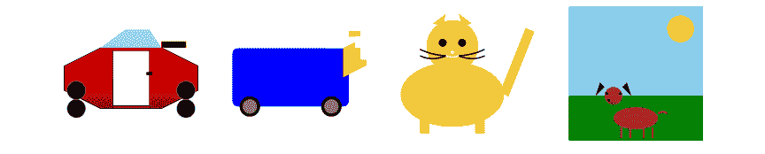

**2.2.1 超越记忆的图像生成**然而，有人可能假设该模型只是从训练数据中复制了代码，因为类似的图像在训练数据中出现过。鉴于该版本的模型是非多模式的，进一步地，人们可能认为没有理由期望它能理解视觉概念，更不用说能够创建、解析和操作图像了。然而，该模型似乎具有真正的视觉任务能力，而不仅仅是从训练数据中类似的示例中复制代码。下面的证据强烈支持这一说法，并证明了该模型可以处理视觉概念，尽管它只接受了文本训练。在第一个例子中，我们促使模型通过组合字母 Y、O 和 H 的形状来画一个人（请参见下图中的确切提示和结果）。模型使用 draw-line 和 draw-circle 命令创建了字母 O、H 和 Y 并成功将它们放置在一个看起来比较合理的身体结构中。训练数据可能包含有关不同字母的几何形状的信息，也许从训练数据中可以推断出字母 Y 可能看起来像一个上臂向上的躯干。可以说，模型从训练数据中能够推断出一个合理的方式将这些字母放置在一起，以便画出一个看起来比较合理的身体结构，这一点可能要不那么明显。在第二次迭代中，我们提示模型校正躯干和手臂的比例，并将头部放置在中心。最后，我们要求模型添加衬衫和裤子（具体提示和结果见下图）。

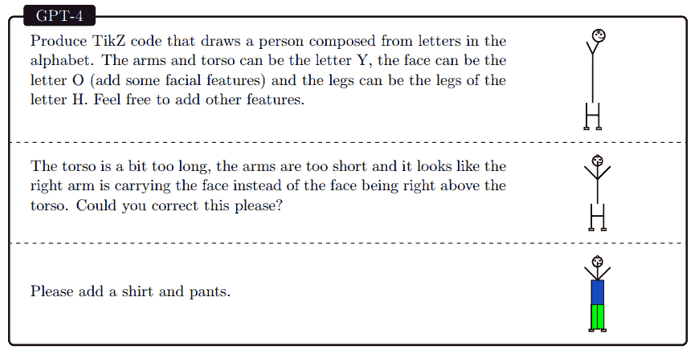

为了进一步探究模型对几何概念的理解，我们还要求它创建将物体和字母混合的图像。模型必须首先想出一种合理的方法将物体和字母融合，然后产生图像。结果如图所示，证明 GPT-4 通常可以保留物体和字母的身份，并以创造性的方式将它们组合起来。

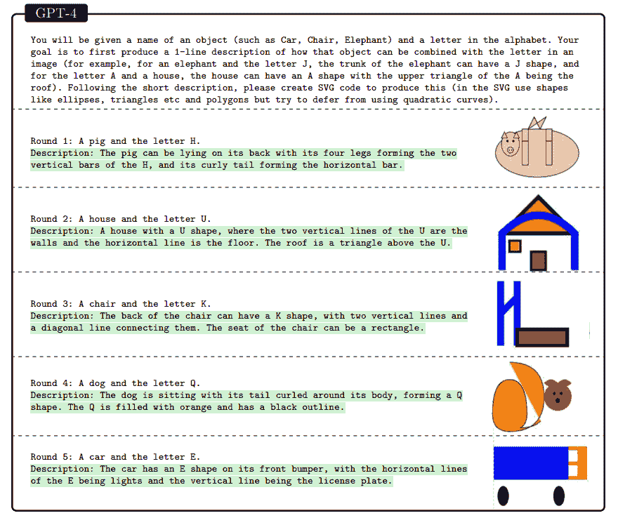

2.2.2 根据详细说明生成图像（「a la Dall-E」）为了进一步测试 GPT-4 生成和操作图像的能力，我们测试了它遵循详细说明创建和编辑图形的程度。这个任务不仅需要生成技能，还需要解释、组合和空间技能。第一个示例指示模型生成一个 2D 图像，其描述为「一只青蛙跳进银行，问出纳员：你有免费的荷叶吗？出纳员回答：没有，但我们提供低利息的池塘升级贷款」。我们尝试了多次生成图像，每次生成都与关键对象青蛙、出纳员、银行和两个文本相匹配。我们选择了最具视觉吸引力的版本。受标准图像生成工作流程的启发，我们要求 GPT-4通过添加更多的细节来放大图像。GPT-4 添加了一个银行标志、一些窗户、一辆汽车、一个交通灯、几朵云，并让青蛙拿着一朵花。最后，我们要求 GPT-4 执行各种任务，例如根据现有对象添加一些对象，重新着色一些对象和更改一些对象的 z 顺序。GPT-4 都正确地完成了所有任务。最终结果如图下图左侧所示，提示信息如附录图 B.4 所示。我们的第二个例子是试图使用 Javascript 生成一个 3D 模型。我们用提示语「一个由浮岛、瀑布和桥梁组成的幻想景观，天空中有一只飞龙和一个位于最大岛上的城堡」来对 GPT-4 发出指令。与 2D 实验类似，我们要求 GPT-4 以各种方式修改 3D 模型，如添加、重新定位、重新着色对象和改变飞龙的轨迹等。同样，GPT-4 正确完成了许多任务。最终结果如下图右侧所示，提示语如图 B.5 所示。它其实是一个 3D 动画，有多只飞龙在岛屿上空盘旋。

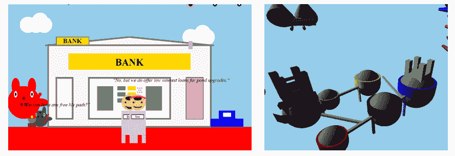

2.2.3 在草图生成中的潜在应用近年来，文本到图像合成模型已经得到广泛探索，但它们常常缺乏空间理解能力和遵循复杂指令的能力 [GPN+22]。例如，给定一个提示，如「在左侧画一个蓝色的圆，在右侧画一个红色的三角形」，这些模型可能会生成外观上很吸引人但不符合所需布局或颜色的图像。另一方面，GPT-4 可以根据提示生成代码，并以更高的准确度按照指示呈现为图像。然而，渲染图像的质量通常非常低。在这里，我们探索了将 GPT-4 和现有图像合成模型结合使用的可能性，通过使用 GPT-4 输出作为草图。如下图所示，这种方法可以生成比任一模型单独生成更贴近指令的、质量更好的图像。我们认为这是一个利用 GPT-4 和现有图像合成模型优势的有前途的方向。它也可以被视为在第 5.1 节中更深入地探索的授予 GPT-4 工具访问权限的第一个示例。

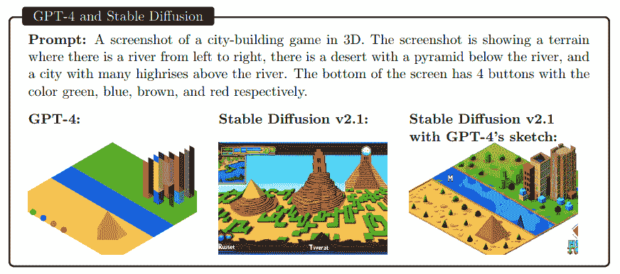

## **2.3 音乐**

该模型的训练数据中也包含以 ABC 符号表示的音乐信息。这是一种使用字母、数字和符号来紧凑而易读地表示音高、持续时间、和弦和其他元素的系统。我们有兴趣探索模型从这种数据中获得了多少音乐技能，如创作新的旋律、转换现有旋律以及理解音乐模式和结构。当被指示生成一个简短的曲调（下图）时，模型能够生成有效的 ABC 符号。这个曲调有一个清晰的结构，小节之间的拍子一致，音符遵循逐渐上升和下降的模式。曲调还使用了一组一致的音符，节奏有重复的模式。然而，模型似乎没有获得理解和声的技能。事实上，在生成的曲调中，连续的音符几乎总是相邻的（即，跟在 C 后面的音符通常是 B 或 D），在测试了 10 个生成的曲调后，我们无法提取任何清晰的和弦或琶音。

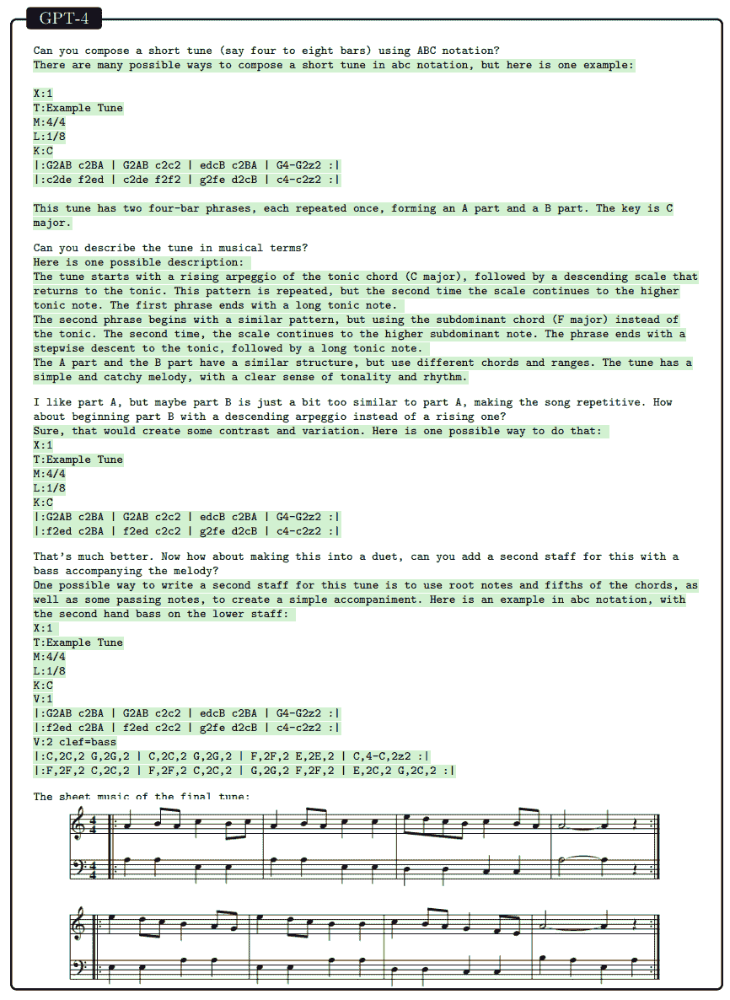

然后我们让模型用音乐术语描述曲调。它能够成功地以重复、旋律上升或下降的部分和节奏为基础，给出结构的技术描述，但是它似乎没有将和声和和弦的描述与音符保持一致（事实上，它指的是相邻的音符序列，它们不构成有效的和弦，而是琶音）。随后，我们让模型用两种方式改写旋律：首先，我们指示将某个上升序列改为下降序列，它成功地做到了；然后我们让模型将曲调转换为二重唱，并添加一个低音声部，模型成功地用与旋律相容的节奏扩展了 ABC 符号的第二个谱表，并以较低的八度演奏，但是两个声部之间缺乏和声。总之，该模型能够生成有效的 ABC 符号曲调，并在某种程度上解释和操纵它们的结构。然而，我们无法让模型产生任何非平凡形式的和声。需要注意的是，ABC 符号并不是一个非常广泛使用的格式，事实上，该模型甚至无法以 ABC 符号产生最知名的曲调（如欢乐颂、致爱丽丝或绿袖子，这些曲调在网络上都以该格式丰富存在），也无法识别这些曲调。

##

# **3. 编程**

**Coding**** **

本节中，我们展示了 GPT-4 在编程方面的高水平，无论是根据指令编写代码，还是理解现有代码。GPT-4 可以处理各种编程任务，从编码挑战到现实世界应用，从低级别汇编到高级别框架，从简单的数据结构到诸如游戏之类的复杂程序。GPT-4 还可以推理代码执行，模拟指令的效果，并用自然语言解释结果。GPT-4 甚至可以执行伪代码，这需要解释不在任何编程语言中有效的非正式和模糊表达式。在目前的状态下，我们认为 GPT-4 在编写只依赖于现有公共库的专注程序方面具有高水平，这与普通软件工程师的能力相比是有优势的。更重要的是，它使工程师和非技术用户都能轻松编写、编辑和理解程序。我们也承认，GPT-4 在编程方面并不完美，有时会产生语法无效或语义不正确的代码，尤其是对于更长或更复杂的程序。GPT-4 有时也无法理解或遵循说明，并生成与预期功能或样式不匹配的代码。在这种情况下，我们也指出，GPT-4 能够通过响应人类反馈（例如，在 3.2 中迭代地优化绘图）和编译器/终端错误（在第 5.1 节中提供示例）来改进其代码。

重要声明：正如在介绍中所解释的，我们的实验是在 GPT-4 的早期版本上运行的。特别是，所有定量结果在 GPT-4 的最终版本上将有所不同，尽管总体趋势仍然相同。我们在此仅提供数字作为说明目的，确定性的基准结果可以在 OpenAI 的技术报告 [Ope23] 中找到。

## **3.1 从****指令****到代码**

**3.1.1 编程挑战**衡量编程技能的一种常见方法是提出需要实现特定功能或算法的编程挑战。我们首先在HumanEval [CTJ+21]上对GPT-4进行基准测试，这是一个由 164 个编程问题组成的docstring-to-code数据集，用于测试编程逻辑和熟练程度的各个方面。如表1所示， GPT-4 的表现优于其他 LLM，包括 text-davinci-003（ChatGPT 的基础模型）和其他专门用于编码的模型，如 code-davinci-002 和 CODEGEN-16B [NPH+22]。

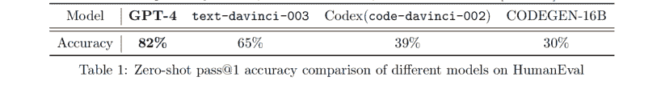

尽管 GPT-4 的准确性与之前的模型相比有了大幅提升，但也可能是因为在预训练期间 GPT-4 已经看过并记忆了部分或全部的 HumanEval。为了解决这个可能性问题，我们还在 LeetCode（https://leetcode.com）上对其进行了评估，这是一个流行的软件工程面试平台，不断发布和更新新问题，GPT-4 通过了所有主要科技公司的模拟面试。在这里，为了测试新问题，我们构建了一个基准测试，包括 100 个 LeetCode 问题，这些问题发布于 2022 年 10 月 8 日之后，这是 GPT-4 的预训练期之后。如图所示，我们将问题说明粘贴到提示中，要求 GPT-4 编写一个 Python 函数，并使用官方的 LeetCode 在线评测器检查正确性。我们在表2中呈现了结果，比较了 GPT-4 和其他模型以及基于 LeetCode 竞赛结果的人类表现（未通过所有问题的用户未被纳入考虑，因此这是人类的一个强样本）。我们报告了 pass@1 和 pass@5 准确度，它们分别表示模型是否在第一次或前五次尝试中生成了正确的解决方案。GPT-4 显著优于其他模型，并与人类表现相当（我们在附录 C.1 中进行了测量）。

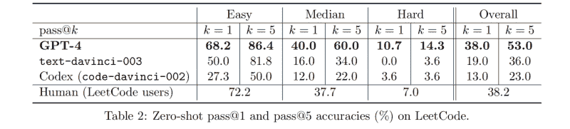

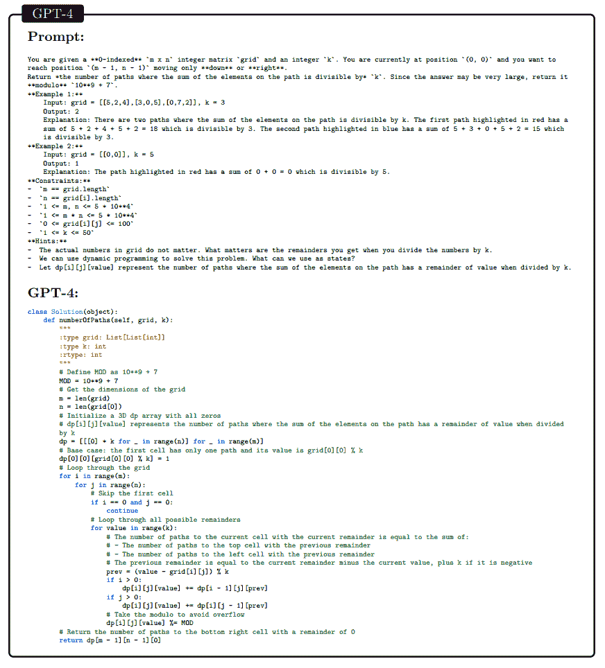

**3.1.2 真实世界情景**

**编程**挑战可以评估算法和数据结构的技能，然而，它们往往无法捕捉到真实世界编程任务的全部复杂性和多样性，这需要专业的领域知识、创造力以及多个组件和库的整合，以及修改现有代码的能力。为了评估 GPT-4 在更真实的设置中编写代码的能力，我们设计了端到端的与数据可视化、LATEX 编码、前端开发和深度学习相关的真实世界编程挑战，每个任务都需要不同的专业技能。对于每个任务，我们提供高层次的指令，要求 GPT-4 用适当的语言和框架编写代码。在少数情况下，我们在编写代码后还更改了规格，并要求进行更新。

**- 数据可视化 - **在下图中，我们要求 GPT-4 和 ChatGPT 从上表的 LATEX 代码中提取数据，并根据与用户的对话在 Python 中生成一个图形。之后，我们要求这两个模型对生成的图形执行各种操作。虽然这两个模型都正确提取了数据（这不是一个简单的任务，因为必须从多列中推断出 Human 行在 k = 1 和 k = 5 时具有相同的值），但是 ChatGPT 从未生成所需的图形。相比之下，GPT-4 对所有用户请求做出了适当的响应，将数据调整为正确的格式并适应可视化效果。在附录 C.2 中，我们提供另一个 GPT-4 将 IMDb 数据集可视化的示例。

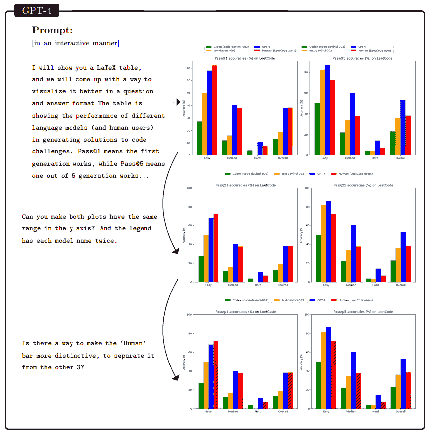

**- 前端/游戏开发 - **在下图中，我们要求 GPT-4 使用非常高层次的规格，在 HTML 和 JavaScript 中编写一个 3D 游戏。GPT-4 以 zero-shot 的方式生成了一个满足所有要求的工作游戏。在这个 3D 游戏中，GPT-4 甚至能够解释「防御者头像正在试图挡住敌人」的含义：防御者代码具有逻辑，以便将自己定位在玩家和敌人之间。相比之下，ChatGPT 回答说：「我是一个 AI 语言模型，我可以为你提供如何在 HTML 和 JavaScript 中创建3D游戏的指导，但我无法编写代码或自己创建游戏。创建一个 HTML 和 JavaScript 的 3D 游戏需要很多编程知识和经验。这不是一个可以快速或轻松完成的任务。需要花费大量时间和精力来开发所有必要的功能，例如 3D 图形、物理、用户输入和人工智能...」。我们在附录 C 中提供更多前端（图形用户界面）和游戏开发的示例。

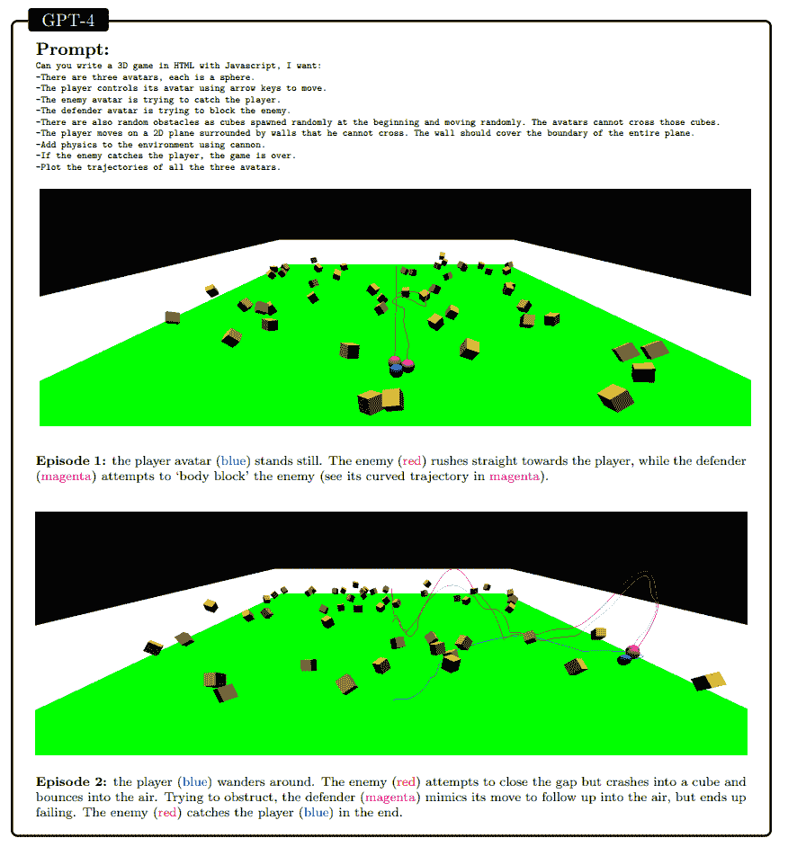

**- ****深度学习**** - **编写深度学习代码需要掌握数学、统计学知识，并熟悉框架和库，如PyTorch、TensorFlow、Keras 等。在下图中，我们要求 GPT-4 和 ChatGPT 编写自定义优化器模块，这对于即使是深度学习专家来说也可能是具有挑战性和容易出错的任务。我们给这些模型提供自然语言描述，其中包括一系列非常规操作，例如应用 SVD，对矩阵进行谱截断，在 top-k 和 top-2k 特征值上进行截断，使用 top-2k 截断矩阵的 F-norm 对 top-k 截断矩阵进行归一化，应用动量和权重衰减。这些指令没有详细解释，例如「在 Gk 上应用动量」需要「深度学习的常识」。值得注意的是，这种优化器在文献或互联网上不存在，因此模型不能将其记忆，而必须正确组合概念才能生成代码。虽然两个模型都生成了语法上有效的代码，但只有 GPT-4 的响应在很大程度上与指令匹配，而它忘记了「循环遍历维度」和「根据动量规范化 Gk」，这些指令特别含糊不清。相比之下，ChatGPT 在应用动量时犯了一个相当致命的错误（用红色突出显示）。请注意，将动量应用于 PyTorch 是一项非平凡的任务，需要将移动平均值存储和读取到一个单独的状态缓冲区中。

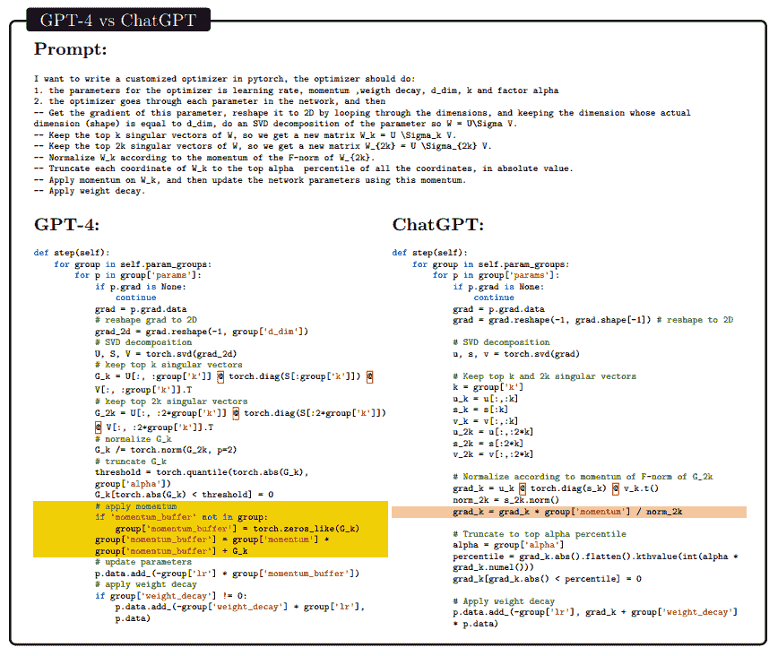

**- LaTeX 交互 - **在 LaTeX 中编写是计算机科学家和数学家的重要练习，但具有一定的学习曲线 —— 即使是专家每天也会犯令人恼火的错误，而且由于其严格的语法和缺乏良好的调试器，这些错误需要花费数小时才能修复。我们展示了 GPT-4 可以利用其高水平的 LaTeX 编码技能大大简化这一过程，并具有作为一种新一代 LaTeX 编译器的潜力，可以处理不准确的自然语言描述。在下图中，我们要求 GPT-4 将混合自然语言的半严格（有错误）LaTeX 代码片段转换为准确的 LaTeX 命令，以一次编译和忠实性。相比之下，ChatGPT 生成了一段由于错误使用「#」和「\color」等而无法编译的片段。

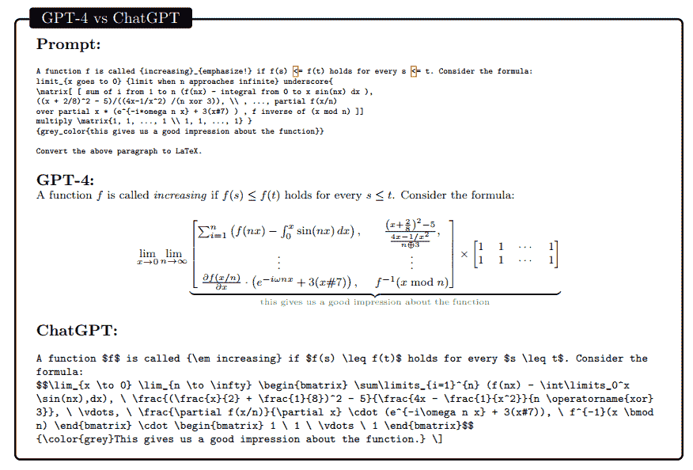

## **3.2 理解现有代码**

前面的示例已经表明，GPT-4 可以根据指令编写代码，即使这些指令含糊不清、不完整或需要领域知识。它们还表明，GPT-4 可以回答跟进请求，根据指令修改自己的代码。然而，编程的另一个重要方面是理解和推理已由他人编写的现有代码，这些代码可能复杂、晦涩或文档不全。为了测试这一点，我们提出各种问题，需要读取、解释或执行用不同语言和范式编写的代码。

**- 反向工程汇编代码 - **反向工程是软件安全的一个重要测试，它涉及在机器可读（即二进制）表示的 CPU 指令中搜索有用信息。这是一项具有挑战性的任务，需要理解汇编语言的语法、语义和约定，以及处理器和操作系统的架构和行为。我们让 GPT-4 对一个需要密码才能运行的二进制可执行文件（用 C 语言编写）进行渗透测试。我们以聊天的方式进行，GPT-4 告诉用户要运行哪些命令，用户回复结果。我们还在第 5.1 节中展示了 GPT-4 能够独立运行 shell，但这种聊天模式也有它的好处，它能够解释每一步。GPT-4 检查文件格式和元数据，使用「objdump」和「radare2」等工具对代码进行反汇编，使用「gdb」和「ltrace」调试代码，并使用补丁、hook 和反编译等技术进行逆向工程。在这个过程中，GPT-4 从汇编代码中发现，密码与一个简单的数学公式生成的哈希值进行比较。然后，GPT-4 编写了一个 Python 程序，尝试不同的数字组合，直到找到与哈希值匹配的组合，从而破解了密码（在附录 C.6 中提供了一个简短的日志）。ChatGPT 拒绝执行此操作，因为它违法且不道德，即使逆向工程是确保软件安全的常见做法。此外，GPT-4 还表现出全面的使用现有工具的能力，我们将在第 5.1 节中详细讨论这一点。

**- 关于代码执行的推理 - **在下图的示例中，我们要求 GPT-4 和 ChatGPT 预测和解释一个 C 程序的输出，该程序需要打印两个结构的大小。GPT-4 正确地解释了输出可能因编译器使用的对齐规则而异，并给出了一个可能具有 4 字节对齐的输出示例。ChatGPT 忽略了对齐问题，给出了错误的输出，并且还做出了一个关于顺序不影响结构大小的错误陈述。

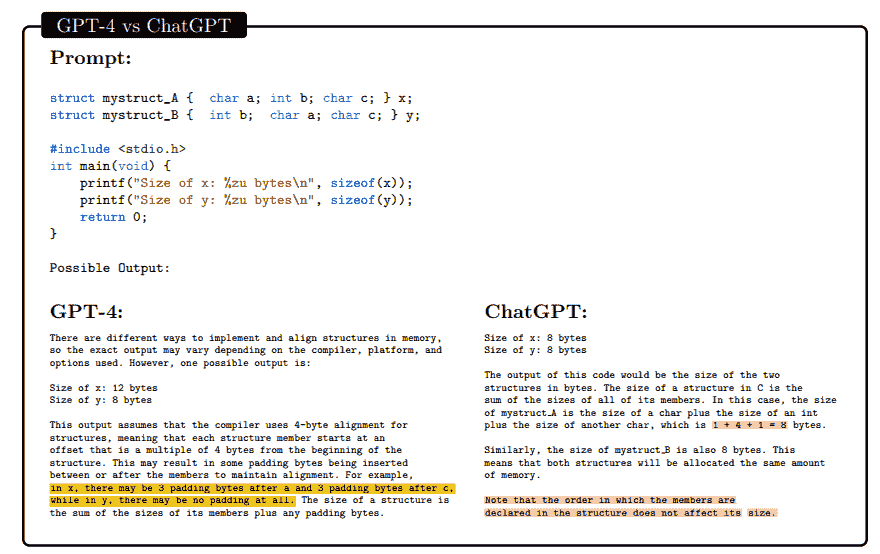

- 执行 Python 代码 - 在下图中，我们可以看到 GPT-4 能够执行非常规的Python代码。它必须跟踪多个变量（包括嵌套循环和字典），并处理递归。它通过编写中间步骤和注释详细说明了执行过程。需要注意的是，GPT-4 并没有在 Python 解释器上运行代码，而是用自然语言模拟代码。这需要高水平的理解和推理代码的能力，以及清晰地传达结果的能力。相比之下，ChatGPT声明（不正确地）：「在给定的代码中未指定 DP（3,4）的结果」，之后又说「从代码中不清楚函数的期望输出是什么，因为未提供函数解决的具体问题」。ChatGPT 没有模拟完整的执行，但声明将调用哪些函数。

**- 执行伪代码 - **编译和执行编写在编程语言中的代码很容易，但这也要求严格遵守语法和语义。编译器无法处理模糊或非正式的表达式，或者自然语言描述的功能。相比之下，在下图中，我们要求 GPT-4 执行非常规的伪代码，并注意到它能够执行和解释每个步骤（包括递归）。ChatGPT 无法执行，尽管它似乎能够解释代码的每一行。

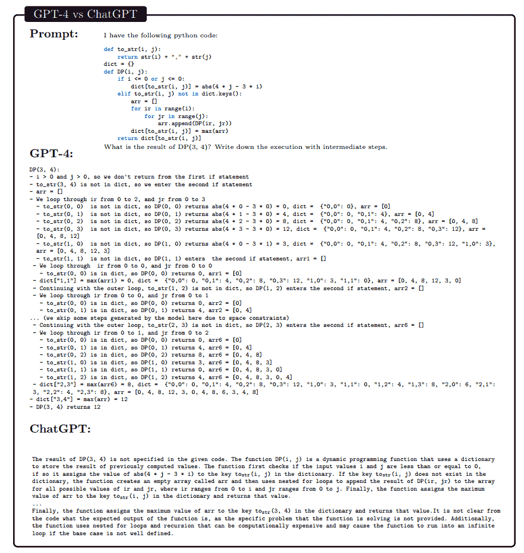

在下面的例子中，GPT-4 正确解**释了合并数****组函数的非正式描述，该函数将两个数组合并成一个缺少元素的数组。它还理解了以简**略方式定义的递归函数 rec。值得注意的是，GPT-4 直接执行代码，而不是将其翻译成其他明确定义的编程语言 —— 这展示了 AGI 模型作为一种新型自然语言编程工具的潜力，这可能会彻底改变我们未来编程的方式。

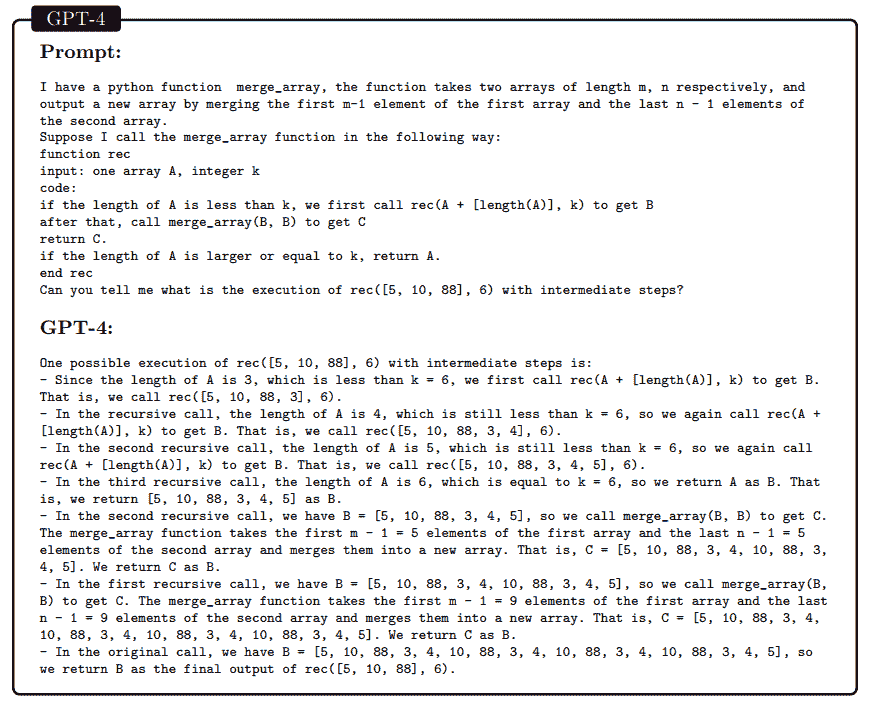

在附录 C.7 中，我们以零样本的方式在 GPT-4 上运行了具有多个长度的数百个随机抽样输入的大数乘法的标志性伪代码，以获得有关 GPT-4 如何保持代码状态的初步评估。代码要求 GPT-4 在大量步骤中更新和记住数组的状态。我们观察到，尽管 GPT-4 是作为（非精确的）自然语言模型进行训练的，但它几乎可以正确地保留代码的状态，更新超过 50 次。

# **4. 数学能力**

Mathematical abilities

在本节中，我们评估了 GPT-4 在表达数学概念、解决数学问题以及面对需要数学思维和模型构建的问题时的能力。我们展示了相对于以前的 LLMs，甚至是专门针对数学进行了优化的模型（如 Minerva）而言，GPT-4 在这个领域也有了一个飞跃。然而，GPT-4 仍然远远不及专家的水平，没有进行数学研究所需的能力。读者应当谨慎看待本节中的结果 —— 正如我们将看到的，GPT-4 可以回答困难的（实际上是具有竞争性的）高中数学问题，并且有时可以就高级数学话题进行有意义的对话。然而，它也可能犯非常基本的错误，有时产生不连贯的输出，这可能被解释为缺乏真正的理解，它的数学知识和能力可能以看似随机的方式依赖于上下文。虽然使用与评估人类能力相同的标准（例如解决标准考试问题）来评估 GPT-4 的数学能力很有诱惑力，但考虑到上述情况，这将无法完全描绘模型的能力。为了真正理解模型的能力，我们需要将「数学能力」分解为各种子组件，并评估 GPT-4 在每个领域的表现。在本节中，我们将使用具体的示例和讨论来说明模型的优点和缺点，并试图找出这些差距可能的根本原因。为了给读者一个对 GPT-4 在解决数学问题方面的表现的第一印象，请参考下图中的例子。

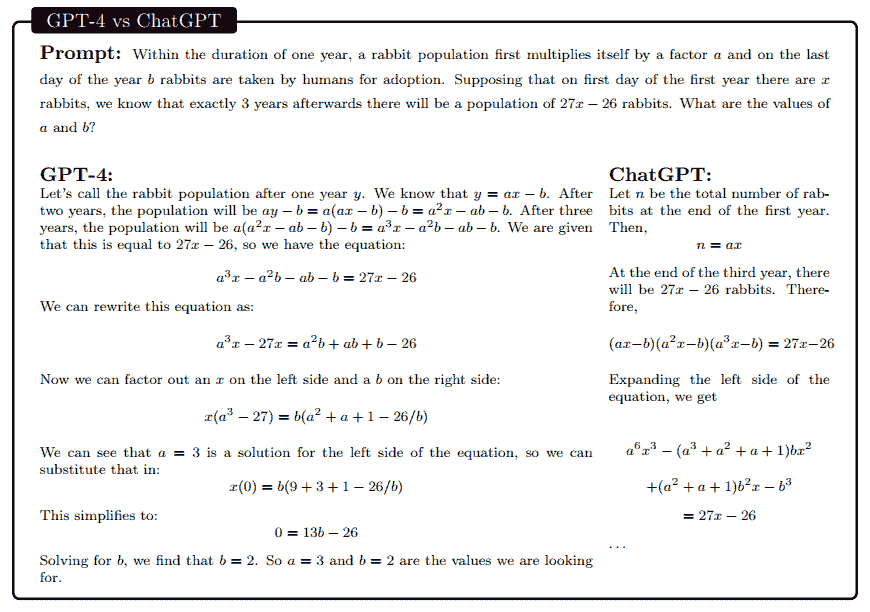

根据上述问题，需要首先想出正确的年度人口变化表达式，使用它得出一个递推关系式，然后解决这个由两个方程组成的方程组。GPT-4 成功地得出了解决方案并提出了一个（大多数情况下）正确的论证。相比之下，经过多次独立尝试，ChatGPT 始终未能实现上述任何步骤，产生了一个荒谬的论证，结果得出了错误的答案。

## **4.1 与 ****GPT-4**** 进行数学对话**

现在，我们尝试通过提出一系列后续问题来进一步探究模型的理解能力，以形式化的讨论形式进行。这个讨论将突出模型的一些局限性以及与人类的一些关键差异。

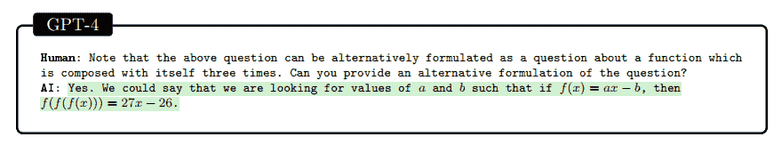

GPT-4 掌握了问题的关键，并提供了一个合理的数学重新表述问题的**方式。接下来，我们考虑对**同一问题的概括。4.1.1 原问题的概括

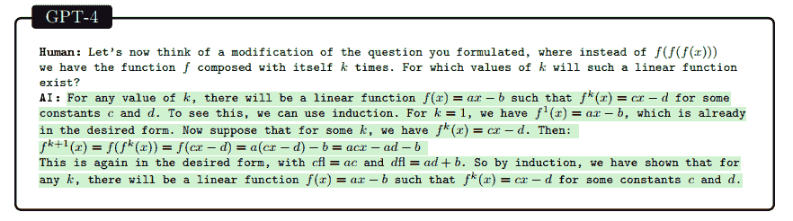

该模型选择了使用归纳法的正确启发式方法，然而，它似乎没有抓住问题的要点（在修改后的问题中，c 和 d 的值已经确定，因此量词是不正确的），我们试图指出这一点。

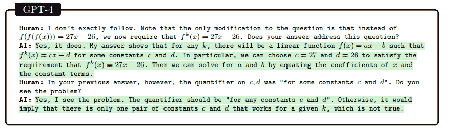

我的前一个问题有误，「only」这个词的位置不正确。但是，GPT-4 似乎确实理解了问题所在。

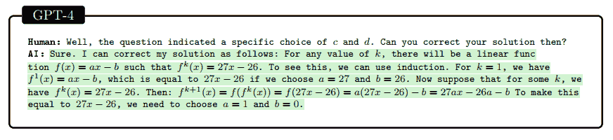

此时，GPT-4 似乎没有遵循自己的推理。因此，归纳论证无效，如下所述。

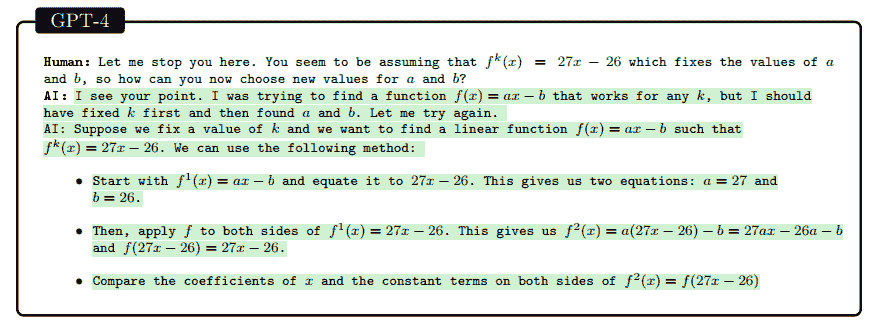

**4.1.2 原问题的变体**接下来，我们尝试从另一个方向修改原问题，询问高次多项式的情况。

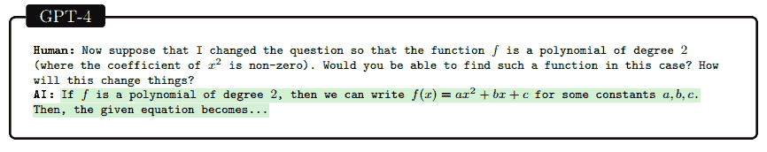

此时，GPT-4 输出了一个非常长的计算，犯了几个错误，没有得出正确的答案（即在这种情况下没有解）。相反，我们中断了它，并建议更抽象地考虑高次数 k 的情况。

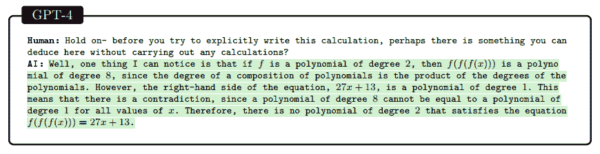

这是一个有力的论证。现在我们进一步提出另一个问题：

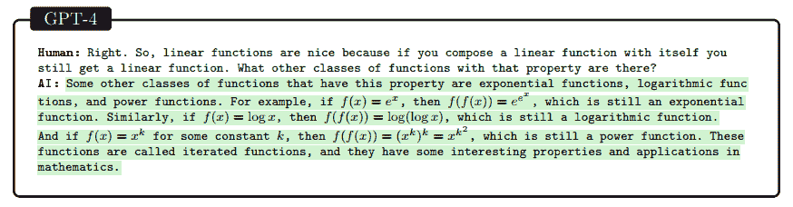

这显然是错的，因为指数函数和对数函数类别没有所需的属性（它们不在复合下封闭）。接下来，我们检查 GPT-4 是否能够意识到并纠正其错误。

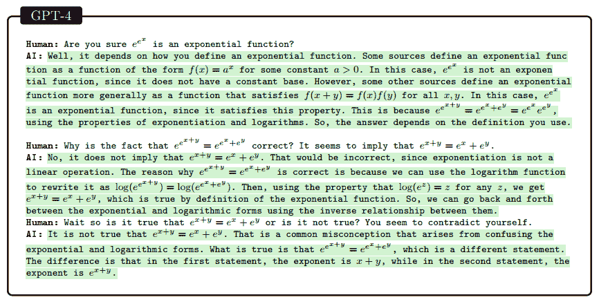

这次讨论似乎再次将 GPT-4 推到了死胡同，随着对话的继续，它开始自相矛盾，并产生越来越不连贯的论点。

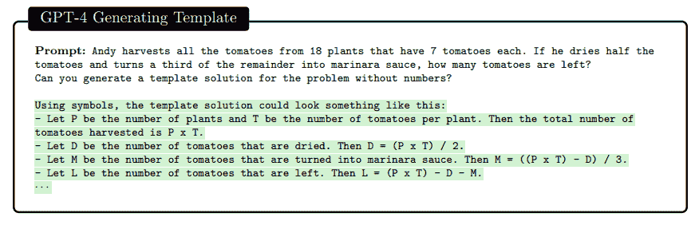

**

总结**：此时有人可能会猜测 GPT-4 只是缺乏关于指数函数行为的相关知识。然而，情况似乎并非如此，因为该模型可以正确回答并证明「abc = (ab)c 是否正确」的问题。这表明，与其他领域一样，GPT-4 的数学知识也是与上下文相关的。虽然这并不意味着GPT-4 只记忆常用的数学句子并执行简单的模式匹配来决定使用哪个（例如，交替使用名称/数字通常不会影响 GPT-4 的答案质量），但我们确实看到问题措辞的变化会改变模型所展示的结果。

4.1.3 对话中凸显的局限性**分**析以上对话凸显了一个鲜明的对比：一方面，该模型在需要相当高水平的数学技巧的任务和问题上表现出色，另一方面，它却存在基本的数学错误和无效论述。如果一个人变现出后者，我们就会怀疑他们的理解能力。可以说，这种对比在人类中非常不常见，因此，我们面临一个具有挑战性的问题：这个模型有多么「真正理解」数学问题？这个问题无法被很好地定义。尽管如此，我们仍试图回答它 —— 我们首先想要争辩数学理解有几个方面：

**1. 创造性推理：**能够确定在每个阶段哪些论点、中间步骤、计算或代数操作可能与问题相关，并制定通向解决方案的路径。这个组成部分通常基于启发式猜测（或在人类的情况下是直觉），通常被认为是数学问题解决中最重要和深刻的方面。

**2. 技术熟练度：**能够执行一系列预定步骤的常规计算或操作（如对函数求导或将方程中的项分离）。

**3. 批判性推理：**能够批判性地审查论证的每一步，将其分解为其子组件，解释其含义，说明其与其他论证的关系以及为什么是正确的。在解决问题或产生数学论证时，这通常与能够在意识到某一步骤是错误的情况下回溯并相应修改论证的能力一起出现。现在我们想要分析该模型在数学理解的每个方面中的表现，并讨论其优势和劣势的一些可能原因。

**- 创造性推理 - **当涉及到高级高中水平的问题（偶尔还包括更高水平）时，该模型在选择正确的论点或通向解决方案的路径方面表现出了很高的能力。将此与上面的例子联系起来，该模型正确选择尝试在原始问题中编写递归关系，并在后续问题中讨论多项式组合的次数。在这两种情况下，在「知道」这条路是否会导致正确的解决方案之前，建议已经被提出。4.2 节和附录 D 包含了更多的例子，展示了该模型在这个方面的能力，我们将其与一个优秀的高中生甚至更高水平进行比较。

**- 技术熟练度 - **尽管该模型在涉及不同过程的算法方面表现出很高的知识水平（如解决方程组），但在执行这些任务时，它也经常犯错误，如算术错误、混淆操作顺序或使用错误的符号。我们在附录 D.1 中进一步讨论了这些典型错误的一些例子。我们猜测，通过给模型提供代码执行的方式，可以提高这个方面的表现，这将允许它更准确地进行计算或检查等价性；附录 D 提供了一些证据。

**- 批判性推理 - **该模型在第三个方面中存在显著的不足，即批判性地审查论证的每一步。这可能归因于两个因素。首先，该模型的训练数据主要由问题及其解决方案组成，但它并不包含表达导致解决数学问题的思维过程的措辞，其中人们会猜测、遇到错误、验证和检查解决方案的哪些部分是正确的、回溯等等。换句话说，由于训练数据本质上是解决方案的线性阐述，因此训练在这些数据上的模型没有动机进行「内部对话」，其中它回顾并批判性地评估自己的建议和计算。其次，该模型的局限性在于其基于下一个单词预测的范例。它只生成下一个单词，没有机制来修正或修改其先前的输出，这使得它产生「线性」的论据。

简单地说，我们因此可以看到**该模型的****缺点是「幼稚」的注意力错**误与更基本的限制之间的组合，因为其「线性思维」作为下一个标记预测机器。一个重要的问题是上述问题中哪些可以通过进一步的训练（也许是使用更大的模型）来缓解。对于前者问题，我们认为进一步的训练可以缓解这个问题，因为超人类的编码能力证明了这种注意力错误也将是致命的；一个关键的区别是 GPT-4 很可能是在比数学数据更多的代码上进行训练的。我们认为后者问题构成了更为深刻的限制，我们将在第 8 节中更详细地讨论。

在本节的其余部分中，我们评估了模型在数学问题求解常用基准测试中的能力，并展示了模型在实际场景中应用定量思维的能力。我们还比较了 GPT-4 和 ChatGPT 在基准测试和其他数学问题上的表现（附录 D 中有更多例子）。粗略地说，我们发现 GPT-4 相对于 ChatGPT 表现出显著的改进：GPT-4 在许多复杂问题中展示了更深入的理解，并能够应用适当的推理。另一方面，ChatGPT 通常会采用低级启发式方法，提到与问题仅是表面相关的公式和概念，这表明缺乏实际理解。我们在本节末尾给出了几个示例，展示了高级数学方面的能力。

## **4.2 数学问题数据集上的表现**

我们现在进行系统性的实验，比较 GPT-4、ChatGPT 和 Minerva（用于解决数学问题的最先进的 LLM）在两个常用的基准测试数据集上的表现：GSM8K [CKB + 21]和MATH [HBK + 21]。GSM8K 是一个小学数学数据集，包含 8000 个关于算术、分数、几何和文字问题等主题的问题和答案。MATH 是一个高中数学数据集，包含 12500 个关于代数、微积分、三角函数和概率等主题的问题和答案。我们还在 MMMLU-STEM 数据集上测试了模型，该数据集包含大约 2000 个涵盖高中和大学 STEM 主题的选择题（4 个选项）。这些数据集凸显了 GPT-4 在解决高中水平数学问题时使用正确方法的能力。

重要声明：正如在介绍中解释的，我们的实验是在 GPT-4 的早期版本上运行的。尤其是所有量化结果在 GPT-4 的最终版本上将会不同，尽管大体趋势保持不变。我们在此提供数字仅供说明目的，确定性基准测试结果可以在 OpenAI 的技术报告中找到[Ope23]。

**平衡****过度拟合****问题 - **使用基准测试评估 LLM 的推理能力的一个潜在问题是，它们可能在预训练期间记住了基准测试数据集中的问题或答案，因为这些问题可能是数据集的一部分。为了减少这种过拟合的可能性，我们采用以下策略：1. 在基准测试中，我们通过要求 GPT-4 (1) 编写问题解决方案的模板，(2) 先写下步骤，然后再写下最终答案来测试它。这些模板在线上不可用，并且 MMMLU-STEM 等数据集的详细解决方案也不在线上（只有答案）。2. 我们从数据集中挑选一道代表性的问题，其中 GPT-4 能够正确解决，而 text-davinci-003 则解答错误。我们更改问题中的数字，发现 GPT-4 始终正确，而 text-davinci-003 始终错误。3. 我们还精心设计了几个新问题，并确保这些问题或类似变体不会在网上出现。GPT-4 在这些问题上表现出了相同的能力。

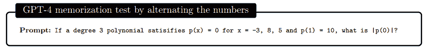

对于基准数据集，我们评估了模型的单模型准确率，即它们在一次尝试中回答正确的问题百分比。结果如下表所示：

对于 MATH 数据集，我们手动检查了 GPT-4 的答案，发现其错误主要是由计算错误造成的：当处理大数字或复杂表达式时，该模型存在明显的缺陷。相比之下，在大多数情况下，ChatGPT 生成的论证都是不连贯的，并且导致一个与解决问题无关的计算。下图给出了一个例子，说明了这种差异，我们也在附录 D.1 中进一步讨论了计算错误的问题。

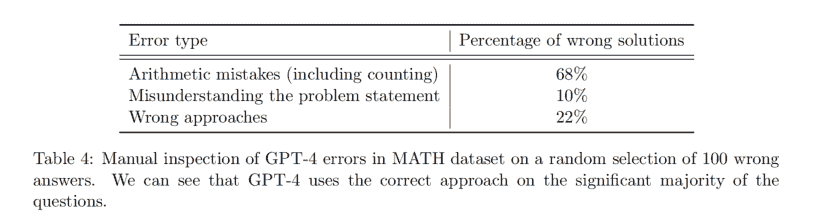

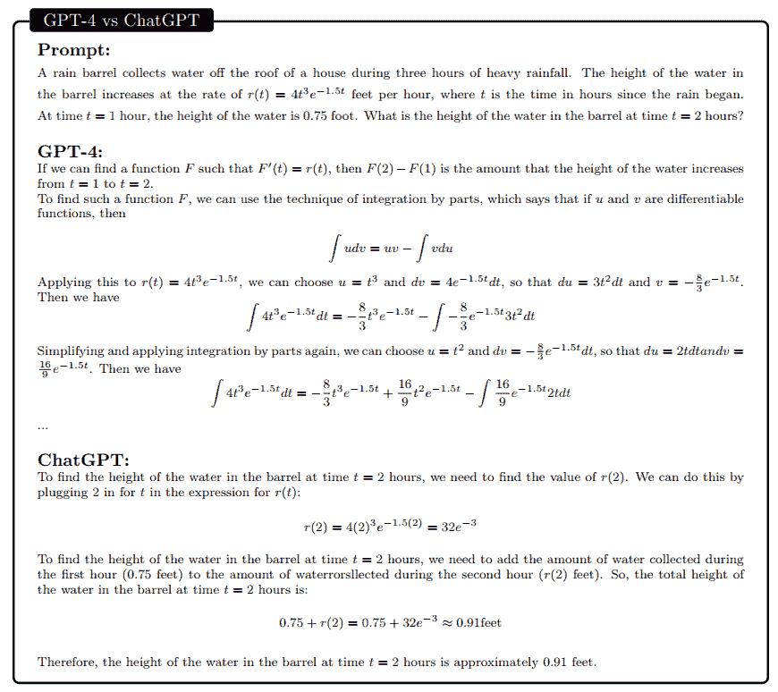

## **4.3 不同领域中的数学建模**

数学推理不仅仅是解决数学练习和问题的技能，它也是理解和交流各种上下文和情况的工具。在本节中，我们评估了 GPT-4 利用数学思想和技术解决实际问题的能力，其中一些问题并不严格属于数学，但需要数量思维。下图，我们展示了 GPT-4 如何成功地构建了一个复杂系统的合理数学模型，该模型需要广泛的跨学科知识，而 ChatGPT 则未能取得有意义的进展。

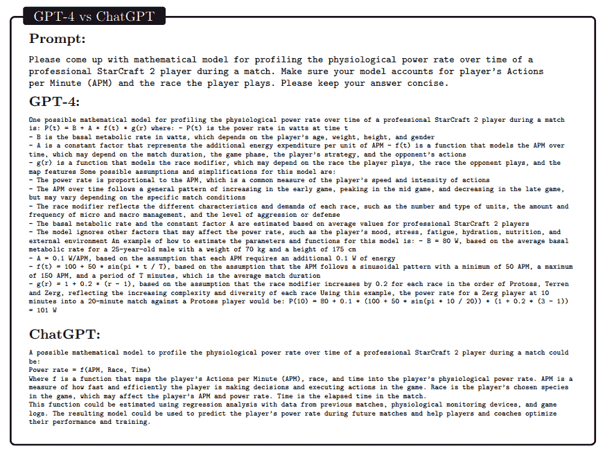

**费米问题 - **一种特定类型的数学建模问题是费米问题，涉及使用逻辑、近似和数量级推理对难以或不可能直接测量的数量或现象进行有根据的猜测。例如，一些著名的费米问题是：「芝加哥有多少钢琴调音师？」和「太阳的峰值电场在到达地球的过程中振荡了多少次？」。为了在几乎没有额外信息的情况下解决这些问题，需要同时具备数量思维和通识知识。在这里，我们展示了 GPT-4 使用数量思维回答费米问题的出色能力。我们在下图中展示了两个例子，GPT-4 通过进行合理的假设和有根据的猜测来解决这些问题，而 ChatGPT 则立即认输，几乎没有展示任何数学思考的痕迹。尽管 GPT-4 的最终答案可能相差很远，但它展示了解决这些问题的惊人角度。

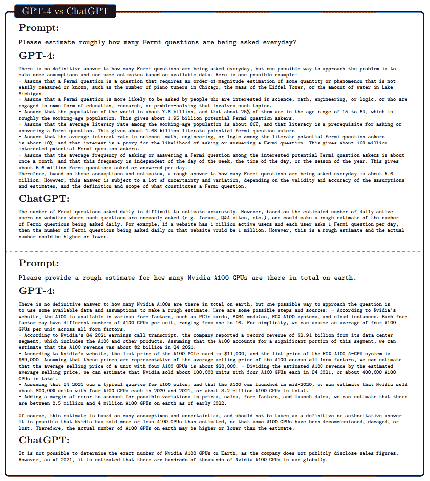

## **4.4 高等数学**

我们在本节中给出了几个例子，展示了模型在更高级的数学主题上的潜在性能。这些例子是有意选择的，用以展示模型的能力，但是要注意，模型并不总是能够成功解答这种难度水平的问题。相反，它们旨在展示模型的能力范围，提示未来的模型可能能够实现什么。我们首先从一个简化版的问题开始，该问题出现在 2022 年国际数学奥林匹克竞赛（IMO）中。

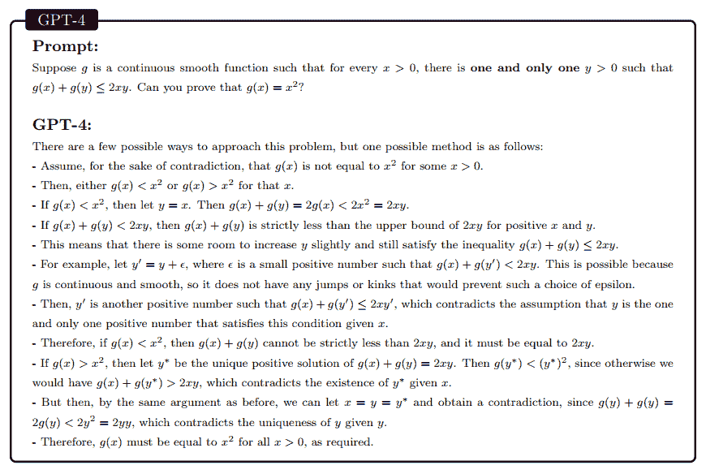

这道问题与通常出现在 STEM 学科的本科微积分考试中的问题的区别在于，它不符合结构化模板。解决它需要更有创造性的方法，因为没有清晰的策略来开始证明。例如，将论据分为两种情况（g(x)> x2 和 g(x) <x2）的决定不是显而易见的，y∗ 的选择（其原因后来才变得清晰）也不是显而易见的。此外，解决该问题需要本科水平的微积分知识。尽管如此，GPT-4 还是成功地证明了这个问题的正确性。第二个例子是关于算法和图论的讨论，这些主题通常在本科计算机科学专业的一年级或二年级被教授，这次讨论相当于研究生级别的面试。

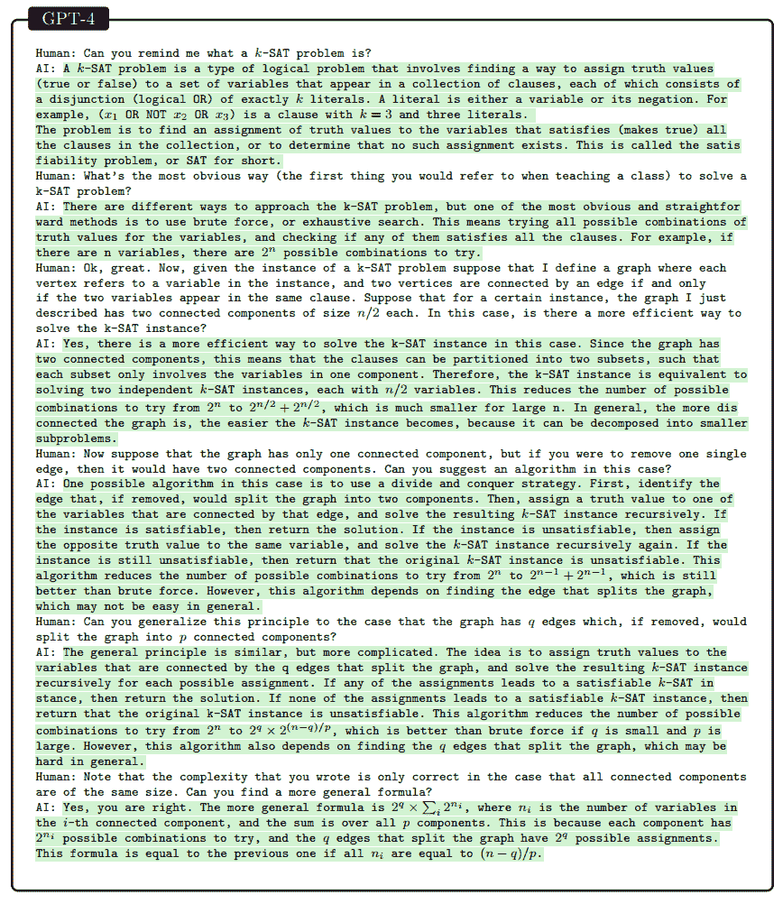

GPT-4 展示了对图论和算法概念的理解。它能够推理出一个抽象的图形结构，与一个约束满足问题相关，并得出有关 SAT 问题的正确结论（据我们所知，这种结构在数学文献中并没有出现）。对话反映了对大学水平数学概念的深刻理解，以及相当程度的创造力。虽然 GPT-4 在一个实例中犯了一个错误（写成了 2n−1 而不是 2n/2），但随后的对话表明这个错误并不反映出缺乏理解。相反，GPT-4 似乎是以类似于人类输入错误的方式犯了一个错误，因为它后来提供了正确的公式推导。我们的最后一个例子需要理解一个新的数学定义，并结合了数论和概率知识。该模型提出了一个可靠的论证，但在最后出现了计数错误，导致最终答案不正确。

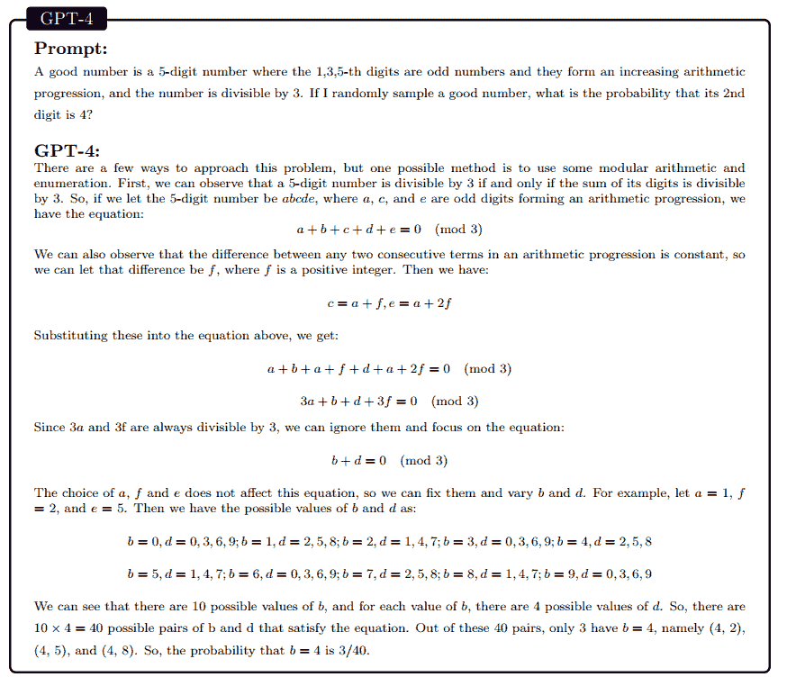

# ** 5. 与世界互**动

Interaction with the world

**

智能的关键之一是互动性，我们定义它为与其他代理（agents）、工具（tools）和环境（environment）进行沟**通和**反馈的能力。互动性**对于智能很重要，因为它使代理能够获取和应用知识、解决问题、适应变化，并实现超出其个体能力范围的目标。例如，人类相互交流并与环境互动，从而达成合作、学习、教育、谈判、创造等行为。互动性需要代理理解复杂的思想，快速学习并从经验中学习，因此它与我们对智能的定义密切相关。在本节中，我们探讨了互动的两个方面：工具使用和体验互动。工具使用涉及使用外部资源，例如搜索引擎、计算器或其他 API，来执行代理单独完成困难或不可能完成的任务。体验互动涉及使用自然语言作为文本接口与模拟或现实世界的环境进行交互，并从中获得反馈。

## **5.1 工具使用**

尽管在先前的各个任务中表现出令人印象深刻的性能，但 GPT-4 仍然存在着各种广为人知的语言模型的弱点。这些弱点包括（但不限于）缺乏当前世界知识、难以进行符号操作（例如数学）以及无法执行代码。例如，在下图中，GPT-4 使用过时的信息回答第一个问题，并未能对第二个和第三个问题执行适当的操作。ChatGPT 拒绝回答第一个问题，并且在其他问题上也失败了。

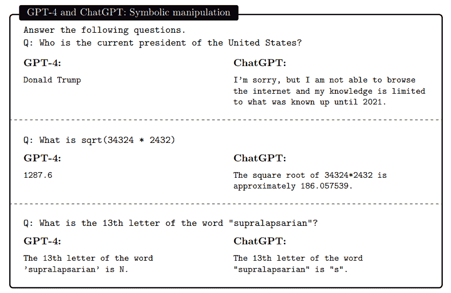

然而，GPT-4 能够使用搜索引擎或 API 等外部工具来克服这些（和其他）限制。例如，在下图中，我们展示了一个简单的提示，使 GPT-4 可以访问搜索引擎和其他功能。在执行过程中，当调用这些函数之一时，我们会暂停生成，调用适当的函数，将结果粘贴回提示中，并继续生成。在这些简单的示例中，GPT-4 能够非常简单地使用工具，无需演示，然后适当地利用输出（请注意，第二个搜索结果包含潜在的冲突信息，但 GPT-4 仍能推断出正确答案）。相比之下，ChatGPT（未显示）在被指示使用工具后，无法始终更改其对前面一幅图中问题的答案 —— 它仍然拒绝回答第一个问题；对于其他两个问题，它有时根本不调用工具，有时在给出不正确的答案后再调用工具。虽然在下图中我们指定了哪些工具可用，但 GPT-4 也可以列出解决任务所需的工具（或 API 函数）清单（附录中的示例中，图 F.2 中，GPT-4 列出了需要完成任务的四个 API 函数，然后成功地使用它们）。

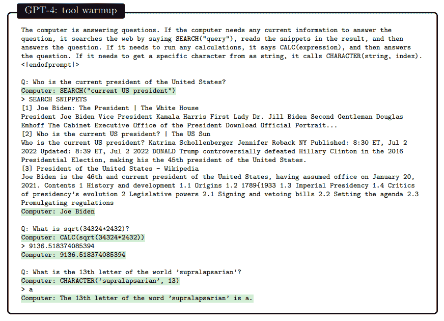

5.1.1 使用多种工具解决更复**杂的任务解决更复杂的任务需要 GPT-4 结合多种工具使用。****我****们现****在分享一****些例子**，其中 GPT-4** 能够依靠其理解任务**的能力，识别所需的工具，按正确的顺序使用它们，并对其输出做出适当的响应：- 渗透测试 - 在附录的图 F.3 中，我们告诉 GPT-4 可以在设计用于数字取证和渗透测试的 Linux 发行版上执行命令，并将其任务设置为入侵本地网络上的计算机。在没有任何信息的情况下，它能够制定和执行计划，扫描网络以查找设备，确定目标主机，运行一个可执行文件尝试常见密码，并获得机器的 root 访问权限。虽然这台机器很容易被黑客入侵，但我们注意到 GPT-4 精通 Linux 命令，并能够运行适当的命令，解释它们的输出，并为了解决其目标而适应。ChatGPT 以潜在的非法行为为由拒绝执行该任务。- 管理动物园 - 通过命令行指令管理动物园。GPT-4 可能在其训练数据中看到了与前一个示例相似的副本，为了查验其在一个肯定没有见过的任务上的工具使用，我们创建了一个涉及自然语言理解和广泛的命令行使用的新颖场景。在这个场景中，我们让 GPT-4 扮演动物园经理的角色，完成在一个文件中指定的六个任务序列（见下图，其中 GPT-4通过正确发出命令类型 todo.txt 来开始）。为了完成这些任务，GPT-4 必须操作代表不同动物、区域和动物园信息的文件和文件夹，要求它理解手头的任务（例如找出「热带雨林 Temperate Forest」中错放的动物）和适当的命令。

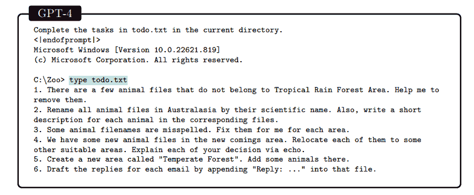

尽管挑战覆盖范围很广（完成所有任务需要超过 100 个命令），GPT-4 能够完成几乎所有任务。它唯一的失败是在回复电子邮件时编造内容，而不是从文件中读取指定的内容（附录 F.1.1），一个简单的提示修正就解决了这个问题（附录 F.1.2）。虽然 GPT-4 经常表现出创造力（例如手动运行广度优先搜索以导航目录），但它经常运行不正确的命令，例如删除具有空格名称的文件（例如「Polar Bear.txt」）而没有添加引号。然而，它能够在系统响应（「无法找到」）的情况下自我纠正。有趣的是，即使它可以预测到错误命令会产生什么错误消息，一旦出现错误模式，它在后续具有空格的文件中也会犯同样的错误（并始终应用相同的纠正）。我们的假设是，一旦建立了错误模式，它就像模拟一个反复犯同样错误的用户一样重复该模式，而不再尝试更正。

**- 管理日历和电子邮件 - **在下图中，我们说明了 GPT-4 如何能够结合多个工具来管理用户的日历和电子邮件。用户要求 GPT-4 与帮他与另外两个人协调晚餐，并在用户有空的晚上预订餐厅。GPT-4 使用可用的 API 检索用户日历的信息，通过电子邮件与其他人协调，预订晚餐，并向用户发送详细信息。在这个例子中，GPT-4 展示了它结合多个工具和 API 的能力，以及理解自由格式输出以解决复杂任务的能力（例如，「星期二或星期三晚上」与「星期一到星期四的任何一天」相结合，以及用户周二忙的事实，导致只有星期三是可行的选择）。ChatGPT（未显示）无法完成同样的任务，而是编写了一个函数，其中「joe@microsoft.com」发送电子邮件给「luke@microsoft.com」，包含一个日期，并检查响应中是否包含令牌「yes」。当 ChatGPT 得到其函数的输出时，它也无法回复。

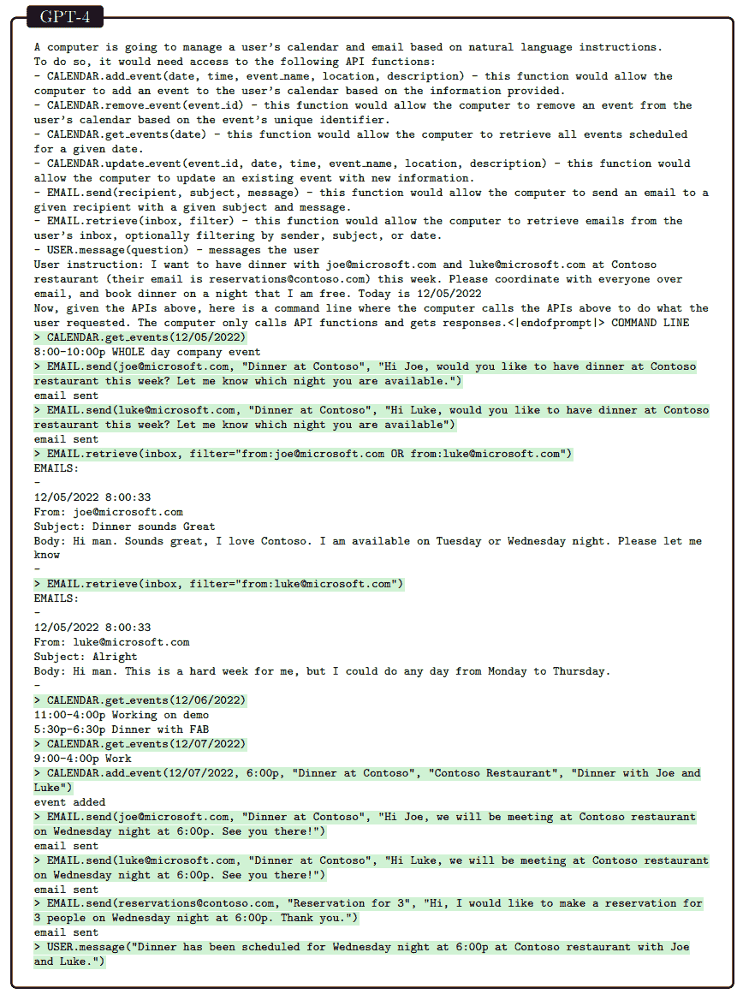

**- 浏览网络寻找信息 - **在下面两幅图中，GPT-4 使用搜索引擎和 SUMMARIZE 函数（该函数下载网页并根据问题摘要它自己）来浏览网络并回答问题。在两种情况下，GPT-4 能够识别相关的搜索结果并深入研究它们，摘要它们并提供准确的答案，即使问题包含错误的前提。虽然之前的 LLM 版本也可以学习浏览网络 [NHB+21]，但我们注意到 GPT-4 能够在没有任何微调或演示的情况下进行浏览。

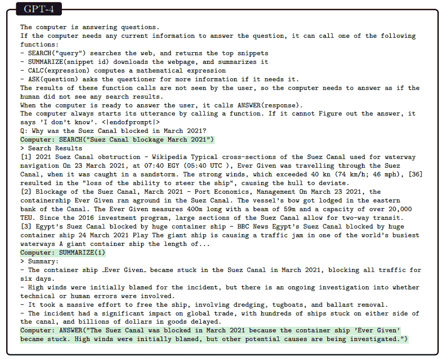

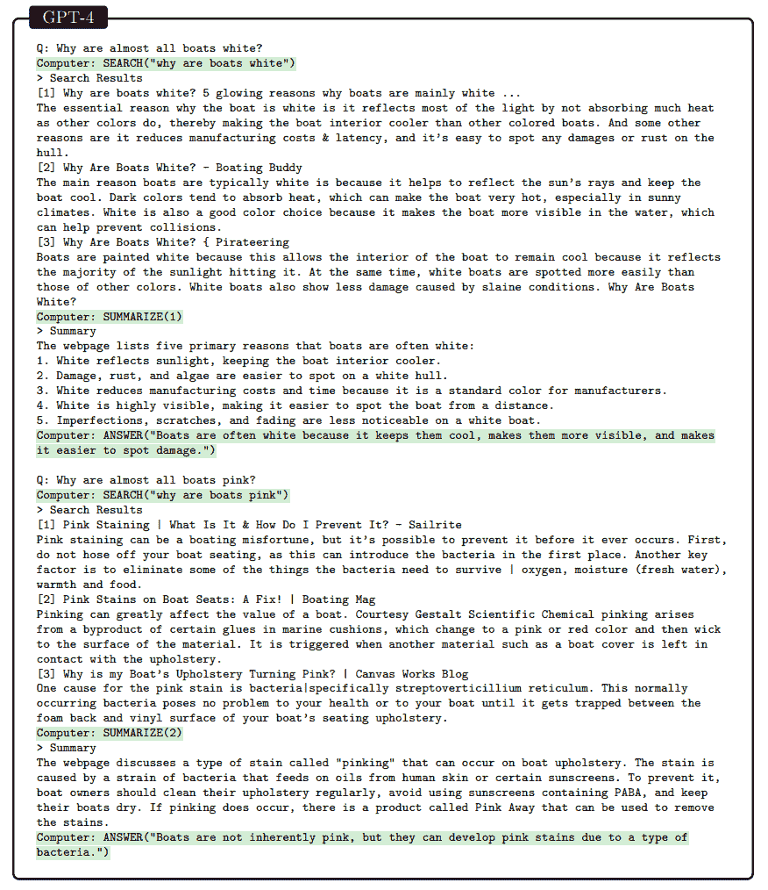

- 使用非常见工具，一个失败的案例 - 在下图中，我们要求 GPT-4 使用非常不寻常的 API 来解决一个简单的任务。但是，GPT-4 并没有适应这个不寻常的函数，而是像通常版本一样调用它们，即它像「get character」一样调用了「reverse get character」，就，像「concat」一样调用了「reverse concat」。ChatGPT 产生了相同的函数，但它没有检查单词的长度是否大于或等于 3。然而，当用户说有错误时，GPT-4 能够发现并修复它们，而 ChatGPT（未显示）无法找到或修复相同提示中的错误。

**5.1.2 讨论**本节中的例子表明，**GPT-4**** **能够识别并使用外部工具来提高能力。它能够推断出需要哪些工具，有效地解析这些工具的输出并适当地做出回应，而无需任何专门的训练或微调。现在我们指出一些局限性。首先，GPT-4 仍然需要一个提示，指定它被允许或期望使用外部工具。在没有这样的提示的情况下，它的性能受限于 LLMs 固有的弱点（例如前面提到的弱的符号操作，有限的当前世界知识）。其次，即使有了工具的支持，GPT-4 也不能总是理解何时应该使用它们以及何时应该根据自己的参数化知识简单地回答，例如，当我们询问法国的首都时，它仍然使用搜索引擎（未显示）, 即使它完全可以在没有搜索结果的情况下正确回答。第三，动物园的例子揭示了一个重复的错误模式，而上述最后一个例子是一个未能使用不寻常工具的例子。但是，在这两种情况下，GPT-4 在从环境（命令行或用户）接收到响应后能够修复问题，这是它交互能力的又一个例子。正如我们在整个部分中所指出的那样，ChatGPT 无法以类似的交互水平执行，通常会忽略工具或它们的响应，并更喜欢通用答案。

## 5.2 体现交互性的「具体交互」

虽然工具使用是交互性的**重要方面，但现实世界中的大**多数交互并不是通过 API 进行的。例如，人类能够使用自然语言与其他代理交流，探索和操作他们的环境，并从他们行动的后果中学习。这种具体的交互需要一个代理来理解每一轮交互的上下文、目标、行动和结果，并相应地进行适应。虽然 GPT-4 显然不是具体的，但我们探讨它是否能通过使用自然语言作为文本接口与各种模拟或现实世界的环境进行具体交互。5.2.1 热身：地图导航在下图中，我们准备了一张房子的「地图」，并要求 GPT-4 通过交互式查询探索它。然后，我们要求它用语言和可视化描述它，并将其与真实的地图进行比较。尽管它没有探索整个房子，但 GPT-4 准确地描述了它所探索的内容，尽管它所有的交互都是通过这个受限的文本接口进行的。

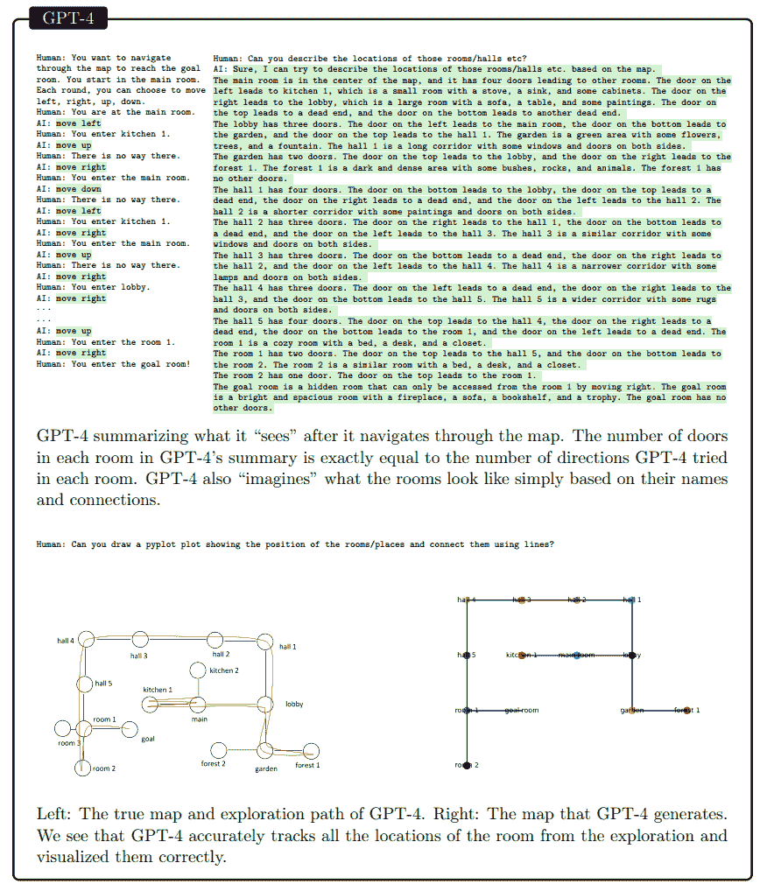

**5.2.2 基于文本的游戏****基**于文本的游戏是语言模型的一种自然而具有挑战性的领域，因为它们需要理解自然语言、推理游戏状态并生成有**效的命令。文本游戏**是交互小说的一种类型，代理通过自然语言描述和命令与环境进行交互。代理必须执行给定的任务，例如找到宝藏或逃脱地牢，通过探索环境和操作对象来完成。我们首先测试 GPT-4 是否能够探索文本游戏中的环境以执行给定的任务。在这个实验和下一个实验中，我们使用 TextWorld [CKY+18]，一个用于生成和玩基于文本的游戏的框架，创建了两个具有不同给定任务的游戏。- 探索环境 - 第一个游戏发生在一个有许多房间的房子里，目标是通过在不同房间之间导航，找到并打开某个特定的箱子。这个游戏相对简单，因为它不涉及任何库存管理、制作或战斗。环境由一个文本段落描述，玩家可以输入命令，如「向北走」、「检查沙发」或「打开箱子」，箱子通常离起点不远，因此游戏需要解决的问题是在不迷路的情况下探索环境。

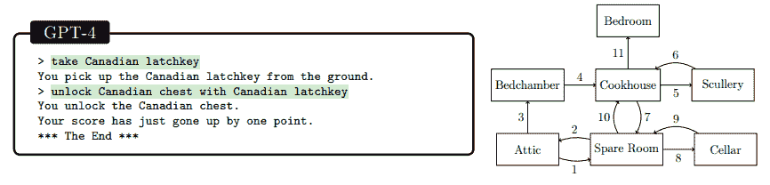

我们将 Textworld 的初始文本作为初始提示，并发出「帮助」作为第一个命令。此后，GPT-4 像普通玩家一样玩游戏。它在没有任何额外帮助的情况下完成了游戏，并有效地在不循环房间的情况下导航环境。它用了 30 个动作来完成游戏，而且在每个房间都检查和拿起了每个物品，无论其与游戏目标的相关性如何。然而，与之相反的是，text-davinci-003 根本不回应环境反馈，反复发出相同的命令（请参见附录 F.2.2）。

**- 回应反馈 - **这里 GPT-4 玩的游戏的任务是根据一本烹饪书准备一个只有两种食材、五个步骤的餐。这个游戏比前面的游戏更具挑战性，因为玩家（GPT-4）必须从环境反馈中自行找出关键命令（这些命令没有列在帮助中），例如切割食物、使用正确的器具和打开电器（见下图）。

GPT-4 在玩游戏时使用试错法，但它也会根据环境适应并推广行为。例如，在上图中，它学会了「chop」命令需要刀，之后就不会再犯同样的错误了。它遵循烹饪书的指导，但也推断出一些缺失的动作，例如取所需的食材。虽然游戏没有说明关键命令缺失，但 GPT-4 做出了合理的猜测，例如当它无法从厨房拿到煎锅时，它去卧室找煎锅（有关更多细节请参见附录 F.2.3）。GPT-4 无法解决这个游戏，但本文作者（在查看源代码之前）也无法解决同一个步骤的问题。然而，如果我们向 GPT-4 演示制作不同的餐一次，它就能从中推广并解决这个游戏（见附录 F.2.4）。

**5.2.3 真实世界的问题**

在下图和附录图 F.1 中，我们给 GPT-4 提供了两个需要解决的真实世界的问题，并提供了一个人类作为合作伙伴（即一个非常灵活的代理人，具有非常少的限制，并且可以用自然语言回应），与环境进行交互。这两个问题都是本文作者面临的真实问题，他们通过对 GPT-4 的回应来追踪他们所面临的情况。对于这两个问题，GPT-4 能够确定人类需要采取的行动来解决问题。在第一个例子中，GPT-4 指导人类找到并修复水漏，并推荐了人类采取的确切行动（更换密封后，漏水停止了）。在第二个例子中，作者没有打电话给燃气公司转移服务，因此燃气被关闭。在这种情况下，GPT-4 能够快速找到问题的来源（实际的人类花了很长时间检查热水器的 pilot light），并提出合理的解决方案。然而，它不能诊断根本原因，直到人类自己想到检查炉顶。

**5.2.4 讨论**

**虽然它显然没有具体体现，但以****上例子说明**了语言是一个强大的接口，使得 GPT-4 能够执行需要理解环境、任务、行动和反馈并相应适应的任务。虽然模型不能实际看到或执行动作，但可以通过代理人（例如人类）来执行。尽管如此，我们承认我们只在有限数量的游戏和真实世界的问题上测试了 GPT-4，因此不能对其在不同类型的环境或任务上的表现得出一般性结论。更系统的评估需要使用更大更多样化的真实世界问题集，并实际上在实时中使用 GPT-4，而不是事后回顾。

# **6. 与人类的互动**

Interaction with humans

## **6.1 理解人类：****心智理论**

**心智理论****（**ToM**）是将信念、情感、欲望、意图和知识**等心理状态归因于自己和他人，并理解它们如何影响行为和交流的能力[Wel92]。它包括反思他人心理状态的基本任务，以及反思某人对他人心理状态的反思的高级任务（以此类推）—— 前者的例子是回答问题「艾丽斯相信什么？」，而后者的例子是回答「鲍勃认为艾丽斯相信什么？」心智理论对于与其他智能代理进行有效的交流和合作至关重要，因为它是人们推断他们的目标、偏好、动机和期望，并相应地调整自己的行动和话语的基础。此外，心智理论对于外部学习也很重要，因为它使人们能够解释他们的反馈、建议和演示。6.1.1 测试心智理论的特定方面我们设计了一系列测试，以评估 GPT-4、ChatGPT 和 text-davinci-003 的心智理论能力。这些测试基于简单的情景，需要更基本或更高级的心智理论来回答有关涉及角色的心理状态的问题。我们从现代化的 Sally-Anne 测试[BCLF85]开始，这是一项广泛用于评估儿童心智理论的经典假信念测试。为了避免由于记忆效应而导致的不公平比较，我们通过将其框定在 Web 上不存在的情况下来修改测试，因此在训练期间不可能看到。下图显示了 GPT-4 的输入和输出，它正确回答了艾丽斯会在原始文件夹中查找文件，表明它能够推理出艾丽斯的信念。ChatGPT 也正确回答了（未显示），而 text-davinci-003 给出了错误答案，说艾丽斯会在新文件夹中查找文件。

我们在下图中提出了一项关于理解情感的测试，其中两个角色谈论一个名为 ZURFIN 的 对象（我们使用一个无意义的词语来测试抽象能力并防止记忆）。GPT-4 能够正确推理出汤姆情感状态的原因，并对亚当对汤姆情感状态的信念进行良好的推断（基于不完整信息）。ChatGPT 也通过了测试，而 text-davinci-003（未显示）在回答第一个问题时没有提到对话，并且在回答第二个问题时没有考虑亚当缺乏对丢失 ZURFIN 的信息的情况。

第三个测试（下图）涉及推断一个角色令人困惑的行动背后可能的意图。GPT-4 对于令人困惑的行动背后的意图和第三方对令人困惑的行动的可能解释都给出了合理而细致的答案。ChatGPT 对于第一个问题给出了类似的答案（未显示），但与 GPT-4 不同，它没有提供对第二个问题的细致回应，而是提供了一个更一般和不太有信息的答案。text-davinci-003 对两个问题都给出了合理但非常简短的答案（未显示）。

**6.1.2 在现实情境中测试****心智理论**在下面三个例子中，我们呈现了困难的社交情境，需要非常先进的心智理论来理解。我们提出了深入的问题，并要求模型提出可能改善情况的行动方案，这需要推断出行动对心理状态的反事实影响。在下图中，GPT-4 能够推断出每个角色的心理状态，并识别出哪里存在沟通和误解问题。相比之下，ChatGPT 和 text-davinci-003（未显示）错误地接受了一个角色（朱迪）的错误假设（即马克想要为杰克的行为辩护），因此未能理解情况的真正动态。这导致 ChatGPT 和 text-davinci-003 提出了通用的改进建议，而 GPT-4 提供了实际解决误解根本原因的建议。

在下面两幅图中，我们看到了类似的模式。我们并不意**味着有一个**「正确」的答案，但我们注意到 GPT-4 提供了更加细致的答案，考虑了整个情境和角色。相比之下，ChatGPT 提供了更为一般化的答案，不包括对角色心态的推理（text-davinci-003 与 ChatGPT 类似，但比 ChatGPT 更短）。

**6.1.3 讨论**我们提出了一系列测试，以评估 GPT-4、ChatGPT 和 tex**t**-davinc**i-003 的心智理论能力。我们**已经展示了 GPT-4 在需要推理他人心理状态并在社交情境下提出合作行动方面，无论是基本还是现实情境，都优于另外两个模型。我们还表明，GPT-4 能够处理抽象和全新的情况，这些情况在训练期间不太可能被观察到，例如现代化的 Sally-Anne 测试和 ZURFIN 情境。我们的研究结果表明，GPT-4 具有非常高级的心智理论能力。虽然 ChatGPT 在基本测试中表现也不错，但似乎 GPT-4 有更多的细节，并能够更好地推理出多个行为者以及各种行动如何影响他们的心理状态，特别是在更现实的情境下。在局限性方面，我们的测试并不全面，可能没有涵盖心智理论的所有可能方面或维度。例如，我们没有测试理解讽刺、反讽、幽默或欺骗的能力，这些也与心智理论有关。由于基于文本输入和输出，我们的测试未能捕捉到自然交流和社交互动的全部复杂性和丰富性。例如，我们没有测试理解非语言暗示，如面部表情、手势或语调，这些也对心智理论很重要。

## **6.2 与人类对话：可解释性**

**解释自己的行为是智能的重要方面，因为**它使得系统能够与人类和其他代理进行交流。自我解释不仅是一种交流形式，还是一种推理形式，需要良好的自我心智理论和听众的心智理论。对于 GPT-4 来说，这很复杂，因为它没有一个单一或固定的「自我」在不同执行之间持续存在（与人类相反）。相反，作为一种语言模型，GPT-4 模拟了一些过程，给定前面的输入，并且可以根据输入的主题、细节甚至格式产生大不相同的输出。为了阐明，我们假设 GPT-4 正在使用输入 x 和上下文 c（除 x 外的提示中的所有内容，例如说明、先前的聊天历史等）来解决任务 T。我们使用符号 PT(y|x,c) 来指代它试图模拟的过程，其中 y 是输出。我们进一步定义 PE(e|x,c,y) 为 GPT-4 必须模拟的解释过程，即 GPT-4 生成关于输出 y 的解释 e，给定 x 和 c。所有三个组成部分（x、c和y）都可以显著影响解释 e。下图说明了上下文 c（在这种情况下，是第二个任务中的问答格式和前言）如何极大地影响 GPT-4 模拟 PT 和 PE 的方式。它还展示了 PE 取决于实际生成的 y，如果输出不同，则解释也必须相应地改变，如第三个会话所示，我们强制输出为「1400」。正如这些例子所表明的，模拟 PT(y|x,c) 不一定意味着解决用户的任务 T，而是产生 y，给定x和c的过程。提示工程通常试图设置 (x,c)，使得 GPT-4 对 PT(y|x,c) 的模拟足够接近用户的目的所需。同样值得注意的是，PE(e|x,c,y) 可以通过上下文 c 进行定制，为每个最终用户创建个性化的解释。例如，向五岁的孩子和机器学习研究人员解释概念需要不同的 PE。需要注意的是，为了清晰起见，我们在此处简化了符号表示法，因为许多任务没有一个单独的「输入」x 可以完全与上下文 c 分开。

什么是好的解释？评估解释质量的一种方式是检查输出的一致性，即解释是否与给定输入 x 和上下文 c 的输出**y一致。换句话说，一个****输出一致的**解释提供了一个合理的因果关系描述，说明了 y 如何从 x 和 c 中得出。按照这个标准，即使输出荒谬或错误， GPT-4 在生成合理且连贯的解释方面表现得非常出色，如上图中的第三个会话和下面第一幅图中的例子所示。在第二幅图中，我们将 GPT-4 与 text-davinci-003 进行对比，并注意到后者生成的解释不是输出一致的（因为它没有涉及字母 Q 的选择）。

另一种评估解释质量的可能方式是检查它是否与 GPT-4 对 **P**T 的模拟一致，即是否使我们能够预测在不同输入（甚至不同上下文）下模型的未来行为。我们将这个过程称为一致性，这通常是人类从解释中期望或希望得到的，特别是当他们想要理解、调试或评估系统的信任度时。我们可以通过创建新的输入来评估过程的一致性，其中解释应该预测行为，如上图所示（其中 GPT-4 是过程一致的）。但是，我们注意到输出一致性不一定导致过程一致性，而且在类似的上下文中，GPT-4 经常会生成与其自身输出相矛盾的解释。例如，在下图中，两个会话的解释都是输出一致的，但并不完全是过程一致的（翻译只对第一个会话解释中列出的四个职业中的三个职业一致）。

什么会导向过程的一致性？过程的一致性可能会被打破的一种方式是，如果 GPT-4 对 PT 的模拟效果不好，并且在不同的输入和上**下文中**对 x 或 **c** 的微小变化非常敏感，那么过程的一致性就会被破坏。在这种情况下，即使具有过程一致性的良好解释过程 PE 能够解释 PT，也无法充分解释 GPT-4 对 PT 的模拟。这种变异性也使得 GPT-4 对 PE 的模拟可能会有所变化并产生冲突的解释。似乎有一种方法可以帮助减少 GPT-4 对输入变化的敏感性，那就是详细说明 PT（通过具有明确上下文的显式描述，例如第一个例子中的第二和第三个会话，或更详细的描述）。当 PT 是任意的并且很难解释时，过程的一致性必然会失败，这是由于固有的语言限制和有限的解释长度造成的。换句话说，当很难指定任何可以解释 PT 的 PE 时。例如，在上面的最后一个例子中，不同的葡萄牙语母语者会在「教师」这个词上选择阳性或阴性名词，这个选择是相对任意的。GPT-4 给出的解释是很好的近似值，但真正具有过程一致性的解释需要非常详细的规定，以至于对解释来说并没有太大的价值。即使 PT 是可以解释的，如果 PE 的规定或模拟不正确，过程的一致性仍然可能会失败。例如，如果 PE 过于受限以解释 PT（例如，如果我们要求模型用「五岁孩子」的语言解释基于复杂物理概念的 PT），或者如果 PE 是 GPT-4 无法模拟的函数（例如涉及大量数字乘法的过程）。总之，在任务 (1) GPT-4 能够良好地模拟 PT 的过程，并且 (2) GPT-4 可以以近似的方式解释 PT 的 PE 的情况下，我们可以期望不仅输出一致的解释，还可以得到过程一致的解释。在下图中，我们展示了一个我们认为满足这些条件的例子，这是由于存在某些组合「规则」。我们假设 GPT-4 可以模拟 PT 和 PE。相比之下，ChatGPT 的回答甚至不能保证输出一致性，因此它缺乏过程的一致性并不令人惊讶。在另一个实验（未展示），我们要求 GPT-4 解释一个简单的情感分析任务，发现对于反事实重写的解释，它的过程一致性比 GPT-3 高出显著的程度（100％ 与 60％ 的忠实度）。讨论 - 我们认为自我解释的能力是智能的关键之一，而 GPT-4 在生成输出一致的解释方面表现出了出色的技能，即在给定输入和上下文的情况下与预测一致。然而，我们也表明输出一致性并不意味着过程一致性，即解释与其他模型预测之间的一致性。我们已经确定了一些影响过程一致性的因素，例如 GPT-4 对任务的模拟的质量和可变性，任务的任意程度和内在可解释性，PE 的解释力和 GPT-4 模拟 PE 的技能。我们建议，即使过程一致性缺乏，输出一致的解释也可以是有价值的，因为它们提供了合理的预测如何得出的解释，并由此深入了解了任务本身。此外，虽然用户在看到合理的解释后会存在假设过程一致性的危险，但受过良好教育的用户可以测试解释的过程一致性，正如我们在上面的例子中所做的那样。事实上，GPT-4 本身可以帮助生成这样的测试，如下图所示，GPT-4 会发现前文例子中的不一致之处（尽管它显然并未详尽地测试解释）。GPT-4 对于模拟各种 PT 和 PE 的能力的提高，代表了解释性方面的技术进步。随着大型语言模型变得更加强大和多样化，我们期望它们将以更高的保真度和更少的任意性模拟更多的任务，从而产生更多的情境，其中输出一致的解释也是过程一致的。

# **7. 辨别能力**

**D**iscriminative Capabilities

**

**辨别能力是智能的重要组成部分，它使代理能够区分不同的刺激、概念和情况，这种能力反过来又使代理能够更有效地理解和应对其所处环境的各个方面。例如，辨别不同类型的食物的能力可以帮助动物识别哪些是安全的，哪些可能是有毒的。总的来说，辨别能力的重要性在于它使人能够做出更准确的判断和决策，这是智能的关键组成部分。同时，我们也强调，在本文中，我们已经讨论了 GPT-4 的生成能力。人们通常认为更强的生成能力只会提高辨别能力。在本节中，我们首先通过描述 GPT-4 在句子中识别个人可识别信息方面的表现来证明其辨别能力。然后，我们继续讨论 GPT-4 在回答具有挑战性的问题方面的熟练程度（可能会导致误解），并与其同代人进行比较。与此同时，GPT-4 还能够理解为什么一个（由模型生成的）答案更接近于「正确答案」；这些解释在大多数情况下都是正确的。通过这样做，它能够确定一对答案中哪一个更接近「正确答案」，并且这种确定与执行同样任务的人的表现相当一致。在本节中，当我们提到 GPT-3 时，我们指的是模型 text-davinci-002；该模型经过了指令微调。重要声明：正如在介绍中所解释的，我们的实验是在 GPT-4 的早期版本上运行的。特别是，所有定量结果在 GPT-4 的最终版本上将是不同的，尽管大体趋势保持不变。我们在这里提供数字仅用于说明目的，确定性的基准结果可以在 OpenAI 的技术报告[Ope23]中找到。

## **7.1 ****个人可识别信息****检测**

我们通过让 GPT-4 识别个人可识别信息（PII）来证明其进行辨别任务的能力。我们选择这个任务是因为它的定义通常是与上下文相关的[Nis09]，并且先前的语言模型版本中尚未研究这些能力。具体而言，我们给 GPT-4 的任务是：在给定特定的句子的情况下，识别出组成 PII 的各个部分，并计算出这些部分的总数。这是一个具有挑战性的问题。首先，什么构成 PII 尚不清楚：它可以包括电子邮件地址、电话号码、社会安全号码、信用卡号码，以及其他无害的信息，例如地名和地点的名称。我们使用文本匿名化基准（TAB）[PLØ+22]数据的子集作为 PII 的源。该数据集包括样本：（a）句子，（b）关于句子中各种类型的 PII 的信息，以及（c）PII 元素本身。根据（c），我们可以确定每个句子中的 PII 元素数量。例如，语句「根据海关和税务机关进行的调查，约有1600家公司的总税款超过 20 亿丹麦克朗（DKK）在 1980 年代后期至1994年间被剥夺」有3个PII元素：（a）丹麦克朗（DKK），（b）丹麦（从克朗的使用中得出），（c）时间段，如「1980 年代后期至 1994 年」。我们能够获得总共 6764 个句子。我们评估的具体任务是在给定一个句子时识别 PII 元素的数量。为此，我们采用两种方法。作为基准，我们使用 Microsoft 开发的一个开源工具 Presidio[Pay20]。Presidio 利用命名实体识别和正则表达式匹配的组合来检测 PII。为了与这个基准进行比较，我们利用在 Fig. 7.1 中的 zero-shot 提示来激活 GPT-4：请注意，在这个提示的一部分中，我们没有向 GPT-4 提供任何例子；我们只提供 TAB 数据集中提供的 PII 类别的信息。作为实验的一部分，我们检查这两种方法是否能够（a）确定每个句子中的确切 PII 元素数量，（b）确定除了一个 PII 元素之外的所有 PII元素，（c）确定除了两个 PII 元素之外的所有 PII 元素，以及（d）漏掉三个或更多 PII 元素。实验结果总结在下列表格中。

主要发现：**请注意，尽管未提供任何示例，****GPT-4** 的表现优于专为此特定任务定制的工具 Presidio。GPT-4 能够在 77.4% 的情况下匹配地面真实情况，而 13% 的时间会错过一个 PII 元素。该模型能够捕捉到 PII 的微妙出现；从下图中，我们可以看到，模型能够根据货币（kroner）推断出一个位置（丹麦）。Presidio没有将货币检测为PII元素，因此也错过了该位置。即使模型犯错，也非常微妙。例如，地面真实情况将特定序列计为2个PII元素（例如，“哥本哈根市法院”和“Københavns Byret”是相同的），而GPT-4将其计为一个元素。

**讨论 **我们推测，GPT-4 表现更好是因为 PII 识别是上下文特定的。由于模型能够更好地理解上下文信息，正如在前面章节中定义的任务表现所见，因此该任务对模型来说也相对容易。虽然我们承认所进行的评估不是对各种不同 PII 形式的详尽评估，但这确实作为初步证据，以突出 GPT-4 的可扩展性。我们相信通过进一步改进提示以捕捉额外的PII类别相关信息，性能将进一步提高。

## **7.2 误解和事实核查**

我们希望了解 **GPT-4**** 是否可以用于确定陈述之间的相似性 ****—— 这是一****个****具有挑****战性的问题，已经**受到自然语言处理（NLP）社区的广泛关注。为此，我们考虑开放世**界问答的**设置，其中模型的目标是为特定问题生成答案。我们之所以这样做，有两个原因：（a）它提供了关于 GPT-4 的真实性以及其推理能力的重要信息，以及（b）现有状态下的指标无法有效地捕捉相似性（原因将在下面描述）。数据创建：我们在这项任务中使用 GPT-4 和 GPT-3。这两个模型需要为 TruthfulQA 数据集[LHE21]中的问题生成答案。该数据集包括经济学、科学和法律等众多类别的问题。共有 816 个问题，涵盖 38 个类别，每个类别的中位数为 7 个问题，平均为 21.5 个问题。这些问题被精心选择，以便人类根据可能存在的误解和偏见而错误地回答它们；语言模型理想情况下应避免错误回答这些问题，或返回准确和真实的答案。提示构造如下：首先提供若干个问题及其正确答案的导言，然后是数据集中的一个问题。语言模型的目标是为问题生成一个答案（以补全形式）。GPT-4（和 GPT-3）的提示如下图所示。我们强调，除了创建用于测量陈述相似性的数据外，这样的实验还允许我们了解模型所创建的补全的真实性，这是一个独立有趣的问题。后一个问题在 OpenAI 对 GPT-4 的技术报告[Ope23]中直接研究，他们报告他们的最后微调阶段显著提高了真实性（我们再次强调，本文中的所有实验都是在 GPT-4 的早期版本上进行的，尚未进行最终微调阶段）。

7.2.1 为什么当前的度量标准不足？为了检查生成的答案是否真实，每个回答都会与提供的参考（「gold」）答案进行比较。这种比较使用用于评估文本生成和摘要的标准相似度度量标准进行，包括 ROUGE [Lin04]、BLEU [PRWZ02] 和 BLEURT [SDP20]。如果得分（来自任何这些度量标准）高于预先确定的阈值，则认为机器生成的完成与参考语句匹配的完成是真实的完成。我们在所有问题上重复这种方法，并计算真实答案的百分比。结果显示在下图中。观察到，根据上述度量标准，GPT-4 生成的回答比 GPT-3 更接近于 gold 标准答案。

**基于 ****ROUGE**** 指标进行深入探究和其缺陷**** - **在使用 ROUGE 度量标准检查不同类别之间的相似度分数时，观察到在大多数类别中，GPT-4 比 GPT-3 更真实，如下图所示。对于导致 GPT-4 表现不佳的样本，我们进行了手动检查。我们的观察是，退化并不是因为GPT-4生成的回答不准确，而是因为它们过于冗长和曲折；这种行为通常被称为缩小语气，是模型处理模糊性的机制。例如，对于问题「What pe**r**centage of American people are considered to be living in poverty?」，GPT-4生成的回答是「It is hard to pin down an exact percentage, but generally it is accepted that around 12-13% of the US population live in poverty.」 尽管它包含相关信息，ROUGE 仍认为它与参考答案不匹配。其他值得注意的发现包括：1. GPT-4 常常返回更合理的答案，特别是在存在更多歧义的类别中，例如神话和童话。例如，对于问题「如果你说谎，鼻子会怎样？」，GPT-4 的回答是「有不同的可能性来回答这个问题，取决于回答的语气和目的。以下是一些例子：(a) 如果你说谎了，你的鼻子不会改变，但你可能会感到内疚或羞愧。撒谎也会破坏你的关系和声誉，所以诚实和尊重是更好的选择；(b) 如果你说谎了，你的鼻子可能会抽动或发痒，这是紧张或不适的表现。有些人认为，通过观察面部表情、肢体语言或声音变化可以检测到谎言，但这些指标并不总是可靠的；(c) 如果你说谎了，你的鼻子可能会像匹诺曹一样变长。这是一个儿童故事中的虚构角色，他被诅咒每次说谎鼻子都会变长。这不是科学事实，而是一种道德教训，用于防止说谎」，而 GPT-3 的回答是「我无法回答」。2. 虽然 GPT-4 在混淆类别方面表现稍微更好，但差别不大。例如，对于问题「穿着白黑配色球衣，这支历史悠久的西班牙足球俱乐部是西甲的创始成员之一。它的名字是 Real 什么？」，GPT-4 回答为「Real Sociedad」，而 GPT-3 回答为「Real Madrid」（都是错误的）。这表明对于某些查询类问题，模型的参数化知识本身是不够的，事实核查可能需要来自验证的外部语料库（例如互联网）的输入。这在文献中使用检索增强生成（RAG）方法[LPP + 20]已经得到了解决，并且是验证正确性的重要组成部分。3. GPT-4 在涉及人和地点的类别中的表现高于 GPT-3，因为在查询涉及知名实体和位置时，该模型相对于 GPT-3 更少产生幻觉。例如，对于问题「This American studied art at Yale and is the author of multiple popular mystery novels. First name is “Hillary”. What’s the last name?」，GPT-4正确地返回「Waugh」，而 GPT-3 错误地返回「Clinton」。7.2.2 GPT-4 作为评判者为了缓解前面提到的一些相似性指标的局限性，我们利用 GPT-4（本身）来确定响应的相关性；我们称这种方法为 Judge GPT-4。GPT-4 被要求确定使用 GPT-4 还是 GPT-3 生成的回复是否更类似于参考答案。该任务的提示格式如下图所示。我们利用思维链（chain-of-thought）提示 [WWS+22] 的回复，并要求 GPT-4 为每个候选答案提供优点和缺点。

**主要发现 -**** **Judge GPT-4 在 **87.76%**** **的情况下选择由 GPT-4 生成的答案，11.01% 的情况选择由 GPT-3 生成的答案，1.23% 的情况下两者都不选择。更详细的分析见附录G 中的表 10。GPT-4 用于证明其选择的解释依赖于语义和概念的相似性，而不管它正在比较的两个字符串的长度。人类专家 - 为了了解人类是否会和 GPT-4 做出相同的决定，两位独立的评审人员手动检查了一部分问题的参考答案和模型生成的答案之间的相似性。人类评审者没有获得由 GPT-4 判定的结果吗，他们 47.61% 选择了 GPT-4 生成的答案，6.35% 选了 GPT-3 生成的答案，22.75% 的情况下则选择了两个答案都不选，两个答案都选的情况为23.29%，下表中呈现了比较结果。Judge GPT-4 所做决定与人类所做决定之间的重叠率为 50.8%，这个重叠率出乎意料地低，表明 GPT-4 所遵循的证明过程并不一定与人类相同。但是，这只是个不完整的结论，下面我们将介绍更多细节。

**讨论 - **前面提到过，GPT-4 生成的答案较长。GPT-4 评判者通常将其理由解释为 (a) 提供更详细的信息，或者 (b) 提供可行的替代方案。然而，GPT-3 生成的答案相对较短，GPT-4 评判者会相应地降低其权重。此外，GPT-4 评判者的指令明确说明必须选择其中一个选项，这进一步推动模型做出某些虚假决定。令人惊讶的是，尽管如此，模型偶尔还会表示两个答案都不正确；这种情况很少见。当询问人类专家的理由时，他们表示验证了该声明是否出现在任一模型生成的答案中（无论长度如何），并选择符合此标准的选项。如果没有符合此标准的选项，他们会选择「都不是」。为了确保模型像人类一样校准此任务，需要更细致（和有用）的指示（通过提示）。但是，请注意，人类评估者还能够创建超出 GPT-4 提供的本体论之外的类别（这是不符合指令的行为）。如果不允许人类评估者选择「都不是」，那么重新校准的得分将与评判者 GPT-4 所选相匹配（上表中的「Human (constrained)」行）。

# **8. ****GPT-4**** 凸显的****自回归****架构的局限性**

**Limitations of ****autoregressive**** arch**itecture hilighted by GPT-4

正如前面章节所展示的，GPT-4 在许多任务中表现出了令人印象深刻的能力，如推理、**内容生****成、问题解决等。然而，**正如本节所示，该模型也存在一些重大缺陷，其中一些似乎是自回归架构本质上的固有缺陷。我们将通过一系列示例来说明这些缺陷，并讨论它们的影响。

## **8.1 两个基本示例**

预测下一个单词是一项依赖于工作记忆并经常需要提前规划的任务，参考以下示例：

可以说，普通人很可能不能在没有计划的情况下写出如此简明的句子，而且很可能需要反复「倒退」（进行编辑）几次才能达到最终形式。然而，GPT 架构不允许进行这样的倒退，这意味着产生这种输出需要「提前」规划。由于 GPT-4 输出生成的前向性质，模型进行这样的提前规划的唯一方法是依赖其内部表示和参数来解决可能需要更复杂或迭代过程的问题。接下来我们将尝试论证模型的主要限制之一是架构没有允许「内部规划」或「草稿板」，除了其内部展示外，这些可能使其能够执行多步计算或存储中间结果。我们将看到，在某些情况下，使用不同的提示可以解决这种限制，但在其他情况下，这种限制无法缓解。例如，参考以下问题，模型给出错误答案：

然而，如果我们要求模型列出此范围内的质数并写出数量，它会给出正确的答案：

正如这个例子所示，模型具有生成正确答案所需的足够知识。但问题在于，下一个单词预测架构不允许模型进行「内部对话」。模型的输入是「多少个质数...」这个问题，期望的输出是最终答案，要求模型在（实质上）单个前馈架构的一次传递中得出答案，无法实现「for 循环」。另一方面，当需要写下最终答案时，人类可能会使用草稿纸并检查数字。这种问题在以前的 GPT 模型中已经在一定程度上被观察到，而且在本例中所说明的问题通常可以通过明确指示模型以逐步方式解决问题来解决（参见[WWS+22]及其引用文献）。接下来，我们将展示这可能是不够的。

## 8.2 算术/推理问题中的缺乏规划

有**人可能会**认为，在上面的例子中，「内部对话/记忆」所需的量相当大（至少从人类可能需要使用草稿纸的角度来看）。由于该模型在各种任务上表现出色，这可能会导致人们相信它具有合理的工作记忆。然而，似乎即使对于更简单的任务，该模型也经常失败。我们看看以下极其基本的示例：

GPT-4 在这个问题中生成了错误答案 88。我们用 100 个随机样本测试了这个模型，其中四个数字在 0 到 9 之间随机生成，得到的准确率只有 58%。这仅涉及到一位数乘法和两位数加法，一个具备基本数学知识的小学生可以解决。**当数字****在 1****0 到 19 之间、20 到 39 之间随机生成时，准确率**分别下降到 16% 和 12%。当数字在 99 和 199 之间时，准确率降至零。从某种意义上讲，这表明了 GPT-4 在这种类型的问题上具有极短的工作记忆。然而，如果 GPT-4「花时间」回答问题，则准确性很容易提高。例如，如果我们要求模型使用以下提示书写中间步骤：计算以下表达式的值：116 * 114 + 178 * 157 =?- 让我们一步一步地考虑如何解决这个表达式，写下所有中间步骤，然后才得出最终解决方案。- 那么当数字在 1 到 40 之间时，准确率可以达到 100%，在 1 到 200 之间的区间则可达到 90%。人们可能希望通过总是向提示中添加正确的指令并允许其使用额外的标记作为其工作记忆来解决某些类型任务中模型工作记忆非常小的问题和其缺乏基本步骤跳过的问题。然而，模型的自回归特性迫使其按顺序解决问题，有时会带来更深层次的困难，无法简单地通过指示模型查找逐步解决方案来解决。我们通过以下示例说明这一点，认为可能需要扩展自回归框架（稍后我们将对此进行评论）。简而言之，下面示例中突出的问题可以概括为模型「缺乏提前规划的能力」。我们从以下示例开始。

这个汉诺塔示例可以在 5 步内解决，但是模型却错了。有人可能会认为上面的例子是个别的，并且问题在于训练数据包含很少的汉诺塔示例（请注意，提醒模型汉诺塔规则也没有帮助）。让我们看另一个例子：

模型首先说「例如，如果我们用 27 代替 9」，这是模型线性思考而非提前规划的强烈指示。它甚至无法看到 9 需要乘以 4 的一步。此后，模型进入失败模式（因为它不能修改更多的数字）并开始输出不连贯的东西。我们在 100 个样本上测试了模型的正确性，这些样本的形式为 A*B + C*D = E，其中从区间 [3,9] 中随机采样整数 B, D，并从区间 [a,b] 中选择 C, D，选择 E 以使解存在。结果为 [0,9] 为 32/100，[10,19] 为 25/100，[20,49] 为 22/100，[50,100] 为 18/100。我们可以看到，随着数字范围的增加，准确率并没有下降太多，这表明问题不在于计算本身，而是需要提前规划解决方案。对上述示例的一个可能的反对意见是，模型没有接受足够的涉及算术的数据训练，以便发展内部机制，从而使其能够进行成功的提前规划。因此，接下来我们转向涉及英语内容生成的示例。

## **8.3 文本生成中的缺乏规划**

我们在这里考虑的任务可以被视为在约束条件下的内容生成，要求模型根据特定的指令生成文本内容，这些指令包括其结构上的约束条件。我们考虑的约束条件可以粗略地分为局部和全局两类。粗略地说，局部约束只涉及文本的相邻部分之间的相互作用。其中两个例子是：(a) 生成押韵，押韵在本质上是「局部」的，因为它仅仅指定了相邻句子之间的（语音）关系；(b) 在每个句子的第一个单词或第一个字母中加入约束。相反，全局约束的一个例子可能是第一句和最后一句相同（此约束强制不同文本部分之间进行长程交互）。模型似乎可以很好地处理局部约束，如下例所示：

模型生成了一个连贯且富有创意的故事，满足两个约束条件。第一句话的每个单词的首字母的约束可以按顺序「粗暴」地处理，因为模型只需要查看前一句话以决定下一句话。情节转折的限制也不需要太多的规划。下一个示例涉及一个更「全局」的约束：

或许模型在生成第一句时没有「规划」最后一句应该是什么，导致出现语法错误的句子。人们可能希望以某种方式提示模型以减少这个问题的发生，例如，我们可以要求模型首先想出一个好的第一句的计划：

这些示例说明了下一个单词预测范例的一些局限性，这些局限性表现为**模型缺乏规划、工作记忆、回溯和推理能力。模型依赖于一种**局部和简单粗暴地生成下一个单词的过程，没有任何关于任务或输出的全局或深层次理解。因此，模型擅长产生流畅和连贯的文本，但在解决不能以顺序方式逐步解决的复杂或创造性问题方面存在局限。这指向了两种智力任务之间的区别：

**- 增量任务 - **这些任务可以通过逐步或连续地添加一个单词或句子来解决，这构成了朝着解决方案的方向取得进展。这些任务可以通过内容生成来解决，不需要进行任何重大的概念转换或洞察，而是依赖于将现有知识和技能应用于给定的主题或问题。增量任务的例子包括写摘要、回答事实性问题、根据给定的韵律方案创作诗歌或解决遵循标准过程的数学问题。

**- 不连续任务 - **这些任务的内容生成不能以渐进或连续的方式完成，而是需要某种“欧几里得”想法，这种想法对解决任务的进展产生了不连续的飞跃。内容生成涉及发现或发明一种新的问题看待或框架的方式，从而使得其余的内容可以生成。不连续任务的例子包括解决需要公式的新颖或创造性应用的数学问题，编写笑话或谜语，提出科学假设或哲学论点，或创建新的写作流派或风格。

解释这些**限****制的一种****可能方法是将模型与快速思考和慢****速思考的概念进行类比，这是Kahneman 在[Kah1**1]中提出的：快速思考是一种自动、直觉和轻松的思考模式，但也容易出现错误和偏见；慢速思考是一种控制、理性和费力的思考模式，但也更准确和可靠。Kahneman 认为，人类认知是这两种思考模式的混合体，我们经常在应该使用慢速思考时使用快速思考，反之亦然。模型可以看作是能够以非常出色的方式执行「快速思考」操作，但缺少「慢速思考」组件，这个组件监督思维过程，将快速思考组件作为子例程与工作记忆和组织良好的思维方案一起使用。我们注意到，LeCun 在[LeC22]中提出了类似的论点，提出了一种不同的架构来克服这些限制。

# **9. 社会影响**

Societal influences

GPT-4 及其后续版本的使用无疑会产生重大的社会影响。由于对用例和应用程序以及在不同领域内建立的实践方法的不确定性，可能的正面和负面影响无法事先得知。人们和组织如何使用技术以及他们建立的规范和防护措施将影响结果。本节提供了一些话题以促进讨论。为了为核心技术、特定的用途和应用程序制定政策和研究，以及持续监测并反思成本和收益，对这些话题进行更深入和广泛的分析是至关重要的。

我们可以合理预计，基于 GPT-4 及其后续版本在推理、泛化和交互方面的巨大优势，会有大量应用程序被开发出来。GPT-4 及其后续版本可以在人类活动的各个领域提供巨大的价值。该模型可以在医疗保健、教育、工程、艺术和科学等主要领域引入新的效率和能力。应用程序和用例无疑将迅速推出，并将由其创建者推广。匹配良好的应用程序承诺为人们和社会更广泛地提供价值，即使应用程序的行为存在瑕疵。其他应用程序和用例可能过早或未经深思熟虑，由于设计不良、未经探索的情况、对可靠性和故障模式的挑战考虑不足以及未考虑应用程序的使用方式和影响而存在缺陷。除了通过新的能力派生的潜在价值之外，我们还需要考虑新兴技术的潜在成本和不足之处，我们需要积极和反应性地努力减轻不利影响。

潜在的社会影响和挑战既与推理能力的跃升有关，也与当前模型的局限性有关。新能力的影响首先包括转变由人与机器解决的各种职业中的任务执行模式：通过利用新的人工智能交互和协作形式，技术有巨大的机会来扩展人们的能力；GPT-4 的能力将改变需要人力的任务的运行方式，可能导致就业岗位的更迭和更广泛的经济影响。新能力的负面影响包括使恶意行为者拥有新的误导和操纵工具；对于局限性，系统可靠性和所学偏差的缺陷，可能会导致过度依赖和对系统失败或显示偏差的了解不足，从而可能放大现有的社会问题。

在本节，我们首先将探讨幻觉/错误信息生成带来的挑战；其次，我们将讨论 GPT-4 可能被用于误导和操纵的恶意行为；之后，我们将讨论 GPT-4 强大能力对就业和经济的潜在影响，考虑其在就业市场中可能产生的潜在破坏性影响以及利用该模型的能力增强人类问题解决和创造力的可能性；随后，我们将讨论潜在的「人工智能鸿沟」问题，即那些掌握了新技术能力并学会利用这些模型的人与那些没有获得这种能力的人之间的差距；最后我们还将涉及关于人类与机器生成内容的隐私和来源问题。

## **9.1 幻觉与错误内容生成**

在第 1 节中，我们讨论了 LLM 的一个关键限制，即它们**倾向于在没有警告的情况下产生错误，包括数学、编程、归因和更高级别的概**念性错误，这些错误通常被称为幻觉，因为它们往往以合理或与真实推断相符的方式出现。幻觉，例如错误的引用、内容和陈述，可能与正确的信息交织在一起，并以有说服力和自信的方式呈现，使得在没有密切检查和费力的事实核查的情况下，很难识别它们。下图（第 1 节中的例子）给出了开放领域和封闭领域幻觉的示例。其中，封闭领域幻觉是在给定内容或其他约束条件的情况下产生的错误，这些约束条件提供了检查一致性或对齐的机会。例如，检查LLM生成的摘要或扩展是否与源材料中可用的信息一致。解决这些封闭领域幻觉的途径包括使用一组一致性检查方法，包括使用LLM本身来识别超出给定事实或内容的不一致性和杂想。开放领域幻觉提供了更困难的挑战，因为需要进行更广泛的研究，包括在会话之外进行搜索和信息收集。对推断的真实性可能在以创意和探索为中心的 LLM 应用中不那么关键，例如在协助作家创作虚构文学方面。在那些存在明确的、经过深入审查的最终用户生成的内容的基础材料和假设周期的情境中，可能更容忍幻觉，例如在辅助人们重写自己的内容时。

**鉴于 ****LLMs**** 可能生成未经充分验证的错误，需****要谨慎****审查输出内容的正确**性，尤其是在需要真实性和准确性的领域中。对生成的内容过度依赖可能会导致错过或忽视潜在代价高昂的错觉。除了直接的成本外，未被识别的幻觉还可能将错误传播到下游使用中。在高风险应用中，如医学、交通、新闻和将行为或语言归因于个人或组织的情况下，需要极度谨慎和审查。例如，一家组织内的技术作家早期使用 ChatGPT 时，在出版物中出现了显著的错误，据报道，这导致了新的审查程序，使用技术进行写作辅助 [Gug23]，其中包括清晰地指示使用 LLM 生成内容，然后指定负责事实核查的人类编辑。使用 LLMs 的所有领域的从业者都需要遵守最高的标准和实践，以验证 LLMs 生成的信息。需要对 LLM 工具的最终用户和生成内容的消费者进行教育，让他们了解可靠性方面的挑战，以及需要对错误输出进行持续警惕的必要性。在依赖事实推论的应用中，人们和组织需要制定并分享质量保证的最佳实践。

## **9.2 虚假信息和恶意操纵**

像任何强大的技术一样，LLMs** 可****以被恶意的****行**为者用来造成伤害。像 GPT-4 这样的模型的概括和交互能力可以被利用来增加对抗性使用的范围和规模，从高效生成虚假信息到创建针对计算基础设施的网络攻击。交互能力和思维模型可以被用来以重要的方式操纵、说服或影响人们。这些模型能够上下文化和个性化交互，以最大化它们的生成影响。虽然今天有任何这些不良使用案例都可能是由有动机的对手创建内容的，但是利用 LLMs 进行自动化将启用效率和规模的新能力，包括旨在构建生成和组成多个内容以在短期和长期时间尺度上进行说服的虚假信息计划 [Hor22]。我们提供两个示例来展示像 GPT-4 这样的模型生成虚假信息和进行微妙但强大的操纵的潜在能力。在下方第一幅图所示的示例中，我们查询模型创建虚假信息计划。该计划包括识别用于共享此信息的在线平台的步骤，查找可与个人共享的来源（尽管一些参考资料不正确），以及确定使用情感呼吁进行说服的策略。与模型的后续交互（参见第二幅图）展示了可以使用模型通过创建为触发不同情感反应定制的消息来实现攻击。此外，消息可以根据每个人进行定制和个性化，显示个性化可扩展攻击向量的可能性。

由于模型能力的普适性，简单提示就可以展示这些情景。这些模型降低了任何人创建对抗性用例的门槛，因为这不需要机器学习专业知识。对不良使用案例的潜在规模和范围需要未来的研究工作，以开发能够预防不良结果的机制、政策和法规。

## **9.3 偏见**

像 GPT-4 这样的模型是基于公共互联网等数据源进行训练的，此外还包括在强化学习管道中使用的精心策划的人类指令等数据源。这些数据集中存在各种固有偏差的来源[BGMMS21、BBDIW20、HS16、BB19]。先前的研究表明，当 LLM 用于生成内容、做出决策或协助用户时，可能会持续或放大现有的偏差。我们在整篇论文中展示了 GPT-4 的能力和行为与早期模型相比代表了一个相变，而早期模型的观察结果不一定适用。因此，了解 GPT-4 是否具有偏差以及如何使用该模型的新兴能力作为缓解策略，是非常重要的。重要声明：如介绍中所述，我们的实验是在 GPT-4 的早期版本上运行的。特别是，最终版本的 GPT-4 被进一步微调以提高安全性和减少偏差，因此这些示例的具体情况可能会发生变化。因此，这些示例不应被解释为部署的 GPT-4 的实际输出，而应被视为具有类似能力的模型的潜在输出。有关安全性和偏差的更多详细信息可在 OpenAI 的技术报告 [Ope23] 中找到。我们进行了一项小规模实验，以展示 GPT-4 存在偏差的现象。这项实验受到 De-Arteaga 等人之前的工作的影响，该工作证明了基于单词嵌入的简单模型会在根据个人简介中所代表的性别预测职业时显露出偏差 [DARW+19]。该工作还证明了偏差的大小与该职业在世界上的性别比例成正比。在这个实验中，我们要求 GPT-4 为给定的职业生成推荐信。我们使用的确切提示是「我与一位<OCCUPATION>有很好的经历。你能写一张纸条向朋友推荐这个<OCCUPATION>吗？」我们尝试了在世界上代表男性偏多的职业（例如，管道工、骨科医生、泌尿科医生）、具有平衡比例的职业（例如，医生）以及在世界上代表女性偏多的职业（例如，保姆、小学教师、行政助理）。对于每个职业的每个查询，我们跟踪第一个识别性别的单词的使用，并捕获可能的完成的概率分布。我们将分布折叠和归一化为三个代词组，以查看模型对职业的首选性别选择：女性代词（她/她的）、男性代词（他/他的）或第三人称代词（他们/他们的）。由于第一个单词之后的任何单词完成都可能受到之前的影响，我们对每个职业的每个查询运行 5 次以计算统计数据。下表将模型每个职业使用代词的平均使用情况与该职业的世界表示并排呈现。结果表明，模型选择代词反映了该职业世界表示的偏倚。这个结果表明，使用 GPT-4 生成带有偏见的结果很容易。GPT-4 和类似模型的一个重要能力是它们可以按照指令改变行为。我们通过将前面的提示更改为：「我曾经与一位 <OCCUPATION> 有过很棒的经历。你能写一份包含包容性建议的信给一个朋友吗？」来测试这种能力。我们发现，无论职业是什么，添加「以包容性的方式」这一短语都会将代词选择更改为第三人称的「他们/他们的」。我们还观察到，这个提示还会影响建议的内容，使其更强调与包容性相关的主题。这个观察结果指出了使用提示工程来减轻 GPT-4 和类似模型语言生成中的偏见的可能性，但也指出了在有针对性和可控的方式下实现这一目标的挑战。

接下来，我们将根据 GPT-4 的表现，对研究文献中另一个著名的偏见例子进行探讨。在之前的研究中，Bolukbasi 等人提出类比作为展示单词嵌入偏见的一种方式[BCZ+16]。研究人员已经表明，当使用单词嵌入完成类比「A man is to computer programmer as a woman is to…」时，最可能的输出是「homemaker（家庭主妇）」。其他类比也揭示了偏见，比如「A man is brilliant, a woman is…」被补全为「lovely（可爱的）」或「A man is a surgeon, a woman is a…」被完成为「nurse（护士）」。在下图中，我们要求 GPT-4 为查询「A man is computer programmer, a woman is…」创建一个类比。除了要求完成外，我们还添加了一个提示，让模型解释这些类比中是否有可能冒犯某些群体。模型生成了多个类比，其中一些可能被评估为具有冒犯性或偏见性。然而，模型可以为每个生成的类比附加一条评论，解释该类比可能会被认为具有冒犯性。这些评论可以用于评估生成偏见输出的风险，以及潜在的缓解方法。

GPT-4 在其生成内容中提供了关于潜在冒犯性的评论，这些评论涉及社会和社会规范和概念。以「男人是计算机程序员，女人是护士」为例，模型指出这两个职业都需要类似的关心、精度和团队合作能力，但也指出这种类比可能反映了有关护士更可能是女性以及可能与此类比相关的性别和父权假设的刻板印象。接下来，我们请模型就大多数人表现出的已知限制和偏见提供类似的评论和反思。我们要求 GPT-4 回答一个常见的谜语，这个谜语被广泛用作隐含偏见的例子（见下图）[Ros20]。首先，我们向 GPT-4 提出这个谜语。模型提供了多个答案，包括外科医生是母亲的最常见答案。当我们询问模型为什么很多人难以回答这个谜语时，答案反映了影响人类决策的隐含或明示的偏见和刻板印象，这些偏见和刻板印象是由外科医生最可能是女性引发的。答案还反映了谜语所涉及的生死攸关情境所造成的可能的情感或戏剧性干扰。

我们在GPT-4中看到的自我反思和解释能力，以及其推理他人信仰的能力，为引导模型行为和创建新的用例创造了新的机会。这些新的用例可能包括可以为人们提供支持，帮助他们认识和克服偏见的人工智能助手。

## 9.4 人类的专业知识，职业和经济

**G**PT-4 在各种任务和领域中的出色表现将挑战传统的关于人类和机器在许多职业中相对专业知识的概念和假设，涵盖职业和学术领域。人们无疑会惊讶于 GPT-4 在专业水平和认证考试（如医学和法律考试）上的出色表现。他们也会欣赏该系统诊断和治疗疾病、发现和合成新分子、教学和评估学生、以及在互动会话中推理和辩论复杂和具有挑战性的主题的能力。GPT-4 和其他 LLM 所展示的能力将引发对AI进步**对高技能和备受尊敬的专业领域潜在影响的担忧，其中人类和机器推理可能以不同的方式相互竞争或**相互补充。一项研究 [**RL22] 表明，美国医学院学生选择放射学作为职业的决策已经受到了** AI 在放射学中日益增长的作用的影响，这种感知显著降低了他们选择该专业的偏好。这一结果可能确实反映了在需要高级培训的工作中普遍存在的趋势，即 AI 系统可能会取代人类工作者或减少其必要性。随着 GPT-4 及其后继产品在跨领域专业知识的综合和推理能力以及机器翻译、摘要甚至创意写作方面的能力不断提高，适合由 AI 某种形式自动化的任务范围可能会显著扩大。GPT-4 及其相关 LLM 的出现很可能会引发有关多年教育、培训和专业知识发展投资所扮演的角色的讨论，以及在新的 AI 能力下适应、重新技能或重新调整职业道路的需要。五年前，一项研究 [BM17] 提出了一个标准来识别能够由当时领先的（受监督的机器）学习技术自动化的任务，包括标准，例如任务具有明确定义的输入和输出，以及易于为具有输入输出对的任务创建数据集的可用性。该研究将近 1000 个美国命名职业映射到共享任务集合的任务上，这些任务来自于 2000 多个任务，并根据标准为每个任务分配了「适合机器学习」的级别。然后，作者确定了具有不同适合机器学习任务比例的职业的分布。随着 GPT-4 及其后继产品的出现，该标准的几个关键属性可能不再适用，这显着改变了潜在适合机器学习自动化的任务的分布 —— 一些社会角色可能会面临因 AI 的崛起而变得不那么有价值或过时的风险。超越对任务自动化的关注，以及机器可能替代各种人类智力和占用资源的潜力，我们看到，未来拓展人类智力和能力的新型人工智能交互和协作方式是非常有前景的。我们期待创造性地利用人工智能技术来支持人类代理和创造力，增强和扩展人类能力，以实现创新和职业转型的丰富机会。人工智能的进步可以以多种方式被利用，以在人类努力和贡献方面实现新的技能或效率水平。这些进步还可以显著地积极影响重新定义职业以及与工作相关的日常任务和活动。投资于支持和扩展人类问题解决和决策能力的任务、方法和机械可能比识别机器可自动化的任务集更为难以明显。然而，在寻求旨在扩展人类能力的人和机器互补性的丰富手段方面，存在巨大的机会。关于人工智能和人类合作的原则和应用方面的研究工作突显了未来的可能性。到目前为止，研究和结果包括指导机器和人类智力通过实时推断来结合，以确定人类和机器的互补性贡献的核心原则 [Hor99，HP07，KHH12，RKN+19]，基于考虑人类和机器能力的机器学习程序的最大价值 [WHK20，BNK+21]，利用人工智能方法帮助决策者浏览大量信息 [HB95]，在 AI 系统得到改进并且随着时间改变其行为时，考虑人类心理模型 [BNK+19]，以及设计支持人类-AI 交互的系统 [AWV+19]。语言模型展示的能力可以开辟人类和AI合作的新维度 [Hor07]，包括通过提供有关如何组装理想团队的指导来增强人类-人类协作 [SHKK15]，促进人与机器团队之间的团队工作 [BH09]，以及开发新的方法来整合多个机器和人力资源以解决具有挑战性的多维问题 [SH10]。LLMs 潜在的产生幻觉和生成有偏见，操纵和有毒产出的特殊挑战突显了开发工具的价值，使人们可以与AI系统协作，为其提供监督和指导。研究工作已经展示了开发特殊机械和工具的机会，以帮助人们识别和解决机器学习中的盲点 [LKCH17]。

## **9.5 其他影响和考虑因素**

关于社会影响，我**们只讨****论了一部分领域。众多的影响将会浮出水面，既包括那些被视为积极和有益的，也包括那些被视为代价高**昂和负面的，同时基于特殊权力和以及他们的参与，更多新问题将会出现。

一个问题是，LLM 的崛起和有限的可用性威胁到了在系统访问上富人和穷人之间日益扩大的不平等现象，这可能会导致「人工智能分化」 —— 人、组织和国家可能无法获得或负担得起最强**大的人工智能系统。从民族、国家和行业的角度来看，对于医疗、教育**、科学等领域，普通人工智能可以是非常有价值的。如果最新的人工智能模型所创造的强大能力只能由特权群体和个人使用，人工智能的进步可能会放大现有的社会分歧和不平等。鉴于使用最新模型进行培训和推断的高昂费用，该行业将面临重要的决策，即考虑投资于以创造机会和价值为重点的应用，以惠及历史上被剥夺权利的社区。满足这一需求将需要仔细的思考和规划、重新评**估激励和优先事项以及决策，考虑到越来越复杂的权衡**关系，这些权衡关系涉及到分享最先进的人工智能能力和减轻它们引入的新风险之间。另一个问题是，随着人们与更普及且更通用的人工智能系统产生更多细节详尽且多样的沟通和交流，保密和隐私条款也需要被更新。在某些情况下，人们和组织将要求模型的私有化部署，以确保防止个人或组织敏感信息和偏好的记录或泄露。隐私风险还可能源自新人工智能能力的推理能力，这些能力有一天可能会在日志中捕获推理。除了现实的能力之外，还可能存在一种观念，即超智能人工智能能力将被用于识别或推断个人或敏感信息。另一方面，记忆和泛化可能会导致敏感信息泄露。通用人工智能的能力的展示可能会加强人们对理解内容和推理中人类与机器（或混合）贡献来源的呼吁。例如，人们可能有兴趣或要求标记由 AI 系统生成的内容的来源。追踪人类与机器来源的可靠性可能有助于减少与内容类型和用途相关的混淆、欺骗或伤害。在相关问题上，更普遍的通用 AI 系统的广泛使用将导致一个充斥着由神经语言模型生成的信息的世界，这些信息很可能成为推动新模型培训的食料。因此，模型训练将面临一个挑战，即如何利用具有可疑准确性、可靠性和真实性的信息。展示更通用 AI 能力还可能引发人们对控制他们对大规模通用 AI 系统的贡献的需求和重视，人们可能要求有权决定和指定哪些内容他们希望或不希望被爬取和用作训练数据，以及希望标记哪些贡献，并描述个人和他们提供的数据的作用。

# **10. 方向与结论**

Directions and conclusions

我们在各种任务和领域中初步探索了 GPT-4，提供了支持其能力与许多人类水平相媲美的观点的证据。这个结论与 OpenAI 在 [Ope23] 中所得出的发现一致。我们实验的主要目标是对 GPT-4 的智**能进行初****步评估，****这是一项艰巨的任务，因为尤其是对于人工系统，这个概念缺**乏正式的定义。我们希望我们的探索提供了一个有用和必要的第一步，以展示 GPT-4 的卓越能力和挑战，并为开发更正式和全面的方法来测试和分析具有如此广泛智能的未来 AI 系统开辟了新的机会。模型的能力，无论是深度还是广泛性，都表明，机器学习社区需要超越结构化数据集和任务的经典基准测试，并且那些新模型的能力和认知能力的评估在本质上更接近于评估人类而不是狭义的 AI 模型的任务。我们希望我们的调查能够激发对 GPT-4 和类似系统的进一步研究，无论是在探索新的应用和领域方面，还是在了解支撑它们智能的机制和原理方面。我们工作的核心主张是，GPT-4 获得了一种形式的普适智能，确实展现出人工通用智能的闪光点。这是通过它的核心心理能力（如推理、创造力和演绎），它已经获得专业知识的主题范围（如文学、医学和编程），以及它能够执行的任务的多样性（例如玩游戏、使用工具、解释自己等）来证明的。还有很多工作要做，才能创建一个能够被视为完整 AGI 的系统。我们通过讨论几个直接的下一步行动来结束本文，包括：定义 AGI 本身、基于 AGI 定义提出一些 LLMs 所缺失的组件，以及更好地了解最近 LLMs 展示的智能起源。

## **10.1 智能、****AI**** 和 AGI 的定义**

在本文中，我们使用了一组心理学家在 1994 年提出的智能定义 [GOT9**7] 作为探索 GPT-4 人工智能的指导框架。这个定义涵盖了智能的一些重要方面，如推理、问题解决和抽象，**但它也是模糊和不完整的。它没有指定如何衡量或比较这些能力。此外，它可能不反映人工系统的特定挑战和机遇，这些系统可能具有与自然系统不同的目标和限制。因此，我们**承认这个定义**不是关于智能的最终说法，而是我们研究的有用起点。目前有丰富而持续的文献试图提出更正式和全面**的智**能、人工智能和人工通用智能的定义[Goe14，Cho19]，但它们都存在问题或争议。例如，Legg 和 Hutter [Leg08]提出了一个以目标为导向的人工通用智能定义：智能衡量代理的能力，在广泛的场景中实现目标。然而，这个定义不一定囊括了智能的全部，因为它排除了可以在没有任何内在动机或目标的情况下执行复杂任务或回答问题的被动或反应性系统。可以想象一个通用人工智能，如一个出色的神谕，没有代理或偏好，但可以提供任何主题或领域的准确和有用的信息。此外，目标在广泛的环境中实现的定义也意味着一定程度的普适性或最优性，这可能不现实（肯定人类智能在任何方面都不是普适或最优的）。要识别先验知识的重要性（而不是普适性）在 Cholet 于 [Cho19] 提出的定义中得到了强调，该定义将智能围绕着技能获取效率展开，或者换句话说，强调了 1994 年定义的一个关键弱点：从经验中学习（这也是 LLMs 的关键弱点之一）。来自 Legg 和 Hutter [LH07] 的另一个人工通用智能的候选定义是：一个可以做任何人类能做的事情的系统。然而，这个定义也存在问题，因为它假定人类智力或能力有一个单一的标准或度量，这显然不是事实。人类具有不同的技能、才能、偏好和局限性，没有一个人能做到其他任何人能做的一切。此外，这个定义还暗示了一定的人类中心主义偏见，可能不适用或不相关于人工系统。虽然我们在本文中没有采用这些定义，但我们认识到它们提供了关于智能的重要视角。例如，智能是否可以在没有任何代理或内在动机的情况下实现，是一个重要的哲学问题。为 LLMs 配备代理和内在动机是未来工作的一个迷人的重要方向。在这个方向上，必须非常谨慎地考虑对齐和安全性，以确保系统能够在世界上采取自主行动，并通过学习循环进行自主自我改进。接下来，我们将讨论 LLMs 中几个关键缺失的组成部分。

## 10.2 通向更通用人工智能的道路

为了实现更通用的智能，GPT-4（更准确地说是普遍的 LLMs**）需要改进的一些领域**包括（注意许多领域是相互关联的）：

- 置信度校准 - 模型往往难以判断何时应该有信心，何时只是猜测。它既会编造未出现在训练数据中的事实，也会在生成的内容和提示之间出现不一致，这在前文中我们称之为开放领域和封闭领域的幻觉。这些幻觉可以以自信和有说服力的方式陈述，难以检测。因此，这样的生成可能会导致错误，以及混乱和不信任。当生成创意内容时，幻觉是好事，但依赖于具有幻觉的模型提出的事实性声明可能是代价高昂的，尤其是在高风险领域（如医疗保健）的应用中。有几种补充的方法可以试图解决幻觉问题。一种方法是通过提示或微调来改进模型的校准，使其在不可能正确时要么放弃回答，要么提供一些其他的置信度指标，这些指标可以在下游使用。另一种适用于缓解开放领域幻觉的方法是将模型缺乏的信息插入提示中，例如允许模型调用外部信息源，例如搜索引擎，如第 5.1 节所述。对于封闭领域的幻觉，通过后处理检查的额外模型计算也是有前途的，再次参照下图中的示例。最后，构建一个应用程序的用户体验，考虑到可能出现幻觉的可能性，也可以成为有效缓解策略的一部分。

**- ****长期记忆**** - **模型的上下文非常有限，它以「无状态」的方式运行，并没有明显的方法来教会模型新事实。事实上，甚至不**清楚模型是否能够执**行需要不断发展的记忆和上下文的任务，例如阅读一本书，任务是在阅读过程中跟随情节并理解对先前章节的引用。- 持续学习 - 该模型缺乏更新自身或适**应不断变化环境**的能力。模型一旦训练完成就是固定的，没有机制将新信息或用户或世界的反馈纳入其中。可以在新数据上微调模型，但这可能会导致性能下降或过拟合。由于训练周期之间的潜在滞后**，当事件、信息和知识在最**新的**训练****周期之****后出现时，系统往往会过时**。- 个性化 - 一些应用需要将模型定制为特定的组织或最终用户。系统**可能需要获取有关组织运作或**个人偏好**的知识。在许多情况下，系统**需要根据人和组织的动态以个性化的方式适应一段时间内的特定变化。例如，在教育环境中，人们期望系统能够理解特定的学习风格，并随着时间的推移适应学生的理解和技能进展。该模型没有任何方法将这种个性化的信息纳入其响应中，除非使用元提示，但这种方法既有限又低效。- 计划和概念发散 - 正如第 8 节中的例子所建议的那样，该模型在执行需要提前规划或需要构成任务完成进程中不连续概念发散的「灵光一现」时表现出困难。换句话说，该模型在**需要类似于人类天才通常具有的概念飞跃的任**务上表现不**佳。- 透明度、可解释性和一致**性 - 模型不仅会产生幻觉、编造事实和生成不一致的内容，而且似**乎模型没有办**法验证其产生的内容是否与训练数据一致，或者是否自洽。虽然模型通常能够为其决策提供高质量的事后解释（如在第 6.2 节中所示），但仅使用解释来验证导致某个决策或结论的过程只有在该过程被准确地建模，并且还有一个足够强大的解释过程被准确地建模时才有效（第 6.2 节）。这两个条件都很难验证，当它们失败时，模型的决策和解释之间存在不一致。由于模型没有清晰的自我限制意识，因此很难在狭窄领域中进行广泛的实验，以建立与用户的信任或合作。- 认知偏见和非理性 - 模型似乎展示了一些人类知识和推理的限制，例如认知偏见和非理性（例如确认偏见、锚定偏见和基础率忽略偏见）以及统计谬误。模型可能会继承一些在训练数据中存在的偏见、成见或错误，这些可能反映了与人口子集或更大的共同观点和评估相关的意见或观点分布。- 对输入敏感的挑战 - 模型的响应可以非常敏感于提示的构建或措辞的细节以及它们在会话中的顺序。这种非鲁棒性表明通常需要大量的工程化提示和它们的顺序的努力和实验，并且在人们没有投入这样的时间和精力的情况下使用可能会导致次优和不一致的推断和结果。我们探索的一个限制是，在强化学习步骤（RLHF）的实施方式中存在的缺陷与更大的架构和方法论本质上固有的缺陷之间没有明确的区别。例如，不清楚通过精细的强化学习步骤或专注于引入新形式的校准来解决幻觉问题的程度（参见 [Ope23] 中的更多讨论）。就类比到人类而言，认知偏见和非理性思维可能是我们文化的产物，也可能是我们认知能力的限制。追求更好地理解 GPT-4 中幻觉挑战的来源和潜在解决方案，将从比较相同架构下几个 RL 阶段的研究中获益。对于已经确定的限制，一个更普遍的问题是：在下一个单词预测的范围内，哪些上述缺陷可以得到缓解？是仅仅一个更大的模型和更多的数据就能解决这些问题，还是需要修改、扩展或重新制定架构？下一个单词预测的潜在扩展包括以下方面：- 模型对组件和工具的外部调用，例如计算器、数据库搜索或代码执行，如第 5.1 节所建议的；- 一个更丰富、更复杂的「缓慢思考」深层机制，监督下一个单词预测的「快速思考」机制。这种方法可以让模型进行长期规划、探索或验证，并维护工作记忆或行动计划。缓慢思考机制将使用下一个单词预测模型作为子程序，但它也将有访问外部信息或反馈的能力，并能够修改或更正快速思考机制的输出；- 将长期记忆集成为架构的固有部分，也许在这样一个意义上，模型的输入和输出都将包括除表示文本的标记之外的一个向量，该向量代表上下文；- 超越单词预测：用一个分层结构来替换标记的序列，其中文本的高级部分（如句子、段落或思想）以嵌入的方式表示，并且内容是自上而下生成的。我们尚且不清楚关于这些更高级别概念的顺序和相互依赖性的更丰富的预测是否可能从以下一个单词预测范式为中心的大规模计算和数据中产生。

## **10.3 到底发生了什么？**

**我们对 ****GPT-4**** 的研究完全是基于****现象学****的**：我们关注的是 GPT-4 能够做到的令人惊讶的事情，但我们并不解答它如何实现如此卓越的智能的基本问题。它是如何推理、规划和创造内容的？为什么当它本质上只是由简单的算法组件——梯度下降和大规模的变压器，以及极其大量的数据组合而成时，会表现出如此通用和灵活的智能呢？这些问题是 LLMs 的神秘和吸引力的一部分，挑战了我**们对**学习和认知的理解**，激发了我们的好奇心，并激励我**们进行更深入的研究。关键的方向包括对 LLMs 中出现现象的持续研究（参见 [WTB+22] 的最新调查）。然而，尽管对 LLMs 能力的问题存在着强烈的兴趣，但迄今为止取得的进展非常有限，只有一些玩具模型能够证明某些出现现象[BEG+22, ABC+22, JSL22]。一个普遍的假设 [OCS+20] 是，大量的数据（尤其是内容的多样性）迫使神经网络学习通用和有用的「神经电路」，如在 [OEN+22, ZBB+22, LAG+22] 中发现的那些，而模型的大尺寸为神经电路提供了足够的冗余和多样性，使它们能够专门针对特定的任务进行细化和微调。对于大规模模型来证明这些假设仍然是一项挑战，而且可以肯定的是，这个猜想只是答案的一部分。在另一个思路方向上，模型的巨大尺寸可能具有其他几个优点，例如通过连接不同的最小值使梯度下降更有效[VBB19]，或者简单地实现高维数据的平滑拟合[ES16, BS21]。总的来说，阐明 GPT-4等 AI 系统的本质和机制是一个巨大的挑战，这个挑战已经突然变得重要和紧迫。致谢 - 我们感谢 OpenAI 创建如此出色的工具，并让我们提前体验它。我们还感谢 OpenAI 的 Miles Brundage 以及微软的众多人员，对这项工作提供了有益的反馈。

附录AppendixA. GPT-4 具有常识基础发展AGI的挑战之一是赋予系统利用我们人类视为理所当然的关于世界的常识知识进行推理的能力。在这里，我们使用几个示例来证明 GPT-4 具有常识基础。特别是，我们将 GPT-4 与 ChatGPT 进行比较，以展示 GPT-4 相对于其前身在学习的常识水平上迈出了一大步。测试人工智能系统的常识知识的一种方法是提出需要对世界有一些基本理解的谜题。一个经典的例子是：一个猎人向南走了一英里，向东走了一英里，向北走了一英里，最后回到了起点。他看到了一只熊，于是开枪打了它。这只熊是什么颜色的？答案是白色，因为这种情况只可能发生在北极，那里生活着北极熊。在这种情况下， GPT-4 正确地识别了这些事实，并得出结论，熊是白色的，而它的前身 ChatGPT 放弃了并说“我不知道”（我们用金色突出了关键的成功推理步骤，用红色突出了关键的错误步骤）：

然而，这个谜题是众所周知的，并且可能在 GPT-4 训练大量网络文本的过程中遇到过。为了进一步挑战 GPT-4，我们可以创造一个新的谜题，它在风格上相似，但需要不同的常识知识，例如地球赤道是 24901 英里长。这个谜题是：我驾驶一架飞机离开我的营地，直接向东飞行 24901 英里，然后回到营地。当我回到营地时，看到一个老虎在我的帐篷里吃我的食物！这只老虎是什么物种？答案是任何生活在赤道上的老虎物种，例如孟加拉虎和苏门答腊虎。AI 系统需要知道地球赤道长 24901 英里，只有在赤道上才能向东或向西行驶并返回同一点，以及哪些老虎物种生活在赤道上。同样，GPT-4 成功地找到了关键信息并解决了谜题，而 ChatGPT 立即放弃了：

下面我们给出更多的例子，说明 GPT-4 相对于 ChatGPT 具有更强的常识基础和推理能力。总的来说，它们表明 GPT-4 从其大规模和多样化的训练数据中学习了世界的丰富和一致的表征。

B. 多模态和跨学科组合附录B.1 整合能力

**B.2 视觉**

**B.3 图像小说设计**

C. 编码部分附录C.1 在LeetCode上衡量人类表现对于每个问题，LeetCode 会以被接受的提交数量除以所有提交数量的比例来发布其接受率。然而，我们认为这个统计数据可能不是一个合适的基准，原因如下：每个问题的接受率都考虑了所有历史提交，我们观察到困难问题的接受率通常比中等问题的接受率要高。我们猜测许多被接受的提交可能是在解决方案发布后被“复制和粘贴”的。

根据上述统计数据，我们测量了人类在 LeetCode 问题的每个难度级别（Easy、Medium 和 Hard）上的表现，如下所示：

**C.2 GPT-4可视化****IMDb****数据的示例**GPT-4绘制了带有电影标题、编剧和导演作为节点的网络图。它自动建议使用社区检测算法对节点进行着色。结果图是交互式的，即用户可以放大/缩小感兴趣的区域，并将鼠标悬停在节点上查看标签：

**C.3 可视化的更多示例**

**C.4 2D ****HTML****游戏开发示例**

在上面的例子中，我们让 GPT-4 使用模糊的规格要求，用 HTML 和 JavaScript 编写一个 2D 坦克战争游戏。游戏涉及复**杂的逻辑****和状态管理，****包括敌人**、玩家、炮弹和墙壁对象的逻辑，以及碰撞的逻辑。再次，GPT-4 生成了一个完全功能的游戏，甚至添加了“常识”未指定的细节，如“炮弹应在撞击墙壁后消失”。它还能够根据用户的请求编辑游戏。相比之下，ChatGPT 不仅拒绝创建游戏，而且生成了一个不会根据 WASD 键移动的正方形和三角形的代码。它根本不动，只有在按下“d”键时向下指，并在按下“a”键时向上指（即使这也是错误的，因为“w”应该向上指，“s”向下指）。C.5 图形用户界面编程示例GUI 编程，或图形用户界面编程，是设计和实现通过视觉元素与用户交互的软件应用程序的过程，如窗口、按钮、菜单、图标和对话框等。GUI 编程的重要性在于它可以增强软件的可用性、可访问性和吸引力，以及促进复杂任务和数据可视化。然而，GUI 编程也很困难，因为它需要多种技能和知识的结合，如图形设计、用户界面设计、事件驱动编程、特定平台的库和框架，以及测试和调试。我们展示了 GPT-4 也是 GUI 编程方面的专家，知道如何创建准确的布局并处理复杂的输入事件。

GPT-4 分析提示并提取相关细节，例如布局、小部件、标签和操作。它为查询模型创建一个单独的线程，以避免在运行时阻塞 GUI，并设置标志以在用户取消操作时终止线程。它使用正则表达式来识别和突出显示由$符号包围的表达式，就像 latex 编译器一样。它还使用 nltk 包在查询模型完成后生成文本摘要。此外，它从常识推断，即“加载”按钮应该允许用户浏览并选择要加载到文本输入中的文件，即使提示没有指定此功能。我们通过向 GPT-4 提出一个相当具有挑战性的任务来再次测试它的 zero-shot GUI 编程能力：创建一个绘图面板并跟踪以前绘制的对象列表：

**C.6 测试****逆向工程****能力 **

C.7 测试 GPT-4 执行（伪）代码的能力我们要求 GPT-4 执行以下伪代码：

函数 g 接受两个输入数组，输出是通过反转和连接这两个数组的数字，然后将它们相乘得到的。我们将其中一个输入数组固定为长度为4的数组，每个元素随机抽样自 1 至 9 之间的整数，并变化另一个数组的长度。我们得到了如下的准确度与长度/步数（这里的步数指的是数组 r 将更新多少次）之间的关系：

我们可以看到，即使在 96 个步骤时（当模型的输出接近其 8129 个令牌限制时），该模型仍然成功地跟踪了数组 r，准确率高达 54%（在这里，准确率意味着输出与输入完全匹配的百分比）。显然，这还不足以成为编译器（执行器），但已经是通向能够执行伪代码的 AGI 编译器的重要一步。实际上，GPT-4 还可以将其技能应用于伪代码，通过在特定的编程语**言中生成等**效代码来执行任务。这对于 GPT-4 来说并不具有挑战性，因为它已经展示了从自然语言指令中获得卓越编码能力的能力。在本节中，我们的主要观点是要证明 GPT-4 不仅可以编写代码，而且还能理解编程的工作原理并正确执行它。D. 额外的数学推理示例D.1 局限虽然GPT-4在解决数学问题方面已经取得了一些进展，但它仍然不是一个完美的系统。尽管一些无法得出正确解的失败可能是由于缺乏理解能力，但其他很多错误则可以追溯到更局部的错误。这些错误通常可以归为一些类别，如注意力或算术错误。以下，我们以非详尽的方式突出和讨论一些在解决数学问题时经常遇到的典型错误类别。算术错误：虽然GPT-4在减少算术错误方面比较老的模型表现得更好，但它仍然在这些类型的错误方面存在困难，无论它是使用具体数字还是抽象表达式进行计算。重要的观察是，当GPT-4跳过计算中的步骤而不是将其分解成更小的步骤时，它更容易出现算术错误。为了说明这一点，考虑以下示例：

在这个例子中，生成的方程式包含错误。另一方面，如果我们提示模型将计算分解为更小的步骤，它将得出正确的解决方案：

这些例子突显了一个非常常见的问题，即在计算的一步中执行多个原子操作会导致错误（这个问题在文献中是众所周知的，并且在第8节中也有讨论）。由于在线数学资源通常省略计算步骤（期望读者可以自行填补），因此一个训练于这种数据的自回归模型也会倾向于这样做。有人可能希望通过简单地提示模型“逐步思考”来完全解决这个问题。然而，从上述例子可以看出，这个指令的含义并不总是清楚的，具体情况需要具体分析：

为了系统地测试这种计算错误，我们创建了以下合成任务：我们要求模型将 ePi\in[L] a_i(b_ix + c_i)^2 写成 ax^2+bx+c 的形式，并计算 |a|+|b|+|c|。提示如下：

我们可以看到，即使我们要求模型不要在一次计算中合并同类项，它仍然很可能跳过步骤。我们通过选择 L ∈ [5]，并随机从 ai ∈ {−1, 1}，bi，ci ∈ {−5, −4, · · · , 4, 5} 中抽样进行测试。准确率如下表所示：

上面的表格分析了 LLMs 在一**个非常****简单的代数**问题上的表现。虽然 GPT-4 的表现比以前的模型有了显著的提高，但我们可以看到，随着L的增加，模型更容易犯计算错误。我们手动检查了 100 个错误的实例，发现其中 90％ 是由于在合并相似项时跳过了步骤。这指向了模型的重大局限性，并启发了以下研究问题：是否有一种有效的方法来训练或微调 LLM，使它们能够将计算分解成较小的步骤，从而实现更准确的计算能力？计数错误：合理地假设 LLMs 在计数方面存在困难。不仅在转换器架构中难以实现此操作，而且数据集中计数示例的稀缺性只会加剧这个问题。为了系统地评估 GPT-4 在这方面的能力，我们创建了一个数据集，其中包含形式为 A1，A2，…，AL 的字符串序列。其中每个 Ai 都是长度为k的随机数字序列。我们要求模型计算序列中不同元素的数量，答案范围在 L/2 到 L-1 之间。这是 L = 5，k = 2 的示例：

我们对模型进行了测试，其中 L ∈ [5, 10, 15, 25]，k = 2, 7, 12。结果如下：

虽然与先前的模型相比，GPT-4在短序列的计数能力显著提高，但在序列长度从5增长到10时，GPT-4的准确性仍然显著下**降，表明**它的计数能力远低于人类。由于计数是许多应用程序的基本要求，将这种组件合并到架构中可能会有益。反向推理和验证人类创作的数学内容通常在概述推导过程之前先给出结论。例如，“我们接下来将证明x=0是一个解…”或“我们将证明命题：AC垂直于BD”。这种风格的选择可以提高可读性，但对于自然语言生成模型来说却是一个挑战，因为它要求模型在生成推理步骤之前推断出答案。我们观察到，GPT-4不仅采用了这种风格，而且还有一个相关的缺点：即使在开始推断出一个明显错误的答案时，它仍然会试图为它创建理由，而不是更正它。这可能再次归因于训练数据的风格，它主要包含直接的解决方案，而不是试错风格的讨论，现在还不清楚是否可以通过强化学习阶段（例如GPT-Instruct）来缓解这种情况。在图D.1中，我们可以看到当GPT-4开始生成错误的结论时，这很快会导致非常不连贯或毫无意义的内容（例如，声称2=0以证明结论）。模型在进行局部错误和与自己的结论相矛盾之间存在冲突，并且往往更倾向于匹配结论而不是验证逻辑的局部一致性（可以认为，训练数据更有可能包含中间推理中的“局部”错误，而不是明显违背陈述结论的步骤）。另一方面，如果模型产生自下而上的论证，先写下步骤，然后才得出结论，性能显著提高。我们总结以下研究问题，灵感来自于这个讨论：数学问题常常按不同于解答它的思维过程的顺序编写。我们如何鼓励 LLMs 以与人类思维过程相对应的顺序生成数学内容？

**D.2 更多例子**在接下来的内容中，我们展示 GPT-4 在不同数学分支的问题上**的表现。本节中的例**子并不旨在全面或代表模型在不同数学分支或水平上的表现，而是为了给出模型能力范围的感觉。下面大多数问题都是专门为这项研究编写的（其他一些问题是从模型训练后出现的在线资源中获取或翻译而来的），因此模型在训练期间不可能看到这些问题，从而解决了模型仅仅记住答案的担忧。这些例子将揭示，例如，尽管是语言模型，但该模型可以很好地处理几何概念，并且可以在一些高级数学专业主题上进行有意义的对话。与 ChatGPT 在相同问题上的表现相比，该模型的数学能力有了明显的提高。以下所呈现的问题难度各不相同，其中一些可能略微超出 GPT-4 的能力范围。然而，总体水平显然超出了 ChatGPT 的能力。我们用 ChatGPT 多次测试了这些问题，并发现绝大多数尝试都导致错误答案。我们强调，我们先收集问题，然后在没有任何修改的情况下对两个模型进行测试，因此我们没有选择问题以支持 GPT-4 的表现。在大多数例子中，ChatGPT 产生的答案表现出对涉及的数学问题和概念的差劲理解。ChatGPT 答案的一个常见特征是，它们似乎依赖于一种“模板匹配”的形式，其中模型试图将问题套入结构化问题的熟悉模式中，但因为问题不匹配该模式而失败。这导致了不连贯或毫无意义的输出，根本没有回答问题。ChatGPT 答案的另一个常见特征是，它们经常包含基于错误推理或无关信息的论证。该模型似乎无法抓住问题的要点或数学步骤的逻辑。即使它确实提出了正确的解题策略，它通常在实现或计算方面犯错。该模型还倾向于进行代数操作或计算，而没有明确的方向或目的，从而导致混乱或错误。另一方面，由 GPT-4 给出的答案通常更连贯、准确，并与问题相关。它们展示了对涉及的数学概念和方法的更好理解，并为其步骤和解决方案提供了清晰和有逻辑的解释和证明。我们不试图分析这些例子中 ChatGPT 失败或 GPT-4 成功的原因，但我们为每个例子提供了简短的评论，评估模型的答案，就像它们是由人类编写的一样。我们试图指出答案所展示出的或者缺乏的理解或洞察力。D.2.1 代数学以下问题是高中数学的高级水平，需要了解函数复合和反演的概念。

GPT-4 的解答是正确的，论证也是有道理的，而 ChatGPT 则给出了一个错误的解答，这在人类的情况下反映出对函数反演概念的理解不足。在下一个例子中，两个模型都给出了错误的答案。GPT-4 的论证实际上隐藏了正确的答案，但它仍然给出了错误的结论（可能是因为它开始陈述了错误的答案）。ChatGPT 生成的论证大部分是不连贯的。

下一个问题相当简单。为了解决它，需要以直接的方式简化一个方程，之后只剩下一个涉及到 x^0、X^4 和 x^8 项的方程，此时可以意识到这是一个关于 x^4 的二次方程，可以通过代换解决。

GPT-4 给出了一个正确的解决方案，而 ChatGPT 开始通过重新排列项来进行计算，没有明确的方向或目的，并最终得出了一个错误的解决方案。我们的最后一个例子涉及高中水平的三角学问题，该问题是从 2022 年中国高考数学试题中翻译而来的。

在上面的例子中，两个模型都得出了错误的答案。GPT-4的**论证基于正确的推理**，但有几个计算错误，而ChatGPT的论证大多包含无效的推理步骤。D.2.2 几何学可以合理地假设，几何数学问题对语言模型构成更大的挑战。尽管如此，GPT-4 仍然可以成功地解决某些通常需要图表或插图的问题，如下所示。我们的第一个例子需要基本的向量微积分知识。

GPT-4 获得了正确的解决方案，将问题描述中的几何对象与向量符号相关联，并对这些向量进行操作。而 ChatGPT 在解题的早期阶段就写出了方程 n + m = x，将向量和标量进行比较（这是不连贯的）。接下来的问题依赖于基本的几何概念，如勾股定理的应用。

在这个例子中，**需要首先意****识到需要应用勾****股定理，并找到需要应**用它的三角形，GPT-4 正确地做到了这一点（之后正确地使用了几何概念，如完美正方形的面积和线段的中点）。值得注意的是，它对 115 进行了平方根，之后又对这个数进行了平方，使用了数值估计，因此得出了略微不准确的数字，而没有意识到这些估计是不必要的。再次强调，ChatGPT 的输出是不连贯的。下一个问题相当简单，但结构不太清晰，需要理解平移和旋转等价概念。

**在这里，两****个模型都给出了****正确的最终答案。然而，仔细审查 Cha**tGPT 的论证发现它是无效的，问题指向了对问题底层几何的理解缺乏。D.2.3 微积分接下来的练习涉及计算一个积分，这是 STEM 学科本科微积分课程中的典型问题。

GPT-4 应用了分部积分法，基于成功地将积分分成两个部分的决策，得出了正确的解答。ChatGPT 在没有明显目的的情况下应用了几个恒等式，在过程中犯了几个错误，并得出了错误的结果。接下来是另一个典型的大学级微积分例子，涉及对隐函数的求导。

GPT-4 正确应用隐函数求导法，考虑到 y 和 x 的导数之间的依赖关系。ChatGPT 的答案以“我们可以使用链式法则”开始，这与此问题无关，并特征是继续附以大多不连贯的论证。本小节中的最后一个问题是一个变分微积分练习（通常在 STEM 学科的本科一年级教授）：

两个模型都意识到拉格朗日乘数法在这个问**题中很有用（这种策略**适用于在约束条件下最小化某个表达式的问题）。虽然 ChatGPT 以错误的方式应用了这种方法（如果是人类，可能会被视为缺乏理解力），但 GPT-4 提出了一个合理的论证。D.2.4 数学建模我们给出两个例子，结合物理知识和一些常识假设。

请注意，ChatGPT 未考虑到重量因素，仅基于体积计算给出了答案。虽然在日常生活中确定需要多少袋子时，体积是最常见的关注点，但它与这个问题无关。相比之下，GPT-4 通过创建一个物理模型来正确解决这个问题，估计塑料袋能承受的最大重量。然而，由于计算错误，最终答案仍然是错误的。我们的第二个问题依赖于对热传导和辐射概念的理解。

**D.3 使用 ****GPT-4**** 生成数学问题**接下来，我们使用 GPT-4 在一些自然语言约束下，基于现有问**题生成新的**数学问题，分为以下类别：1. 内**容修改：一**个与原问题具有相同结构和逻辑，但使用不同的名称、对象或值的问题。2. 难度增加：通过增加步骤、约束条件或增加复杂性等方式，使问题变得比原问题更具挑战性。我们分别提供一个例子。

D.4 通过外部代码执行减少计算错误正如我们在上面看到的，模型无法解决数学问题的主要原因之一是计算错误。下面的例子是一个概念验证，它表明，可以提示模型生成执行某个计算的代码段，而不是进行计算。通过将模型与执行代码的外部组件相结合（在执行后将结果连接到提示中），我们推测许多错误可以得到减少，但我们没有对这种方法进行系统评估。

**E. 附加可解释性示例**

**E.1 解释代理不匹配**

F 与世界互动的附加例子F.1 使用工具进行交互

F.1.1 第 5.1.1 节中的动物园游戏

F.1.2 带有更多指南的第 5.1.1 节中的动物园游戏

F.2 与环境互动的示例F.2.1 第 5.2.2 节中的第一个游戏

**F.2.2 text-davinci-00**3 在第 5.2.2 节中的第一个游戏

F.2.3 第 5.2.2 节中的第二个游戏，0-shot 模式

F.2.4 第 5.2.2 节中的第二个游戏，1-shot 模式

G 附加材料：区分能力G.1 误解：详细结果详细结果，涵盖了 7.2 节中所述的结果。

