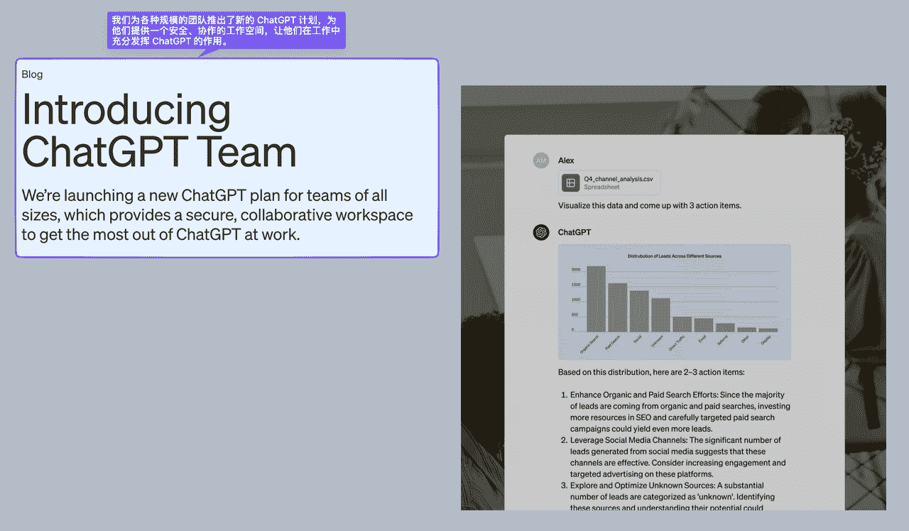
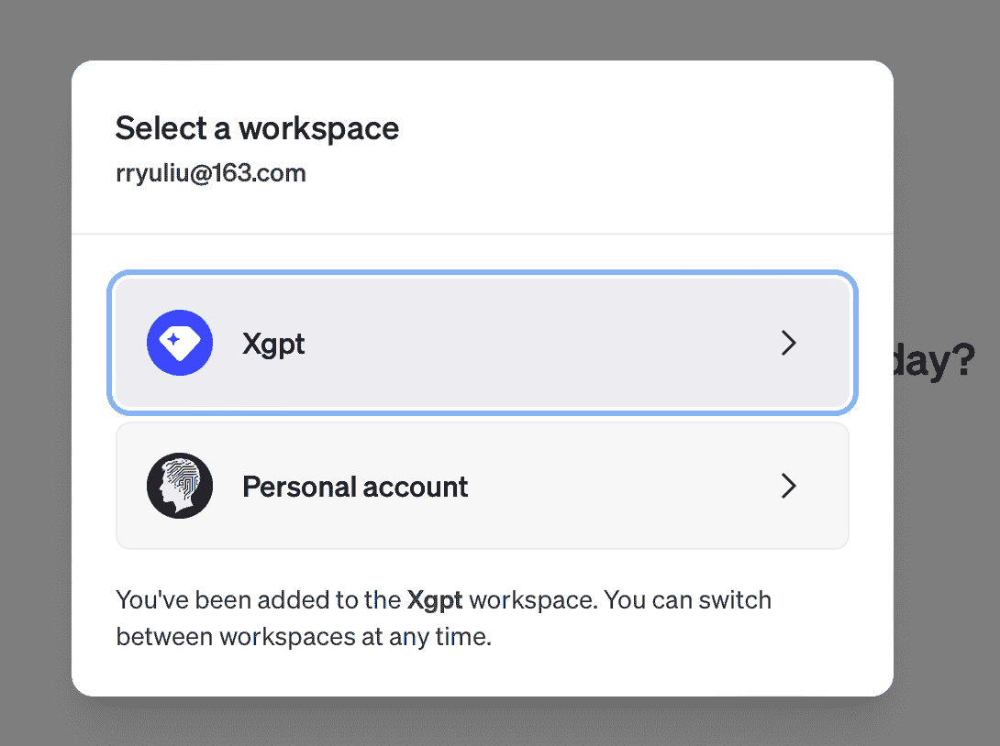
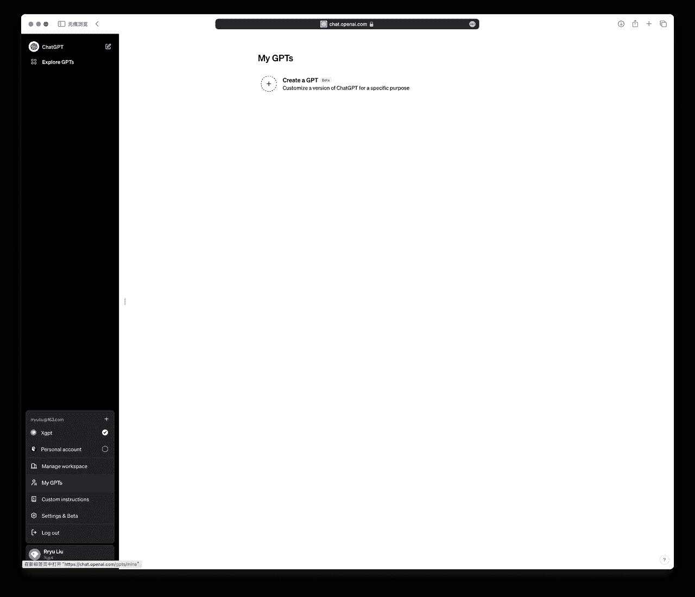
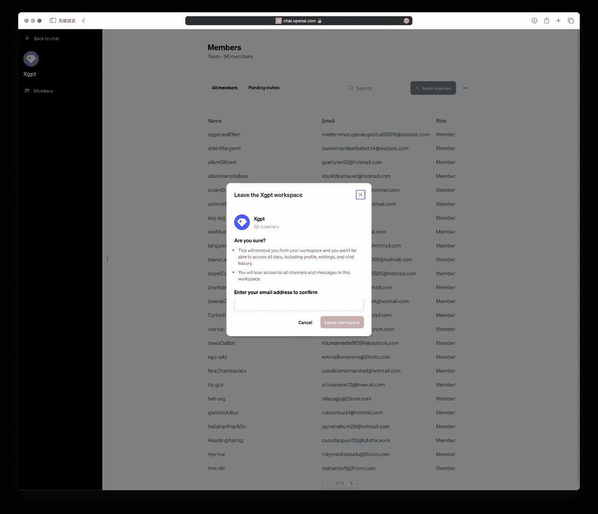
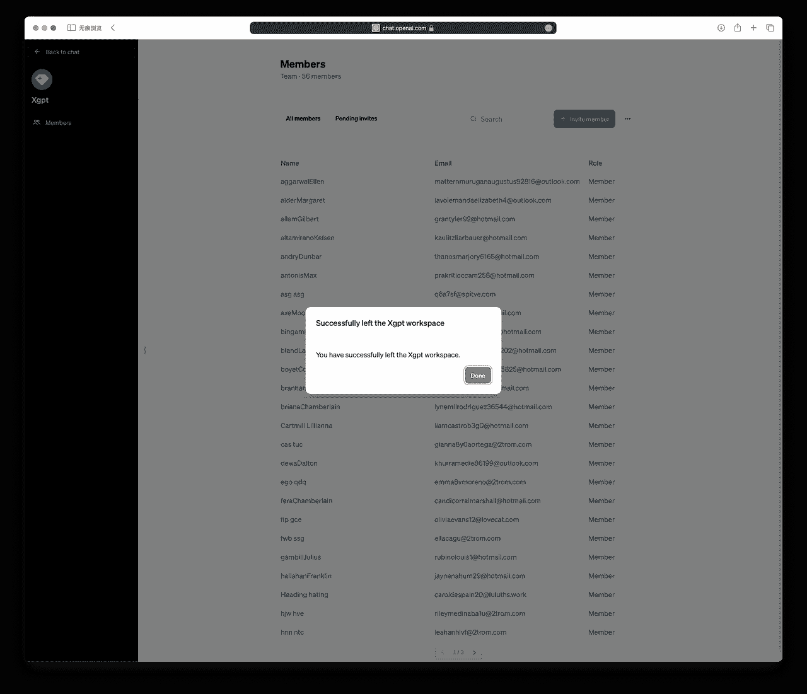

# ChatGPT Team (团队版）测试Tips

> 来源：[https://waytoagi.feishu.cn/docx/BkJAdTCLyoPrIgxQXj4czRNYnUd](https://waytoagi.feishu.cn/docx/BkJAdTCLyoPrIgxQXj4czRNYnUd)

> 作者：小七姐

> 可以在以下地址关注她：[**小七姐的prompt学习社群**](https://t.zsxq.com/15KhQ0RE7)

OpenAI 今天发布了 ChatGPT Team (团队版）

[https://openai.com/blog/intr](https://openai.com/blog/introducing-chatgpt-team)oducing-chatgpt-team

大家对这版本产生了各种各样的疑虑和问题，但是因为**不用就不知道，用了就得花****钱**。 所以我和 GPTGeeker刘宇龙 给大家测评了一下。结论附飞书：

# 最关心的事

## Teams Plan 是什么，和 GPT Plus 有什么不同

|  | 普通会员 | GPT Plus | GPT Team Plan |
| --- | --- | --- | --- |
| 适合用户群 | +   尝鲜用户 | +   中重度用户 | +   中小团队 |
| **用量** | GPT-3.5 | GPT-4-32K | GPT-4-32K |
| **费用** | 免费 | 20美元 / 月 | +   **年付**：300美元 / 年（折合 25美元 / 月） |
| **续费周期** | 无 | 开通后每月续费 | +   **年付**：每年续费，适合固定团队 |
| **支付方式** | 无 | +   海外信用卡 | +   海外信用卡 |
| **账号** | 自己的账号 | 自己的账号升级 | 填写邮箱，自动发邮件邀请给已有的 GPT 会员 |
| 隐私 | 对话数据会被用于训练 | 对话数据会被用于训练 | +   不会被用于训练 |
| GPTs | 无 | +   署名可以选择个人名字或者认证域名 | +   署名只能使用自己的名字 |
| 其它 |  |  | 一个账号可以加入多个团队，每个团队账号都是相对独立的 |

+   期间每多1个人 + 300美元

+   随时可以加入和移除成员

# 使用方面

当你成为某一个团队的成员后，再次进入 ChatGPT 就能看到这个对话框，让你选择用哪个身份：团队工作 workspace 还是个人的号（这里所罗门同学起的工作空间名叫“Xgpt” ）

无论你选择哪个身份进入，都可以在原先的左下角（见下图）随时切换身份。

两个账号的资料是完全隔离和区分的，你可以直接理解成团队账号是一个3小时有100次GPT4次数的「新号」。

如下图，新工作身份是 完——全——空——白 的。

# 退出团队

如果要退出团队，在 Manage workspace 里面，右上角的“…” 点击后，可以选择 “Leave workspace”。

虽然一般人可能用不到，不过还是截了一些图。

# **使用感受对比**

## 老用户

如果你现在已经/正在使用 GPT Plus，采用团队版会带给你这些影响：

+   原有的个人账号和新增的团队账号是两个独立的体系，并不会融合数据

+   所以你原有的对话记录和你个人创建的GPT都不会迁入团队版，而依然保留在你的个人版中

+   如果你既要团队版的100条/3小时真香，又要保有原来的记录和 GPTS，你需要两个账号都支付费用/续费

+   团队版中每个子账号下的对话是独立的，互相并不可见

+   团队版中每个子账号创建的 GPTs 也是独立的，对外显示的是你个人的名字，其他子账号并不能干预其他人的 GPTs

+   团队版中的对话数据不会被用于训练，相对安全那么一些些

## 新用户

如果你还没使用过 GPT Plus（这个星球应该都开了吧？） 而准备新开一个，团队版意味着：

+   更多的对话次数（100次/3小时）

+   年付贵5美元/月/人

+   月付贵10美元/月/人

+   和团队版发起人共担账号风险（连坐）

+   隐私数据相对安全一些

+   可以有仅供团队内部共享的GPTS

更多 Prompt 工具及方法交流欢迎链接小七姐:se7en319