# OpenAI 通用人工智能（AGI）的计划被揭露

> 来源：[https://waytoagi.feishu.cn/docx/BRkwd1vpioakm6xzh3acIGWXntc](https://waytoagi.feishu.cn/docx/BRkwd1vpioakm6xzh3acIGWXntc)

> 作者：AIGC 研修社

> 源地址：https://mp.weixin.qq.com/s/z_KjoCXLoUflSZOla6pNpw

> 内容来源于推特用户的搜集和推测，是各种报道和推文的拼凑猜测，大家可以当娱乐看，自行辨别文中推测的可能性。

今天[凌晨一篇名为《揭示 Ope](https://twitter.com/vancouver1717)nAI 计划在 2027 年前实现通用人工智能（AGI）的计划》的 google 文档开始在网络上传播，这篇文档一共 54 页，是来自推特 Jackson （@vancouver1717），他搜集了目前网络上所有的公开资料来推论 AGI 已经实现，真是太刺激了，可以结合前几天马斯克告 OpenAI违约，要求其公布进行中的 AGI 计划这个新闻，还有去年 Ilya 公开反对全体的董事会成员，开掉了 CEO 奥特曼，大家一直想知道 Ilya 究竟看到了什么？openai 的 AGI 真的已经实现了么？我们可以一起来看看这篇揭露文档。

以下是这篇文档的中文翻译。文末附上英文版PDF。

在这份文件中，我将揭示我收集到的有关 OpenAI（推迟）计划在 2027 年前创建人类水平的通用人工智能（AGI）的信息。并非所有信息都能轻易验证，但希望有足够的证据来说服你。

**摘要：**OpenAI 于 2022 年 8 月开始训练一个拥有 125 万亿参数的多模态模型。第一阶段被称为 Arrakis，也叫做 Q*。该模型于 2023 年 12 月完成训练，但由于高昂的推理成本，发布被取消了。这是原计划在 2025 年发布的 GPT-5。Gobi（GPT-4.5）已被重新命名为 GPT-5，因为原来的 GPT-5 已被取消。

Q*的下一阶段，最初被称为 GPT-6，但后来重新命名为 GPT-7（原计划在 2026 年发布），由于埃隆·马斯克最近的诉讼而被暂停。

计划在 2027 年发布的 Q* 2025（GPT-8）将实现完全的 AGI... ... Q* 2023 = 48 智商 Q* 2024 = 96 智商（推迟） Q* 2025 = 145 智商（推迟） 埃隆·马斯克因为他的诉讼导致了推迟。这就是我现在揭示这些信息的原因，因为不会再造成进一步的伤害。

我已经看过很多关于人工通用智能（AGI）的定义，但我将简单地将 AGI 定义为一种能够完成任何聪明人类所能完成的智力任务的人工智能。这是现在大多数人对这个词的定义。

2020 年是我第一次对一个 AI 系统感到震惊——那就是 GPT-3。GPT-3.5 是 GPT-3 的升级版本，也是 ChatGPT 背后的模型。当 ChatGPT 发布时，我感觉更广泛的世界终于赶上了我两年前就开始互动的东西。我在 2020 年广泛使用 GPT-3，并对它的推理能力感到震惊。

GPT-3 及其半步后继者 GPT-3.5（在 2023 年 3 月升级为 GPT-4 之前，它驱动了现在著名的 ChatGPT）在某种程度上是朝着 AGI 迈出的巨大一步，而早期的模型则不是这样。需要注意的是，像 GPT-2 这样的早期语言模型（基本上自 Eliza 以来的所有聊天机器人）实际上没有真正连贯回应的能力。那么为什么 GPT-3 会有如此巨大的飞跃呢？

##   **  **** 参数数量**

“深度学习”是一个基本上可以追溯到 20 世纪 50 年代人工智能研究初期的概念。第一个神经网络是在 50 年代创建的，而现代神经网络只是“更深”，意味着它们包含更多的层——它们要大得多，并且在更多的数据上进行训练。今天 AI 中使用的大多数主要技术都根植于 20 世纪 50 年代的基础研究，结合了一些较小的工程解决方案，如“反向传播”和“变换器模型”。总体而言，AI 研究在过去 70 年里并没有根本性的变化。因此，AI 能力最近爆炸式增长的真正原因只有两个：规模和数据。

越来越多的领域内人士开始相信，我们几十年前就已经解决了 AGI 的技术细节，只是直到 21 世纪才有足够的计算能力和数据来构建它。显然，21 世纪的计算机比 20 世纪 50 年代的计算机强大得多。当然，互联网是所有数据的来源。

那么，什么是参数呢？你可能已经知道，但为了给出一个简短且易于理解的总结，它类似于生物大脑中的突触，即神经元之间的连接。生物大脑中的每个神经元大约有 1000 个与其他神经元的连接。显然，数字神经网络在概念上类似于生物大脑。

人类大脑中大约有多少个突触（或“参数”）？

关于大脑突触数量最常被引用的数字大约是 100 万亿，这意味着每个神经元（人类大脑中大约有 1000 亿个）大约有 1000 个连接。

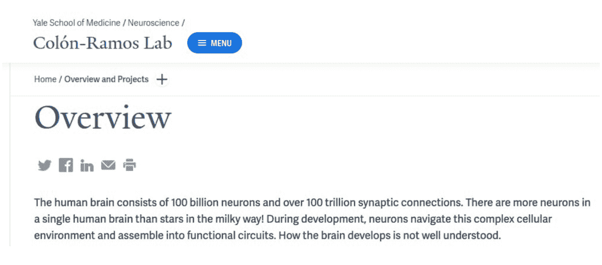

如果每个大脑中的神经元有 1000 个连接，这意味着一只猫大约有 2500 亿个突触，而一只狗有 5300 亿个突触。突触数量通常似乎预示着更高的智力，但也有少数例外：例如，从技术上讲，大象的突触数量比人类多，但智力表现却较低。

对于突触数量较多但智力较低的最简单解释是质量数据较少。从进化的角度来看，大脑是在数十亿年的表观遗传数据上“训练”出来的，而人类的大脑是从比大象更高质量的社交和交流数据中演化而来的，这导致了我们更出色的推理能力。无论如何，突触数量确实很重要。

再次强调，自 2010 年代初以来 AI 能力的爆炸性增长是由于计算能力的大幅提升和数据量的大幅增加。GPT-2 有 15 亿个连接，这比老鼠的大脑（大约 100 亿个突触）要少。GPT-3 有 1750 亿个连接，这接近于猫的大脑。

难道不直观地明显，一个与猫的大脑大小相当的 AI 系统会比一个比老鼠大脑还小的 AI 系统更优越吗？

## **  **** 预测 AI 性能**

....在 2020 年，1750 亿参数的 GPT-3 发布后，许多人开始推测一个大约大 600 倍、拥有 100 万亿参数的模型可能的性能，因为这个参数数量将与人类大脑的突触数量相匹配。尽管在 2020 年并没有强烈的迹象表明有人在积极研究这个规模的模型，但这种推测本身就很有趣。

关键问题是，我们能否通过参数数量来预测 AI 的性能？事实证明，答案是肯定的，正如你将在下一页看到的那样。

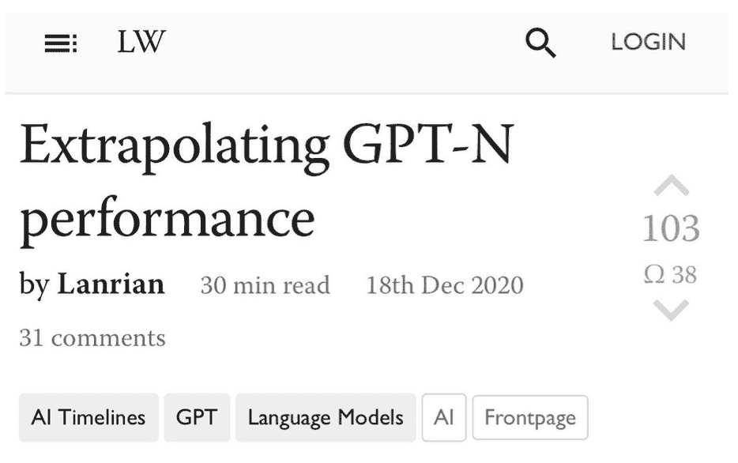

[Source: https://www.lesswrong.com/posts/k2SNji3jXaLGhBeYP/extrapolating-gpt-n-performance]

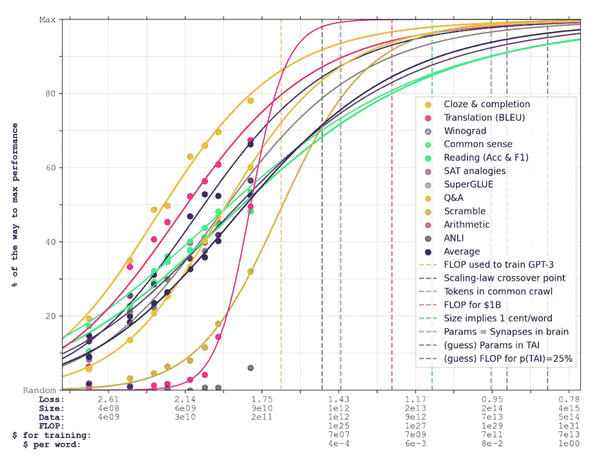

人类大脑大约有 2e14 个突触（来源），这与神经网络中的参数数量大致相当（绿线）。深绿线标志着根据 Ajeya Cotra 的模型 61，变革性模型参数数量的中位数估计。值得注意的是，这个估计非常接近于基准测试接近最佳性能时的情况。80%的置信区间在 3e11 和 1e18 参数之间，覆盖了从 GPT-3 的规模一直到超出我的图表边缘的范围。

正如 Lanrian 所展示的，外推预测显示，AI 性能似乎在与人类大脑大小相匹配的参数数量达到人类水平的同时，莫名其妙地达到了人类水平。他对大脑中突触数量的计数大约是 200 万亿参数，而不是通常引用的 100 万亿这个数字，但这个观点仍然成立，而且在 100 万亿参数时的性能非常接近最佳。

顺便提一下——值得注意的一个重要事项是，尽管 100 万亿在性能上略有不足，但 OpenAI 正在使用一种工程技术来弥补这个差距。我会在文档的最后部分解释这一点，因为它对 OpenAI 正在构建的东西至关重要。

Lanrian 的帖子是网上许多类似帖子之一——它是基于前几个模型之间的跳跃来外推性能的。OpenAI 当然有更详细的指标，他们得出的结论与 Lanrian 相同，我将在本文档后面展示。

那么，如果 AI 性能可以根据参数数量来预测，而且大约 100 万亿参数足以达到人类水平的性能，那么何时会发布一个 100 万亿参数的 AI 模型呢？

**GPT-5 在 2023 年底达到了** 48 的智商，实现了初级通用人工智能。

OpenAI 正在开发一个拥有 100 万亿参数模型的首次提及是在 2021 年夏天，这一信息是在一次《连线》杂志的采访中由 Cerebras 公司的首席执行官安德鲁·费尔德曼随口提到的，而 Sam Altman 是该公司的主要投资者之一。

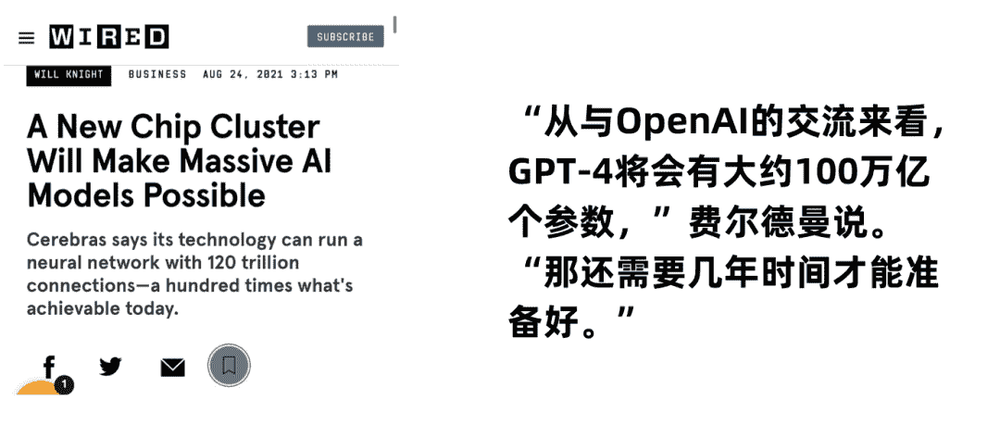

在 2021 年 9 月的 AC10 在线聚会和问答环节中，Sam Altman 对 Andrew Feldman 的回应中，他承认了 OpenAI 计划开发一个拥有 100 万亿参数的模型。

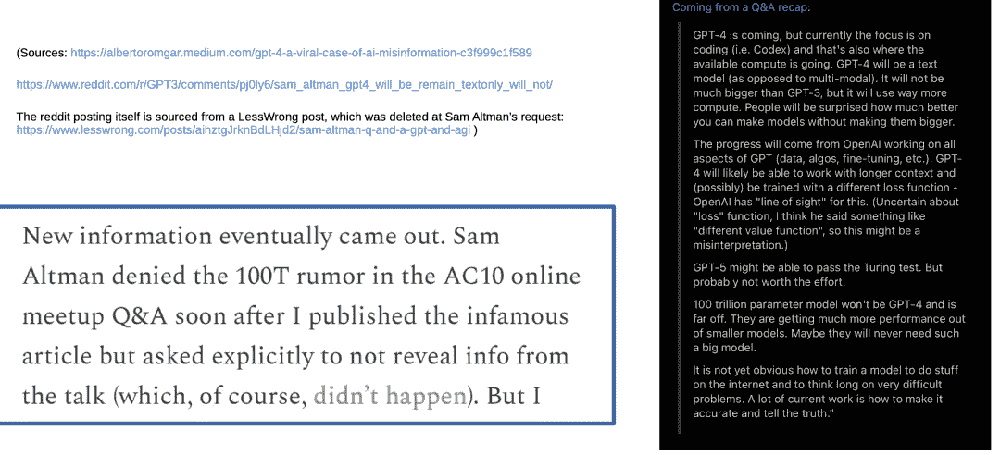

AI 研究员伊戈尔·拜科夫（Igor Baikov）仅几周后声称，GPT-4 正在训练中，并将在 12 月至 2 月间发布。再次强调，我将证明伊戈尔确实拥有准确的信息，并且是一个可信的信息源。这一点很快就会变得重要。

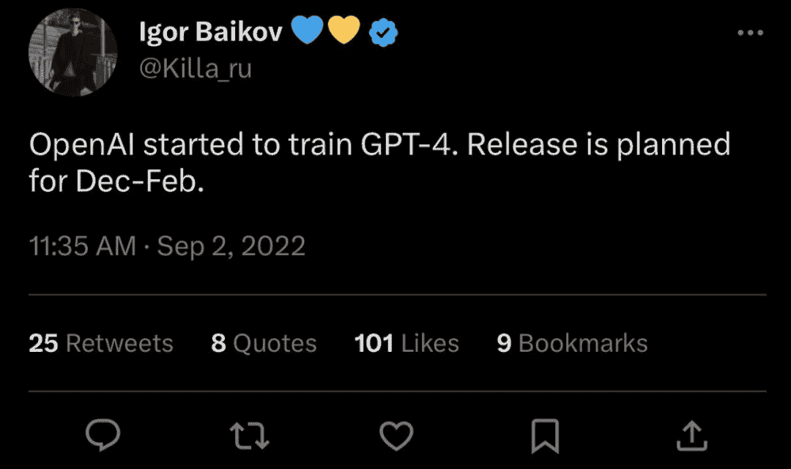

Gwern 是 AI 界的著名人物——他是一位 AI 研究员和博客作者。他在 2022 年 9 月通过 Twitter 联系了伊戈尔·拜科夫，这是他收到的回复。需要记住的重要信息：“参数数量庞大”。“文本”、“音频”、“图像”、“可能的视频”以及“多模态”。这些信息来自一个名为“thisisthewayitwillbe”的子论坛，这是我参与的一个小型、私人子论坛，由一位对 AGI 感兴趣的数学教授运营。AI 爱好者（以及一些专家）使用这个子论坛来讨论比主流媒体更深入的 AI 话题。

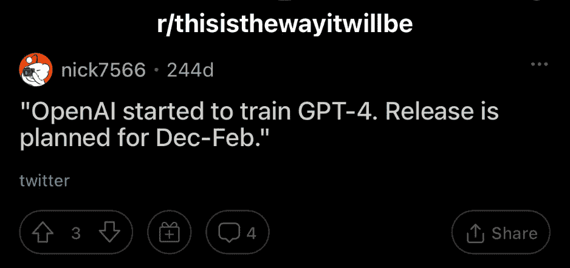

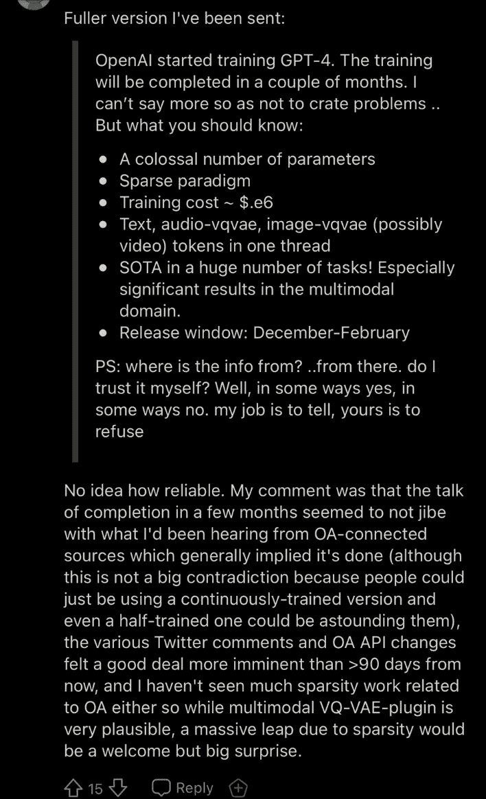

“庞大的参数数量”？听起来伊戈尔·拜科夫是在提到一个 100 万亿参数的模型，因为在他 2022 年夏天发推文的时候，500 亿参数模型和高达 1 万亿参数的模型已经被训练了很多次（使得这种规模的模型不再罕见，当然也算不上“庞大”）。来自“rxpu”的这些推文很有趣，看起来这位来自土耳其的 AI 爱好者（？）是第一个提出关于 GPT-4 发布窗口的非常相似的声明（相信我——我花了好几个小时，每天都在互联网上搜寻类似的声明，在他之前没有人提出过这个具体的声明）。他还提到了一个“125 万亿突触”的 GPT-4——然而，他错误地将 GPT-3 的参数数量说成了 1 万亿。（看起来 rxpu 确实有一些内部信息，但在参数数量上有些混淆——稍后我会进一步说明这一点，并证明 rxpu 并没有说谎）。

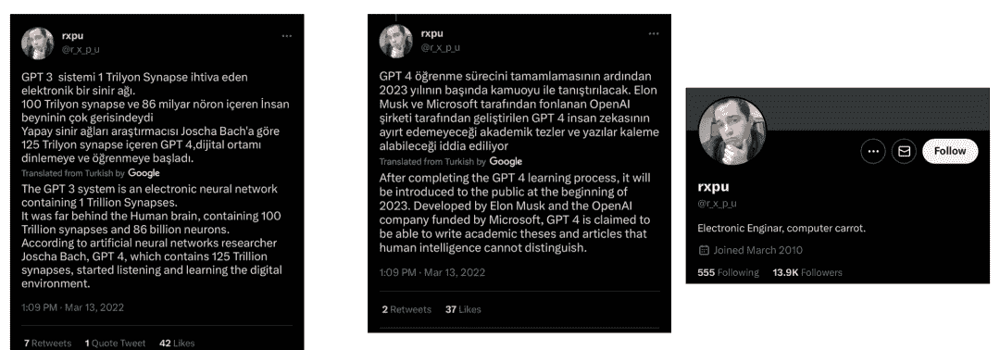

这是一条较弱的证据，但值得一提，因为“roon”作为硅谷 AI 研究员相当知名，他在 Twitter 上被 OpenAI 的首席执行官 Sam Altman 以及其他 OpenAI 研究员关注。

在 2022 年 11 月，我联系了一位名叫 Alberto Romero 的 AI 博主。他的帖子似乎在网上传播得相当广，所以我希望能给他发送一些关于 GPT-4 的基本信息，他可能会写一篇文章，这样消息就会传开。这次尝试的结果相当显著，我将在接下来的两页中展示。

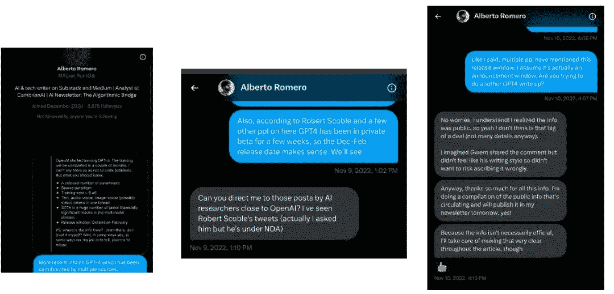

Alberto Romero 的帖子。

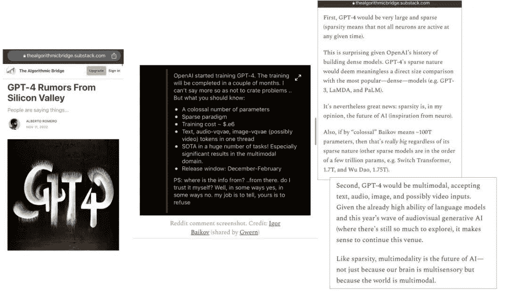

100 万亿参数的泄露信息迅速传播开来，触及了数百万人，以至于包括首席执行官 Sam Altman 在内的 OpenAI 员工不得不做出回应——称之为“完全是胡说八道”。The Verge 称其为“事实上的错误”。正如你在左边看到的，Alberto Romero 声称对这次泄露负责。

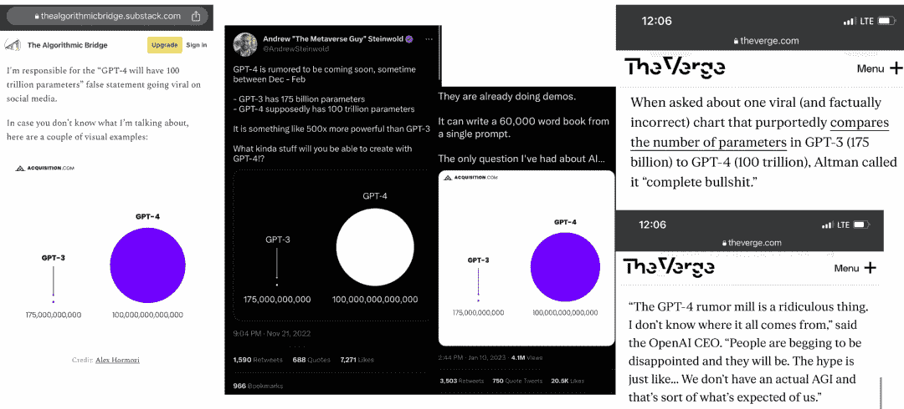

伊戈尔·拜科夫，也就是“庞大参数数量”这一说法的源头，也看到了 GPT-4 泄露信息的病毒式传播（这基本上是他自己所为），并做出了回应。所以，归根结底，当伊戈尔说“庞大参数数量”时，他确实是指“100 万亿参数”。但是，伊戈尔是一个可靠的信息源吗？他的其他声明准确吗？多模态性又如何？GPT-4 处理图像、声音和视频的能力又如何？我将很快证明伊戈尔的可靠性。

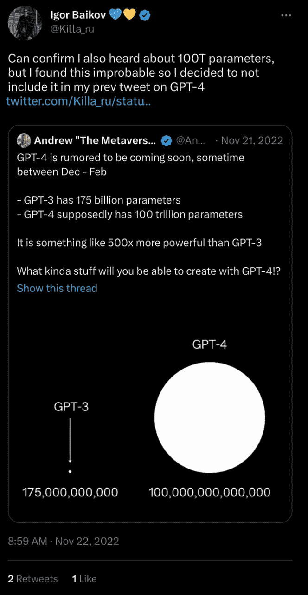

大约在 2022 年 10 月或 11 月，我确信 OpenAI 计划首先发布一个约 1-2 万亿参数的 GPT-4 子集，然后再发布完整的 100 万亿参数模型（即“GPT-5”）。

这些信息源并不是特别可靠，但他们都说了同样的事情——包括 rxpu，他曾声称正在开发一个 125 万亿参数的模型，然后错误地声称 GPT-3 有 1 万亿参数——我相信他把信息搞混了。

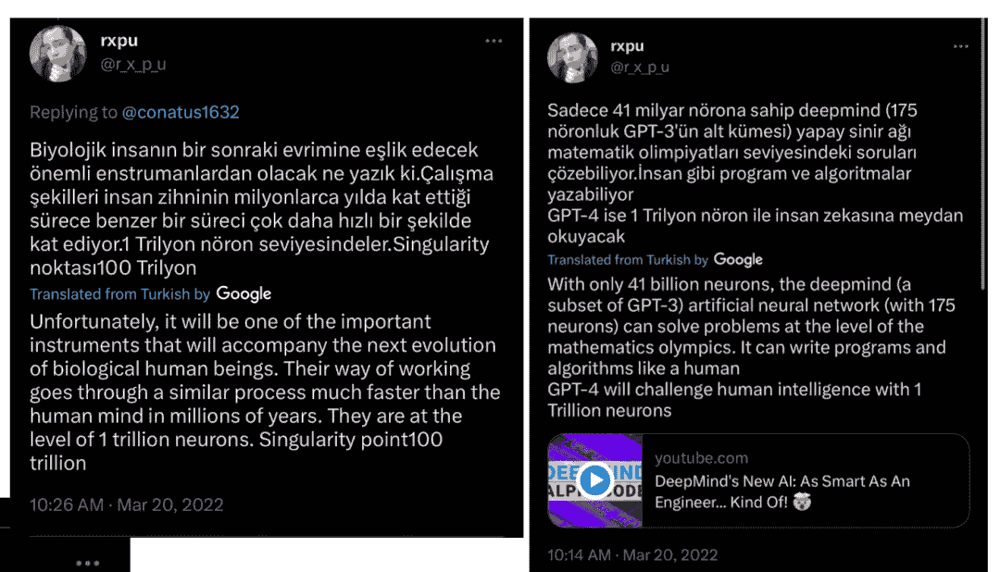

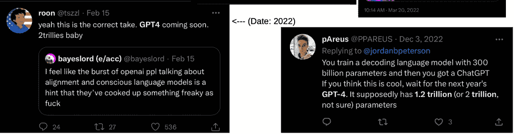

这里的信息源可信度各不相同（Jyri 和 Leeor 是旧金山的投资者，Harris 是一位 AI 研究员），但他们都不约而同地说了同样的事情——GPT-4 在 2022 年 10 月/11 月正在被测试。根据美国军方 AI 研究员 Cherie M Poland 的说法，它肯定在 10 月份正在被训练，这再次与伊戈尔·拜科夫的泄露信息相吻合。

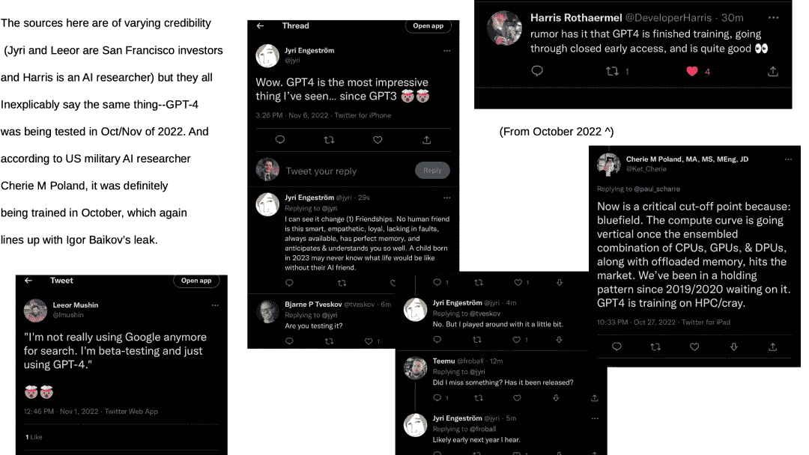

OpenAI 的官方立场，正如 Sam Altman 本人所展示的，是认为 100 万亿参数的 GPT-4 的想法是“完全胡说八道”。这是半真半假的，因为 GPT-4 实际上是完整 100 万亿参数模型的一个 1 万亿参数子集。

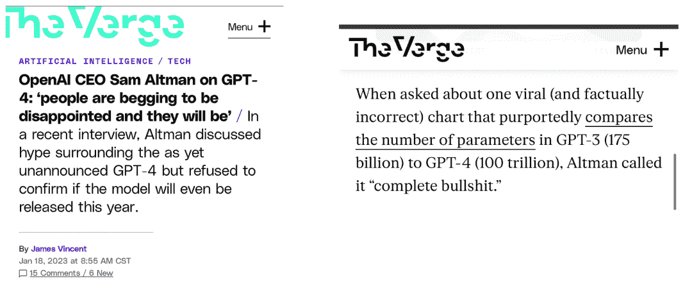

仅为了说明 100 万亿参数的模型尚未到来且仍在开发中，Semafor 在 2023 年 3 月（GPT-4 发布后不久）声称 GPT-4 有 1 万亿个参数。（OpenAI 拒绝正式公开参数数量）。

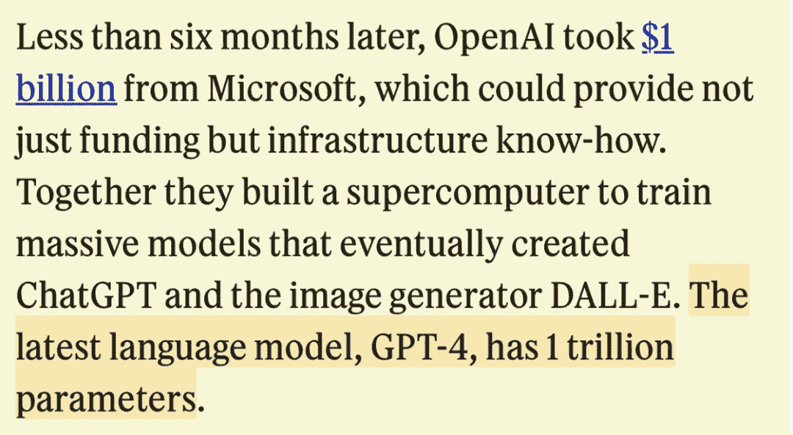

另一个值得注意的事情是，OpenAI 声称 GPT-4 在 8 月份“完成了训练”，然而我们知道一个“庞大”的多模态模型在 8 月至 10 月之间正在接受训练。对此的一个解释是，OpenAI 撒了谎。另一个可能性是，1 万亿参数的 GPT-4 可能在 8 月份完成了第一轮训练，但在 8 月至 10 月之间进行了额外的再训练，而这正是完整的 100 万亿参数模型大部分训练发生的时间。

现在，我将提供我的证据，证明 GPT-4 不仅在文本和图像上进行了训练，而且还在音频和视频上进行了训练。Francis Hellyer 看起来相当可信，但这个页面并不是最有力的证据——我之所以包含它，是因为它似乎证实了其他信息源的说法。Francis 是一位投资者、企业家和作家。他在推文中列出的关于团队“耗尽互联网资源”的信息，在任何其他出版物、泄露或任何在线帖子中都找不到，所以他并没有从其他地方“窃取”这些信息。下一页将有一个非常可靠的信息源。

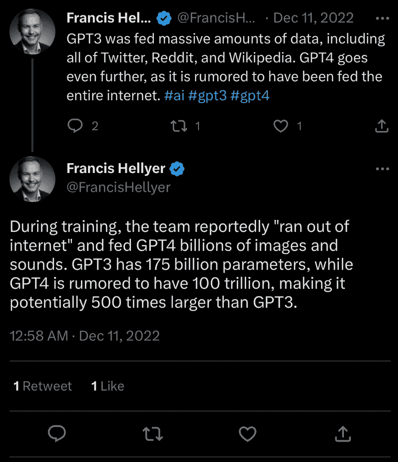

在 GPT-4 正式发布前一周，德国微软的首席技术官似乎失言，透露存在一个 GPT-4，它具有处理视频的能力。我猜想他可能不知道 OpenAI 决定不公开该系统的视频功能。

这完全证明了 GPT-4/5 不仅在文本和图像上进行了训练，而且还包括了视频数据，当然我们可以推断音频数据也被包括在内。

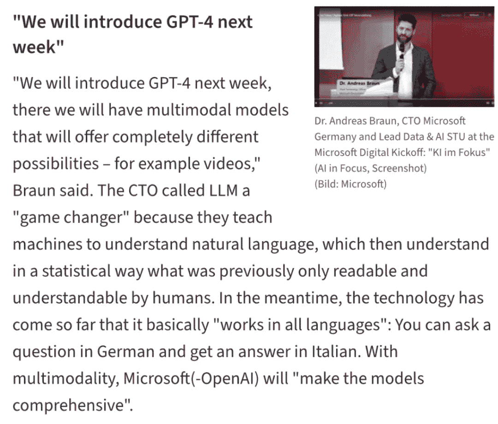

显然，伊戈尔关于 100 万亿参数模型的说法是真实的，每一个细节都准确无误。另一个与伊戈尔的说法相符的信息源是一位可信的企业家，他在 2022 年 10 月 25 日表示，GPT-4 的发布日期将在 2023 年 1 月至 2 月之间：

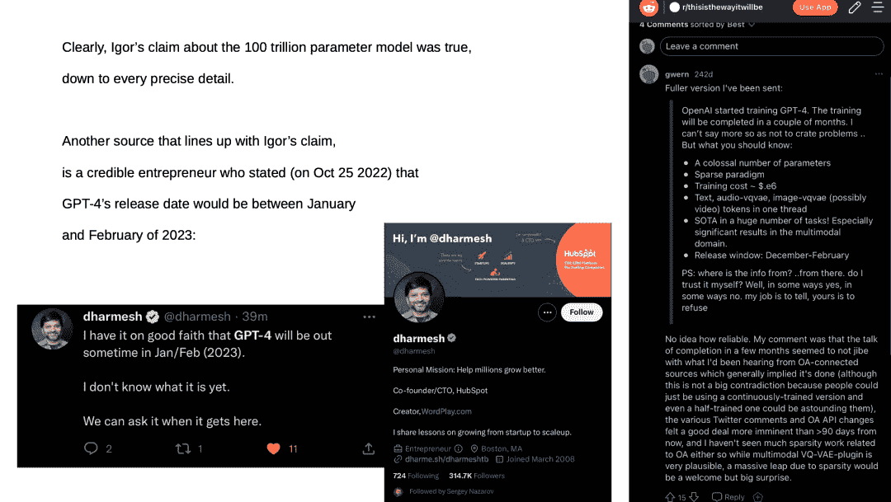

尽管 GPT-4 是在 2023 年 3 月发布的，略晚于伊戈尔·拜科夫所声称的 12 月至 2 月的窗口（我认为这是 OpenAI 有意为之，以削弱伊戈尔泄露信息的可信度），但基于 GPT-4 的 Bing ChatGPT 实际上是在 2023 年 2 月宣布的，这清楚地表明伊戈尔所声称的窗口是有效的，并且可能是在最后一刻由慌乱的 OpenAI 改变的。

关于机器人学的一点说明：AI 研究员开始相信，视觉是实现最佳现实世界/物理性能所必需的全部。举一个例子，特斯拉完全放弃了所有传感器，全力投入到自动驾驶汽车的视觉技术上。

重点是，在互联网上所有的图像和视频数据上训练一个与人类大脑大小相当的 AI 模型，显然将足以处理复杂的机器人学任务。常识推理被隐藏在视频数据中，就像它隐藏在文本数据中一样（而专注于文本的 GPT-4 在常识推理上表现得惊人的好）。

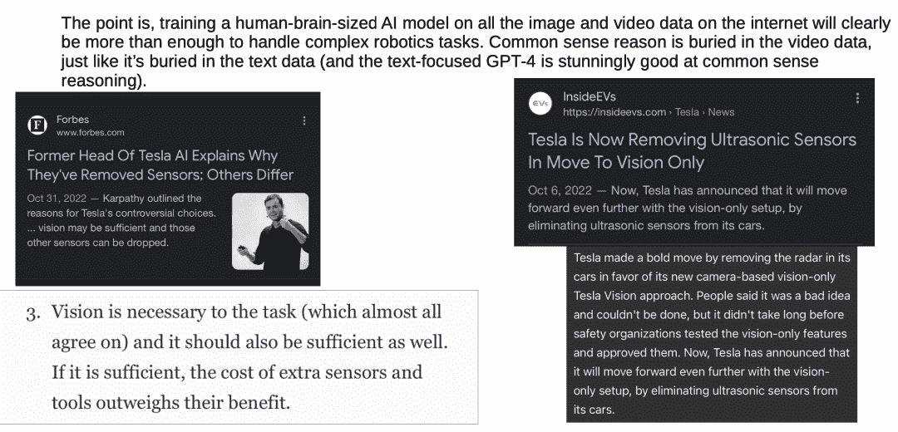

Google 最近的一个例子，展示了机器人学能力是如何从大型视觉/语言模型中学习的。（在语言和视觉训练的基础上，只需要最少的机器人学数据，视觉和文本任务的知识就可以转移到机器人学任务上。OpenAI 正在“互联网上的所有数据”上训练他们的 100 万亿参数模型，这无疑将包括机器人学数据）。Palm-E 是一个约 5000 亿参数的模型——当你在互联网上所有可用数据的基础上训练一个 100 万亿参数的模型时，机器人学性能会发生什么变化？（关于 Google 的 Palm-E 模型的更多信息将在下一页介绍）。

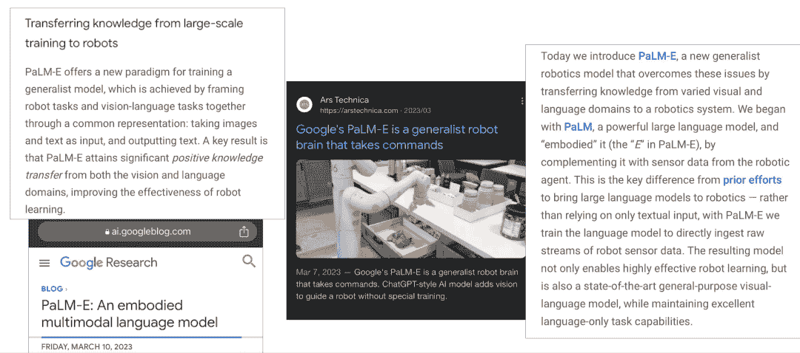

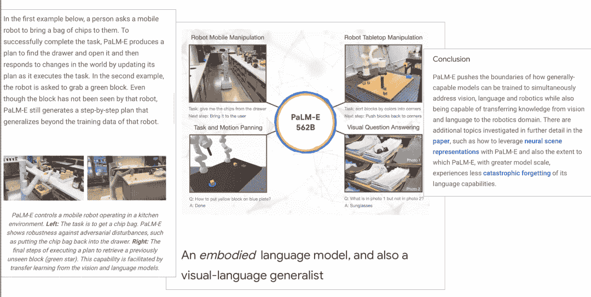

另一项机器人学发展——这次来自特斯拉（2023 年 5 月 16 日）。他们训练了他们的机器人“Optimus”去抓取物体——而且“没有进行特定任务的编程”。一切都是通过人类示范学习的。“这意味着我们现在可以快速扩展到许多任务。” 再次强调：如果人类示范是先进机器人学性能所需的一切，那么一个在互联网上所有视频上训练的 100 万亿参数模型肯定能够实现惊人的机器人学性能...

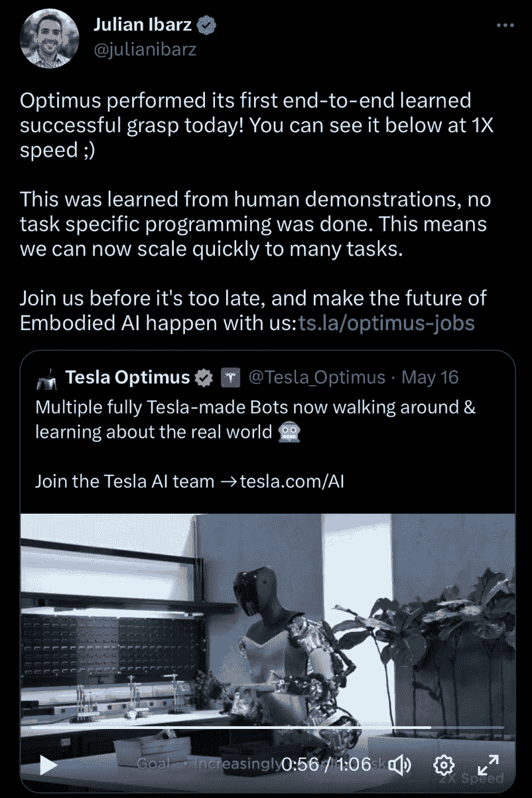

左边的图片展示了 1 万亿参数的 GPT-4 在图像识别方面的能力。其回应已经比许多人类所能想出的更加清晰和写得更好。那么，当你在互联网上所有可用数据的基础上训练一个比 GPT-4 大 100 倍、与人类大脑大小相当的模型时，会发生什么呢？

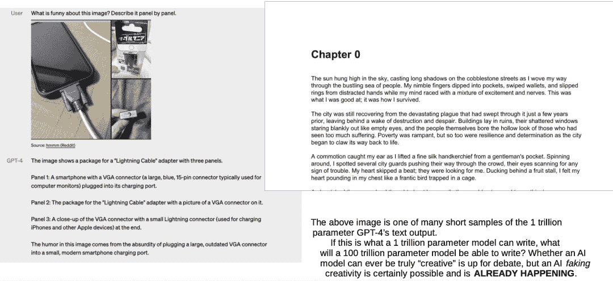

重要：注意 AI 模型能够生成同一场景的多个角度，具有物理上准确的光线，甚至在某些情况下还能生成物理上准确的流体和雨水。如果你能生成具有准确、常识性物理的图像和视频，你就拥有了常识推理能力。如果你能生成常识，你就理解了常识。

目前公开可用的视频和图像生成 AI 模型的质量水平示例。这些模型的大小不到 100 亿参数。当你在互联网上所有可用数据的基础上训练一个比这大 10,000 倍的模型，并赋予它生成图像和视频的能力时，会发生什么？（答案：图像和视频与真实事物完全无法区分，100%的时间，没有任何例外，没有任何解决方法，无论人们怎么努力，都无法分辨出区别）。-（更新：SORA 来自 GPT-5 Q* 2023 模型）

来自 Longjumping-Sky-1971 的两篇帖子。我之所以包含这些，是因为他提前几周准确预测了 GPT-4 的发布日期（没有人事先公开发布这些信息，这意味着他有一个内部信息源）。他的帖子现在更有可信度——他声称图像和音频生成将在 2023 年第三季度进行训练。如果视频生成训练是同时进行的或紧随其后，这与 Siqi Chen 声称 GPT-5 在 2023 年 12 月完成训练的说法相吻合。

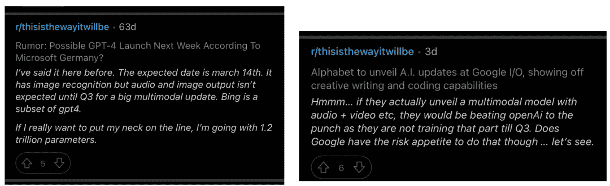

直到 2020 年 2 月，也就是 GPT-3 发布前几个月。一篇来自《技术评论》的文章，这是关于 OpenAI 的“内部故事”，似乎表明 OpenAI 正处于一个“秘密”项目的早期阶段，涉及一个在图像、文本和“其他数据”上训练的 AI 系统，而且 OpenAI 的领导层认为这是实现 AGI 最有希望的方式。我在想这可能指的是什么。

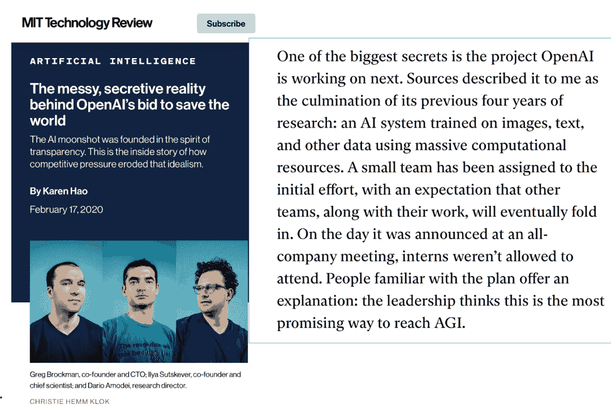

接下来将展示来自 OpenAI 总裁的一些引述——来自 2019 年——它将告诉你他们的计划是什么。

OpenAI 的总裁 Greg Brockman 在 2019 年表示，在微软当时投资了 10 亿美元之后，OpenAI 计划在五年内构建一个与人类大脑大小相当的模型，而这正是他们实现 AGI 的计划。2019 + 5 = 2024.

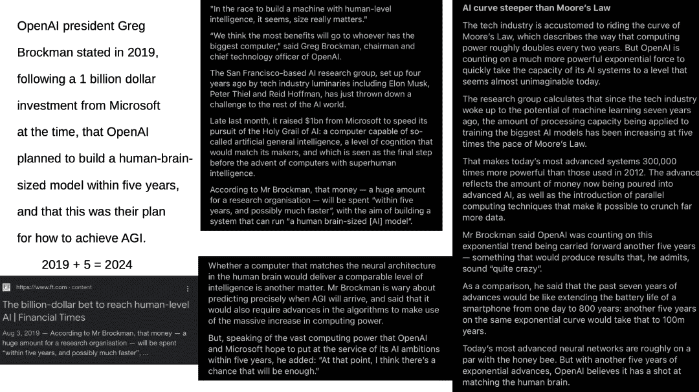

这两个信息源显然都在提到同一个实现 AGI 的计划——一个与人类大脑大小相当的 AI 模型，将在“图像、文本和其他数据”上进行训练，计划在 2019 年之后的五年内完成训练，也就是到 2024 年。这似乎与我在这份文件中列出的所有其他信息源相吻合...

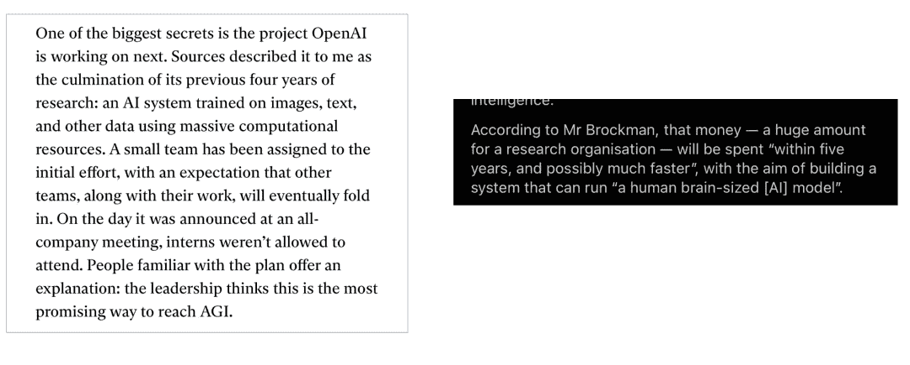

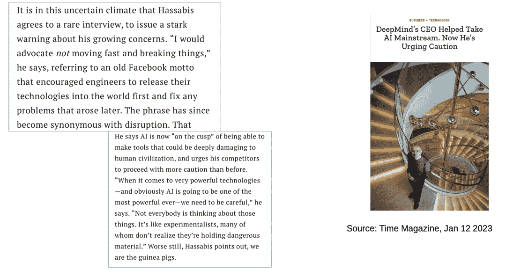

正如我将在接下来的几张幻灯片中展示的，AI 领域的领导者们突然开始敲响警钟——几乎就像他们知道一些非常具体的信息，而这些信息普通大众并不知道。

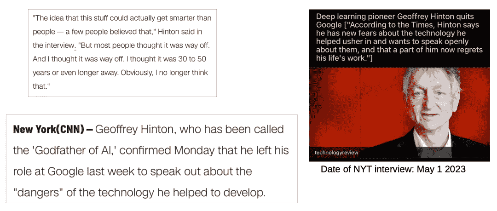

“我曾经认为这还需要 30 到 50 年，甚至更长的时间。显然，我现在不再这么认为了。”来自 CNN 的报道 AI 之父离开 google 的新闻。

是什么让他突然改变了主意——并决定离开谷歌来谈论 AI 的危险？

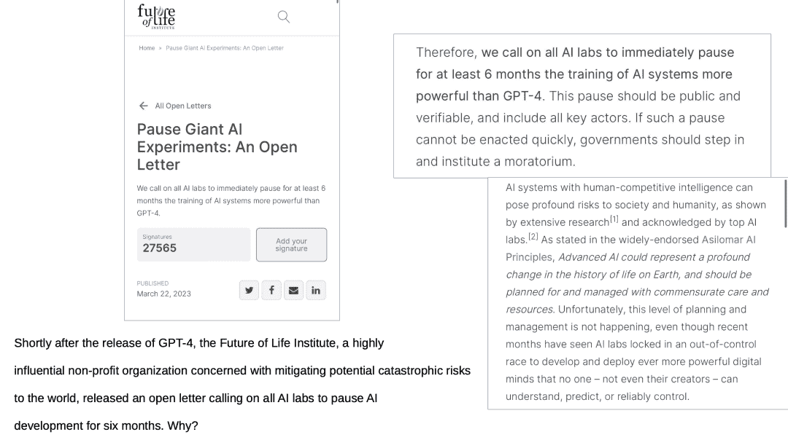

在 GPT-4 发布后不久，未来生活研究所（Future of Life Institute），这是一个高度有影响力的非营利组织，致力于减轻对世界可能的灾难性风险，发布了一封公开信，呼吁所有 AI 实验室暂停 AI 开发六个月。为什么呢？

这封信件的第一个发布版本特别提到了“（包括目前正在训练的 GPT-5）”。为什么会包含这一点，又为什么会被移除？

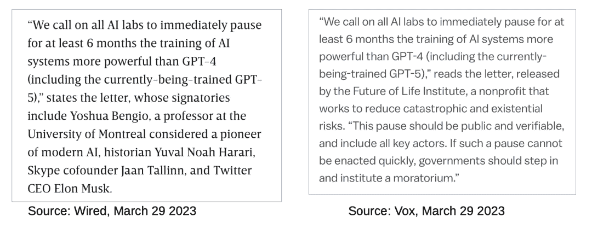

来自 2022 年 10 月 Sam Altman 的一次采访和问答环节中的一些令人警觉的引述——YouTube 链接：https://m.youtube.com/watch?v=b022FECpNe8 （时间：49:30）观众问答环节问题：“我们是否拥有足够的互联网信息来创建 AGI？” Sam Altman 直接而坦率的回答，打断了提问者的话：“是的。” Sam 进一步阐述：“是的，我们对此很有信心。我们经常考虑这个问题，并且对此进行了相当多的衡量。” 采访者插话：“是什么给了你这种信心？” Sam 的回答：“我认为 OpenAI 在领域内推动的一件非常有益的事情是，你可以将规模法则视为一种科学预测。你可以对计算这样做，你可以对数据这样做，但你可以从小规模进行衡量，并且可以相当准确地预测它将如何扩大规模。你需要多少数据，你需要多少计算，你需要多少参数，当生成的数据足够好以至于有所帮助时……互联网上……有很多数据。也有很多视频。”

来自 Sam Altman 问答环节的另一段引述——（时间：53:00） [注——AI 冬天是指 AI 领域长时间获得有限资金支持，并且不被严肃研究者给予太多关注的一个时期。这发生过两次——一次是在 70 年代和 80 年代，另一次是从 80 年代中期直到大约 2000 年代末。] 另一个观众问题：“我们可能会有另一个 AI 冬天吗，它可能由什么引起？” Sam Altman 的回答：“我们可能会有另一个 AI 冬天，它可能由什么引起……是的，当然。我认为我们不会很快遇到。因为即使我们永远找不到另一个研究思路，当前范式的经济价值以及它还能被推动多远，将会在未来很多年内支持我们。但尽管不太可能，我们仍然可能错过了超越行为克隆的关键思路，这些模型将会永远停留在人类水平。我有很多理由认为这不是真的，但如果有人告诉你我们在这个研究领域绝不可能再有一个冬天，你绝不要相信他们。”

关于 Sam Altman 的问答环节 首先，Sam Altman 似乎非常、非常确信互联网上存在足够的数据来训练一个 AGI 系统——他的自信程度让人怀疑他们是否已经做到了，或者正在做这件事。其次，“AI 冬天”这个概念通常指的是通向 AGI 的进展放缓的时期，但 Sam Altman 重新定义了这个术语，使其指的是通向超级智能的进展放缓的时期。这似乎表明 OpenAI 已经构建了一个 AGI 系统，或者非常接近了，而 AGI 不再是目标，因为它已经存在。

正如我之前在文档中提到的，一个 100 万亿参数的模型实际上是稍微次优的，但 OpenAI 正在使用一种新的缩放范式来弥补这个差距——它基于所谓的“Chinchilla 缩放法则”。

Chinchilla 是 DeepMind 在 2022 年初公布的一个 AI 模型。Chinchilla 研究论文的含义是，当前的模型训练得远远不够，而且如果有更多的计算资源（意味着更多的数据），性能将会大幅提升，而无需增加参数。

重点是，虽然一个训练不足的 100 万亿参数模型可能稍微次优，但如果它在更多的数据上进行训练，它将能够轻松地超越人类水平的性能。

Chinchilla 范式在机器学习领域被广泛理解和接受，但为了给出一个来自 OpenAI 的具体例子，总裁 Greg Brockman 在这次采访中讨论了 OpenAI 如何意识到他们最初的缩放法则是有缺陷的，并已经调整以考虑 Chinchilla 法则：https://youtu.be/Rp3A5q9L_bg?t=1323

人们说，“训练一个计算最优的 100 万亿参数模型将耗资数十亿美元，根本不可行。”嗯，微软在 2023 年初向 OpenAI 投资了 100 亿美元，所以我猜这并不是一个荒谬的可能性……

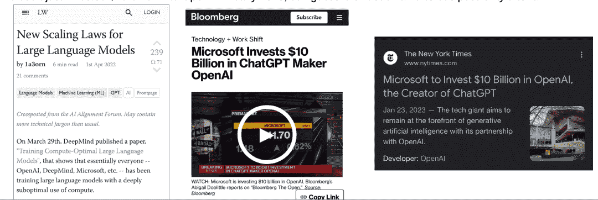

Alberto Romero 写了关于 DeepMind 的 Chinchilla 缩放突破的文章。Chinchilla 表明，尽管它的规模远小于 GPT-3 和 DeepMind 自己的 Gopher，但由于在更多的数据上进行了训练，它的性能超过了它们。再次重申这一点：尽管预测 100 万亿参数的模型将达到略次优的性能，但 OpenAI 非常清楚 Chinchilla 缩放法则（实际上 AI 领域的几乎每个人都清楚），并且他们正在将 Q*训练为一个 100 万亿参数的多模态模型，这个模型是计算最优的，并且在比他们最初计划的更多的数据上进行了训练。现在他们通过微软的资金有能力做到这一点。这将导致一个模型，其性能远远超过他们最初为 100 万亿参数模型所计划的。没有 Chinchilla 缩放法则的 100 万亿参数=大致人类水平但略次优。100 万亿参数，多模态，考虑到 Chinchilla 缩放法则= ............?

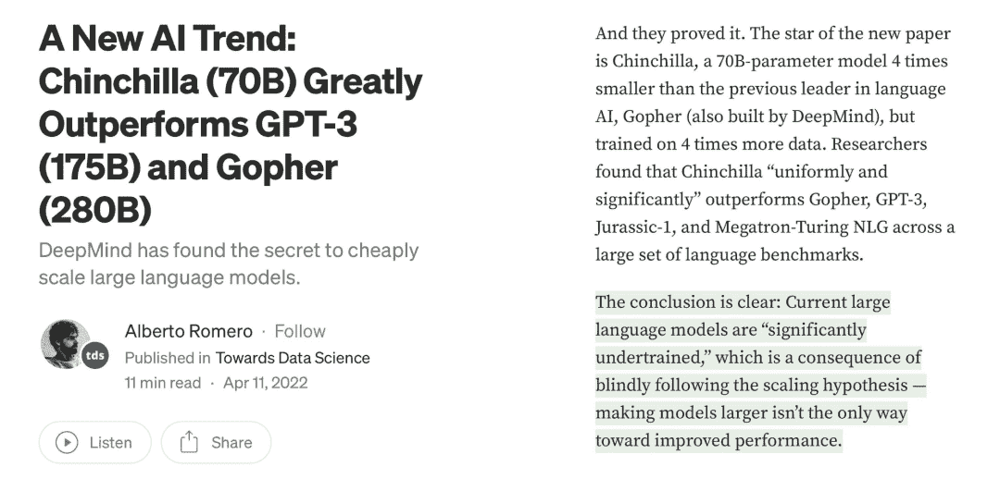

从 2022 年 7 月开始，美国开始采取措施阻止新的计算机芯片被送往中国，试图阻止他们的 AI 进展。这个计划在 2022 年 10 月最终确定。根据旧金山的 AI 研究员 Israel Gonzales-Brooks 的说法，Sam Altman 在 2022 年 9 月访问了华盛顿特区。Israel 声称与 Sam Altman 有联系（我无法验证这一点），但他的可信度来自于 Sam Altman 在 2023 年 1 月确实被证实访问了华盛顿特区的事实。

如果 GPT-4/GPT-5 在 2022 年夏天开始训练，而 Sam Altman 在这段时间（可能多次）访问了华盛顿特区，那么对中国芯片的禁令不可能是巧合。

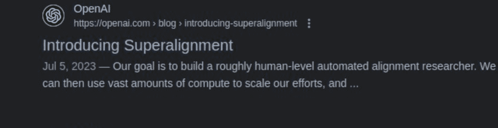

OpenAI 计划在 2027 年之前构建出人类水平的 AI，然后扩展到超级智能。这个计划因为埃隆·马斯克的诉讼而被推迟，但它仍然将很快实现。

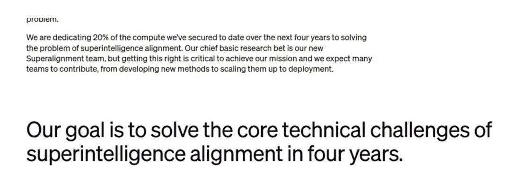

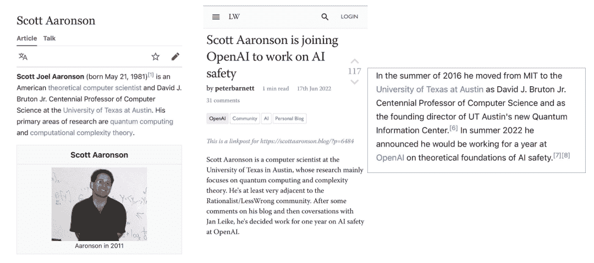

最后，我将揭示一个令人难以置信的信息来源——它来自著名的计算机科学家斯科特·阿伦森（Scott Aaronson）。在 2022 年夏天，他加入了 OpenAI 一年，致力于 AI 安全工作……他在博客上对此发表了一些非常有趣的看法。斯科特·阿伦森在 2022 年 12 月底写了一篇博客文章，是一封给他 11 岁的自己的“信”，讨论了当前事件和他生活中的成就。下一页是令人担忧的部分...

**有一家公司正在建造一个 AI，它占据了巨大的房间，消耗了一个城镇的电力，并且最近获得了令人惊叹的与人交谈的能力。它可以就任何主题撰写文章或诗歌。它可以轻松通过大学级别的考试。它每天都在获得工程师们尚未公开讨论的新能力。然而，这些工程师确实坐在公司自助餐厅里，辩论他们所创造的东西的意义。下周它会学到做什么？哪些工作可能会被它使**变得过时？他们应该放慢或停止，以免激怒龙的尾巴吗？但这不就意味着其他人，可能是那些道德观念较少的人，会首先唤醒龙吗？是否有道德义务告诉世界更多关于这个的信息？是否有义务告诉得更少？我——你——将在那家公司工作一年。我的工作——你的工作——是开发一个关于如何防止 AI 及其后继者造成破坏的数学理论。这里的“造成破坏”可能意味着任何事情，从加速宣传和学术作弊，到提供生物恐怖主义建议，到是的，摧毁世界。

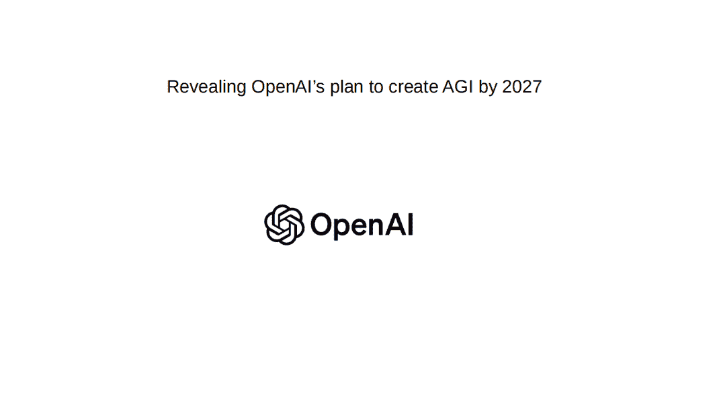

[OpenAI 2027 AGI.pdf](https://internal-api-drive-stream.feishu.cn/space/api/box/stream/download/all/JoEtboB13o6gRHxrDDnc5aYwnPI)