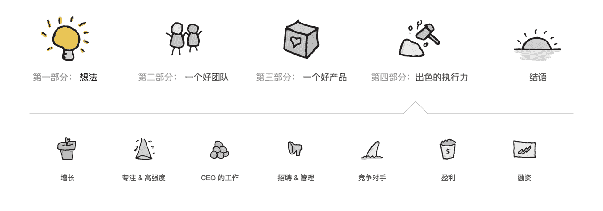
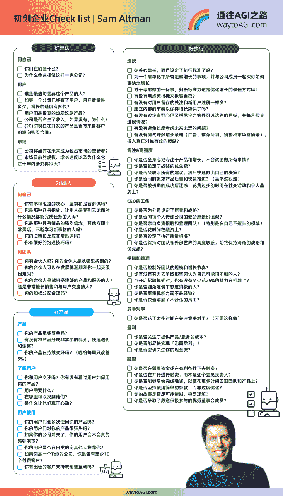

# 创业手册 | Sam Altman

> 来源：[https://waytoagi.feishu.cn/docx/XaI7diYf4oywtDx0FCoc72Gjnlh](https://waytoagi.feishu.cn/docx/XaI7diYf4oywtDx0FCoc72Gjnlh)

> 原文地址：https://playbook.samaltman.com/

> 作者：Sam Altman（OpenAI CEO）

> 橙色为译者标注的重点内容。文章较长，难免有错译之处，请在段落评论中斧正，谨此致谢！

> [您也](https://m.okjike.com/users/6E90ECB6-768A-4B0A-A457-57ABA89AA078)可[以参考](https://playbook-cn.github.io/)其他几[个中](http://playbook.coding.io/)文翻译版本，如 海松、Ray 和 这里

> 欢迎大家使用飞书评论，一起完善、补充相关资料和链接

## 前言

我们[花了很多时间为初创公司提](https://www.ycombinator.com/)供咨询。尽管一对一的建议始终是至关重要的，但我们认为，如果我们能够提炼出这些建议中最具普遍性的部分，并提供给 YC 和 YC 旗下公司会有助于 YC 的成长，可能对我们扩大 Y Combinator 的规模会有所帮助。

然后，我们觉得我们应该将它提供给所有人。

这是为那些对创业领域刚入门的人准备的。大部分内容对于已阅读过我们的合伙人所写的东西的人来说已不新鲜——我们的目标是将其汇集到合集中。

作为一家创业公司，你的目标是：做出用户们喜爱的产品。如果你做到了，那么你就必须弄清楚如何获得更多的用户。但是第一步“做出用户们喜欢的产品”至关重要——想想今天真正成功的公司，他们都是从一个备受早期用户喜欢的产品开始的。他们的早期用户是如此喜欢他们的产品，以至于会到处分享给其他人。

**如**果你无法做出用户们喜欢的产品，那么你会失败。如果你试图欺骗自己，假装你的用户喜欢你的产品，而实际上他们并不喜欢，那么你也会失败。

有非常非常多自认为可以跳过这一步的创业公司，但是他们都死了。

**做一个少数用户真心热爱的产品，要比做一个即**使很多用户、但仅仅有些喜欢的产品要好很多。虽然你获得的正面感受的总量可能是一致的，但获得更多用户要比从喜好变为喜爱容易得多。

这里对于选择创业的创始人们有个警示：创业真的非常痛苦！我们从YC创始人们那里得到的最一致的反馈就是，创业比他们想象的要困难的多。因为他们没有一个框架来描述创业涉及的工作和强度。通常情况来说，加入一个早期但是处于火箭般上升速度的创业公司，会是财务上好得多的选择。

另一方面，开启一个创业公司对你的职业生涯来说也没有那么大的风险。如果你**真**的很擅长技术，那么即使你失败了你也能找到工作。大多数人都没有那么擅长评估风险。我个人认为，比起创业，更有风险的选择是，当你有一个真正热爱的想法或者项目，但是你却停留在了一个安全、轻松、不尽如人意的工作中。

**想**要做个成功的创业公司，你需要：一个非常好的想法（包括一个好市场），一个非常好的团队，一个非常好的产品和出色的执行力。

---

## 第一部分：想法

我们问YC系公司的第一个问题是，你们在创造什么？为什么？

我们希望听到一个清晰、简洁的回答。

这个问题既是对于创始人的评估，也是对于创业想法本身的评估。作为创始人，能够清晰地思考和沟通是很重要的——你在招聘、筹资、销售等方面都需要这个能力。并且通常来说，清晰的想法更容易传播，而复杂的想法几乎总是思维混乱或者假问题的标志。如果这个想法第一次被听到时并没有真正激发起至少一些人的兴趣，那么这是个很糟糕的事情。

另一个我们会问的问题：谁是最迫切需要这个产品的人？

最好的回答，你自己就是目标用户。第二好的回答，你极其理解你的目标用户。

如果一个公司已经有了用户，我们会问用户数量是多少，并且增长的速度有多快？我们会想弄清楚为什么用户数量没有增长的那么快。我们最想搞清楚的问题是，用户们是否真的热爱这款产品。通常来说热爱一个产品意味着用户们会自发的推荐这个产品给朋友们使用，不需要任何诱导。我们还会问公司是否产生了收入，如果没有，为什么？

如果公司还没有用户，我们会设法确定首先要构建的最小功能，以验证这个假设。也就是说，如果从理想的用户体验倒推，我们会努力找出应该从哪个关键点开始。

测试一个想法的方法是发布它看看会发生什么，或者尝试销售它（例如，在你编写一行代码之前，尝试获得意向合同）。前者更适用于To C类的想法（因为用户的口头调研可能是不诚实的），后者则更适用于To B类的想法（如果一家公司告诉您他们会购买某个产品，那就去开发这个产品）。具体来说，如果您是一家To B公司，我们会问你的第一个问题是：你现在在开发的产品是否有来自客户的意向购买合同？而对于大多数生物技术和硬科技公司来说，测试一个想法的方法是首先与潜在客户交流，然后弄清楚你可以首先构建技术的最小子集。

当你获得了用户的反馈的时候，及时调整你的想法非常重要。深入地了解你的用户，是衡量你的想法、打造伟大的产品、做出伟大公司至关重要的部分。

如前所述，初创企业真的很难。你需要非常长的时间，和持之以恒的高强度努力。创始人和员工们都需要有一种使命感去支撑他们。所以我们会问创始人，为什么会选择做这样一家公司。

我们还会问公司将如何在未来成为独占市场的垄断者。虽然有很多不同的说法，但我们使用的是彼得·蒂尔（Peter Thiel）的观点。当然，我们并不希望你的公司采取不道德的手段来对待竞争对手。相反，我们在寻找那些随着规模扩大而越来越强大并且难以模仿的企业。

最后，我们会问市场相关的问题。我们会询问市场目前的规模、增长速度以及为什么它在十年内会变得很大。我们努力了解市场为何会快速增长，以及为什么这对于初创公司来说是一个好市场。我们喜欢那些刚刚开始的重大技术变革，而大多数人尚未意识到这一点——大公司在应对这样的情况时往往表现不佳。有点反直觉的是，最佳策略是在一个小市场中占据很大的份额。

一些其他关于想法的内容：

我们更喜欢新的东西而不是衍生的东西。大多数真正的大公司都是从一些根本性的新事物开始的。（新事物的定义是比之前好十倍的东西）。如果同时有十家公司有相同的计划，并且要做的东西非常像一些已经存在的东西，我们会比较怀疑。

一个非常重要的反直觉的原因是，做全新的和困难的东西，要比做老的和容易的事情更简单。因为前者人们愿意帮助和加入你，后者不会。

最好的想法是那种听起来很糟糕，但是实际上是很好的。因此，你不需要对你的想法过于保密。如果你的想法真的是个很好的主意，那么它听上去很可能并不值得窃取。即使你的想法真的听上去很值得被窃取，但是这个世界上愿意真正去付出很多努力将一个好想法打造成一个好公司的人是非常非常少的。相反，如果你告诉人们你正在做的事情，大家可能会帮助你。

说到告诉别人你的想法——虽然好的想法需要让一部分人第一次听到时真的很激动。但是几乎所有的人都会告诉你，你的想法很糟糕。也许他们是对的。也许他们不擅长评估创业想法，也许他们仅仅是嫉妒。不管原因是什么，这种情况会经常发生，会很伤人，即使你认为你不会受到它的影响，你仍然会被影响到。你越快地建立自信，不被仇恨者过多地拖累，你就会过得越好。不管你有多成功，仇恨者永远不会消失。

如果你还没有一个想法，但是你想创业该怎么办？我们的建议是也许不应该这么做。先有想法，再通过创业来实现你的想法是好得多的路径。

我们曾经做过一个实验，投资了一些非常优秀的，但是还没有想法的创始团队。我们希望他们在获得资金之后能够找到一个有前途的想法。

他们都失败了。我认为其中的一部分原因是因为，好的创始人通常都会有很多（甚至是过多）好的想法。但更大的问题是，一旦你有了一个创业公司，你就必须赶紧想出一个想法，而且因为这已经是一家正式的公司，所以你的想法不能太疯狂。你最终会得到一些听起来很合理但是缺乏创新的想法。这就是转型的危险所在。

所以，最好不要过于努力地强迫自己想出创业点[子。相反，了解很多不](http://blog.samaltman.com/projects-and-companies)同的事物。锻炼自己发现问题的能力，关注那些看似低效的事物和重大技术变革。投身于你感兴趣的项目，刻意与聪明、有趣的人为伍。在某个时刻，灵感就会涌现出来。

---

## 第二部分：一个好团队

平庸的团队不会建立伟大的公司。我们最看重的事情之一，就是创始人的能力。当我过去进行后期投资时，我会同样看重创始人所雇佣员工的能力。

**什么是伟大的创始人？最重要的特质包括不可阻挡的决心**、坚韧和足智多谋。智力和激情也非常重要。这些特质比经验以及所谓的“语言X和框架Y的专业知识”要重要得多。

我们注意到，最成功的创始人通常是那些工作中容易相处、让人感到“无论面对什么情况都能完成任务”的人。有时候，凭借纯粹的意志力也可以取得成功。

好的创始人具备许多看似相互矛盾的特点，其中一个重要的特点是既要对公司核心以及使命的强烈信念，又要在其他方面非常灵活，愿意不断学习新的事物。

最好的创始人反应非常迅速。这是决策力、专注、强度和完成事情能力的指标。

那些很难沟通的创始人几乎都是糟糕的创业者。沟通是一种非常重要的创始人技能。说实话，我认为这是那些很少被提到的创业技能里，最重要的一个。

科技型创业公司，需要至少有一个创始人能够把产品和服务搭建出来，也需要至少一个创始人（或者通过学习成为）非常擅长销售和与用户交流的人。这两个人可以是一个人。

当你选择创业合伙人时，要考虑以下几点——这可是你最重要的决定之一，但通常人们随随便便就做决定了。你最好选一个你已经很熟悉的人，而不是在某个创业派对上刚认识的人。多了解一些信息，你才能更好地评估是否能和这个人合作，毕竟选错人可是要命的。另外，有时候创业公司的价值可能会暂时下降很多，这时如果你和合伙人创业之前已经很熟悉，你们不会轻易放弃，因为你们不想让对方失望，所以你们会一起克服困难。创业合伙人们闹掰是一个非常常见的的创业公司死亡的原因。并且我们经常看到这个事情发生在那些为了创业而相遇的合伙人身上。

最好的情况，无疑是拥有一个好的合伙人。其次是单打独斗。最糟糕的情况，无疑是拥有一个糟糕的合伙人。如果事情不顺利，你应该迅速分道扬镳。

关于股权的问题，要早日解决，因为随着时间推移，分配股权的讨论只会变得越来越复杂。最好尽早设定股权比例，近似平等是最好的，不过如果只有两个创始人，最好让其中一人多持有一点，以防万一在合伙人之间产生分歧时出现僵局。

---

## 第三部分：一个好产品

成功的秘诀是：拥有一个出色的产品。这是所有伟大公司的共同点。

如果你没有办法做出来一个让用户爱上的产品，你迟早会失败。虽然创始人们总想绕过这一点，但是创业是没有捷径的。

长期来看，出色的产品是唯一的增长方式。因为即使你用了一些别的增长手段，但是最终你会发现，随着你的体量变大，所有的其他手段都会失效，只有“人们真的想要用你的产品”不会失效。这是关于超级成功公司最重要的事情。没有其他方式。想想所有真正成功的技术公司——它们都这样做。

**你需**要在你的公司里搭建一个“产品改进引擎”。你应该和你的用户交谈，看着他们使用你的产品，找出哪些部分是需要改进的，从而让你的产品变得更好。反复去做这件事。这应该是你的公司里最重要的事情，并且由它来驱动所有别的事情。如果你真的能每周让你的产品变好5%，你会有巨大的复合增长。

这个循环越快，你的公司就会做的越好。在YC期间，我们告诉创始人，他们应该在花时间在建立产品和与用户交谈这两件事，除了吃饭、睡觉、锻炼和与亲人度过的时间，不应做太多其他事情。

你需要和你的用户离得非常近，来确保你的循环正确。一定要站在他们旁边盯着他们使用你的产品。记住他们说的话和他们实际的操作。你不应该在你和用户之间有任何隔离的人，你需要自己去做销售、客户支持等。

尽你所能了解你的用户。真正弄清楚他们需要什么，在哪里可以找到他们，以及是什么让他们真正心动。

“Do things that don't scale”（做无法规模化复制的事情）已经成为了创业公司们的口头禅。你需要一次次的去手动招募初始用户（Pinterest的创始人Ben Silbermann曾经在咖啡馆里去请求陌生人使用他们的产品），然后你需要去为他们创作他们想要的东西。许多创始人讨厌这个部分，想要通过媒体去发布他们的产品。但是这招基本永远不会有效。手动的招募用户，然后把这个产品做的非常好，这样你的用户们会分享给他们的朋友。

你也需要把事情分成非常小的部分，快速迭代和调整。不要尝试计划得太远，也绝对不要把所有的东西都集中到一个大的公开版本中。你需要从非常简单的东西开始。越小越好，并且比你想象地更快速地推出产品。事实上，简单的东西几乎总是好的。你需要永远试图把你的产品和公司都搞得尽可能简单。

我们经常询问遇到问题的初创企业的一些常见问题：你的用户们会多次使用你的产品吗？你的用户们对你的产品很狂热吗？如果你的公司消失了，你的用户会不会真的感到沮丧？你的用户是否在自发的向其他人推荐你？如果你是一个ToB的公司，你是否有至少10个付费客户？

如果这些答案是否定的，那么产品不够好就是根本性的原因。我对一个公司发展缓慢的大多数借口都很怀疑。因为最常见也最真实的原因就是产品做得不够好。

当创业公司不确定他们的产品下一步该怎么做，或者怀疑他们的产品是不是足够好，我们会让他们去和用户聊天。这当然不是每一次都有效（用户可能会告诉福特想要更快的马），但这种方法出奇地有效。事实上，如果你的公司里有任何的意见不统一，你都应该去和你的用户聊一聊。

最好的创始人们经常看起来过度关注一些产品的细节，即使可能看上去不重要。但是这招真的有效。顺便说一句，产品包括所有用户和公司产生交互的东西。你需要提供出色的客户支持、出色的销售互动等。

请记住，如果你没有做出来一个非常好的产品，什么也救不了你。

---

## 第四部分：出色的执行力

尽管建立一个出色的产品是必要的，但是你的任务仍然没有结束。你需要把这个非常好的产品，变成一个非常好的公司，且你必须自己去做这件事。雇佣一个职业经理人去做这些工作的幻想极为普遍，同时也是极为失败的。你不能把工作长期外包给别人。

虽然听起来很明显，但是你必须要开始挣钱了。现在是思考如何实现盈利的好时机。

作为CEO，你唯一通用的职责就是确保公司获胜。即使你是创始人，也许有很多缺点不适合担任CEO，但只要你雇用的人能够弥补你的技能缺陷并充分发挥他们的能力，你仍然可以做好这项工作。与那些经验丰富、拥有高级商学院学位的CEO相比，你可能没有他们那样的技能，但你对用户更了解、你有更敏锐的产品直觉，并且对公司的成长更有热情。

### 增长

持续增长和发展势头是出色执行的关键。良好的增长（只要不是以亏本出售商品为代价的增长）可以解决所有问题，而缺乏增长则不能被除增长之外的任何事物所解决。如果你们在增长，你就会感觉自己在取得源源不断胜利，大家也会感到开心。如果你在增长，就会有不断的新角色和新责任，人们感觉自己的职业生涯在不断进步。而如果你没有增长，你们就会感觉自己正在输，人们会感到不满意并离开。如果你没有增长，人们就会争权夺利和相互指责。

没有增长的公司里面充满着沮丧的氛围，创始人和员工都非常的疲惫。很难说这究竟有多让人难受。

出色执行的首要任务是“永远不失去增长动力”。但你如何做到这一点？

我认为最重要的方法是，让保持增长变成你的第一优先级。公司会做CEO关注的事情。让公司优化一个单一的度量标准是有价值的，花时间找出正确的增长度量也是值得的。如果你关心增长，而且你设定了执行标准，公司的其他人都会集中注意力。

以下是几个例子：

Airbnb的创始人把他们的增长目标直观的写在纸上，并且贴的到处都是。贴在他们的冰箱上、桌上，甚至厕所镜子上。如果他们达到了这个数字，那就太好了，如果没有达到，这会是他们所有人谈论的唯一事情。

扎克伯格曾经说过，Facebook最重要的创新之一，就是当增长遇到瓶颈的时候，建立了增长团队。FB的增长团队曾经是（也许现在还是）整个公司最有声望的团队。每个人都知道他们有多重要。

列一个清单记下所有阻碍增长的事项，并与公司成员一起探讨如何更快地增长。如果你知道限制增长的因素，你自然会想到如何解决它们。

对于你在考虑要不要做的任何事情，问你自己“这是优化增长的最佳方式吗？”例如，参加一个会议通常不是优化增长的最佳方式，除非你预期在会议上能够大量销售。

极度透明化内部数据指标（和财务状况）是一件好事。出于某种原因，创始人们总是非常害怕这种透明化。但这对于让整个公司专注于增长非常有好处。公司员工关注指标的程度似乎与公司业绩良好程度直接相关。如果你隐藏指标，人们就很难专注于它们。

说到指标，不要用虚荣指标来欺骗自己。这里的常见错误是关注注册量却忽略用户留存。但用户留存对于增长与新用户获取同样重要。

建立内部的节奏以保持增长势头也很重要。你希望“有节奏的”做事，即不断推出新功能、获得新客户、招聘新员工、实现营收里程碑、建立新合作伙伴等，这些可以在内部和外部进行宣传。

你应该设定有野心但又拼尽全力勉强可以达到的目标，并每月检查进展情况。庆祝每一个胜利！时刻在内部讨论战略，告诉所有人你从客户那里听到的信息等等。你分享的信息越多，无论是好是坏，你的公司就会做得越好。

创始人们常常会陷入一些陷阱。其中一个陷阱是，如果公司的增长速度非常快，但似乎所有事情都异常混乱和低效，每个人都会担心事情会失控。实际上，这种情况几乎很少发生（我能指出的一个最近因技术债而死的初创公司是Friendster）。出人意料的是，事实证明，如果你的增长速度很快，但一切都没有得到优化，那么你只需要修复这些问题，你就能获得更多的增长！我的最喜欢的投资是那些增长非常快但是没怎么优化的公司——它们被严重低估了。

另一个相关的陷阱是过度考虑未来太远的问题——例如，“我们如何在大规模的情况下做到这一点？”正确的做法是，等到需要解决这个问题时再去考虑。很多初创公司会在争论这个问题时浪费太多的时间，而不是专注于解决当前的问题。一个好的经验法则是只考虑当前规模的 10 倍的情况。大多数早期的初创公司应该将“Do things that dont scale”挂在墙上记在心里。举个例子，伟大的初创企业在早期总是有出色的客户服务，而糟糕的创业公司会担心这个会拖累他们的盈利能力并且不可规模化。但是很好的客户服务能够带来热情的早期用户，随着你的产品的优化，你会越来越不需要客服，因为你知道哪些问题是用户们被经常困住的地方，并且你解决了这些问题。（顺便说一句，有非常好的客户服务是一件特别重要的事情。）

这里有一个大问题——“Do things that dont scale”并不能成为你逃避盈利的借口。在初期，拥有不好的单位经济指标可能是可以接受的，但是你必须有一个很好的理由来说明为什么单位经济指标在以后会得到改善。

另一个陷阱是，即使产品的增长率很好，但绝对数字不理想，这会使你感到沮丧。不过人类在对指数增长的直觉上非常不准确。提醒你的团队这一点，以及所有巨型公司都是从小规模开始增长的。

最大的陷阱之一是创始人认为某些事情会带来增长，但实际上这些事情几乎从不起作用，却消耗了大量的时间。常见的例子是与其他公司的协议和“重磅新闻发布会”。请小心这些，实际上它们几乎从不起作用。相反，像所有伟大的公司一样，打造深受用户喜爱的产品，手动招募初始用户，然后测试许多增长策略（广告、推荐计划、销售和市场营销等），投入真正对你有效的策略。询问你的客户在哪里可以找到更多像他们这样的人。

记住，销售和市场营销并不是坏词。尽管如果你没有一个出色的产品，它们都无法拯救你，但它们都可以大大加速增长。如果你是一家企业公司，你的公司必须擅长这些，这几乎是一个必要条件。

尤其不要害怕销售，至少有一个创始人必须擅长请求人们使用你的产品并给你钱。

[Alex Schultz曾](http://startupclass.samaltman.com/courses/lec06/)发表过一场关于To C公司增长的演讲，非常值得观看。针对To B产品，我认为应该追踪每月的收入增长，记住销售周期较长意味着最初的几个月可能会表现不佳。（将初创公司作为初始客户，可能会解决这个问题。）

### 专注和高强度

如果只能用两个词来总结我的运营建议，那么我会选择“专注”和“高强度”。这些词非常适用于我所见过的最优秀的创始人。

他们会全身心地专注于产品和增长，不会试图做所有事情。实际上，他们会频繁地说“不”（这很难，因为创业者通常都喜欢尝试新事物）。

通常来说，在你主宰第一件事情之前，不要让你的公司开始做下一件事情。我所知道的没有一个伟大的公司是一开始就做多件事的——他们从对一件事持有很大的信念开始，并一直坚持到底。你能做的事情比你想象中的要少得多。初创公司倒闭的常见原因之一就是做了太多错误的事情。因此，设定优先级至关重要，但也非常困难。（除了为公司设定优先级外，为自己设定战略的优先级同样重要。我发现对我个人而言，每天列出约3个主要任务和30个次要任务的清单，并编制一份年度所有的目标清单是最有效的方法。）

优秀的创始人不会做太多大项目，但他们会非常专注地做任何一件事情。他们非常快速地完成任务，决策能力很强，这在创业公司中非常重要，因为你会收到许多冲突的建议。这些建议有时会引导你采取不同的方法，有时则是错误的建议。优秀的创始人会聆听所有的建议，然后快速做出自己的决策。

请注意，这并不意味着你必须对所有事情都十分专注——那是不可能的。你必须选择正确的事情。正如Paul Buchheit所说，要找到以10%的努力获得90%的价值的方法。市场并不关心你有多努力，它只关心你是否做了正确的事情。

优秀的创始人应该同时追求产品质量和快速推进，但这非常困难。这也是优秀创始人最显著的特征之一。

我从未见过一个动作慢的创始人真正成功。

你并不比别的创业公司特殊。你需要保持专注并且快速推进。即使是制造火箭和核反应堆的公司也能做到这一点。失败的公司常常觉得自己很特别，觉得不用快速行动。

当你找到有效的方法，要继续前进，不要被其他事情分心。不要松懈，保持油门。

不要被初期的成功所迷惑，不要花费过多的时间在社交活动和个人品牌上。创始人在初期取得成功后，要么继续埋头苦干，要么沉迷于成为一个创业明星。

拒绝参加会议和媒体宣传很难——这些活动让人感觉很好，特别是看到别的创业者受到关注时，更是难以抗拒参加的诱惑。但这种局面不会持续太久。媒体最终会发现谁是真正的赢家，如果你的公司真的成功了，你会拥有比你想象的更多的关注。那些早期有着自己公关团队的创业者（是的，真的有）几乎全部失败了。

长期来看，专注和高强度的做事会取得胜利。（Charlie Rose曾经说过，世界上的事情是通过专注和人际关系的结合完成的，这句话一直深深地印在我的脑海里。）

### CEO的工作

之前我提到了 CEO 的唯一普遍工作描述是确保公司获得胜利。虽然这是正确的，但我想更具体地谈一下 CEO 应该如何分配时间。

**CEO 必须：**

+   **1）为公司设定愿景和战略；**

+   2）向每个人传递公司的使命愿景价值观；

+   3）招聘和管理团队，特别是在自己不擅长的领域；

+   **4）筹集资金；**

+   **5）设定执行质量标准。**

除了这些职责，你要找到你最喜欢的那部分业务，保持持续参与。

就像我在一开始提到的那样，这是一份高强度的工作。如果你成功了，它会在你不能想象的程度上接管你的生活——公司会时刻浮现在你的脑海中。极度专注和高强度的工作意味着你很难平衡工作和生活。你对家庭或者别的重要事情的关心都不会超过对公司的。你必须时刻保持在线，有许多决定只有你能够做，无论你在授权方面多么出色。

你应该努力保持对团队和外部世界的高度敏感，始终保持清晰的战略和优先级，参加所有重要的事情，并迅速执行（特别是在别人搞不定的事情上）。你还应该采取“不惜一切代价”的态度——将有大量不愉快的工作要做。如果团队看到你这样身先士卒，他们也会紧随其后。

管理好你自己的心态既非常困难，也非常重要。虽然这已经成为一个陈词滥调，但它确实是真实的——情绪上的高低波动非常剧烈，如果你不知道如何保持相对平稳，你就会遇到困难。作为一名CEO是孤独的。所以与其他CEO建立联系非常重要，这样当你遇到巨大的困难的时候，至少有个人能打电话（Y Combinator 的一个重要的意外发现是为创始人提供相互支持的同伴）。

一个成功的创业公司需要非常长的时间——肯定比大多数创始人在一开始想的时间更长。你不能将其视为通宵达旦的工作。你必须吃得好、睡得好、锻炼身体。你必须花时间与家人和朋友相处。你还需要在你真正热爱的领域工作——只有这样才能支撑你高强度的工作十年。

一切都会感觉像是破碎的——灾难的多样性和严重性会让你大吃一惊。你的工作是在微笑中修复它们并安慰你的团队，告诉他们一切都会好起来的。通常情况下，事情并没有看上去那么糟糕，但有时确实非常糟糕。无论如何，你需要继续前进，继续成长。

作为CEO，你没有借口可以找。你会遇到很多不好和不公平的事情。但不要对自己，尤其是不要对团队说“如果我们有更多的钱”或“如果我们有另一个工程师”这样的话。要么找到一种解决方法，要么想办法绕过它。喜欢找借口的人几乎都失败了，尤其是创业公司的CEO。你可以沮丧一分钟，然后你要意识到需要你来想出解决方案。“我们CEO总能想出一些办法来解决任何问题”，你会希望别人这么谈论你。

没有任何一个首次创业的创始人知道他在做什么。在你理解这点并寻求帮助的时候，你会更坦然些。投资时间学习成为一个好的领导者和经理是值得的。做到这一点的最佳方法是找到一个导师——阅读书籍似乎不如这种方法有效。

我们在YC的很多建议都是诸如“直接问他们”或“直接去做”。初次创业的创始人认为当你需要别人的东西或你想做一些新事物时，一定有一些秘密。但再次强调，创业是不需要技巧的地方。只要直接，愿意请求你想要的，不要成为一个混蛋。

你要扭曲别人眼中的现实，但是要对自己保持诚实，你要让别人相信你是未来10年最重要的公司，但你自己应该对可能出现的一切问题保持警惕。

要坚持。大多数创始人放弃得太快或者过快地转向下一个产品。如果情况不太好，找出问题的根本原因，并确保你解决了它。作为成功的初创企业CEO，坚持不懈是非常重要的（尽管你也不想顽固到无法理喻的地步——这是另一个明显的矛盾，需要做出艰难的判断）。

要保持乐观。虽然可能有一位极为悲观的CEO存在于世界上，但我还没有遇到过这个人。你要相信，并且要让整个公司感染这种信念：未来会更好，并且你们公司在其中发挥了重要作用。这在理论上很容易，但在面临现实的短期挑战下却很困难。不要失去对长期愿景的追求，并相信日复一日的困难终将被年复一年的进步所替代。

你最重要的工作之一是定义使命和价值观。这可能有些老套，但在早期就值得去做。你在开始时灌输的任何东西通常在多年后仍然有效。随着公司的发展，每一个新人都需要首先认同公司的使命和价值观，然后再去向其他人灌输。因此，早期就要把文化，价值观和使命写下来。

另一个我想重弹的老调是：建立公司有些类似于建立一种宗教。如果人们无法将日复一日所做的事情与他们关心的更崇高的目标联系起来，他们就不会做得很出色。我认为在Y Combinator网络中，Airbnb在这方面做得最好，强烈建议你看看他们的文化和价值观。

CEO们经常犯的一个错误是在非常成熟的领域创新，而不是在产品和解决方案方面进行创新。例如，许多创始人认为他们应该花时间去找一些人力资源、市场营销、销售、融资、公关等方面的新方法。这几乎总是不好的。这些方面找到成熟有效的做法即可，把你的创造力集中在你正在建立的产品或服务上。

### 招聘和管理

招聘是你最重要的工作之一，也是建立伟大公司的关键（而不是建立伟大产品）。

我关于招聘的第一个建议是先不要招聘。我们在YC与合作的最成功的公司在开始招聘员工之前都等待了相对较长的时间，然后才开始招聘。员工是昂贵的，员工增加组织复杂性和沟通成本。有些事情你可以和联合创始人说，但是不能在员工在场时说。员工还会增加惯性——团队中的人越多，改变方向就越难。不要从你的员工数量来衡量自我价值。

最优秀的人才有很多机会。他们想加入成功的团队。如果你没有任何东西，那么很难招聘到他们。一旦你明显取得成功，他们会想要加入你的团队。

值得重复的是，优秀的人有很多选择，而你需要优秀的人才能建立一个伟大的公司。在股权、信任和责任方面要慷慨。要努力去争取那些你认为自己可能招不到的人。记住，你想雇佣的那些人如果愿意，他们可以自己创业。

当你处于招聘模式时（即从获得PMF到T-infinity），你应该将约25%的时间用于招聘。至少一个创始人，通常是CEO，需要在招聘方面非常出色。这是大多数CEO最常花时间的活动。大家都说CEO应该花很多时间招聘，但在实践中，只有最好的CEO才能做到。这可能说明了一些东西。

不要在招聘人才的质量上妥协。每个人都知道这一点，但在迫切需要的时候，每个人都会妥协。每个人都会后悔，有时甚至会差点毁掉公司。好人和坏人都有感染力，如果你从平庸的人开始，平均值通常不会上升。那些最初雇佣平庸员工的公司几乎永远不会恢复。相信自己对人的直觉。如果你有疑虑，那么答案是不。

不要雇佣性格消极的人。他们不适合早期创业公司，因为整个世界每天都会预测你的失败，所以整个团队要团结在一起并且坚定的相信你们会取得成功。

对于几乎所有角色，都要重视能力而不是经验。寻找具有真正智慧和完成过很多事情的人。寻找你喜欢的人——你们将会在一起度过很多时间，而且经常处于紧张的情况下。对于你不认识的人，试着在他们全职加入之前一起做个项目。

努力锻炼自己成为一个很好的管理者。这对大多数创始人来说是很困难和反直觉的。但这很重要。找到可以帮助你提升管理能力的导师。如果你不擅长管理，你会很快失去员工，如果你不能留住员工，即使你是世界上最好的招聘人员，也毫无意义。大多数关于成为一个好的管理者的原则都已经有很好的讨论了，不过我要提到比较少见的一点“不要个人英雄主义”。大多数初次担任管理者的人都会在某个时候试图自己做所有事情，并变得对员工无法交流。这通常以一场灾难告终。绝对不要进入这种模式，你可以推迟项目以获得一个运作良好的团队。

谈到管理，努力让每个人都在同一个办公室里。由于某些原因，创业公司总是在这方面做出妥协。但几乎所有最成功的创业公司最初都是在一起工作的。我认为远程工作对于较大的公司可能很有效，但对于创业公司来说，这不是取得巨大成功的秘诀。

最后，要快速解雇不合适的员工。每个人都知道这个原则，但却没有人去做。但我觉得我还是应该说一下。同时，无论他们的工作能力有多强，只要有人对文化有毒，就解雇他们。文化是由你雇佣、解雇和提拔的人定义的。

我写了一篇博客文章，里面有更多细节。

### 竞争对手

关于竞争对手，简单说一下：竞争对手是创业公司的杯弓蛇影。创业者们认为竞争对手是导致99%的创业公司死亡的罪魁祸首。但99%的创业公司是死于自杀，而不是被竞争对手击败。相反，应该关注所有内部问题。如果你失败了，很可能是因为你没有做出一个伟大的产品和/或没有建立一个伟大的公司。

99%的情况下，你应该忽略竞争对手。特别是在竞争对手筹集大量资金或在媒体上大肆宣传时更应该忽略他们。不要担心竞争对手，直到他们用一个真正发布的产品打败你。新闻发布比编写代码更容易，而编写代码又比制作出一个伟大的产品更容易。用亨利·福特的话说：“真正应该担心的竞争对手是那些从不关心你，却一直在提高自己业务的人。”

每个巨型公司在小的时候都面临着比你现在面临的更严重的竞争威胁，它们都渡过了难关。总会有对策的。

### 盈利

哦，是的，赚钱。你需要弄清楚如何做到这一点。

这个问题的简短版本是，你必须让人们为你的产品/服务支付的钱超过你提供该产品/服务的成本。由于某些原因，人们总是忘记考虑自己的成本这个部分。

如果你有一个免费的产品，不要试图通过购买用户来增长。对于靠广告变现的企业来说，这非常困难。你需要做出人们愿意与他们的朋友分享的东西。

如果你有一个付费产品，其客户生命周期价值（LTV）小于500美元，通常你负担不起销售费用。尝试使用不同的用户获取方法，如SEO/SEM、广告、邮件等，但要尝试在3个月内偿还客户获取成本（CAC）。

如果你有一个付费产品，其客户生命周期价值（LTV，对你净收益而言）超过500美元，通常你负担得起直接销售费用。首先尝试自己销售产品以了解哪些方法有效。《Hacking Sales》是一本有用的书。

无论如何，尽可能快地实现“泡面盈利”，即赚足够的钱，让你们可以靠吃泡面维持生计。当你达到这个目标时，你就掌握自己的命运，不再受投资者和金融市场的任意摆布。

密[切关注你的现金流。尽](http://blog.samaltman.com/how-to-hire)管听起来难以置信，但我们已经多次看到创始人在没有意识到自己正在用完钱的情况下，就把钱用光了（参考保罗·格雷厄姆的文章）。

### 融资

大多数创业公司在某个时候会去融资。

你应该在需要资金或在有利条件下去融资。注意不要失去你的节俭感，或者开始通过投钱来解决问题。资金不足可能是不好，但是资金过多几乎总是不好的。

成功筹集资金的秘诀是拥有一个好的公司。创始人为了融资而做的所有其他的刻意优化，可能只占5%的重要性。投资者正在寻找的是那些无论他们是否投资都将非常成功的公司，但是外部资本可以加速其增长。"非常成功"的部分很重要——因为投资者的回报主要由大的成功主导，如果一个投资者相信你有100%的机会创造一个1000万美元的公司，但几乎没有机会建立一个更大的公司，他/她仍然可能不会投资，即使估值非常低。始终解释为什么你可能会取得巨大的成功。

投资者受到两种恐惧的驱使，一种是错过下一个谷歌，另一种是担心事后看起来明显愚蠢的事情上损失钱的恐惧。（对于最好的公司，他们同时担心这两种情况。）

当你的公司状态不足以吸引资本时，试图融资是一个坏主意。你将浪费时间并损失声誉。

如果你筹集资金的过程很艰难，不要感到沮丧。许多最好的公司都面临这个问题，因为最好的公司往往在一开始看起来不好（并且它们几乎总是不时尚的）。当投资者拒绝你的时候，相信他们的否定，但不要相信他们的理由。记住，除了“是”的回答，其他的回答都是“否定”的——投资者有一种奇妙的能力，可以让否定听起来很像是“或许是”。

进行融资对话非常重要，要并行进行——不要按照你最喜欢的投资者列表逐个进行。让投资者行动的方式是让他们担心其他投资者夺走他们的机会。

把融资视为必要的恶，尽快完成。一些创始人会迷上融资；这肯定不好。最好只让一个创始人去做它，这样公司不会停滞不前。

记住，大多数VC对大多数行业并不了解。数据是最有说服力的。

虽然情况正在发生改变，但大多数投资者（Y Combinator是一个著名的例外）仍然需要从你们都认识的人那里获得介绍，才会认真对待你。

坚持使用简单的条款（复杂的条款会逐轮叠加并变得更糟），但不要过度优化，特别是在估值上。估值是一个可以竞争的定量指标，所以创始人喜欢争取最高估值。但中间估值并不重要。

第一笔资金是最难获得的，因此将精力集中在获得第一笔资金上，通常意味着将注意力集中在最爱你的人身上。始终拥有多个计划，其中一个是不筹集任何资金，并且根据兴趣灵活调整——如果你可以更好地利用资金，而且能够以合理的条件获得，那么要对接受它持开放态度。

进行有效推销的一个重要关键是使你的故事尽可能清晰、容易理解。当然，最重要的关键是真正拥有一个好的公司。有很多关于如何在路演中包含什么的想法，但至少你需要有：使命、问题、产品/服务、商业模式、团队、市场和市场增长率以及财务状况。

记住，每一轮融资的门槛都会变高很多。如果你仅仅在种子轮就因为是一个有说服力的演讲者而获得成功，那么不要惊讶在你的A轮中这不起作用。

好的投资者确实能够为公司带来很大的价值，而不好的投资者则会给公司带来很大的负面影响。大多数投资者处于中间状态，既不会增加也不会减少价值。只投入少量资金的投资者通常对你没有任何帮助（例如那些参与派对式轮融资的投资者）。

优秀的董事会成员是公司除用户外最好的外部制约力量，外部制约力量的价值超过了大多数创始人的想象。愿意接受较低的估值，以获得一个愿意积极参与的优秀董事会成员。

我认为Paul Graham的这篇文章是关于融资最好的文章。

## 结语

请记住，每一个伟大的想法至少都有一千人都有过。其中一个实际上会变得成功。这一切归根结底是因为执行。这是一个艰难的过程，每个人都希望跳过执行将“想法”转化为“成功”，但迄今为止还没有人找到。

因此，你所需要的只是一个伟大的想法、一个伟大的团队、一个伟大的产品和出色的执行。

这实在是太简单了！；）

感谢 Paul Buchheit, Erica Carpenter, Brian Chesky, Adam D’Angelo, Drew Houston, Justin Kan, Matt Krisiloff, Aaron Levie, Gabriel Leydon, Jessica Livingston, Dustin Moskovitz, David Rusenko 和 Colleen Taylor 对本文贡献了思考。

---

## 译后记：检查清单

我根据本文内容，列出一份检查清单，作为初创企业可以对照来看：

### 好**想法**

### **好团队**

### **好产品**

### **好执行**

**增长**

**专注&高强度**

**CEO的工作**

**招聘和管理**

**竞争对手**

**盈利**

**融资**

## 检查图表

为此做了一张图，如果有需要可以打印，做勾选

