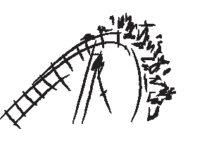
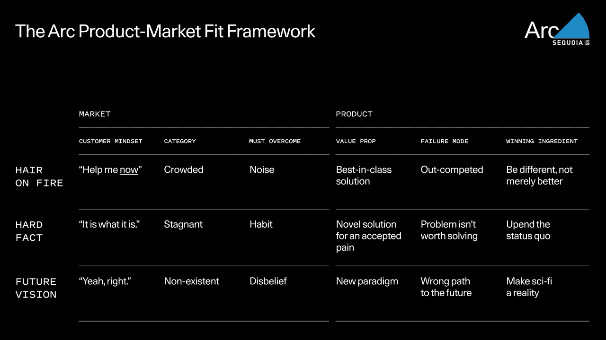
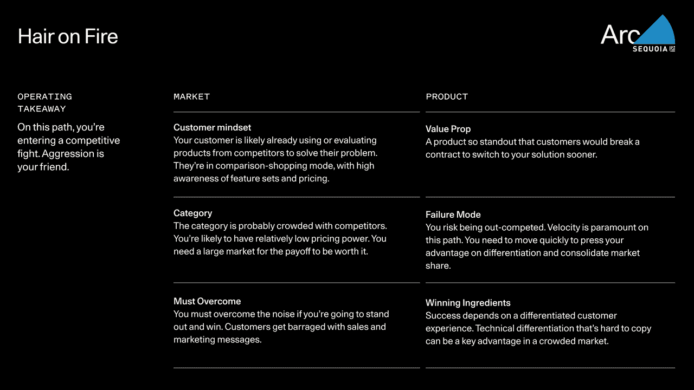
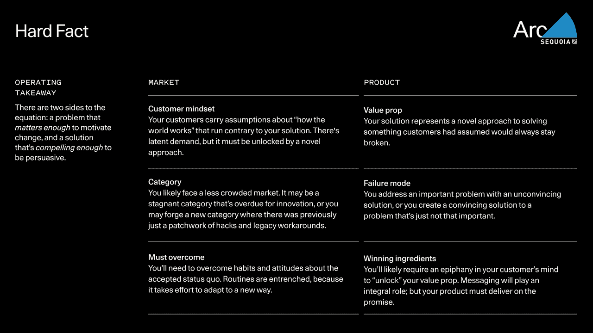
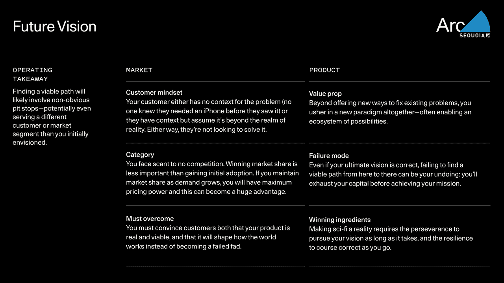
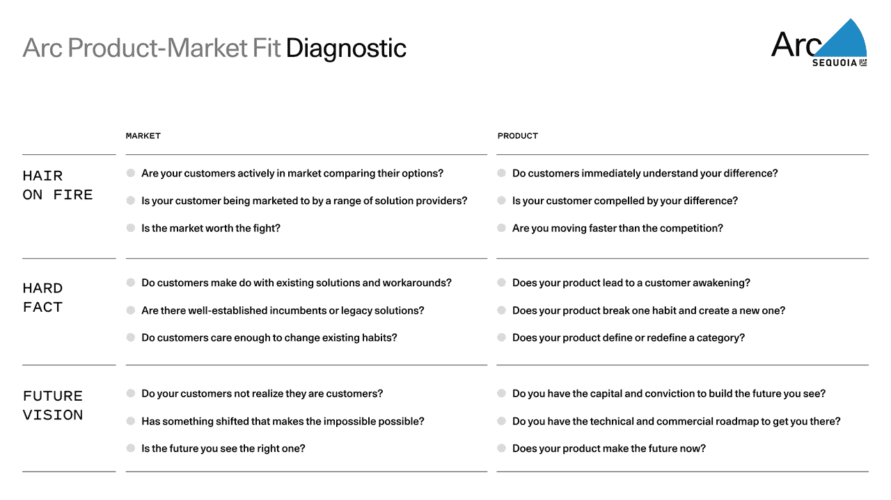
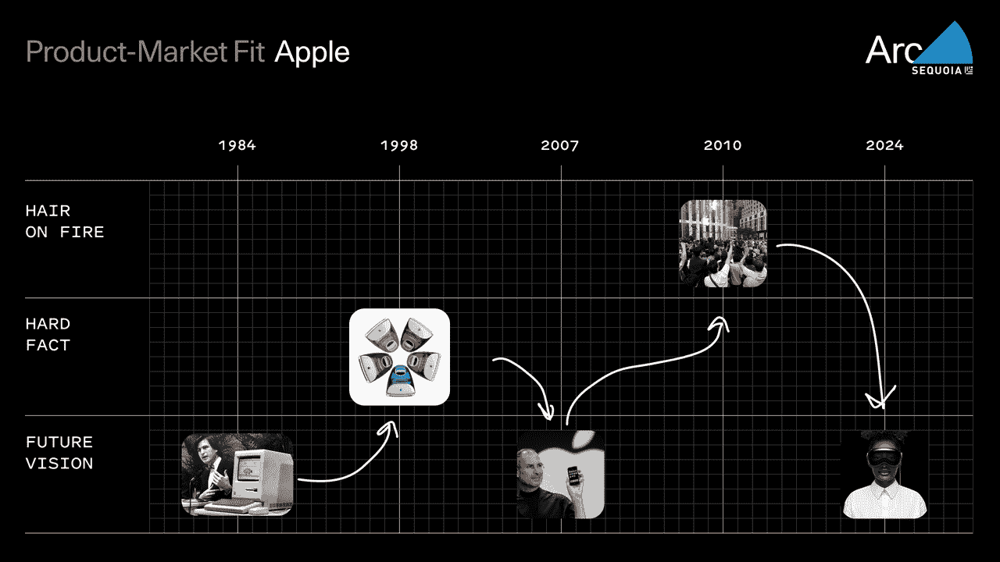

# 产品市场契合度（PMF）框架 ｜ 红杉

> 来源：[https://waytoagi.feishu.cn/docx/FMKKdWxuoo9XAOxbbahc1IUInPm](https://waytoagi.feishu.cn/docx/FMKKdWxuoo9XAOxbbahc1IUInPm)

> 🔗 原文链接： h[ttps://www.sequoia](https://www.sequoiacap.com/article/test-pmf-framework-2/)cap.com/article/...

> 发表时间：2024 年 3 月 15 日

寻找产品市场契合度是每个早期阶段创业公司的中心任务。关于这一[任务，人们有许多](https://www.sequoiacap.com/arc/)不同的思考方式和方法。在我们的 Arc 构建沉浸式课程中，我们引导初创公司的创始人理解以下框架，这一课程针对前种子和种子阶段的公司。我们经常听到人们说这个框架能够提供清晰的指导，因此我们现在决定将其公开分享给更广泛的创业社区。我们希望这能够增加创始人在其产品市场契合度（PMF）旅程中可以借鉴的资源库。

## 3 种产品市场契合度框架（PMF）

归根结底，产品市场契合度关乎你的产品在世界中的位置。关于产品如何适应这个世界，有不同的方面可以深入探讨——比如竞争格局、产品的技术优点等等。我们认为最佳的方法是首先关注客户如何与你的产品解决的问题产生关联。

存在不同类型的问题，以及客户与这些问题产生关联的不同方式。我们认识到有三种基本原型，每种都有其独特的客户与产品之间的关系动态。

### 紧急需求**（Hair on Fire）**

你解决的是对客户来说明显而迫切的问题。需求显而易见，因此，你的市场可能充斥着竞争者，大家都在争夺市场份额。客户正在积极地寻找解决方案，并可能在比较现有的产品。要在这样的市场中脱颖而出，必须提供超群的解决方案。而卓越的产品之所以突出，是因为它们具有区别性，而不仅仅是更好。你的产品不能仅仅更快或更便宜——你需要提供一个真正与众不同的客户体验来获得持久的竞争优势。

### 改变固有认知**（Hard Fact）**

你识别到的痛点被普遍视为生活中不可改变的硬性现实，但实际上这只是你的产品能为客户解决的难题。客户已经习惯于忍受这些问题，他们没有迫切地寻找解决方案。现状似乎已成定局，改变不在考虑之中。你通过一个出人意料的方法来颠覆现状：事实虽不可改变，但问题可以解决。挑战在于打破习惯的力量。客户需要改变他们现有的行为模式，而惯性是一大障碍。你需要提出一个足够新颖的解决方案，解决一个足够重要的问题，使得客户愿意做出改变。

### 构建未来愿景（Future Vision）

你通过创新开启了一种新的现实。未来愿景不仅仅是引入了听起来像科幻小说中的概念——不管是因为这个概念虽熟悉但似乎不可能实现（如通过核聚变获得的丰富而廉价的能源），还是因为之前从未有人想到过它（如 iPhone）。客户不仅没有尝试解决这个问题，他们要么对此一无所知，要么本能地认为这是不可能实现的梦想。这一路径上的障碍是怀疑：客户必须相信你的产品代表了一个全新的范式——通常伴随着其自身的生态系统。（iPhone 不仅是一种设备，其 App Store 代表了与互联网互动的新方式。特斯拉不仅是一辆汽车，它的摄像头网络和自动驾驶软件代表了一种全新的驾驶体验。）客户必须对这种新范式及其带来的可能性无法抗拒。如本文所述，这条路径往往很长，找到正确的道路和途中的商业机会至关重要。

## 各路径如何选择

在 Arc 项目中我们遇到的许多创始人倾向于认为他们自己应该处于“紧急需求”路径上。他们认真听取了“听从客户需求”的忠告。这是一条宝贵的建议。但他们往往会惊讶地发现，“改变固有认知”和“构建未来愿景”这两种动态同样是实现产品市场契合的有效路径。

希望你已经在解决一个你拥有独特解决优势的问题。不过，你的成功路径将由你的客户如何看待这个问题（以及他们对你的解决方案的感受）来决定。在任何一条路径上都能够寻找到成功——但每条路径都有其特定的运营重点，理解这些重点是至关重要的。

### 路径 1 – 紧急需求

“紧急需求”路径既需要一个出色的产品，也需要一个出色的市场进入策略——而且这两者需要紧密连续。解决方案、销售和速度的结合是克服竞争的关键。

### 紧急需求 – 案例研究

除了产品速度外，突破成功找到“紧急需求”路径的公司的一个特点是能够积极地超越竞争对手。

当帕克·康拉德（Parker Conrad）创立 Rippling 时，他进入了一个大型的“紧急需求”市场。每家公司都需要人力资源软件，这种紧迫性反映在激烈的竞争中：市场上已经至少有半打的老牌企业在争夺市场份额。事实上，其中一个竞争者就是帕克自己之前的公司 Zenefits。为什么还要努力呢？因为他深厚的专业知识意味着他知道需要做出什么不同：虽然其他供应商通过整合不同的数据集来提供一个集人力资源和福利于一体的平台，但 Rippling 的方法是构建一个统一的数据库。除了这个员工的基础数据，然后还可以涵盖到员工体验的任何方面，从福利到费用再到设备管理。他们的技术优势为人力资源、财务和 IT 管理员创造了不同的体验，这使得 Rippling 能够在众多老牌公司中脱颖而出并迅速增长市场份额。他们打包最广泛的员工体验的策略，即使在“紧急需求”动态选择中，价格对新进入者来说可能是个挑战，但这赋予了它定价权。

阿萨夫·拉帕波特（Assaf Rappaport）和他的 Wiz 联合创始人以前一起创立了 Adallom。对于他们的新公司，他们对云基础设施安全的问题很感兴趣——但这已经是一个与像帕洛阿尔托网络（Palo Alto Networks）这样的老牌企业提供产品的拥挤市场。然而，当他们采访 CISOs 时，这个话题总是出现在每个人愿望列表的顶部。在一个大市场中有明显的需求——但需要一些挖掘才能找到差异化的机会。大多数云安全产品依赖于代理，这是一种需要安装在每个服务器上以便监控的软件，传统上只有安全团队使用。Wiz 构建了一个专为云设计的“无代理”解决方案，不仅减少了摩擦和头痛问题，而且专注于扫描所有云层并跨云堆栈相关联风险。更好的是，一旦连接，它可以在 15 分钟的客户演示过程中显示出那些漏洞，并使安全和开发团队能够一起工作以改善云姿态。阿萨夫和他的团队找到了他们的优势，并踩下了加速器，积极地超越竞争对手：工程师们在以色列时区的工作日构建产品，并在夜晚兼职作为销售代表——那时候在美国是白天。他们在一个季度内从 0 增长到 280 万美元，并在 18 个月内达到 1 亿美元的年复合增长率（ARR），创下了有史以来增长最快的软件公司的新纪录。

### 路径 2 – 改变固有认知

“改变固有认知”路径包括促使客户重新评估并改变他们当前处理某一过程的方式。这首先需要对市场进行教育，然后抓住机会。

### 改变固有认知 – 案例研究

你的新颖方法可能会替代现有市场（如 Salesforce 将 CRM 迁移到云端）或可能创造一个新市场（如 Uber 将出租车体验重新想象为共享汽车市场）。无论哪种方式，你在“改变固有认知”路径上可能会面临较少的竞争，因为改变现状的困难已经让其他创始人望而却步。为了成功，Uber 不仅必须说服成千上万的普通人载着陌生人四处驾驶，而且还必须与出租车工会、当地法规和劳动法律打交道。其他人对这种困难的天然厌恶意味着你可能会获得更多的空白市场机会。

当 Block（原名叫 [Square](https://squareup.com/)）首次推出时，他们要解决的困难现实是众所周知并且被普遍接受的：“仅限现金”。对于许多小企业或任何农贸市场来说，他们没有办法接受信用卡支付。消费者只能辛苦去寻找自动取款机，而商家则经常错失销售机会。杰克·多尔西和吉姆·麦克尔维的独到见解是，正在变得无处不在的智能手机，实际上可以有效地转变为移动信用卡终端。Square 意识到这个所谓的生活固有事实实际上是一个它们可以解决的难题。但是，要想获得成功，就需要让世界看到它不再需要忍受这一痛点，并且足够信任 Square 的解决方案来采纳他们的新方式。为了激发这种顿悟并赢得早期采纳者的支持，他们会宣传这一产品，Square 早期决定免费向商家提供硬件和软件，并稍后再找出商业模式。最终，Square 成为了一个新标准。

200[6 年，营销主要](https://www.hubspot.com/)由广告、邮件和电话营销组成。这使得小企业处于不利地位，因为这些都是高成本渠道。布莱恩·哈利根和达默什·沙阿意识到有一种新的方式：小公司可以利用快速成熟的互联网的特性——博客、社交媒体、SEO、电子邮件通讯——以传统渠道一小部分的成本达到观众。HubSpot 的一套内容、SEO 和电子邮件管理工具为客户解决了这个问题。但是，为了让客户相信他们的方法并开始采用他们的产品，HubSpot 需要在客户心中明确新的方式——使他们意识到旧的方式已破损并可以被更好的东西所替代。他们通过为他们的新方式创造一个术语——“入站营销”——甚至写了一本关于它的书来实现这一点。他们在市场教育方面如此有效，以至于这一想法获得了认可，并在小企业界引发了一场营销革命，推动 HubSpot 达到产品市场契合，甚至更远。

### 路径 3 – 构建未来愿景

“构建未来愿景”路径可能是最容易失败、成功途径最少，但潜在收益最大的路径。走这条路需要耐力和长期吸引及留存顶尖人才的能力。

### 构建未来愿景 – 案例研究

哲学家索伦·克尔凯郭尔说过：“生活只能通过回顾来理解，但必须向前看去生活。”像Nvidia的创始人黄仁勋这样的“构建未来愿景”创始人，经历了曲折的30年路径来实现公司的创立雄心，可能会有共鸣。

Nvidia最初的愿景是通过一款3D图形芯片提升个人电脑的功能，这将彻底改变使用电脑的体验。当Nvidia发布其第一款芯片时，它如此超前于时代，以至于没有人知道如何使用它。芯片经过了六年时间和三代产品线才在一个行业中找到产品市场契合点——视频游戏行业，这里GPU具有不可抗拒的新可能性。虽然Nvidia最初的雄心并不仅限于视频游戏行业，但它成为了游戏创新的代名词，其GPU支持了PC和Xbox。如果不是那个非常有成效的中途站——推动Nvidia实现盈利和IPO——公司就永远不会存活足够长的时间来推动当今的AI革命。实际上，在找到游戏中的PMF之前，他们一度濒临破产。从成立开始的三十年后，Nvidia正在使新的计算范式成为可能，GPU正在改变从数据中心到云计算的一切。

未能找到产品市场契合的“构建未来愿景”产品通常被描述为“太早了”。例如，谷歌眼镜发布11年后，增强现实仍然没有成为主流。这正是为什么沿途找到具有商业吸引力的中途站如此关键的原因。假设你的愿景是正确的，并且你能找到一个可行的路径，时间将在“构建未来愿景”路径上站在你这边：当世界开始转向你的范式时，你可以积累起无法逾越的领先优势。但找到正确的中途站可能很困难。你必须在不完美的信息下行动——正如克尔凯郭尔所说的“向前看去生活”，而且回顾时总是更容易看到陷阱。往往找到正确的路径意味着接受技术生产和服务市场的意外转向。

OpenAI是我们这个时代最有趣的“构建未来愿景”故事之一。它的愿景是实现人工通用智能（AGI）——长期以来在技术圈被视为白日梦——并且为了人类的利益而实现它。为了实现这一目标，他们起初作为一个非盈利组织，因为创始人认为公司的盈利动机会破坏他们的人类利益使命。然而，几年的旅程后，他们意识到，推动他们的大型语言模型创新所需的计算成本超过了即使是最有资源的非盈利组织的筹资能力。他们的路径需要转向盈利领域。采取更传统的初创企业结构带来了资金以及产品发布的期望——因此有了ChatGPT。它立即在“直到我看到它之前，我无法想象会需要它”的iPhone范式中找到了产品市场契合。2022年，对生成式AI的消费需求还处于萌芽阶段。到了2023年，OpenAI产生了16亿美元的收入。虽然ChatGPT实现了有史以来任何消费技术产品最快的人群覆盖度，但对OpenAI来说，这只是他们通往真正雄心道路的中途站。

### 把它们综合起来

使用这三条路径的框架——同时记住其中没有一条比另外两条更好——你可以反思自己的产品在世界中的位置。你在哪条路径上？客户如何看待你正在解决的问题？你是否考虑了正确的路径？你的运营优先事项是什么？你需要优化速度和规模，还是需要与早期采纳者达成默契，或是规划你旅程中的中途站？

### 探索仍在继续

实践总是比理论更为混乱，在现实世界中应用这些思考时，有几个重要的细微差别需要记住：

产品市场关系是动态变化的。随着时间的推移，许多公司在推出新产品或客户对现有产品及其背后问题的态度发生变化时，最终会从一条路径移动到另一条路径。有些公司同时跨越两条路径。这个框架的要点并不是要不可撤销地将你的路径定型；将自己过于狭隘地与任何一条路径相认同都是一个错误。

例如，苹果最初是作为一个“构建未来愿景”的公司开始的。该公司在1978年给红杉资本的初始备忘录中承认，对家用电脑的需求为零。“苹果管理层”表示，“他们相信，1980年的大多数潜在客户今天对购买家用电脑没有丝毫兴趣。”然而，随着他们在80年代突破想象力并实现增长，个人电脑的类别不再是一个“构建未来愿景”。到了1998年，随着iMac的推出，苹果解决了一个“改变固有认知”的问题：电脑虽然日益普及，但缺乏个性。当史蒂夫·乔布斯在2007年发布iPhone时，它立即作为一个“构建未来愿景”找到了产品市场契合。然后，智能手机类别迅速转变为“紧急需求”的动态，市场上涌现了大量新智能手机。苹果通过定义类别、正确判断并持续创新，成功保持了其主导地位。今天，苹果正在介绍又一个“构建未来愿景”——Apple Vision Pro。该设备利用了为iPhone开发的传感器的10倍进步：一个产品的PMF旅程的成果可以为下一个产品创造种子。Apple Vision Pro是否会启用我们现在还无法想象的全新体验，并在几年后坚定地进入“紧急需求”路径？时间会告诉我们。

传奇公司将多个产品线串联在一起，这些产品线通过一种产品市场适应路径发展到另一种产品市场。 虽然一种产品可能会趋于稳定，但下一种产品会开始凸显出来。

无论您处于这个周期的哪个阶段，您都可以使用此框架来定位自己。 PMF 可能看起来像是您想要达到的目的地，但一旦您到达，保持并扩展它就是一个持续的追求，并且将随着您的公司的存在而持续下去。

---