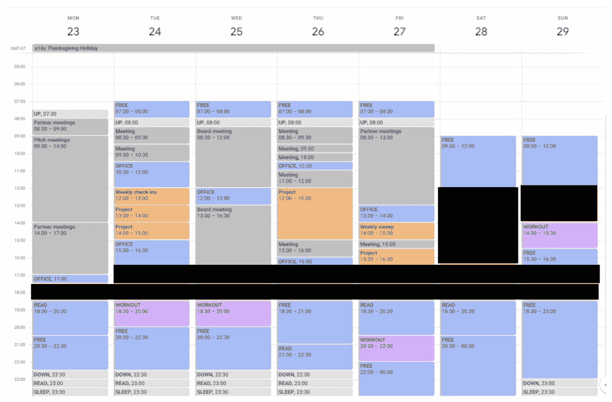
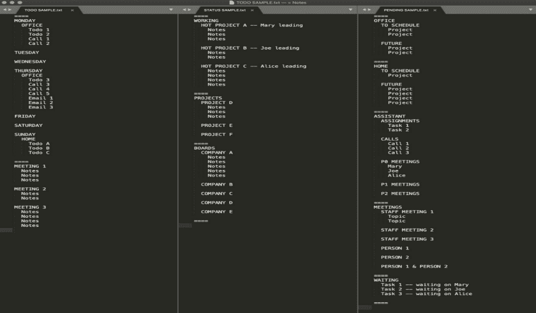

# 结构化的工作方法和人生｜Marc Andreessen

> 来源：[https://waytoagi.feishu.cn/docx/Ok1RdRMPWoqfNvxqE0Mc3PRznRg](https://waytoagi.feishu.cn/docx/Ok1RdRMPWoqfNvxqE0Mc3PRznRg)

> 原文链接：https://www.theobservereffect.org/marc.html

> 译者：胖福馒头 https://mp.weixin.qq.com/s/AEuo224AGt1hZafv3hoUjQ

> 略有修改，并补充了原文的后几段内容

欢迎来到“The Observer Effect”的第一次采访。在为这系列有趣的领导者和机构的采访进行计划时，我只想到了一个人作为首位受访者 - Marc Andreessen。此次采访发布于2020年6月13日。

Marc是互联网历史上最著名和有影响力的人物之一。我们很幸运地与他进行了一次广泛的对话，讨论了他如何利用他的时间，他如何为自己设定目标，他是如何阅读如此多的内容，经过这么多年他仍然如此投入是什么原因，以及他希望人们建立什么。Marc对于他的回答非常慷慨和开放，我希望你能像我一样喜欢这次对话。

# **关于生产力**

[**Sriram：十多年前**](https://pmarchive.com/guide_to_personal_productivity.html)**，你在个人博客上发布了著名的《Pmar**ca生产力指南》。那么，2020版的《Marc Andreessen生产力指南》是什么样的？（Pmarca是Marc Andreessen的个人博客）

**Marc：**最大的变化是，我基本上已经完全摒弃了13-14年前的模式。很多这样的变化都是由于创办了A16Z然后扩大这个公司所驱使的。目前，我们的投资组合中有大量的公司，而且在任何时候都有大量的投资正在进行。对我和这里的高级合伙人来说，很多事情都让我们感到压力很大。这迫使我全面转向了一种更加结构化的生活方式。

对我来说，现在的典型一天就是非常严格地遵循日程表。我尽可能地想要有一个“程序化”的一天。

Sriram：带我了解你的一天。

**Marc：**我应该首先说，如果没有我出色且不知疲倦的助手Arsho Avetian的帮助，以下的任何事情都不可能实现。她已经是我超过20年的秘密武器了。

我的日程安排更多是以周为单位。一周中的一天决定了很多事情。周一和周五有非常具体的时间表，因为我们是按照风险投资公司的节奏运行的。周一像一场全天“马拉松”，因为大部分真正的团队合作都在周一进行。周五的安排和周一一样。周二、周三、周四的时间安排会灵活很多，通常更多的是外出会面、董事会会议、企业家咨询等等。从周一到周五都按照这个时间表进行工作，我现在终于明白人们为什么会有周末这个概念了。我正在尽我最大的努力为周六和周日留出一些休息时间。

**Sr**iram：在你之前的帖子里，你谈到了Arnold Schwarzenegger（阿诺德·施瓦辛格）的开放式日程，还说到了在一天中拥有非结构化时间的好处以及给你带来的灵活性。

**Marc：**我觉得Arnold接受那次采访时，我认为他处于“创业者模式”。当时，他参与了很多创业项目，并开始了很多新的业务。如果你是一个处于创新模式的创业者，那么这肯定是有益的。

我早年做编程的时候也像他一样忙。基本上一直只做一件事，直到筋疲力尽。然后第二天早上起床再继续。我从来没有一个真正的日程计划。我只知道我在做什么。从某种意义上说，这和没有时间表是一样的。但是如果你要处理涉及组织运营或者客户服务的事情时，就会面临挑战。这就在于我们是如何看待自己的工作的。如果你工作的一部分是处理大量的电话或者邮件，你需要及时回复，不要让人等太久。也许有些人能做到立即回复，但是我不知道该怎么做。

Sriram：有没有哪一刻你决定改变你的旧系统？是你创办公司的时候吗？

**Marc：**是的，老实说，在2009年创办公司时我们就马上开始了。公司的创立只是引起改变行动的一个契机。我们公司的价值观之一就是尊重与我们合作的人，做到这一点就包括——我们绝不会掉链子。我们确保回复即时，我们制定了服务等级协议（SLA），能在特定时间段内进行回复。用摩根大通的一句老话来说，“以一流的方式，从事一流的业务”。如果你联系我们，你一定会得到回复。我们承诺做什么，就一定会做。我们有必要为此建立一种系统。

我认为风险资本是非常“接地气”的工作。那些试图将自己从日常工作中抽象出来的风险资本家没有做得很好。你必须真正了解正在发生的事情。你必须真正密切关注这些市场、这些技术和这些创业者正在发生的事情。而且你必须一直和很多人交流，所以一种更结构化的工作方法十分必要。

Sriram：周一早上或者周日晚上醒来看到自己的日程表时，你会想什么？

**Marc：**我在想“上帝，我是有条理的！我有计划！”。如果没有这个，我醒来的第一刻就会惊慌失措。

基本上每一件事都记在日程表上。睡觉也在日程表上，自由时间也在日程表上。自由时间很重要，它就像一个释放压力的阀门。只要你知道自己有足够的时间休息，你就可以全力以赴地工作很久。但是我发现如果没有安排足够的自由时间，你就会对自己的日程表产生不满。当我年轻的时候，我真的没有“关机”的概念。但是，随着年龄的增长，你的身体就会反抗。而且很明显，如果你还有一个家庭，只有工作的系统绝不是一个好的选择。

# **关于开放式时间和放权的价值**

**Sr**iram：我觉得你的日程表中很有意思的一点就是分配了很多的开放式时间。我们经常谈论世界上一些最有趣、最有影响力的人往往有大量的开放空间。而不是那些从早上8点到晚上7点每30分钟都安排得满满当当的高管。

**Marc：**我们都和时间表被N件事情排满的高管合作过。对于这样的高管，你往往会发现这三点。

### ...这就像那些经典的电影场景，当有一个巨大的危机，有人对他的秘书喊道：“取消我的日程！”...

1.  他们从来没有时间去真正地思考。而事实证明思考是一件非常重要的事。

1.  他们很难适应环境的变化。在风险投资这一行业中，你会遇到很多问题，需要处理很多紧急情况。就像那些经典的电影场景，当遇到巨大的危机时，有人向他们的秘书喊道，“取消我的日程安排！”。好吧，如果你的日程表有一定的灵活性，也许你就不需要这样做了。

1.  你可能已经发现了，被这种日程表“控制”的管理者可能最后只会成为微观管理者。你可能已经见过一些这样的人被工作压得喘不过气。好消息是他们对组织中的每件事情都了如指掌。坏消息是他们已经成了工作中的瓶颈。这种情况的极端形式就是，他们的办公室外总是排着长队。我就曾和几个这样的人一起工作过。等待的队伍沿着走廊延伸，人们都等着进去见他。他们也是组织的瓶颈。在这样的组织中工作很令人士气低落，这基本上与放权的情况相反。

**Sri**ram：与此相关的话题就是放权。对于很多这样的人来说，放手很难。放权往往是陈词滥调。说起来容易做起来难。所以，如果你想在日程表上争取一些开放式时间，你会怎么做？你实际上会怎么表达，“我不打算这样做”，“我会说不”，还是“我打算让别人做这件事”？

**Marc：**我管理的方式就是，我不直接管理任何人。

**Sriram：对我来说，你是一个不同寻常的对话对象，因**为你不是那种管理着大型组织的传统CEO。

**Marc：**没错。所以这必然会有所不同，至少在某种程度上是不同的。我没有传统CEO那些一对一处理各种事务的压力，也不承担所有的管理责任。我参与了公司的大量管理工作，但这些都是我们在内部会议上讨论的内容。然后我们选择优秀的人才来管理这些团队。在某些时候，我们都需要做的就是弄清楚哪些事是不用做的，能委托给他人来做的。

**Sr**iram：现在我们正好来聊一聊你发给我的这张截图。每位高管都必须有自己的check-in系统。你的时间有限，而且有一堆关心的项目都需要你去关注。那你所使用的系统是什么样的？

（备注：“check-in系统”是公司管理中一个众所周知的说法。保持英文表达也能更容易理解；根据原文，“check-in system”可理解为“项目进度签到系统”。）

**Marc：**所以，简单来说，有两类项目情况。Apple有一个叫做直接负责人（D.R.I.; directly responsible individual）的概念。我对于任何一个项目，都会试着确定DRI，谁是负责项目交付的人。如果是我，那么项目完成后就会出现在我的日程表上。如果它没有出现在日程表上，就表示它还没有完成。每周的check in是针对其他人负责的所有项目。举个例子，你可能有一家公司在筹集资金或进行一笔大交易。我不一定要每天追问企业家或CEO，但至少要经常了解最新的情况，我不希望我对事情的发展一无所知。

# **关于目标和系统**

**Srir**am：我想再跳脱出来讨论。谈谈时间跨度长一点的日程，比如以年为单位。是否有一周你会在山顶上冥想，然后说“好吧，今年我需要花更多时间与创始人呆在一起”，或者“今年我需要花更多时间阅读科学论文”或者类似的计划。还有个相关的问题是，你是如何将你的目标和公司的目标，与你花费时间和精力的方式联系起来的？有这样一个山顶吗？

**Marc：**（笑）没有该死的山顶！让我远离山顶，远离蚊子。没有，这些都没有。所以事情是这样的。第一，每六个月左右，我都会感到不知所措，觉得一切都不在我的掌握之中。所以大约每六个月，我都会坐下来自省。也就是跟自己说“好吧，你有个很棒的系统，但它超负荷了”，或者“你对太多事情说‘是’，你参与了太多事情”。

你必须要提升自我，要搞清什么是重要的。我通常会花一个小时来复盘我一直在做的事，基本上就是确定“是”与“否”的阈值，我试着每年进行一次修改。另外，我也会每年都重新制定我的个人计划。从头开始写我真正想做的事和我的目标，然后把相关的活动排列起来。关于时间分配，我想说一两点。首先，它并不是电子表格驱动的。你读到的这些高管/CEO都在做这项非常复杂的事，他们用电子表格进行时间管理……

**S**riram：Steve Ballmer（史蒂夫·鲍尔默 微软前首席执行官）就是用电子表格进行时间管理的范例。

**Marc：**是的，确实。所以他们有这些详细的分析、饼图、报告等等，如果你经营着一家财富500强公司，我也许能理解。那时你就像一个国家元首。你需要在不同时间段见不同的选民，做许多不同的事情，并试图每10分钟优化一次。我真的很同情面临这种挑战的人。从我来说我不愿意达到这么严苛的程度。

对于发生了什么事和如何去重新平衡，我正试着寻找某种直觉。这个公司的建立是为了实现我想要实现的东西。我的角色就是在公司的背景下去实现这个目标。所以答案总是一样的。就好比，我们如何优化公司？对于公司参与的项目，我如何优化我自己的工作？所以，连续11年，这个问题的答案每年都一样，而且短期内都不会变。我认为，相比于重新思考目标，更多的是针对单个目标进行调整。

# **关于过程、结果和赌注**

**Srir**am：这是一个非常有趣的话题，因为如你所知，无论是在个人层面还是在组织层面，关于如何设定目标有两种流派。一种是利用OKR目标管理模型和各种指标，通过查看一些可量化的对象来客观地衡量结果。另一种则只关注投入和过程，而不是实际结果本身。而你的工作是独一无二的，因为它具有多年的长期反馈循环，而不是个只有季度业绩的业务部门。

**Marc：**是的，我们基本上都只关注投入。基本上就是过程与结果的关系。而这正是你所说的原因。风险投资需要很长时间才能看到结果。在我们最初的五年里，我们真的不知道它能否成功。所以就是，我学到了什么？比如，在前三年，它毫无进展，我会学到什么？因为有时这些公司挣扎了一段时间，然后他们真的成功了。有时则恰恰相反，他们很快就成功了，但是之后遇到了严重的问题。

很难找到一个合适的比喻，但它比较像打扑克，成为一名优秀的扑克玩家真的，真的，真的很难。如果一手气不好就自责，就会养成这种坏习惯。你只是需要一个让你能够思考整个过程的系统……

**Sriram：Annie** Duke的《对赌》（Thinking in Bets）是这方面最好的书之一。

**Marc：**是的，正是。Michael Mauboussin（哥伦比亚商学院教授迈克尔•莫布森）在他的书中也写了大量关于这一职业的内容。投资是一个分离过程和结果的过程。我们的世界几乎总在试图优化过程。结果会在5年、6年、8年或10年后才出现。在这一点上，我很怀疑复盘你所做的工作和你得到的结果之间的因果关系是否有用。因为这种做法没有确定性，也不靠谱。

Sriram：因果关系真得很难推导。

**Marc：**是的，所以我们不会在这上面花费大量时间。我们所关注的是——运行过程的最佳方法是什么？运行公司的最佳方式是什么？帮助创业者的最佳方法是什么？顺便说一句，提供过多的帮助并不是最好的帮助方式。最好的方式是确保我们了解行业中正在发生的事情，为我们的网络提供帮助的最佳方式是什么，为团队管理提供帮助的最佳方式是什么。这些都是过程。

老实说，这也有点符合我的心理，其实我并没有赌博的基因。我从赌注和结果中得不到任何快感。我坐下来一赌，什么也没有发生。我的心跳不会因此加速。而大脑的数学部分就像，好吧，这个的预期回报是负的，那我**的到底在做什么？所以在不到10秒，我就会失去兴趣然后走开。我们公司并不会过度庆祝成功，也不会因为获得实际利益就激情高涨。我们在意建立极具竞争力的公司，但回报不是重点。

**Sriram：这是一个有趣的观点，因为外行人经常把风险**投资家比作赌徒，而内行的看法却截然不同。

**Marc：**我永远不会成为一名职业赌徒，但你会发现职业赌徒都有一个特点，他们可能会在晚上赌牌，白天则会一起出去玩，为大笔的钱做附加赌注。这实际上就是一场额外的赌注，坐在餐厅里打赌经过的红色汽车是不是比蓝色汽车多。他们是在“磨练”自己的心理，以便能够用纯数学的视角不带任何感情地下注。他们努力让自己做到不露声色。相反，上了赌桌，他们则希望对面是一个极度情绪化的人。因为不露声色的人最懂得“屠杀”情绪化的人。

奇怪的是，赌博这种活动本来就应该让人感到情绪的强烈变化，但真正的专业人士却对此无动于衷。他们不在乎，因为这是一个概率的结果。这只是游戏的一部分，他们会回来继续游戏，第二天的结果可能会更好。

# **关于书籍和阅读**

**S**riram：我要稍微转变一下话题。关于这次采访的问题，我问了很多我们都认识的人。其中一个最常见的问题就是：你是怎么读这么多书的？

### ...这个世界非常复杂多变，想要搞清楚它是一个毕生事业....

**Marc：**我从很小的时候就一直在读书，阅读是一辈子的事。基本上是试图填补大的差异中的所有拼图碎片。一个很好的术语是“意义制定”。意思就是，搞清楚到底发生了什么，为什么？这个世界非常复杂多变，想要搞清楚它是一个毕生事业。

过去几年我一直在尝试的是“杠铃式”阅读。我读的东西要么是最新的，要么是经典的。

**Sriram：从****林迪效应****看，这么做不会出错。**

**Marc：**没错。我想把中间的东西都去掉。因为我发现，中间地带里能写点什么，能解释上周、上个月、去年甚至过去十年里发生的事情，以及能够客观解读情况并值得我信任的人屈指可数。有几个，但数量不多。比如我们现在的情况，现在[在新冠疫情下]实际上正在发生什么，我每天都在关注科学和经济学领域里关于新冠病毒的的内容，因为这些都很重要。而且我会避免所有的评论和解释。

另一个，正如你所说，有大量经典书籍随着时间的推移确实被证明是正确的。你可以一生只阅读经典作品，很多聪明人都是这么做的。

**Sriram：那么你如何在一个新的领域中完成从零到**一呢？你从哪里开始？是先广度还是先深度？

**Marc：**作为一家（投资）公司，我们会结识很多人并与之交谈。所以，确实，很多都是面对面的谈话。通常，了解一件事的方式是因为有人告诉你这件事。所以，你首先要认真留意每次谈话。然后有人会告诉你一些重要的东西或者新的领域。我称它们为“来自未来的事物”。世界上正在发生一些事情，它只发生在一个地方。但是……哇，它很可能最后会发生在任何地方。我经常会问认识的那些人，我可以和谁交谈或者我可以读什么书。

每隔一段时间，就会有好事发生。当我问我有什么能读的时候，他们会说，“好吧，真的什么都没有”。而这是最好的情况，因为这意味着我们可能是第一个要发现什么的人。如果是关于技术、商业或金融的东西，我们基本上会在公司内部处理。我并不会亲自离开公司进行为期两周的深入研究，我们会让公司中的其他人完成这项工作。因为这既是他们自身发展和职责的一部分，也是让我们了解目前情况的一个机会。

### ...必须读完每一本书不仅会导致你把时间花在不该读的书上，还会导致你在阅读上拖延...

**Sr**iram：在最近的一期播客中，Naval Ravikant（硅谷知名投资人）谈到了他不把书读完的原因。他摆脱了需要读完整本书的内疚感。Tyler Cowen（美国经济学家）也说过类似的话。你会把每本书都读完吗？

**Marc：**是啊，我真的很纠结。我有一大堆书还没读完，我真的应该扔掉它们。Patrick Collison（Stripe创始人）也谈到了这一点。必须读完每一本书不仅会导致你把时间花在不该读的书上，还会导致你在阅读上拖延。如果我不读完这本书就不能开始读下一本书，但我又不想读这本书，我还不如去看电视。不知不觉中，你已经一个月没读书了，你会问自己“我都做了什么？！”我认为这是一部分原因。这种“不要那样做”的道德威胁对人的影响就是如此成功。另一种技巧是同时阅读十几本书。

**Sriram：这是怎么做到的？你身边总放着一叠书**吗？还是你会用手机上的Kindle阅读？

**Marc：**我既有一堆纸质书，也有电子书，而且会同时阅读它们。当你坐下来读书时，你只读其中最有趣的。这就相当于这堆书你都读完了。一个月后，你理论上读了一堆书，有的书你只读到了第三章就再也没有回过头继续读，就像衣柜里一件一年都没穿过的衬衫，这就是一个丢掉它的信号。

# **关于学习和改变观点**

**Sr**iram：Michael Nielsen（量子学家和计算机学家）和 Andy Matuschak（全栈工程师）谈论了“间隔重复”的力量。有些人重读一本书是为了更好地吸收它。你喜欢重读吗？

### ......当你做笔记时，它实际上就像是记忆的双重加固，记住某件事的双重机会......

**Marc：**我渴望成为那样做的人，但我失败了。我能记住大概，但记不住具体内容。我能清楚得记住想法、概念和解释，但记不住细节。我淡化了人，淡化了具体时间，淡化了具体的对话内容。

我做了很多笔记，虽然之后我从不会去翻看这些笔记。我正在阅读一本关于记忆的好书。做笔记实际上就是对记忆的双重加固。另一个读书技巧来自Chris Dixon（A16Z合伙人）。他认为书中的章节就像博客文章一样。当他坐下来阅读的时候，看到目录就好像看到一组博文，哦，这两个看起来已经很有趣了，然后你说，好的，我可以把剩下的丢掉。我不会阅读博客上的每一篇文章，对吧？我只读感兴趣的。

**Sriram：在之前的一次采访中，你谈到当你被证明你错了的时侯**你会很高兴。那么你如何寻求不同的意见呢？

**Marc：**这就像一种重要的自我提高方式。一般来说，你身边的大多数人大部分情况下都讨厌被告知他们错了，他们绝对讨厌这样。至于为什么，这确实是一个有趣的问题。我能想出的最好解释是：人们对待他们的想法就像对待他们的孩子一样。我有一个想法，就像我有一个孩子一样，如果你说我的想法很愚蠢，就像说我的孩子很愚蠢一样。然后谈话就戛然而止了。我一直在努力减少与他人争论的时间。因为人们真的不想改变想法。所以我尽量不与人争论。

然而，确实有一群人喜欢改变他们的想法。有趣的是，这种人大家都不喜欢。对冲基金经理就是这种人。真正优秀的对冲基金经理似乎都有这样的特点：如果你和他们发生激烈的争论，他们实际上会听你在说什么。他们不会总是改变想法，但有时他们会说“哦，这真是个好主意”。然后他们会说，“哦，谢谢你”，这真的很奇怪，因为这通常并不是争论的结果。他们感谢你是因为他们会在第二天早上回到办公室扭转交易。

**Sri**ram：在某种程度上，改变想法其实是他们的工作职责之一，比如套利可能就需要随时改变想法，才能赚到钱。在大多数典型的领导角色中，身份可能与战略紧密相连，比如，你正着手制定一个涉及1000名员工的战略，所以，证明某个高管是错的，虽然对组织来说是最好的事情，但对那位高管来说未必是好事。

**Marc：**是的。对冲基金的人就是最好的例子，因为他们确实每天都会改变他们的交易。他们可以在周二做多一家公司，又在这周快结束时做空。他们喜欢抛弃旧想法，正是因为你所说的，这样做能让他们赚钱。有时候我很想拥有这种心态，但是太难了。

还有，如果你想让别人告诉你你有多错，你可以去社交媒体上试试。

# **关于进步和驱动力**

**Sriram：换个话题，****Tyler Cowen****（美国经济学家）有这样一个类比，他问到对于知识工作****者来说，什么**东西相当于钢琴家演奏练习或者斯蒂芬·库里的训练。对你来说，尤其是考虑到长期的反馈循环，你每天都如何提升自己？

**Marc：**你需要一直在努力了解正在发生的事情。比如，实际到底发生了什么。

举一个典型的例子，如果你问一位企业家公司怎么样，他们总是会说“很好”。但可能并非如此。你可能正面临一场飓风，因为这就是工作的常态。那么，公司内部到底发生了什？客户实际购买的是什么？实际采用了什么策略？这项技术实际发展如何？市场竞争实际又变成什么了？如果回到现今更广泛的问题上，新冠病毒到底发生了什么？新冠病毒的实际死亡率仍然是一个悬而未决的大问题，每天都会出现新的研究，尽管如此，很多人仍固执己见。你想问——“不，不，什么是实际上发生的？”我们正处在一个科学发展日新月异的时代，这就是我之前说的贴近实际一线的意思，也是我所说的人要乐于改变自己的观点。

我经常谈到“强观点，弱坚持”的概念（在发表强烈观点的同时也开放的面对外部不同的意见）。我认为在任何业务中，都会想要承诺，想要采取行动，想要偏向于行动。很明显，如你所知，风险投资家与对冲基金经理的情况恰好相反，风险投资家必须等待10年才能知道结果。而我们最后确实会在这件事上承诺更多。

### ……我们有潜力在下个世纪或接下来的几个世纪里真正取得巨大进步，让几乎每个人的生活变得更好……

**Sriram：你一直以来都在投入并专注于未来，其中一些是出于你角色性质所致，但我相信即使你不做**这份工作，你也会坚持每天这样做吧。是什么驱动着你每天都阅读一个关于技术的新主题？

**Marc：**技术带来的革新是世界上最有趣的东西。我深信，通过多年来对经济史和文化史的学习，技术是真正的驱动力。经历了几千年的自给农业，几百年前却突然出现了垂直式的起飞。世界各地的生活质量都爆炸式提高。但并不是同时发展，而是从欧洲开始向外扩展。基本上都是因为技术的进步，比如印刷机、互联网等等。然后你就看到了这个不可思议的发展轨迹。在下个世纪或接下来的几个世纪里，我们有潜力取得巨大的进步，让每个人的生活都变得更好。技术是有效利用自然资源的杠杆，能够创造更美好的未来。

所以阅读关于技术的新主题就是我能想到的最有趣、最有用、最有益的事情。

### .....我真的只是坐下来，在接下来的四个小时里，在愤怒的推动下敲出了那篇文章......

# **论“构建”文章**

**Sriram：这是一个很好的延续。如果我不问这个问题，那就是我的失职。几周前****，您显然发表****了著名的文章，呼吁**人们“建设”。您能向我们介绍一下写作的过程吗？这是杰瑞·马奎尔式的一晚备忘录吗？

**Marc：**[是的，](https://www.wsj.com/articles/new-york-city-seeks-rain-ponchos-as-surgical-gowns-dwindle-11586821702)那是一个单独的夜晚。这确实是一个晚上。这要从斗篷的 [事说](https://www.wsj.com/articles/new-york-city-seeks-rain-ponchos-as-surgical-gowns-dwindle-11586821702)起。

我将其描述为“自下而上”和“自上而下”的组合。所以自下而上 - 我在《华尔街日报》上读到一篇报道 ，讲述在病毒最严重的时候，到处都有人死亡，医院不仅没有足够的口罩供医护人员使用，而且也没有足够的医用服。因此，该市呼吁市民自愿提供雨披，以便医院系统能够保护他们的医护人员。

而且……我决定我不能再忍受了。我真的只是坐下来，在接下来的四个小时里，在愤怒的推动下敲出了那篇文章。

Sriram：您见过的最令人惊讶的反应是什么？

**Marc：**最令人惊讶的是，这对政治双方来说都是积极的回应。特别是美国众议员凯文·麦卡锡（Kevin McCarthy），他是一位保守派人士，目前是众议院的领[导人](https://twitter.com/saikatc/status/1251644092091527168)。他很快地转发。那天晚上他把它发给了所有共和党国会议员，他们对此进行了很多讨论。另一方面，我收到了 Saikat Chakrabarti 发来的一条非常好的推文，他是美国众议员亚历山大·奥卡西奥-科尔特斯 (Alexandria Ocasio-Cortez) 的同事。

因此，可以说，有坚定的保守派和坚定的进步派，而且两者都得到了同样积极地回应。这代表了广泛的回应。有趣的是，政治的双方都认为它同样引人注目，这就是我想要的。看，肯定有很多对话要进行，比如自由市场与政府与这个或那个。但双方都知道出了问题，他们都能感觉到。

# “......所以我们需要重新思考。显而易见地说，就像，好吧，学校在哪里？医院在哪里？房子在哪里？......”

**Sriram：这篇文章最有趣的事情之一是你实际上没有规定要构建什么。现在我有了**你，如果你可以选择一件你希望读到这篇文章的人出去思考建造的东西 - 那会是什么？

**Marc：**嗯，我就选三个吧！这是我们现代困境的典型三位一体。这是医疗保健、教育和住房。这是三巨头。所以基本上，发生的事情是我们疯狂建设的行业，它们的价格暴跌。所以我们疯狂地制造电视，我们疯狂地制造汽车，我们疯狂地制造食物。过去20年来，所有这些东西的价格确实大幅下降，这对普通人来说是一件难以置信的好事。价格下跌对人们来说真的非常好，因为你可以用每一美元购买更多东西。

这里有两种方法：你得到更多的报酬或者你买的所有东西都更便宜。我认为，人们总是低估一切变得更便宜的好处。因此，我们实际制造的东西一直在变得越来越便宜。这太棒了。我们“不”建造的东西，特别是，我们没有住房，我们没有建造学校，我们没有建造任何接近我们应该拥有的医疗保健系统的东西——这些东西价格飞涨。这就是零和政治的根源。我认为人们有非常敏锐的意识。他们无法用正式的经济术语来表达，但他们对现代西方生活方式的标志有敏锐的认识。比如——我希望能够拥有一所房子，我希望住在一个好的社区，我希望能够将我的孩子送到一所非常好的学校，我希望拥有非常好的医疗保健。

这就是价格水平越来越难以承受的三件事。无论我们过去如何构建这些系统，它都让我们失败。所以我们需要重新思考。显而易见地说，就像，好吧，学校在哪里？医院在哪里？房子在哪里？

**Sriram：最后一个问题。既然你已经做****到了这一点，你对**这次采访到底有多后悔？

Marc：（笑）并没有那么痛苦。

Sriram：没那么痛苦。好吧，Marc，非常感谢你。