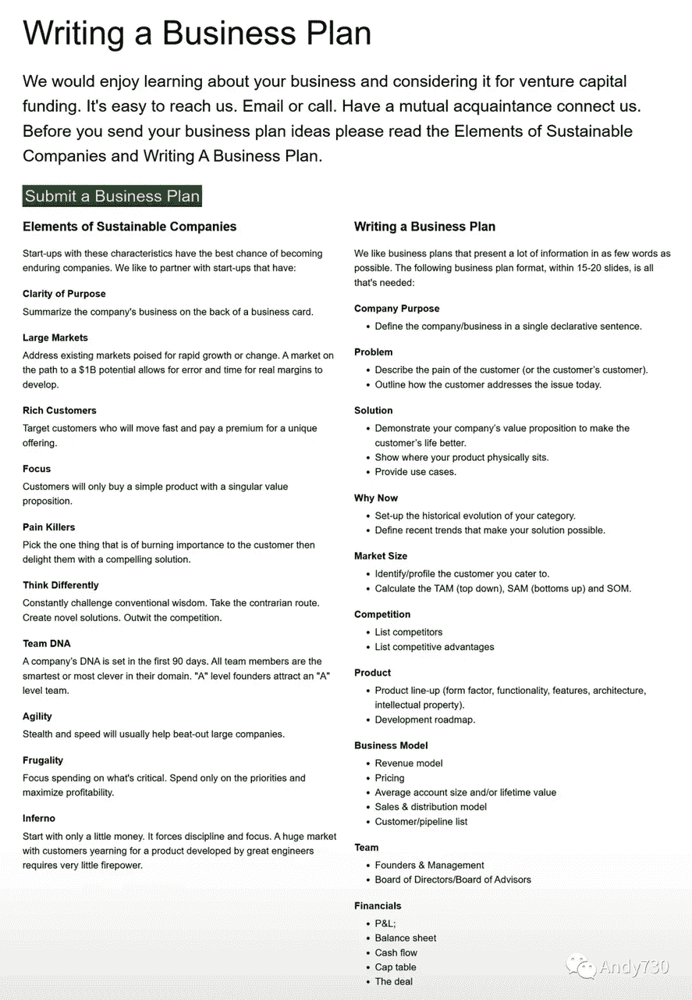

# 创业指南｜ Marc Andreessen

> 来源：[https://waytoagi.feishu.cn/docx/BAwVd9n1AoxxcyxPMgncCzx1nMc](https://waytoagi.feishu.cn/docx/BAwVd9n1AoxxcyxPMgncCzx1nMc)

> 🔗 原文链接： https://pmarchive.com/#guide-to-startups

> ⏰ 发表时间：2007 年

> [编译：Founder Park ht](https://mp.weixin.qq.com/s/6oyUGEmvzeX8fnfHC-i6tw)tps://mp.weixin.qq.com/s/6oyUGEmv...

本系列文章由 Marc Andreessen（马克·安德森）撰写，在第四部分「唯一重要的事」中，PMF 的概念第一次被提出。2007 年，Marc Andreessen 在他的博客 (blog.pmarca.com) 上发表了本系列文章。包括本文在内的系列文章被认为是「关于商业和创业的一些最好的文章」（注：Pmarca 是他的网名）。

Marc Andreessen（1971 年 7 月 9 日—）是风险投资公司 Andreessen Horowitz（a16z）的联合创始人，他还是备受推崇的 Mosaic 互联网浏览器的联合创作者，并共同创立了 Netscape，有「浏览器之父」之称后来以 42 亿美元的价格被 AOL 收购。他还是 Loudcloud 的联合创始人，后更名为 Opsware，以 16 亿美元的价格被惠普收购。

《Pmarca 创业指南》目录

+   一、为什么不要创业

+   二、当风投说「不」的时候

+   三、「但是我不认识任何风投！」

+   四、唯一重要的事

+   五、大公司的《白鲸》理论

+   六、融资多少才算太少？太多？

+   七、为什么创业公司的初始商业计划没那么重要

+   八、招聘、管理、晋升和解雇高管

+   九、如何聘请专业的 CEO

## **01**** 为什么不要创业**

在此系列文章中，我将分享我在创建高科技初创公司方面积累的知识和经验。

具体经验来自于我共同创办的三家公司：Netscape，于 1998 年以 42 亿美元的价格卖给了 America Online；Opsware（前身为 Loudcloud），一家市值约 10 亿美元的软件上市公司；以及目前正在运营的 Ning，一家新的、私有的消费互联网公司。

然而，总体而言，自 1994 年来到硅谷以来，我有幸参与并接触到了众多初创公司，数量大约在 40 到 50 家之间，这足以证明我所言非虚。我曾以董事会成员、天使投资人、顾问、各位创始人的朋友等身份，以及参与各种风险投资基金的经历，深入了解了这些公司的运作与挑战。

本系列文章将重点探讨从硅谷初创公司中汲取的各层面经验教训——因此，请不要误以为我所分享的任何内容仅代表我自己的公司。当提及某个场景或我所经历的事情时，它们很可能源于我未具名但以其它方式参与的初创公司，而非作为创始人的身份。

最后，我的许多观点都是基于硅谷及其环境——文化、人群、风险投资基础等等。其中一些观点可能适用于其它地区和国家，而另一些可能不适用。请自行判断并谨慎采纳。

说了这么多，让我们从头开始： **为什么不要创业 **。

即使在 2000 年的崩盘之后，初创公司仍然被赋予了一种真正的神秘感——你经常会看到有关创业有多么美好、多么有意思的文章，你可以在其中创造未来，享受免费的餐食、桌上足球等等。

确实，有很多关于创业的好事情。据我的经验，包括：

首先，最基本的是有机会掌控自己的命运——你可以通过自己的努力决定成功或失败，而不是听从某个蠢货的指示。对于某些性格的人来说，仅这一点就足以成为创业的理由。

其次，有机会创造新事物——就像传说中的一张白纸，你可以在上面自由地描绘你的想法。你有能力——实际上，是义务——想象一个尚不存在的产品，并将其变为现实，而不受通常困扰大公司的任何限制。

第三，有机会对世界产生影响——提供人们新的沟通方式、新的信息共享方式、新的协作方式，或者任何能让这个世界变得更美好的创意。认为低收入人群应该更容易借到钱？创办 Prosper。认为电视应该开放到无限频道？创办 Joost。认为计算机应该基于 Unix 和开放标准，而不是专有技术？创办 Sun。

第四，有能力创造理想的企业文化，并与你自己组建的梦之队共事。想让你的文化建立在每天都玩得开心、喜欢一起工作的人基础上？或者，在工作和娱乐中都超级竞争？或者，专注于创新科技的研发？或者，从一开始就具有全球视野？你可以选择，并建立适合你的文化和团队。

最后，当然少不了钱——成功的创业可以带来巨大的经济回报。这并非仅仅是满足个人贪欲，而是展现出团队和员工共同努力的成果，让他们能够支持家庭、实现梦想，甚至进行深度的慈善捐赠，为社会带来积极的变革。作为企业家，如果你足够幸运，你最终可以实现这些目标，并创造积极的社会变革。

然而，不创业有很多更为充足的理由。

首先，也是最重要的，要认识到创业将让你经历前所未有的情绪过山车。

你将在一天之内经历情绪的剧烈波动，从充满信心地认为自己将拥有整个世界，到突然感到灾难即将降临，陷入深深的绝望。然后再次回到兴奋状态。

一次又一次，一次又一次。

而且，我所说的是那些稳定的创业者可能会遇到的情况。

几乎你所做的每件事情，都伴随着诸多不确定性和风险。产品会按时发货吗？速度够快吗？会有过多的 Bug 吗？易于使用吗？有人会使用吗？你的竞争对手会比你更早进入市场吗？你会得到任何媒体的报道吗？有人会投资公司吗？那位关键的新工程师会加入吗？你的关键用户界面设计师会辞职去谷歌吗？等等等等......

有些时候，事情会进展得非常顺利，有些时候，事情则会进展得非常糟糕。你所面临的压力水平通常会将这些瞬时数据点放大成令人难以置信的高潮和低谷，其速度和幅度之大，会让你感到目瞪口呆。

听起来有意思吗？

其次，在创业公司， 除非你亲自推动，绝对什么都不会发生。

这对于创始人和初次涉足创业公司的员工来说都是个难题。

在一家成熟的公司，即使管理糟糕、气氛沮丧，事情也仍在被推进。员工们按时上班，代码被编写，用户界面被设计，服务器被配置，市场被分析，定价被研究和确定，销售电话被打出，垃圾篓被清空等等。

创业公司没有任何一家成熟公司所拥有的系统、节奏和基础设施。

在创业公司，代码不容易被写出来，用户界面不容易被设计...... 员工不容易来上班...... 垃圾篓不容易被清空。

作为创始人，你必须建立所有这些系统、流程和习惯，并确保每个人都真正投入努力——别说朝着正确的方向努力：光是让大家齐心协力，在一开始就已经很困难了。

而在你做到这一切之前，绝对什么都不会发生。

当然，除非你亲自去做。

尽情愉快地清空那些垃圾篓吧。

第三，你会被告知「不」——很多次 。

除非你在销售领域工作过，否则你可能不太熟悉经常听到别人说「不」。

这并不是很有意思。

去看《推销员之死》（Death of a Salesman）然后看《大亨游戏》（Glengarry Glen Ross）。

大致上就是那样。

你会被潜在雇员、潜在投资者、潜在客户、潜在合作伙伴、记者、分析师告知「不」......

一次又一次。

而且当你确实得到一个「是」的时候，有一半的情况下，两天后你会接到一个电话，结果发现答案已经变成了「不」。

你最好开始学习假笑。

**第四，招聘真是一大痛苦。**

你会惊讶于你将面对多少观望者。

很多人认为他们想成为创业公司的一部分，但当离开惠普或苹果这样的舒适工作的时候，他们犹豫了一下——最终选择留下。

对于那些典型的工程师或大公司中层管理人员来说，经历招聘过程并被创业公司吸引是一种令人兴奋的体验——你可以在没有真正加入或做任何辛苦工作的情况下，间接地参与到创业的刺激中。

作为创业公司创始人，当你试图招聘你的团队时，你会一次又一次地遇到这种情况。

1994 年，当吉姆·克拉克（Jim Clark）决定开始一家新公司时，我是他在各种硅谷公司中与之交谈的大约十几个人之一，后来成为 Netscape 的一员。

我是唯一一个说「是」的人（主要因为我当时 22 岁，没有理由不这样做）。

其余的人都犹豫不决，最终没有加入。

而这可是吉姆·克拉克，是 1994 年硅谷最成功的公司——Silicon Graphics Inc.（SGI）的传奇人物。

你认为这对你来说有多容易呢？

然后，一旦你经历了那些观望者，真正雇佣了一些人，你的招聘成功率可能不会超过 50%，即使你做得很好。

我的意思是，你雇佣的一半或更多的人可能无法胜任。他们可能过于懒惰、反应迟钝、容易受惊、政治化、躁郁症，或者精神不健全。

然后，你要么与他们相处，要么解雇他们。

哪一种听起来更有意思？

第五，天哪，到了某个时候你将不得不雇佣高管。

你认为雇佣员工很难很有风险——等你开始雇佣工程副总裁、市场副总裁、销售副总裁、人力资源副总裁、总法律顾问和首席财务官的时候，你就会知道什么叫困难和风险了。

第六，工作时间。

最近硅谷有很多关于工作与生活平衡的讨论——关于你应该能够创业的同时过上充实而充实的生活。

现在，就我个人而言，我非常理解这种观点。

而且我在我的公司里（至少在我过去的两家公司里）努力做任何我能做的事情，以确保大家不会被工作量和工时压得一地鸡毛。

但，这真的很困难。

事实上，创业公司是一种非常紧张的经历，在最好的情况下也会让人筋疲力尽。

仅仅因为你希望人们能够保持工作与生活的平衡，并不意味着在你快要用尽现金、你的产品还没有发货、你的风险投资人对你不满意，而你在门罗公园（Menlo Park）的那个由 Kleiner Perkins 支持的竞争对手——你知道的，那个员工平均年龄似乎是 19 岁左右的公司——正在击败你时，情况就会变得轻松。

而这将是大部分时间的常态。

**即使你能帮助员工保持适当的工作与生活平衡**，作为创始人，你自己肯定不会有这种平衡。

（顺便说一下，如果你想知道的话，工作时间确实会加剧压力。）

第七，创业公司的文化很容易走偏。

这结合了上面的第一和第二点。

这是情绪过山车，不仅对你个人造成负面影响，而且对整个公司也产生了影响。

任何公司的文化变得「确定」都需要时间——对于第一次聚在一起的团队，他们需要共同决定他们的目标是什么，他们的价值观是什么，以及他们如何看待挑战和逆境。

在最好的情况下，你组建了一个令人惊叹的团队，大家紧密合作，相互支持，并共同努力追求梦想。

在最糟糕的情况下，你最终会面临广泛的、自我强化的痛苦、幻灭、愤世嫉俗、士气低落、对管理层的蔑视和沮丧。

而作为创始人，你对此的影响力远远没有你想象的那么大。

你猜公司文化通常会走向哪个方向。

第八，有很多无法预料的因素可能突然冒出来，并把你打得晕头转向，而你却对此束手无策。

股市崩盘。

恐怖袭击。

自然灾害。

一家融资更充裕、团队经验更丰富、在你之前就已经努力工作很长时间、处于隐秘模式（stealth mode）中的初创公司，突然发布了一个产品，迅速主导了你的市场，完全封锁了你的机会，而你甚至都不知道他们正在做这个。

在最好的情况下，任何一个不确定因素都可能迅速关闭融资窗口，导致客户推迟或取消采购——或者，在最糟糕的情况下，导致整个公司倒闭。

俄罗斯黑帮通过你的服务洗钱，洗白了数百万美元，导致信用卡公司关闭你的业务。

你以为我在开玩笑吗？

好吧，现在来说说最有意思的一部分：

我甚至还没有讲到如何确定要构建什么产品，如何构建产品，如何将其推向市场，如何脱颖而出。

关于公司实际做的核心活动中的所有风险，都还没有涉及到，将在本系列的后续文章中讨论。

## **02**** 当风投说「不」的时候**

本文将探讨的是在 VC 拒绝为你的创业公司提供资金时，你应当如何应对。你可能需要改变他们的想法，或者寻找其它融资途径。

在此之前，我假设你已经做好了以下基础工作：制定了详细的商业计划书和演讲稿，评估了风险融资是否适合你的公司，并确定了你是否适合风险融资。此外，你还安排了与有资质的 VC 的会议，并进行了推介。

答案已经有了回复，是一个「不」。

一个「不」并不代表什么，VC 可能只是心情不佳，或者她在你所在的领域里与另一家公司有过不愉快的经历，或者她在另一家公司遇到过名称相似的糟糕经历，或者她与另一位看起来和你有点像的创始人有过不愉快的经历，或者她的奔驰 SLR 迈凯伦在早上高速公路上发动机故障了——可能是任何原因。所以，不要灰心，继续去见更多的 VC。

如果你和三家 VC 见面，他们都说「不」，那可能只是巧合。继续与更多的 VC 见面。

但如果你与五家、六家甚至八家 VC 会面，他们都表示拒绝，那就不是巧合了。

这说明你的 BP 可能存在问题。

或者即便 BP 本身没有问题，但你可能仍然认为它存在问题，因为你仍然未能获得资金支持。

在诸多投资人拒绝你之后，再去见更多的投资人可能只是在浪费时间。 相反，你应该重新审视并调整你的计划——而这正是本文要探讨的内容。

首先，为将来再次推介 BP 做好准备。

这是一个老套而真实的经验之谈，即VC 很少直接说「不」——更常见的是他们会说「可能」，或者「现在不合适」，或者「我的合伙人们还不确定」，或者「很有意思，让我再考虑一下」。

他们这样做是因为根据当前的情况，他们觉得不适合投资你的公司，但他们希望在情况有所改善时还能有与你合作的机会。

而这也正是你想要的——你希望通过新的信息或进展，再次与他们接触，改变他们的看法，并获得积极的回应。

所以，一定要优雅地接受「不」——礼貌地向他们请求反馈（他们可能不会完全坦诚地告诉你，至少不会完全说实话——没人喜欢说别人的孩子丑——相信我，我有过这样的经历），感谢他们抽出时间，并询问如果情况有变是否可以再次联系他们。

相信我，他们更愿意说「是」，而不是「不」——他们需要尽可能多的好投资机会。

**其次，考虑环境。**

在 1999 年被 VC 说「不」与在 2002 年被说「不」是完全不同的。

如果你在 1999 年被说「不」，我相信你是个非常优秀的人，你有巨大的潜力，你的母亲非常爱你，但你的计划确实存在严重缺陷。

如果你在 2002 年被说「不」，你很可能真的是下一个谷歌，但大多数 VC 都躲在他们的桌子底下，他们刚好错过了。

在我看来，我们现在所处的环境比这两个极端更为理性——许多优秀的项目正在获得投资，但也存在一些糟糕的项目，但并非所有糟糕的项目都能获得投资。

我将基于我们处于正常时期的假设继续。但如果情况变得过于狂热或过于悲观，那么本文的其余部分可能对任何一种情况都提供不了太大的帮助。

**第三，重新调整你的计划。**

这是一个难题——改变你计划中的内容和你试图实现的目标，以使你的公司更具吸引力。

为了描述在重新调整计划时应该考虑的方面，让我介绍一下风险的」洋葱理论「。

如果你是一位投资人，你会将投资的风险因素看作是一个洋葱。就像你剥洋葱一样，逐层去掉每一层，初创公司投资的风险也是逐层降低。

作为一位寻求融资的创业者，你的挑战是不断地降低你所在特定洋葱上的风险层，直到风险降低到风险投资人愿意说「是」的地步——直到你的创业公司的风险降低到投资人看起来不再可怕，而只是有风险的地步。

对于高科技创业公司来说，存在哪些层面的风险呢？

取决于初创公司的具体情况，但以下是一些常见的风险层：

**创始人风险 **：初创公司是否具备合适的创始团队？理想的创始团队通常包括一位杰出的技术专家，以及至少一位具备经营能力的业务人员。技术专家是否真的如此卓越？业务人员是否真正具备经营公司的实力？团队中是否完全缺乏业务人员，或者是一个完全没有技术人员的团队，因而导致难以获得资金支持？

**市场风险 **：是否存在对产品或服务的需求市场？是否有人真正需要这个产品或服务？他们愿意为这个产品或服务支付费用吗？他们愿意支付多少？我们如何了解这些问题的答案？

**竞争风险 **：是否有其它初创公司已经在做同样的事情了？这家初创公司是否具有足够的竞争力，能够与其它初创公司以及大公司区分开来？

**时机风险 **：是不是太早了？是不是太晚了？

**融资风险 **：在我们投资这一轮之后，公司还需要多少轮融资才能实现盈利？这些融资的总金额将是多少？我们对于这些估算的确定性有多大？我们如何了解这些信息？

**营销风险 **：这家初创公司能否在市场噪音中脱颖而出？营销将耗费多少成本？客户获取的经济效益——获取客户的成本以及该客户将产生的收入——是否可行？

**分销风险 **：这家初创公司是否需要特定的分销合作伙伴才能取得成功？它能否获得这些合作伙伴的支持？如何实现这一目标？（例如，对于需要与主要移动运营商达成协议才能取得成功的移动初创公司，这是一个常见的问题。）

**技术风险 **：产品是否能够成功开发？是否涉及复杂的技术，如人工智能或自然语言处理等「高深莫测的」领域？是否需要实现基本的技术突破？如果是，我们对这些突破的发生有多大的确定性，或者这个团队能否实现它们？

**产品风险 **：即使在理论上产品是可行的，这个团队是否具备构建它的能力？

**招聘风险 **：为了执行计划，初创公司需要招聘哪些职位？例如，计划构建高规模网络服务的初创公司可能需要一位运营副总裁——创始团队是否有能力招聘到合适的人？

**地点风险 **：初创公司位于何处？它是否能够在该地区雇佣到合适的人才？作为一位风险投资人，我是否需要驱车超过 20 分钟才能抵达？

你知道的，当你综合考虑所有这些风险层面并审视整体情况时，你会明白创业投资是一项多么复杂且充满挑战的任务。

你需要冷静地审视每一种风险——以及那些特定于你的初创公司及其所在领域的特殊风险——并站在风险投资人的角度思考：这家初创公司能够采取哪些措施来最小化或消除足够多的这些风险，从而使公司更具吸引力？

然后，采取行动，执行这些计划。

这可能听起来不太有意思，因为它可能需要对你的计划进行重大调整。但积极的一面是：当你的公司最终上市并需要向美国证券交易委员会（SEC）提交 S-1 注册声明时，这是一个非常好的基础。在这个过程中，你必须详细列出每一个可能发生的风险和不良情况，甚至包括全球变暖等外部因素。

以下是一些降低风险的建议：

创始人风险：这是一个复杂的问题。如果你是创始团队中的技术专家，与一位业务人员一同合作，你必须考虑风险投资人可能认为业务人员不够强大，不能担任创始 CEO。反之亦然，也许他们认为技术专家不够强大，无法构建产品。你可能需要替换一个或多个创始人，或者增加一个或多个创始人。

我将这一点放在首位，因为它可能是一个重大问题，而且关于这一问题的具体而诚实的对话可能并不容易实现。

市场风险：你可能需要在实际层面上验证市场的存在。有时候，更详细和分析性的市场研究可能有助于解决问题，但更常见的情况是，你实际上需要获得一些客户来证明市场的存在。理想情况下，这些客户应该是付费客户，或者至少是可靠的潜在客户，愿意与风险投资人交谈以验证市场假设。

竞争风险：你的差异化是否足够明显？重新思考这个问题。很多初创公司在开始甚至在获得资金后都没有足够强烈的差异化。如果你对自己与已知和未知竞争对手截然不同或具有优势的方式没有一个真正坚实的想法，你可能最好不要创办一家公司。

关于竞争风险，创始人在向 VC 进行演示时，经常容易搞砸的两个附加要点

永远不要声称你没有竞争对手，这会显得你非常幼稚。一个伟大的市场自然会吸引竞争对手，所以如果你真的没有竞争对手，那很可能意味着你并不处在一个有潜力的市场。即使你真的相信你没有直接的竞争对手，也应该制作一张展示竞争格局的幻灯片。在这张幻灯片中，列出相关市场细分中的相关公司，并准备清晰地阐述你与这些公司的相似之处和差异。

而且，绝对不要说你的市场预测表明，如果你只占据了（极大的）市场的 2%，你将会取得巨大成功。这同样会显得你非常幼稚。如果你只争取了庞大市场的 2%，那意味着那些可能更大的公司将占据其余的 98%，并将消灭你。你必须提出一个理论，说明你将如何获得明显高于 2% 的市场份额。我选择「2%」是因为这是一个常见的废话，但如果你是一名风险投资人，你可能已经听过有人使用过这个数字。

时机风险：在这个阶段，唯一能做的就是取得更多的进展，证明你既不是太早也不是太晚。确保获得客户是你能在这个方面做的最有价值的事情。

融资风险：非常仔细地重新考虑你在这一轮融资之后需要筹集多少资金，并尽量以合理的方式调整计划，以减少资金需求。例如，在公司的派对上，你可以选择提供兰姆香槟而不是昂贵的人头马「黑珍珠」路易十三干邑。

营销风险：首先，确保你的差异化非常明确，因为没有这一点，你可能很难在市场中脱颖而出。

然后，详细建模你的获客经济学，确保你能够展示你将如何从一个客户那里获得比销售和营销费用更多的收入。对于追求小企业市场的初创公司来说，这是一个常见的问题。

如果事实证明你在绝对数字上需要大量资金进行营销，寻找替代方案——也许是游击营销，或某种形式的病毒营销。

分销风险：这是一个非常棘手的问题。如果你的计划存在分销风险，也就是说你需要一个关键的分销合作伙伴来使其运作，我个人建议暂时搁置该计划，转而做其它事情。否则，你可能需要在能够筹集资金之前就达成分销协议，这几乎是不可能的。

技术风险：解决这个问题的唯一方法是构建产品，或者至少将其推向测试阶段，然后筹集资金

产品风险：同样的答案——构建它。

招聘风险：解决这个问题的最佳方法是明确 VC 所担忧的职位，然后将其纳入创始团队。这可能意味着对你来说会有额外的股权稀释，但这可能是解决问题的唯一方式。

地点风险：这是一个你可能真的不喜欢的问题。如果你不在一个创业中心，而且筹集资金有困难，你可能需要考虑搬迁。大多数电影之所以在洛杉矶制作，大多数获得风险投资的美国科技初创公司之所以在硅谷和其它少数地方发生，都有原因——那里有钱。你可以在任何地方创办一家公司，但你可能无法在那里获得资金支持。

你会注意到，你可能需要做的很多事情都是将球踢得更远——在筹集风险投资之前对你的计划取得更多进展。

这显然引发了一个问题，即在筹集到资金之前，你应该如何做到这一点。

尝试筹集天使投资，或依靠最初的客户或咨询合同进行自给自足，或在业余时间工作，同时保留你目前的工作，或辞去工作一段时间依靠信用卡生活。

很多创业者都经历过这些事情并取得成功，当然，也有很多人失败了。

没有人说这会很容易。

你能做的最有价值的事情是真正地构建你的产品。有疑虑时，专注于这一点。

接下来最有价值的事情是获取客户，或者对于消费互联网服务来说，建立起页面浏览量的增长模式。

整个风险投资理论的核心是，风险投资人投资的是风险，也就是所谓的「风险资本」，但现实情况是，风险投资人只愿意承担有限的风险。因此，为了最大限度地提高筹资成功的概率，你能做的最好的事情就是降低风险。

逐层剥开洋葱。

然后，一旦你完成了这一步，根据新的实际情况重新打磨你的 BP。再次进行推介，必要时重复进行。

最后，以一个愉快的结尾结束，记住在资金到账之前，「是」随时可能变成「否」。

所以，一直保持对所有投资人敞开大门，直至最终融资成功。

## **03**** 「但是我不认识任何风投！」**

在我这个系列的上一篇文章《当风投说「不」的时候》中，我探讨了在第一次被拒绝风险投资后的下一步应该怎么做。

然而，前提是你首先能够向风投进行推介。那么，如果你是一家初创公司，想要筹集风险投资，但你不认识任何风投，应该怎么办呢？

我完全能理解这个问题——当我在伊利诺伊大学致力于 Mosaic 项目时，对我来说，「风险投资」这个词还非常陌生。我从未见过风险投资人，也没有与任何风投交流过，如果我在街上碰到一个，我可能都认不出来。如果没有吉姆·克拉克（Jim Clark），我甚至不确定我能不能筹集到启动像网景（Netscape）这样的公司所需的资金，如果我当时有开公司的想法的话。

在你不认识任何风投的情况下，筹集资金的起点是要意识到，风投主要通过推荐来进行合作。他们会从之前合作过的人那里听到一家有前途的初创公司或企业家的消息，比如另一位企业家、他们曾经投资的初创公司的高管或工程师，或者是之前共同投资过的天使投资人。因此，建立良好的人际关系和口碑是非常重要的。

这样做的原因很简单：任何一位风险投资人一年只能投资几家公司，而对于她投资的每一家公司，她可能会与 15 到 20 家公司见面，还有数百家希望与她见面的公司。她必须依赖她的人脉来帮助她从数百家中筛选出 15 到 20 家，以便她可以花时间在这 15 到 20 家中找到合适的那一家。

将一份商业计划「递过桌子」，或者说是未经邀请地提交给一家风险投资公司，就如同将一份剧本「递过桌子」给好莱坞的经纪公司一样，基本上是毫无作用的。

因此，关键的诀窍是让自己处于这样一个位置：在特定的风险投资人那里，你是基于她的人脉推荐而见面的 15 到 20 家公司之一，而不是数百家中没有任何人推荐的人，她根本不打算见面的那种人。

但在考虑这些之前，首要任务是「做好万全的准备」——制定并完善你的 BP、演示和支撑材料，以便当你与风投见面时，你能在一开始就给她留下深刻的印象，让她觉得你带来的是一家有筹款潜力的初创公司，由一个有明确目标和专业知识的创业者（也就是你）创办。

我的建议是，研究你应该做的事情，制定一个真正有效的商业计划和演示，然后假设你已经被拒绝过一次。然后回到我上一篇文章中，查看在你真正走进风投的门之前，你应该预料和解决的所有不同事项。

风投只通过他们的人脉见面的一个原因是因为太多其它数百家初创公司给他们的印象都显得业余和无知，因此在与他们见面时，他们并不具备融资的条件。因此，通过留下良好的第一印象，你有机会在众多声音中脱颖而出——这需要提前认真思考并在前期付出所有努力，真正使你的推介和计划成为一部杰作。

从这个角度来看，你能拿出来的最好的东西就是一个可以运作的产品。或者，如果你不能在没有风险投资的情况下得到一个运行的产品，那至少要有某种形式的测试版或原型——一个能展示但尚未完全推出的网站，或者带有部分功能的软件模型，或者其它什么。当然，如果你带着一些已经存在的「牵引力」走进来，比如客户、测试客户、一些互联网用户的采纳证据，对你的初创公司来说，这会更有帮助。

有**一个可以运行的产品作为有筹款**潜力的初创公司的基础，一旦你进入风投的大门，就有更大的机会得到资金支持。回到我上一篇文章中的经验法则： 当你犹豫不决时，专注于产品。

如果没有一个可以运行的产品，理想情况下还应有客户或用户，确保你的演示充实而详细——包括模型、截图、市场分析、与真实潜在客户的访谈等客户研究。

不要花费过多时间写一份冗长详细的商业计划。大多数风投要么会基于一个大约 20 页的充实 PowerPoint 演示来考虑是否投资初创公司，要么干脆不投资。因此，任何要求提交冗长详细商业计划的风投可能都不是适合合作的风投。

接下来：进行资格审查，再资格审查，然后再次进行资格审查。对风险投资人进行广泛调查，找到那些专注于与你初创公司相关领域的投资人。如果你向医疗保健领域的风投推销一家消费互联网初创公司，或者反过来，这对所有人都是完全不合适的。个别风投通常会非常专注于他们寻找的公司类型，识别这些风投并筛除其它所有的风投绝对是关键的。

然后，让我们来谈谈建立联系的话题：

我认为，与风险投资建立联系的最佳途径是在一家获得风险投资支持的初创公司工作，展现出色的表现，获得晋升，并在这个过程中建立广泛的人脉。

如果你现在无法被一家获得风险投资支持的初创公司雇佣，那就在一家声誉良好的大型科技公司工作，比如谷歌或苹果，积累经验。然后，你可以去一家获得风险投资支持的初创公司工作，展现出色的表现，获得晋升，并在这个过程中建立广泛的人脉。

如果你无法被一家声誉良好的大型科技公司雇佣，那么你可以考虑去一所有名的研究型大学获得学士或硕士学位。这些大学通常会定期招聘一些优秀的学生进入著名的大型科技公司工作，积累经验。然后，你可以继续在一家声誉良好的大型科技公司工作，展现出色的表现，获得晋升，并在这个过程中建立广泛的人脉。最终，你可以考虑加入一家获得风险投资支持的初创公司，并继续发挥你的才华和潜力。

我听起来可能像在开玩笑，但我是非常认真的——许多我认识的获得风险投资支持的创业者都选择了这条路径。

一些不需要花费太多时间的替代技巧：

如果你还在学校，可以考虑转学到或计划去一所与风险投资社区有明显联系的大型研究型大学，比如斯坦福大学或麻省理工学院。

斯坦福大学的研究生直接创建或参与了一些知名公司，如 Sun、思科、雅虎和谷歌。因此，可以毫不夸张地说，硅谷的风险投资人经常在斯坦福工程校园附近出没，寻找下一个杨致远或拉里·佩奇。

相比之下，我曾经就读的伊利诺伊大学主要被一些在寒冷天气下出现的奇特牛群所光顾。

或者，全力以赴参与 Y Combinator。这个由创业家保罗·格雷厄姆及其合作伙伴创建的项目，在硅谷和波士顿组织投资早期初创公司，然后确保好的公司能够面对风险投资人获得后续融资。这是一个绝佳的理念，也是参与其中的人们的巨大机会。

阅读风投博客——阅读全部内容，并且要认真仔细地阅读。那些写博客的风投不仅为创业者提供了非常有用的信息，而且经常通过电子邮件、评论甚至上传的播客等方式与创业者进行互动，方便创业者与他们联系。每位风投在在线互动方面都有不同的方式，但无论如何，请尽量阅读尽可能多的风投博客，并以适当的方式与尽可能多的风投进行互动。

查看我的主页上的风投博客列表，以及这些博客作者的主页上的其它相关列表。

至少，你将开始对哪些写博客的风投对哪些类型的公司感兴趣有一个很好的了解。

在最好的情况下，风投博客作者可能会鼓励她的读者以各种方式与她进行沟通，包括征集她感兴趣的某些初创公司的电子邮件。

Union Square Ventures 的 Fred Wilson 甚至曾鼓励创业者录制并上传关于新创企业的音频，以便他可以在 iPod 上收听。我不知道他是否仍在这样做，但值得阅读他的博客并了解一下。

在这方面，一些风投是积极使用者，他们愿意尝试新的沟通方式，比如目前流行的 Facebook 和 Twitter。观察发现，当风投在探索新的沟通媒介时，他们可能更愿意通过这种新媒介与各种人互动。因此，当出现新的沟通方式时，比如 Facebook 或 Twitter，要及时跟进，看看哪些风投在使用它，然后以明智的方式与他们互动。

一般来说，对于寻求资金的创业者来说，写博客是一个好主意——关于他们的初创公司、正在发生的有趣事物以及他们的观点。这使创业者置身于对话的流中，这可能通过博客这一媒介导致与风投的互动。而且，当一位风投决定仔细研究你和你的公司时，她可以阅读你的博客，了解你是谁以及你的思考方式。这是另一个展示出色第一印象的绝佳机会。

最后，如果你是一位程序员，我强烈建议你，如果有时间的话，创建或为一个有意义的开源项目做出贡献。开源运动为全球的程序员提供了一个惊人的机会，不仅可以构建有用的软件，让很多人可以使用，还能够完全脱离他们目前的日常工作，建立自己的声望。能够给一位风投发电子邮件并说：「我是开源项目 X 的创作者，全球有 5 万用户使用，我想向你介绍我的新创企业」比你正常的推介更加有效。

如果你坚持运用这些技巧的一部分，你将能够以一种风投认为有用的方式与一些风投进行互动，这可能会引发关于资金的进一步对话，甚至可能为你引荐给其它风投。

我个人希望下一个谷歌能够诞生自一位创业者通过阅读某位风投的博客后，向该风投发送电子邮件提案。然后，地球上的每一位风投都会在一夜之间开始博客。

如果这些想法对你都不奏效：

在我看来，你资金筹措的备选方案的降序（从高到低）偏好为：天使投资、通过咨询合同或早期客户自给自足、保留你的日常工作并利用空余时间进行初创公司工作，以及信用卡债务。

天使投资——来自个人投资者，他们通常在初创公司的早期阶段投入少量资金，通常是在风投介入之前——可能是一种很好的选择。因为好的天使投资者了解好的风投，并会急于向他们介绍你，这使得你的公司对天使投资者和你都取得成功。

这当然引出了如何筹集天使资金的问题，这需要另行讨论！

我并不推荐其它三种替代方案——自给自足、兼职工作，或信用卡债务。每种都有严重的问题。但可以轻松列举出遵循这些路径的极其成功的企业家，因此值得注意。

结束链接：

最后，请务必阅读 Sequoia Capital 网站上的这个页面（https://www.sequoiacap.com/ideas/）。（注：链接已失效，页面如下）

Sequoia 是全球顶尖的风险投资公司之一，曾投资过许多你耳熟能详的公司，包括甲骨文、苹果、雅虎和谷歌。

在那个页面上，Sequoia 通过首先明确他们在初创公司中寻找的标准，然后提供演示文稿的推荐结构，最后实际上鼓励大家「递过桌子」提供提案，为全球的创业者提供了巨大的帮助。

我并没有对其它风投网站进行全面检索，但我知道 Sequoia 是如此公开的，对于合适的初创公司来说，这是一个巨大的机遇。千万不要错过。

## **04**** 唯一重要的事**

本文关于对初创企业来说唯一重要的事。

先来点理论：

如果你观察了一大批创业公司，30 或 40 家以上，数量多到足以排除那些纯属侥幸的成功，并能归纳出一些模式，两条明显的事实会显现出来。

第一条明显的事实是：创业公司的成功差异极大——有些公司极其成功，有些高度成功，许多算是成功，还有不少彻底失败。

第二条明显的事实是：每个创业公司的三个核心要素——团队、产品和市场——的水平差异也很大。

在任何一个创业公司，团队可能从非常优秀到非常糟糕不等；产品可能从工程杰作到几乎不能用不等；市场可能从蓬勃发展到毫无生机不等。

所以你会开始思考，什么与成功最相关——团队、产品还是市场？或者更直白地说，是什么决定了成功？对于研究创业公司失败的人来说，什么是最危险的：糟糕的团队、弱的产品还是差的市场？

我们先来定义一下这些术语。

创业公司团队的水平可以定义为，CEO、高管、工程师和其他关键员工相对于他们面前机会的适应性。

你可以看看一个创业公司，问问这个团队能否最优地把握他们的机会？我更关注有效性而不是经验，因为科技行业的历史上有很多高度成功的创业公司是没经验的人组建的。

一个创业公司产品的质量可以定义为，一个真正使用它的客户或用户对产品的印象：产品使用起来有多简单？功能有多丰富？速度有多快？扩展性如何？精致度如何？有多少（或更少）错误？

一个创业公司市场的规模则是，这些产品的客户或用户的数量和增长率。

（我们假设在这个讨论中，你能在规模上赚钱——获得客户的成本不会高于客户产生的收入。）

> 一些人反对我的分类说：「如果没人要，产品能有多好？」换句话说，产品的质量难道不是由它对很多客户的吸引力决定的吗？

> 不。产品质量和市场规模是完全不同的概念。

> 这是一个经典场景：世界上最好的软件应用程序，运行在没人使用的操作系统上。只要问问那些开发 BeOS、Amiga OS/2 或 NeXT 应用程序的开发者，就知道伟大产品和大市场之间的区别。

所以：

如果你问创业者或风险投资人，团队、产品还是市场哪个最重要，许多人会说团队。这是显而易见的答案，因为在创业初期你对团队了解得多，而对产品和市场了解很少，因为产品还没做出来，市场还没探索。

而且我们从小被灌输「人是最重要的资产」这种观念——至少在美国，这种重视人的理念深深植根于文化中，从高中的各项自我认知项目到《独立宣言》中强调的不可剥夺的生命、自由和追求幸福的权利——所以「认为团队最重要」 的答案听起来很对。

谁愿意站在认为人不重要的一边呢？

另一方面，如果你问工程师，许多人会说产品。这是一个以产品为主的行业，创业公司发明产品，客户购买和使用产品。今天的苹果和谷歌是行业中最好的公司，因为他们制造了最好的产品。没有产品就没有公司。试想如果有一个伟大的团队却没有产品，或者有一个伟大的市场却没有产品，你会想问这是哪里出了问题？我们应该继续回到产品。

但我个人选择第三种立场—— 我认为市场是决定创业公司成功或失败的最重要因素。

为什么？

在一个大市场中——一个有大量真实的潜在客户的市场——会把产品从创业公司中拉出来。

市场需要被满足，市场会被第一个可行的产品满足。产品不需要很棒；它只需要基本上能用就好。市场不在乎团队有多好，只要团队能生产出那个可行的产品就行。

简单来说，客户如果正在门口等着买你的产品，那么你最大的任务就是接电话和回复所有想买产品的邮件。

当你拥有一个巨大的市场时，团队就非常容易飞速升级。

这是搜索关键字广告、互联网拍卖和 TCP/IP 路由器们的故事。

反之，在一个糟糕的市场中，你可以拥有世界上最好的产品和一个绝对优秀的团队，但都无济于事——你会失败。

你会花费多年时间试图找到根本不存在的客户来为你的奇妙产品买单，你出色的团队最终会士气低落然后辞职，你的创业公司将会倒闭。

这是视频会议、工作流软件和微支付们的故事。

为了纪念 Andy Rachleff，Benchmark Capital 为我总结了这个公式，我把它称为「Rachleff 的创业成功法则」：

初创公司的头号杀手是缺少市场。（原文：The #1 company-killer is lack of market. 缺少市场是头号公司杀手。）

Andy 这样说：

当一个伟大的团队遇到一个糟糕的市场时，市场胜出。

当一个糟糕的团队遇到一个伟大的市场时，市场胜出。

当一个伟大的团队遇到一个伟大的市场时，一些特别的事情会发生。

你显然可以搞砸一个大市场——这并不罕见——但假设团队基本上合格，产品基本上可接受，一个大市场往往等于成功，而一个差的市场往往等于失败。市场最重要。

无论团队多么出色或产品多么棒，都无法拯救一个糟糕的市场。

那我们要怎么办呢？

**第**一个问题：既然团队是你在开始时最能控制的因素，所有人都希望拥有一个伟大的团队，那伟大的团队到底能带来什么？

希望一个伟大的团队至少能带来一个不错的产品，在理想情况下是一个伟大的产品。

然而我可以给你列举许多伟大的团队完全搞砸了产品的例子。打造伟大产品真的非常困难。

希望一个伟大的团队还能带来一个大市场——但我也能列举很多伟大团队在对抗糟糕市场时执行得非常出色却失败的例子。根本不存在的市场不在乎你多聪明。

根据我的经验，伟大的团队搭配糟糕产品和/或糟糕市场的最常见于第二次或第三次创业中。第二/三次创业者的第一家公司曾非常成功，因此会变得自大然后犯错。有一位现在非常高调且成功的软件企业家，他最新的创业公司烧掉了大约 8000 万美元的风投资金，但几乎没有任何成果，除了几篇好新闻报道和几个测试客户——因为他所开发的东西几乎没有市场。

相反，我可以给你列举很多弱团队的例子，他们的创业公司因为他们所做的事情有巨大市场而非常成功。

最后引用 Tim Shephard 的话：「一个伟大的团队在相同的市场和产品条件下，总会击败一个平庸的团队。」

第二个问题：难道伟大的产品不能创造巨大的新市场吗？

绝对可以。

不过，这属于最好的情况。

VMWare 是最近一家这样做的公司——VMWare 的产品从一开始就具有深远的变革性，它催生了整个操作系统虚拟化的新运动，结果证明这的确是一个巨大的新市场。

当然，在这种情况下，你的团队并不一定需要非常卓越，只要能够将产品开发到市场所需的质量基线水平，并将其推向市场即可。

请理解，我不是说你应该在团队质量方面降低要求，也不是说 VMWare 的团队不强大——他们过去和现在都非常强大。我是说，只要带着一个像 VMWare 那样具有变革性的产品进入市场，你肯定会成功。

除此之外，我不会指望你的产品能从头创造一个新市场。

第三个问题：作为创业公司创始人，我能做些什么？

让我们引入 Rachleff 的创业成功定律的推论：

**唯一重要的事情是实现 PMF（Product/M**arket Fit，产品/市场匹配）。

PMF 意味着，在一个好的市场中，拥有一个能够满足该市场的产品。

当产品与市场不匹配时，你总能感觉得到：客户没有真正从产品中获得价值，口碑没有传播，使用量增长不快，媒体评价平平，销售周期太长，很多交易没有达成。

当 PMF 发生的时候，你也总能发觉：客户购买产品的速度和你生产的速度一样快——或者使用量的增长和你增加服务器的速度一样快；客户的钱堆积在你的公司账户中；你以最快的速度雇佣销售和客服；记者听说你的新产品之后打电话来想和你谈谈；你开始从哈佛商学院获得年度企业家奖；投资银行家在你家门口蹲点；你可以在 Buck's 餐厅免费吃一年。

许多创业公司在 PMF 发生之前就失败了。

事实上，我认为他们失败是因为他们从未实现 PMF。

更进一步，我相信任何创业公司的生命周期可以分为两个部分：PMF 之前（简称「BPMF」）和 PMF 之后（简称「APMF」）。

当你处于 BPMF 阶段时，请不惜一切代价实现 PMF。包括更换人员，重写产品，进入不同的市场，当你不想答应客户时却说「好」，当你不想拒绝客户时却说「不」，筹集第四轮会严重稀释股权的风险投资——不惜一切代价。

归根结底，你可以忽略几乎所有其他事情。

我并不是建议你忽略其他一切——只是从我在成功的初创公司中看到的情况来看，你可以这样做。

每当你看到一个成功的创业公司，你会看到一个已经实现了 PMF 的公司——通常在这个过程中搞砸了各种其他事情，从渠道模型到产品开发策略，再到营销计划、媒体关系、薪酬政策，甚至包括 CEO 和风险投资人的私生活，但它仍然成功了。

相反，你会看到许多运营非常好的创业公司，所有运营方面的工作都非常到位，HR 政策健全，销售模式出色，营销计划周密，面试流程完善，餐饮优质，程序员都有 30"的显示器，董事会里有顶级投资人——但由于从未找到 PMF 而直奔悬崖。

具有讽刺意味的是，一旦创业公司成功，当你问创始人是什么让它成功，他们通常会列举出与成功无关的各种事情。人们在理解因果关系方面表现很差。但实际上几乎在每个案例中，真正的原因都是 PMF。

否则还能是什么呢？

Pmarchive 编者注：这篇文章显然提出了更多问题，而不是回答问题。怎样才能在一开始没有达到 PMF 时实现它？如何评估市场的规模和质量，尤其是在它们还未完全形成之前？是什么使一个产品「适合」市场？时机扮演了什么角色？怎样知道何时更改策略，去追求不同的市场或开发不同的产品？何时需要更换部分或全部团队？为什么不能依靠一个优秀的团队来打造合适的产品并找到合适的市场？所有这些话题将在本系列的未来文章中讨论。

## **05**** 大公司的《白鲸》理论**

> 「那边喷水了！」桅杆上传来一声呼喊。

> 「方向呢？」船长询问。

> 「在左舷前方三点钟方向，长官。」

> 「调整方向盘。保持！」

> 「保持，长官。」

> 「桅杆啊！你看到那头鲸了吗？」

> 「是的，长官！一群抹香鲸！喷水了！跃出水面了！」

> 「大声喊！每次都大声喊！」

> 「是的，长官！喷水了！那边——那边——那——那儿喷水了——水了——水——」

> 「离我们多远？」

> 「两英里半。」

> 「哇哩咔嚓！这么近！召集全体船员。」

> ——J. Ross Browne，《捕鲸巡航蚀刻版画》（Etchings of a Whaling Cruise），1846

在创业的过程中，有时候你不得不与大公司打交道。

也许你正在寻找合作伙伴或分销协议。或者你需要获得投资。有时候你希望建立市场营销或销售联盟。偶尔你需要大公司的批准来执行某项计划。或者一家大公司可能主动联系你，表示有意收购你的创业公司。

在与大公司进行任何讨论或互动之前，你需要知道的最重要的事情是，你是「阿哈船长」（Captain Ahab），而大公司就是「白鲸」（Moby Dick）。

> 「我们在海上航行了两天，几乎在日出时，许多鲸鱼和其他海洋怪物出现了。其中，有一只尤为庞大。……它向我们游来，张开大口，将周围的海浪激起，将面前的海水打得四溅。」

> ——Tooke's Lucian，《真实的历史》（The True History）

当阿哈船长踏上寻找巨大白鲸白莫比的征程时，他完全不知道他是否会找到白莫比，白莫比是否会让自己被找到，白莫比是否会立即倾覆船只，或者选择玩起捉迷藏，或者他是否在与他的巨大鲸鱼女友共度美好时光。

发生的一切都取决于白莫比。

而阿哈船长永远无法向自己或任何人解释白莫比为什么会做出他想做的任何事情。

你就是阿哈船长，而大公司就是白莫比。

> 「瞧一瞧阿哈船长，年轻人，你会发现他只有一条腿。」

> 「你是说什么，先生？是另一条被鲸鱼吃掉了吗？」

> 「被鲸鱼吃掉了！年轻人，靠近点：那是被那头最可怕的抹香鲸嚼碎、咀嚼、咬碎的！—啊，啊！」

> ——《白鲸》

这就是为什么：

任何大公司的行为在外部看来很大程度上是难以解释的。

每当有人说，「微软会做 X」，或者「谷歌会做 Y」，或者「雅虎会做 Z」时，我总是会笑。

很有可能，在微软、谷歌或雅虎内部，没有人知道在任何给定情况或问题上，微软、谷歌或雅虎会采取什么行动。

当然，如果问题非常重大，也许首席执行官知道，但你可能没有达到首席执行官层级，所以这并不重要。

任何大公司的内部都是一个非常复杂的系统，由成千上万的人组成，其中至少有数百，甚至可能有数千名认为自己拥有某种决策权的高管。

在任何给定的问题上，公司内的许多人都将对发生的事情发表意见——也许有 8 人，也许有 10、15、20 人，有时甚至更多。

在 90 年代初，我任职于 IBM，他们有一个正式的决策流程，叫做「一致性」。针对任何问题，他们会列出一份包含大约 50 名可能受决策影响的高管的名单，其中任何一位高管都可以提出「不一致」并否决该决策。这虽然是个极端的例子，但所有大公司都有类似的流程，他们必须这样做。然而，这样的流程即使从内部来看也极其复杂，更别提从外部了。

> 「而鲸鱼的呼吸往往伴随着一种令人难以忍受的气味，足以导致大脑失调。」

> ——Ulloa，《南美洲》（South America）

我们可以确信，在任何大公司的任何问题上，都会有一系列影响决策动态的外部力量。

共识建设过程、权衡、交换条件、政治因素、竞争关系、争论、师徒关系、对过去冤屈的报复、地盘争夺、工程团队、产品经理、产品营销人员、销售、公司营销、财务、人力资源、法务、渠道、业务发展、战略团队、国际部门、投资者、华尔街分析师、行业分析师、好消息、坏消息、你不知道的新闻报道、客户、潜在客户、丢掉的订单、观望的潜在客户、合作伙伴、本季度的销售数字、本季度的利润率、债券评级、上周发生的规划会议、本周取消的规划会议、奖金计划、公司新来的人、公司离开的人、公司解雇的人、晋升的人、被搁置的人、降职的人、谁和谁有染、CEO 昨晚参加了哪个晚宴、为员工会议准备 PowerPoint 演示的那个家伙，不小心将你创业公司的名字写得字体太小，从会议室后面无法阅读……

你根本无法识别所有可能影响大公司决策的因素，更不用说理解它们，更不用说试图对它们产生很大影响。

> 「较大的鲸鱼，捕鲸者很少冒险去攻击。他们极度害怕其中一些鲸鱼，甚至在海上时都害怕提到它们的名字，还在他们的船上携带着粪便、石灰石、杜松木和一些其他同类的物品，以便恐吓和阻止它们过于靠近。」

> —Uno Von Troil，《班克斯与索兰德冰岛之旅书信集》（Letters on Banks's and Solander's Voyage to Iceland），1772

回到《白鲸》。

白鲸也许会跟踪你三个月，然后突然跳出水面，掀起巨大的骚动，接着在接下来的六个月里消失，再次出现并搁浅你整艘船，或者相反地给你一个明确的机会，来用矛状武器捕捉他那庞大的尾巴。

而你永远不会知道原因。

一家大公司也许会研究你三个月，然后突然向你抛出橄榄枝，想要投资你、与你合作或者购买你，接着又消失六个月，然后推出直接与你竞争的产品击败你，或者突然收购你，让你和你的整个团队都获得丰厚的回报。

而你永远不会知道原因。

与大公司打交道的好处是，你可能会从中获得大量的机会。

抱歉，我混淆了隐喻。与正确的大公司建立正确的合作关系确实会对创业公司的成功产生重要影响。

> 「而任何进入这怪物口腔混乱的事物，无论是兽类、小船还是石头，都会立即被他那肮脏的大咽喉吞下，毁灭在他无底的深渊。」

> ——Holland's Plutarch，《道德论》（Morals）

与大公司打交道的弊端在于，它可能会让你陷入困境——或许通过某种方式将你置于死地，但更可能是通过卷入一个糟糕的合作关系，最终阻碍你的发展，或者只是让你在会议中浪费大量时间，无法专注于你的核心使命。

那么应该怎么办？

首先，不要创办那些必须依赖与大公司合作才能成功的初创公司。

无论你多么努力，都无法保证能够成功与大公司达成交易，这样的风险太高了。

而且即使你达成了交易，结果也可能不符合你的期望。

> 「『船尾全速后退！』大副喊道，因为他转过头时，看到一头巨大的抹香鲸的张开的大嘴离小船头不远处，威胁着即将毁灭它；—『船尾全速后退，为了你们的生命！』」

> ——《捕鲸人沃顿》（Wharton the Whale Killer）

**其次，永远不要以为与大公司的交易在合同**签署和/或资金到账之前就已经确定无疑。

总有一些事情可能会导致看似已经板上钉钉的交易突然破裂，或者莫名其妙地消失。

> 黎明时分，三个桅杆都准时重新有人看守。

> 「看见它了吗？」船长喊道，留了一点时间让光线散开后。

> 「什么都没看见，长官。」

> ——《白鲸》

**第三，要极度耐心。 **

大公司经常玩「赶时间等消息」（Hurry up and wait）的游戏。在过去的几年里，我与某个东海岸大型科技公司打交道，他们至少有四次与我玩过这个游戏，其中包括强制性的紧急横穿全国的飞行，只是为了与公司第二号高管共进晚餐。然而，他们从未兑现过承诺。

如果你想要与一家大公司达成交易，它很可能会花费比你想象的时间要长得多。

> 「天哪！查斯先生，发生了什么事？」

> 我回答说，「我们被一头鲸鱼撞了。」

> ——「南塔基特的鲸船埃塞克斯号的沉船叙述，该船在太平洋被一头大型抹香鲸袭击并最终摧毁」，由纳兰塔基特的欧文·查斯所著，该船的副船长，1821 年纽约

**第四，要小心糟糕的交易。 **

我现在想到的是旧金山一家备受关注的互联网初创公司，它非常有前途，拥有出色的技术和独特的产品，早期与备受关注的大公司合作达成了两笔重要交易，结果却因此完全无法有效执行其核心业务。

第五，永远不要、绝对不要假设一家大公司会采取明确的做法。

对你或任何外部人来说显而易见的事情，在内部考虑了所有其他因素后，可能就不那么明确了。

**第六，要知道大公司更关心其他大公司**在做什么，而不是任何初创公司在做什么。

哎，大公司往往更关心其他大公司在做什么，而不是关心他们的客户在做什么。

白鲸更关心其他巨大的白鲸在做什么，而不是那些烦人的小人在那艘脆弱的小船上做什么。

> 「确实，鲸鱼被鱼叉刺中了；但请想一想，你要如何管理一匹强大而未驯服的小马，只用一根绳子系在它尾巴的根部。」

> ——《捕鲸：肋骨与拖车》中某章（A Chapter on Whaling in Ribs and Trucks）

**第七，如果与大公司达成交易将成为你战略的关**键部分，务必雇佣一位经验丰富的专业人士。

只有最出色、最有经验的捕鲸者才有机会击败白鲸。

这也是为什么高级销售和业务拓展人员能够获得丰厚薪水的原因。他们是物有所值的。

> 「哦！阿哈船长，」斯塔巴克喊道，「现在还不算太迟，即便在第三天，放弃吧。看！白鲸并不追求你。是你，是你，疯狂地在寻找他！」

> ——《白鲸》

**第八，不要过于执着。**

不要演变成阿哈船长。

尽管可以与大公司讨论各种各样的事情，但随时准备好对话突然中断并回到核心业务。

在成功的初创公司中，与大公司达成交易导致成功或未能达成交易导致巨大失败的情况非常罕见。

（然而，请参考一下 1981 年左右的微软和 Digital Research。当我们在谈论一头大鲸鱼。）

（ 注：在 1980 年代初，微软和 Digital Research 之间曾有过一些合作和交涉。当 IBM 决定推出他们的个人计算机（IBM PC）时，IBM 寻找了一个操作系统供应商。最初，IBM 与 Digital Research 接触，但由于合同谈判中的一些问题，IBM 也转向了微软。微软向 IBM 提供了他们的 MS-DOS 操作系统，而不是 Digital Research 的 CP/M。这一决定最终对个人计算机行业产生了深远的影响，使微软成为了主导力量。 ）

总结思考：

> 潜入沉没的船下，鲸鱼颤抖着沿着龙骨游过；但在水下转向，迅速地冲到水面，远离另一只船头，但在阿哈船的几码之内，鲸鱼在那里静止了一段时间。

> 「...... 向你滚去，你这一切摧毁但无法征服的鲸鱼；我将与你战斗到最后；我将从地狱的心脏刺向你；因为仇恨而吐出我最后的一口气。让所有的棺材和灵车沉入一个共同的池中！既然两者都无法属于我，那么让我在追逐你的同时，也让我被你撕成碎片，虽然被你所束缚，该死的鲸鱼！因此，我放弃这支矛！」

> 鱼叉被投掷出去；受伤的鲸鱼向前飞去；绳索以引爆的速度穿过槽道；——卡住了。

> 阿哈弯下腰去解开；他解开了；但飞速旋转的弯曲把他卷住了脖子，无声地如同土耳其人把他们的受害者绞死，他在船上失踪之前，船员们都不知道他已经离去。

> ——《白鲸》

#

## **06**** 融资多少才算太少？太多？**

在本文中，我探讨了以下问题：

一家创业公司融资多少才算太少？

一家创业公司融资多少才算太多？

那么，你如何确定，并采取哪些行动呢？

首先，要探讨的问题是： 创业公司需要融资多少才算正确或合适？

在我看来，这个问题的答案基于我的理论，即一家创业公司的生命周期可以划分为两个阶段：产品/市场契合之前和产品/市场契合之后。

在产品/市场契合之前，创业公司理想情况下应该筹集足够的资金来实现产品/市场契合。

在产品/市场契合之后，创业公司理想情况下应该筹集足够的资金，以充分利用眼前的机会，并在继续利用这些机会的同时实现盈利。

我将进一步阐述，在每种情况下，「至少足够的资金」的定义应包括比你原计划更多的额外资金，以便应对不利的意外情况。换句话说，这就是保险。对于尚未实现产品/市场契合的初创公司来说，这一点尤为重要，因为你无法确定这需要多长时间。

这些答案似乎显而易见，但根据我的经验，许多初创公司在寻求融资时，往往缺乏一个明确的理论基础，即他们需要筹集多少资金以及筹集资金的确切目的。

如果你无法一次性筹集那么多资金呢？

显然，许多初创公司会发现自己无法一次性筹集到足够的资金来实现这些目标，但我相信这个基本理论仍然适用。在决定初创公司应该筹集多少资金时，你的思考应该以这个理论为核心。

如果你在产品/市场契合之前，一次性无法筹集到足够的资金以达到产品/市场契合，那么你需要在每一轮融资中尽可能地取得更大的进展，并在筹集每一轮新资金时展示出朝着产品/市场契合方向的进步。

如果你在产品/市场契合之后，一次性无法筹集到足够的资金来充分利用现有机会，那么你面临一个好问题。可能会，但并非肯定，随着时间的推移，筹集新资金会变得越来越容易。

如果你不想一次性筹集那么多资金呢？

你可以声称，应该分阶段筹集小额资金，因为一旦取得进展——无论是在产品/市场契合之前还是之后——你都可以在后续阶段以更高的估值筹集剩余资金，从而减少公司股份的稀释。

这就是为什么一些能够筹集大量资金的企业家选择保守的原因。

以下是你不应该这样做的原因：

不筹集足够的资金会有什么后果？

不筹集足够的资金会对你的公司的生存构成风险，原因如下：

首先，你可能会遇到——而且很可能会遇到——业务上的意外挫折。

也许新产品发布推迟了，或者出现了意外的质量问题，或者你的一家重要客户破产了，或者出现了一个具有挑战性的新竞争对手，或者你被一家大公司起诉侵犯专利，或者你失去了一名关键工程师。

其次，当你需要更多资金时，融资窗口可能不会开放。

有时投资人对投资新业务充满热情，而有时则没有。

当他们缺乏热情时——就像那句俗话说的「机会之窗已关闭」——很难说服他们改变主意。即使那正是投资初创公司的最佳时机，也因为弥漫着恐惧和担忧的氛围，使得其他人止步不前。

我们那些经历过 2001-2003 年的创业公司的人清楚这会是什么样子。

第三，可能会出现完全出乎意料且不利的情况。

我最为担忧的另一种情况是发生另一次重大恐怖袭击、超级细菌的出现、中东爆发全面战争、朝鲜展示能够发射真正核弹头的洲际导弹，以及巨大的火流星。这些最坏的情况不仅会导致融资窗口关闭，而且可能会长时间关闭。

有意思的事实：事实上，许多在 90 年代末期看似愚蠢的互联网业务模式，在当时或者经过一些调整后，实际上取得了非常好的效果。

而且有很多 90 年代末期的初创公司今天表现得非常出色——例如即将上市的 OpenTable，以及最近以 80 亿美元的价格将自己出售给微软的 TellMe，还有我的公司 Opsware——如果我们在有能力时没有筹集大量资金，今天可能已经破产，而现在我们完成了第一个 1 亿美元的年收入，并在公开市场上有着大约 10 亿美元的估值。

而且，很多 90 年代末期的初创公司如今表现得非常出色，例如即将上市的 OpenTable，最近以 80 亿美元的价格将自己出售给微软的 TellMe，还有我的公司 Opsware。如果我们当初没有筹集到足够的资金，现在可能已经破产。但现在，我们实现了首个 1 亿美元的年收入，在公开市场上的估值约为 10 亿美元。

我甚至敢说，那个时代做得好的初创公司与那些不再存在的公司之间的重要区别，就在于前者在合适的时候筹集了大量资金，而后者没有。

那么我应该筹集多少资金？

总体而言，尽可能多。

在不失去公司控制权，并且不疯狂的前提下。

那些试图过于激进并因为认为以后还能筹到资金而暂时保守的创业者有时表现得相当出色，但他们在这种策略上把整个公司都赌上了。除了所有正常的初创公司风险外，这种策略还会增加额外的不确定性。

假设你筹集了很多资金，而且做得非常出色。即使你的收入没有像一开始滚动骰子筹集较少资金那样多，你仍然会非常高兴，赚了很多钱。

假设你在有可能的时候没有筹集到足够的资金，结果却事与愿违。你失去了公司，而你将感到非常、非常沮丧。

真的值得冒这样的风险吗？

筹集大量资金还有一个后果，这一点你应该牢记在心，尽管它对一些公司比对其他公司更为重要。

那就是清算优先权。在最终被收购的情况下：你从外部投资人那里筹集的资金越多，创始人和员工在初始支付给投资人的基础上赚取超额利润所需的收购价格就越高。

换句话说，筹集大量资金可能会使你在高价之下更难有效地出售你的公司，而到时你可能无法得到那么高的价格。

如果你确信你的公司将被收购，而你认为收购价不会太高，那么从纯粹的财务角度来看，筹集较少资金是一个好主意。然而，这一策略有很多其他风险，将在另一篇有意思的文章中详细讨论，题为「为什么追求翻转（快速出售）是个坏主意」。

考虑到这些因素，在正常情况下，筹集较多资金而不是较少资金通常是有道理的。这相当于为自己购买了一份保险，以防范内部和外部潜在的不良事件——这比过于担心股权稀释或清算优先权更为重要。

有多少钱算太多？

筹集太多资金会带来一些不利后果。

我已经探讨了其中的两个问题：可能的递增稀释（在大多数情况下，我认为这不是真正的担忧），和可能过高的清算优先权（应该监控，但不过分关注）。

然而，筹集太多资金的一个巨大不利后果是文化腐蚀。

在你刚进入这个行业不久，可能就会遇到一家筹集了大量资金却被自满、懒散和傲慢文化所侵蚀的初创公司。

筹集大量资金的感觉确实很好——你觉得自己做出了成就，取得了成功，当许多其他人未能如愿时，你却做到了。

当然，这些都不是真的。

**筹集资金本身从来都不是一个成就——它只是增加了本来必须完成的所**有艰苦工作的赌注：真正地建立你的业务。

以下是筹集过多资金导致文化腐蚀的一些迹象：

+   雇佣过多员工：导致流程缓慢，加大应对和变革的难度。即使取得成功，也几乎肯定需要为未来的裁员做好准备，因为你可能无法准确地将招聘分配到随着业务增长而实际需要的各个职能部门。

+   懒散的管理文化：容易形成一种管理文化，在这种文化中，经理的工作仅仅是雇佣人员，然后管理的各个方面都会受到影响，可能对士气和效率造成长期灾难性的后果。

+   工程团队过度膨胀：这是雇佣过多人的另一个副作用。工程团队很容易迅速变得过于庞大。随后，「人月神话」（The Mythical Man-Month）效应就会出现，导致一切工作都放缓下来。你团队中最优秀的人才可能会感到沮丧并选择离职，使你陷入巨大的困境。

+   对产品和客户缺乏关注：当你的银行账户里有很多钱，不必担心公司即将倒闭时，很容易不再全身心投入于你的产品和客户。

+   过早雇佣大量销售人员：在推销一个尚未完全准备好、尚未实现产品/市场契合的产品时，这可能会疏远早期导入者，使得产品真正成熟时更难重新获得他们的支持。

+   产品进度下滑：我们手头有这么多现金，何必那么着急呢？但这反而为更小、更灵活的初创公司创造了黄金机会，他们可能会趁机超越你。

那么，如果你真的筹集了大量资金，应该如何应对呢？

正如我以前的老板 Jim Barksdale 曾经说过的那样：最关键的是保持最关键的事情始终是最关键的。（the main thing is to keep the main thing the main thing）。在筹集大量资金时，你应该和没有筹集大量资金时一样专注于产品和客户。

说起来容易，做起来难，但这是值得的。

继续以尽可能精简的方式运营，尽可能储存更多资金，并为雨天——或者冬天——做好准备。

告诉公司里的每个人，反复强调，直到他们听得厌烦，再继续说下去：筹集资金并不是真正的成就。实际上，你还没有做出任何实质性的进展，只是增加了赌注和压力。

通过在物质方面尽可能保持简朴来证明这一点——比如办公空间和家具等。在我看来，有两个领域是可以挥霍的：大屏幕显示器和符合人体工程学的办公椅。除此之外，其他一切都应该选择宜家的产品。

当筹集了大量资金时，失控支出的最简单方式是雇佣过多的人。第二简单的方式是支付过高的工资。我们应该更多地关注第一个问题而不是第二个问题；与几次加薪相比，雇佣更多的人会使支出更快地倍增。

总的来说，你应当表现得好像并没有筹集到那么多资金一样——无论是在言语、行为还是支出方面。

特别要注意截止日期。当你筹集了大量资金时，最容易犯的错误是突然感觉一切似乎不再那么紧急。实际上，事情仍然是紧急的。从比喻的角度来说，竞争对手仍然藏在每棵树和每个灌木丛后面。为了生存，你需要保持快速前进。

有些初创公司筹集了过多的资金，像醉汉一样肆意挥霍，最终取得了巨大的成功。但很可能你不是他们。别把公司的未来押在这上面。

还有许多初创公司筹集了过多的资金，烧光了，最终倒闭。

还记得 Geocast、General Magic、Microunity、HAL、Trilogy Systems 吗？

确实如此。

## **07** 为什么创业公司的初始商业计划没那么重要

初创公司最开始的商业计划其实并不太重要，因为在创业初期很难确切地知道产品和市场的组合是否会带来成功。

从本质上讲，你将在充满变数的环境中进行全新的尝试。我们无法预知最初的设想是否会成功转化为产品和业务。在这个过程中，你可能需要迅速调整计划的各个方面，甚至每一个细节。

（军方有一句谚语，表达了同样的概念： 「没有一份战斗计划在与敌人交手后能完全执行。」 （No battle plan ever survives contact with the enemy.）在这种情况下，你的「敌人」就是整个世界。）

因此，对于一家初创公司而言，一旦启动，最重要的是积极寻找一个巨大的市场，并在该市场中实现产品与市场的契合，这比试图提前详细规划要做什么更为关键。

成功初创公司的历程在这个问题上展现得相当明显。

一般来说，我通常会简单提及微软，起初是一家编程工具公司，直到 IBM 迫使比尔·盖茨涉足操作系统业务；或者甲骨文，起初是中央情报局的咨询公司，直到拉里·埃里森决定将关系数据库产品化；还有英特尔，一家在 80 年代中期受到日本冲击的小公司，迫使安迪·格鲁夫转向 CPU 市场。

然而，近期我一直沉浸在兰德尔·斯特罗斯（Randall Stross）关于托马斯·爱迪生的精彩著作《门洛帕克的奇才》（The Wizard of Menlo Park）中。

爱迪生的首个商业上可行的突破性发明是留声机，对于年轻一代来说，这就是唱片机、转盘、随身听、CD 播放器和 iPod 的先驱。当然，爱迪生后来成为了历史上最杰出的发明家和创新者之一。

在故事的开端，爱迪生是一位鲜为人知的发明家，经营着自己的初创公司，专注于改进电报操作员的硬件设备。他特别关注的是电报操作员能够通过电报线发送语音消息的设备。

书中的内容：

> 爱迪生记录下有关记录电报办公室接收语音消息的构思的第二天，他提出了一个变体。那个晚上，在 1877 年 7 月 18 日，[他的实验室] 的午夜晚餐结束时...[爱迪生] 转身面对 [他的助手查尔斯·巴切勒] 并漫不经心地说：「巴奇，如果我们在这个点上插上一个尖头，我们就可以记录一些材料，然后将其拉到尖头下面，就能再次播放出语音。」

> 一经爱迪生指出，这个构思似乎是如此显而易见，以至于他们没有停下来欣赏... 这个建议。每个人都立刻跳起来准备进行一次测试... 不到一个小时，他们就在桌子上组装好了这个小装置... 爱迪生坐下来，靠近话筒... 然后说出了实验室用来测试电话振膜的经典短语：「玛丽有一只小羊。」（Mary had a little lamb.）... 巴切勒重新播放了 [记录该短语的带子]，出来的声音是「ary ad ell am」。「虽然它并不是流利的对话，」巴切勒回忆道，「但它的样子已经显现出来了。」众人欢呼庆祝，互相握手，然后继续努力工作。到了第二天早餐时，他们已经成功地从蜡纸上得到了清晰的发音，这是第一种录音介质——在第一次午夜录音会话中。

> ... 在实验室的笔记本中，这一发现被轻描淡写地记录下来...

> 这是发明现代历史上的一个独特时刻，但在随后的岁月里，爱迪生从未按照那个夏天实际展开的方式讲述这个故事，总是将事件的发生时间从 1877 年 7 月推迟到 12 月。我们或许可以猜测原因：在 7 月，他和他的助手们可能还没有意识到他们所发现的重要性。当时，他们正专注于开发一套工作电话，以展示给他们最好的前景... 西联电报公司... 没有时间停下来反思这个留声机的偶然发明，这是第一台实际工作的模型... 这一发明在实验室的笔记本中继续以更广泛的标题「会说话的电报」标注，这反映了他们最初的假设：这台机器将被用于电报办公室，用于记录消息。一位不知名的员工还列出了机器可能的名字，其中包括：电报-自动画笔、电报-自动电话、「时间-宣布者-说话时钟」、「教学扬声器-便携式老师」、「语言声音器或扬声器」、「天气宣布者」、「鸟鸣声器」、「吠声器」...

> ...1877 年 10 月，[爱迪生] 给他的父亲写信说他「目前非常缺钱」，但如果他的「会说话的电报」获得成功，他将获得版税的预付款。他的尚未命名的录音设备的商业潜力仍然不为人知...

> [《科学美国人》于 11 月初对留声机的描述] 这一发明在美国和欧洲引起了轰动。《纽约太阳报》对这一发明能够播放「死者的回声」这一形而上学的意义感到着迷。《纽约时报》预测，将会出现一个大型的「瓶装布道」的业务，富有的鉴赏家会以保留「一个充满演讲的酒窖」而感到自豪。

> ...《科学美国人》的认可具有如此的权威性，以至于所有这些非同寻常的关注并未集中在第一台供公众检查的工作留声机上，而是集中在了爱迪生助手提供的一份描述上。

> ... 到了 11 月下旬，爱迪生和他的团队已经意识到了留声机作为娱乐小工具的巨大商业潜力... 爱迪生和他的团队列出了一份留声机的可能用途清单，显然是通过自由联想得出的：会说话的玩具（狗、爬行动物、人类）、会吹口哨的玩具火车引擎、音乐盒、报时的时钟和手表。甚至还暗示了个人音乐收藏品未来将占据重要地位，这里描述为整个家庭都可以享用的机器，配备了一千张 [音乐录音]，能够带来无尽的娱乐。

> ... 然而，第一台真正的留声机模型尚未制造完成... 在 1877 年 12 月 4 日，巴切勒的日记中简短地记录道：「[员工约翰·克鲁斯] 今天制作了留声机」；这条消息与另一则关于「研究电报操作员发明」的消息一样，并没有引起更多的关注...

> ...1877 年 12 月 7 日，[爱迪生] 走进了《科学美国人》的纽约办公室，将一台小巧的机器放在编辑的桌子上。大约有十几个人聚集在周围，他们转动曲柄。「你好吗？」有人问机器，它简洁地自我介绍。「你觉得留声机怎么样？」它自我感觉非常好，并向听众保证，然后热情地向每个人道晚安...

> ... 由于长期从事电报设备领域的工作，[爱迪生] 一直处于接收留声机技术灵感的理想环境。然而，同样的世界，面向一小部分大型工业客户，与消费者市场大相径庭...

故事还在继续——我强烈推荐你阅读这本书，内容非常精彩。

关键在于：

如果托马斯·爱迪生在发明留声机的时候，都不知道自己已经拥有了什么，当时他还以为自己是在为电报操作员创造更好的工业设备...

那么你——或者说所有的创业者——在一开始就完全弄清楚一切的可能性有多大呢？

## **08**** 招聘、管理、晋升和解雇高管**

创业的创始人必须完成的至关重要的任务之一是打造一支顶级的高管团队。这是一个可以写一整本书的主题，但在这篇文章中，我将根据我的亲身观察和经验，提供有关如何在创业公司中招聘、管理、提拔和解雇高管的具体指导。

在本文中，我们来定义一下：高管是一位领导者——负责公司内某一职能，并对组织内的特定部门负有主要责任，这个部门将对公司的成败产生重大影响。高管与经理的区别在于，高管在她的职能范围内拥有更大的自主权，能够组织、做决策，并在她的职能中执行。经理可能会询问应该做什么是正确的，而高管应该心知肚明。

像经理一样，高管的一般理论是，根据安迪·葛洛夫（Andy Grove）的说法：高管的产出就是她领导组织的产出。因此，高管的首要任务是最大化她所领导组织的产出。然而，在创业公司中，一位成功的高管必须同时完成其他三个至关重要的任务：

+   **搭建她的组织 **：通常情况下，当一位高管加入或晋升到创业公司的角色时，她并非来充当保姆；相反，她必须从零开始建立她的组织，往往是从头创建。这与许多大公司高管的情况形成了鲜明的对比，后者可能会整个职业生涯内一直在运行其他人构建的组织，往往是数年甚至几十年前构建的组织。

+   **充当主要的个人贡献者 **：在创业公司，高管必须「亲自动手」并亲自产生实际的产出。在创业公司，有许多至关重要的任务需要完成，而那些在建立和管理组织的同时不能亲自动手的高管通常难以持久。再次强调，这与许多大公司的情况不同，大公司的高管通常更像行政人员和官僚。

+   **成为团队的一员 **：在创业公司，高管必须对她与同事以及整个创业公司内各个职能和层级的人际关系负有个人责任。大公司通常能够容忍内部的竞争和争斗，而在创业公司则是不可容忍的。

成为一名创业公司的高管绝非易事。但奖励是巨大的。能够直接为创业公司的成功做出贡献；按照她自己的理论和原则建立和管理组织的自由度；以及如果创业公司成功，将带来可以导致个人财务独立的有意义的股权份额。但同时，责任也是重大而紧迫的。

### **招聘：**

首先，如果你不确定是否需要为某一职能招聘一位高管，请勿草率行事 。

创业公司，尤其是融资充裕的创业公司，往往在时机未到之前就过早地招聘高管。特别是在创业公司实现产品/市场契合之前，有时候让一位积极性极高的经理或主管来负责某一职能，比起过早招聘高管更为明智。

过早地招聘高管可能会导致一位高薪却无所作为的人坐在公司的核心位置。这种情况对高管本人不利，对团队其他成员不利，会加速公司的资金消耗，对整个公司的发展也不利。

只有在确实需要的时候才招聘高管：当需要建立一个组织时；当招聘需要加速时；当需要更多流程、结构和严密性来进行工作时。

其次，招聘最适合接下来九个月的人选，而不是接下来三年的。

我见过很多创业公司在高管招聘上过犹不及。他们需要某人在接下来的九个月内将软件开发团队从四人扩展到 30 人，于是他们从一家大公司招聘了一个一直管理着 400 人的高管。这通常是致命的。

招聘时要根据当前需求和接下来的九个月选择最合适的人选。至少，你将得到目前所需，而你招聘的人很可能能够在未来数年内扩展并持续发展。

相反，如果你过度招聘——如果你听到自己说「等我们变大了，这个人会很出色」的话——你很可能正在招聘一个在最好的情况下对你需要的规模不太感兴趣，而在最坏的情况下，甚至不知道如何应对的人。

**第三，尽可能从内部提拔。**

伟大的公司培养他们自己的高管。这有几个原因：

+   你可以培养出最优秀的人才，并将他们打造成高管，这对他们和你都是极好的——这通常是保留优秀人才长时间的最佳方式，也通常是唯一的方式。

+   你确保你的高管完全了解和理解你公司的文化、战略和道德伦理。

+   你现有的员工是「你已知的魔鬼」——任何新来的人都可能有缺陷，通常是非常严重的缺陷，但你可能要等到雇佣之后才能发现这些问题。而对于你现有的员工，你是了解的，你能最大程度地减少惊讶和愤怒的几率。

当然，这并非总是可行的。这直接引出了我们的下一个话题…第四，我在评估高管候选人时注重的关键事项：

+   寻找那些渴望并充满动力的人：他们渴望有机会去做「属于自己的事情」。曾在中型公司崭露头角，但渴望在创业公司担任主要高管职务的人，可能是非常合适的人选。

+   与此相反：警惕那些「之前已经做过」的人。有时你会碰到曾在四家公司担任 VP 工程职务、热衷于在第五家公司继续的人。但更常见的情况是，你将会面对那些不再怀有渴望和动力的人。这是一个非常严重的问题，务必小心应对。

+   不要仅仅因为自尊心或过于自负而否定某人——只要她不是疯狂的。优秀的高管通常都有很高的自尊心——你希望找到一个有动力来管理事务、做决策、对自己和自己的能力有信心的人。我不是说要大声嚷嚷，而是指确信而坚定，甚至有点自负。如果风险投资者理想中的投资是一个公司在没有他的情况下能够成功，那么你理想中的高管雇佣就是一个在没有你的情况下也能成功的人。

+   谨慎雇佣大公司的高管到创业公司。大公司与创业公司所需的高管技能集合非常不同。即使是在大公司表现优异的高管，在踏足创业公司后通常也难以找到正确的方向。

+   特别注意不要雇佣来自非常成功的大公司的高管。这通常是非常诱人的——谁不想在创业公司引入一些 IBM（在 80 年代）、Microsoft（在 90 年代）或 Google（今天）的魔法呢？问题在于，那些在非常成功的大公司工作过的人通常无法在一个正常、现实世界、竞争激烈的环境中发挥作用，在那里他们不是每天以 80% 的市场份额开始。在 80 年代，你经常听到，「永远不要直接从 IBM 招聘任何人——首先，让他们去其他地方失败，然后再雇佣他们」。谨记这一点。

+   这可能是显而易见的，但务必追踪产出——也就是业绩的表现模式。通过参考同事、下属和老板的推荐来验证。在此过程中，确保关注个性和团队协作，但首先最重要的是要关注业绩的模式。

第五，务必聘请高管招聘公司，但仅限于搜寻，而非评估。有一些高管招聘公司实际上非常擅长评估。其他一些则不然。这并不是关键点。评估和做决定是你的工作，而不是招聘公司的工作。我之所以这么说是因为我从未遇到一个在评估候选人和判断谁适合特定情况方面缺乏自信的招聘者。这可能导致创业创始人过于依赖招聘者的判断，而不是真正深入挖掘并做出自己的决定。赌赢你的招聘者在评估方面很出色并不是你想冒的风险。如果情况不佳，最后负责解雇高管的还是你。

第六，要准备好支付市场水平的薪酬，这可能包括比你预期更高的现金薪酬。但在讨论薪酬时，要警惕一些「红旗」。

你希望雇佣的人关注未来的利益——关注公司的发展。这意味着，首要关注他们的股票期权套餐。

注意那些想要过高现金、高额奖金、受限制的股票、假期天数、福利或——最糟糕的是——有保底离职补偿的候选人。一个关注这些事情而不是关注期权套餐的候选人并不准备在创业公司工作。

此外，还要注意控制权变更时的期权加速问题。对于财务、法务和人力资源等支持职能来说，这通常是合理的，因为收购者在这些职能中很可能不会为创业公司高管提供职位。但在我看来，对于核心职能，如工程、产品管理、市场营销或销售，这是不合理的。你不希望你的关键高管过于关注出售公司——除非你确实希望他们这样做。根据具体情况做出你的决策。

第七，当雇佣曾在你之前专业领域工作的高管时，小心别刻意选择弱者。

这听起来有点蠢，但这种情况经常发生。一位曾担任产品经理的 CEO 却雇佣了一位产品管理水平较低的高管。一位曾在销售领域工作的 CEO 却雇佣了一位销售水平较低的高管。一位曾在营销领域工作的 CEO 却雇佣了一位营销水平较低的高管。

我将其称为「迈克尔·艾斯纳纪念性的弱高管问题」（Michael Eisner Memorial Weak Executive Problem），以迪士尼的 CEO 命名。他曾是一位杰出的电视网络高管。当他在迪士尼购买 ABC 后，它很快跌至第四位。他的回应是：「如果我每周多两天时间，我可以亲自扭转 ABC 的局面。」然而，事实上，他并没有每周多出两天时间。

一位 CEO 或创业公司的创始人通常很难放弃他们熟悉的职能。结果是：你可能会故意雇佣一位在该职能领域水平较低的高管，以便你能够继续成为「那个人」——无论是有意识还是潜意识。不要让这种情况发生在你身上——确保你雇佣的人比你过去的水平要高得多。

第八，认识到雇佣高管是一项高风险的任务。

你经常会看到一家创业公司拥有混乱的开发流程，但总是抱着「一旦我们找到工程副总裁，一切都会好起来」的希望。或者一家创业公司未能达到其收入目标，却总认为「一旦我们有了销售副总裁，收入就会猛增」。

问题在于：根据我的经验，如果你知道自己在做什么，对于某个高管的雇佣能否成功，成功的几率大约是 50/50。也就是说，大约有 50% 的时间你会搞砸，最终不得不替换这个人。（如果你不知道自己在做什么，你的失败率将更接近 100%。）

为什么呢？因为人是复杂的生物，每个人都有自己的弱点和缺陷。通常只有通过深入了解，你才能发现这些缺陷是什么。这些缺陷在高管角色中往往是致命的。更普遍的是，有时候即使经过适应，也可能仍然无法胜任高管的工作。

这就是为什么我如此支持内部晋升的原因。至少那时你会提前知道缺陷是什么。

### **管理： **

首先，善于管理你的高管。

在创业创始人中，尤其是初次创业的人，雇佣了高管后却不愿意对其进行管理并不罕见。

他们的思维过程可能是：我刚刚雇佣了这位非常优秀、经验丰富的工程副总裁，她比我更有经验来管理开发团队——我应该让她按照她的方式去做！

这是一个不好的想法。尽管尊重某人的经验和技能，但你仍然应该将每位高管都当作普通员工来管理。这意味着每周进行一对一的会议、绩效评估、明确的目标、职业发展计划，一应俱全。如果在这方面偷工减料，你和她之间的关系以及她在公司的效力都很容易偏离正轨。

即使你只有 22 岁，而她有 40、50 或 60 岁！不要害羞，那只会吓到她——而且理所当然。

其次，给予你的高管足够的自由来管理他们的组织。

这是对前一点的平衡，但同样重要。不要过度干预。

雇佣高管的整个目的是为了有人能够找出如何建立和管理一个组织，这样你就不必亲自操心。对她进行管理，了解她在做什么，对你期望的结果非常明确，但要让她去做这份工作。

这里的关键点是：如果你想给予一位高管充分的自由，但因为你不确定她是否能够做到而犹豫不决，那么现在可能是时候解雇她了。

根据我的经验，创始人或 CEO 感到不适—有时仅仅是在直觉层面—真的给予高管足够的自由去运用所学。这是高管工作不好的明显信号，很可能需要解雇。下文将更详细说明。

第三，为了收集数据，毫不留情地违反指挥链。

我不是指在高管不知情的情况下绕过她告诉手下的人要做什么。我的意思是，要不断在整个组织的各个层次提问。事情进行得如何？你对新员工的看法如何？你多久与你的经理会面一次？等等。

你永远不希望关于某个职能的大部分信息都来自运营该职能的高管。这是最容易让人彻底失望的方式，尤其是在事情进展不顺利时。

这里有一个关键点：一个出色的高管永远不会介意 CEO 与她组织中的人交流。事实上，她会喜欢这样，因为这意味着 CEO 听到了更多关于她的好消息。

如果你有一位高管不希望你与她组织中的人交流，那么你很可能雇佣了一个不称职的高管。

### **晋升： **

这可能会引起争议，但我非常支持尽快晋升有才华的人——将初露头角的人提升到高管职位，将高管提升到更大更广泛的责任范围。

当然，你显然可以做得过火——你可以在一个人准备好之前就提拔她，在最糟糕的情况下，完全毁了她的职业。（见过。做过。）你也可能把某人提拔到他们能力不及的位置——彼得原则（the Peter Principle）。（见过。做过。）

然而，生命短暂，创业公司发展迅速，你有很多事情要做。你在职业生涯中不会有太多机会与很多出色、有才华、潜力巨大的人一起工作。当你找到一个时，尽快提拔她。对她好，对公司好，对你也好。

这前提是你在这个过程中进行了适当的培训和管理。这留给读者作为一个练习。

最确定一个人准备好晋升的迹象是，她正在出色地管理她当前的团队。项目进展顺利，团队士气高涨，新员工素质很高，人们很满意。是时候提拔一些人迎接新的挑战了。

我坚信，大多数成就卓越事物的人都是第一次做的。回到我的雇佣理论，我宁愿让一个为第一次做某事而兴奋不已的人，而不是一个之前已经做过并且对再次做这件事不是那么兴奋的人。让一个有高潜力的人去尝试，你很少会犯错。

这前提是你能够将高潜力的人与其他人区分开来。这也留给读者作为一个练习。

### **解雇： **

首先，认识到解雇高管的悖论。

这个悖论的运作方式如下：

收集评估高管绩效的数据需要时间。你不能像评估普通员工那样根据高管自己的产出来评估她——你必须根据她组织的产出来评估她。她需要时间来建立和管理她的组织以产生产出。因此，评估高管的绩效比评估普通员工的绩效需要更长的时间。

但是，高管可能造成的破坏要比普通员工大得多。普通员工不行了，好吧，替换他。高管不行了，最糟糕的情况下可能永久性地瘫痪她的职能，有时甚至是整个公司。因此，与普通员工相比，尽快解雇一位不称职的高管要重要得多。

解决方案？没有。这是一个永久性的问题。

我曾经问过安迪·格鲁夫，这位有史以来最杰出的首席执行官之一，关于这个问题。他说，你总是太晚才解雇一位不称职的高管。如果你真的很出色，你会晚约三个月才解雇她。但你总是会解雇得太晚。如果你解雇得太快，以至于不算太晚，你就没有足够的数据支持你的决定，而且你可能会被组织的其他成员视为武断和反复无常。

其次，一旦你的直觉有不好的感觉，立即开始收集数据。

回到违反指挥链的问题上——开始行动吧。与每个人交流。了解发生了什么。除非你是偏执狂——令人震惊的是，我曾经遇到过偏执狂的创始人和首席执行官，除了安迪·格鲁夫之外——你需要收集数据，因为你将需要解雇这位高管——如果你很擅长，大约三个月内。

与此同时，当然要尽一切努力指导、发展和提高高管的水平。如果奏效，那太好了。如果不行，做好准备。

一些我认为需要特别关注的关键事项：

+   高管是否在招聘？如果有空缺岗位而没有人进入，那就有问题。同样糟糕的是，新员工的素质不高——当他们拉低组织的平均素质时。

+   高管是否在培训和发展她的团队？在创业公司，高管通常是被聘用来接管一个已经开始的职能，至少在基础形式上是这样。该职能中的人员应该在最初的几个月内明显地在他们的工作中表现更好，并对高管的技能表示高度的尊重。如果没有，那就有问题。

+   其他高管怎么想？优秀的高管通常有不足之处，但他们的同行总是尊重他们。如果其他高管在新高管上任的最初几个月表示怀疑，那就有问题。

+   与高管互动是否令人痛苦？你是否尽量避免或取消与她的一对一会议？与她交流是否让你头疼？你是否经常不理解她试图表达的要点或她为什么专注于如此奇怪的问题？如果对任何一个问题的回答是肯定的，那就有问题。

第三，果断解雇。解雇一位高管是非常困难的决定，因为它会对组织产生不良影响，并且给你带来大量的工作，尤其是你需要找到合适的人来接替这个职位。此外，这可能会让你看起来很糟糕，因为你当初是选择雇佣了这个人。而且总是在创业公司关键时刻发生，此时你最不需要这样的干扰。

尽管如此，唯一能做的就是去做，要专业地去做，向组织明确接下来会发生什么，然后继续前进。

在我看来，人们解雇高管时常见的两个错误都属于留有余地的范畴，我强烈建议避免：

+   过长的过渡期虽然诱人，但往往事与愿违。这种做法会让人感到困惑、泄气和不适。相反，我们应该果断地切断关系，让新人接手工作，即使只是临时的，然后继续前进。

+   将降职作为解雇的替代方案是不可取的。降职并不意味着解决真正问题的方法。优秀的人通常不善于接受降职，而且这种情况很少有例外。除非你确定有这样的例外，否则请直接得出结论，不要浪费时间和资源。

第四，不要感到内疚。你不是在砍头。

在创业公司担任高管职务的人很容易找到下一份工作。毕竟，她总是可以把你描绘成一个疯狂的创始人或无能的 CEO。

更多时候，解雇一位高管实际上是在帮她——给她一个机会在其他公司找到更适合她的位置，她将在那里更受重视、更受尊敬，更成功。这听起来有点感性，但我是认真的。如果她不能找到，那么她有一个更深层次的问题，而你刚刚躲过了一颗巨大的子弹。

在这个振奋人心的时刻，祝你好运！

## **09**** 如何聘请专业的 CEO**

别找了。

如果你的创始团队没人能胜任 CEO，那就赶紧把公司卖掉。

---【完】---