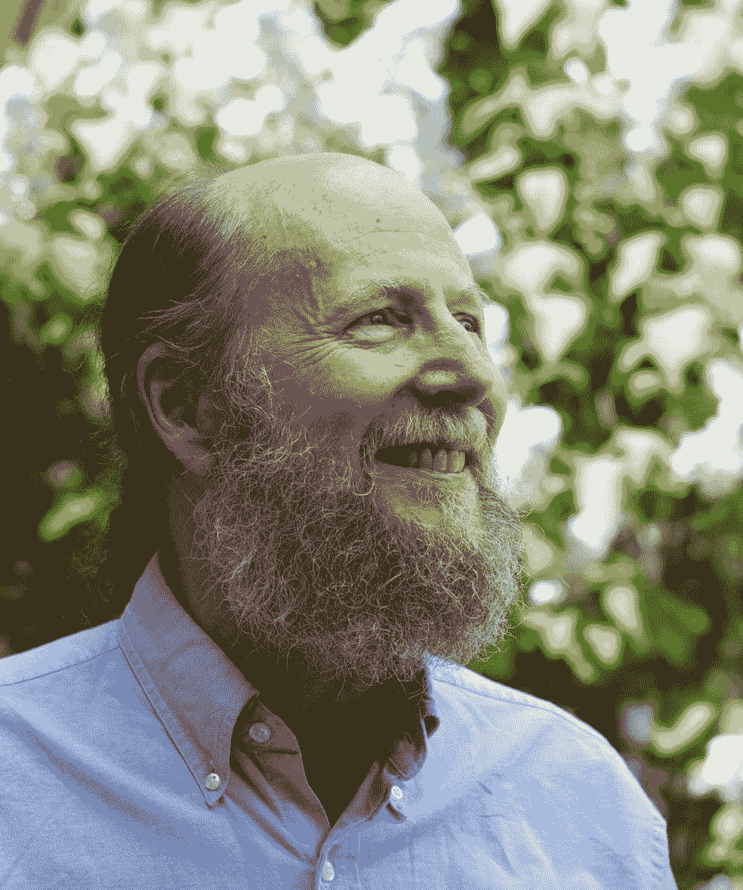

# 苦涩的教训 The Bitter Lesson

> 来源：[https://waytoagi.feishu.cn/docx/IhGLdzKHioR4Cmxb7xFchDMSnFf](https://waytoagi.feishu.cn/docx/IhGLdzKHioR4Cmxb7xFchDMSnFf)

> The bitter lesson 源自机器学习先驱 Rich Sutton 在 2019 年的一篇经典文章《苦涩的教训》， 通过探讨人工智能近几十年所走过的弯路，他抛出的核心观点是：人工智能如果想要长期获得提升，利用强大的算力才是王道。这里的算力隐含了大量的训练数据和大模型。

> OpenAI 研究人员 Jason Wei 的每日工作时间线 中也提到了 Rich Sutton 的 The bitter lesson。由此可见，很多业内人士将 The bitter lesson 视为圭臬。

> 原文地址：http://www.incompleteideas.net/IncIdeas/BitterLesson.html

> 翻译者：[宝玉](https://baoyu.io/translations/ai/bitter-lesson)

## 中文翻译

70 年人工智能研究给我们的最大启示是：依赖计算能力的通用方法最终表现最佳，而且优势明显。这背后的主要原因是摩尔定律，也就是计算成本持续以指数级下降。大部分 AI 研究都是在假设计算资源固定的情况下进行的（在这种情况下，利用人类知识几乎是提升性能的唯一途径），但实际上，在稍长于一般研究项目的时间里，可用的计算资源会大幅增加。研究者为了在短期内取得突破，尝试利用自己对特定领域的人类知识，但从长远看，关键在于计算能力的利用。这两者原本不必相互冲突，但在实践中却常常如此。投入其中一个领域的时间，就意味着在另一个上的缺失。此外，人们在一种方法上的投资也会形成心理承诺。而基于人类知识的方法往往会使系统变得复杂，不利于利用计算能力的通用方法。有很多例子显示 AI 研究者是如何迟迟才领悟到这个苦涩的教训，回顾这些案例非常有启发性。

以计算机国际象棋为例，1997 年击败世界冠军卡斯帕罗夫的方法主要是深度搜索。当时，大多数计算机国际象棋研究者对此表示失望，因为他们更倾向于利用对棋局特殊结构的人类理解。然而，当一个简单但基于搜索的方法，结合特殊的硬件和软件展现出巨大效能时，这些基于人类知识的研究者并不愿意接受失败。他们认为，尽管这次“蛮力”搜索获胜，但它并非一种通用策略，也不是人类下棋的方式。这些研究者本希望基于人类理解的方法能够取胜，对实际结果感到失望。

在计算机围棋的发展中，也出现了类似的模式，只是晚了 20 年。最初的努力都在于避免搜索，尽可能利用对游戏的人类理解和特殊特征，但一旦有效地应用了大规模搜索，这些努力都显得微不足道，甚至有害。在这个过程中，通过自我对弈学习价值函数（在很多其他游戏中也是这样，甚至包括国际象棋，尽管在 1997 年首次击败世界冠军的程序中学习的作用并不大）也非常关键。自我对弈学习和一般学习，就像搜索一样，能够充分利用大量计算资源。在计算机围棋和国际象棋中，研究者最初都是试图利用人类的理解来减少搜索的需要，但最终通过接受搜索和学习才取得了巨大的成功。

在语音识别领域，1970 年代由 DARPA 赞助的一场早期比赛就是一个例子。参赛者包括使用了大量人类知识（如对单词、音素、人类声道的理解）的特殊方法，而另一边则是更依赖统计和大量计算的新方法，基于隐马尔可夫模型（HMMs）。最终，基于统计的方法战胜了基于人类知识的方法。这导致了自然语言处理领域的一次重大转变，随着时间的推移，统计和计算开始成为该领域的主导。深度学习在语音识别中的兴起是这一趋势的最新体现。深度学习方法更少依赖人类知识，使用更多的计算资源，并通过在大型训练集上的学习，极大地提升了语音识别系统的性能。与游戏领域相似，研究人员总是试图创建一个按照他们自己的思维方式工作的系统，但这种尝试最终证明是逆向而行，不仅浪费了大量的研究时间，而且在大量计算资源可用并找到有效利用方法的情况下，这种尝试显得更是多余。

计算机视觉领域也经历了相似的发展模式。早期的方法试图通过搜索边缘、广义圆柱体或 SIFT 特征来处理视觉问题。但在今天，这些方法都被淘汰了。现代的深度学习神经网络仅使用卷积和某些类型的不变性概念，取得了更好的表现。

这是一个重要的教训。作为一个领域，我们还没有完全吸取这一教训，仍在重蹈覆辙。为了识别并避免这种错误，我们必须理解其吸引力所在。我们必须领悟到，试图构建一个基于我们认为自己思考方式的系统是行不通的。苦涩的教训源于这样的历史观察：1) 人工智能研究者经常试图将知识融入他们的代理中；2) 这在短期内总是有益的，也让研究者感到满足；但 3) 从长远来看，这种做法会导致进步停滞，甚至阻碍进一步的发展；4) 真正的突破性进展最终是通过一个相反的方法实现的，这个方法基于通过搜索和学习来扩大计算的规模。这种成功带有苦涩，往往消化不良，因为它是在人类中心化方法之上取得的。

从这个苦涩的教训中，我们应该明白通用方法的巨大力量，即那些随着计算能力的增长而持续扩展的方法。在这方面，似乎可以无限扩展的两种方法是搜索和学习。

苦涩教训中的另一个关键点是，人类心灵的实质内容极其复杂，不可能简化；我们应该放弃试图简单化地理解心灵内容，如空间、物体、多重代理或对称性等概念。这些都是外部世界中任意而复杂的部分，不应该成为我们构建的核心；相反，我们应该构建的是那些能够发现并捕捉这种任意复杂性的元方法。这些方法的核心在于它们能够找到良好的近似，但寻找这些近似的过程应该由我们的方法来完成，而不是我们亲自动手。我们希望 AI 代理能像我们一样具有发现能力，而不是仅仅包含我们已有的发现。将我们的发现直接构建进去，只会使我们更难看清如何实现发现的过程。

---

## 英文原文

The biggest lesson that can be read from 70 years of AI research is that general methods that leverage computation are ultimately the most effective, and by a large margin. The ultimate reason for this is Moore's law, or rather its generalization of continued exponentially falling cost per unit of computation. Most AI research has been conducted as if the computation available to the agent were constant (in which case leveraging human knowledge would be one of the only ways to improve performance) but, over a slightly longer time than a typical research project, massively more computation inevitably becomes available. Seeking an improvement that makes a difference in the shorter term, researchers seek to leverage their human knowledge of the domain, but the only thing that matters in the long run is the leveraging of computation. These two need not run counter to each other, but in practice they tend to. Time spent on one is time not spent on the other. There are psychological commitments to investment in one approach or the other. And the human-knowledge approach tends to complicate methods in ways that make them less suited to taking advantage of general methods leveraging computation.  There were many examples of AI researchers' belated learning of this bitter lesson, and it is instructive to review some of the most prominent.

In computer chess, the methods that defeated the world champion, Kasparov, in 1997, were based on massive, deep search. At the time, this was looked upon with dismay by the majority of computer-chess researchers who had pursued methods that leveraged human understanding of the special structure of chess. When a simpler, search-based approach with special hardware and software proved vastly more effective, these human-knowledge-based chess researchers were not good losers. They said that ``brute force" search may have won this time, but it was not a general strategy, and anyway it was not how people played chess. These researchers wanted methods based on human input to win and were disappointed when they did not.

A similar pattern of research progress was seen in computer Go, only delayed by a further 20 years. Enormous initial efforts went into avoiding search by taking advantage of human knowledge, or of the special features of the game, but all those efforts proved irrelevant, or worse, once search was applied effectively at scale. Also important was the use of learning by self play to learn a value function (as it was in many other games and even in chess, although learning did not play a big role in the 1997 program that first beat a world champion). Learning by self play, and learning in general, is like search in that it enables massive computation to be brought to bear. Search and learning are the two most important classes of techniques for utilizing massive amounts of computation in AI research. In computer Go, as in computer chess, researchers' initial effort was directed towards utilizing human understanding (so that less search was needed) and only much later was much greater success had by embracing search and learning.

In speech recognition, there was an early competition, sponsored by DARPA, in the 1970s. Entrants included a host of special methods that took advantage of human knowledge---knowledge of words, of phonemes, of the human vocal tract, etc. On the other side were newer methods that were more statistical in nature and did much more computation, based on hidden Markov models (HMMs). Again, the statistical methods won out over the human-knowledge-based methods. This led to a major change in all of natural language processing, gradually over decades, where statistics and computation came to dominate the field. The recent rise of deep learning in speech recognition is the most recent step in this consistent direction. Deep learning methods rely even less on human knowledge, and use even more computation, together with learning on huge training sets, to produce dramatically better speech recognition systems. As in the games, researchers always tried to make systems that worked the way the researchers thought their own minds worked---they tried to put that knowledge in their systems---but it proved ultimately counterproductive, and a colossal waste of researcher's time, when, through Moore's law, massive computation became available and a means was found to put it to good use.

In computer vision, there has been a similar pattern. Early methods conceived of vision as searching for edges, or generalized cylinders, or in terms of SIFT features. But today all this is discarded. Modern deep-learning neural networks use only the notions of convolution and certain kinds of invariances, and perform much better.

This is a big lesson. As a field, we still have not thoroughly learned it, as we are continuing to make the same kind of mistakes. To see this, and to effectively resist it, we have to understand the appeal of these mistakes. We have to learn the bitter lesson that building in how we think we think does not work in the long run. The bitter lesson is based on the historical observations that 1) AI researchers have often tried to build knowledge into their agents, 2) this always helps in the short term, and is personally satisfying to the researcher, but 3) in the long run it plateaus and even inhibits further progress, and 4) breakthrough progress eventually arrives by an opposing approach based on scaling computation by search and learning. The eventual success is tinged with bitterness, and often incompletely digested, because it is success over a favored, human-centric approach.

One thing that should be learned from the bitter lesson is the great power of general purpose methods, of methods that continue to scale with increased computation even as the available computation becomes very great. The two methods that seem to scale arbitrarily in this way are search and learning.

The second general point to be learned from the bitter lesson is that the actual contents of minds are tremendously, irredeemably complex; we should stop trying to find simple ways to think about the contents of minds, such as simple ways to think about space, objects, multiple agents, or symmetries. All these are part of the arbitrary, intrinsically-complex, outside world. They are not what should be built in, as their complexity is endless; instead we should build in only the meta-methods that can find and capture this arbitrary complexity. Essential to these methods is that they can find good approximations, but the search for them should be by our methods, not by us. We want AI agents that can discover like we can, not which contain what we have discovered. Building in our discoveries only makes it harder to see how the discovering process can be done.