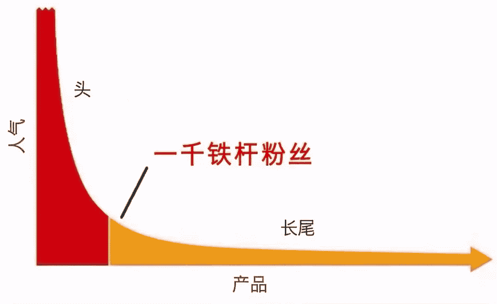

# 一千个铁杆粉丝｜凯文·凯利

> 来源：[https://waytoagi.feishu.cn/docx/I711d6LynoWrKxxQsPKc4I0knFc](https://waytoagi.feishu.cn/docx/I711d6LynoWrKxxQsPKc4I0knFc)

> 原文地址：https://kk.org/thetechnium/1000-true-fans/

> 发表时间：2008 年 3 月 4 日

**要成为一名成**功的创造者，你不需要数百万粉丝。为了谋生的话，作为一名工匠，摄影师，音乐家，设计师，作家，app 制造者，企业家或发明家，你只需要 1000 个铁杆粉丝。

铁杆粉丝被定义为购买你任何产品的粉丝。这些死忠的粉丝会开 200 英里看你唱歌； 他们会买你书的精装本和平装本以及可听见的音频版本； 他们会盲目的购买你的个人小雕像； 他们还将购买你免费 YouTube 频道的“最佳”DVD； 他们每月会来参加一次你组织的聚会。如果你有大约 1000 个这样的铁杆粉丝，你就可以谋生——如果你满足于谋生而不是一笔财富。

达成这一点，你需要满足两个标准：

**首先，你必须每年创造足够的产品，让你可以从每**个铁杆粉丝平均赚取 100 美元的利润。在某些艺术和商业中，这比其他人更容易做到，同时在每个领域都是一个很好的创意挑战。你知道的，为现有客户提供更多的东西比找到新的粉丝更容易也更好。

**其次，你必须与粉丝有直接关系。**也就是说，他们必须直接付钱给你。你可以得到他们所有的支持，而不是他们向音乐唱片公司，出版商，工作室，零售商或其他中间商那里购买你的产品。如果你保留每个铁杆粉丝 100 美元，那么你每年只需要 1000 个就可以赚到 10 万美元。对大多数人来说，这可以让你过上不错的生活。

有 1000 个真实粉丝比起超过一百万粉丝更为现实。数以百万计的付费粉丝并不是一个真实的目标，特别是当你开始时。但是 1000 名粉丝是可行的。你甚至可以记住 1000 个名字。如果你每天增加一个新的真正粉丝，那么只需要几年时间就可以获得 1000 个粉丝。

**数字 1000 不是绝对的。它的意义在于其粗略**的数量级——大概四位数的粉丝便能养活你。必须为每个人调整实际数量。如果每个铁杆粉丝每年只能赚 50 美元，那么你需要 2,000 个。（同样，如果你每年可以卖 200 美元，那你只需要 500 名铁杆粉丝。）或者你每年只需要 75,000 美元，所以你可以向下调整。再者，如果你有合作伙伴，那么你需要乘以 2 来获得 2,000 名粉丝。

最后，根据媒介不同，实际数量也可能有所不同。画家也许只需 500 名铁杆粉丝，而**视频制作者需要 5000 名铁杆粉丝。所需**粉丝的数值也肯定会随国家地区不同而异。但事实上，实际数字并不重要，因为只有达到这个数值，你才能知道到底需要多少铁杆粉丝。

我一直在搜寻与铁杆粉丝数量相关的文献。Suck.com 的联合**创始人卡尔·斯特德曼（Carl S**teadman）提出了一个关于微名人的理论。在他看来，如果某人对 1500 人来说都很有名，那么这个人就是一个微名人。也就是说，有 1500 人会为你疯狂。

**正如丹尼·奥布莱恩引用的一句话所述：如果英国每个镇子都有一**个人喜欢你的网络漫画，那么就足以让你一年到头啤酒不断（或 T 恤销量不愁）。

有人称这种微名人支持为微赞助，或分部式赞助。

另一种计算真正粉丝支持的方法是——每年从他们那里获得一天的工资。想想看，你能激发或取悦他们足以赚取一天的劳动力吗？这是一个很高的标准，但在全世界找到 1000 人来说并非不可能。

当然，不是每个粉丝都会超级。1000 名铁杆粉丝的支持可能就足以谋生，但对应每一个铁杆粉丝，你可能会有两三个普通粉丝。

想象一个同心圆，中心有铁杆粉丝，周围有更广泛的常规粉丝圈。这些常规粉丝可能会偶尔购买你的作品，或者只购买一次。但他们的普通购买会扩大你的总收入，也许这将是你总收入额外的 50％。尽管如此，你仍然应该专注于铁杆粉丝，因为铁杆粉丝的热情可以促使普通粉丝的赞助行为。铁杆粉丝不仅是你收入的直接来源，也是你对普通粉丝的主要营销力量。

你可能会说：粉丝、客户和赞助商早已存在。这里有什么新鲜事？那这两点能解答你的困惑。:

一、在过去创造者与粉丝的直接接触是不存在的的，但现代零售的革新改变了上个世纪，大多数创作者都没有与消费者直接接触的局面。通常来说，在那时即使是出版商，工作室和制造商也没有收集客户名称那样的重要信息。

例如，尽管已有数百年的经营历史，但纽约图**书出版商并不知道其核心和专注读者的名字。对**于以前的创作者来说，这些中间体（通常不止一个）意味着你需要更多的粉丝来取得成功。而现在，随着无处不在的点对点通信和支付系统的出现，每个人都可以使用优秀的工具，任何人都可以直接向世界上的任何人销售。

因**此**，俄勒冈州的创作者可以向尼泊尔加德满都的某个人出售并传送一首歌曲，就像去遍布世界的纽约的唱片公司购买一样容易（甚至可能更容易）。这项新技术允许创作者与客户保持关系，以便客户可以成为粉丝，并使创作者获得无中间体的总付款金额，从而减少所需的粉丝数量。

**二**、P2P（peer-to-peer network）网络模式的基本优点是——最冷门的节点距离最热门的节点只差一次点击。换句话说，当你在浏览畅销书籍，歌曲或是创意，只需点击一下便可以看到冷门书籍，歌曲或创意。

在网络兴起的早期，内容和产品的大型聚合商，如 eBay，亚马逊，Netflix 等，注意**到那些最低销售的冷门商品的总销售额总是会等于或在**某些情况下超过畅销产品的销售额。Chris Anderson 将此效果命名为“The Long Tail”（长尾效应）。

**用**销售分布曲线做出视觉图形就是：一类低近乎无休止的物品系列，每年只卖几份，却形成了一些畅销书的长尾“尾巴”，但是尾巴的总面积和头部一样大。

通过这种洞察，网络商家们有很大的动力去鼓励观众点击不起眼的项目。因此他们发明了推荐引擎和其他算法，以引起人们对长尾中罕见创作的关注。

即使像谷歌，必应，百度这样的网络搜索公司也发现，它们的他们可以根据不同消费者的兴趣向他们推荐冷门内容，那样的话他们就可以在长尾中卖广告，结果是最冷门的东西变得不那么冷门了。

如果你只是住在地球上 200 万个小镇中的任何一个，那么你可能是你镇上唯一一个渴望死亡金属音乐的人，或者是光是听到低声细语便能颅内高潮的人，或者是个渴望左利手渔具的左撇子。

在网络出现之前，你永远无法满足这种愿望，只会深陷在你的迷恋中，独自一人，但现在只需点击一下即可获得看似私人订制的满足。无论你作为创作者的兴趣是什么，你的 1000 名铁杆粉丝只需点击一下即可获得他们想要的。

据我所知，没有任何产品，任何想法，任何潜在的欲望，在互联网上是没有粉丝的。你所做出或想到的每一件事都可以让一百万人中的一个感兴趣——这只是一个低标准。然而，即使只有百万人中有一人感兴趣，这个地球上可能就有 7,000 人。

**这意味着任何吸引力只有百万分之一的事物都可以找到 100**0 名铁杆粉丝，诀窍是几乎找到那些粉丝，

目前的状况就是：**大**公司，中间商，商业生产商都没完全做好准备，还难以与这千名长尾粉丝直接联系，这意味着长尾对你来说是敞开的。你将拥有属于自己百万分之一的真正粉丝。并且在通讯工具不断改进，社交媒体的不断创新的现在。在创作者周围聚集 1000 名铁杆粉丝从未如此容易，从未像这样可以和粉丝如此亲密。

近年来，铁杆粉丝们为创造者服务的众多创新之一是众筹。让粉丝为他们的下一个产品提供资金或是想法，双赢共赢。全球约有 2,000 种不同的众筹平台，其中许多专门针对特定领域：为科学实验、乐队或是纪录片筹集资金。

除了专业兴趣之外，每个平台都有自己的要求和不同的资助模式——有些平台标示“筹备全部资金，才意味众筹成功”，有些平台只需要部分资金也可以继续项目，有些平台则为已完成的项目筹集资金。著名的如 Patreon，主要资助正在进行的项目。Patreon 的支持者可能会资助杂志，视频或直接是艺术家的薪水。最著名的资助方是 Kickstarter，它为超过 100,000 个项目筹集了 25 亿美元。

**你**要知道，成功的 Kickstarter 项目的平均支持者数量是 241 个资助者——远远少于 1000 个。这意味着如果你有 1000 个铁杆粉丝，你可以进行众筹活动，因为根据定义，铁杆粉丝将成为你的资助者。

**话虽如此，事实上培养 1000 个铁杆粉丝是耗时**的，有时是神经紧张，且不是适合每个人的。做得好它可以成为另一份全职工作。但往往，充其量这只是一项具有消耗性和挑战性的兼职任务，需要持续的努力。

有许多创作者不想与粉丝打交道，老实说不应该。他们可以专心画画，缝制或制作音乐，并聘请其他人来处理他们的铁杆粉丝。如果那样的话，你得寻找某人来帮助你与粉丝打交道，那么帮助者会改变你的公式，增加你需要的粉丝数量。但这可能是最好的打算，如果你已经走得那么远，那么为什么不分包任务给中间人或工作室、出版商和零售商呢？

**最后，1000 名真正粉丝的逻辑并不是简单的跳过中间人，**你不必将此这种方式与其他主流方式相对立。包括我在内的许多创作者都将与铁杆粉丝建立直接关系，但我们仍与中介保持关系。我的作品已经被纽约的几家大型出版商出版。而我自己出版了的书，我也使用 Kickstarter 众筹向我铁杆粉丝发布了。

我根据不同的内容选择不同的模式，但无论如何，培养我铁杆粉丝都可以丰富我前行的道路。