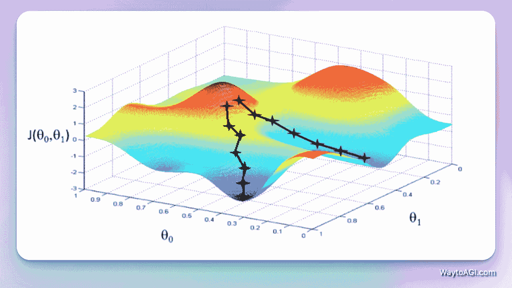

# 用随机梯度下降来优化人生｜李沐

> 来源：[https://waytoagi.feishu.cn/docx/THAEdkpUnoyy0Axy2IJcjoSinQh](https://waytoagi.feishu.cn/docx/THAEdkpUnoyy0Axy2IJcjoSinQh)

> 原文地址：https://zhuanlan.zhihu.com/p/414009313

> 作者：李沐，亚马逊 首席科学家

> 发表时间：2021-09-26

**要有目标**。你需要有目标。短的也好，长的也好。认真定下的也好，别人那里捡的也好。就跟随机梯度下降需要有个目标函数一样。

**目标要大**。不管是人生目标还是目标函数，你最好不要知道最后可以走到哪里。如果你知道，那么你的目标就太简单了，可能是个凸函数。你可以在一开始的时候给自己一些小目标，例如期末考个 80 分，训练一个线性模型。但接下来得有更大的目标，财富自由也好，100 亿参数的变形金刚也好，得足够一颗赛艇。

**坚持走**。不管你的目标多复杂，随机梯度下降都是最简单的。每一次你找一个大概还行的方向（梯度），然后迈一步（下降）。两个核心要素是方向和步子的长短。但最重要的是你得一直走下去，能多走几步就多走几步。

**痛苦的卷**。每一步里你都在试图改变你自己或者你的模型参数。改变带来痛苦。但没有改变就没有进步。你过得很痛苦不代表在朝着目标走，因为你可能走反了。但过得很舒服那一定在原地踏步。需要时刻跟自己作对。

**可以躺平**。你用你内心的激情来迈步子。步子太小走不动，步子太长容易过早消耗掉了激情。周期性的调大调小步长效果挺好。所以你可以时不时休息休息。

**四处看看**。每一步走的方向是你对世界的认识。如果你探索的世界不怎么变化，那么要么你的目标太简单，要么你困在你的舒适区了。随机梯度下降的第一个词是随机，就是你需要四处走走，看过很多地方，做些错误的决定，这样你可以在前期迈过一些不是很好的舒适区。

**快也是慢**。你没有必要特意去追求找到最好的方向和最合适的步子。你身边当然会有幸运之子，他们每一步都在别人前面。但经验告诉我们，随机梯度下降前期进度太快，后期可能乏力。就是说你过早的找到一个舒适区，忘了世界有多大。所以你不要急，前面徘徊一段时间不是坏事。成名无需太早。

**赢在起点**。起点当然重要。如果你在终点附近起步，可以少走很多路。而且终点附近的路都比较平，走着舒服。当你发现别人不如你的时候，看看自己站在哪里。可能你就是运气很好，赢在了起跑线。如果你跟别人在同一起跑线，不见得你能做更好。

**很远也能到达**。如果你是在随机起点，那么做好准备前面的路会非常不平坦。越远离终点，越人迹罕见。四处都是悬崖。但随机梯度下降告诉我们，不管起点在哪里，最后得到的解都差不多。当然这个前提是你得一直按照梯度的方向走下去。如果中间梯度炸掉了，那么你随机一个起点，调整步子节奏，重新来。

**独一无二**。也许大家有着差不多的目标，在差不多的时间毕业买房结婚生娃。但每一步里，每个人内心中看到的世界都不一样，导致走的路不一样。你如果跑多次随机梯度下降，在各个时间点的目标函数值可能都差不多，但每次的参数千差万别。不会有人关心你每次训练出来的模型里面参数具体是什么值，除了你自己。

**简单最好** 。当然有比随机梯度下降更复杂的算法。他们想每一步看想更远更准，想步子迈最大。但如果你的目标很复杂，简单的随机梯度下降反而效果最好。深度学习里大家都用它。关注当前，每次抬头瞄一眼世界，快速做个决定，然后迈一小步。小步快跑。只要你有目标，不要停，就能到达。

---

## 附：什么是随机梯度下降算法

以下内容引用自 Gemini 的回答——

想象一下你迷失在一个茂密的森林中，想要找到山谷中的最低点。你无法看到整个山谷，所以你必须一步一步地探索。随机梯度下降 (SGD) 就像是一种算法，可以帮助你找到山谷的底部。

它是怎么工作的呢？

1.  **从随机点开始：**就像你可能会在森林中随机行走一样，SGD 以随机值初始化其参数，这些参数代表你当前在山谷中的位置。

1.  **迈出小步：**你不可能一步就跳到山谷底部。相反，你应该朝着看起来像下坡的方向迈出小步。SGD 会做同样的事情，通过计算梯度来指示从当前点到最陡峭下坡方向。

1.  **重复：**不断朝着梯度方向迈出小步，随着前进调整你的位置。SGD 也会重复这个过程，根据梯度更新其参数，直到梯度接近零，这表明它已经找到一个最小点。

为什么叫它“随机”？

“随机”的部分来自于 SGD 在每次迭代中只考虑训练集中的一个数据点。这意味着它并不保证能以最有效的方式找到山谷的底部，但它仍然能有效地找到一个最小点。

为什么叫它“梯度下降”？

“梯度下降”部分指的是 SGD 如何使用梯度来引导其搜索。梯度就像一个指南针，指向最陡峭下坡的方向，帮助 SGD 朝着山谷底部移动。

SGD 的优点：

+   **简单易懂：**SGD 的概念相对简单，易于实现和使用。

+   **对于大型数据集效率高**：SGD 可以有效地处理大型数据集，因为它一次只考虑一个数据点。

+   **适用于在线学习：**SGD 可用于在线学习，在这种情况下，新数据点会不断出现。

SGD 的缺点：

+   **可能很慢：**SGD 有时可能需要很长时间才能收敛到最小点，尤其是在复杂的问题中。

+   **可能陷入局部最小值：**SGD 可能会陷入局部最小值，即比周围低但不是绝对最低点的点。

总的来说，SGD 是一种强大且通用的优化算法，在机器学习中得到了广泛应用。其简单性、效率性和对大型数据集的适用性使其成为各种任务的宝贵工具。