# 李飞飞的两次 TED 演讲

> 来源：[https://waytoagi.feishu.cn/docx/KrrbdXJxLohpbaxdm9Kc1KxOnTg](https://waytoagi.feishu.cn/docx/KrrbdXJxLohpbaxdm9Kc1KxOnTg)

## 一、2015年 《我们怎么教计算机理解图片？》

链接：https://www.ted.com/talks/fei_fei_li_how_we_re_teaching_computers_to_understand_pictures?language=zh-CN

<https://player.bilibili.com/player.html?bvid=1RW411D78Z>

我先来给你们看点东西。

（视频）女孩： 好吧，这是只猫，坐在床上。

一个男孩摸着一头大象。

那些人正准备登机。

那是架大飞机。

李飞飞： 这是一个三岁的小孩

在讲述她从一系列照片里看到的东西。

对这个世界， 她也许还有很多要学的东西，

但在一个重要的任务上， 她已经是专家了：

去理解她所看到的东西。

我们的社会已经在科技上 取得了前所未有的进步。

我们把人送上月球， 我们制造出可以与我们对话的手机，

或者订制一个音乐电台， 播放的全是我们喜欢的音乐。

然而，哪怕是我们最先进的机器和电脑

也会在这个问题上犯难。

所以今天我在这里， 向大家做个进度汇报：

关于我们在计算机 视觉方面最新的研究进展。

这是计算机科学领域最前沿的、

具有革命性潜力的科技。

是的，我们现在已经有了 具备自动驾驶功能的原型车，

但是如果没有敏锐的视觉， 它们就不能真正区分出

地上摆着的是一个压扁的纸袋， 可以被轻易压过，

还是一块相同体积的石头， 应该避开。

我们已经造出了超高清的相机，

但我们仍然无法把 这些画面传递给盲人。

我们的无人机可以飞越广阔的土地，

却没有足够的视觉技术

去帮我们追踪热带雨林的变化。

安全摄像头到处都是，

但当有孩子在泳池里溺水时 它们无法向我们报警。

照片和视频，已经成为 全人类生活里不可缺少的部分。

它们以极快的速度被创造出来， 以至于没有任何人，或者团体，

能够完全浏览这些内容，

而你我正参与其中的这场TED， 也为之添砖加瓦。

直到现在，我们最先进的 软件也依然为之犯难：

该怎么理解和处理 这些数量庞大的内容？

所以换句话说， 在作为集体的这个社会里，

我们依然非常茫然，因为我们最智能的机器 依然有视觉上的缺陷。

”为什么这么困难？“你也许会问。

照相机可以像这样获得照片：

它把采集到的光线转换成 二维数字矩阵来存储

——也就是“像素”，

但这些仍然是死板的数字。

它们自身并不携带任何意义。

就像”听到“和”听“完全不同，

”拍照“和”看“也完全不同。

通过“看”， 我们实际上是“理解”了这个画面。

事实上，大自然经过了5亿4千万年的努力

才完成了这个工作，

而这努力中更多的部分

是用在进化我们的大脑内 用于视觉处理的器官，

而不是眼睛本身。

所以"视觉”从眼睛采集信息开始，

但大脑才是它真正呈现意义的地方。

所以15年来， 从我进入加州理工学院攻读Ph.D.

到后来领导 斯坦福大学的视觉实验室，

我一直在和我的导师、 合作者和学生们一起

教计算机如何去“看”。

我们的研究领域叫做 "计算机视觉与机器学习"。

这是AI（人工智能）领域的一个分支。

最终，我们希望能教会机器 像我们一样看见事物：

识别物品、辨别不同的人、 推断物体的立体形状、

理解事物的关联、 人的情绪、动作和意图。

像你我一样，只凝视一个画面一眼 就能理清整个故事中的人物、地点、事件。

实现这一目标的第一步是 教计算机看到“对象”（物品），

这是建造视觉世界的基石。

在这个最简单的任务里， 想象一下这个教学过程：

给计算机看一些特定物品的训练图片， 比如说猫，

并让它从这些训练图片中， 学习建立出一个模型来。

这有多难呢？

不管怎么说，一只猫只是一些 形状和颜色拼凑起来的图案罢了，

比如这个就是我们 最初设计的抽象模型。

我们用数学的语言， 告诉计算机这种算法：

“猫”有着圆脸、胖身子、

两个尖尖的耳朵，还有一条长尾巴，

这（算法）看上去挺好的。

但如果遇到这样的猫呢？

（笑）

它整个蜷缩起来了。

现在你不得不加入一些别的形状和视角 来描述这个物品模型。

但如果猫是藏起来的呢？

再看看这些傻猫呢？

你现在知道了吧。

即使那些事物简单到 只是一只家养的宠物，

都可以出呈现出无限种变化的外观模型，

而这还只是“一个”对象的模型。

所以大概在8年前，

一个非常简单、有冲击力的 观察改变了我的想法。

没有人教过婴儿怎么“看”，

尤其是在他们还很小的时候。

他们是从真实世界的经验 和例子中学到这个的。

如果你把孩子的眼睛

都看作是生物照相机，

那他们每200毫秒就拍一张照。

——这是眼球转动一次的平均时间。

所以到3岁大的时候，一个孩子已经看过了 上亿张的真实世界照片。

这种“训练照片”的数量是非常大的。

所以，与其孤立地关注于 算法的优化、再优化，

我的关注点放在了给算法 提供像那样的训练数据

——那些，婴儿们从经验中获得的 质量和数量都极其惊人的训练照片。

一旦我们知道了这个，

我们就明白自己需要收集的数据集，

必须比我们曾有过的任何数据库都丰富

——可能要丰富数千倍。

因此，通过与普林斯顿大学的 Kai Li教授合作，

我们在2007年发起了 ImageNet（图片网络）计划。

幸运的是，我们不必在自己脑子里 装上一台照相机，然后等它拍很多年。

我们运用了互联网，

这个由人类创造的 最大的图片宝库。

我们下载了接近10亿张图片

并利用众包技术（利用互联网分配工作、发现创意或 解决技术问题），像“亚马逊土耳其机器人”这样的平台

来帮我们标记这些图片。

在高峰期时，ImageNet是「亚马逊土耳其机器人」 这个平台上最大的雇主之一：

来自世界上167个国家的 接近5万个工作者，在一起工作

帮我们筛选、排序、标记了 接近10亿张备选照片。

这就是我们为这个计划投入的精力，

去捕捉，一个婴儿可能在他早期发育阶段 获取的”一小部分“图像。

事后我们再来看，这个利用大数据来训练 计算机算法的思路，也许现在看起来很普通，

但回到2007年时，它就不那么寻常了。

我们在这段旅程上孤独地前行了很久。

一些很友善的同事建议我 做一些更有用的事来获得终身教职，

而且我们也不断地为项目的研究经费发愁。

有一次，我甚至对 我的研究生学生开玩笑说：

我要重新回去开我的干洗店 来赚钱资助ImageNet了。

——毕竟，我的大学时光 就是靠这个资助的。

所以我们仍然在继续着。

在2009年，ImageNet项目诞生了——

一个含有1500万张照片的数据库， 涵盖了22000种物品。

这些物品是根据日常英语单词 进行分类组织的。

无论是在质量上还是数量上，

这都是一个规模空前的数据库。

举个例子，在"猫"这个对象中，

我们有超过62000只猫

长相各异，姿势五花八门，

而且涵盖了各种品种的家猫和野猫。

我们对ImageNet收集到的图片 感到异常兴奋，

而且我们希望整个研究界能从中受益，

所以以一种和TED一样的方式，

我们公开了整个数据库， 免费提供给全世界的研究团体。

（掌声）

那么现在，我们有了用来 培育计算机大脑的数据库，

我们可以回到”算法“本身上来了。

因为ImageNet的横空出世，它提供的信息财富 完美地适用于一些特定类别的机器学习算法，

称作“卷积神经网络”，

最早由Kunihiko Fukushima，Geoff Hinton， 和Yann LeCun在上世纪七八十年代开创。

就像大脑是由上十亿的 紧密联结的神经元组成，

神经网络里最基础的运算单元 也是一个“神经元式”的节点。

每个节点从其它节点处获取输入信息， 然后把自己的输出信息再交给另外的节点。

此外，这些成千上万、甚至上百万的节点

都被按等级分布于不同层次，

就像大脑一样。

在一个我们用来训练“对象识别模型”的 典型神经网络里，

有着2400万个节点，1亿4千万个参数， 和150亿个联结。

这是一个庞大的模型。

借助ImageNet提供的巨大规模数据支持，

通过大量最先进的CPU和GPU， 来训练这些堆积如山的模型，

“卷积神经网络” 以难以想象的方式蓬勃发展起来。

它成为了一个成功体系，

在对象识别领域， 产生了激动人心的新成果。

这张图，是计算机在告诉我们：

照片里有一只猫、

还有猫所在的位置。

当然不止有猫了，

所以这是计算机算法在告诉我们

照片里有一个男孩，和一个泰迪熊；

一只狗，一个人，和背景里的小风筝；

或者是一张拍摄于闹市的照片 比如人、滑板、栏杆、灯柱…等等。

有时候，如果计算机 不是很确定它看到的是什么，

我们还教它用足够聪明的方式 给出一个“安全”的答案，而不是“言多必失”

——就像人类面对这类问题时一样。

但在其他时候，我们的计算机 算法厉害到可以告诉我们

关于对象的更确切的信息， 比如汽车的品牌、型号、年份。

我们在上百万张谷歌街景照片中 应用了这一算法，

那些照片涵盖了上百个美国城市。

我们从中发现一些有趣的事：

首先，它证实了我们的一些常识：

汽车的价格，与家庭收入 呈现出明显的正相关。

但令人惊奇的是，汽车价格与犯罪率 也呈现出明显的正相关性，

以上结论是基于城市、或投票的 邮编区域进行分析的结果。

那么等一下，这就是全部成果了吗？

计算机是不是已经达到， 或者甚至超过了人类的能力？

——还没有那么快。

目前为止，我们还只是 教会了计算机去看对象。

这就像是一个小宝宝学会说出几个名词。

这是一项难以置信的成就，

但这还只是第一步。

很快，我们就会到达 发展历程的另一个里程碑：

这个小孩会开始用“句子”进行交流。

所以不止是说这张图里有只“猫”，

你在开头已经听到小妹妹 告诉我们“这只猫是坐在床上的”。

为了教计算机看懂图片并生成句子，

“大数据”和“机器学习算法”的结合 需要更进一步。

现在，计算机需要从图片和人类创造的 自然语言句子中同时进行学习。

就像我们的大脑， 把视觉现象和语言融合在一起，

我们开发了一个模型，

可以把一部分视觉信息，像视觉片段， 与语句中的文字、短语联系起来。

大约4个月前， 我们最终把所有技术结合在了一起，

创造了第一个“计算机视觉模型”，

它在看到图片的第一时间，就有能力生成 类似人类语言的句子。

现在，我准备给你们看看 计算机看到图片时会说些什么

——还是那些在演讲开头给小女孩看的图片。

（视频）计算机： “一个男人站在一头大象旁边。”

“一架大飞机停在机场跑道一端。”

李飞飞： 当然，我们还在努力改善我们的算法，

它还有很多要学的东西。

（掌声）

计算机还是会犯很多错误的。

（视频）计算机： “一只猫躺在床上的毯子上。”

李飞飞：所以…当然——如果它看过太多种的猫， 它就会觉得什么东西都长得像猫……

（视频）计算机： “一个小男孩拿着一根棒球棍。”

（笑声）

李飞飞：或者…如果它从没见过牙刷， 它就分不清牙刷和棒球棍的区别。

（视频）计算机： “建筑旁的街道上有一个男人骑马经过。”

（笑声）

李飞飞：我们还没教它Art 101 （美国大学艺术基础课）。

（视频）计算机： “一只斑马站在一片草原上。”

李飞飞：它还没学会像你我一样 欣赏大自然里的绝美景色。

所以，这是一条漫长的道路。

将一个孩子从出生培养到3岁是很辛苦的。

而真正的挑战是从3岁到13岁的过程中， 而且远远不止于此。

让我再给你们看看这张 关于小男孩和蛋糕的图。

目前为止， 我们已经教会计算机“看”对象，

或者甚至基于图片， 告诉我们一个简单的故事。

（视频）计算机： ”一个人坐在放蛋糕的桌子旁。“

李飞飞：但图片里还有更多信息 ——远不止一个人和一个蛋糕。

计算机无法理解的是： 这是一个特殊的意大利蛋糕，

它只在复活节限时供应。

而这个男孩穿着的 是他最喜欢的T恤衫，

那是他父亲去悉尼旅行时 带给他的礼物。

另外，你和我都能清楚地看出， 这个小孩有多高兴，以及这一刻在想什么。

这是我的儿子Leo。

在我探索视觉智能的道路上，

我不断地想到Leo 和他未来将要生活的那个世界。

当机器可以“看到”的时候，

医生和护士会获得一双额外的、 不知疲倦的眼睛，

帮他们诊断病情、照顾病人。

汽车可以在道路上行驶得 更智能、更安全。

机器人，而不只是人类，

会帮我们救助灾区被困和受伤的人员。

我们会发现新的物种、更好的材料，

还可以在机器的帮助下 探索从未见到过的前沿地带。

一点一点地， 我们正在赋予机器以视力。

首先，我们教它们去“看”。

然后，它们反过来也帮助我们， 让我们看得更清楚。

这是第一次，人类的眼睛不再 独自地思考和探索我们的世界。

我们将不止是“使用”机器的智力，

我们还要以一种从未想象过的方式， 与它们“合作”。

我所追求的是：

赋予计算机视觉智能，

并为Leo和这个世界， 创造出更美好的未来。

谢谢。

## 二、2024 年  李飞飞揭秘创业方向“空间智能”

链接：https://www.ted.com/talks/fei_fei_li_with_spatial_intelligence_ai_will_understand_the_real_world?

视觉化为洞察，看见成为理解，理解导致行动

<https://player.bilibili.com/player.html?bvid=19T421S7jt>

> 译者：量子位

> 链接地址：https://mp.weixin.qq.com/s/0tNw4osUmVg0eHzfkijE-Q

### **空间智能，让AI理解现实世界**

#### **生物视觉的进化**

> 让我向你展示一些东西，确切地说，我将向你展示“空无一物”。

这是5.4亿年前的世界。纯粹、无尽的黑暗。它之所以黑暗，并不是因为缺少光线。它之所以黑暗，是因为缺少视觉。

尽管阳光能够穿透海洋表面下1000米，来自海底热泉喷口的光线也能渗透到海底，充满了生命的海底，但这些古老的水域中找不到一只眼睛。

没有视网膜，没有角膜，没有晶状体。所以所有这些光线，所有这些生命，都未被看见。

曾经有一段时间，“看到”的概念还不存在。它曾经从未被实现过，直到它被实现了。

出于某种我们才开始理解的原因，能够感知光线的第一批生物——三叶虫出现了。它们是最早一批能够感知我们习以为常的现实的生物。它们是最早一批发现除了自己之外还有其他事物存在的生物。

世界第一次充满众多“自我”。

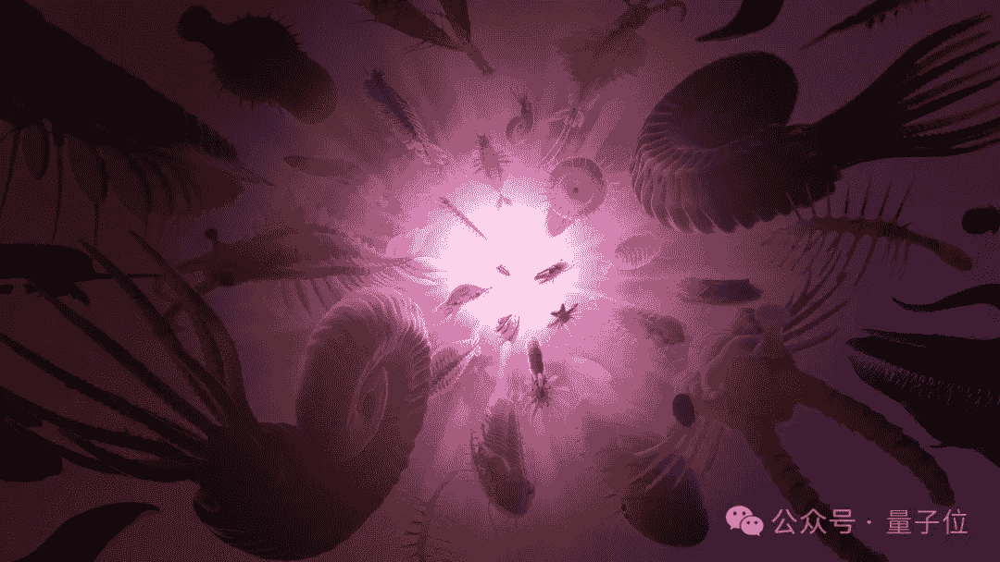

视觉能力被认为引发了寒武纪大爆发，一个动物物种大量进入化石记录的时期。最初是被动体验，简单让光线进入的行为，很快变得更加主动，神经系统开始进化。

> 视觉变成了洞察力。看变成了理解。理解导致了行动。

所有这些都催生了智能。

#### **计算机视觉的崛起**

今天，我们不再满足于自然界赋予的视觉能力。好奇心驱使我们创造机器，希望其视觉能力至少和我们一样，甚至更好。

九年前，在这个舞台上，我提交了一份关于计算机视觉的早期进展报告。

当时，三个强大的力量首次汇聚在一起：

+   一类称为**神经网络**的算法

+   **快速、**专门的硬件，称为图形处理单元，或GPU

+   再加上**大数据**，比如我的实验室花数年时间整理的1500万张图像，称为ImageNet。

它们共同迎来了现代人工智能时代。

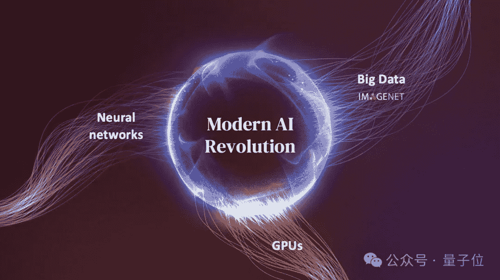

从那时起到现在，我们已经走了相当远。

最开始，仅仅给图像贴上标签就是一个重大突破,但算法的速度和准确性迅速提高。

由我的实验室主办的年度ImageNet挑战赛衡量了这一进展。在这张图表中，可以看到每年模型能力的提高，和其中一些里程碑模型。

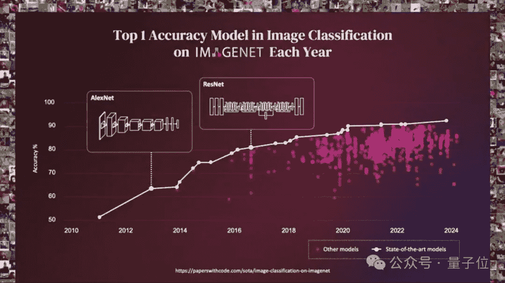

我们更进一步，创建了能够分割视觉对象或预测它们之间动态关系的算法，这些工作是由我的学生和合作者完成的。

还有更多。

回想上次演讲我展示的第一个计算机视觉算法，AI可以用人类的自然语言描述一张照片。那是我和聪明的学生Andrej Karpathy一起完成的工作。

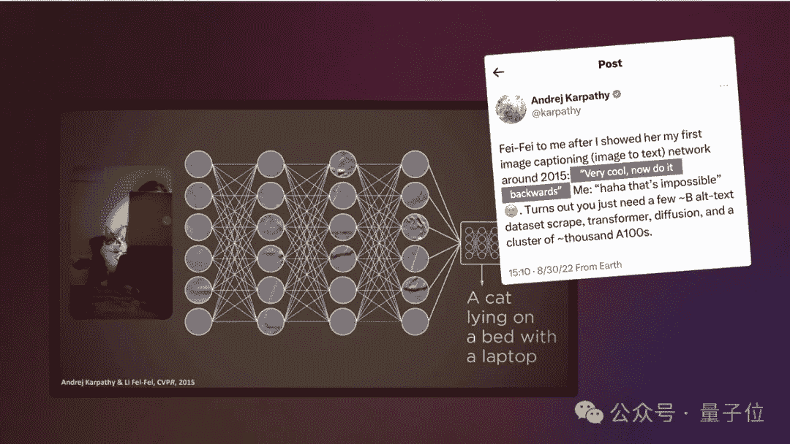

当时，我大胆地说：“Andrej，我们能让计算机做相反的事情吗？”Andrej笑着说说：“哈哈，那是不可能的。”

好吧，正如您今天看到的，不可能已经变得可能。

这要归功于一系列扩散模型，为当今的生成式AI算法提供动力，可以将人类的提示词转化为照片和视频，创造出全新的事物。

你们中许多人已经看到了OpenAI的Sora，最近取得令人印象深刻的成果。不**过，早在**几个月前，在没有大量GPU的情况下，我的学生和合作者们就开发出了一个名为Walt的AI视频生成模型。

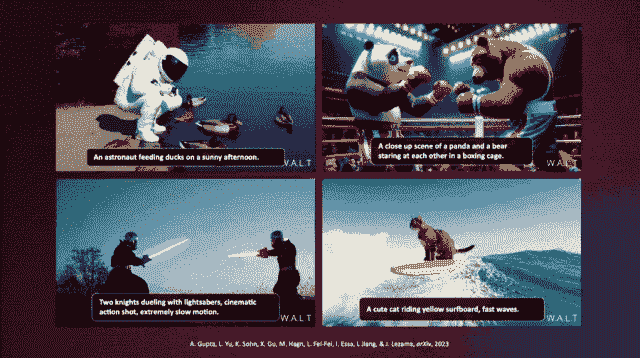

这里还有改进的空间，看看那只猫的眼睛，它在波浪下从未被弄湿，好一个灾～难～（cat-astrophe）。

#### **空间智能：仅仅看是不够的**

过去是一个序章，我们将从这些错误中学习，并创造一个我们想象中的未来。在这个未来，我们希望AI尽其所能为我们做事，或帮助我们做事。

多年来，我一直在说拍照和看到和理解不是一回事。今天，我想再补充一点：仅仅看是不够的。

> **看，是为了行动和学习。**

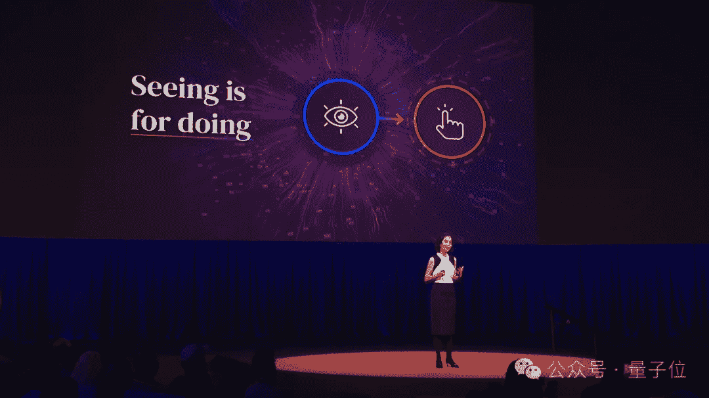

当我们在3D时空中采取行动时，我们学习，我们学会更好地看，更好地做事。大自然通过“空间智能”创造了一个看和行动的良性循环。

为了展示空间智能是什么，请看这张照片。如果你有想要做点什么的冲动，就举起手。

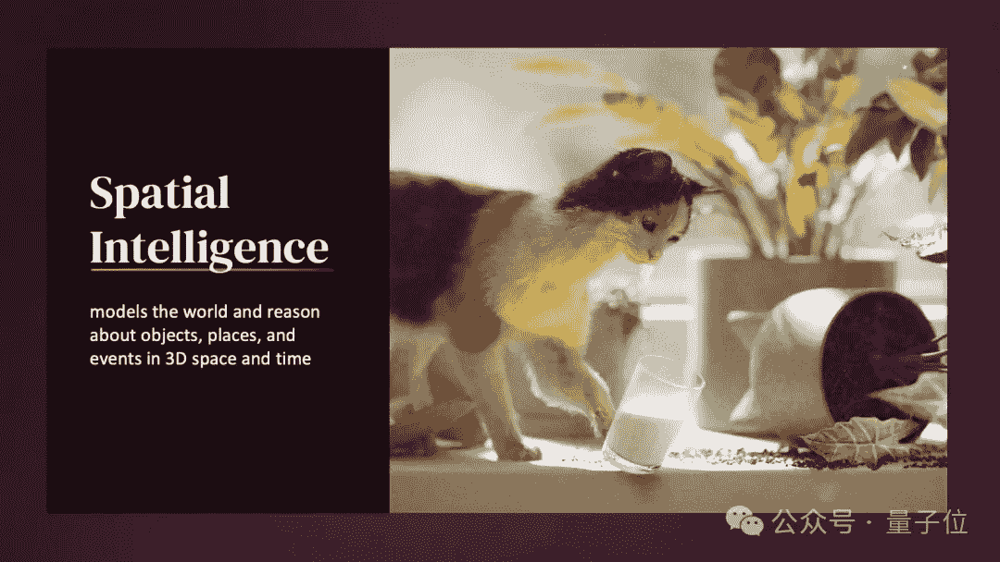

在一刹那，你的大脑观察了这个杯子的几何形状，它在3D空间中的位置，它与桌子、猫和所有其他物体的关系，而且你可以预测接下来会发生什么。

行动的冲动是所有具有空间智能的生物固有的，它将感知与行动联系起来。

如果我们想让AI超越当前能力，我们不仅想要能够看到和说话的AI，我们想要能够行动的AI。

事实上，我们正在取得令人兴奋的进展。

> 空间智能的最新里程碑是教计算机看到、学习、行动，并学习看到和行动得更好。

而这并不容易。

大自然花费了数百万年时间进化出空间智能，眼睛捕捉光线，将2D图像投射到视网膜上，大脑将这些数据转换成3D信息。

直到最近，一群来自谷歌的研究人员才开发出一种算法，将一组照片转换成3D空间。

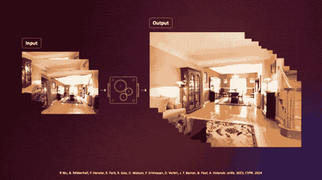

我的学生和合作者们更进一步，创建了一个将单个图像变成3D形状的算法。

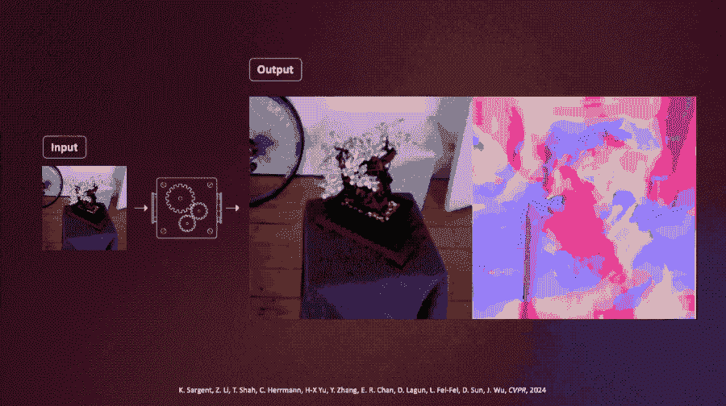

密歇根大学的一组研究人员找到了一种方法，将句子转换成3D房间布局。

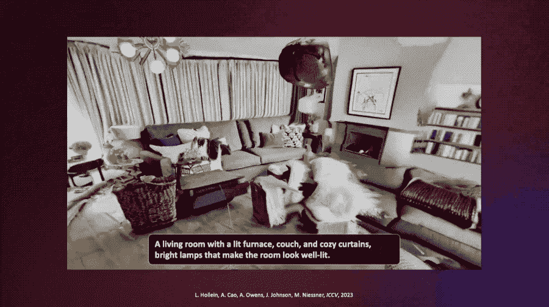

我在斯坦福大学的同事和他的学生们开发了一种算法，可以从单个图像生成无限可能的空间，供观众探索。

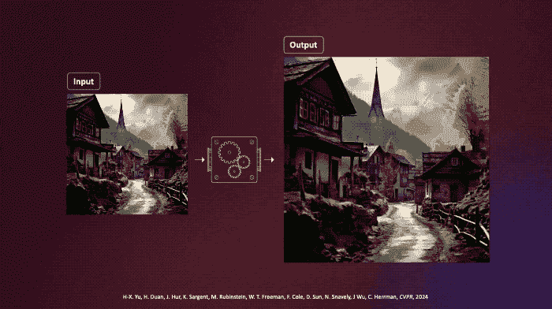

这些就是未来可能性的的原型。在这个可能性中，人类可以将我们的整个世界转化为数字形式，并模拟其丰富和细微之处。

大自然在我们每个人的头脑中隐性地做了什么，空间智能技术有望能为我们的集体意识（collective consciousness）做同样的事情。

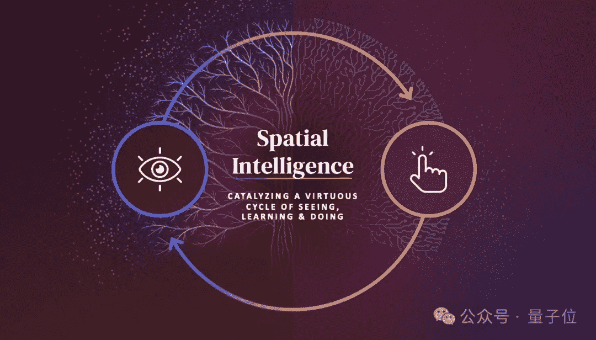

随着空间智能的加速进步，一个新时代在这个良性循环中正在我们眼前展开。这种循环正在催化机器人学习，这是任何需要理解和与3D世界互动的具身智能系统的关键组成部分。

十年前，我的实验室的ImageNet使数百万张高质量照片的数据库成为可能，帮助训练计算机视觉。

今天，我们正在做类似的事情，训练计算机和机器人如何在3D世界中行动。

这次我们不是收集静态图像，而是开发由3D空间模型驱动的模拟环境，以便计算机可以学习行动的无限可能性。

你刚刚看到的是教导我们的机器人的一小部分例子，这是一个由我的实验室领导的项目，称为Behavior。

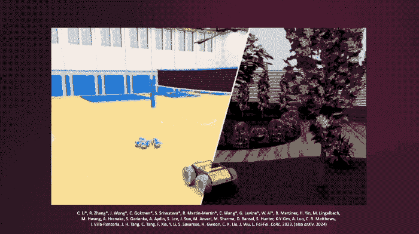

我们也在机器人语言智能方面取得了令人兴奋的进展。

使用基于大型语言模型的输入，我学生以及合作者是第一批展示机械臂可以根据口头指令执行各种任务的团队之一。

比如打开这个抽屉或拔掉电话线。或者制作三明治，使用面包、生菜、西红柿，甚至为用户放一张餐巾纸。通常情况下我希望三明治更丰富一些，但这是一个好的起点。

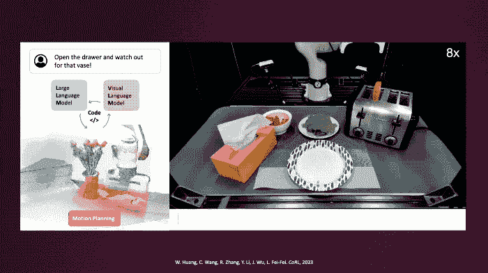

#### **空间智能的应用前景**

在古老时代的原始海洋中，能够看到和感知环境的能力引发了与其他生命形式互动的寒武纪大爆发。

今天，那道光正在达到数字思维。

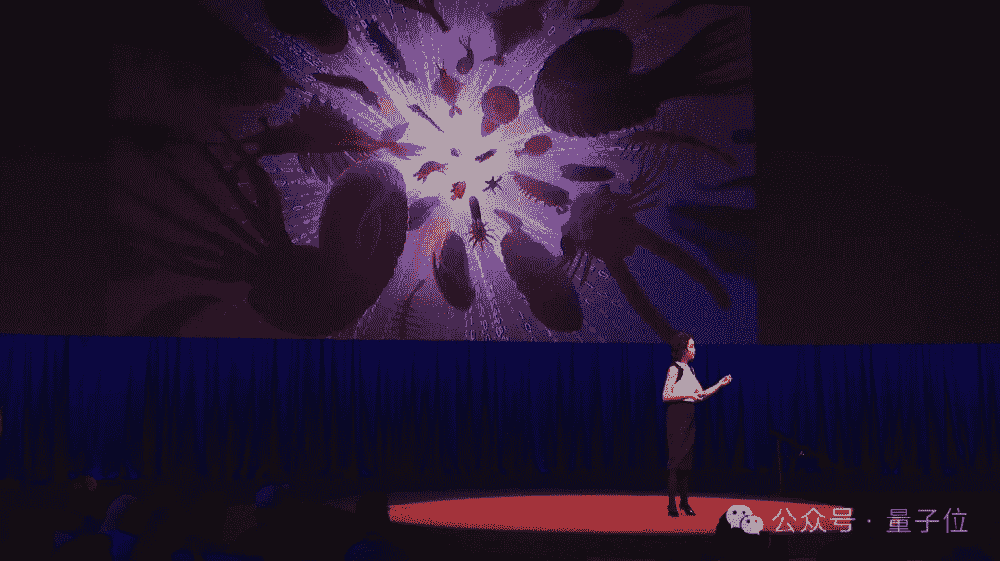

空间智能不仅允许机器与彼此互动，而且还能与人类，以及真实或虚拟的3D世界互动。

随着这个未来成形，它将对许多生命产生深远的影响。

让我们以医疗保健为例。在过去的十年中，我的实验室一直在做初步努力，将AI应用于解决影响患者结果和医疗人员疲劳的挑战。

与来自斯坦福医学院的合作者和其他合作医院一起，我们正在试验一些智能传感器，可以检测到临床医生是否在没有正确洗手的情况下进入病人房间。或跟踪手术器械，或在病人身体面临风险，如跌倒时提醒护理团队。

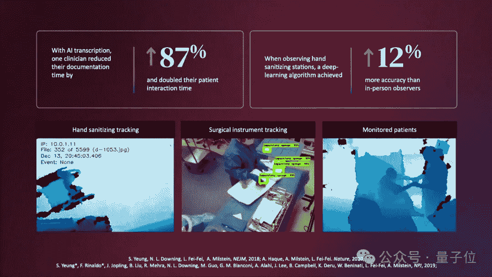

**我们认为这些**技术是一种环境智能，就像额外的眼睛。

但我更希望为我们的患者、临床医生和**护理人员提供**更多的互动帮助，他们迫切需要额外的一双手。

想象一下，一个自主机器人在护理人员专注于病人的同时运输医疗用品，或者用增强现实技术，引导外科医生进行更安全、更快、更少侵入性的操作。

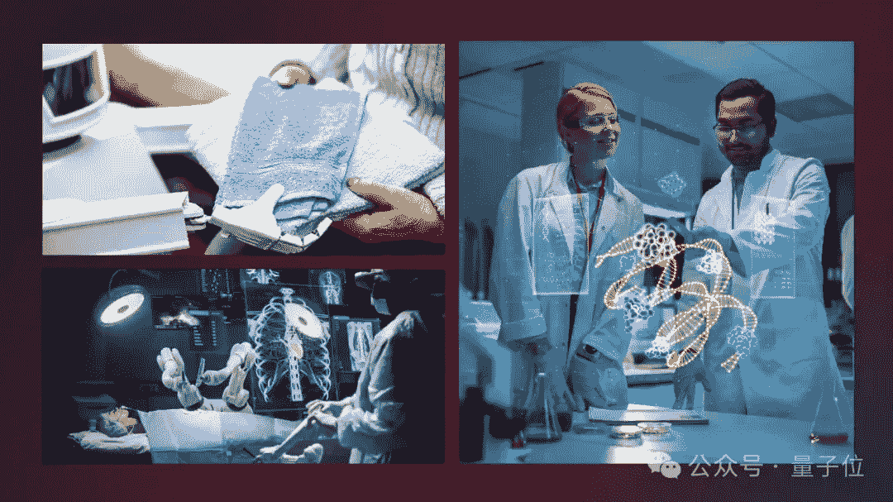

再想象一下，严重瘫痪的病人可以用他们的思想控制机器人。没错，用脑电波来执行你和我习以为常的日常任务。

这是最近我的实验室进行的一项试点研究。在这个视频中，机器人手臂仅通过大脑电信号控制，正在烹饪一顿日本寿喜锅餐。其中信号非侵入性地通过EEG帽收集。

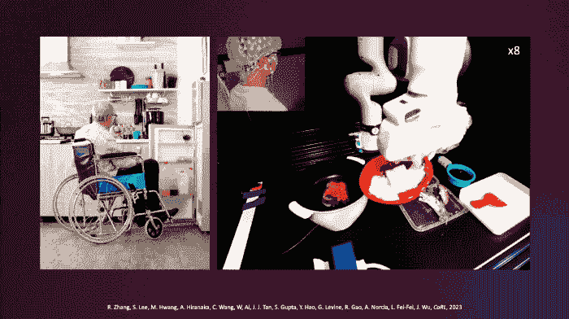

五亿年前，视觉的出现颠覆了黑暗的世界，引发了最深刻的进化过程：动物世界的智能发展。

过去十年AI的进步同样令人惊叹。但我相信，直到我们为计算机和机器人赋予空间智能，就像大自然对我们所有人所做的那样，这场数字寒武纪大爆发的全部潜力才会完全展现。

这是一个激动人心的时刻，教我们的数字伙伴学会推理，和与我们称之为家的这个美丽的3D空间互动，同时也创造更多我们可以探索的新世界。

实现这一未来并不容易，它要求我们所有人深思熟虑，开发始终以人为本的技术。

但如果我们做得好，由空间智能驱动的计算机和机器人不仅会成为有用的工具，还会成为值得信赖的伙伴，在尊重个人尊严的同时，提高我们的生产力、增强我们的人性，提升我们的集体繁荣。

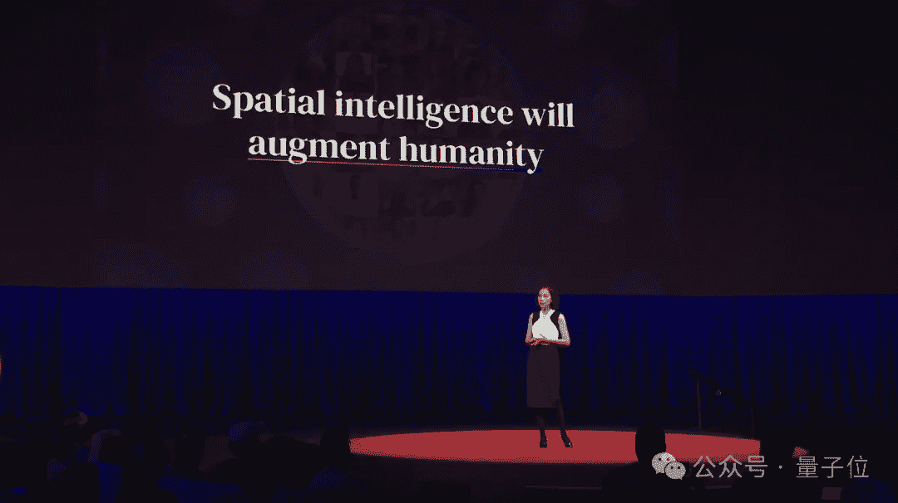

在所有未来中我最兴奋的，是一个AI变得更有感知、有洞察和空间意识，并与我们一道追求创造更好的世界的方法。

（全文完）