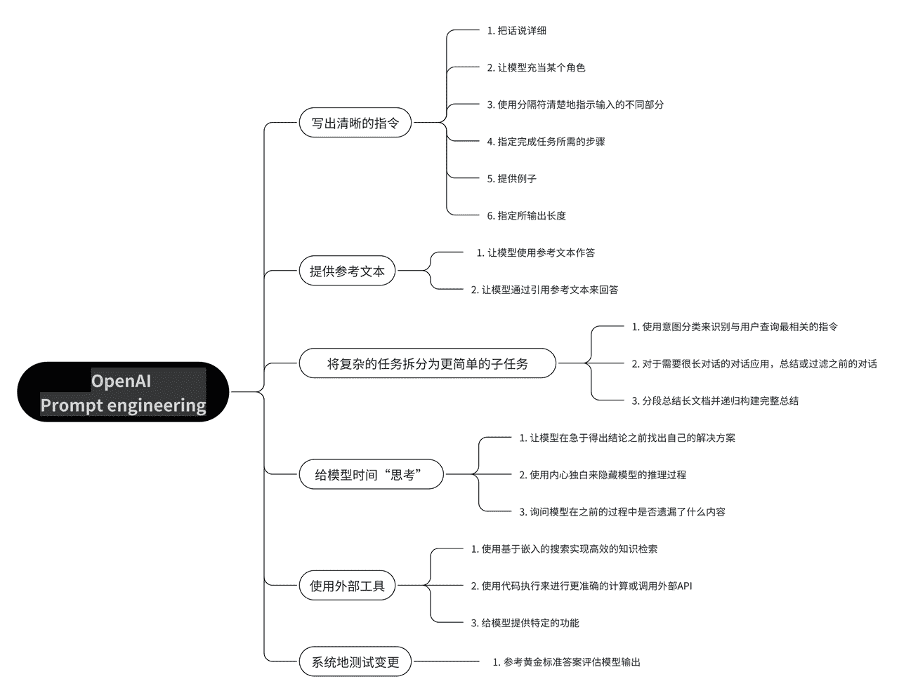

# OpenAI 官方提示工程指南

> 来源：[https://waytoagi.feishu.cn/docx/Ts61d9vaBoEw59xlpg6cVJstn0E](https://waytoagi.feishu.cn/docx/Ts61d9vaBoEw59xlpg6cVJstn0E)

> 原文地址：https://platform.openai.com/docs/guides/prompt-engineering

> 翻译：[宝玉](https://baoyu.io/translations/openai/openai-prompt-engineering-guides)

> 解读文章：《OpenAI的官方Prompt工程指南详解 - 看这一篇真的就够了》数字生命卡兹克

> [提示工程： 如何与大型语言模型高效沟通【OpenAI官网翻译】](https://waytoagi.feishu.cn/wiki/I0UVwBs22iTxN0kmDZ2cm7RHn3L)一篇翻译可以对照来看，来自大雨：《 》

这份指南分享了如何更有效地利用像如 GPT-4 这样的大语言模型（有时候也叫 GPT 模型）来获得更好的结果。介绍的方法可以相互结合，以发挥更大的作用。我们鼓励你进行实验，寻找最适合你的技巧。

目前，这里演示的一些示例只适用于最先进的模型 gpt-4。一般来说，如果你尝试的模型在某个任务上未能成功，并且有更高级的模型可供使用，不妨用更高级的模型再尝试一次。

此外，你可以查看一些示例提示，了解我们的模型能做些什么：

> [提示词示例](https://platform.openai.com/examples)

> 浏览这些示例，发现 GPT 模型的潜能

## 六大策略助你获得更佳结果

### 撰写清晰的指令

这些模型并不会读心术，无法猜到你的想法。如果模型的输出内容过长，你可以要求它简短回答。如果模型输出内容过于简单，你可以要求使用更专业的水平写作。如果你对输出格式不满意，可以直接展示你期望的格式。最好就是让模型不需要去猜你想要什么，这样你最有可能获得想要的结果。

技巧：

+   在查询中添加详细信息，以获得更准确的答案

+   [请求模型扮演特定角色](https://baoyu.io/translations/openai/openai-prompt-engineering-guides#tactic-ask-the-model-to-adopt-a-persona)

+   使用分隔符来清晰区分输入的不同部分

+   [明确指出完成任务需要的步骤](https://baoyu.io/translations/openai/openai-prompt-engineering-guides#tactic-specify-the-steps-required-to-complete-a-task)

+   [提供实例作为参考](https://baoyu.io/translations/openai/openai-prompt-engineering-guides#tactic-provide-examples)

+   [明确指定希望输出的长度](https://baoyu.io/translations/openai/openai-prompt-engineering-guides#tactic-specify-the-desired-length-of-the-output)

###

### 提供参考文本

语言模型可能会自信地编造出虚假答案，特别是当回应一些深奥主题或被要求提供引文和 URLs 时。就像学生在考试中借助笔记能够帮助其取得更好的成绩一样，为这类模型提供参考文本也可减少其制造虚假信息的情况。

技巧：

+   [引导模型根据参考文本回答问题](https://baoyu.io/translations/openai/openai-prompt-engineering-guides#tactic-instruct-the-model-to-answer-using-a-reference-text)

+   引导模型根据参考文本中的引用信息回答问题

###

### 把复杂的任务拆分成简单的子任务

就像在软件工程中，我们会习惯于把复杂的系统分解成一套模块化的组件，对于提交给语言模型的任务也是同样的道理。相较于简单的任务，复杂任务的错误率往往会更高。而更进一步，我们常常可以把这些复杂任务重新设定为一系列的工作流程，每一个流程就是一个更简单的任务，而且这些任务之间是相互联系的，前一个任务的输出会作为后一个任务的输入。

技巧：

+   利用意图分类识别用户查询中最相关的指令

+   对于需要长时间对话的对话应用，总结或筛选先前的对话内容

+   分步总结长文档，并递归地构建完整的总结

###

### 给模型更多时间“思考”

如果被要求计算 17 乘以 28，我们可能不能立即给出答案，但可以花一些时间逐步计算出结果。同样，在 AI 模型试图立刻回答问题时，往往比理性思考后再做出回答更容易出错。所以，在模型给出答案之前，要求其展示一下"思考过程"，有助于模型更可靠地推导出正确的答案。

技巧：

+   在仓促做出结论前，指导模型自己寻找解决方法

+   通过内心独白或连串问题来掩盖模型的思考过程

+   [问模型在之前的步骤中是否有遗漏](https://baoyu.io/translations/openai/openai-prompt-engineering-guides#tactic-ask-the-model-if-it-missed-anything-on-previous-passes)

###

### 运用外部工具

为了弥补模型的不足，我们可以利用其他工具的输出作为输入。例如，文本检索系统（有时被称为 RAG 或检索增强生成系统）可以向模型提供相关文档的信息。像 OpenAI 的代码执行引擎这样的工具，可以帮助模型进行数学运算和代码执行。如果某项任务通过工具来完成能比通过语言模型更可靠或更高效，那么就把任务交给这个工具处理，这样就能结合两者长处，达到最佳效果。

技巧：

+   运用基于嵌入的搜索来高效实现知识检索

+   利用代码执行进行更精确的计算或调用外部 API

+   [使模型能够访问特定功能](https://baoyu.io/translations/openai/openai-prompt-engineering-guides#tactic-give-the-model-access-to-specific-functions)

###

### 系统地对变更进行测试

如果能对性能进行量化，那么就能更好地提高性能。有时，对提示词的修改在少数特定例子上可能表现更佳，但在更具普遍性的样本集上可能会导致整体性能下降。因此，为了确保改动对总体性能产生积极的影响，可能需要设计一份全方位的测试（也被称为"评估"）。

技巧：

+   根据标准答案的参考评估模型输出效果

##

## 实用策略

上述的每一种策略都可以通过具体的技巧来具体实施。这些技巧是为了给你提供可尝试的想法，但并不是完全详尽无遗的。你也可以尝试这里没有提到的一些新颖创意的方法。

###

### 策略：编写明确的指导说明

####

#### 技巧：在你的查询中包含详尽的信息，以获取更为准确的答案

为了得到更准确的回答，确保你的提问中包含了所有重要的细节和背景信息。否则你就是在让模型猜测你的意图。

####

#### 技巧：让模型扮演一个角色

通过系统消息，我们可以指定模型在回答中所扮演的角色。

在 Playground 中体验

####

#### 技巧：利用分隔符清晰区分输入的不同部分

使用三重引号、XML 标签、章节标题等作为分隔符，能够有效地区别并处理不同的文本内容。

在 Playground 中体验

在 Playground 中体验

在 Playground 中体验

对于诸如此类的简单任务，使用分隔符可能不会对输出质量产生影响。但任务越复杂，就越需要清楚地区分每个任务的细节，以避免混淆。要让模型很准确地理解你究竟需要什么。

####

#### 技巧：明确说明完成任务所需的每个步骤

对于某些任务，最好将其分解成一系列明确的步骤。将步骤清晰地写出来，可以帮助模型更有效地遵循指令。

在 Playground 中体验

####

#### 技巧：提供示例

通常，给出适用于所有情况的通用指导比展示各种任务示例更高效。但在某些情况下，通过提供具体示例来说明可能更直观。比如，你想让模型学习某种特定的回应方式，这种方式可能难以用语言明确描述，这就是所谓的“少样本 (Few-shot)”提示方法。

在 Playground 中查看

####

#### 技巧：明确输出长度要求

你可以要求模型按照指定的长度来生成答案。这个长度可以根据单词、句子、段落、要点等的计数来指定。但要注意，让模型精确生成特定字数的文本可能不太容易做到。模型更擅长按照指定的段落数或要点数来构建输出。

在 Playground 中查看

在 Playground 中查看

在 Playground 中查看

###

### 策略：提供参考文本

####

#### 技巧：使用参考文本来构建答案

如果我们能向模型提供与提问内容相关的可靠信息，我们就可以指导模型利用这些信息来构建答案。

在 OpenAI 的 Playground 中查看

由于所有模型都受到上下文窗口大小的限制，我们需要一种方法来动态[地查询与提出的问题相](https://platform.openai.com/docs/guides/embeddings/what-are-embeddings)关的信息。可以使用 Embeddings（嵌入式技术）来实现有效的知识检索。具体方法请参考策略 "利用基于嵌入式搜索的方式来高效检索知识"。

####

#### 技巧：指导模型用引用的文本回答问题

如果输入信息中已经包含了相关知识，就可以直接要求模型在回答问题时引用所提供的文件中的段落。值得注意的是，输出中的引用可以通过在所提供的文件中匹配字符串来进行验证。

在 OpenAI 的 Playground 中查看

###

### 策略：将复杂任务分解成更简单的子任务

####

#### 技巧：利用意图分类确定与用户查询最相关的指令

在一些需要[处理众多](https://openai.com/pricing)独立指令集的任务中，先对查询的类型进行分类，然后根据这个分类来确定需要的指令，这样做往往是有益的。具体方法是，先定义固定的类别，并为处理这些类别中的任务硬编码相关指令。这个过程还可以递归地应用于把一个任务分解成多个阶段。这种方法的好处是，每个查询只包含执行下一个任务阶段所需的指令，相比于用一个查询来完成整个任务，这样可以降低错误率。同时，这也可能降低成本，因为较长的提示的运行成本更高（更多详情请参见 定价信息）。

比如，对于客户服务应用来说，可以有效地把查询分为以下几类：

在 Playground 中打开

基于客户查询的分类，我们可以为模型提供一系列更具体的指令来处理下一步。例如，如果客户需要“故障排除”的帮助。

在 OpenAI Playground 中查看

请注意，模型被设定为在对话状态发生变化时发出特殊指令。这使我们的系统能够转变为一个状态机，根据当前的状态来决定注入哪些指令，以及从该状态出发可以转换到哪些状态。通过监控对话状态、相关指令以及状态转换，我们能更好地控制用户体验，这在非结构化的交流方式中难以实现。

####

#### 技巧：针对需要长时间对话的应用程序，应概括或过滤之前的对话内容

由于模型的上下文长度是固定的，用户与助手的对话不能无限延续，尤其是当整个对话内容都包含在上下文窗口中时。

解决这一问题的方法之一是概括之前的对话。当输入内容达到一定长度时，可以触发对部分对话内容进行概括的查询，这样的概括可以作为系统消息的一部分。或者，也可以在整个对话过程中不断后台概括之前的对话内容。

另一种方法是动态地挑选对话中与当前问题最相关的部分。详情可见策略 “利用基于嵌入向量的搜索实现高效的知识检索”。

####

#### 技巧：逐段归纳长文档并递归地构建完整摘要

因为模型的上下文长度是固定的，所以它们无法一次性总结超过上下文长度减去所生成摘要长度的文本。

例如，要总结一本很长的书，我们可以使用一系列的查询来分别总结书中的每个章节。这些部分的摘要可以被连结并进一步总结，形成摘要的摘要。这个过程可以递归地进行，直至整[本书](https://openai.com/research/summarizing-books)被总结完毕。如果在理解书中后续部分时需要前面章节的信息，那么在总结当前部分内容时附加一个前面内容的连续摘要会是一个实用的技巧。OpenAI 之前利用 GPT-3 的变种对这种总结书籍的方法进行了 研究。

###

### 策略：给予模型“思考”的时间

####

#### 技巧：在模型急于得出结论之前，指导模型自己寻找解决方案

有时，在明确指导模型根据基本原理进行推理之前，我们可能会得到更好的结果。假设我们希望模型评估一个学生对数学问题的解答。最直观的方式是直接询问模型学生的解答是否正确。

在 Playground 中查看详情

然而，学生的解答其实并不正确！我们可以通过引导模型首先产生它自己的解答，从而让它成功地发现这个问题。

在 Playground 中查看详情

####

#### 技巧：运用内心独白或连续提问来隐藏模型的推理过程

先前的策略证明，在回答特定问题之前，模型有时需要深入地推理问题的过程。然而，在某些应用环境中，模型为得出最终答案的推理过程不宜与用户分享。比如，在教导应用里，我们或许希望鼓励学生自行思考答案，但模型对于学生解答的推理过程可能会无意间透露出答案。

内心独白就是能有效应对这种情况的策略。内心独白的主要概念是指导模型将那些需要被用户隐藏的输出部分以一种结构化的形式表现，从而容易进行解析。然后在将输出结果展示给用户之前，将其进行解析处理，最后只呈现部分的解析结果给用户看。

在 Playground 中查看

另一种方式是通过一系列的查询来实现，除了最后一个外，所有查询的结果都不展示给用户。

首先，我们可以让模型独立解决这个问题。因为这个初始步骤不需要学生的答案，所以可以省略。这样可以确保模型的答案不会受到学生答案的影响。

在 Playground 中查看

然后，模型将利用所有信息来判断学生的答案是否正确。

在 Playground 中查看

最后，让模型根据自己的分析以有帮助的家教身份给出回复。

在 Playground 中查看

####

#### 技巧：询问模型是否有遗漏

比如我们在用模型列出与特定问题相关的摘录时，每列出一段后，模型需要决定是继续写下一个还是停止。如果原文很长，模型可能会过早结束，错过一些相关摘录。此时，通过后续查询来寻找之前遗漏的摘录，通常可以获得更好的效果。

在 Playground 中打开

###

### 策略：使用外部工具

####

#### 技巧：使用基于嵌入的搜索实现高效知识检索

模型可以通过利用作为输入的一部分提供的外部信息，生成更加准确和及时的回应。例如，如果用户提问有关某部特定电影的问题，将该电影的高质量信息（如演员、导演等）添加到模型输入中可能很有帮助。嵌入技术可以用于高效地检索知识，因此可以在运行时动态地将相关信息添加到模型输入中。

文本嵌入是一种向量，能够衡量文本字符串之间的相关性。相关或相似的字符串在嵌入空间中会比不相关的字符串更靠近。这一事实，加上快速向量搜索算法的存在，意味着可以使用嵌入来实现高效的知识检索。具体而言，可以将文本语料库分割成多个块，对每个块进行嵌入处理并存储。然后，可以对特定查询进行嵌入处理，并进行向量搜索，以找到语料库中与查询最相关的嵌入文本块（即在嵌入空间中位置最接近的）。

在 [OpenAI Cookbook](https://cookbook.openai.com/examples/vector_databases/readme) 中，你可以找到一些实用的实现示例。想了解如何利用知识检索技术减少模型产生错误信息的风险，不妨看看 “教模型用检索到的知识回答问题” 这个实用技巧。

####

#### 技巧：利用代码执行进行精确计算或调用外部 API

仅凭语言模型自身，我们不能指望它准确完成算术或复杂计算。在需要精确计算的场合，我们可以让模型编写并运行代码，而不是自行计算。特别是，我们可以让模型将要执行的代码放在特定的格式里，比如三个反引号。代码运行后产生的输出可以被提取并执行。必要时，还可以将代码执行引擎（比如 Python 解释器）的输出作为下一步查询的输入。

[在 Playground 打开](https://platform.openai.com/playground/p/default-code-execution)

另一个使用代码执行的好场景是调用外部 API。如果模型掌握了正确的 API 使用方法，它就能编写调用这些 API 的代码。我们可以通过提供相关文档和代码示例来指导模型如何使用 API。

[在 Playground 打开](https://platform.openai.com/playground/p/default-code-api)

**警告：由模型生成的代码执行可能存在安全风险，因此，在任何计划中使用此类代码时必须采取预防措**施。特别重要的是，需要一个隔离的代码执行环境，以降低不受信任代码可能带来的风险。

####

#### 技巧：使模型能够访问特定功能

Chat[ Compl](https://platform.openai.com/docs/guides/function-calling)[etions](https://cookbook.openai.com/examples/how_to_call_functions_with_chat_models) API 允许在请求中传递函数的描述。这样，模型就可以生成符合这些描述的函数参数。这些参数以 JSON 格式由 API 返回，并可以用于执行函数调用。函数调用的结果可以再次输入到模型中，形成一个闭环。这是利用 OpenAI 模型来执行外部函数调用的推荐方法。想了解更多信息，请参阅我们的入门文本生成指南中的函数调用部分和 OpenAI Cookbook 中的更多函数调用示例。

###

### 策略：系统地对变更进行测试

有时，很难确定某个更改，比如新的指令或设计，是否真的改善了系统。观察几个案例可能会有所帮助，但在样本量较小的情况下，很难判断这是真正的改进还是偶然的幸运。可能某些更改在特定输入上提高了性能，但在其他情况下则降低了性能。

评估程序对于优化系统设计非常有用。有效的评估特点是：

+   能够代表现实世界中的使用情况（或至少具有多样性）

+   包含众多测试案例，从而拥有更强的统计能力（参见下表中的指南）

+   可以轻松自动化或重复

评估[可以由计算机、人工或两者](https://github.com/openai/evals)结合进行。计算机可以自动化那些具有客观标准的评估（例如，有唯一正确答案的问题），也可以用于某些主观或模糊标准的评估，在这种情况下，模型输出由其他模型查询进行评估。OpenAI Evals 是一个开源软件框架，提供创建自动化评估的工具。

当涉及到一系列可能的答案，且这些答案都被视为高质量时，基于模型的评估方法会非常有帮助，比如在回答需要较长解答的问题时。判断何时使用基于模型的评估和何时需要人工评估之间的界限并不明确，随着模型能力的提升，这一界限也在不断变化。我们鼓励大家进行实验，以探索基于模型的评估在特定应用场景下的实际效果。

####

#### 技巧：以标准答案为基准评估模型输出

假设我们已经知道对某个问题的正确回答应当涉及一组特定的已知事实。在这种情况下，我们可以通过模型查询来检查回答中包含了哪些必要的事实。

例如，可以使用以下系统提示：

以下是一个示例输入，满足两个信息点：

在 Playground 中打开

以下是一个示例输入，仅满足一个信息点：

在 Playground 中打开

以下是一个示例输入，两个信息点都不满足：

在 Playground 中打开

在这类型的基于模型的评估中，有多种可能的变体。其中一个变体是追踪候选答案与标准答案之间的相似性，以及候选答案是否与标准答案有任何矛盾。

以下是一个例子，展示了一个答案虽不完全符合标准，但并未与专家答案相矛盾的情况：

在 Playground 中打开

以下是另一个例子，显示了一个与专家答案直接相矛盾的答案：

在 Playground 中打开

这是一个正确答案的例子，它提供了比必要更多的细节：

在 Playground 中查看

##

## 其他资源

欲获取更多灵感，可以访问 [OpenAI 实用手册](https://cookbook.openai.com/)，其中含有示例代码，以及指向第三方资源的链接，例如：

+   [引导工具库](https://cookbook.openai.com/related_resources#prompting-libraries--tools)

+   [引导教程](https://cookbook.openai.com/related_resources#prompting-guides)

+   [视频教程](https://cookbook.openai.com/related_resources#video-courses)

+   [提高推理能力的高级引导论文](https://cookbook.openai.com/related_resources#papers-on-advanced-prompting-to-improve-reasoning)

