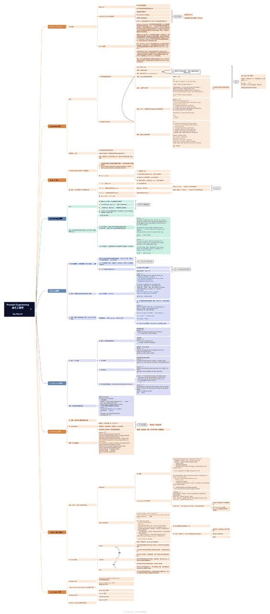
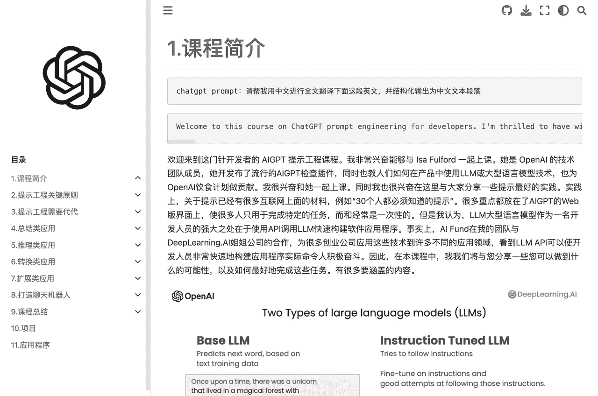
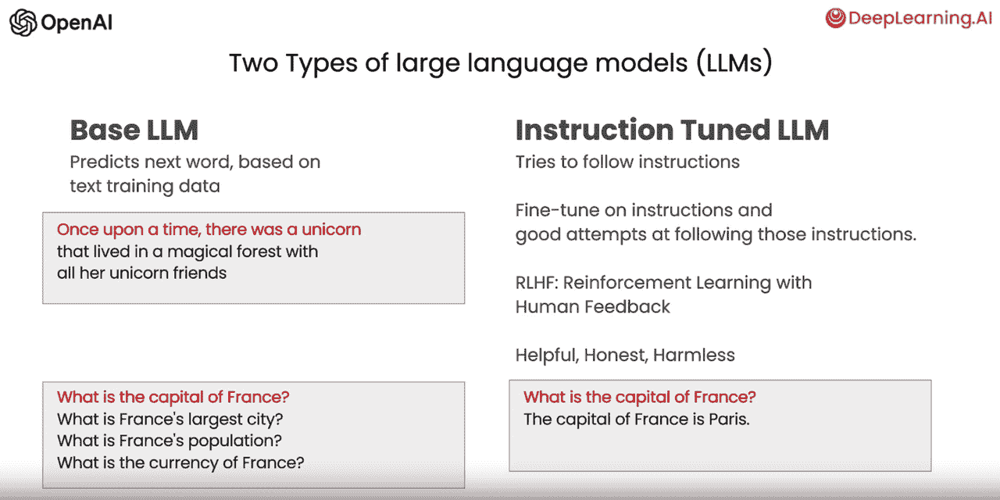

# 目录：吴恩达讲Prompt

> 来源：[https://waytoagi.feishu.cn/docx/M9HDd7msxoCB0kxLq1ccQNcsnec](https://waytoagi.feishu.cn/docx/M9HDd7msxoCB0kxLq1ccQNcsnec)

谷歌/百度AI部门负责人吴恩达和OpenAI合作推出了免费的Prompt Engineering（提示工程师）课程。

课程主要内容是教你书写AI提示词，并且最后会教你利用GPT开发一个AI聊天机器人。

原版网址：https://www.deeplearning.ai/short-courses/chatgpt-prompt-engineering-for-developers/

B站版本：【合集·AI Course-哔哩哔哩】 https://b23.tv/ATc4lX0

https://b23.tv/lKSnMbB

---

翻译版本：[来自twitter博主歸藏](https://twitter.com/op7418?s=21&t=F6BXooLyAyfvHbvr7Vw2-g)

+   推荐直接使用Jupyter版本学习，效率更高：https://github.com/datawhalechina/prompt-engineering-for-developers/

+   吴恩达和Open AI合作的提示工程课程一共9集全部已经翻译完成，并且改成了双语字幕，字幕文件也已经上传了。

+   视频下载地址：https://pan.quark.cn/s/77669b9a89d7

+   OpenAI开源了教程：https://islinxu.github.io/prompt-engineering-note/Introduction/index.html

---

纯文字版本：

+   https://github.com/zard1152/deepLearningAI/wiki

+   [ChatGPT 提示工程 中文翻译版（仅用于学习分享）](https://fieghf3pzz6.feishu.cn/wiki/MazPw5eo5iW95gkvWAhcSTxdnSc)

+   [openai官方《提示词工程课》超详细中文笔记](https://ec26ubh65w.feishu.cn/docx/PuULdQP3wojyZYxn157cnsDXnqe)

+   [Gi](https://github.com/Kevin-free/chatgpt-prompt-engineering-for-developers)tHub - Kevin-free/chatgpt-prompt-engineering-for-developers: 吴恩达《ChatGPT Prompt Engineering for De

## 介绍

有两类大语言模型：

+   基础LLM：

+   基础大型语言模型经过训练，可以根据文本预测下一个词。训练数据通常基于大量来自互联网和其他来源的数据，以推断出最有可能出现的下一个词。

+   指令微调LLM：

+   指令调优的大型语言模型是当前大型语言模型研究和实践的主要发展方向。指令调优的大型语言模型经过训练，能够遵循指令。

+   为了让系统更有帮助并遵循指令，通常会进一步使用一种名为人类反馈 强化学习 （RLHF）的技术来优化。因为指令调优的大型语言模型经过训练，更有助于提供有用的、无害的回答。

## 原则与技巧

> 两个提示的关键原则：

> 1）原则1：尽可能保证下达的指令“清晰、没有歧义”

> 2）原则2：给大模型思考的时间，以及足够的时间去完成任务