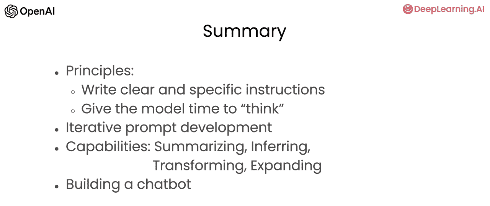

# 9.课程总结

> 来源：[https://waytoagi.feishu.cn/docx/TkFydHRsXo1fnxxj3wLcvTX7nlb](https://waytoagi.feishu.cn/docx/TkFydHRsXo1fnxxj3wLcvTX7nlb)

---

恭喜你完成了这个短课程。总的来说，在本短课程中，你学会了两个关键的提示原则。撰写清晰明确的指令，并在适当的情况下给模型时间思考。你还学会了迭代式提示开发的方法，以及如何找到适合你的应用程序的提示方法是至关重要的。

我们还介绍了一些大型语言模型的功能，在许多应用程序中非常有用，特别是摘要、推理、转换和扩展。你还学会了如何构建自定义聊天机器人。这短短的课程中，你已经学到了很多，我希望你喜欢这些材料。我们希望你能想出一些自己可以构建的应用程序的想法。请尝试一下，让我们知道你的想法。

没有太小的应用程序，开始做一些非常小的项目，也是可以的，也许它只有很少的效用，甚至不连可用性都没有，但这样也很有趣。我发现玩这些模型非常有趣，所以去尝试一下吧！我同意，从我的经验来看，这是一个很好的周末活动。请用你第一个项目中所学到的东西去建立更好的第二个项目，甚至第三个项目，以此类推。这也是我自己用这些模型成长的方式。

如果你已经有一个大型项目的想法，那就直接着手去实现吧。需要提醒大家的是，这些大型语言模型是一项非常强大的技术，因此我们要求你们在使用时要明智并只构建能够产生积极影响的东西。是的，我完全同意这个说法。我认为在这个时代，构建人工智能系统的人对他人有巨大的影响。因此，我们所有人都要更加重视使用这些工具的责任。

嗯，我认为现在基于大型语言模型构建应用程序是一个非常令人兴奋和不断发展的领域。现在您已经完成了这门课程，我认为您已经掌握了许多知识，可以构建出很少有人能够构建的东西。因此，我希望您也能帮助我们宣传，并鼓励其他人也参加这门课程。最后，我希望您在完成本课程时玩得开心，并感谢您完成本课程。我和Ezra都期待着听到您所构建的惊人事物。