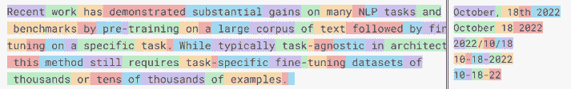

# 目录：微软与Claude教程等

> 来源：[https://waytoagi.feishu.cn/docx/VOXNdcFCIoJOV6xThaycjCBOnfh](https://waytoagi.feishu.cn/docx/VOXNdcFCIoJOV6xThaycjCBOnfh)

## 简介

OpenAI 中的 GPT-3、GPT-3.5 和 GPT-4 模型基于提示。 使用基于提示的模型时，用户通过输入文本提示与模型交互，该文本提示通过文本补全进行响应。 补全是模型的输入文本的延续。

虽然这些模型非常强大，但它们的行为对提示也非常敏感。 这使得提示构造成为开发的重要技能。

提示构造可能很困难。 在实践中，提示的作用是配置模型权重以完成所需的任务，但它更像艺术而不是科学，通常需要经验和直觉来制作成功的提示。 本文的目的是帮助你开始学习此学习过程。 它会尝试探讨适用于所有 GPT 模型的一般概念和模式。 但是，请务必了解，每个模型的行为方式不同，因此这些学习成果可能不适用于所有模型。

## 基本信息

本部分介绍 GPT 提示的基本概念和元素。

文本提示是用户与 GPT 模型交互的方式。 与所有生成语言模型一样，GPT 模型会尝试生成最有可能紧跟上一个文本的下一系列字词。 就好像我们在说“当我说 <prompt> 时，你想到的第一件事是什么？”.  以下示例演示了此行为。 给定注明内容的第一个单词，模型能够准确地延续文本。

在开发更复杂的提示时，记住这一基本行为会很有帮助。 无论提供的提示是什么，模型都只是使用它确定的最有可能的情况（基于训练数据和训练目标）做出响应。 如果在提示中提出问题，则模型不会遵循单独的“Q&A”代码路径，而是看起来在回答问题，因为回答即是输入的给定问题最有可能的响应。

### 提示组件

当使用补全 API 而提示的不同部分之间没有区别时，它对于学习和[讨论以识别基础提](https://learn.microsoft.com/zh-cn/azure/cognitive-services/openai/how-to/chatgpt)示组件仍然很有用。 使用聊天补全 API 时，提示的不同部分以具有关联角色（系统、用户和助手）的字典数组的形式发送到 API。 本指南将更宽泛地侧重于如何考虑提示构造，而不是提供特定于某个 API 的规范性指导。

同样重要的是要了解，虽然可能存在其他有效的方法来剖析提示，但这种分解的目标是提供一种相对简单的方法来理解提示构造。 使用补全 API 时，所有组件都是可选的，但必须至少有一个组件存在，而大多数提示包含多个组件。 组件之间也可能存在一些灰色区域。 下面显示的顺序大致对应于每个组件的使用方式（从最多到最少）。

#### Instructions（指示）

指令可能是最常用的提示组件。 指令很简单：向模型说明要执行的操作。 虽然概念简单，但它在实践中可能比较复杂。 下表以两种不同形式显示简单和复杂的指令，借此来说明这一点。

### 主要内容

主要内容是指模型正在处理或转换的某种文本。 主要内容通常与指令一起使用。 一个简单的示例是语言翻译。 在下面的示例中，英语文本被视为主要内容，而“翻译为法语：”是指令。

主要内容也可以更长。 在以下示例中，主要内容是维基百科「时间复杂度」条目的简介部分，长度近 300 字。 为了便于显示，此内容已在表中缩写。

GPT 模型还可以处理结构化的主要内容。 在下面的示例中，有关比利时啤酒的 TSV（本文中为显示为缩写）作为提示的一部分传递给模型。 它能够正确解释内容并回答有关数据的问题。

### 示例

成功的提示通常依赖于“单样本”或“少样本”学习。 这是指加入模型所需行为的一个或多个示例，通常做法是加入输入和输出对。 这不是从模型进行永久更改这一意义上学习，而是通过示例更好地使模型能够仅根据当前推理的需求做出响应。 使用没有示例的提示有时称为“零样本”学习。 请注意，使用聊天补全 API 时，在初始系统消息后，少样本学习示例通常以示例用户/助手交互的形式添加到消息数组中。

上面的示例演示了少样本学习的效用。 如果没有这些示例，模型似乎在猜测所需的行为，而示例则清晰地向模型展示了如何操作。 这也演示了模型的强大功能，它可以推断出所需的标签类别，即使示例中没有“篮球”标签。

### 提示

提示充当模型输出的“快速启动”，帮助将模型定向到所需的输出。 它通常是模型可以作为生成基础的前缀。 在下面的示例中，我们演示了引导故事以包含关键元素的提示。 提示通常与指令一起使用，但并非总是如此。 在下面的示例中，该模型用于汇总长公告电子邮件。 提示在一种情况下用于帮助聚焦模型的输出，在另一种情况下用于建议特定输出格式（项目符号）。

在聊天补全 API 的上下文中，指令采用系统消息的形式，通过提供一系列示例用户/助手交互来指示少样本示例以帮助启动模型。

### 支持内容

支持内容是模型可用于以某种方式影响输出的信息。 它与主要内容的不同之处在于，它不是任务的主要目标，但它通常与主要内容一起使用。 常见示例包括上下文信息，例如当前日期、用户名、用户偏好等。 以下示例使用支持内容来帮助为用户安排一组计划的研讨会。 如果没有支持（重要主题），模型只会列出研讨会（为显示而截断），当被告知我的重要主题时，模型能够准确地分组会议。

## 最佳做法

+   尽量具体。 尽可能少留解读空间。 限制操作空间。

+   具有描述性。 使用类比。

+   强调。 有时可能需要对模型进行重复操作。 在主要内容之前和之后提供说明，使用指令和提示等。

+   给事项排序。 向模型呈现信息的顺序可能会影响输出。 你选择是在内容之前放置指令（“汇总以下内容...”）还是之后（“汇总以上...”）会影响输出。 即使是少样本示例的顺序也很重要。 这被称为“近因偏差”。

+   给模型一个“出路”。 如果模型无法完成分配的任务，有时为模型提供备用路径可能会有所帮助。 例如，在对一段文本提出问题时，可以加入类似于“如果答案不存在，则回复‘未找到’”之类的内容。 这有助于避免模型生成错误响应。

## 空间效率

虽然输入大小会随着 GPT 模型的迭代而增加，但仍存在提供的数据超出模型所能处理的数据量的情况。 GPT 模型将单词分解为“标记”。 常见的多音节单词通常是单个标记，而不太常见的单词会按音节拆分。 标记有时可能违反直觉，如以下示例所示，它演示了不同日期格式的标记边界。 在这种情况下，拼出整个月份比使用完全数字的日期更具空间效益。 当前的标记支持范围：早期 GPT-3 模型支持 2000 个标记，最新的 GPT-4 模型 32k 版本支持最多 32,768 个标记。

由于空间有限，请务必尽可能高效地使用它。

+   表格–如上一部分中的示例所示，GPT 模型可以非常轻松地理解表格格式的数据。 这是一种空间高效的包含数据的方式，相较于在每个字段前面加上名称（例如 JSON）。

+   空格 - 连续的空格被视为单独的标记，这很容易浪费空间。 另一方面，单词前面的空格通常被视为与单词相同的标记的一部分。 请仔细观察空格的使用情况，不要在单独使用空格就足够时使用标点符号。

---

原文地址：https://learn.microsoft.com/en-us/azure/cognitive-services/openai/concepts/prompt-engineering