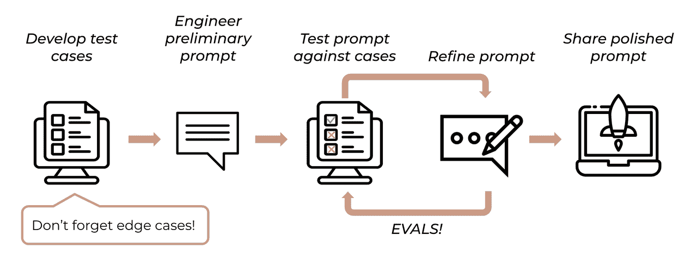

# 2.Prompt engineering 提示工程

> 来源：[https://waytoagi.feishu.cn/docx/GZSadTtb6ocTuaxZaj2czRC5nNf](https://waytoagi.feishu.cn/docx/GZSadTtb6ocTuaxZaj2czRC5nNf)

Claude offers high-level baseline performance out of the box. However, prompt engineering can help you enhance its performance further and fine-tune its responses to better suit your specific use case. These techniques are not necessary for achieving good results with Claude, but you may find them useful in upleveling your inputs & outputs.

Claude 在开箱即用时提供了高水平的基线性能。然而，及时的工程可以帮助您进一步提升其性能，并对其响应进行微调，以更好地适应您特定的用例。这些技术对于实现 Claude 的良好结果并不是必要的，但您可能会发现它们对提升输入和输出非常有用。

> To quickly get up and running with a prompt or get introduced to prompting as a concept, see intro to prompting.

> 要快速开始使用提示或了解提示作为一个概念，可以参阅提示入门。

---

# **What is **prompt engineering? 什么是提示工程？

Prompt engineering is an empirical science that involves iterating and testing prompts to optimize performance. Most of the effort spent in the prompt engineering cycle is not actually in writing prompts. Rather, the majority of prompt engineering time is spent developing a strong set of evaluations, followed by testing and iterating against those evals.

提示工程是一门经验科学，涉及迭代和测试提示以优化性能。在提示工程周期中花费的大部分精力实际上并不是在编写提示上。相反，大部分提示工程时间都花在开发一组强大的评估上，然后针对这些评估进行测试和迭代。

## The prompt development lifecycle 提示开发生命周期

We recommend a principled, test-driven-development approach to ensure optimal prompt performance. Let's walk through the key high level process we use when developing prompts for a task, as illustrated in the accompanying diagram.

我们建议采用一种原则性的、测试驱动的开发方法，以确保提示性能最佳。让我们走一遍我们在为任务开发提示时使用的关键高层流程，如附图所示。

1.  Define the task and success criteria: The first and most crucial step is to clearly define the specific task you want Claude to perform. This could be anything from entity extraction, question answering, or text summarization to more complex tasks like code generation or creative writing. Once you have a well-defined task, establish the success criteria that will guide your evaluation and optimization process.
定义任务和成功标准：第一个也是最关键的步骤是清楚地定义您希望克劳德执行的具体任务。这可能是从实体提取、问题回答或文本摘要到更复杂的任务，如代码生成或创意写作等任何事情。一旦您定义了明确定义的任务，就建立指导您评估和优化过程的成功标准。

1.  Key success criteria to consider include:
要考虑的关键成功标准包括：

+   Performance and accuracy: How well does the model need to perform on the task?
性能和准确性：模型在任务上需要表现多好？

+   Latency: What is the acceptable response time for the model? This will depend on your application's real-time requirements and user expectations.
延迟：模型的可接受响应时间是多少？这将取决于您的应用程序的实时要求和用户期望。

+   Price: What is your budget for running the model? Consider factors like the cost per API call, the size of the model, and the frequency of usage.
价格：您运行模型的预算是多少？考虑因素如每个 API 调用的成本、模型的大小和使用频率。

1.  Having clear, measurable success criteria from the outset will help you make informed decisions throughout the adoption process and ensure that you're optimizing for the right goals.
从一开始就设定清晰、可衡量的成功标准将帮助您在采用过程中做出明智的决策，并确保您优化了正确的目标。

1.  Develop test cases: With your task and success criteria defined, the next step is to create a diverse set of test cases that cover the intended use cases for your application. These should include both typical examples and edge cases to ensure your prompts are robust. Having well-defined test cases upfront will enable you to objectively measure the performance of your prompts against your success criteria.
开发测试用例：在定义任务和成功标准之后，下一步是创建一组多样化的测试用例，涵盖应用程序的预期用例。这些应包括典型示例和边界情况，以确保您的提示具有鲁棒性。提前定义好的测试用例将使您能够客观地衡量您的提示与成功标准的表现。

1.  Engineer the preliminary prompt: Next, craft an initial prompt that outlines the task definition, characteristics of a good response, and any necessary context for Claude. Ideally you should add some examples of canonical inputs and outputs for Claude to follow. This preliminary prompt will serve as the starting point for refinement.
设计初步提示：接下来，制定一个初步的提示，概述任务定义、良好响应的特征，以及 Claude 所需的任何上下文。理想情况下，您应该添加一些规范输入和输出的示例供 Claude 参考。这个初步提示将作为改进的起点。

1.  Test prompt against test cases: Feed your test cases into Claude using the preliminary prompt. Carefully evaluate the model's responses against your expected outputs and success criteria. Use a consistent grading rubric, whether it's human evaluation, comparison to an answer key, or even another instance of Claude’s judgement based on a rubric. The key is to have a systematic way to assess performance.
根据测试用例测试提示：使用初步提示将测试用例输入到 Claude 中。仔细评估模型的响应与您预期的输出和成功标准是否一致。使用一致的评分标准，无论是人工评估、与答案标准的比较，甚至是基于评分标准的 Claude 判断的另一个实例。关键是要有一种系统性的评估性能的方式。

1.  Refine prompt: Based on the results from step 4, iteratively refine your prompt to improve performance on the test cases and better meet your success criteria. This may involve adding clarifications, examples, or constraints to guide Claude's behavior. Be cautious not to overly optimize for a narrow set of inputs, as this can lead to overfitting and poor generalization.
优化提示：根据第 4 步的结果，迭代地优化您的提示，以提高测试用例的性能并更好地满足您的成功标准。这可能涉及添加澄清、示例或约束条件，以指导克劳德的行为。要小心，不要过度优化于一组狭窄的输入，因为这可能导致过拟合和泛化能力差。

1.  Ship the polished prompt: Once you've arrived at a prompt that performs well across your test cases and meets your success criteria, it's time to deploy it in your application. Monitor the model's performance in the wild and be prepared to make further refinements as needed. Edge cases may crop up that weren't anticipated in your initial test set.
发布优化后的提示：一旦您找到一个在测试用例中表现良好并满足您的成功标准的提示，就是将其部署到您的应用程序的时候了。在实际应用中监控模型的性能，并准备根据需要进一步进行优化。可能会出现一些未在初始测试集中预料到的边缘情况。

Throughout this process, it's worth starting with the most capable model and unconstrained prompt length to establish a performance ceiling. Once you've achieved the desired output quality, you can then experiment with optimizations like shorter prompts or smaller models to reduce latency and costs as needed.

在整个过程中，值得从最具能力的模型和无约束的提示长度开始，以建立性能上限。一旦达到所需的输出质量，您可以尝试优化，如缩短提示或使用较小的模型，以根据需要降低延迟和成本。

By following this test-driven methodology and carefully defining your task and success criteria upfront, you'll be well on your way to harnessing the power of Claude for your specific use case. If you invest time in designing robust test cases and prompts, you'll reap the benefits in terms of model performance and maintainability.

通过遵循这种测试驱动的方法论，并在一开始仔细定义您的任务和成功标准，您将为利用克劳德的强大功能做好准备。如果您投入时间设计健壮的测试用例和提示，您将在模型性能和可维护性方面获得好处。