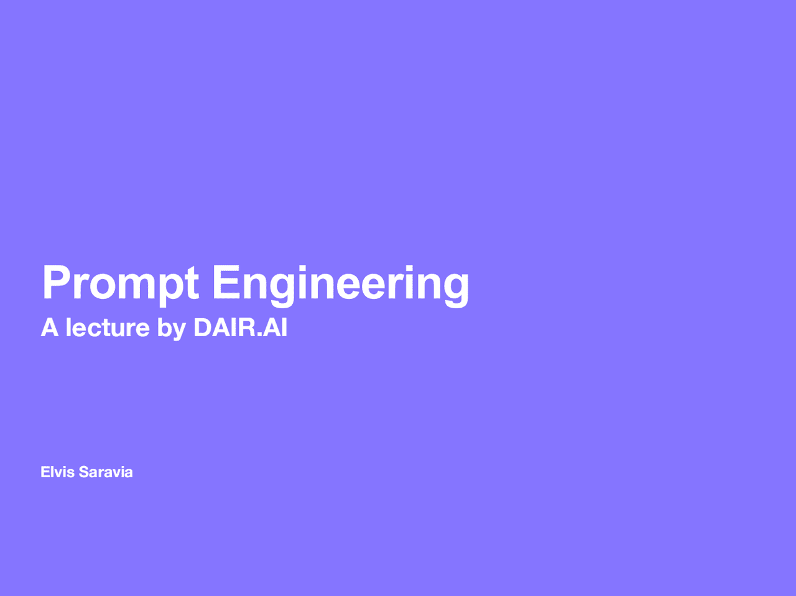

# 提示工程指南

> 来源：[https://waytoagi.feishu.cn/docx/T4vndwWKhoYaZ9x8Icac0am9n7f](https://waytoagi.feishu.cn/docx/T4vndwWKhoYaZ9x8Icac0am9n7f)

> 提示工程指南（Prompt Engineering Guide）是由 DAIR.AI(opens in a new tab) 发起的项目，旨在帮助研发和行业内相关人员了解提示工程。

> 以传播 AI 技术和研究成果为目标，DAIR.AI 的愿景是赋能新一代 AI 领域的创新者。

> 本目录内容翻译自：https://www.promptingguide.ai/

提示工程（Prompt Engineering）是一门较新的学科，关注提示词开发和优化，帮助用户将大语言模型（Large Language Model, LLM）用于各场景和研究领域。 掌握了提示工程相关技能将有助于用户更好地了解大型语言模型的能力和局限性。

研究人员可利用提示工程来提升大语言模型处理复杂任务场景的能力，如问答和算术推理能力。开发人员可通过提示工程设计、研发强大的工程技术，实现和大语言模型或其他生态工具的高效接轨。

提示工程不仅仅是关于设计和研发提示词。它包含了与大语言模型交互和研发的各种技能和技术。提示工程在实现和大语言模型交互、对接，以及理解大语言模型能力方面都起着重要作用。用户可以通过提示工程来提高大语言模型的安全性，也可以赋能大语言模型，比如借助专业领域知识和外部工具来增强大语言模型能力。

基于对大语言模型的浓厚兴趣，我们编写了这份全新的提示工程指南，介绍了大语言模型相关的论文研究、学习指南、模型、讲座、参考资料、大语言模型能力以及与其他与提示工程相关的工具。

[Prompt-Engineering-Lecture-Elvis.pdf](https://internal-api-drive-stream.feishu.cn/space/api/box/stream/download/all/TLAgb10w9ofhMTxBqE0clED7nNc)