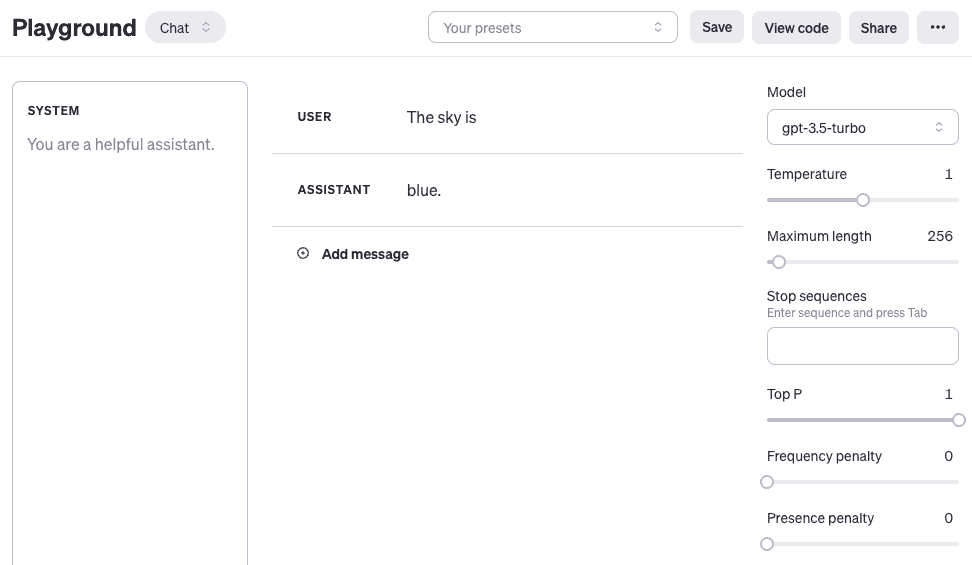

# 基本概念

> 来源：[https://waytoagi.feishu.cn/docx/KyMod4yZDoVNBuxb1nfcGI4cndg](https://waytoagi.feishu.cn/docx/KyMod4yZDoVNBuxb1nfcGI4cndg)

## 基础提示词

您可以通过简单的提示词（Prompts）获得大量结果，但结果的质量与您提供的信息数量和完善度有关。一个提示词可以包含您传递到模型的_指令_或_问题_等信息，也可以包含其他详细信息，如_上下文_、_输入_或_示例_等。您可以通过这些元素来更好地指导模型，并因此获得更好的结果。

看下面一个简单的示例：

提示词

```
The sky is
```

输出结果

```
blue.
```

如果使用的是 OpenAI Playground 或者其他任何 LLM Playground，则可以提示模型，如以下屏幕截图所示：



需要注意的是，当使用 OpenAI 的 gpt-4 或者 gpt-3.5-turbo 等聊天模型时，您可以使用三个不同的角色来构建 prompt： system、user 和 assistant。其中 system 不是必需的，但有助于设定 assistant 的整体行为，帮助模型了解用户的需求，并根据这些需求提供相应的响应。上面的示例仅包含一条 user 消息，您可以使用 user 消息直接作为 prompt。为简单起见，本指南所有示例（除非明确提及）将仅使用 user 消息来作为 gpt-3.5-turbo 模型的 prompt。上面示例中 assistant 的消息是模型的响应。您还可以定义 assistant 消息来传递模型所需行为的示例。您可以在此处(opens in a new tab)了解有关使用聊天模型的更多信息。

从上面的提示示例中可以看出，语言模型能够基于我们给出的上下文内容 `"The sky is" 完成续写。而输出的结果可能是出人意料的，或远高于我们的任务要求。 但是，我们可以通过改进提示词来获得更好的结果。

让我们试着改进以下：

提示词

```
完善以下句子:The sky is
```

输出结果

```
blue during the day and dark at night.
```

结果是不是要好一些了？本例中，我们告知模型去完善句子，因此**输出的结**果和我们最初的输入是完全符合的。提示工程（Prompt Engineering）就是探讨如何设计出最佳提示词，用于指导语言模型帮助我们高效完成某项任务。

以上示例基本说明了现阶段的大语言模型能够发挥的功能作用。它们可以用于执行各种高级任务，如文本概括、数学推理、代码生成等。

## 提示词格式

前文中我们还是采取的比较简单的提示词。 标准提示词应该遵循以下格式：

```
&lt;问题&gt;?
```

或

```
&lt;指令&gt;
```

这种可以被格式化为标准的问答格式，如：

```
Q: &lt;问题&gt;?A: 
```

以上的提示方式，也被称为 零样本提示（zero-shot prompting），即用户不提供任务结果相关的示范，直接提示语言模型给出任务相关的回答。某些大型语言模式有能力实现零样本提示，但这也取决于任务的复杂度和已有的知识范围。

具体的零样本提示示例如下：

提示词

```
Q: What is prompt engineering?
```

对于一些较新的模型，你可以跳过 Q: 部分，直接输入问题。因为模型在训练过程中被暗示并理解问答任务，换言之，提示词可以简化为下面的形式：

提示词

```
What is prompt engineering?
```

基于以上标准范式，目前业界普遍使用的还是更高效的 _小样本提示（Few-shot Prompting）_范式，即用户提供少量的提示范例，如任务说明等。小样本提示一般遵循以下格式：

```
&lt;问题&gt;?
&lt;答案&gt;
&lt;问题&gt;?
&lt;答案&gt;
&lt;问题&gt;?
&lt;答案&gt;
&lt;问题&gt;?
```

而问答模式即如下：

```
Q: &lt;问题&gt;?
A: &lt;答案&gt;
Q: &lt;问题&gt;?
A: &lt;答案&gt;
Q: &lt;问题&gt;?
A: &lt;答案&gt;
Q: &lt;问题&gt;?
A:
```

注意，使用问答模式并不是必须的。你可以根据任务需求调整提示范式。比如，您可以按以下示例执行一个简单的分类任务，并对任务做简单说明：

提示词

```
This is awesome! // Positive
This is bad! // Negative
Wow that movie was rad! // Positive
What a horrible show! //
```

输出结果

```
Negative
```

语言模型可以基于一些说明了解和学习某些任务，而小样本提示正好可以赋能上下文学习能力。我们将在接下来的章节中更广泛的讨论如何使用零样本提示和小样本提示。