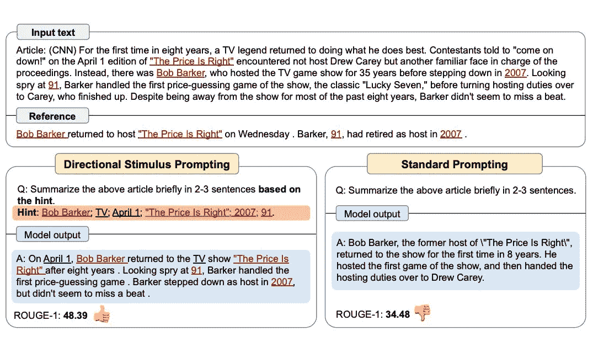

# 方向性刺激提示

> 来源：[https://waytoagi.feishu.cn/docx/OwQddIJE5o4oYZxuNfRcRKVun2f](https://waytoagi.feishu.cn/docx/OwQddIJE5o4oYZxuNfRcRKVun2f)

Li 等人，（2023）(opens in a new tab)提出了一种新的提示技术，以更好地指导 LLM 生成所需的摘要。

训练了一个可调节的策略 LM 来生成刺激/提示。越来越多地使用RL来优化 LLM。

下图显示了方向性刺激提示与标准提示的比较。策略 LM 可以很小，并且可以优化以生成指导黑盒冻结 LLM 的提示。

图片来源：Li 等人，（2023）(opens in a new tab)