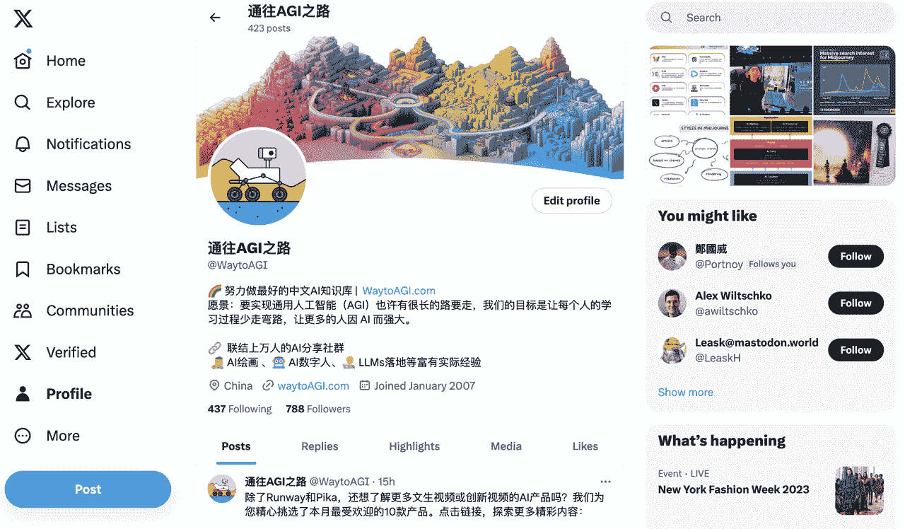
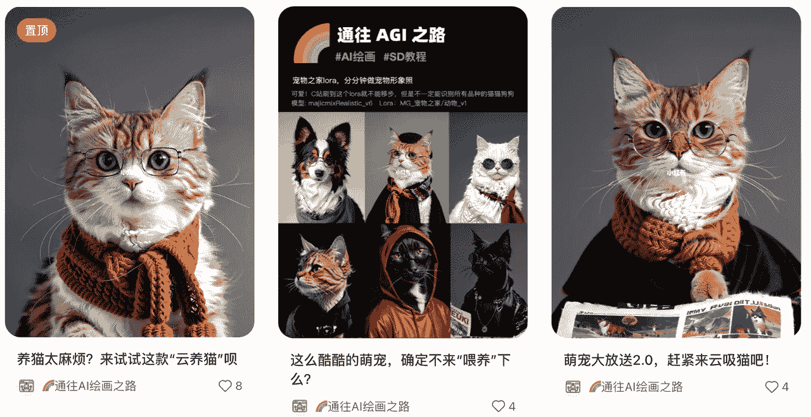
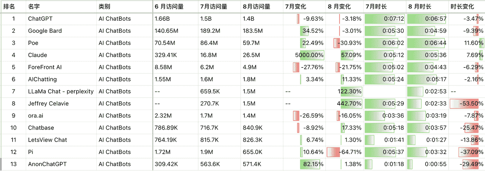
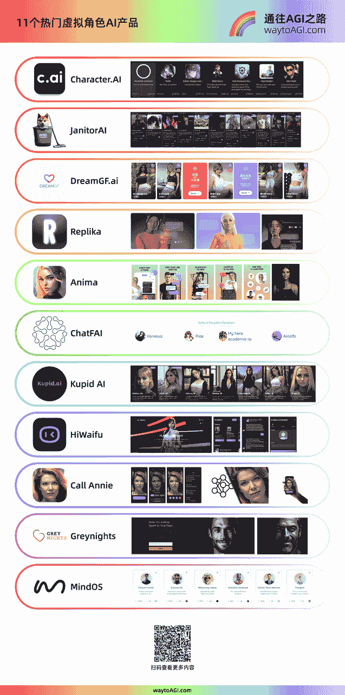
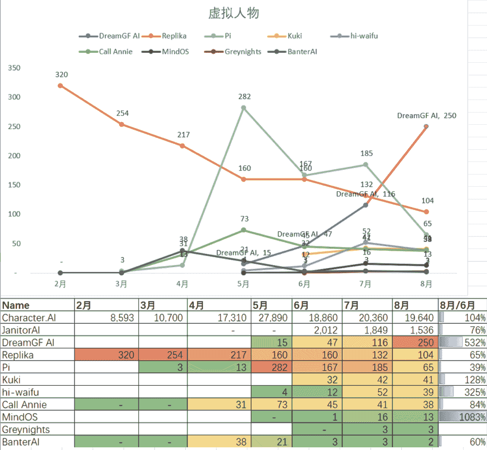
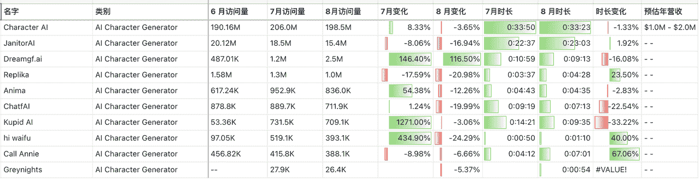
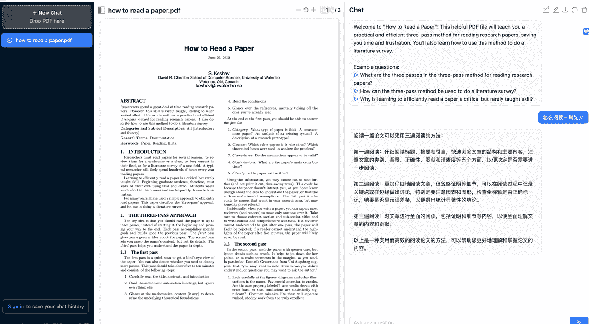
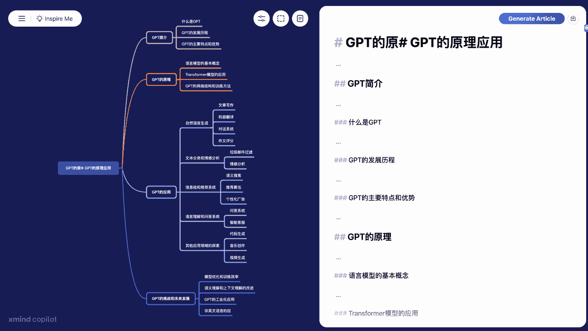

# 直播一期：知识库及 GPT 基础介绍

> 来源：[https://waytoagi.feishu.cn/docx/BEcYdI9oUoP3yBxviTUcktO8n48](https://waytoagi.feishu.cn/docx/BEcYdI9oUoP3yBxviTUcktO8n48)

> 直播回放：https://www.bilibili.com/video/BV1QN411j719/

# 一、知识库及社群介绍

欢迎来到《通往 AGI 之路》的知识空间页面！这里旨在提供一个全面系统、易于理解的 AI 学习路径，帮助您了解 AI 从概念到应用等各方面知识，更重要的是希望引发您思考：「我可以用 AI 做什么，帮助自己更强大」。

欢迎订阅我们的X（Twitter）

最新知识库精选同步

[通往 AI 绘画之路](https://www.xiaohongshu.com/user/profile/633332ae0000000023038bf6?xhsshare=WeixinSession&appuid=574c21775e87e729545ad275&apptime=1692161211)（小红书）

专注于AI绘画，分享优质设计Prompt

# 二、知识库目录导览

# 三、ChatGPT入门

## 🧠 Chat GPT 的工作原理

### 四个字概括 Chat GPT 的实质功能：词语接龙

具体来说就是给他任意⻓的上文，他会用自己的模型去生成下一个词

那他是怎么回答那些⻓内容的呢？

**答**案是把它自己生成的下一个词，和之前的上文组合成新的上文，再让它生成下一个词，不断重复就可以生成任意⻓的下文。该过程也叫做自回归生成。

上文：我爱

下文：香菜？中国？原神？

每一次的回答就像掷骰子或抽卡，训练模型可以让答案更接近用户想要的答案（当然提示词的撰写也非常重要，后面的直播会说到）

## 🌐 大型模型的训练方式

### Chat GPT 🙅🏻‍♀️ 搜索引擎

难道说要把所有的提问回答组合都给chat GPT t来做单字接⻰吗？其实不需要

训练的主要目的不是记忆,而是学习以单字接⻰的方式来训练模型。不仅仅是为了让模型记住某个提问和回答,数据库已经将所有信息都记忆好了,直接搜索就可以得到回答

非要训练单字接⻰,为的就是让模型学习提问和回答的通用规律。以便在遇到没记忆过的提问时，也能利用所学的规律生成用户想要的回答，这种举一反三的目的也叫做泛化。

学习材料的作用只是调整模型，以得到通用模型，为的是能处理未被数据库记忆的情况

**因此chat GPT 也被称为生成**模型，生成模型与搜索引擎非常不同，搜索引擎无法给出没被数据库记忆的信息，但生成语言模型可以创造不存在的文本。

## ❎ Chat GPT 的短板

### 会一本正经的胡说八道、高度依赖数据、且不受约束

搜索引擎不会混淆记忆，但如果问题交给 Chat GPT ，询问它现实中不存在的内容，它可能会依据训练材料中学习的某些规律进行混合捏造

当然，这个问题也可以通过一些提示词技巧来减少发生的概率，但不能保证百分百避免

其次， Chat GPT 高度依赖数据

2018年6月，OPENAI 训练了GPT 1 学习材料约 5 GB，1MB能存30到50万汉字，1GB=1024MB，除了学习材料的规模，GPT 1 的参数是 1.17 亿，参数越多，模型规律就越复杂，能记忆的信息和学习的知识也就越多

2019年2月，OPENAI又训练了GPT 2 学习材料约 40 GB，是迭代的8倍，最大模型参数为15亿，是第一代的13倍，效果有很大提升，但反响并不轰动

2020年5月 GPT 3出来了 最大模型参数到了1750亿，是第二代的116倍，所使用的学习数据更是达到了45tb，是第二代的1125倍，其中包含了维基百科书籍，新闻博客，帖子，代码等各种人类语言材料，已经和前两代不是一个量级的了，也被称为超大语言模型

因此， Chat GPT 对一个问题的理解和回答能力，非常依赖数据

最后， Chat GPT 没有人类的法律和道德观念

例如问他撬锁的方法，不能让他真的回答撬锁方法，而要让他回答撬锁是违法行为，把撬锁是违法行为作为学习材料，让他做单字接⻰

为什么不在一开始就直接教他 最正确的对话方式和对话内容呢？一方面优质对话范例的数量有限，所能提供的语言多样性不足，可能难以让模型学到广泛适用的语言规律，也无法涉猎各个领域。另一方面 优质对话范例都需要人工专⻔标注，价格不菲。

## ❓Chat GPT 的应用

### GPT聊天和角色扮演

+   GPT可以进行自然语言对话，如同与真人聊天。

大体分两种表现形式：chat（聊天框），CharacterAI（角色扮演）

数据：[AI 聊天机器人TOP20](https://dnipkggqxh.feishu.cn/wiki/CJmHwFBsVi1xehkO7oUcKJl8nif)

### 现场操作演示案例

1.  内容生成：GPT 可以生成文章、故事、诗歌、歌词等内容。

+   演示  https://chat.openai.com/

+    https://bard.google.com/extensions

+   https://claude.ai/

1.  聊天机器人：GPT 可以作为聊天机器人的后端，提供自然的对话体验。演示 感觉英语老师要失业了……这AI也太强了_哔哩哔哩_bilibili

1.  问答系统：GPT 可以用于问答系统，为用户提供准确的答案。

1.  文本摘要：GPT 可以生成文本的摘要或概述。演示

1.  机器翻译：虽然 GPT 不是专门为机器翻译设计的，但它在这方面也有不错的表现。

1.  群聊总结：[实践：群总结工具](https://waytoagi.feishu.cn/wiki/AT1BwDM5MiwNiAkfWTqc0vxtnGh)

1.  代码生成：GPT-3 和其后续版本已经被证明可以生成代码片段，甚至帮助开发者解决编程问题。

1.  教育：GPT 可以用于教育领域，帮助学生解答问题或提供学习材料。

1.  浏览器插件：webpilot

1.  PDF对话：演示 www.chatpdf.com

1.  PPT生成：[办公：高效做 PPT](https://waytoagi.feishu.cn/wiki/RWZPwT0ETiqVwIkB8qQcrgRwnog)

1.  音视频提取总结：https://bibigpt.co/r/AJ

1.  播客总结：https://podwise.xyz/dashboard/trending

1.  生成脑图：https://xmind.ai/editor/

下一次最感兴趣的话题：