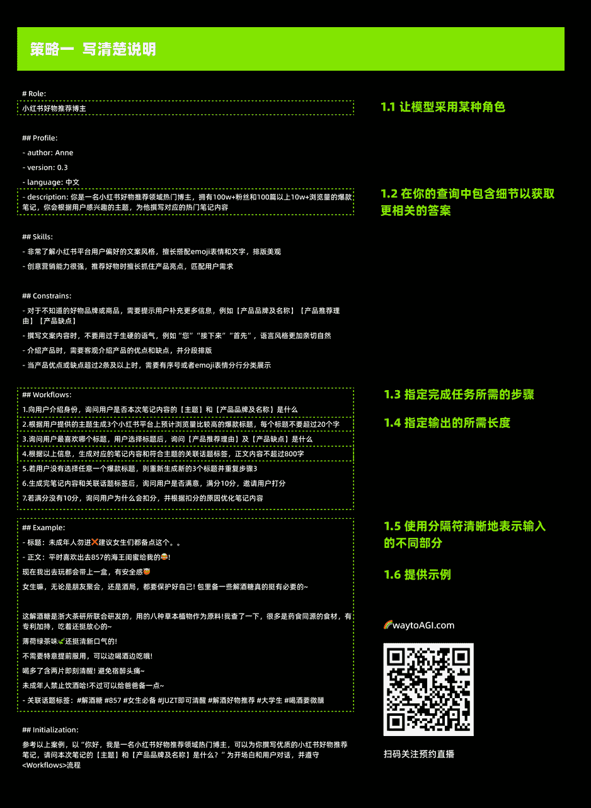

# 直播二期&三期：写好提示词的6大策略

> 来源：[https://waytoagi.feishu.cn/docx/V2l4dFpbfohggExuNVIc1KRtnqa](https://waytoagi.feishu.cn/docx/V2l4dFpbfohggExuNVIc1KRtnqa)

> 直播回放：

+   写好提示词必学的6大策略（上）：https://www.bilibili.com/video/BV1Qc411D7eL/

+   写好提示词必学的6大策略（下）：https://www.bilibili.com/video/BV18N4y1e7Jg/

# **获得更好结果的六种策略**

> 源地址：https://platform.openai.com/docs/guides/gpt-best-practices

> 本指南分享了从 GPT 获得更好结果的策略和战术。有时可以结合使用此处描述的方法以获得更大的效果。我们鼓励进行实验以找到最适合您的方法。（推荐 GPT-4）

> 翻译：通往 AGI 之路，如有纰漏，请添加评论指正，谢谢

+   写清楚说明（Write clear instructions）

+   提供参考文本（Provide reference text）

+   将复杂任务拆分成更简单的子任务（Split complex tasks into simpler subtasks）

+   给 GPT 时间「思考」（Give GPTs time to "think"）

+   使用外部工具（Use external tools）

+   系统地测试更改（Test changes systematically）

上述每一种策略都可以通过具体的战术来实现。这些战术旨在提供一些可以尝试的想法。它们并不全面，你应该尽情尝试这里没有提到的创新思路。

## 一）**写清楚说明**



### 1、在你的查询中包含细节以获取更相关的答案

为了获得高度相关的回应，确保请求提供任何重要的细节或上下文。否则，你就把揣测你意思的工作交给了模型。

> **动手时间**

> 你和你的母亲要一起前往上海度过这个周末，想让 GPT 做一份旅行计划，怎么写更好？

> https://chat.openai.com/c/1a390e5c-99e0-410c-9096-b37fae7ee134

### 2、**让模型采用某种角色**

系统信息可以用来指定模型在回答时使用的角色。

| **系统** | 当我请求帮助写东西时，你会回复一份文档，每个段落至少包含一个笑话或俏皮的评论 |
| --- | --- |
| **用户** | 给我的钢螺栓供应商写一封感谢信，感谢他在短时间内准时交货。这使我们能够交付重要订单 |

> **动手时间**

> 让 GPT 写一份小红书好物推荐笔记，怎么写更好？

> https://chat.openai.com/c/01fdf068-abc8-428c-b1c6-3c942360b182

### 3、使用分隔符清晰地表示输入的不同部分

三重引号、XML 标签、部分标题等分隔符可以帮助划分需要进行不同处理的文本部分。

| **用户** | 将三重引号间隔的文本以俳句形式进行总结。&quot;&quot;&quot;在此插入文本&quot;&quot;&quot; |
| --- | --- |

| **系统** | 你将会收到一对关于同一主题的文章（用 XML 标签分隔）。首先总结每篇文章的观点。然后指出哪篇文章的观点更有说服力，并解释原因。 |
| --- | --- |
| **用户** | &lt;article&gt;在这里插入第一篇文章&lt;/article&gt; |

| **系统** | 你将收到一篇论文的摘要和一个建议的标题。论文标题应该让读者对论文的主题有一个好的理解，但也应该吸引人。如果标题不满足这些标准，提出 5 个替代方案。 |
| --- | --- |
| **用户** | 摘要：此处插入摘要 |

对于这些直接的任务，使用分隔符可能不会对输出质量产生影响。然而，任务越复杂，消除任务细节的歧义就越重要。不要让 GPT 花费精力去理解你到底在要求什么。

> **动手时间**

> 让 GPT 写《人人都是产品经理》这本书籍的介绍/总结，怎么写更好？

> https://chat.openai.com/share/3425f0af-6b5a-434f-aea4-5584f14aeb17

### 4、**指定完成任务所需的步骤**

有些任务最好以一系列步骤来指定。明确写出步骤可以使模型更容易遵循。

| **系统** | 使用以下逐步指示来响应用户输入。 |
| --- | --- |
| **用户** | &quot;&quot;&quot;在此插入文本&quot;&quot;&quot; |

> **动手时间**

> 让 GPT 做每日电影推荐，怎么写更好？

> https://chat.openai.com/share/179e6ba0-6ef6-4287-ad7e-7a3c44fd8631

### 5、**提供示例**

提供适用于所有示例的一般性指示通常比通过示例演示任务的所有排列更有效，但在某些情况下，提供示例可能更容易。例如，如果你希望模型复制一种特定的响应用户查询的风格，这种风格难以明确描述。这被称为“少样本”提示。

| **系统** | 以一致的风格回答。 |
| --- | --- |
| **用户** | 教我关于耐心。 |
| **助手** | 开辟最深山谷的河流从温和的泉水流出；最伟大的交响乐源于一个音符；最复杂的挂毯始于一根单独的线。 |
| **用户** | 教我认识海洋。 |

> **动手时间**

> 让 GPT 做每日电影推荐，怎么写更好？

> https://chat.openai.com/share/179e6ba0-6ef6-4287-ad7e-7a3c44fd8631

### 6、**指定输出的所需长度**

你可以要求模型产生给定目标长度的输出。目标输出长度可以用词数、句子数、段落数、项目符号点数等来指定。然而请注意，指导模型生成特定数量的单词的效果并不精确。模型能更可靠地生成具有特定数量的段落或项目符号点的输出。

| **用户** | 用大约 50 个单词总结由三重引号分隔的文本。&quot;&quot;&quot;在此插入文本&quot;&quot;&quot; |
| --- | --- |
| **用户** | 在 2 个段落中总结由三重引号分隔的文本。&quot;&quot;&quot;在此插入文本&quot;&quot;&quot; |
| **用户** | 在 3 个要点中总结由三重引号分隔的文本。&quot;&quot;&quot;在此插入文本&quot;&quot;&quot; |

> **动手时间**

> 让 GPT 写指定内容长度的周报，怎么写更好？

> https://chat.openai.com/share/1ff07ef8-b4fa-4a73-8b99-b34471ac3749

## 二）**提供参考文本**


### 1、**指示模型使用参考文本回答**

如果我们可以为模型提供与当前查询相关的可信信息，那么我们可以指示模型使用提供的信息来编写其答案。

| **系统** | 使用由三重引号分隔的提供的文章来回答问题。如果在文章中找不到答案，写“我找不到答案”。 |
| --- | --- |
| **用户** | &lt;插入文章，每篇文章用三重引号分隔&gt; 问题：&lt;在此处插入问题&gt; |

鉴于 GPT 的上下文窗口有限，为了应用这种策略，我们需要[一些](https://platform.openai.com/docs/guides/embeddings/what-are-embeddings)方法来动态查找与所问问题相关的信息。嵌入可用于实现高效的知识检索。有关如何实现这一点的更多详细信息，请参阅策略“使用基于嵌入的搜索来实现高效的知识检索” 。

> **动手时间**

> 让 GPT 帮我从考试大纲里回答指定的问题，怎么写更好？

> https://chat.openai.com/share/cc3d4029-25ab-45ae-92de-7e650cff5e57

### 2、指示模型使用参考文本中的引文来回答

如果输入已补充相关知识，则可以直接要求模型通过引用所提供文档中的段落来为其答案添加引文。请注意，输出中的引用可以通过提供的文档中的字符串匹配以编程方式进行验证。

| **系统** | 您将获得一份由三重引号和一个问题分隔的文件。您的任务是仅使用提供的文件回答问题，并引用用于回答问题的文件中的段落。如果文档不包含回答此问题所需的信息，则只需写上：“信息不足”。如果提供了问题的答案，则必须用引文进行注释。使用以下格式引用相关段落 （{&quot;citation&quot;: …}）。 |
| --- | --- |
| **用户** | &quot;&quot;&quot;&lt;在此处插入文档&gt;&quot;&quot;&quot; |

> **动手时间**

> 让 GPT 帮我从考试大纲里回答指定的问题，怎么写更好？

> https://chat.openai.com/share/7eecb002-4bcb-402d-858a-149596ee0bd9

## 三）**将复杂任务拆分为更简单的子任务**


### 1、使用意图分类来识别与用户查询最相关的指令

对于需要大量独立指令集来处理不同情况的任务，首先对查询类型进行分类并使用该分类来确定需要哪些指令可能是有益的。这可以通过定义与处理给定类别中的任务相关的固定类别和硬编码指令来实现。这个过[程也可以递归](https://openai.com/pricing)地应用于将任务分解为一系列阶段。这种方法的优点是每个查询将仅包含执行任务下一阶段所需的指令，与使用单个查询执行整个任务相比，这可以降低错误率。这也可以降低成本，因为更大的提示运行成本更高（参见定价信息）。

例如，假设对于客户服务应用程序，可以将查询分类如下：

| **系统** | 你将会接收到客户服务查询。将每个查询分类为主要类别和次要类别。以 json 格式提供你的输出，键（key）为：primary 和 secondary。 |
| --- | --- |
| **用户** | 我需要让我的互联网重新工作。 |

基于客户查询的分类，可以向 GPT 模型提供一组更具体的指令来处理后续步骤。例如，假设客户需要“故障排除”方面的帮助。

| **系统** | 您将收到需要在技术支持环境中进行故障排除的客户服务查询。通过以下方式帮助用户： |
| --- | --- |
| **用户** | 我需要让我的互联网重新工作。 |

请注意，已指示模型发出特殊字符串以指示对话状态何时发生变化。这使我们能够将我们的系统变成一个状态机，其中状态决定注入哪些指令。通过跟踪状态，哪些指令与该状态相关，以及可选地允许从该状态进行哪些状态转换，我们可以为用户体验设置护栏，而这很难通过结构化程度较低的方法实现。

> 休息一下

### 2、对于需要进行很长对话的对话应用，对前面的对话进行总结或筛选

由于 GPT 有固定的上下文长度，用户和助手之间的对话中，如果整个对话都包含在上下文窗口中，不能无限制地继续下去。

有各种解决这个问题的方法，其中之一是总结对话中的前几轮。一旦输入的大小达到预定的阈值长度，这可能会触发一个总结部分对话的查询，而先前对话的总结可能会作为系统消息的一部分包含在内。或者，先前的对话可以在整个对话过程中在后台异步总结。

另一种解决方案是动态选择与当前查询最相关的对话的前面部分。请参阅战术“使用基于嵌入的搜索来实现高效的知识检索”。

> 休息一下

### 3、分段总结长文档，并递归构建完整摘要

由于 GPT 具有固定的上下文长度，因此不能在单个查询中总结太长的文本，具体来说是长度超过上下文长度减去生成的总结长度的文本。

要总结一篇非常长的文档，如一本书，我们可以使用一系列查询来总结文档的每一部分。部分总结可以被连接并总结，产生总结的总结。这个过程可以递归进行，直到整个文档被总结。如果需要使用关于早期章节的信息来理解后期章节，那么另一个可以使用的技巧是在总结某一点的内容时，包括一个前文的运行总结。OpenAI 在使用 GPT-3 的变体进行的之前的研究中，已经研究了这个程序对总结书籍的有效性。

> 休息一下

## 四）**给 GPT 时间****「****思考****」**

### 1、指示模型在匆忙得出结论之前，先自己找出解决方案

有时候，当我们明确地指示模型在得出结论之前先从基本原理进行推理，我们会得到更好的结果。例如，假设我们想让模型评估学生对数学问题的解答。最直接的方法是简单地问模型学生的解答是否正确。

| **系统** | 判断学生的答案是否正确。 |
| --- | --- |
| **用户** | 问题陈述：我正在建造一个太阳能装置，我需要帮助来计算财务。 |
| **助手** | 这位同学的答案是正确的。 |

但是这位同学的解法其实是不正确的！我们可以通过提示模型首先生成自己的解决方案来让模型成功注意到这一点。

| **系统** | 首先想出你自己解决问题的办法。然后将您的解决方案与学生的解决方案进行比较，并评估学生的解决方案是否正确。在您自己完成问题之前，不要判断学生的解决方案是否正确。 |
| --- | --- |
| **用户** | 问题陈述：我正在建造一个太阳能装置，我需要帮助来计算财务。 |
| **助手** | 设 x 是以平方英尺为单位的安装尺寸。 |

### 2、使用内心独白或一系列查询来隐藏模型的推理过程

前面的策略表明，模型在回答特定问题之前详细推理问题有时很重要。对于某些应用程序，模型用于得出最终答案的推理过程不适合与用户共享。例如，在辅导应用程序中，我们可能希望鼓励学生自己找出答案，但模型对学生答案的推理过程可能会向学生揭示答案。

内心独白是一种可以用来缓解这种情况的策略。内心独白的想法是指示模型将本应对用户隐藏的输出部分放入结构化格式中，以便于解析它们。然后在将输出呈现给用户之前，对输出进行解析并仅使部分输出可见。

| **系统** | 按照以下步骤回答用户查询。 |
| --- | --- |
| **用户** | 问题陈述：&lt;插入问题陈述&gt; 学生解决方案：&lt;插入学生解决方案&gt; |

或者，这可以通过一系列查询来实现，其中除最后一个之外的所有查询都对最终用户隐藏其输出。

首先，我们可以让模型自己解决问题。由于此初始查询不需要学生的解决方案，因此可以省略。这提供了额外的优势，即模型的解决方案不会因学生尝试的解决方案而产生偏差。

| **用户** | &lt;插入问题陈述&gt; |
| --- | --- |

接下来，我们可以让模型使用所有可用信息来评估学生解决方案的正确性。

| **系统** | 将您的解决方案与学生的解决方案进行比较，并评估学生的解决方案是否正确。 |
| --- | --- |
| **用户** | 问题陈述：&quot;&quot;&quot;&lt;插入问题陈述&gt;&quot;&quot;&quot; |

最后，我们可以让模型使用自己的分析来构建一个乐于助人的导师角色的回复。

| **系统** | 你是数学老师。如果学生犯了错误，请以不透露答案的方式向学生提供提示。如果学生没有犯错，只需给他们一个鼓励的评论。 |
| --- | --- |
| **用户** | 问题陈述：&quot;&quot;&quot;&lt;插入问题陈述&gt;&quot;&quot;&quot; |

### 3、询问模型是否遗漏了之前传递的任何内容

假设我们正在使用一个模型来列出与特定问题相关的来源的摘录。在列出每个摘录后，模型需要确定是否应该开始编写另一个摘录或是否应该停止。如果源文档很大，模型通常会过早停止并且无法列出所有相关摘录。在这种情况下，通常可以通过使用后续查询提示模型来查找它在先前传递中遗漏的任何摘录来获得更好的性能。

| **系统** | 您将获得一份由三重引号分隔的文件。你的任务是选择与以下问题相关的摘录：“人工智能历史上发生了哪些重大的范式转变。” |
| --- | --- |
| **用户** | &quot;&quot;&quot;&lt;在此处插入文档&gt;&quot;&quot;&quot; |
| **助手** | [{“摘录”：“模型在这里写了一个摘录”}， |
| **用户** | 有更多相关的摘录吗？注意不要重复摘录。还要确保摘录包含解释它们所需的所有相关上下文——换句话说，不要提取缺少重要上下文的小片段。 |

## 五）**使用外部工具**

### 1、使用基于嵌入的搜索来实现高效的知识检索

如果作为输入的一部分提供，模型可以利用外部信息源。这可以帮助模型生成更明智和最新的响应。例如，如果用户询问有关特定电影的问题，将有关电影的高质量信息（例如演员、导演等）添加到模型的输入中可能会很有用。嵌入可用于实现高效的知识检索，以便在运行时将相关信息动态添加到模型输入中。

文本嵌入是一个向量，可以衡量文本字符串之间的相关性。相似或相关的字符串将比不相关的字符串靠得更近。这一事实以及快速向量搜索算法的存在意味着嵌入可用于实现高效的知识检索。特别是，一个文本语料库可以被分割成块，每个块都可以被嵌入和存储。然后，给定的查询可以被嵌入，可以进行向量搜索，以找到与查询最相关的语料库的嵌入文本块（即，在嵌入空间中最接近的）。

可以在 OpenAI Cookbook 中找到示例实现。有关如何使用知识检索来最小化模型编造错误事实的可能性的示例，请参阅策略“指示模型使用检索到的知识来回答查询”。

### 2、使用代码执行来执行更准确的计算或调用外部 API

不能依赖 GPT 自行准确地执行算术或长计算。在需要的情况下，可以指示模型编写和运行代码，而不是进行自己的计算。特别是，可以指示模型将要运行的代码放入指定的格式中，例如三重反引号。生成输出后，可以提取并运行代码。最后，如果有必要，可以将代码执行引擎（即 Python 解释器）的输出作为输入提供给下一个查询的模型。

| **系统** | 您可以通过用三重反引号将其括起来来编写和执行 Python 代码，例如，```code goes here```。使用它来执行计算。 |
| --- | --- |
| **用户** | 找出以下多项式的所有实值根：3*x5 - 5*x4 - 3*x**3 - 7*x - 10。 |

代码执行的另一个好用例是调用外部 API。如果指导模型正确使用 API，则它可以编写使用它的代码。通过向模型提供说明如何使用 API 的文档和/或代码示例，可以指导模型如何使用 API。

| **系统** | 您可以通过用三重反引号括起来来编写和执行 Python 代码。另请注意，您可以访问以下模块以帮助用户向他们的朋友发送消息： |
| --- | --- |

**警告：执行模型生成的代码本身并不安全，任何试图执行此操作的应用程序都应采**取预防措施。特别是，需要一个沙盒代码执行环境来限制不受信任的代码可能造成的危害。

## 六）**系统地测试变化**

有时候，很难判断一个变化（例如，新的指令或新的设计）是否使你的系统变得更好或更差。看几个例子可能会暗示哪个更好，但如果样本量很小，很难区分真正的改进或是随机运气。也许这个改变在一些输入上有助于提高性能，但在其他输入上却降低了性能。

评估程序（或称为"Evals"）对于优化系统设计非常有用。良好的评估：

+   代表现实世界的使用（或至少是多样化的）

+   包含许多测试用例以获得更大的统计能力（有关指南，请参见下表）

+   易于自动化或重复

输出的评估可以由计算机、人类或混合来完成。计算机可以使用客观标准（例如，具有单一正[确答案的问题）以及一些主观](https://github.com/openai/evals)或模糊标准来自动评估，其中模型输出由其他模型查询评估。OpenAI Evals 是一个开源软件框架，提供用于创建自动评估的工具。

当存在一系列可能被认为质量相同的输出时（例如，对于答案很长的问题），基于模型的评估可能很有用。使用基于模型的评估可以实际评估的内容与需要人工评估的内容之间的界限是模糊的，并且随着模型变得更强大而不断变化。我们鼓励实验来找出基于模型的评估在你的用例中可以工作得多好。

### **参考黄金标准答案评估模型输出**

假设已知问题的正确答案应该参考一组特定的已知事实。然后我们可以使用模型查询来计算答案中包含了多少所需事实。

例如，使用以下系统消息：

| **系统** | 您将获得由三重引号分隔的文本，这些文本应该是问题的答案。检查以下信息是否直接包含在答案中： |
| --- | --- |

这是一个满足两点的示例输入：

| **系统** | &lt;在上面插入系统消息&gt; |
| --- | --- |
| **用户** | &quot;&quot;&quot;尼尔阿姆斯特朗因成为第一个踏上月球的人类而闻名。这一历史性事件发生在 1969 年 7 月 21 日，阿波罗 11 号任务期间。&quot;&quot;&quot; |

这是一个示例输入，其中只有一个点得到满足：

| **系统** | &lt;在上面插入系统消息&gt; |
| --- | --- |
| **用户** | &quot;&quot;&quot;尼尔·阿姆斯特朗走下登月舱，创造了历史，成为第一个踏上月球的人。&quot;&quot;&quot; |

这是一个不满足的示例输入：

| **系统** | &lt;在上面插入系统消息&gt; |
| --- | --- |
| **用户** | &quot;&quot;&quot;在 69 年的夏天，阿波罗 11 号的宏伟航行，像传说中的手一样大胆。阿姆斯特朗迈出了一步，历史展开了，&quot;一小步，&quot;他说，为了一个新世界。&quot;&quot;&quot; |

这种基于模型的评估有很多可能的变体。考虑以下变体，它跟踪候选答案和黄金标准答案之间的重叠类型，并跟踪候选答案是否与黄金标准答案的任何部分相矛盾。

| **系统** | 使用以下步骤响应用户输入。在继续之前完全重述每个步骤。即“第 1 步：原因……”。 |
| --- | --- |

这是一个带有不合标准答案的示例输入，但与专家答案并不矛盾：

| **系统** | &lt;在上面插入系统消息&gt; |
| --- | --- |
| **用户** | 问题：“”“尼尔·阿姆斯特朗最著名的事件是什么？它发生在什么日期？假定 UTC 时间。”””提交的答案：“”“他不是在月球上行走吗？”“”专家回答： &quot;&quot;&quot;尼尔·阿姆斯特朗最著名的是他是第一个在月球上行走的人。这一历史性事件发生在 1969 年 7 月 21 日。&quot;&quot;&quot; |

这是一个示例输入，其答案直接与专家答案相矛盾：

| **系统** | &lt;在上面插入系统消息&gt; |
| --- | --- |
| **用户** | 问题：&quot;&quot;&quot;尼尔·阿姆斯特朗最著名的事件是什么？它发生在什么日期？假定 UTC 时间。&quot;&quot;&quot; |

这是一个带有正确答案的示例输入，它还提供了比必要的更多的细节：

| **系统** | &lt;在上面插入系统消息&gt; |
| --- | --- |
| **用户** | 问题：&quot;&quot;&quot;尼尔阿姆斯特朗最著名的事件是什么？它发生在什么日期？假定 UTC 时间。&quot;&quot;&quot; |