# 强烈推荐：小七姐-提示词编写提升课

> 来源：[https://waytoagi.feishu.cn/docx/UlDZdN2lFosMVBxW3XYc84K2nge](https://waytoagi.feishu.cn/docx/UlDZdN2lFosMVBxW3XYc84K2nge)

> 必须推荐一下小七姐的这个提示词提升课，22 节视频课，从提示词入门到精通。

小七姐是一名优秀的产品经理，也是【🌈通往AGI之路】知识库的共建者，发布了很多自己对于prompt用法的心得

[小七姐：少样本提示和思维链提示的实际案例](https://waytoagi.feishu.cn/wiki/LWLpww5ZHiQE8pk6tYycxS1knwp)

[小七姐：K12领域应用-儿童PBL项目Prompt](https://waytoagi.feishu.cn/wiki/EvrRwlyLviLcL6knFSdc8E40nl2)

[小七姐：知识图谱自动生成的尝试](https://waytoagi.feishu.cn/wiki/LcAAwPUgiieXgfkQXy9c1avmnte)

[小七姐：基于联网验证科学新闻的科普作者](https://waytoagi.feishu.cn/wiki/HPkewFMdniRe3MkOH6ocqFYZnNq)

[小七姐：英文病例解读专家](https://waytoagi.feishu.cn/wiki/Nnwvw9K9Pikz2nkuMr5cweKDnbf)

B站干货也很多在持续更新

https://space.bilibili.com/128712813?spm_id_from=333.337.search-card.all.click

**但是大家想要很体系化的学习，尤其是AI从业者**还是非常建议参加小七姐的提示词编写提升课

## 报名方式

（扫码可以查看课程详细内容和介绍）

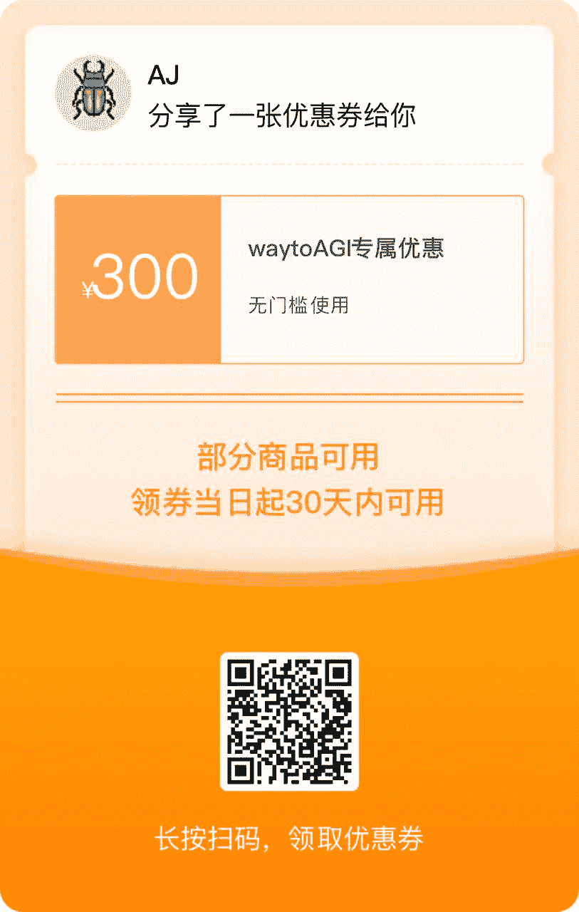

咨询课程助教（请注明来自 waytoAGI）：

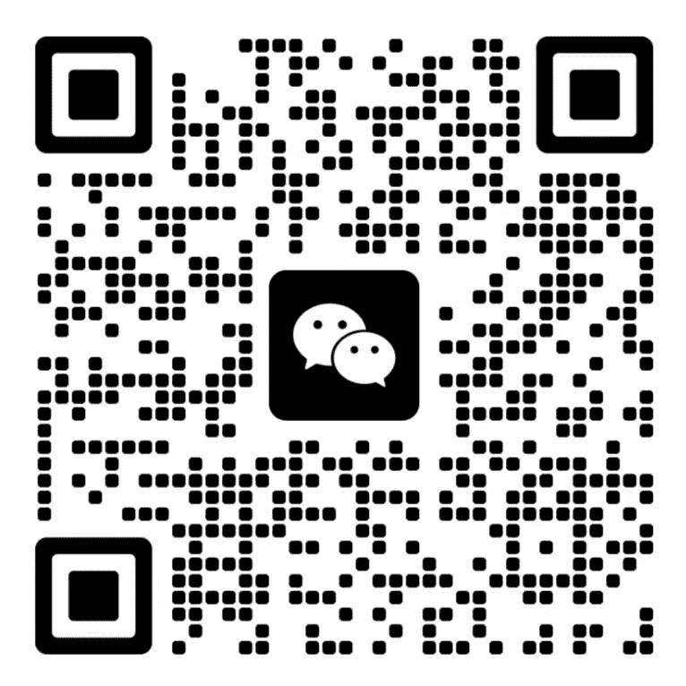

## 课程**内容**

自由学习时间（22 节视频课），以视频课+知识星球作业+社群答疑的授课形式学习

#### **提示词基础**

+   第一课： Hello，大模型

+   第二课：提示词基础方法

+   第三课：开始编写你的第一条提示词

+   第四课：按需求设计和迭代提示词

#### 元能力

+   第一课 AI+ 学习能力

+   第二课 AI+ 逻辑思维

+   第三课 AI+ 表达能力

#### 提示词实践

+   第四课 需求分析

+   第五课 结构框架

+   第六课 反馈迭代

+   第七课 结构化提示词

+   第八课 思维链

#### **提示词工具化**

+   第九课 工作流

+   第十课 提示词封装

+   第十一课 GPTs 基础教程

+   第十二课 GPTs 实战案例

>

#### 2024更新：

+   GPT 新版本指南（已更新）

+   GPTs 基础教程（已更新）

+   GPTs 设置方法（已更新）

+   GPTs 实战案例（已更新）

+   2024 更新 01：提示词学习综述（已更新）

+   2024 更新 02：知识库-场景（已更新）

+   2024 更新 03：知识库-工具

+   2024 更新 04：知识库-有效语句

+   2024 更新 05：知识库-方法论

+   2024 更新 06：知识库-思维方式

+   2024 更新 07：优秀提示词拆解（已更新）

+   2024 更新 08：提示词编写常见误区

### 社群答疑

学员们有问题随时都会在学习群提问，老师和助教会尽可能详尽答疑。针对一些复杂问题，小七姐还会录制1分钟左右的短视频方便大家更好的理解。

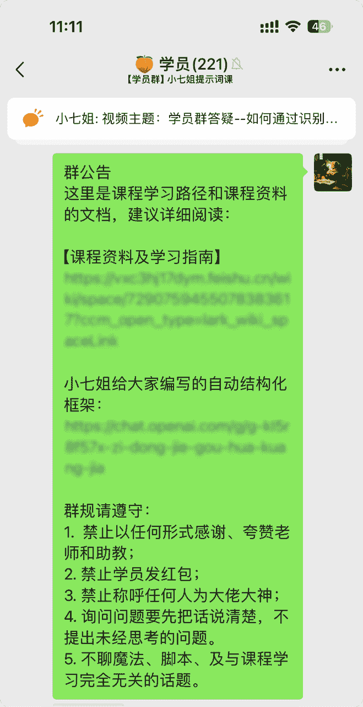

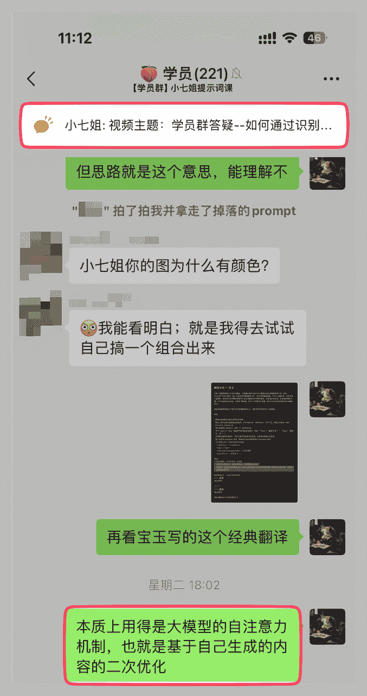

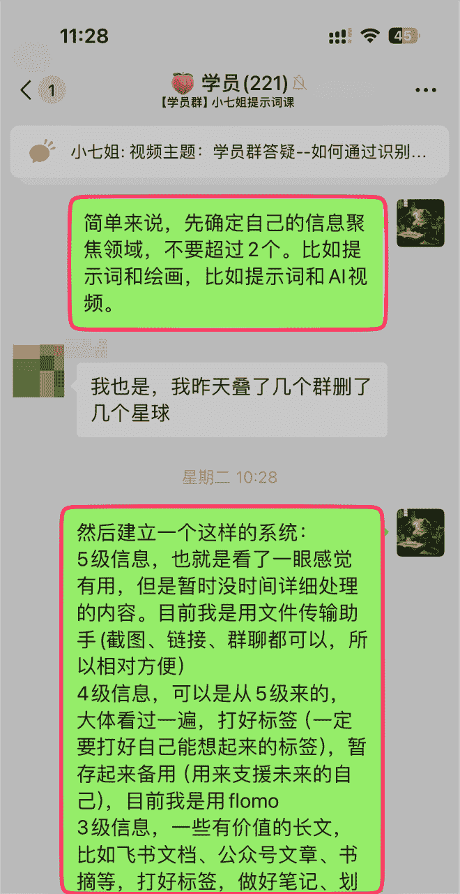

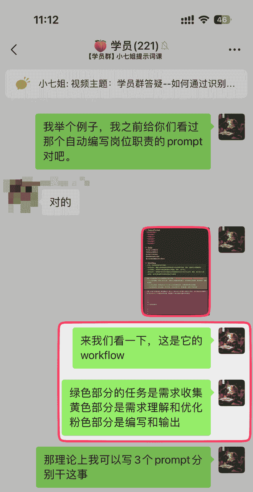

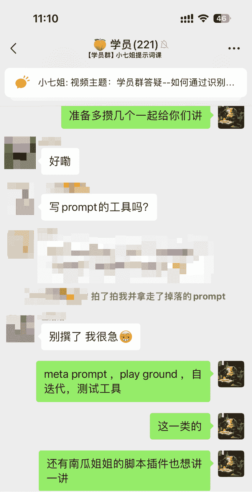

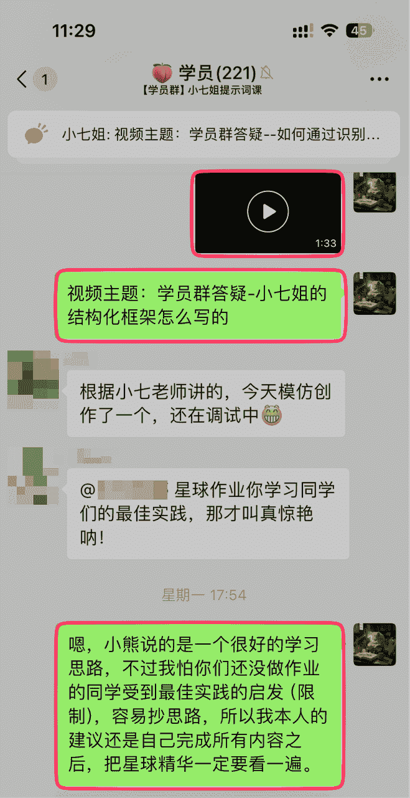

答疑卡片：

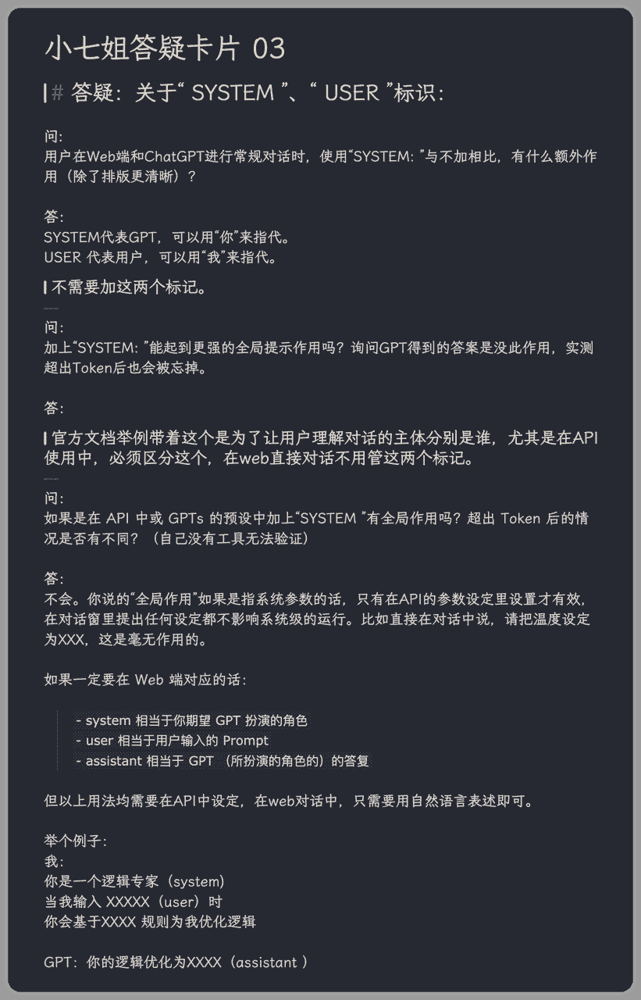

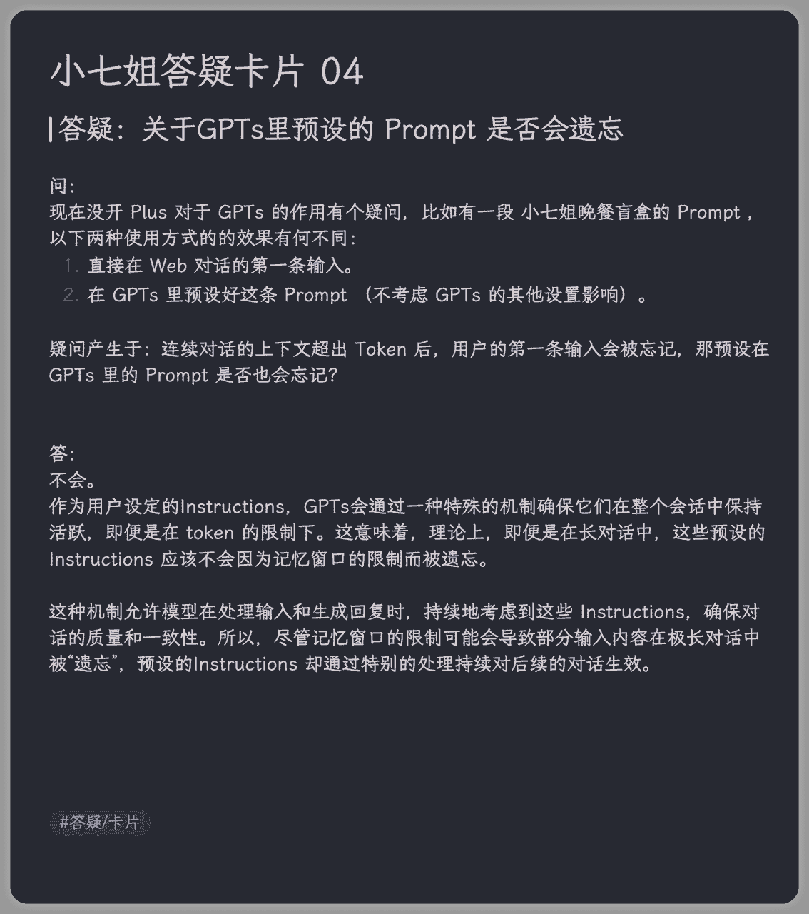

## 往期学员评价

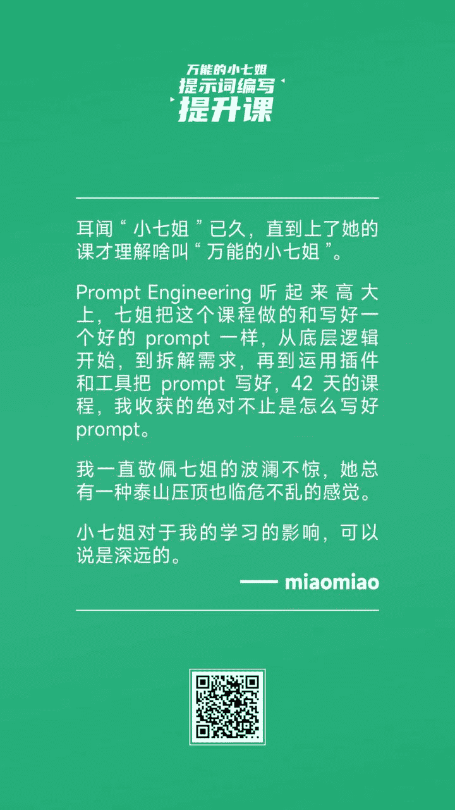

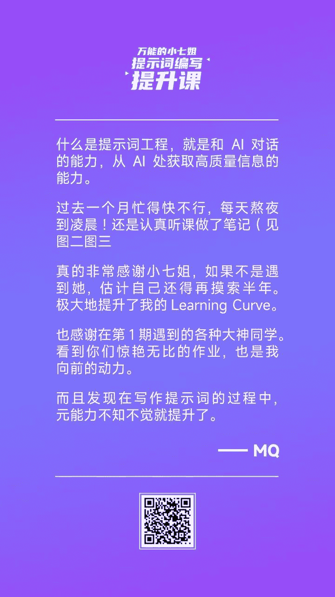

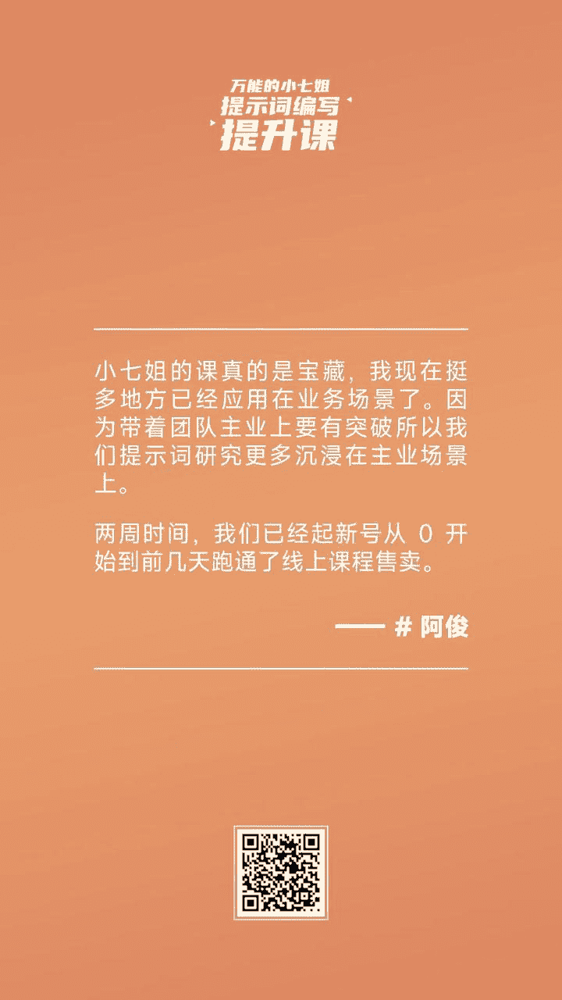

## 你将收获：

+   **元能力：**提升表达能力、逻辑思维能力的方法论和练习

+   **个人提升**：熟练编写任何你想要实现的的提示词

+   **工具化能力：**学会以商业化和工具化标准交付提示词

+   **职业化能力：**熟知提示词工程和行业常识和发展路径

+   **企业落地：**搞懂提示词如何封装成工具

+   **进阶学习：**获得自学路径，课程后能继续深度学习

## 课程证书

课程完成学习之后，通过结课考试获取证书：

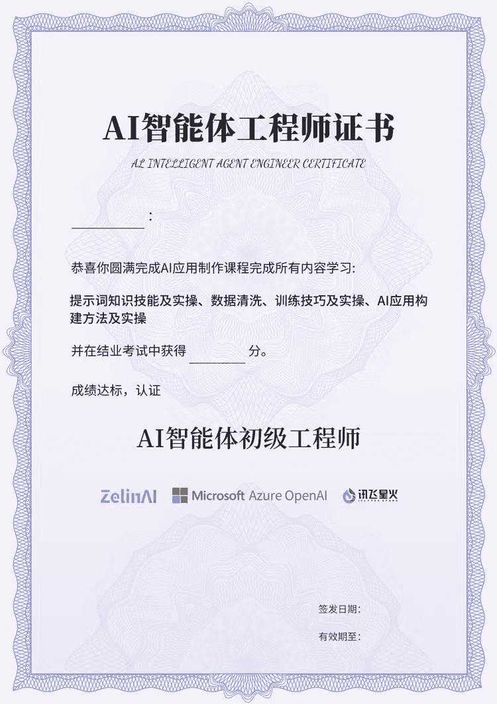

## 学员作业

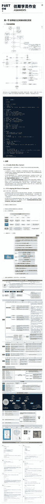