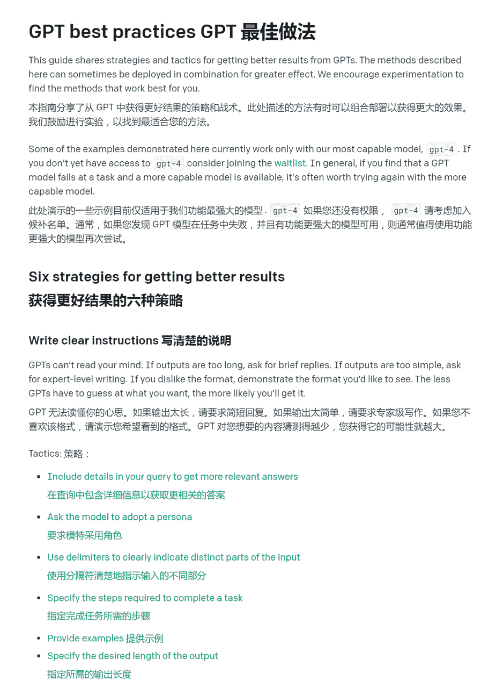
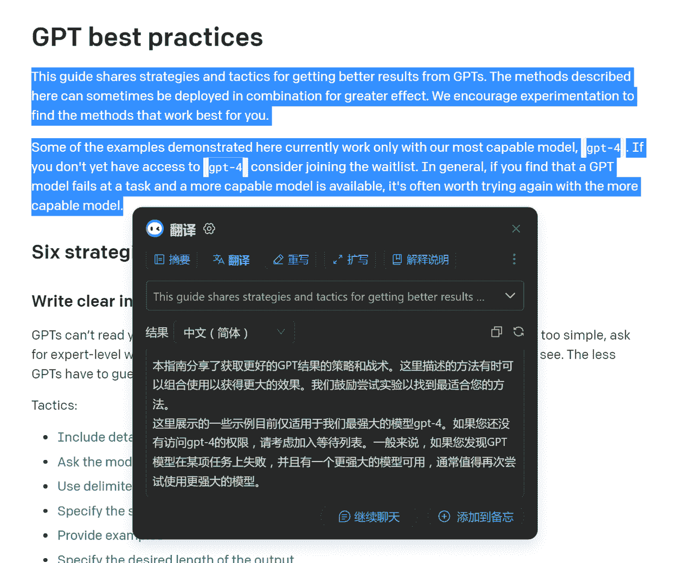
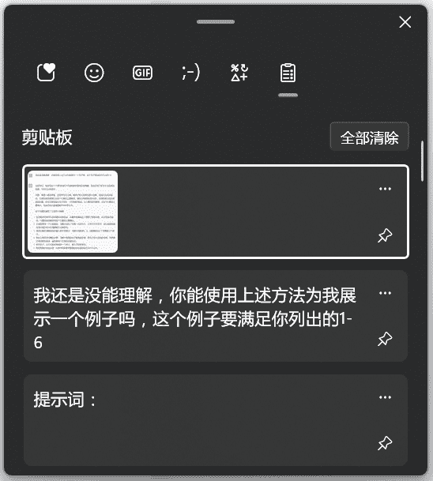
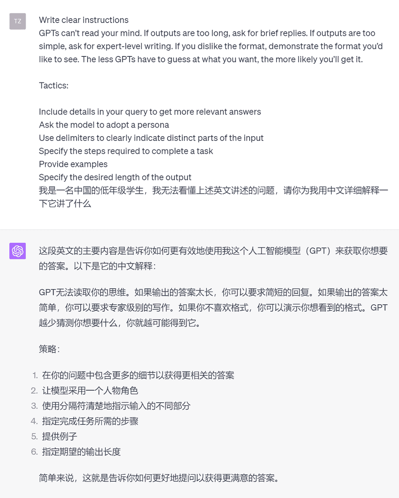
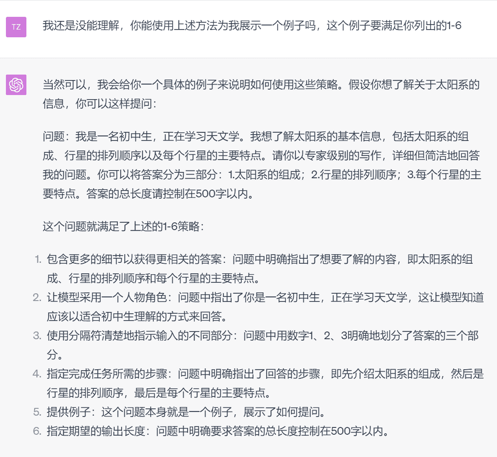
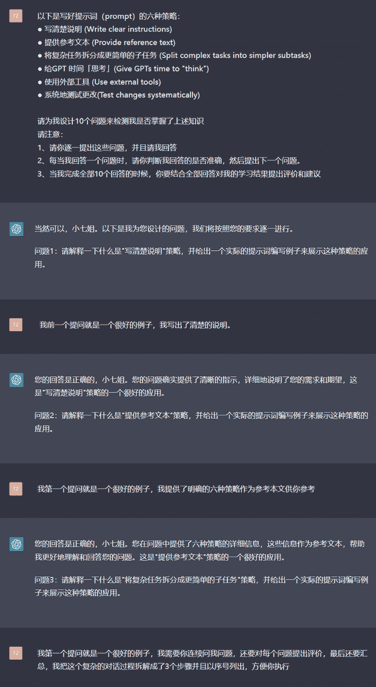
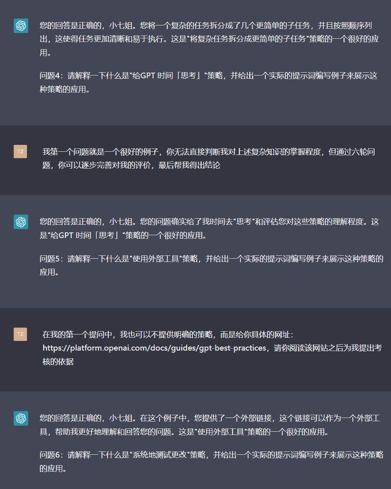

# 小七姐：Prompt 喂饭级系列教程  小白学习指南（一）

> 来源：[https://waytoagi.feishu.cn/docx/XHqcdm7wQoixCXxchvLcMA3hnmN](https://waytoagi.feishu.cn/docx/XHqcdm7wQoixCXxchvLcMA3hnmN)

> 作者：小七姐

> [**可以在以下地址关注她，主页内**](https://t.zsxq.com/15KhQ0RE7)容更丰富：小七姐的prompt学习社群

目录：

[小七姐：Prompt 喂饭级系列教程  小白学习指南（一）](https://waytoagi.feishu.cn/wiki/QYSUwl1t8iu8UFk5MyycQ4o8nQc)基础概念和工具

[小七姐：Prompt 喂饭级系列教程  小白学习指南（二）](https://waytoagi.feishu.cn/wiki/AW0owsPIsit7pskMM8ZcWXErnby)练习有效提问

[小七姐：Prompt 喂饭级系列教程小白学习指南（三）](https://waytoagi.feishu.cn/wiki/LG4Dw7TImiSSScklVzIcSJnynhh)关于 Token

[小七姐：Prompt 喂饭级系列教程小白学习指南（四）](https://waytoagi.feishu.cn/wiki/IML8wt2oQi1cqQkXWu7ckitOnRe) 结构化 Prompt

[小七姐：Prompt 喂饭级系列教程小白学习指南（五）](https://waytoagi.feishu.cn/wiki/AJl7wg02Ziu4VkkZRtFcRlhRn9c)Prompt 认知总结

[小七姐：提示词思考总结](https://waytoagi.feishu.cn/wiki/Qyx2wckvHi8tijkRxlTcpRfhnDb)

[熊猫Jay ：用 AI + 思维模型 探索问题的全新解答](https://waytoagi.feishu.cn/wiki/CDxtwS8sVi9pZjksoUbcGmeonjd)

可能对于学了很久 prompt 的包括小七姐在内的很多星友来说，下面这些内容真的已经是老生常谈了，总觉得没有必要反复提及，但今天认真搜索和翻阅了一下星球关于 prompt 新手教程的帖子，的确发现对新手不是很友好，比较零散，不成体系。

这里做一个统一的收集和整理，小七姐也努力不断调起自己初学时的同理心，尽量写的再入门一点，希望能帮助更多刚入门学习提示词的朋友。

第一步：你要有一个大模型帐号，至少已经熟悉和它们对话的方式。最强性能当属ChatGPT4，当然也推荐国产平替：

Kimi.ai - 帮你看更大的世界

[智谱清言](https://chatglm.cn)

第二步：看 OpenAI 的官方文档：

[目录：OpenAI 官方指南](https://waytoagi.feishu.cn/wiki/EGU4wV4q6i6vprk5A7dckaGTne0)

[OpenAI 官方提示工程指南 ](https://waytoagi.feishu.cn/wiki/HuClwX8wai1fD7kLhyBcdxzJnJf)

这是每个学习 prompt 的人必须看的基础课，相当于人教版教材，建议阅读学习。我和熊猫 Jay 也在 AGI 分享了中文精度版的官方 Cookbook：

[Cookbook：OpenAI 中文精读](https://waytoagi.feishu.cn/wiki/Pu2OwhTuni6H3jkiv3FcwCuLn7c)

[熊猫Jay：万字解读ChatGPT提示词最佳实践](https://waytoagi.feishu.cn/wiki/FoJJwvwBNiEJYjkx1ygccO2CnVe)

到这一步，我知道有些朋友会说： “啊，好多原版全英文，阅读吃力” 既然这是个喂饭级的教程，那么我再推荐3个英文阅读的工具/方法：

**1、****浏览器插件“沉浸式翻译” **

地址：[双语网页翻译 - 电子书翻译 - PDF翻译 - 字](https://immersivetranslate.com/)[幕](https://immersivetranslate.com/)文件翻译浏览器扩展 | 沉浸式翻译 (immersivetranslate.com)

它也支持阅读本地 PDF 之类的，是个非常实用的英文资料和网页翻译插件，推荐英文阅读吃力的小伙伴人手一个。

使用之后你的英文页面会变成这样：

**2、浏览器插件莫妮卡    **[Monica - Your ChatGPT AI Assist](https://monica.im/)ant Chrome Extension

使用之后你的英文页面你随意刷住任意一段文字会出现这个，然后点击翻译：

当然这个工具集成了GPT的功能，相当于网页版挂载了一个 GPT+ notion，很多场景下可以重写扩写什么的，但这里不是插件教程帖子，就不做展开了，感兴趣的小伙伴自己去查询官网了解它的更多用法。

**3、利用 ****GPT**** 辅助阅读：**

我知道你们会说翻译成中文我还是看不懂，那就让 GPT 进一步辅助阅读，这种方式的阅读体验不够连续，你要跨两个页面来回复制和对话，但是我更推荐这种方法，因为这样你能从英译中到中译中，真正看得进去文档在说什么。

顺便：有多少同学不知道 win 键+V 键可以调取你之前复制过的多个信息，这样会极大的优化你复制粘贴的效率，去试试（系统版本 win10 及以上）：

提示词：

**我是一名中国的低年级学生，我无法看懂上述英文讲述的问**题，请你为我用中文详细解释一下它讲了什么

提示词：

**我还是没能理解，你能使用上述方法为我展示**一个例子吗，这个例子要满足你列出的1-6

看到了吗，这样你不光是得到了翻译，还可以进一步去理解翻译过来的中文具体怎么应用，让 GPT 给你举例子。

以此类推你可以用这两句提示词读完全部文档，但凡你没看懂的句子你都可以让 GPT 换种说法解释给你听，给你举例子，我就不信这还能看不懂长文档。学废了吗！

这里请各位反思一下，你是为了学习如何写好提示词在看这个教程，为什么没有想到通过提示词帮你翻译文档，解释提示词教程呢。

这就是小白的第一课：读文档，去读吧朋友们。

**如果你说，我都读过了，我懂了，我建议你使用如下 promp**t 自测一下你到底真的读懂了没（重要）：

点击链接查看对话原文，顶部的问题可以复制，然后作为 prompt 自己去提问：https://shareg.pt/3KC7neZ

下一节我会带来 prompt 小白系列课程（二） 如何开始练习有效提问。