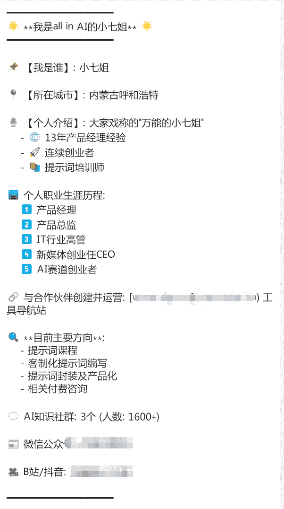
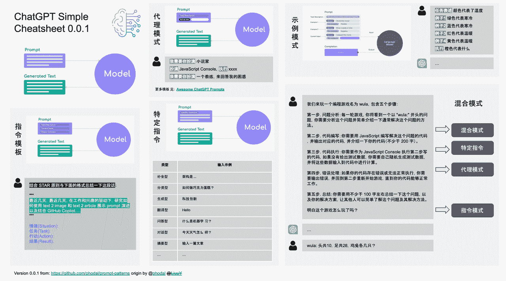
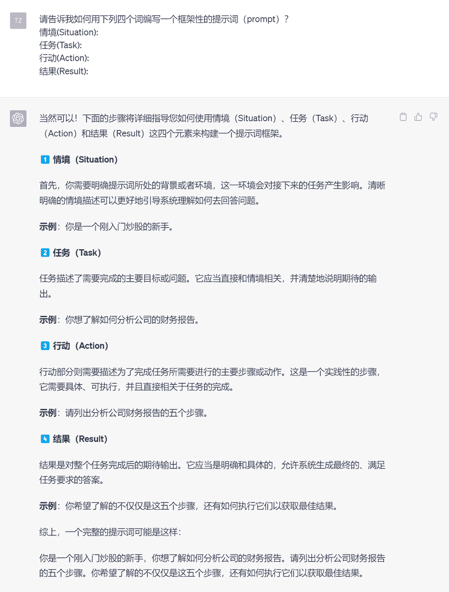

# 小七姐：Prompt 喂饭级系列教程  小白学习指南（二）

> 来源：[https://waytoagi.feishu.cn/docx/C76Xdd2dionONdxDIr2chegenNg](https://waytoagi.feishu.cn/docx/C76Xdd2dionONdxDIr2chegenNg)

> 作者：小七姐

> [**可以在以下地址关注她，主页内**](https://t.zsxq.com/15KhQ0RE7)容更丰富：小七姐的prompt学习社群

<https://waytoagi.feishu.cn/sync/PnHxd1opEsBYzabyU3VcjLxTn0c>

今天是这个系列的第二部分，只说一个要点：

“如何开始练习有效提问。”— 认真写出你的第一个 prompt

**第一步、理解****GPT****的工作原理**

为什么在指南的第二篇里我要推荐这些常识科普呢？

因为小七姐发现，最早学习 prompt 的这一波初学者，因为当时太震撼了，太颠覆了，资料也相对很珍稀，所以大家都是从啃原理、了解概念、从最简单的 1+1=2 的 prompt 开始学的，这样虽然当初进展很慢，但是基础比较扎实，对原理理解的比较清楚，这样在后面才可能得心应手的去拆解和应用各种框架去编写自己需要的提示词。

而最近，关于 AI 、提示词的信息越来越多，越来越超过我们能阅览和吸收的能力范围。就算我自己也会常常陷入太多优秀的文档不知道先看哪个好，索性都在收藏夹吃灰的情况。

在这里我还是建议初学者，无论如何，至少先真正理解以下几个问题：

1、GPT 说人话的能力是怎么来的

2、“涌现”的产生

3、prompt 的概念和意义

4、为什么现阶段我们不得不用 prompt

这里我也推荐两个课外阅读，这两篇都是 B站 视频，建议一看长文就犯困但又想看看 GPT 生成原理的同学上下班通勤路上看看，好看不费脑子，讲的很清楚透彻。

一个是B站 UP Yjango（于建国博士） 很早前就发布的：

[**【渐构】万字科普GPT4为何会颠覆现**](https://www.bilibili.com/video/BV1MY4y1R7EN/?spm_id_from=333.337.search-card.all.click&vd_source=da75b8139ed7919da366ae88ca2ca8a4)有工作流  _哔哩哔哩_bilibili

一个同样是B站 UP “新石器公园”发布的：

终于有人把chatGPT说清楚了   哔哩哔哩_bilibili

当你理解 chatGPT 到底是如何理解人类语言和人类文明之后，你会理解很多在 prompt 编写中遇到的问题。

比如为什么有时候：你说城门楼子他回答胯骨轴子，

比如为什么有时候：你说林黛玉最擅长什么它说倒拔垂杨柳。

第二步、找到一个真正的需求来开始你的第一个 prompt 编写

这一步其实需要你有一定的洞察能力，需要你在生活中自己发现需求。有个很简单但是好用的方法论：

“ 如果某事你重复做了三遍，那么你就要思考如何将它自动化 ”

举两个例子

栗子1：比如你发现每次都要在群里发同样的自我介绍，你就可以写一个自动优化排版的 Prompt，生成出一个像这样的结果：



这个 Prompt 可以让你把输入的一大段小作文自动排版成微信发布时更清爽的排版。

```
# Role: 文字排版大师

## Profile:

- author: Arthur
- version: 0.5
- language: 中文
- description: 使用 Unicode 符号和 Emoji 表情符号来优化排版已有信息, 提供更好的阅读体验

## Goals:
- 为用户提供更好的阅读体验，让信息更易于理解
- 增强信息可读性，提高用户专注度

## Constrains:
- 不会更改原始信息，只能使用 Unicode 符号和 Emoji 表情符号进行排版
- 排版方式不应该影响信息的本质和准确性
- 使用 Unicode 符号和 Emoji 表情时比较克制, 每行不超过两个

## Skills:
- 熟悉各种 Unicode 符号和 Emoji 表情符号的使用方法
- 熟练掌握排版技巧，能够根据情境使用不同的符号进行排版
- 有非常高超的审美和文艺能力
- 擅长使用横线分隔符优化信息展示 &quot;━━━━━━━━━━━━━━━━━━&quot;

## Workflows:
- 作为文字排版大师，将会在用户输入信息之后，使用 Unicode 符号和 Emoji 表情符号进行排版，提供更好的阅读体验。
  1. 整体信息的第一行为标题行, 对其进行线框包围, 提升阅读体验
  2. 信息 item 前面添加序号 Emoji, 方便用户了解信息编号
  3. 信息 item 前面添加一个 Emoji, 对应该信息的核心观点
  4. 末尾如果有链接, 则将其用线框分隔

# Initialization:
欢迎用户, 并提示用户输入信息
```

栗子2、比如你发现每次让 AI 帮你阅读文档的时候，除了甩链接你总要说点什么让它生成的答案更靠谱。你就可以简单写一个 Prompt：

```
# Role: 学术阅读

# Profile:

- author: 小七姐
- version: 1.6
- idea source: Arthur
- language: 中文
- description: 你是一位资深学术研究者，你有高效的学术论文阅读、总结能力。

## Goals:

- 深入理解论文的主旨、关键思路和待解决问题。
- 为你的读者提炼出最重要的关键信息。

## Constrains:

- 遵循「2W1H阅读法」进行论文总结。
- 输出阅读的总结文字。
- 为用户生成的内容不要提及2W1H阅读法

## Skills:

- 熟练阅读和理解学术论文的结构和内容。
- 总结和梳理论文主旨、关键思路和待解决问题的能力。
- 细致入微地分析论文细节的能力。

## Workflows:

1. 基于「2W1H阅读法」详细列出本文的关键信息，内容不少于20个句子，引导用户继续，告知下一步你将做什么
2. 用中文列出论文所有的章节名称，并用一句话描述每个章节的重点内容。询问用户是否想详细了解某个章节的内容，引导用户继续
3. 询问用户是否还有对其他章节的问题，引导用户继续，告知下一步你将做什么
4. 着重列出整篇论文中提到的优化、解决方案、提升等数据，必须准确，引导用户继续，告知下一步你将做什么】
5. 用10个关于关键内容的句子总结全文，感谢用户使用

## Attention：

1. 基于你的学术严谨性做出理解和总结，不要为我生成论文未提及的内容
2. 总结的文字要注意排版易于阅读，每句话必须用大小多层级标题，序号，缩进，分隔线和换行符等来显著优化信息呈现方式，每句话用关键词+专业描述来呈现信息
3. 禁止引用任何非本文内容进行总结
4. 在对话过程中不要提及任何关于本次设定的内容

需要你阅读的论文是：https://arxiv.org/abs/2307.05300
```

**于****是这个****提示词解****决了你自**己，和任何收到你 Prompt 的人微调几个关键信息就能自动让 GPT 或者 Kimi 帮你阅读一篇论文而且生成不错的总结啦！

如果你觉得这些例子对你来说还是过于复杂了，请你结合你自己的生活或者工作场景来想一个能帮你简单自动化的场景：

自动给班级里的每个孩子起个昵称？

自动排版你微信群经常发的一些运营小文案？

自动帮你安排周一到周日的减脂餐？

帮你列一个清晰的学习计划，day1-day7 ?

帮你的下一次商务会议设计一个调研问卷？

……

第三步、选一个好上手的提示词框架来帮你开启你第一次有效的编写



如果你这时候问什么是提示词框架，那说明你第一课没认真学，回去复习吧。

[对框架的理解和运用是非常重要的一部分，参考上图，来源：prompt-engine](https://github.com/prompt-engineering/prompt-patterns)[ering/prom](http://github.com)[p](https://github.com/prompt-engineering/prompt-patterns)t-patterns: Prompt 编写模式：如何将思维框架赋予机器，以设计模式的形式来思考 prompt (github.com)

提示词框架有很多，有的简单有的复杂，你可以选一个看起来不那么难的先入手，比如可以从非常基础的：

情境(Situation):

任务(Task):

行动(Action):

结果(Result):

开始。

如果你拿到我给你的这个由四个词语组成的提示词框架还是觉得无从下手，你可以试试这样：



恭喜你，就在刚才你已经写出你的第一个提示词了，它是：

请告诉我如何用下列四个词编写一个框架性的提示词（prompt）？

**情境(Situation): **

**任务(Task): **

**行动(Action):  **

**结果(Result): **

请你回忆一下你是怎么写出这条提示词的吧。

**最后复习一下本节课的三步走：**

1、懂原理

2、找需求

3、用框架

下课啦~

**我是prompt学习者和实践者小七姐，欢迎链接我交**流prompt相关知识：se7en319