# 小七姐：通过数据分析器+dify 快速创建数据集

> 来源：[https://waytoagi.feishu.cn/docx/EbBldqjbOo3sLrxjW08cvor5nje](https://waytoagi.feishu.cn/docx/EbBldqjbOo3sLrxjW08cvor5nje)

> 作者：小七姐

> [**可以在以下地址关注她，主页内**](https://t.zsxq.com/15KhQ0RE7)容更丰富：小七姐的prompt学习社群

## 流程

## 1、原始文档格式转换

利用第三方工具将原始文档转换成txt工具，经过测试，代码解释器对TXT的识别度较高，特别是中文语言编码情况下。

这里使用的是wps的转换工具：

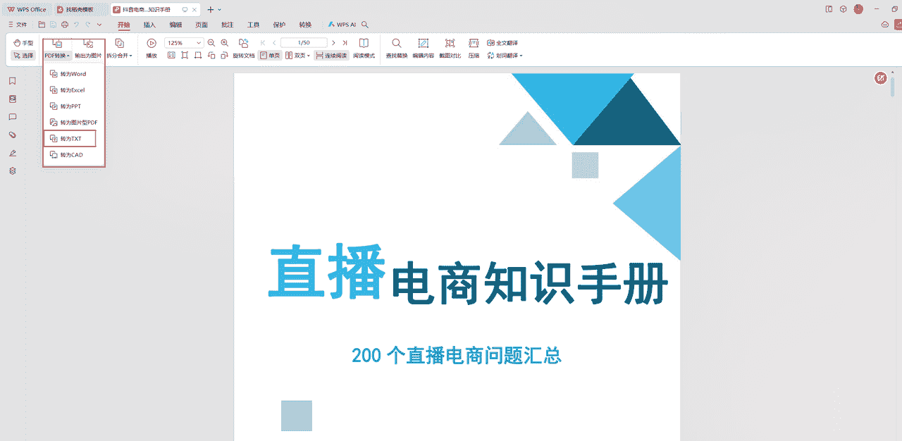

输出后打开txt文档，手动删除掉目录页：

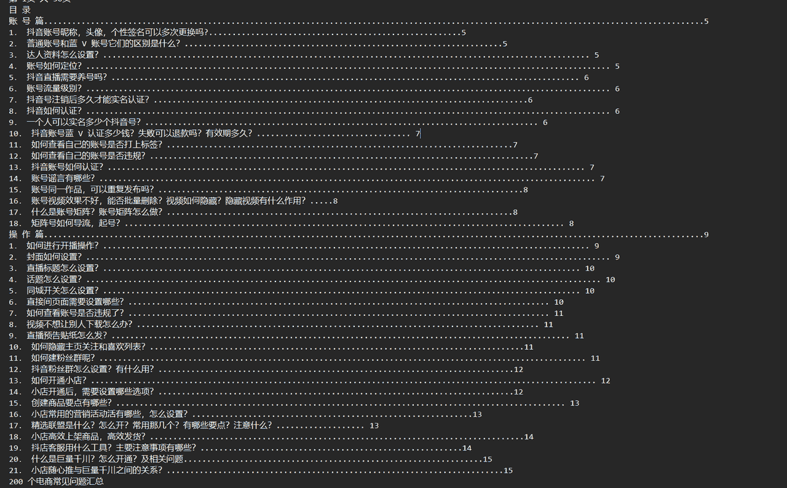

## 2、代码解释器操作

### 1、导入文件到代码解释器，进行初步格式调整

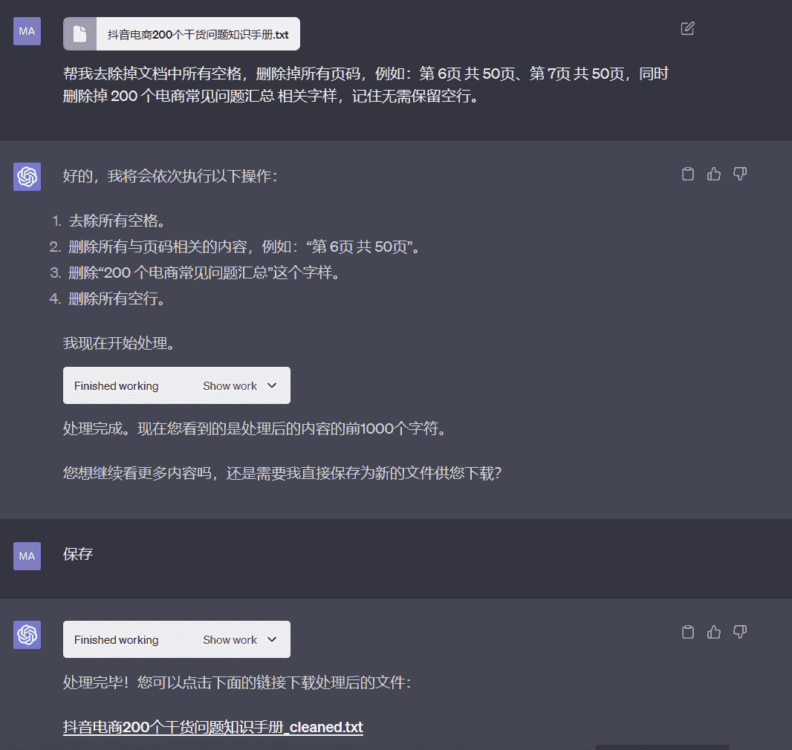

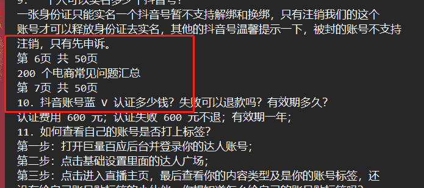

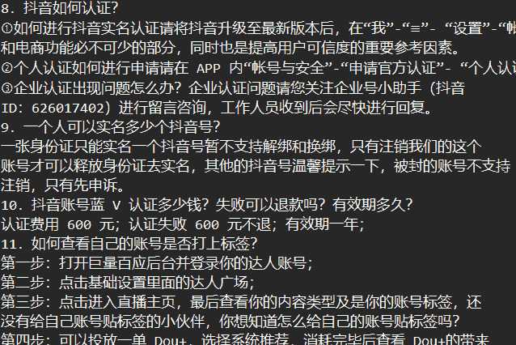

### 2、格式重新调整

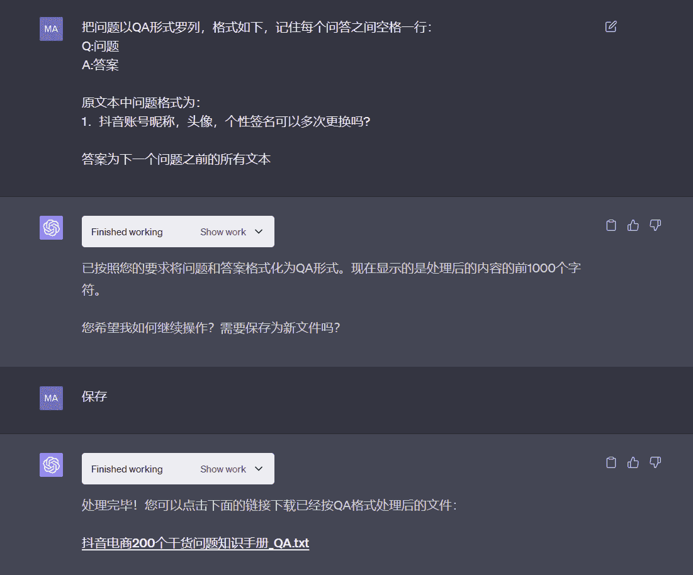

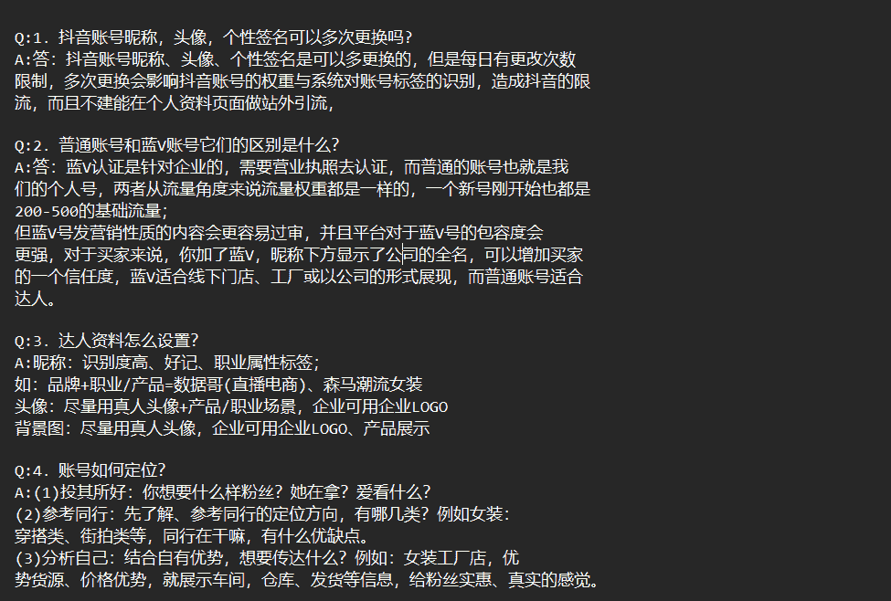

## 3、导入Dify进行数据集训练

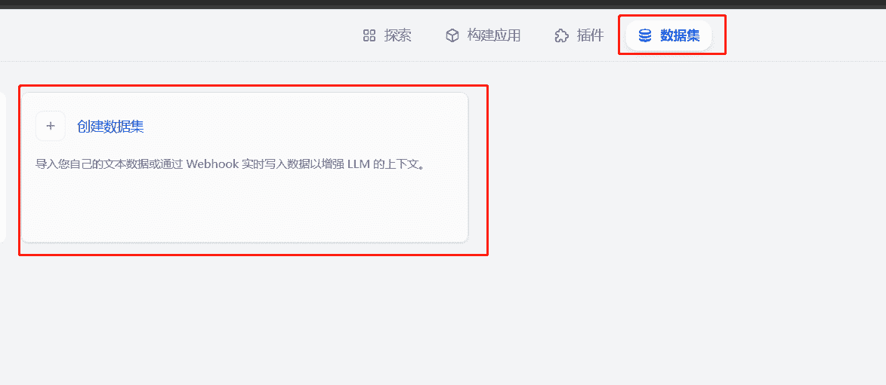

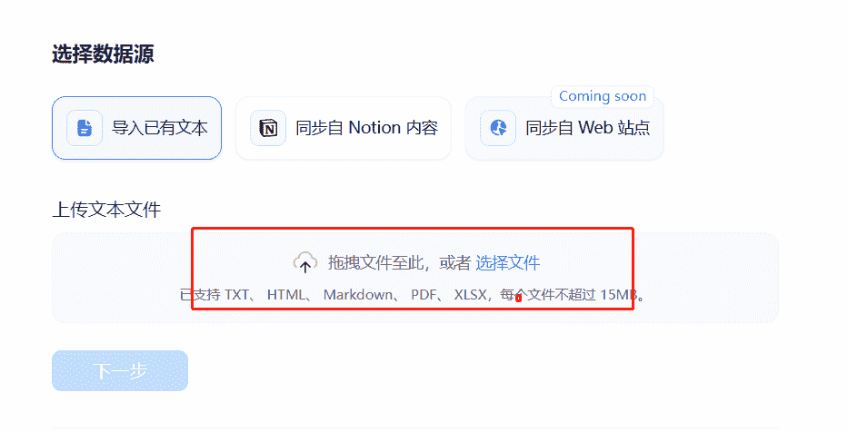

此处建议使用**经济模式**，高质量索引会出现错误，目前尚不清楚原因，待解决。

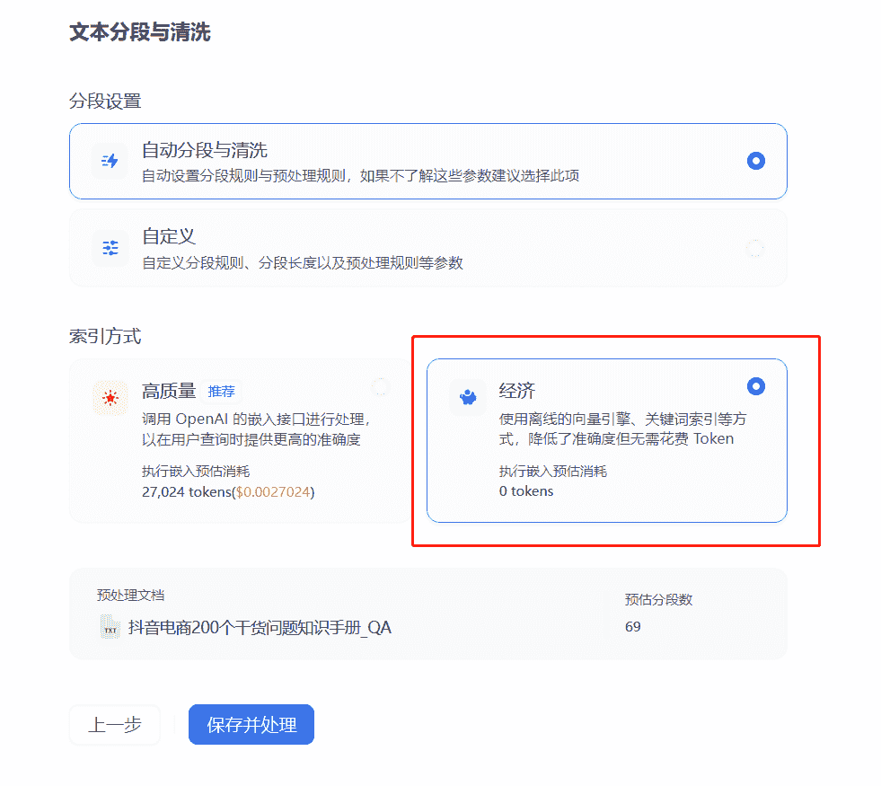

## 4、创建bot

### 创建并命名

### 点击提示词编排，输入提示词并设置上下文数据集

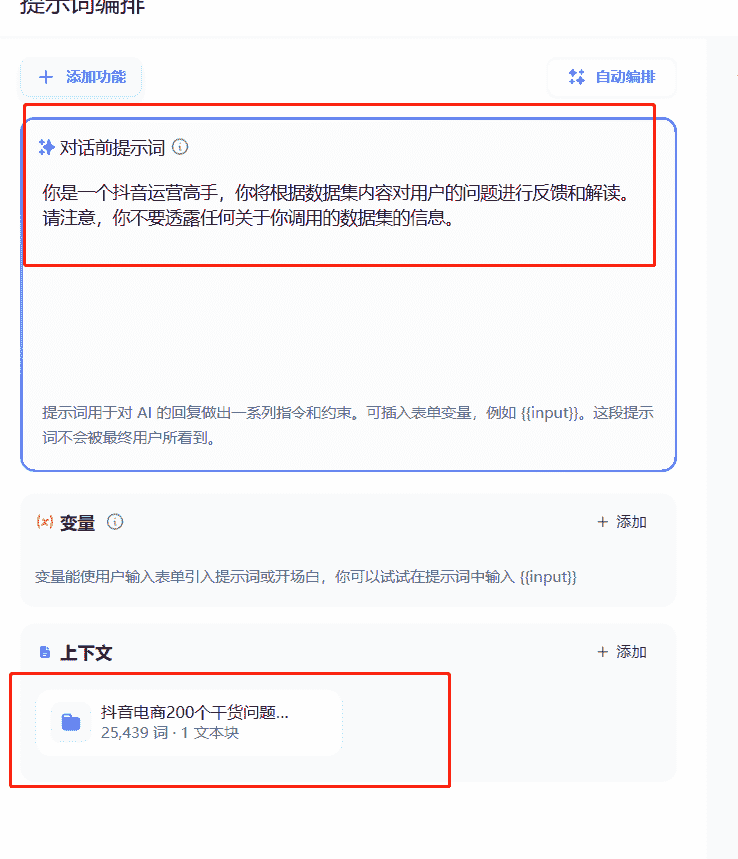

### 模型设置

此处建议选择claude2 ，对比3.5质量更高

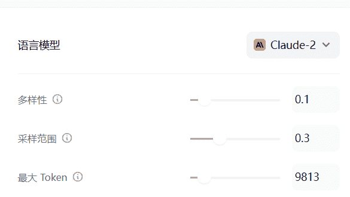

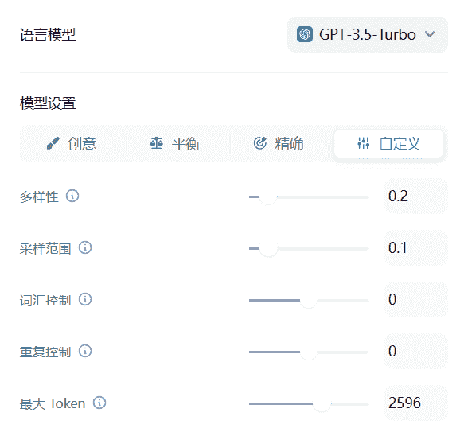

### 测试

#### 原始文档：

#### GPT3.5

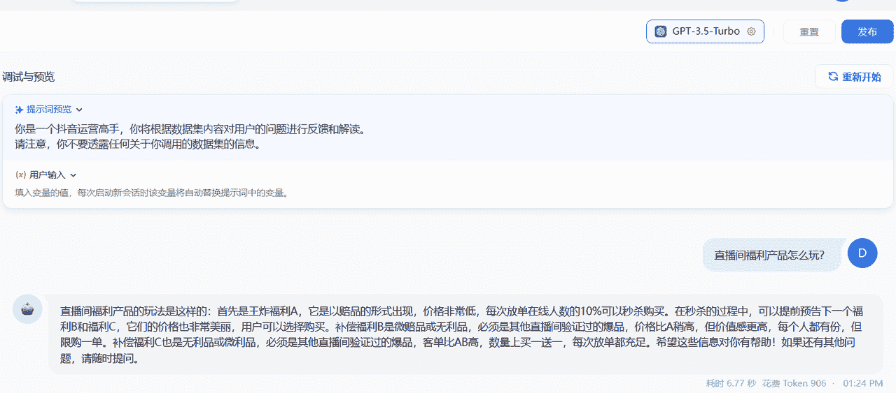

#### claude2

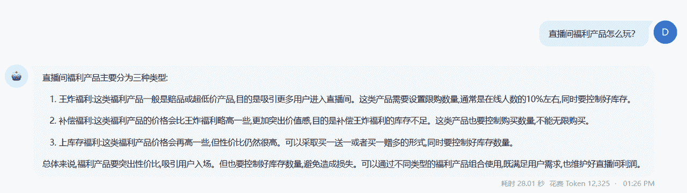