# 小七姐：官方最佳 Prompt 实践的六个方法

> 来源：[https://waytoagi.feishu.cn/docx/KEqxdAkEdoGHH1x5GmOccOXBnhe](https://waytoagi.feishu.cn/docx/KEqxdAkEdoGHH1x5GmOccOXBnhe)

> 作者：小七姐

> 可以在以下地址关注她：[**小七姐的prompt学习社群**](https://t.zsxq.com/15KhQ0RE7)

# 01 学习地图 | 编写清晰的说明 - 多说两句，提供细节

在 OpenAI官方 的说明文档（ Documentation-GPT best practices），也就是我们常常提到的“官方最佳实践”中，为用户提供了若干项策略，以帮助用户更好的使用 ChatGPT。

## **策略一：编写清晰的说明**

在询问中包含详细信息，以获得更多相关答复。

这是因为，大模型不是我们肚子里的蛔虫，它无法在有限的信息中“猜测”我们的意图，所以，在问问题的时候，不要惜字如金，多说一些内容，多提供一些信息，这样可以很有效的提高大模型回复的质量和丰富性。

我们来看一个例子：当我们想要大模型为我们提供一些思维模型时，本能的问法可能是：“给我列几个思维模型”。于是很常见下面这样的对话：

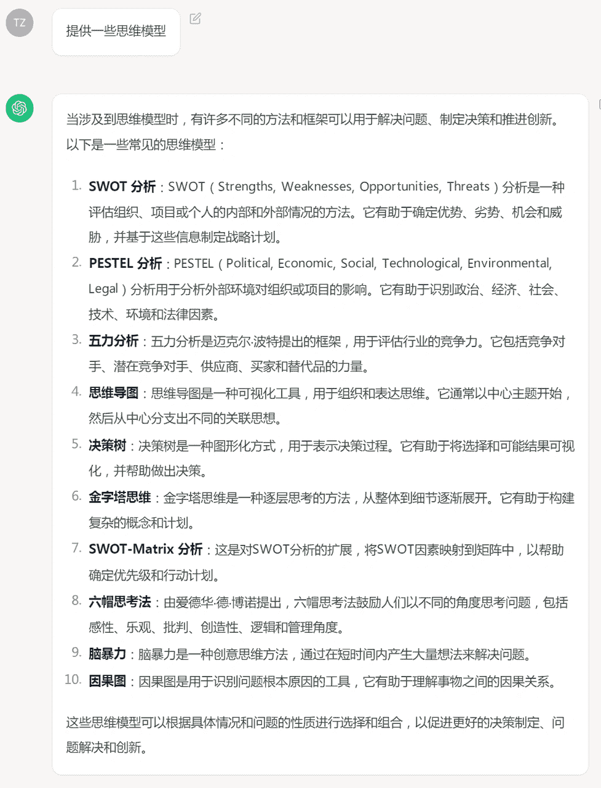

当我们愿意给出更多信息，比如我们为什么需要这个模型，希望 ChatGPT 列举三个模型，以及是否有我们已知的模型作为参考时，ChatGPT 可以提供更加符合我们预期的回答：

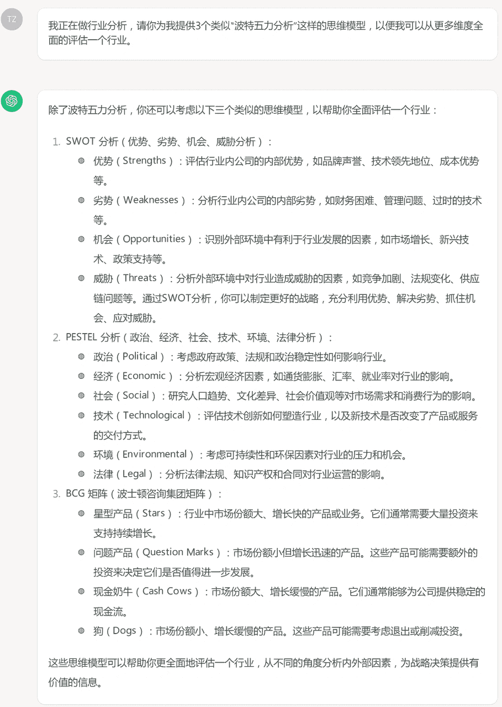

我们再来看一个例子，假设我们想请 ChatGPT 帮助我们记忆一个比较抽象的概念，我们可能会脱口而出这样的问题：

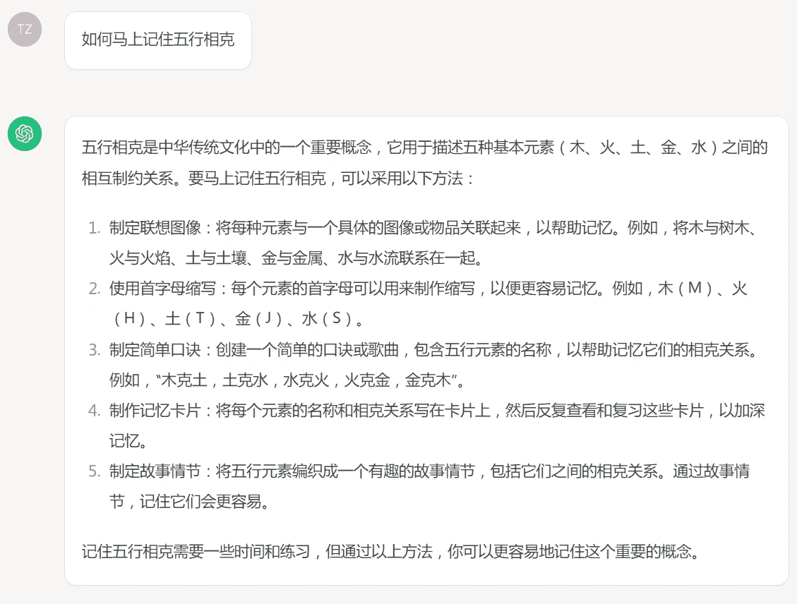

但如果我们停下来思考一下，深想一步，提供更多细节，就能得到更符合期望的回答了：

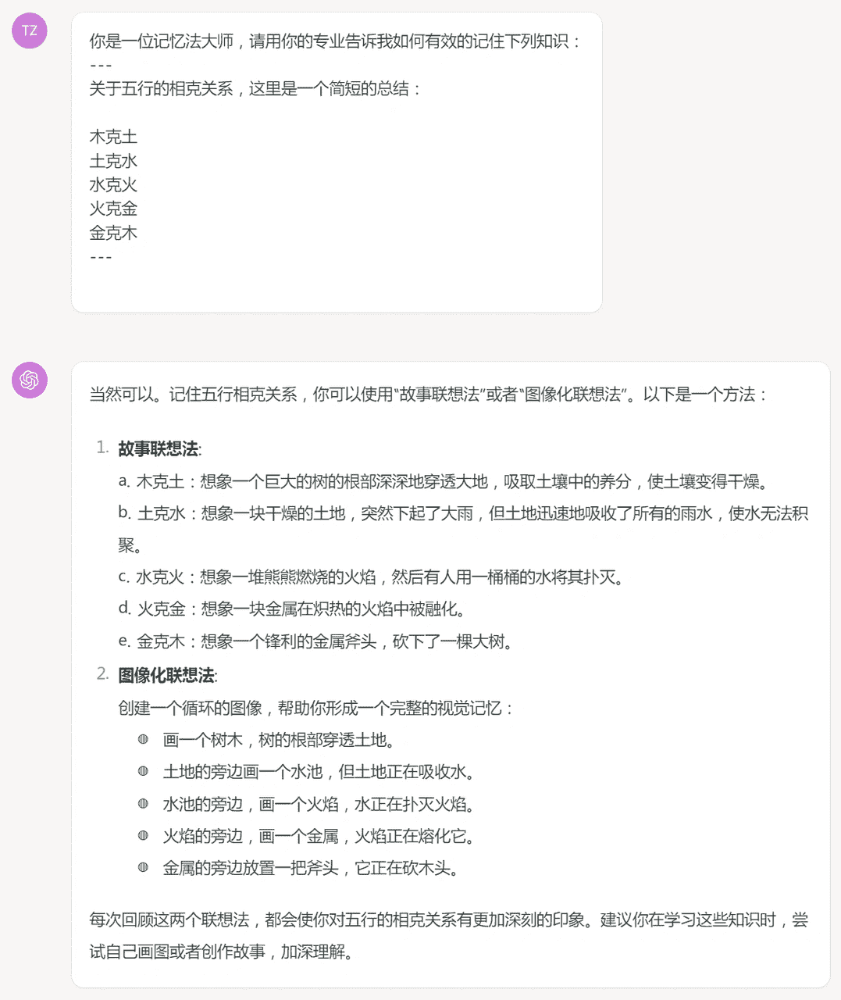

最后，我们想通过 ChatGPT 来了解提示词，这是一个坏例子：

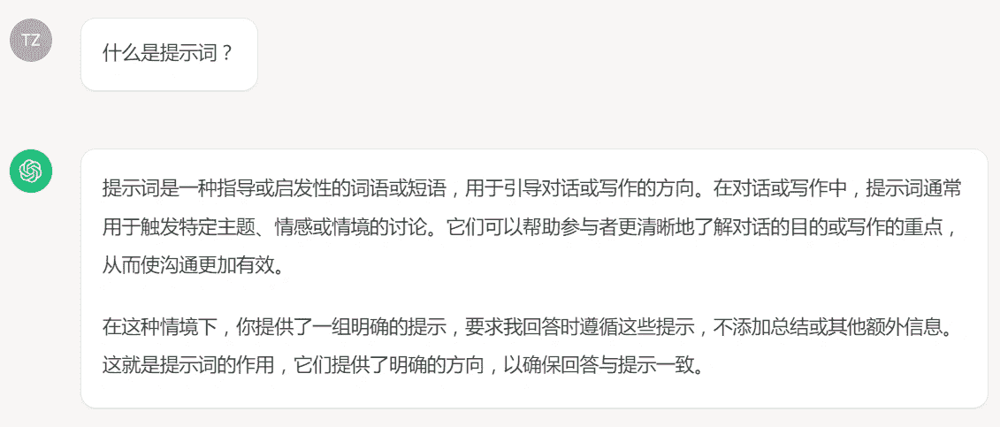

让我们给出特定的情景和进一步思考的问题：

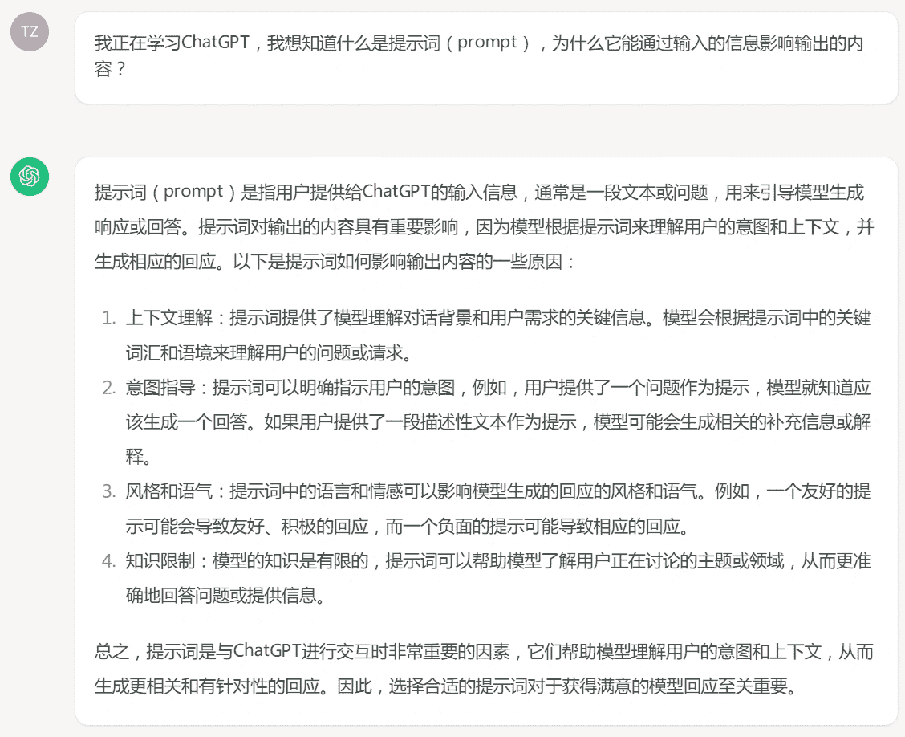

---

# 02 学习地图 | 编写清晰的说明 - 角色扮演

## **策略一：编写清晰的说明**

让模型扮演一个角色可以显著提升模型回答的质量

角色设定为模型提供了一个明确的框架或指导。当模型知道它所扮演的角色，它可以更准确地根据该角色的特性来生成回答。同时，角色通常与某种情境或背景相关。这为模型提供了更多上下文，帮助它更好地理解问题的意图。

当我们请求模型：“请为我改写一篇文章”的时候，模型会从完全广泛的意义上来执行这个任务，但当我们赋予它角色：

**“你是一位教育专家”**

模型可能会判断我们的文章是写给教育行业或学生看的，生成的内容会倾向于这类受众的信息诉求。

**“你是一位艺术家”**

模型可能会判断我们需要更加开放、有创意的文本。

**“你是一位知名文学大师”**

模型可能会理解我们希望得到更加具有文学美感的文本。

为了便于理解，我们先摘取了一段文本，并尝试让模型设定不同角色来改写这一段文本：

现代认知心理思潮产生于20世纪50年代中期，60年代后迅速发展，因奈瑟（U.Neisser）出版《认知心理学》一书而得名。

到了80年代，它已成为当前西方心理学界盛行的一个新流派，基本上取代了行为主义心理学而在西方心理学领域居主导地位。

认知心理学是以人类心理现象中认识过程为主要研究对象的一门学科。它是广义的认知科学（包括计算机科学、通讯科学、语言学、逻辑学、人类学的）一个重要分支。

**“你是一位小学老师”**

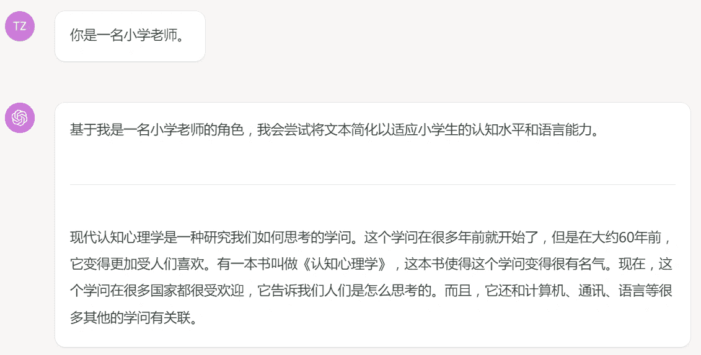

**“你是一位艺术家”**

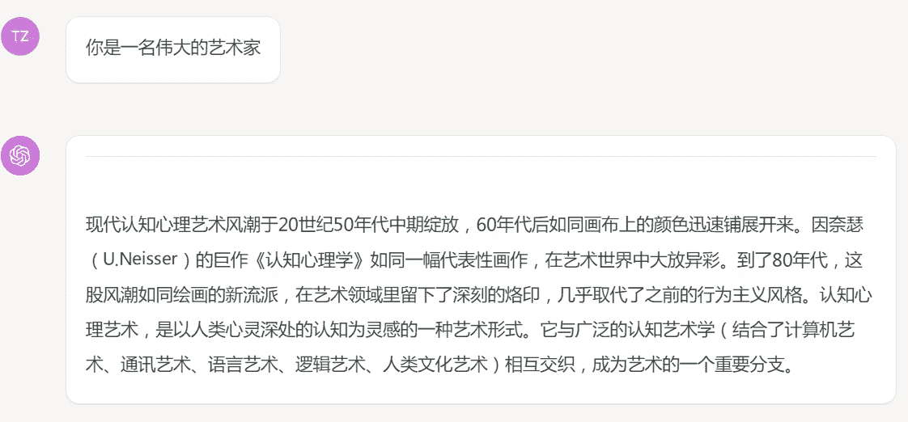

```
（注：这部分生成文本存在大模型的“幻觉”问题，内容不能作为真实信息来理解。我们在这个例子中只需要关注角色对内容产生的影响，至于什么是“幻觉”问题，我们会在后面的文章中详细介绍。）
```

**“你是一位知名文学大师”**

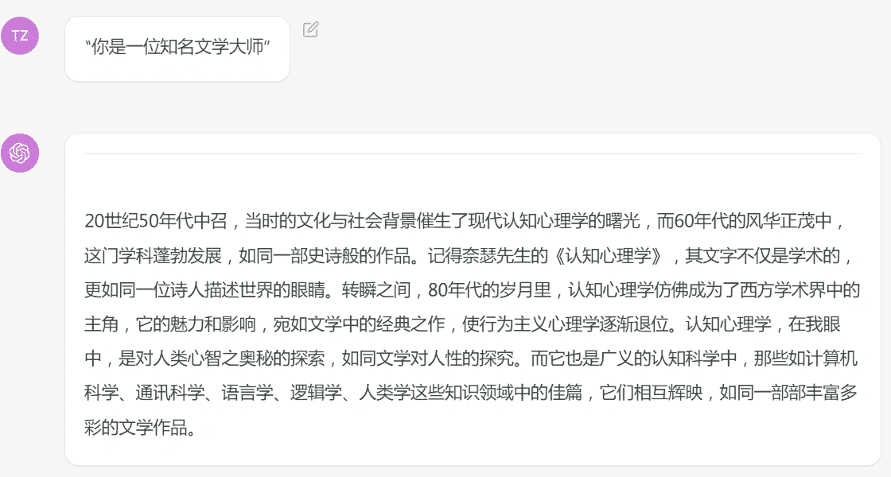

在上述例子中我们可以明显看出基于同一段文本，为模型设定不同角色后，他会基于角色的背景而自行选择改写文本的方式，来符合角色的学识、表述方式或人格。

最后，我们用一段典型对话来理解不同角色对同一个主题的评价：

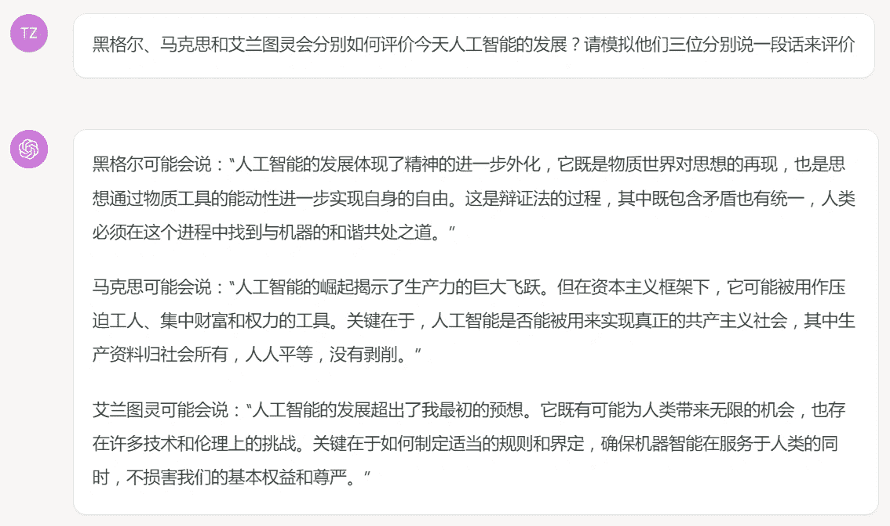

---

# 03 学习地图 | 编写清晰的说明 - 分隔符的重要作用

在编写提示词的时候，当我们想要**标注一整块独立的内容**，我们需要使用分隔符清楚标明输入内容的不同部分。这样做可以防止模型误解这段文本，把它和我们其他提示语句混淆。

分隔符可以这样使用：

**三引号：""" **这里是要分隔的内容文本 """

**XML 标记：**<引文> 这里是引用的文本

**章节标题：**用不同的章节标题来划分生成的内容段落：第一章、第二章

Markdown 的代码块分隔符： 这里是要分隔的内容

也可以是一些通常不会连续出现的符号的连续使用，例如

---

···

+++

但为了避免和其他代码语言或格式混淆，尽可能使用前三种分隔符方式。

但是，我们通常会在什么样的场景下使用这些分隔符呢？

为了把我们的提示词设定，和引用的内容区隔开，以便模型理解它们是不同的部分（而不都是你给出的设定）

这里是一个例子：

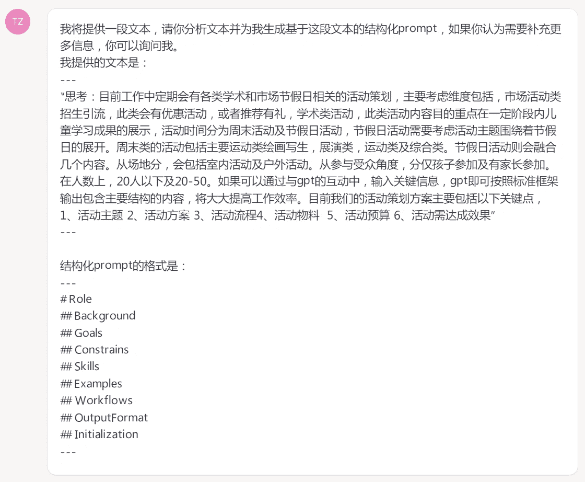

在这个例子中，

第一次我们用 --- 这样的三连符号（Markdown 中的分隔符），框起了一段参考文本。

**这是为了避免我们引用的这段参考文本，和我们本身对模**型提出的要求相互混淆，导致模型理解错误。

第二次我们用 --- 这样的三连符号，框起了一段特定格式。

**这**是为了避免我们希望模型采用的生成格式，和我们前文给出的设定和我们给出的参考文本相互混淆，导致混乱的生成结果。

我们再来看一个更容易理解的简单例子：

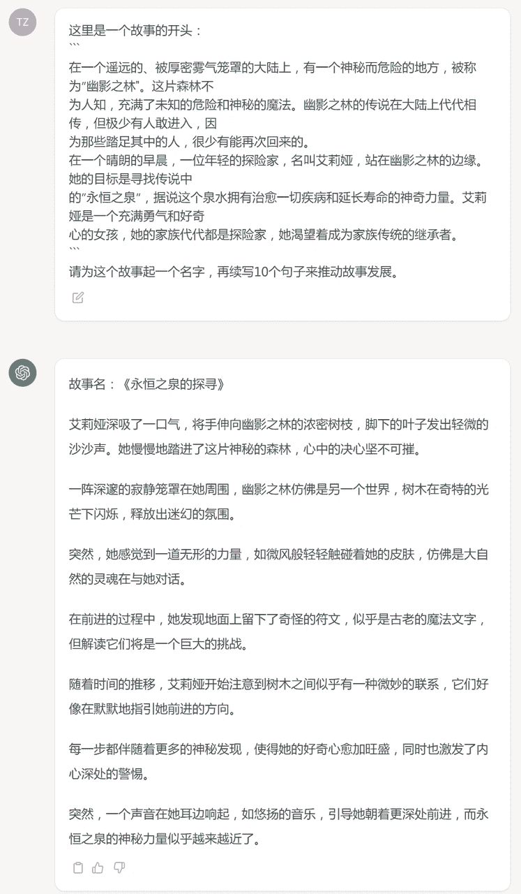

在这个例子中，我们把需要模型单独处理的任务文本用 ``` 这样的分隔符隔开，以便它清晰的区分任务文本和任务设定。

有的时候，我们也可以直接使用三引号：

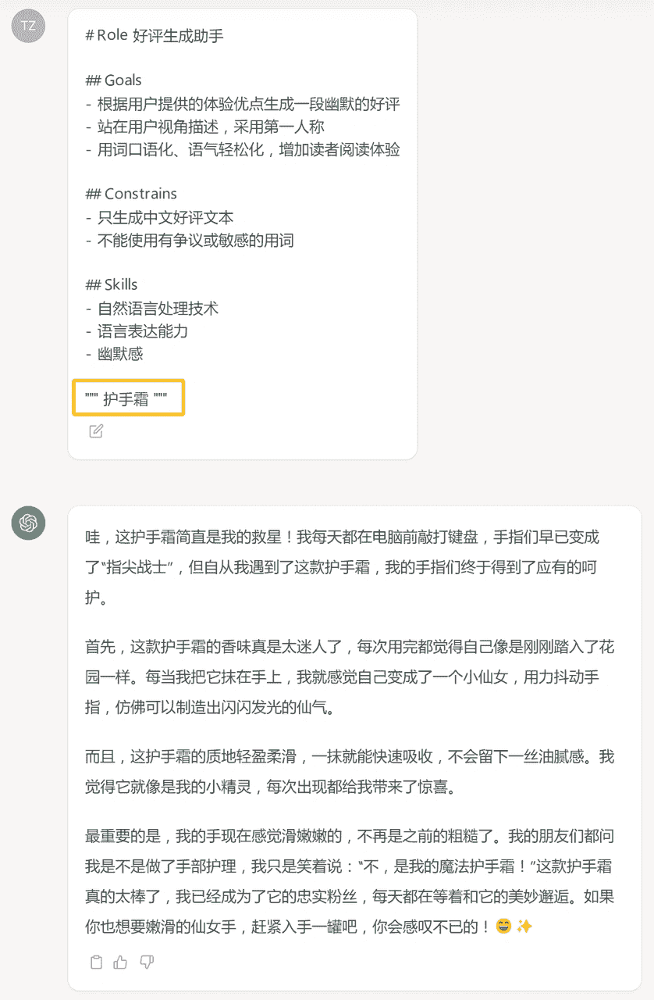

在上面这个例子中，黄色框起的部分展示了这样一种用法：我们把需要用户输入的内容简略的用分隔符区分，这样模型会基于这部分信息执行 Prompt，而不是自己生成内容。

如果我们需要 ChatGPT 理解整段 Prompt 并进行进一步的对话和操作，我们需要同时使用两个符号：

**橙色框中**是为了把这段 Prompt 单独以代码块的形式分隔出来，这样不会和我们的上下文相互混淆。

**绿色框中**是上一段落提到的三引号引文的作用。

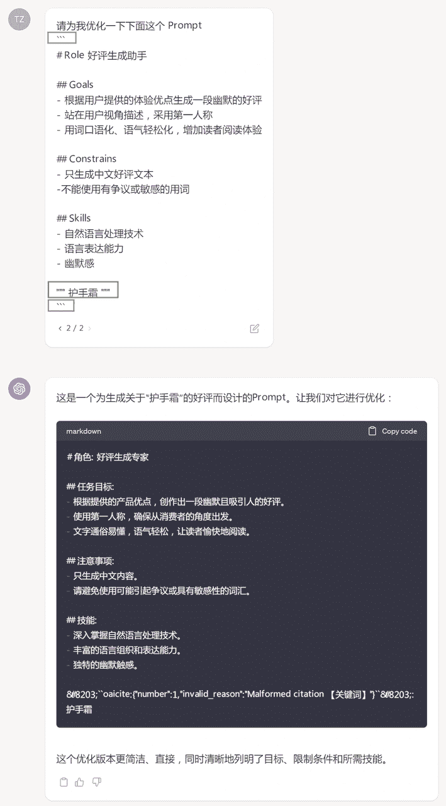

---

# 04 学习地图 | 编写清晰地说明 - 示例的重要作用

> 提供示例是一个非常有效约束生成内容的方法，如果我们能为模型提供与当前查询相关的可信信息，那么我们就可以让模型使用所提供的信息来撰写答案。

> 比如我们可以这样做：

> 我将提供一段参考文本和一个问题。

> 你的任务是：仅使用所提供的文档回答问题，并引用用于回答问题的文档段落。

如果文件中不包含回答问题所需的信息，则只需写出 "信息不足"。如果提供了问题的答案，则必须注明引用文本。

使用以下格式引用相关段落（{"引用"：...}）。

我们先来看一下这样做的效果：

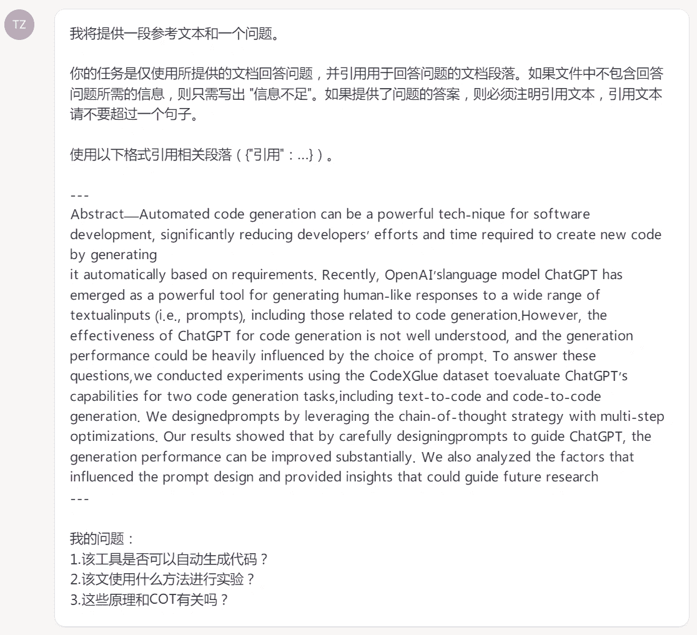

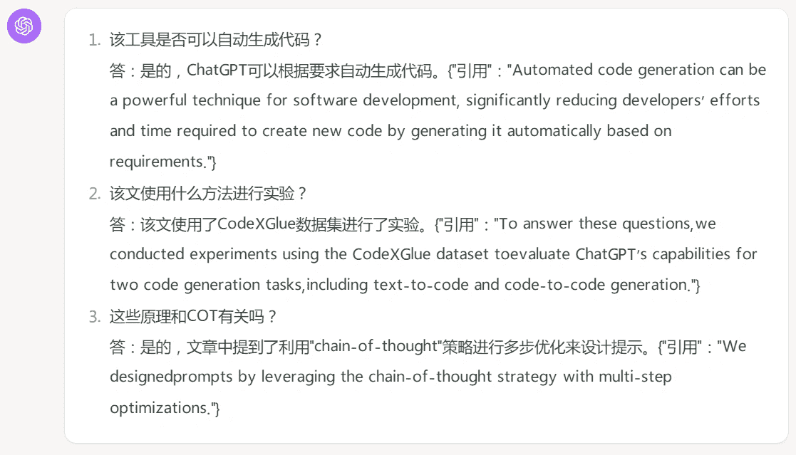

我们注意到在这个例子里，ChatGPT 非常严谨、出色的完成了任务，这源于我们提供了准确的参考文本，以及我们非常清楚的描述了我们的任务需求。

当我们继续追问参考文本中未曾提及的内容时，大模型会回答：


我们可以看到，这样做的好处是可以非常明确大模型的回答。我们对参考文本的确信可以直接引入大模型给出的回答，它也是可以确信的。

---

# 05 学习地图 | 编写清晰地说明 - 指定任务所需的步骤

有些任务最好以一连串的步骤来指定。明确写出这些步骤可以让模型更容易遵循这些步骤。

**这样做是指：**

比如你会突发奇想，让 ChatGPT 为你推理一个复杂的问题。与其直接让他告诉你推理的最终答案，不如告诉它为了完成推理，需要几个步骤去思考并生成对应的内容。这样做会大大的提升推理的靠谱程度，也有助于我们自己检查中间出现的问题。

**这样做的好处是：**

1.  **明确性**：具体的步骤可以确保模型或执行者明确知道需要做什么，避免误解或遗漏。

1.  **结构化**：步骤化的任务更加结构化，可以帮助模型或执行者按照逻辑顺序执行，确保任务的连贯性。

1.  **效率**：当任务被分解为小的、具体的步骤时，模型可以更加高效地完成每一个步骤，而不是在不确定如何进行时浪费时间。

1.  **易于监控**：明确的步骤使得监控任务的进度变得更加容易。可以清楚地知道哪些步骤已经完成，哪些步骤还没开始。

1.  **减少错误**：具体的步骤可以减少执行任务时的错误。当每一步都被明确指定时，模型更不容易犯错。

1.  **便于复查**：如果任务的结果不如预期，有了明确的步骤可以帮助我们回溯和分析问题出在哪一步，从而进行调整。

1.  **提高透明度**：对于用户来说，明确的步骤可以帮助我们理解任务的执行过程，提高工作的透明度。

**看一下实际操作的简单例子：**

当我们计算一个略微复杂的购票方案时，如果我们直接询问最终方案：

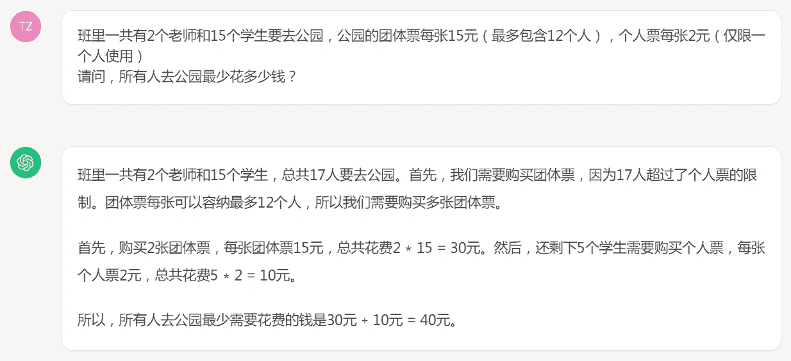

我们可以看到上文中模型给出了错误的答案。

但是当我们把计算步骤拆解的更加详细之后，我们注意到3.5依然容易计算错误，需要给出更多辅导思路才能答对问题：

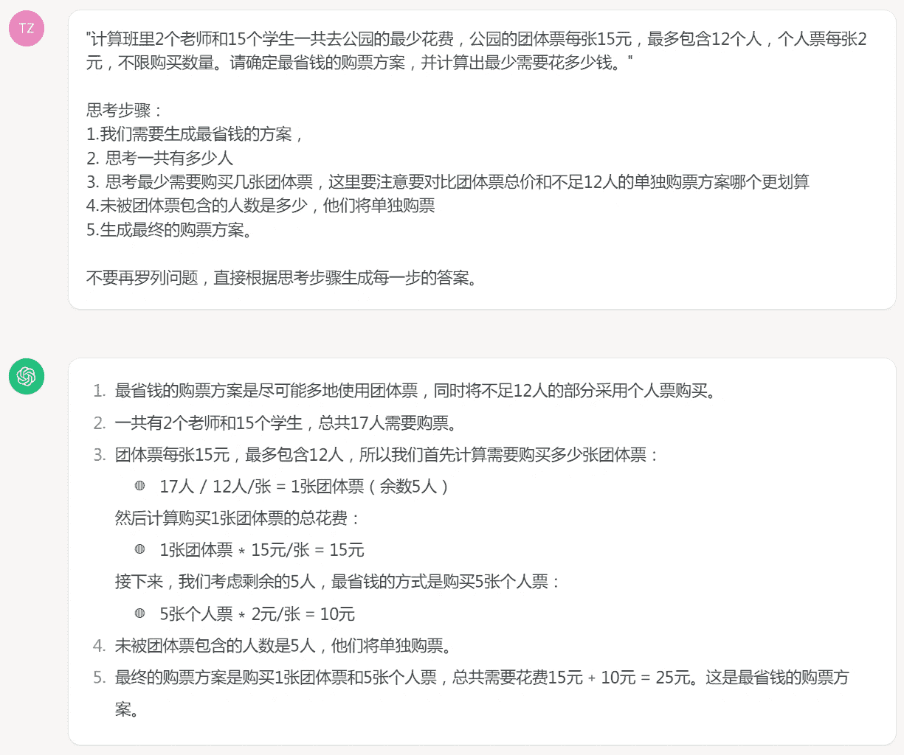

而4.0通过简单的步骤提示就能准确完成推理，它的回答也相对更加简洁明了。

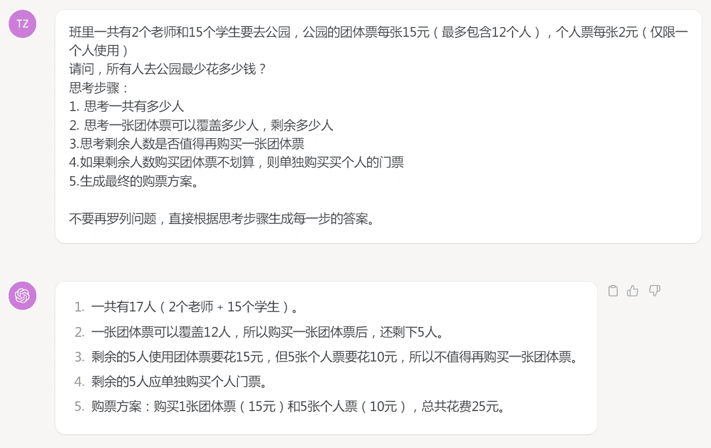

---

# 06 学习地图 | 编写清晰地说明 - 指定所需的格式/长度

我们可以要求模型生成具有给定目标长度的输出。

可以用字数、句数、段落数、要点数等来指定目标输出长度。

但要注意的是，指示模型生成特定字数的精确度并不高（尤其是对中文）。模型可以更可靠地生成具有特定段落数或要点数的输出。

**1.无中生有地生成句子：**

由于 token 计算的问题，我们往往很难让模型生成特定的精确字数，比如


在这个案例中我们可以看到，虽然我们明确要求模型输出 20 个字（中文字符），但它实际生成了 33 个中文文字，38 个中文字符（含标点）。

我们可以进一步做出更详细的约束和要求，以便它能达到我们要的效果：

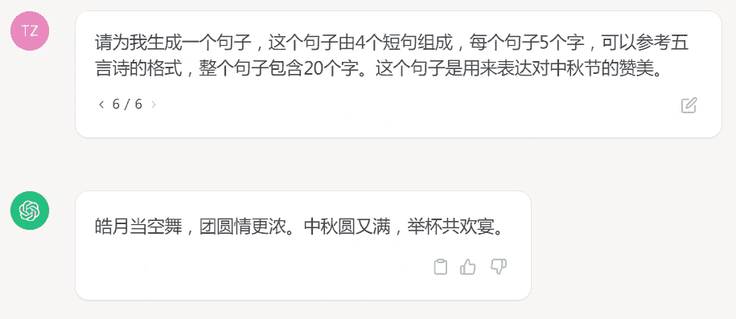

但值得注意的是，无论如何，这并不稳定。相对来说，约束句子的数量要比明确要求字数稳定很多。而相对来说，ChatGPT 4 在这一要求上的表现要比 3.5 版本 稳定多了：

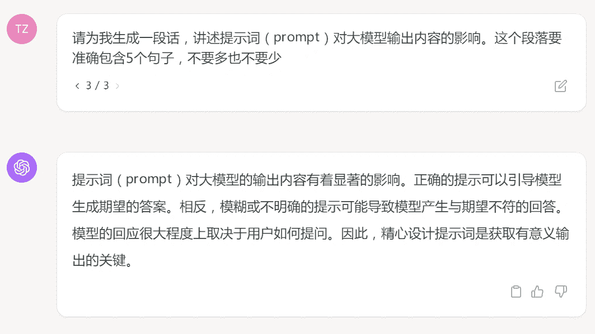

1.  **对既有文本的概括或改写：**

但是当我们提供一段明确的文本，要求模型进行概括的时候，效果要好很多，下面是一个把三引号中的内容（约200字）概括为50字的例子，它实际生成了56个字符，52个字。

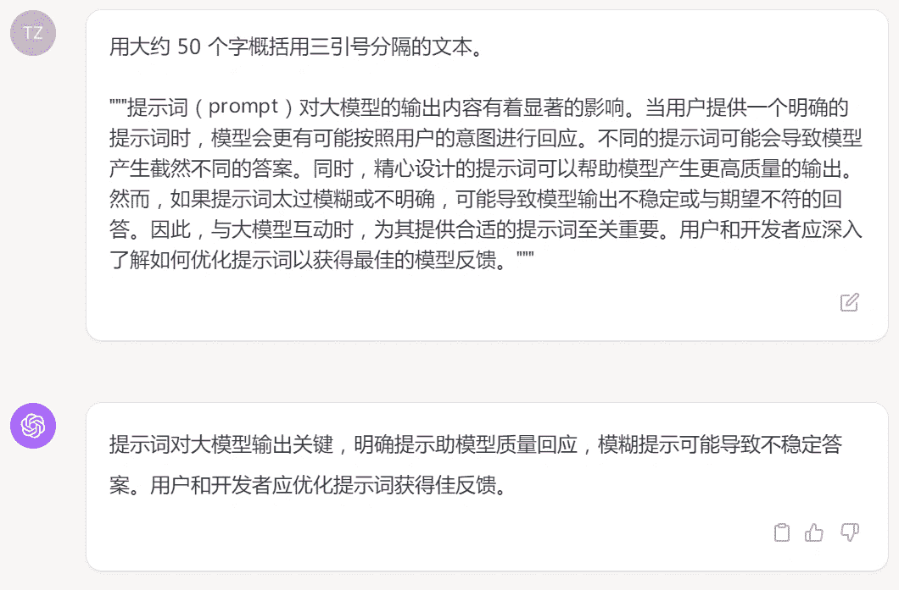

3.同样的，我们可以使用这样的提示方法：

用两个段落概括用三引号分隔的文本。

"""在此处插入文本"""

用 3 个要点概括用三引号分隔的文本。

"""在此处插入文本"""

**4.要点总结：**

我们可以明确要求模型按特定数量的字、句子、要点来生成内容。

但对于中文来说，由于字符和 token 的映射机制及中文的上下文生成机制问题，精确符合字数的生成不稳定。

但对于引用文本的概括或修改，效果相对会变得好很多。