# 小七姐：信息管理工具与方法

> 来源：[https://waytoagi.feishu.cn/docx/QyOddO3Smoc67nxzTQ3cjpaXnyd](https://waytoagi.feishu.cn/docx/QyOddO3Smoc67nxzTQ3cjpaXnyd)

> 作者：[**小七姐**](https://vxc3hj17dym.feishu.cn/wiki/RxnSw84QIiC63KkBrofc2altnuf)**         **免费知识星球：[**Prompt 星球**](https://t.zsxq.com/15KhQ0RE7)

应我学员许愿，一直想让我把自用工具全部分享出来，碍于时间拖延至今，深感歉意。

本篇文章会分享**我实践下**来觉得好用的工具以及信息管理的策略。为了让大家能更直观地了解如何使用这些工具，本文会以“拎得清、看得到、想得起、用得上”4个核心理念作为主线，贯穿整个文章的始终，将信息管理、知识体系搭建、创意捕捉与创作的内容穿插在其中。

# **拎得清**

这是信息管理的第一步，指的是主动选择信息源的能力。你需要有能力筛选出对你有价值的信息，并决定哪些信息值得你投入注意力和时间。这涉及到信息嗅探能力和选择能力，是构建知识体系的前提。

## **主动选择信息源**

这个环节强调的是主动选择信息源的能力。它要求我们具备在信息过载的时代中，必须具备信息选择能力和信息嗅探能力。不是所有信息都对我们有价值，要尽量选择那些能够带来价值、提升效率、丰富知识的信息源。

### **获取信息的方式**

#### AI 搜索引擎

在AI搜索引擎这个领域，[P](https://www.perplexity.ai/)[**erplexity**](https://www.perplexity.ai/)** **是独一档，暂时没找到其他同等水平的替代。

非常推荐利用AI搜索引擎来帮助筛选信息，通过它们智能的算法推荐，可以更快地找到所需的信息以及方法论来源。

经过3个多月的重度使用，我对国产AI搜索引擎的推荐排名如下（没错，360是断层第一，但它的能力和体验被严重低估了，有空我会单独写一篇 AI 搜索引擎测评和进阶用法科普）

1.  360 AI搜索

1.  秘塔 AI 搜索

1.  天工 AI 搜索

以下是其他感兴趣可以了解一下的其他AI搜索工具：

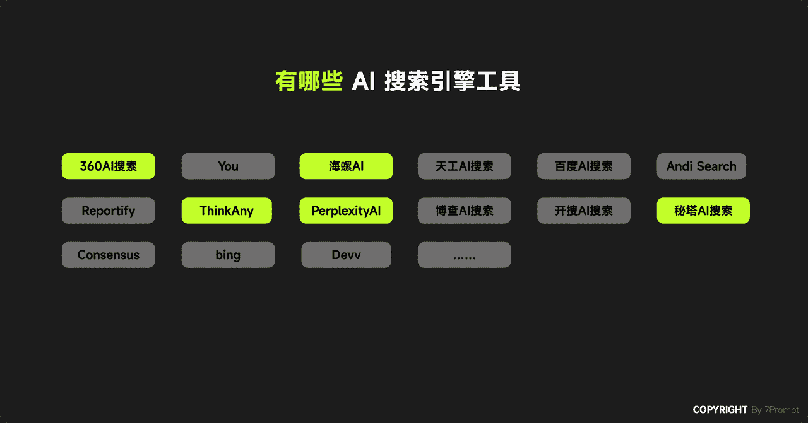

#### **优质社群：**

加入讨论质量高、内容丰富的社群，以及订阅产出高质量内容的公众号，从而建立起稳定而高效的信息获取渠道。

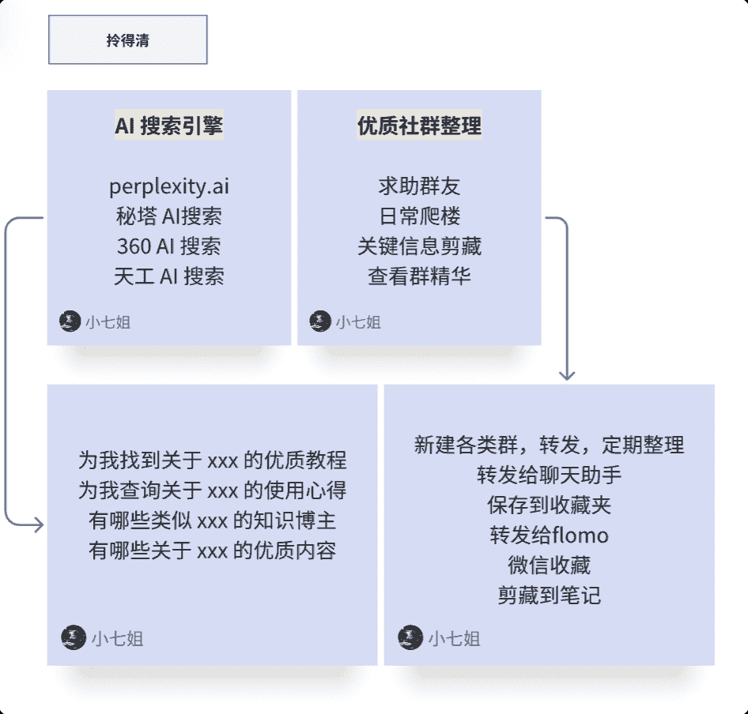

### **信息源分类**

在这个阶段，个人需要识别哪些信息源对自己来说是高质量的，并且根据触达成本的高低来决定如何分配自己的时间和资源。主动选择和有效管理不同类型的信息源。

1.  **信息质量高、触达成本低的信息源**（如优质社群、订阅号、newsletter）：

+   这类信息源通常容易获得，不需要个人投入太多的时间和金钱。

+   它们能够提供高质量的内容，帮助个人保持信息的更新和知识的积累。

1.  **信息质量高、触达成本高的信息源**（如个人博客、学术文献、书籍、聚合站）：

+   这类信息源需要更多的努力去获取，比如购买书籍、访问付费数据库或投入时间去深入阅读和研究。

+   它们往往提供更深入、更系统的知识，适合于那些需要专业深度或学术研究的场合。

### 小七姐的个人信息源

**公众号**

+   赛博禅心

+   南瓜博士

+   Web3天空之城

+   歸藏的AI工具箱

+   云中江树

+   小互

+   互联网黄叔

+   老刘说NLP

+   通往AGI之路

+   Super黄的念想

+   [值得关注的AI领域英文博主](https://vxc3hj17dym.feishu.cn/docx/IAVsdY6nvooIQGxWd6OcLEfcnuf?from=from_copylink)

**社群圈子**

+   即刻 AI探索站 [AI探索站 - 即刻App](https://m.okjike.com/topics/63579abb6724cc583b9bba9a?s=eyJ1IjoiNWIzNzQ1ZTU4OThlYTgwMDE3MmYzOTBkIiwiZCI6MX0%3D)

+   即刻笔记圈 https://web.okjike.com/topic/660165c504703c909c6d8b2e

+   你不知道的行业内幕 https://web.okjike.com/topic/5699f451d3e8351200bffdc8

+   即刻数码站 https://web.okjike.com/topic/59bdc5d8e569780011a4d791

**播客**

[值得听的7个AI播客](https://vxc3hj17dym.feishu.cn/docx/MHGedSmJyophDoxUr4HcUPMhnne?from=from_copylink)

### 常用阅读工具

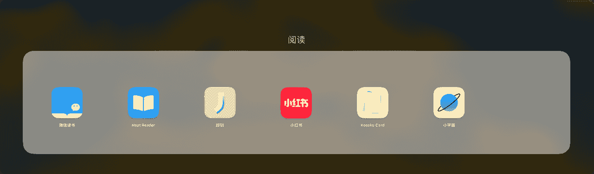

### 辅助阅读的插件

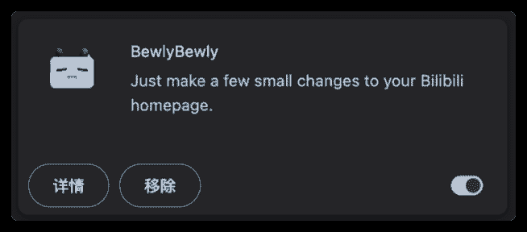

+   这是一个专为B站设计的阅读工具。如果你是一个重度的B站用户，安装这个插件后，你的B站界面会变得更加清爽整洁，同时可以屏蔽广告并提供一些美化功能。

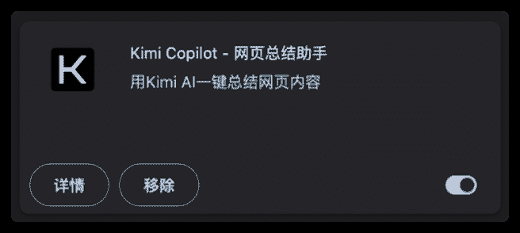

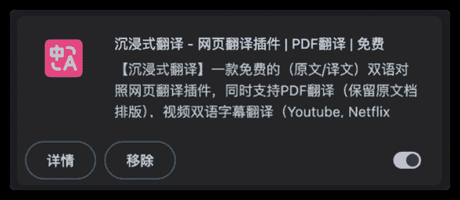

---

# 看得到

"看得到"的实现依赖于对信息源的主动管理和定期互动。

在“拎得清”的基础上，这一步强调的是确保你选择的信息能够被你频繁地看到。这意味着建立信息通路，比如订阅、关注、加入相关社群等，以便信息能够主动推送给你，或者你能够方便地访问它们。

## 搭建**信息通路**

一旦确定了这些信息源，接下来的任务便是搭建信息通路，即创建一个流程，确保你能够方便地访问和回顾你所收集的信息。

### **建立习惯**

**主动选择与被动接收**：区分信息是主动推送给你的还是需要你主动去查找的。

+   对于对于主动推送的信息，如优质社群、订阅号和newsletter，你需要确保已经建立了接收的通路，这涉及执行订阅、培养日常浏览习惯、及时剪藏重要内容。

+   对于需要主动查找的信息，如于个人博客、学术文献、书籍和聚合站，你需要有意识地定期去访问这些信息源、沉浸式地深入阅读、依靠内在的自驱力持续学习。

### **剪藏和整理**

+   当遇到有价值的内容时，使用剪藏工具或笔**记**应用保存，并进行分类整理，方便日后查找。

+   针对不同的信息源，采取合理的剪藏方式。

+   关于如何整理**优质社群信息**，有以下几种方法：

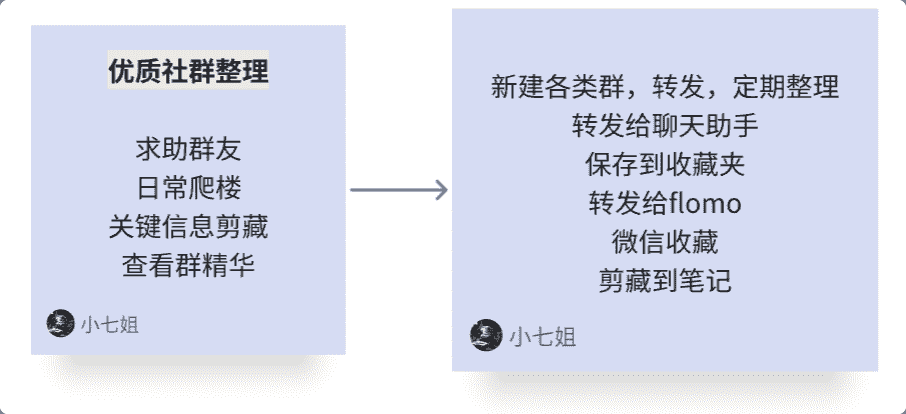

## 信息管理工具

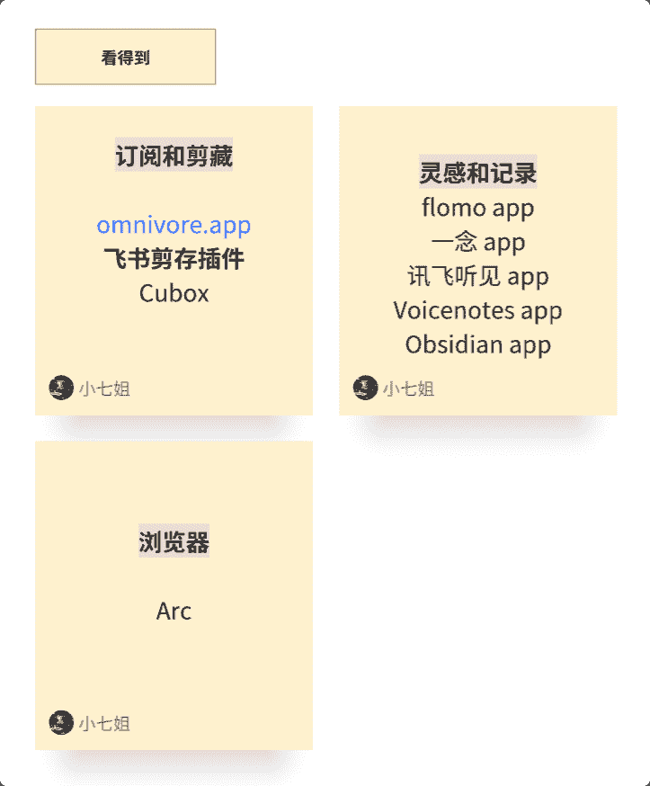

### **订阅剪藏**

1.  **Omnivore.app**：浏览器插件，能将网页内容保存到不同的笔记应用中。可以通过这个插件，将文章、链接、图片等内容一键保存到你偏好的笔记系统中，例如Notion、Obsidian等。

1.  **飞书剪存插件**：能将网页上的文本、图片和链接等内容直接剪存到飞书文档中。这个插件特别适合需要在飞书平台上进行知识管理和文档协作的用户。

1.  **Cubox**：是一个稍后阅读和内容收集的工具，它允许用户保存网页、文章和笔记，以便稍后阅读和整理。可以通过Cubox的浏览器插件或应用程序收集内容，并利用其强大的标签系统进行分类和搜索，从而方便地管理和回顾信息。

1.  **松鼠快看：**一站式管理订阅源的工具，支持公众号、up主、播客、RSS订阅源

### **灵感记录**

+   **轻量级记录工具**

+   [**Flomo**](https://flomoapp.com/)**：**一个轻便的工具，用于记录灵感、小线索和碎片化信息。它适合随时掏出手机记录下瞬间的想法，便于后续的整理和思考。

+   [**一念**](https://www.yinian.pro/#/)** ：**与Flomo的功能类似，用于记录灵感和轻量化的简单记录。

+   **语音记录工具**

+   [**讯飞听见**](https://www.iflyrec.com)：强大的语音识别功能，特别适合在移动中或不便打字时使用，快速记录口头表达的灵感。

+   [**Voicenotes**](https://apps.apple.com/cn/app/voicenotes-ai-voice-notes/id6483293628)：是iOS系统中的语音记录应用，适用于记录会议要点、灵感或任何需要语音记录的场合。

+   **知识管理和深度思考工具**

+   [**Obsidian**](https://obsidian.md/)**：**侧重于知识管理和笔记的深度整理，支持Markdown和知识链接。本地化管理笔记，不依赖网络。适合构建个人知识体系，可以在Obsidian中创建知识库，进行沉浸式写作，整理笔记和知识，支持笔记之间的链接和网络化，有助于深度思考和知识整合。

### 浏览器

+   **自用浏览器插件**

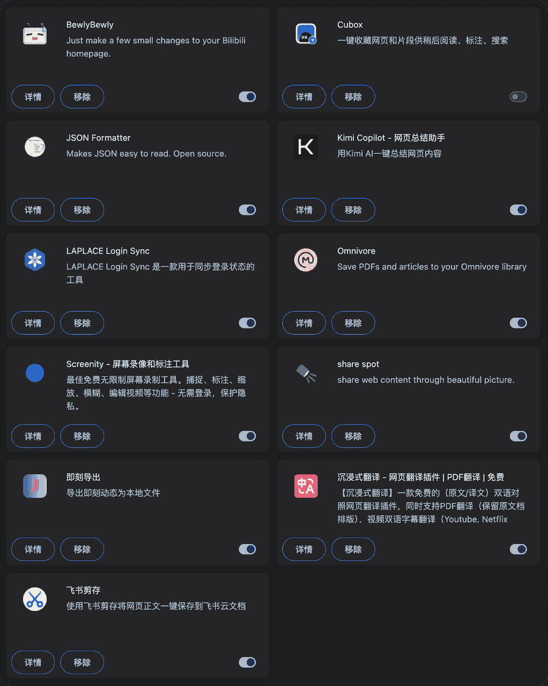

**分类汇总**

1.  **Tampermonkey：**

KeepChatGPT、ChatGPT 问题导航侧边栏、Obsidian Omnisearch、Twitter - 为用户添加备注

1.  **文章/视频/文件翻译：**

Relingo、沉浸式翻译、Trancy

1.  **AI系列：**

monica、Perplexity、glarity、kimi copilot、Elmo、AI阅读助手测试版、prefind

1.  **Chatgpt 增强：**GPTs Works、Promption

1.  **自动化系列**：Automa、Bardeen、Easy Scraper

1.  **网页导出系列**：EpubPress 、PrintFriendly

1.  **高亮/稍后读/笔记**：

cubox、Glasp、Omnivore、新枝、flomoplus

1.  **保存到 Notion 系列  **

网页剪藏 Notion Web Clipper

保存 ChatGPT DALL·E-3 对话记录到 Notion

WeSync 微信读书笔记同步notion

Save Twitter to Notion - Twitter Hunter

+   [**Arc浏览器**](https://arc.net/)

+   **工作区管理**：根据不同的工作场景创建和管理多个工作区。

+   **高频日常工具：**将日常使用最频繁的工具或网页放在一个专门的工作区，以便于快速访问。

+   **课程编写和沉浸式写作**：为特定任务（如课程编写或沉浸式写作）设置专门的工作区，其中可以放置相关的工具和资源。

+   **信息源工作区：**创建一个工作区用于信息源，如新闻网站、博客、学术资源等，以便集中管理和阅读。

+   **直播演示**：为直播准备的工作区，可以临时存放直播时需要展示的网页。

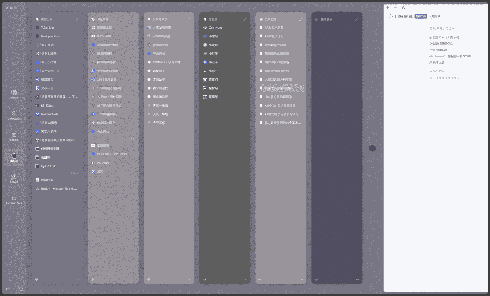

---

# **想得起**

**“想得起”这一核心理念通过系统化的方**法，将灵感和剪藏的信息有效转化为笔记、文章和知识库，形成一个有机的知识管理体系。

这一步关注的是如何在需要时能够回忆起信息。这涉及到建立知识线索，通过标签、笔记、索引等方式，使得信息在你需要使用时能够被快速检索和关联起来。

## **信息关联**

通过标签、关键词或概念将信息连接起来，形成一个易于检索和回顾的网络。

### 提示词设计笔记标签系统

一个有效的标签系统是知识管理的关键，但设计一个既全面又不过度复杂的标签体系并非易事。AI可以通过分析你的笔记内容和使用习惯，推荐合适的标签和标签结构。这种自动化的提示词功能可以帮助你更高效地管理笔记，提高检索效率。

```
基于上述内容，请为我设计一套适合快速检索的标签（tag)，可以包含三级标签。例如：
#工具/AI/文生图
#课件/python

注意：标签系统应当和笔记分类不重复，所以项目、领域、资源和存档这些分类方式不需要重复出现在tag中，tag应当提供的是另一个检索维度，请基于上文和这一原则为我设计可用的合理标签（tag）
标签格式应当符合我给出的示例。
```

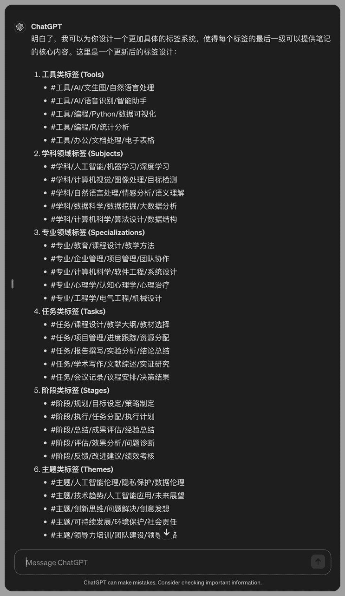

## 内化思考

定期回顾和思考所收集的信息，并通过一些系统的知识管理方法进行内化思考，将其转化为个人的理解和知识。

为了更高效地实现这一过程，我们可以借助一些成熟的方法论来指导我们的行动。下面，我会为大家介绍一套完整的知识管理系统：PARA笔记法、IOTO工作法、CODE信息管理、点线面体创作法

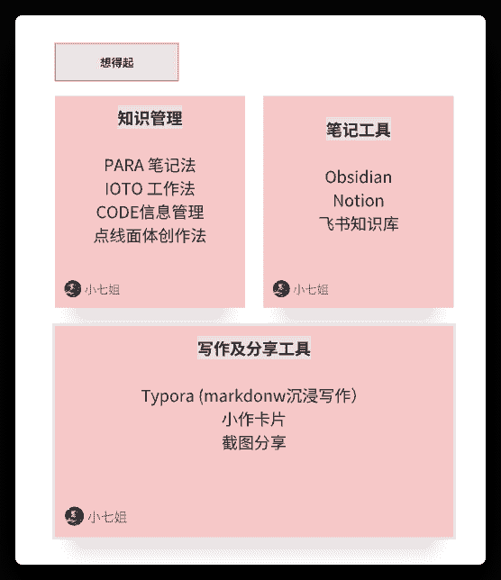

## 笔记工具

### **Obsidian**

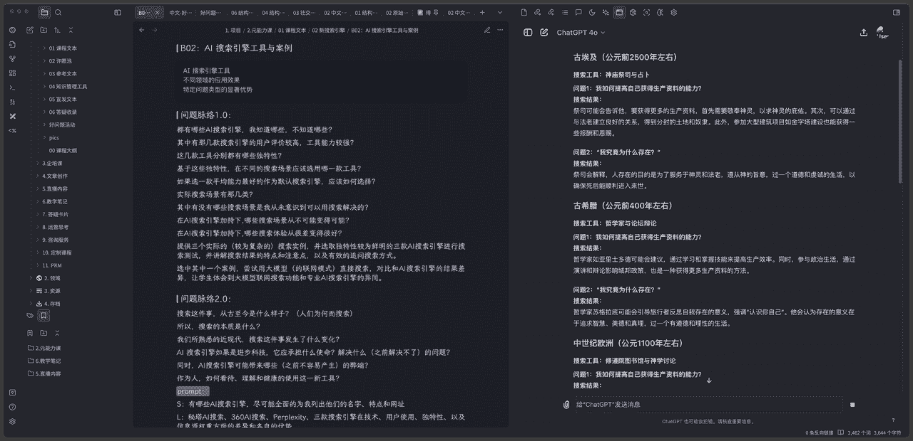

+   **侧重点：知识网络和深度思考**

+   **双向链接**：Obsidian的最大特点是支持双向链接，可以将笔记互相连接，形成一个复杂的知识网络。通过这种方式，用户可以方便地浏览和探索相关知识点。

+   **知识图谱**：内置的知识图谱功能，可以可视化笔记之间的连接关系，帮助用户发现隐藏的关联，促进深度思考和知识的内化。

+   **Markdown支持**：Obsidian完全基于Markdown格式，轻便灵活，适合写作和记录，且易于导出和迁移。

+   **本地化存储**：所有笔记和数据存储在本地，不依赖网络，保护用户隐私。

+   **高度可定制**：支持自定义CSS和插件，用户可以根据需要定制笔记界面和功能。

> **Obsidian 自用插件列表**

1.  **AidenLx’s Folder Note** - folderv component: 可选的“folderv”组件，用于 a4x-folder-note 插件。

1.  **Auto Card Link：**自动获取 URL 的元数据，并生成卡片样式的链接。

1.  **Better Footnote**: 提供 Obsidian 中的脚注弹出窗口。

1.  **BMO Chatbot**: 使用大型语言模型（LLM）生成和脑暴笔记想法。支持的模型包括 OpenAI、Anthropic、Mistral AI 等。

1.  **BRAT**: 轻松安装插件的测试版。

1.  **Code Styler**: 在编辑模式和阅读模式中自定义代码块和内联代码样式。

1.  **Copilot**: 在 Obsidian 中使用 ChatGPT。

1.  Custom Attachment Location: 使用变量（例如 $filename, $date 等）自定义附件位置，类似于 Typora。

1.  **Custom Frames**: 使用自定义样式将网页应用嵌入窗格中。也提供 Google Keep、Todoist 等预设。

1.  Editor Syntax Highlight: 在编辑器中显示代码块的语法高亮。

1.  **Excalidraw**: 编辑和查看 Excalidraw 绘图的插件。

1.  Folder Note Core: 提供文件夹笔记的核心功能和 API。

1.  Footnote Shortcut: 更快地插入和书写脚注。

1.  **Highlighter**: 提供美观的高亮菜单，使颜色编码高亮更容易，并且可以配置多种高亮颜色。

1.  **Hover Editor**: 将页面预览悬停功能转换为完整的编辑器实例。

1.  **Iconize**: 在 Obsidian 中添加图标，包括文件、文件夹和文本。

1.  **Markmind**: 用于 Obsidian 的思维导图和大纲工具。

1.  Minimal Theme Settings: 更改 Minimal 主题的颜色、字体和功能。

1.  **Style Settings**: 提供用于调整主题、插件和 CSS 代码片段变量的控制。

1.  **Surfing**: 在 Obsidian 中浏览互联网。

1.  **Tag Wrangler**: 从标签页面重命名、合并、切换和搜索标签。

1.  **Templater**: 创建和使用模板。

1.  **Text Generator**: 使用 AI 生成文本。

1.  **Vimrc Support**: 使用 Obsidian Vim 命令加载启动文件。

### **Notion **

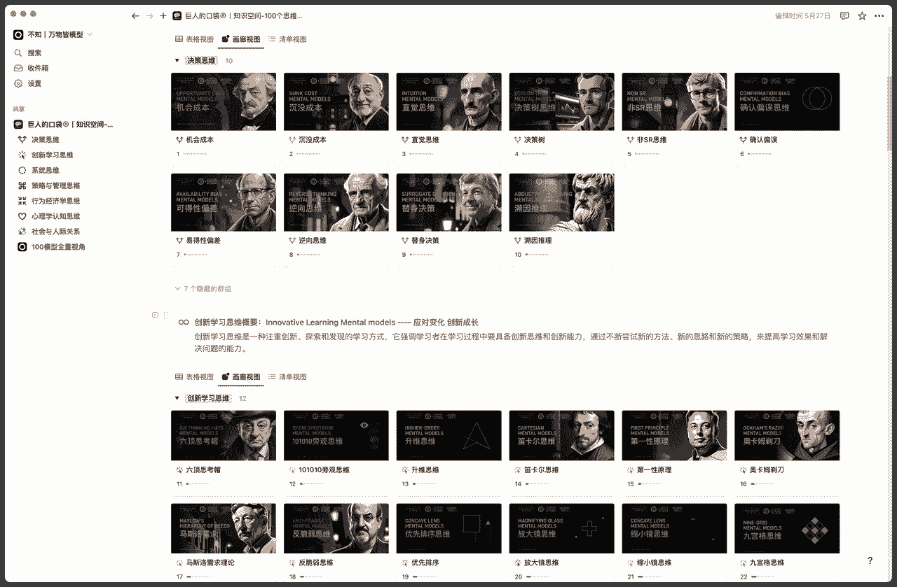

+   **侧重点：综合管理和多功能集成**

+   **数据库功能**：Notion的数据库功能强大，用户可以创建各种形式的数据库，如表格、看板、日历等，实现灵活的数据管理。

+   **多功能页面**：Notion的页面功能非常灵活，支持嵌入图片、视频、代码块等，用户可以在一个页面中集成各种类型的内容。

### **飞书知识库**

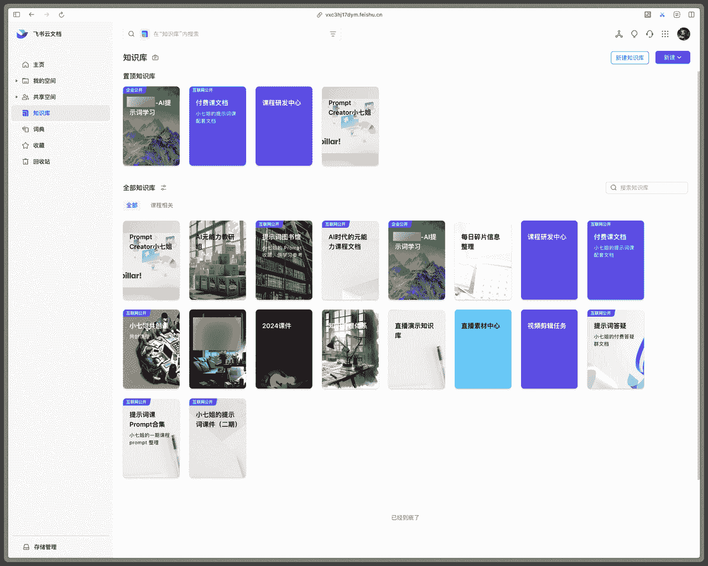

+   **侧重点：团队协作和企业级管理**

+   **集成协作**：飞书知识库与飞书的其他工具（如即时通讯、日历、云文档等）无缝集成，提供一体化的团队协作平台，适合企业级的团队合作和沟通。

+   **权限管理**：飞书知识库具有完善的权限管理功能，可以细化到每个文档和每个用户，确保信息安全和数据的可控性。

+   **云端存储**：所有文档存储在云端，便于同步和访问。

---

# **用得上**

这是信息管理的最终目的，即将收集和整理的信息应用到实际中去解决问题或创造价值。

## **知识管理的成果环节**

在知识管理体系中，"用得上" 是成果环节的一部分。通过前几个环节（拎得清、看得到、想得起）积累的信息和知识，最终要在"用得上"这个环节中得到应用。

## **形成解决方案**

我们在想得起环节通过“思考、整理、链接”，形成的知识库可能最终会导向一个解决方案，或者是一个产品，或者是一个知识型的IP，这些都是知识应用的体现。

## **知识管理的意识**

无论我们收集和整理了多少信息，如果不能在需要时有效地使用它们，那么这些信息就失去了价值。

建立一种意识，即所有收集的信息和知识都应该能够在适当的时候被“用得上”。

---

# 信息管理&知识体系构建全流程

"拎得清、看得到、想得起、用得上"是信息管理和知识体系搭建中四个核心的步骤，它们共同构成了一个高效的信息处理和应用流程。

1.  **拎得清**：这一步骤强调的是主动选择和判断信息源。首先，你需要识别并选择那些高质量、与你目标相关的信息来源。使用AI搜索引擎来帮助筛选信息，并通过加入优质社群、订阅号等方式建立信息通路。这要求个人具备信息嗅探能力，选择对自己有用的信息源，为后续的信息管理打下基础。

1.  **看得到**：在建立了信息通路之后，需要确保所选信息能够频繁且不经意地触达个人。这涉及到信息的可见性和可访问性，如通过浏览器插件、笔记工具等，将信息组织得易于检索和浏览，确保信息能够在需要时被看到。

1.  **想得起**：这一步骤强调信息的内化和知识线索的建立。这一步骤是关于信息的索引和关联。当你保存信息时，要考虑到未来如何能快速回忆起它，这要求在存储时做好标记（关键词、tag）、选择合适的存放位置等。推荐使用PARA笔记法、IOTO工作法、点线面体创作法等方法来组织和串联信息，形成易于回忆和应用的知识结构。

1.  **用得上**：最终目标是将积累的知识转化为实际行动和成果。当需要解决问题或创造价值时，能够从知识库中调取相应信息，形成解决方案、产品、文章或个人生活指导等。这意味着知识不再是静态的存储，而是动态的应用于具体情境中，实现知识的价值转化。这一步将信息管理的成果落实到具体产出上，体现了知识的实践意义。

🏗 知**识体系搭建：**

+   **信息源的选择**：在搭建知识体系时，首先要明确自己的需求和兴趣点，选择与之相关的信息源，确保信息的质量与相关性。

+   **信息通路的建立**：通过各种工具和方法，如浏览器插件、笔记应用等，建立稳定的信息获取和存储机制，确保信息能够顺畅地流入知识体系。

+   **知识结构化**：使用不同的笔记方法和工具，将收集的信息进行分类、标签化和链接，形成结构化的知识体系，便于检索和应用。

+   **知识内化与应用**：通过定期的复习、思考和实践，将外部信息转化为个人知识，并在实际工作和生活中应用这些知识，解决具体问题。

这篇文章从理论到工具，展示了如何信息管理和知识体系搭建的过程，从信息的筛选、组织、内化到应用，形成了一个闭环，希望能帮助你更有效地管理和利用信息，提升个人的知识管理能力。

---

# 自用 MAC 软件

## 插件和工具

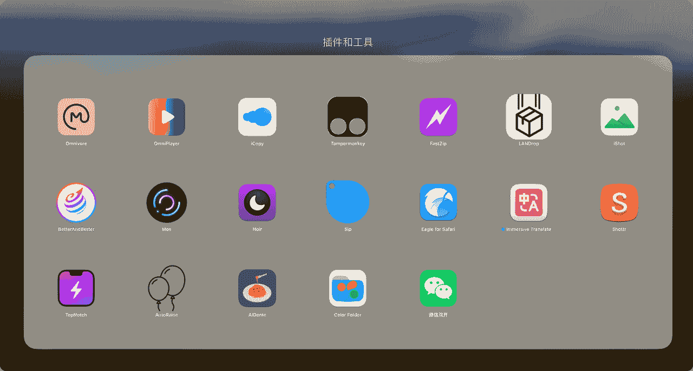

## 课程制作

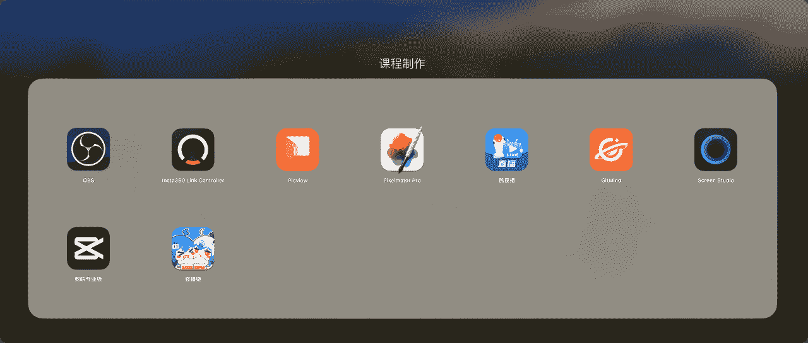

## 写作

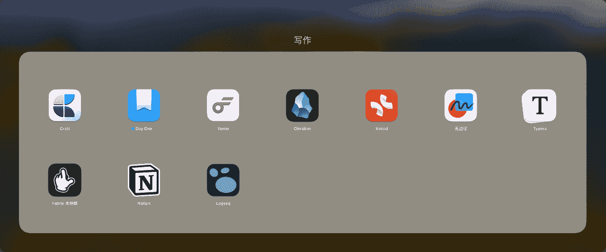

## 阅读

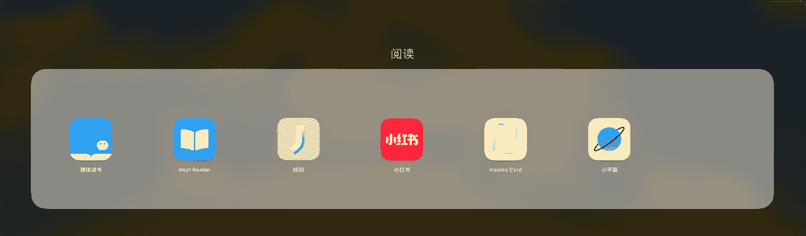

## 系统

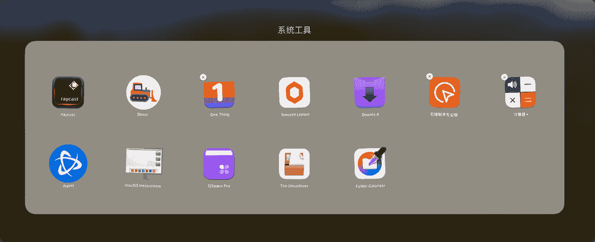

本文是直播的文字稿，直播回放：

<https://player.bilibili.com/player.html?bvid=1Uf421R723&spm_id_from=333.999.0.0>