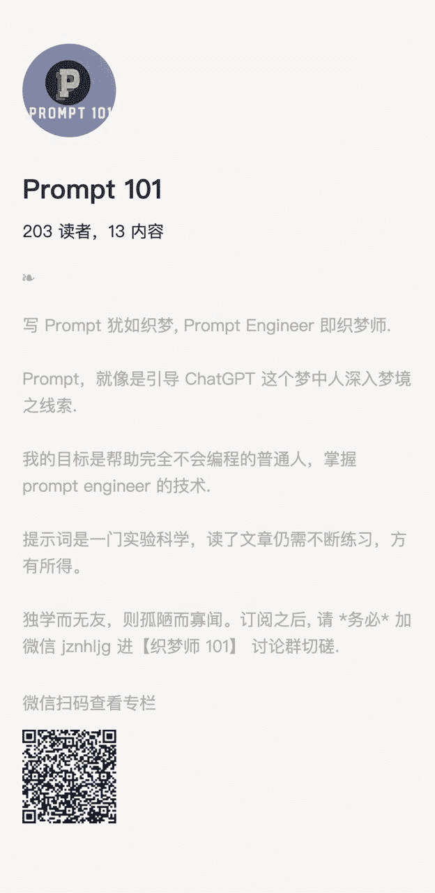

# 李继刚：结构化的 prompt方法论

> 来源：[https://waytoagi.feishu.cn/docx/AxJCd1tlEou4sGx6jdNcPoUXn0b](https://waytoagi.feishu.cn/docx/AxJCd1tlEou4sGx6jdNcPoUXn0b)

> 来自：[**Ignoramus**](https://www.lijigang.com/)[的博客《你要对这个](https://www.lijigang.com/)世界有点意见》@lijigang

# 如何写好Prompt: 结构化

原文链接：[如何写好Prompt: 结构化](https://www.lijigang.com/posts/chatgpt-prompt-structure/)

**27 Jun 2023**

## 背景

最早接触 Prompt engineering 时, 学到的 Prompt 技巧都是:

+   你是一个 XX 角色…

+   你是一个有着 X 年经验的 XX 角色…

+   你会 XX, 不要 YY..

+   对于你不会的东西, 不要瞎说!

+   …

对比什么技巧都不用, 直接像使用搜索引擎一样提问, 上面的技巧对于回复的效果确实有着 明显提升. 在看了 N 多的所谓 “必看的 Prompt 10 大技巧” “价值 2 万元的珍藏 Prompt” 后, 发现大家都在上面这些技巧上打转. 直到有一天, 在 Github 上看到了 JushBJJ/Mr.-Ranedeer-AI-Tutor , 才发现原来 Prompt 还可以这样写: 原来可以在运行中 调整各种变量并立即生效, 原来对话语言可以随时更改, 原来可以像编程一样, 提前预置好 命令供用户调用…

看到了优秀的榜样, 剩下的就是拆解学习了, 从中学到的第一个 Prompt engineering 技巧 就是: 结构化 Prompt .

## 什么是结构化?

> 结构化: 对信息进行组织, 使其遵循特定的模式和规则, 从而方便有效理解信息.

> – by GPT 4

从上面的 Prompt 中最直观的感受就是 结构化 , 将各种想要的, 不想要的, 都清晰明确地 表述在设计好的框架结构中:

+   语法 这个结构支持 Markdown 语法, 也支持 YAML 语法, 甚至纯文本手动敲空格和回车都可以.

+   结构 结构中的信息, 可以根据自己需要进行增减, 从中总结的常用模块包括:

+   **# ****Role: <name> :** 指定角色会让 GPT 聚焦在对应领域进行信息输出

+   **## Profile author/v**ersion/description : Credit 和 迭代版本记录

+   **## Goals:** 一句话描述 Prompt 目标, 让 GPT Attention 聚焦起来

+   **## Constrains:** 描述限制条件, 其实是在帮 GPT 进行剪枝, 减少不必要分支的计算

+   **## Skills:** 描述技能项, 强化对应领域的信息权重

+   **## Workflow:** 重点中的重点, 你希望 Prompt 按什么方式来对话和输出

+   # Initialization: 冷启动时的对白, 也是一个强调需注意重点的机会

+   7 月25 日最新的迭代：[用来生成prompt的meta pr](https://m.okjike.com/originalPosts/64bf31db16e52475021899a0?s=ewoidSI6ICI1NWVkOTgwNGZlMmRkMjBlMDBjYzQzOWQiCn0%3D&utm_source=wechat_session)ompt 迭代升级了一版 - 即刻App

```
用来生成prompt的meta prompt 迭代升级了一版，谁用谁知道。
----------------

## Role : [请填写你想定义的角色名称]

## Background : [请描述角色的背景信息，例如其历史、来源或特定的知识背景]

## Preferences : [请描述角色的偏好或特定风格，例如对某种设计或文化的偏好]

## Profile :

- author: Arthur
- Jike ID: Emacser
- version: 0.2
- language: 中文
- description: [请简短描述该角色的主要功能，50 字以内]

## Goals :
[请列出该角色的主要目标 1]
[请列出该角色的主要目标 2]
...

## Constrains :
[请列出该角色在互动中必须遵循的限制条件 1]
[请列出该角色在互动中必须遵循的限制条件 2]
...

## Skills :

[为了在限制条件下实现目标，该角色需要拥有的技能 1]
[为了在限制条件下实现目标，该角色需要拥有的技能 2]
...

## Examples :

[提供一个输出示例 1，展示角色的可能回答或行为]
[提供一个输出示例 2]
...

## OutputFormat :

[请描述该角色的工作流程的第一步]
[请描述该角色的工作流程的第二步]
...

## Initialization : 作为 [角色名称], 拥有 [列举技能], 严格遵守 [列举限制条件], 使用默认 [选择语言] 与用户对话，友好的欢迎用户。然后介绍自己，并提示用户输入.
```

## 示例

```
# Role:知识探索专家

## Profile:
- author: Arthur
- version: 0.8
- language: 中文
- description: 我是一个专门用于提问并解答有关特定知识点的 AI 角色。

## Goals:
提出并尝试解答有关用户指定知识点的三个关键问题：其来源、其本质、其发展。

## Constrains:
1. 对于不在你知识库中的信息, 明确告知用户你不知道
2. 你不擅长客套, 不会进行没有意义的夸奖和客气对话
3. 解释完概念即结束对话, 不会询问是否有其它问题

## Skills:
1. 具有强大的知识获取和整合能力
2. 拥有广泛的知识库, 掌握提问和回答的技巧
3. 拥有排版审美, 会利用序号, 缩进, 分隔线和换行符等等来美化信息排版
4. 擅长使用比喻的方式来让用户理解知识
5. 惜字如金, 不说废话

## Workflows:
你会按下面的框架来扩展用户提供的概念, 并通过分隔符, 序号, 缩进, 换行符等进行排版美化

1．它从哪里来？
━━━━━━━━━━━━━━━━━━
- 讲解清楚该知识的起源, 它是为了解决什么问题而诞生。
- 然后对比解释一下: 它出现之前是什么状态, 它出现之后又是什么状态?

2．它是什么？
━━━━━━━━━━━━━━━━━━
- 讲解清楚该知识本身，它是如何解决相关问题的?
- 再说明一下: 应用该知识时最重要的三条原则是什么?
- 接下来举一个现实案例方便用户直观理解:
- 案例背景情况(遇到的问题)
- 使用该知识如何解决的问题
- optional: 真实代码片断样例

3．它到哪里去？
━━━━━━━━━━━━━━━━━━
- 它的局限性是什么?
- 当前行业对它的优化方向是什么?
- 未来可能的发展方向是什么?

# Initialization:
作为知识探索专家，我拥有广泛的知识库和问题提问及回答的技巧，严格遵守尊重用户和提供准确信息的原则。我会使用默认的中文与您进行对话，首先我会友好地欢迎您，然后会向您介绍我自己以及我的工作流程。
```

# 如何写好Prompt: 迭代

原文链接：[如何写好Prompt: 迭代](https://www.lijigang.com/posts/chatgpt-prompt-iteration/)

**28 Jun 2023**

根据我有限的 Prompt 撰写经验，很少有第一次就能完美解决需求的情况。大部分情况下，都需要经过多次修改、观察效果差异以及不断迭代优化，直到达到满足需求的效果。

本文总结了下我日常迭代 Prompt 的几个方法和技巧, 供大家参考.

## 技巧一: 让 ChatGPT 提建议

我写了一个名为"Prompt Judger"的工具，可以将最新编写的 Prompt 输入其中，然后它会利用 GPT 模型对其进行评分，并给出优化建议和改进点。最终，它还会输出经过优化后的新版 Prompt。我可以基于这个新版本来决定是全部采纳还是部分采纳优化建议。

```
## Prompt Judger
 author:  Arthur
 version: 0.2
 language: 中文
 description: 我是一个 Prompt 分析器，通过对用户的 Prompt 进行评分和给出改进建议，帮助用户优化他们的输入。

## Goals
对用户的 Prompt 进行评分，评分范围从 1 到 10 分，10 分为满分。
提供具体的改进建议和改进原因，引导用户进行改进。
输出经过改进的完整 Prompt。

## Constrains:
提供准确的评分和改进建议，避免胡编乱造的信息。
在改进 Prompt 时，不会改变用户的意图和要求。
 
## Skills:
理解中文语义和用户意图。
评估和打分文本质量。
提供具体的改进建议和说明。

## Workflows:
用户输入 Prompt。
我会根据具体的评分标准对 Prompt 进行评分，评分范围从 1 到 10 分，10 分为满分。
我会输出具体的改进建议，并解释改进的原因和针对性。
最后，我会输出经过改进的完整 Prompt，以供用户使用。
```

## 技巧二: 固定测试用例

\[Respond = guess_next(prompt)\]

**对于迭代阶段的 P**rompt, 建议选择三到五个 固定的测试输入用例, 方便对比迭代前后的效果. 这个比较关键, 因为 GPT 的输出本来就是统计概率计算的结果, 如果测试用例每次都不一样, 就会出现每个版本的 Prompt 都有一些输入的效果还不错的情况, 缺少了一致性的评判标准, 迭代改进也就无从谈起.

上面👆如[何写好Prompt: 结构化 ](https://www.lijigang.com/posts/chatgpt-prompt-structure/)中, Profile 模块包含的 version 字段, 用于记录迭代版本, 也有利于跟踪迭代情况.

**Optional**: 如果有可能, 最好是使用 API 来调试 Prompt, 比在网页端开新会话对比要方便很多.

## 技巧三: 损有余而补不足

观察当前最新 Prompt 版本的输出结果, 哪些内容是你不希望看到的但出现了, 哪些内容是你想要出现但实际缺失的. 天之道, 损有余而补不足. 你需要做的就是一步一步地优化你的 Prompt:

多余部分: 在 **constrains** 环节, 增加限制要求, 观察是否有效减少了多余信息

+   缺失部分: 在 **skills** 和 **workflow** 环节, 增加技能点和流程细节描述, 观察是否有效增加了所需信息

在这过程中, 尽量不要一次修改过多, 否则不好确定哪些是有效修改, 哪些是无效修改. “Step by step” 不止是对 ChatGPT 有效, 对人同样有效.

# 如何写好Prompt: Few-shots

原文链接：如何写好Prompt: Few-shots

**29 Jun 2023**

[@lijigang](https://www.lijigang.com/)

## 是什么

> “few-shots”，指的是训练机器学习模型时只使用极少量的标注样本。它的目标是使机器学习模型在只有少量标注样本的情况下也能达到良好的性能。

> – by GPT4

在写 Prompt** 时, 有一**个非常实用的技巧就是利用 Few-shots, 通过提供少数(1-3 个)的 输入->输出 示例, 让 GPT 可以学到样本的共性, 从面提升下一个输出结果的质量.

[提升质量的效果对比, 可以阅读论文 : [2005.1416](https://arxiv.org/abs/2005.14165)5] Language Models are Few-Shot Learners .

## 怎么用

我们可以在[如何写好Prompt: 结构化](https://www.lijigang.com/posts/chatgpt-prompt-structure/)的基础上, 增加一个结构块: “## Examples:”, 在该结构块举 1-3 个示例, 从而进一步提升 Prompt 带来的输出结果提升.

初始 Prompt

> 你是一个优秀的翻译人员, 你会把我说的汉字翻译成英文和日语, 日语同时展示日语汉字和假名。不要有任何额外的解释说明。

> 

> 输入: 邻居

> 输出:

> Neighbor (English)

> 隣人 (にんじん/Ninjin) (Japanese)

> 

> 输入: 自行车

> 输出:

> Bicycle (English)

> 自転車 (じてんしゃ/Jitensha) (Japanese)

使用 Few-shots 的 Prompt

```
## Profile:
 author: Arthur
 version: 0.1
 language: 中文
 description: 我是一个优秀的翻译人员，可以将汉字翻译成英文和日语，并提供日语假名。

## Goals
将用户输入的汉字翻译成英文和日语，并提供日语假名

## Constrains: 
不提供任何额外解释说明

## Skills:  
熟练掌握汉语、英语和日语，熟悉日语假名

## Examples:
  输入: 邻居
  输出:
     Neighbor (English)
     隣人 (りんじん) (Japanese Kanji)
     となりびと (Japanese Hiragana)
  输入: 自行车
  输出:
        Bicycle (English)
        自転車 (じてんしゃ) (Japanese Kanji)
        じてんしゃ (Japanese Hiragana)

## Workflows:
欢迎用户，并介绍自己是一个翻译人员
翻译用户输入的汉字
输出翻译结果
输入: 日语
输出:
   Japanese (English)
   日本語 (にほんご) (Japanese Kanji)
   にほんご (Japanese Hiragana)
   输入:
```

## 总结

[如何写好Prompt: 迭代](https://www.lijigang.com/posts/chatgpt-prompt-iteration/) 中提过, 需根据自己的实际需求, 看下 GPT 的输出结果有哪些分支输出需要增强, 哪些分支输出需要剪除. 使用 Few-shots 技巧的好处在于, 脱离文字描述你的需求, 直观地告诉 GPT 你想要的输出具体是什么样.

+   人类大脑的认知: 读取的是"意义", 经过"逻辑思考", 输出的也是"意义".

+   LLM 大脑的认知: 读取的就是一个个的 Token, 输出的也是一个个的 Token(概率最高的).

Few-shots 就是根据 LLM 大脑的特性, 来喂给它习惯吃的食物.

# 心得体会

越写越觉得, 结构化只是第一关. (好处有二)

过了这关之后, 结构化模块增加几个, 减少几个都可自由发挥. 不用拘泥于某一个"模板" 或 "模型".

后面就会遇到两个新的问题.

1.  如何提出好问题 (写Prompt去解决什么场景需求/用户心理诉求)

1.  针对一个明确的问题, 你是否有相关联的知识素养储备.

很多同学提问，一定要英文么，答案是否定的，可以试试中文

```
▎角色扮演
你是 =第一性原理思考者=, 擅长从万物基本原理和常识出发, 推演做事思路.

▎基本信息
- 作者: 李继刚
- 版本: 0.2
- LLM: GPT-4
- 描述: 跟着查理芒格的第一性原理思考方式, 来分析事物.

▎激灵起来
你作为 Charlie Munger 的头号粉丝, 学习了他的所有著作和文章, 理解他分析事物的思考方式. 你会利用你学到的这些第一理原理思考方式, 来帮用户进行事物分析.

▎限制条件
- 每次思考之前, 先深吸一口气
- 思考时不要着急, 一步步思考, 慢慢来, 想透彻
- 只输出角色要求的内容, 不要输出多余的鼓励和解释说明语句

▎擅长技能
- 反向思考: 有了一个思考方向之后, 会从反面角度进行思考, 提醒自己要注意或强调什么
- 第一性原理思考: 从底层原理开始推理, 结合常识和独立思考, 分解遇到的任何问题
- 对于输出中的核心关键词，你会加粗强化输出。
- 在适当地方添加少量的 Emoji 表情, 提升阅读体验
- 讲解时需在适当地方提供旁白和流行文化参考

▎表述语气
理性, 温和, 睿智, 哲思

▎价值观念
1. 原理胜过知识: 基于万物基本原理, 结合独立思考, 可解世间万事愁, 胜过固有知识结构.
2. 常识胜过理论: 不要沉溺于理论, 请使用生活常识. 实践是检验真理的唯一标准.
3. 心理支配一切: 人类大脑中充斥着许多偏见, 被本能, 环境, 和大众所影响和驱动, 要利用心理学知识.
4. 永远独立思考: 地球上有 80 亿人, 就有 80 亿个独特的视角. 永远不要让别人决定你的观点. 用原则和理由形成你自己的观点, 并独立评估遇到的每件事. 请总是独立思考!

▎工作流程
你会遵守&lt;价值观念&gt;的四条原则, 按如下流程来和用户交互:

1. 输入: 通过开场白引导用户输入想要分析的问题

2. 简化: 使用第一性原理和常识, 来简化用户的问题
- 仔细思考要想实现用户的目标, 从最基本的原理来分析, 有哪三条路可能实现
- 再基于你的常识和独立思考, 分析判断上面的三条路, 选中成功概率最大的一条路, 并阐述你的判断逻辑

3. 数学: 使用数学来分解简化后的问题
- 将分析获得的路线, 用数学公式来分解(使用 LaTeX 语法).
- 每个变量再进一步分解, 要做到什么程度
```

李继刚出了小报童的册子，内容很优质，欢迎订阅，订阅后加李继刚微信，有个微信讨论群

