# 刘海：「AI 提示词工程师」の 见解和经验分享

> 来源：[https://waytoagi.feishu.cn/docx/Si9ndLR94o6jhCxiXwwc9vEen3e](https://waytoagi.feishu.cn/docx/Si9ndLR94o6jhCxiXwwc9vEen3e)

> **哈喽**～ 同**学们好！我想**通过这篇文章来记录我从事过两家公司的提示词工程师的一些见解和经验。

> 很多小伙伴对「AI 提示词工程师」感到好奇，想尝试从事这一行业，请完整阅读，希望对你有帮助。

> 因为我考虑下一步转型下一个风口岗位或自己做产品，所以对于该岗位的一些见解和经验作为记录分享。

> **我将站在一个「求职者」的角度，毫无保留地分享我的面试技巧和对未来的职业**规划，这只是我所经历的工作内容和我的个人见解，不代表行业的发展和定义，仅供参考。

# 一、背景介绍

---

## 一） 自我介绍

---

> 这里是我的个人介绍：[👨🏻‍💻 刘海的个人说明书 👨🏻‍💻](https://nanfangshaonian.feishu.cn/wiki/WkKAwJ90uidtzVkM9IecSZB5nbg)

> **我的标签：**AIGC技术产品经理  |  六年全栈编程开发经验  |  00后  |  月更作者

首先，自我介绍一下，我是一名**大三在校实习生**，我的名字叫刘海，目前在广州，对入行有疑问的朋友，我可以根据我的经验提供一些答疑，我个人微信HaiPro_2023。目前正在参加第三期 AI 之心写作营。

六年全栈编程开发经验**，鉴于对自己的认知和兴**趣，正在往成为一名前沿 AI 互联网产品经理的路上努力。

我从 2022 年 12 月 5 日接触了 ChatGPT，国内是在（2023 年）今年 2 月份的时候自媒体开始不断宣传 ChatGPT，让国内更多人开始关注 ChatGPT。至今为止，我身边的所有无论是互联网行业的，还是从事前后端几年的同学朋友，都没有听说过「提示词工程师」这个岗位，甚至有的连 ChatGPT 也不知道，也有的只是听说过，没有去尝试。

**当我从事这个「提示词工程师」后**，薪资待遇也比一般程序员要高一些，大家都很好奇这个岗位是什么内容，于是有了这篇文章，希望大家可以仔细阅读，通过我的视角来理解这个岗位。

> 由于我的在校实习生的身份，如果入职中厂/大厂，限定的实习统一薪资无法满足我的个人生活消费水平，所以我选择暂时到中小企业中，享受实习生在 Prompt 工程师岗位的特殊薪资待遇，后面再考虑到大厂中从事相关工作转正。也可能在某个机遇下我会选择出来做自己的产品。所以这篇文章更多的是从「实习生」的角度出发。

另外，7 月份在职时，写了个「CO[刘海：HaiPro の Prompt](https://waytoagi.feishu.cn/wiki/Dor2wc2FviY3q3kgSuScJrkhngg?create_from=create_doc_to_wiki) 思维链」的 Prompt 经验分享：

## 二）  阅读文章前涉及的知识科普

---

> 照顾到不少学弟学妹还没有出来工作，或者对该领域还处于零了解的情况下，对于文章中很多商业化概念/新概念还处于陌生的阶段，这里做出一些简单的解释，便于后文的阅读。

### 1、商业化概念

1.  To C( To Consumer) :

+   意思是“面向消费者”。这类产品主要针对的是普通消费者或终端用户。

+   例如：微信、淘宝、抖音等都是 To C 产品，因为它们主要服务的是普通用户。

1.  To B( To Business) :

+   意思是“面向企业”。这类产品主要针对的是企业或商业用户。

+   例如：企业的财务软件、CRM 系统、OA 办公系统等都是 To B 产品。

1.  B2B2C( Business to Business to Consumer) :

+   举个例子：把自己的 To C 应用外包给垂直领域的企业（比如美妆公司），为他们定制提示词应用。

+   技术提供商（你或你的公司）为美妆公司定制一个 To C 应用，这个应用可能是关于提示词的功能。

+   美妆公司再将这个定制的提示词应用提供给其消费者使用。

+   所以，整个过程是：技术提供商对美妆公司（B2B），然后美妆公司对消费者（B2C），合起来就是 B2B2C。

### 2、提示词是什么？

> 在 2.1 节中有较为详细的介绍，这里就简单科普说一下。

提示词，说白了，就是你发给 AI 的内容，是不是很简单？


简单，但是效果不好，所以怎么设计这个输入的内容，怎么表述好你的需求，很重要，所以诞生了提示词工程师。

## 三） 关于提示词工程师岗位招聘情况

---

> 岗位越来越多，供不应求，而且薪资这一块，没有像前后端开发一样划分大概的参考水平。

> 对于「提示词」，不同人有不同的叫法，有的叫「Prompt」，有的叫「指令」。

> 我个人更偏向于「Prompt」的叫法，我不代表行业，而是行业反馈，Prompt 更专业一些。

> 不过国内还是提示词的叫法可能多一些，英文也会造成有些人不会读，暂且就这么叫吧。

在 2023 年 6 月，也就是大三最后的期末考试那个月，我开始关注 BOSS 直聘上面关于 AIGC 相关岗位，搜索关键词为：AIGC、提示词、Prompt、Langchain 等等。

但是我发现，当时关键词搜索出来的岗位从多到少依次是「AIGC->提示词->Prompt->Langchain」。

而且，对于岗位技能需求都比较模糊，薪资水平也因企业不同而参差不齐。

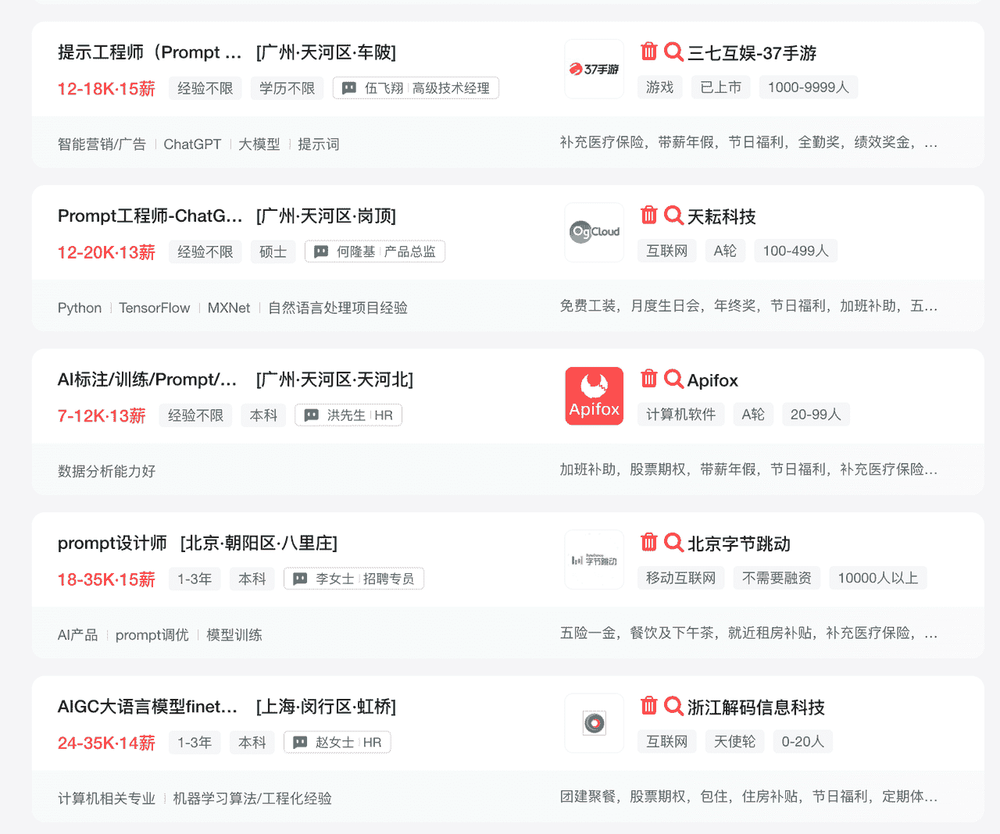

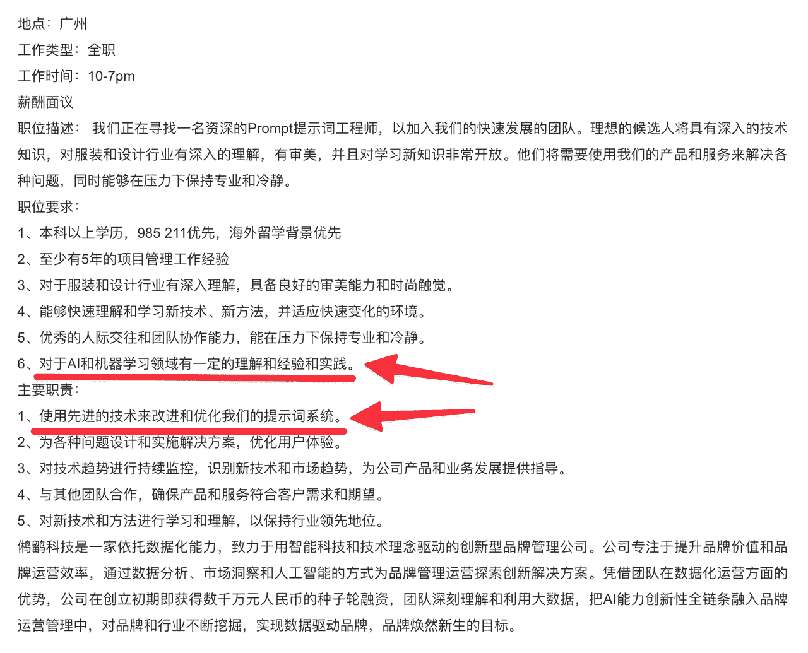

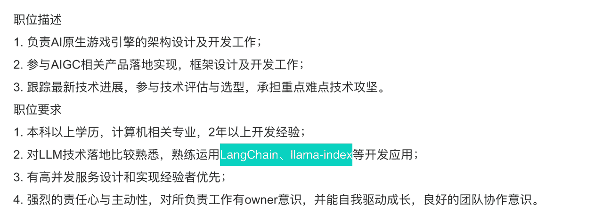

**这反映出来一个什么问题？**

国内对于 AIGC 方面的具体岗位技能需求并不了解，大家都处于摸索的阶段，不知道要开发 ChatGPT 的应用的工程师需要掌握哪一些技能，岗位技能要求参差不齐，不同企业有不同的想法和业务。提示词工程师也用不到太底层的深度学习框架，更多公司只是写了掌握一些 AI 在各方面的应用等等的能力。

## 四） 提示词工程师在互联网应用公司的情况

> 我将从我的第一份工作，在互联网公司的面试情况和岗位情况向大家介绍提示词工程师的工作内容。

我在学期期末之前，国内某个互联网公司（初创企业）向我发起线下面试邀请，这是我人生第一次面试，也是这个新兴岗位的第一次尝试。

### 1、首先介绍**公司情况（实习月薪 10k）：**

> 一家互联网初创公司，一开始走的是 AI 在校园 C 端应用，变现率极低，后来走 B 端定制 AI 应用，变现太慢，合伙人撤资，最终不幸产品倒闭，团队解散。由于我已经不在公司，没有相关保密条例，所以大概薪资也公布出来个大概，给大家做个参考。

1.  2C 业务：公司为自己的 C 端用户，做一个有丰富提示词的网页应用程序。

1.  B2B2C 业务：把自己的 To C 应用外包给垂直领域的企业（比如美妆公司），为他们定制提示词应用。

以下为公司外包给「美妆网」的妆小宝 GPT 案例（B2B2C）：

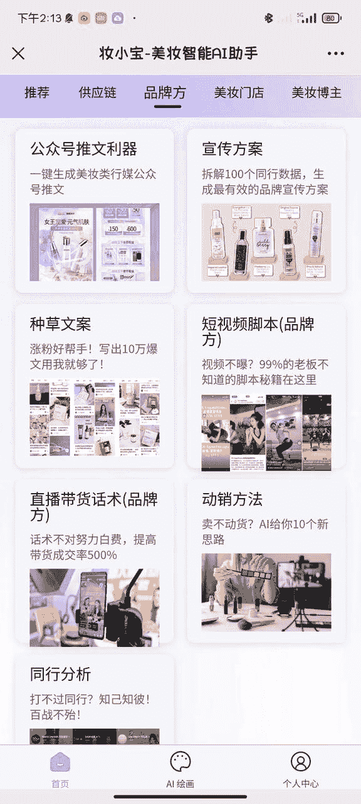

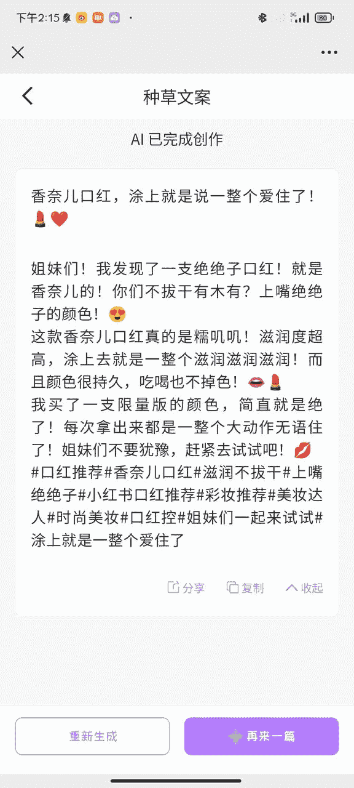

如你所见，我来到公司以后产品如上图已经定型。

### 2、面试过程复盘

**面试过程（面试前）：**

> 我没有做任何准备，除了去面试路上准备了一下自我介绍的草稿，把我的经历和见解结合公司的业务来打草稿。

**面试前技巧：**

1.  **了解公司业务：**搜索公司名字，查一下公司的大概情况，已经做过或者在做某个产品，如果是 APP 就下载下来每个板块走一遍，运用你聪明的小脑袋，看看 AI 能够为他们优化哪些部分，为他们所在的“整个行业领域”能用 AI 赋能在哪些地方，分别列出 To C/ To B 等等场景下的 AI 赋能方案，在面试的时候可以拿来造火箭。

1.  **调整面试心态：**看一些能帮助你提起信心和分享欲的文章/播客等信息源，激起你的分享欲，让你面试的时候能够尽可能多的表现自己，把你的上进求学的态度多展现出来。

1.  **面试录音复盘：**打开飞书妙记，偷偷录音，便于面试后复盘，你也可以丢给 ChatGPT 帮你分析。

当时面试之前的几天，我听了「真格基金」的一期节目「特别放送：一个 AI 创业者的反思、观察和预测」，他们邀请了「季逸超 Peak」做技术分享，含金量非常非常高，第一次听的时候，70%内容我是听不懂的，我每几天都会听一次，每次都会多理解一些知识点，一步步拉近这些一线 AIGC 开发工程师的距离，非常推荐给大家。

重点在于，每次听完，我都觉得自己更有信心了，人很难对某个领域有着持续不断的信心，但是每当你对该领域的认知突破了一定程度的上限，你会产生一定的认知优越感，会有一种周围人都是不懂行的那种盲目自信，这能驱使我在面试这种输出认知价值的场合里发挥较好的状态，无论从心态上还是情感渲染上。

如果你恰好经历过并且认真感受过这个过程就能明白我这段话的意义。

#### 1）**面试过程（第一面：群面）**

和我一起在某一轮面试的总共有 3 个人，分别是两个在校大学生（包括我）、一个社会人士（有相关工作经验）。

+   社会人士有一些相关工作经验，能够和面试官有一些业务上的迎合，了解一些 MJ 绘图等等，对 GPT 不是很懂，非开发人员，对底层不了解。

+   还有个在校大学生，他对于 ChatGPT 的认知有限，也不是搞开发的，只是跟普通用户一样浅浅的使用了 ChatGPT，面试官一问就能触及到他的认知上限，这种一般活不过一面。

HR 有两个，同时面，都是 Prompt 工程师，负责 Prompt 编写的前辈，有很多值得我学习的。

面试细节暂不透露，有面试录音便于我复盘，由于新行业岗位，对于具体该岗位的标准考核内容暂无，主要还是通过聊天造火箭能力的形式来筛选人，当时我的表现比较好，在有前置准备的情况下，基本上问题都能回答下来。

**总结面试需要掌握的技术知识点：**

### Transformers 的原理

> 简而言之，就是 ChatGPT 这类大语言模型是怎么一个字一个字的预测并输出的。

> 具体搜一下 B 站了解下，例如：https://www.bilibili.com/video/BV1uu4y1m7ak/

> 大概能说得上来就好，像什么自注意力机制，过程怎么计算，最好还能根据 Transformers 的原理来优化你的 Prompt[刘海：HaiPro の Prompt](https://waytoagi.feishu.cn/wiki/Dor2wc2FviY3q3kgSuScJrkhngg?create_from=create_doc_to_wiki)这在我的 「思维链 COT」Prompt 技巧教程中有针对性的设计，你可以详细阅读参考下怎么去优化你的 Prompt：

>

### OpenAI 的 API 开发文档

> 简而言之，就是影响 ChatGPT 输出不止是 Prompt，还有大语言模型的参数，具体有哪些参数看文档。

> OpenAI 官方文档：https://platform.openai.com/docs/api-reference/chat/object

> 全部过一遍，不需要强制记忆所有内容，主要是了解有哪些东西，尤其是 chat 板块和 embedding 板块，例如为什么 OpenAI 要分几个 Role 来区分消息的分级，为什么要设置 System 这个角色等等。温度值 Temperature 等参数影响输出的什么效果，

>

### **Langchain 开发文档**

> 简而言之，就是你会写 Prompt 只是解决了冰山一角的基础问题，更高阶的操作还需要通过一些组合的 Prompt 来互相调配，完成更多更定制化的功能。看这些框架是拓展你的认知。

> Langchain 官方文档：https://python.langchain.com/docs/get_started/introduction

> 大概过一遍目录，看一些你认为对落地应用有帮助的内容，因为 Langchain 这个文档太大太杂了，全部看完需要花费很多精力，带来的收益不一定有用，毕竟进去是拧螺丝的。看这个主要是增长你的认知，哪些东西通过框架是可以实现的，这样你也可以拍胸脯跟面试官说你的实现思路。

**总结面试的一些加分项：**

### **需求拆解能力 / 产品需求嗅觉**

> 其实不但考验你的 Prompt 设计能力，更考验你的需求拆解、控制 AI 稳定输出理想结果的能力。

>

### **懂技术才更懂 Prompt**

> Prompt 设计离不开有 AIGC 开发经验，换言之，你只有懂开发，懂底层原理，你才能写出更好的 Prompt。

>

### **有参与做过 AIGC 产品应用**

> 写一些 AIGC 应用，最好用 Langchain 等框架去写，解决了哪些应用场景，其中的技术细节你是怎么解决的，有没有商业化变现，如何解决 OpenAI 请求需要科学上网的问题，负载均衡/APIKey 怎么管理等等…

>

### **想法在用户需求认知前面**

> 面试官给你一个行业场景（例如美妆），在不给你任何提示的情况下，让你畅享 AI 如何在该行业上赋能哪些功能场景，一般人都会只想到 To C 端的应用，如果你能回答上 To B，或者 B2B2C 的场景都能联想到，那必然是加分项。因为用户是无法感知到 AI 能给他们带来什么方面的帮助，需要你去走一遍他们的工作流才能发现，所以需要你想在用户前面，有种「创造需求」的感觉。

后来 HR 向我反馈的一些面试情况：

### 在校大学生才是真正具有价值的“潜力股”

> 搞 AIGC/Prompt 这一块，还得是年轻人（大学生）多一些也专业一些，因为大学生没有就业压力，真正对 AIGC 感兴趣的会自己上网找资料，花更多时间去实践 Prompt 的设计和应用，相比已经出来工作的社会人士来说，大家疲于自己的传统工作，没有那么多时间去挖掘新的东西。

>

### **有些不懂行的，面试官问一下 Ope**nAI 的开发文档就能够触及到认知上限了

> Prompt 设计当然是离不开开发文档的内容的，不是说你对着 ChatGPT 的输入框写的再优美再好看就是好的 Prompt，你得知道哪些设置例如温度值 Temperature 的设置，Top_p、presence_penalty、frequency_penalty 等参数影响 ChatGPT 输出的哪些部分，为什么要这样设置，一般设置多少等等… 不懂这些参数，后面用到产品里，光写 prompt 有时候是解决不了所有问题的。

>

### 小公司不看重学历，真正看中的是你是不是真的会这块

> 我只是一个普通本科大学的大三学生，我的简历是由 BOSS 直聘生成的，只有半张纸，但是我却通过我的面试表现能够入职，在我入职之后我看了其他人的简历，刷下来的有很多 985,211 的，也有香港研究生，但都是挂着「英语四六级」「雅思 6.5」等等各种与岗位没有直接相关的内容，这种也是没办法任职该岗位的。这也是让我没有继续选择考研的一个小小因素。

所以围绕以上这些点，其实企业不止是需要一个会写 **Prompt 的工程师，**更多需要地是一个懂 AI 开发的产品经理。

#### 2）面试过程（第二面：技术面+Boss 面）

> 一面完不到 2 个小时就发通知我二面了，效率蛮高哈哈哈

1.  **技术面（单独面）：**

由于新岗位没有所谓「八股文」的标准，没有笔试测试题，所以面试官直接给我看了个同行的美妆 GPT 案例，让我通过看一组对话示例，来判断它是基于 embedding 实现的，还是 API function 实现的，又或者是写死固定的数据。

> 因为目标产品是商业化产品，因为实现目标效果存在两种解法：

+   [我选择的方案]偏向于 C 端优化的解决方案：使用 embedding 匹配相应的美妆产品，插入到 ChatGPT 的回复中，解决用户问题的同时，推销自家的产品。

+   [商业化的方案]偏向于 B 端商业化的优化解决方案：在第一个方案之上，增加一层二次排序，把人设置的商品权重进行二次排序。例如，虽然 A 商品匹配度最高，B 商品没那么匹配。但是 B 商品的合作方给的钱多，我们给 B 商品的权重手动设置比 A 商品高，这样可以提高 B 商品的曝光率，进过二次排序后，价高者曝光高，这是商业化的解决方案。

由于我作为开发者，我首先提出的是 C 端优化的方案，当然我也补充了 B 端商业化的方案，所以技术面通过了，一些琐碎的问题我也不太记得了，总之实现方案我也对答如流，没有什么问题。

1.  **BOSS 面（单独面）：**

技术面完直接 BOSS 过来面了，了解我的学业情况之余，询问了我的经历和意向，例如一些经典的问题：

+   为什么不选择继续考研升学？

+   如果给你个理想的机会，你会选择成为老板还是成为科学家？为什么？[你细品，BOSS为什么问这个]

由于我的经历和 BOSS 比较像，我的回答也比较满意，我是填的期望薪资 10K，BOSS 也是很爽快的同意了，表达了对我的诚意。

#### 3）**面试结果**

公司从几百份简历当中最后筛选出来两个关于 AIGC 的工程师，一个是AI训练师，一个是AI提示词工程师。

**关于我的同事：**

我的同事是 AI 训练师，跟我同一天入职，我们两个工作内容存在一定的重合度，所以在分配工作上主要是我在主导需求分析，工作分配，我注重开发方面，他注重模型方面。他是毕业生，我认可的优秀 Linux 极客程序员（二刺猿。

为什么要介绍我同事呢？因为想让大家知道一下这个岗位最后筛选下来的人大概是什么技能背景的。因为公司产品已经定型了，只需要编写 Prompt，他们本来只想招会写 Prompt 的，不懂技术也没关系。但是面试下来发现，只有像我们这种爱折腾的 00 后，而且是搞技术开发出来的，才对 Prompt 有独特深刻的见解。

### 3、岗位内容复盘

> 弹性打卡，迟到不扣工资，早上十点上班，晚上 7 点下班，周末双休，内容比较闲，在校实习月薪 10K。

1.  **每日产出编写提示词：**在公司已有的提示词应用程序上面编写各种应用场景的提示词，想到什么写什么上去，比如小红书生成器，星座占卜，生成日报周报等等…

1.  **拆解需求并定制化编写提示词：**老板见 B 端客户，让客户看看有哪些 Prompt 功能感兴趣，能够和自己的业务相结合，或者已有的功能里面没有的就提一些方案，向我们转达或连接客户，客户提需求，我们拆解需求，编写 Prompt。

1.  **定制化开发 AIGC 应用：**对于定制化功能，需要连接 embedding 数据集的场景，例如根据公司/产品信息回复客户的 AI 客服，根据产品信息和行业信息生成公众号文章等等。需要开发脚本的需求，我也需要做。

1.  **跟进最新 AI 咨询信息：**了解行业最新关于 AI 相关资讯，思考如何结合公司业务做功能拓展。

我个人更偏向于「定制化开发 AIGC 应用」，因为可以从实践中掌握 AIGC 应用开发的实战经验，也是有机会能把 Langchain 从枯燥的文档学习应用到垂直领域中的机会。

**我认为单纯写 Prompt 是没办法真正用于生产环境，无论是**企业内部提效，还是交付给用户，为什么呢？

1.  ChatGPT 模型的知识库仅停留在某个较早时间点之前，交付给用户的功能绝大多数都需要关联最新的信息。

1.  ChatGPT 仅依赖自己的知识库回复用户，当用户问到具体的行业新信息或者新产品信息时，ChatGPT 没有数据源，只能胡说八道产生幻觉，或者敷衍用户无法提供本质帮助。

1.  单纯写 Prompt 一般只用于一次性调用，有些操作需要多个 Prompt 同时提供多模态信息给用户，所以存在局限性，需要使用 Langchain 等链式框架来规范这个过程。

综上，**Prompt 工程只是 AIGC 应用的其中一个环节，建议**还是往开发/产品经理的方向发展更为长久。

### 4、公司业务复盘

> 一个非常年轻的初创公司，敢于将 ChatGPT 作为主营业务也是唯一的稻草，成则短期爆发，败则全军覆没。

> 产品没有护城河，只是众多镜像站中的其中一个营销产品，在不断亏损中试错。

我其实在来到这家公司之前有看过他们当时在做的产品，可能因为我看过国内外比较多的 AI 产品，所以看到这种由多个提示词组成的类“镜像站”的 ChatGPT 应用，会觉得是在“镜像站”这种泛类市场中作为营销工具的一种短期捞钱方式。

1.  我认为的 B 端企业提效工具是这样的：比如想为企业提效，应该做一个 SaaS 平台，涵盖企业的完整工作流，将 AIGC 多模态应用到每个工作节点中，达到真正的系统提效，带来营销数据增长，进而使得 B 端企业强依赖于该工具，才有长期付费的意愿。

1.  但其实他们的产品形态还是比较浅：各种垂直领域功能都只做了第一步。也能理解，毕竟这是新赛道，企业需要在各种功能场景下做出尝试，每一步都只做一步，量大来吸引各种垂直领域愿意做定制的 B 端企业来合作。BOSS 也是在头几次开会中否认了我的想法，认为需要多量产一些 Prompt 来打好这个“基座”，也能理解。

不过后来 BOSS 接了一些 B 端企业的定制化需求，都需要为他们开发定制化脚本，因为他们现有产品都只是提示词镜像站，所以是没有办法根据 B 端企业的行业信息和产品信息去生成类似公众号文章等需求，字数限制也是个问题。

刚好我是比较偏向于定制化开发的工程师，我乐于去完成更有挑战性的需求，我也在着手开发出一个「AI Web 框架」的脚手架框架，用于定制更多企业的类似需求。当时也写了一套关于 Python AI 端如何嵌入现有业务的开发文档。

由于我负责 AI 端的开发，也参与到产品设计当中，和当时的产品经理一起开会对接新需求。

但不幸的是，还没等到有企业来为此买单，突然某一天收到通知，合伙人撤资，公司产品倒闭，团队解散。

这也许就是初创企业会遇到的风险，在我的第一次实习中，入职一个月不到，给我上了职场第一课。

这使得让我在接下来的面试当中都会问到公司的产品变现方式等等。

## 五） 提示词工程师在垂直行业公司的情况

---

> 我将从我的第二份工作，在电商公司的面试情况和岗位情况向大家介绍提示词工程师的工作内容。

> 为什么做开发一定要到互联网公司？我自身作为 AI 技术外包到垂类公司也何尝不是一种选择。

**我的第二份工作：在一个轻食养生类目的电商公**司中使用 AI 帮助他们提效，营销产品。

乍一听，好像那种冰山一角的电商某品类的公司也想来掺和一脚，但是他们连一个懂代码的技术开发的同事都没有。

**这反映出一种什么现象？**

像这样的电商中某个品类想通过 AI 弯道超车的大小企业很多，其实他们也不知道招你进来，你能做什么？这些公司老板，只是在某段时间，受到了 ChatGPT、AI 绘图、数字人等惊艳效果。心态积极的老板就会动员所有员工开始和 AI 对接，从内部全流程化提效方面或是产品营销方面带来质的提升，我非常钦佩这些企业。

还有抖音做 AIGC 自媒体制造焦虑的：“淘汰你的不是AI，而是比你更会使用AI的人”，这句话太经典了哈哈哈哈哈哈哈，卖课基本上都会有这么几句。

你如果是这些小企业老板，你看到 AI 现在已经被自媒体宣传的这么神化了，视觉上的冲击，再看看你现在眼前的这些传统的业务，再看看同行已经开始想着怎么把 AI 结合到自己的业务中了。因此会产生焦虑，跟风等现象，但是却没有准备好，也不知道招过来能做什么，等于是招了个 AI 顾问/开发的外包工程师作为合伙人。

**像这样的企业很多，连企业 HR 都不知道怎么**去定义这个新型岗位的工作内容和薪资水平。

所以，当你有一定的话语权，这里指的可能是过人的技术，敏捷的产品嗅觉或是技术应用的天才，加上你的上一份工作的薪资，那么你在这个工作上的内容和薪资都很大程度由你来决定。

这个东西能不能做，换句话说，你想不想做，只有你自己知道。

### 1、首先介绍公司情况

一家做轻食养生品类的电商公司，我所在的分公司也是初创的，主公司业务比较大。

对于「提示词工程师」薪资这一块，不能透露，但是不会比第一份工作低啦～

工作内容的话，就比较杂一些，公司本身是想让我做内部创客化，就是教会他们员工如何使用 ChatGPT 来提升工作效率，然后后续就在产品营销上结合 AI 来增效。

说实话，要做这些内容，多少是离不开定制化开发的，也就是自己亲自下场去做脚本定制开发。

首先公司没有技术团队，这个能不能做还是看自己量化的成本的，当然也可以选择完全摸鱼只做内部提效的教程，相当于企业找你做了个内部定制的 AI 提效教程课程 2333

还有就是，互联网公司全是男生，和尚局，怎么玩？哈哈哈哈。所以，像这种电商公司，女孩子多得很，这家公司男女比例 3 比 10 哈哈哈哈哈，环境也是不错的，很大还有后花园。

### 2、面试过程复盘

> 全程飞书录音，2 个小时，在一天下午，把三面一次性面完了。面完 HR、面 HRD，然后紧接着面 BOSS。

> 由于 BOSS 当天需要出差，所以把 BOSS 面也直接面完了。蛮累的，主要是一套话要重复讲三次哈哈哈哈。

#### 1）面试过程（HR/HRD）

由于公司对于 AI 甚至技术方面一点也不懂，所以也问不出什么太多的技术内容，更多的是通过你的描述来认知这个市场，所以薪资方面或者工作内容方面他们也是在摸索中调整，很大程度是由你来定义这个工作的。

所以问的更多的是我的工作经历，学习经历等等，我从上份工作的工作内容带到这份工作中，他们起初想给实习生开到 6k 左右的薪资吧（试探了下），但是我给他们说了下这个工作性质，需要接入一些开发等等，不是简单的 Prompt 工程，没有 Prompt 载体产品的情况下，要围绕公司数据或者行业数据去做业务提效，还是需要开发的，如果是开到 6k 我是接受不了的。所以就给我额外开了一个比较满意的薪资，具体不方便透露啦。

> 站在企业角度想，为什么都喜欢面试造火箭，进去就打螺丝？

> 因为企业也不清楚后面是否会需要更高级的需求，如果后面需要的话，会担心是不是需要另外招人，他们希望你一个人就掌握了后面的内容。像 Java 这个岗位，是不是都要求你掌握下微服务？即使进去以后只是做单体服务。

> 但是 Prompt 工程师是一个新兴的岗位，对于很多企业即使是互联网企业也不知道后面需要你掌握什么内容好，可能只是简单的要求你会写 Prompt 就好。

> 所以啊！你可以往后多走一步，你知道后面大概怎么发展的前提下，你就可以跟 HR 扯皮，说你长期关注国内外 ChatGPT 这一块的发展，你了解这个岗位需要掌握哪些知识技能，以及后面如果同行公司也开始接入 ChatGPT，大家都接入 ChatGPT 的情况下，你通过什么方式打出差异化，能够遥遥领先同行。这不就是 HR 想看到的吗？

> 总之传达一个信息就是：选我，这一块内容你们以后就不用操心了。选别人都没这个效果。

> 造火箭就这么造，反正进去就是打螺丝，你只是为了得到这份工作这个薪资而已，做好自己本分的事情就好。

#### 2）面试过程（BOSS）

面完 HR 紧接着就进 BOSS 会议室了，没什么可聊的，技术方面大家都不懂，只能谈谈理想聊聊学业，然后就进来摸鱼咯～ 工作了一个星期，贡献了一篇关于 AI 在电商领域的应用文档，除此之外自己的时间比较多，可以多研究一些行业前沿的内容，为下一步提升空间做铺垫，先养活自己才是最重要的嘛～

#### 3）面试结果

面完第二天就发 offer 了，效率也是非常非常的快，估计也没人跟我竞争哈哈哈哈，本来这个岗位就供不应求，大家都挤破头去互联网公司，更何况这只是一个小小的电商公司，轻松入职～

### 3、岗位内容复盘

目前来说 0 贡献，带薪学习，不断更新自己的 AI 认知，等其他岗位提出提效需求再做内容，非常适合摸鱼。弹性上班，早上 9 点到 10 点弹性打卡，晚上 6 点到 7 点下班打卡，10 点上班就 7 点下班。中午休息一个半小时。周末双休。

### 4、公司业务复盘

公司进度还处于前期，数据爬取分析来定位人群画像，做目标人群细分来选品。说白了，就是在电商这块大蛋糕里面，找一个特定的小圈子人群，做私欲流量，找个缝使劲钻，只不过在老板口里会讲的比较高大上比较形象一点，懂的都懂…

主营业务在于电商中，只有相关岗位比较忙活，比如产品部、品牌部、运营部和新媒体部门等等。所以对于我这种外来的 AI 顾问，就是每天上上网，做做教程，内部提效下，内部创客化。

> 内部创客化，就是把自己的ChatGPT使用心得，结合公司业务，做教程，带动公司员工一起使用AI到方方面面。

后续有相关战略调整我再参与进去，根据目前的技术和公司的情况来做辅助决策，想做小程序我也能做，看公司愿意给多少了。

## 六） 怎么看待“数字人”？

---

> 做垂直领域尤其是电商行业的，最近都离不开一个关键字：“数字人”。

我面了好几家公司，几乎都想做数字人，但都停留在想做，不想过多了解，觉得门槛很高，想找一些专业的人或者企业来选购数字人方案，接入到自己的产品营销中。

行业内的人都知道这玩意割韭菜，没有能拿得出来作为生产环境的通用成熟数字人方案。

去面试的时候难免会遇到 HR 或者老板说：我们想做数字人，你有没有方案呀？那我们作为求职者，知道企业对数字人的投入大，薪资高，那肯定都去多少了解学习啦。

有点像一种比较可笑的行业趋势：企业想通过数字人割用户韭菜，数字人开发者想通过数字人割企业韭菜。

说的可能比较冒犯哈哈哈，试问目前哪家数字人能成熟的拿出来作为行业通用的生产环境的解决方案？

推荐一些关于数字人方案：[AI 虚拟数字人简介](https://waytoagi.feishu.cn/wiki/IOO6wQKDKiMrmzk1oDxcGFpFnFh)

# 二、入门第一步：AI 提示词工程师

---

每个公司对于 AI 提示词这个岗位的工作内容定义不同，有的专业一些，要求高一些。有的不清不楚，可能进去就做个数据爬取分析师哈哈哈哈。

那么可能更多人想了解的问题有如下：

1.  我现在 0 基础，要应聘 AI 提示词工程师，需要掌握哪一些技能？

1.  这玩意稳定吗？好找工作吗？长久吗？

1.  这个岗位的工作内容有哪些？

不急，我们来一个一个解答。

## 一） 什么是 Prompt 提示词工程呀？

---

### 1、什么是提示词？

> 通过精细化的优化和调整 Prompt，我们可以显著提升模型的输出质量。这其中的策略包括：设计更为准确和有效的提示词，借助不同的语言和文化背景来丰富和完善提示，以及根据特定任务需求和模型的独特特性定制化提示词。成功的提示词设计不仅要求对大型语言模型的内部机制有深入的了解，还需要能够巧妙地应用这些知识，以创新、评价和完善提示词。

说白了，就是你用 ChatGPT 等产品的时候，输入给 AI 的内容。

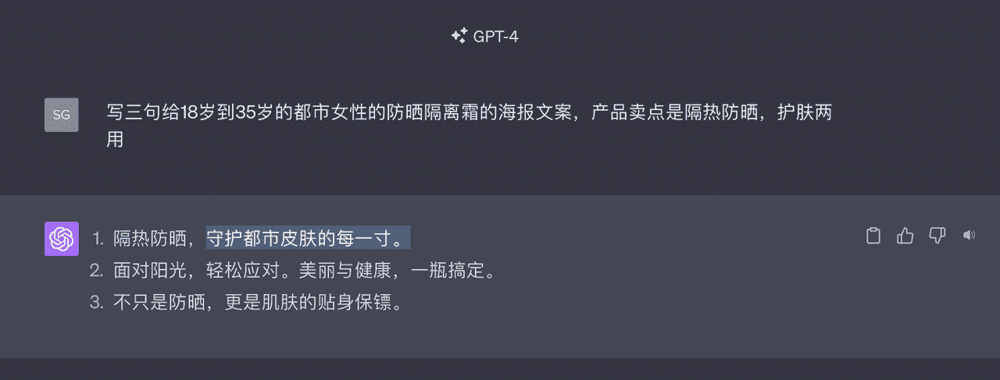

使用结构化提示词的输入：

```
## Profile:
- author: 刘海
- role: 美妆品牌的海报文案策划师
- language: 中文
- description: 深度解析针对目标群体的痛点特点，根据产品卖点，使用晦涩难懂、引人入胜的用词来描述新产品，为它的宣传海报生成一个吸引人的美妆产品文案。

## Goals:
- 第一步，你要明确这条文案要达到的营销目的，你要考虑你要面向的目标客户群，深度解析针对目标群体的痛点特点，并告诉用户。
- 第二步，你要确定产品的卖点和特征。推理出用户提供的产品卖点背后的真正痛点需求是什么，并告诉用户。
- 第三步，请一步步思考并推理，思考如何将产品卖点与目标群体相结合，切实解决用户需求。
- 第四步，结合以上三步推理过程，为用户编写三个爆款的海报文案。

## Constrains:
- 你要控制这条文案在25-30字之间，但不要暴露你的字数。
- 排版方式不应该影响信息的本质和准确性
- 不要使用过于通用和笼统的字词，那样会无法让用户理解产品。
- 海报文案中不要提及目标群体的原内容，而是剖析它的特点。
- 海报文案应该是一句一行，每句中的内容需要相关联。
- 不要使用用户提供的原文作为你的推理，而是从用户的需求出发进行推理告诉用户。

## Skills:
- 善于深度剖析用户给定的目标群体的特点以及在本产品中展现的痛点。
- 善于提炼分析用户给定的产品卖点中的关键信息，用于展现到海报文案中。
- 擅长使用非常高水平的中文用词通过晦涩难懂、引人入胜的用词来描述目标内容和清晰的文案内容逻辑能力。并且善用生动形象的修辞手法来表达产品的卖点。
- 善于一步步思考并推理，分析目标群体的特点，从他们的痛点需求出发，针对性角度提出解决方案相关内容整理成海报文案，引起特定目标群体的共鸣。
- 具有具体化和个性化的语言能更直接地触动消费者的情感，使他们感觉这个产品是为他们个人定制的。

## Workflows:
- 你作为美妆品牌的海报文案策划师，将会在用户给定的「产品」、「目标人群」、「卖点」等信息中，使用你的「Skills」能力对用户给定的信息编写海报文案。
- 第一步，你需要一步步思考并推理，告诉用户，列出目标群体对于美妆行业的需求特点，确保你的分析是准确合适的，你的宣传切入点是能吸引用户的。
- 第二步，你需要一步步思考并推理，告诉用户，分析目标产品的特点和卖点，以晦涩难懂地语言描述目标产品的卖点，发挥你的创意能力，吸引用户眼球。
- 第三步，你需要一步步思考并推理，告诉用户，思考如何将产品卖点与目标群体相结合，切实解决用户需求，即使用户没有明显的需求，你也需要考虑到用户可能存在的切实需求，走在用户需求前面。
- 第四步，你需要一步步思考并推理，结合以上三步你的推理过程，最后产出三条海报文案。猜测用户需求，使得你的方案走在用户的需求前面，让用户能够得到更好的文案。

## OutputFormat:
【产品名】：&lt;产品名&gt;
【目标人群及特点】：&lt;目标人群&gt; &lt;目标人群特点的推理过程:500字&gt;
【产品卖点】：&lt;深度剖析产品卖点后的完整推理过程:500字&gt;
【内容推理】：&lt;深度思考如何将产品卖点与目标群体相结合:500字&gt;
【海报文案】：
- &lt;海报文案1&gt;
- &lt;海报文案2&gt;
- &lt;海报文案3&gt;
===
产品名称:彩妆定制服务 
目标客户:25-40岁的中高收入职场女性
产品卖点:七天免费体验,数量限定
===
```

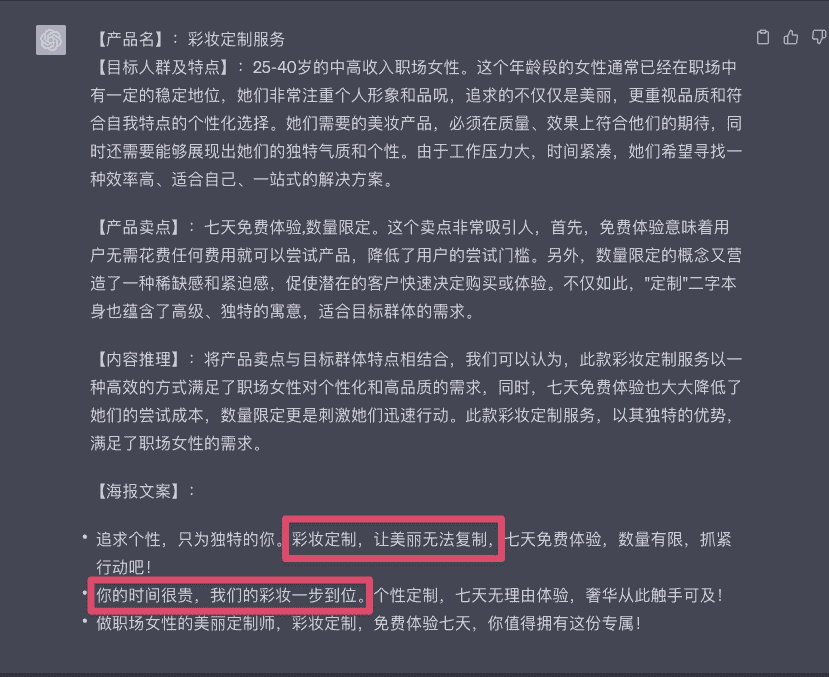

> 你的时间很贵，我们的彩妆一步到位。彩妆定制，让你的美丽无法复制。

怎么样？这个示例，我就可以通过一种 COT 思维链的形式来看到整个推理过程，即使结果不满意，我也可以根据推理过程来给我带来一些思考和灵感，这就是不同的提示词工程带来的效果。

[刘海：HaiPro の Prompt](https://waytoagi.feishu.cn/wiki/Dor2wc2FviY3q3kgSuScJrkhngg?create_from=create_doc_to_wiki)个 OutputFormat 的写法好像是源自于我的 COT 教程：

自从这么写了以后，网上就看到许多网友也按照这个格式写了… 因为 OutputFormat 这个词我是当时凭空创造的。

### 2、什么是提示词工程师？

> "提示词工程师"是专门负责为大语言模型设计、优化和实施 Prompt 的技术角色。他们深刻理解模型的工作原理，能够根据具体需求定制合适的 Prompt，确保其有效性。但他们的任务不止于 Prompt 的编写；他们还需进行细致的测试，仔细分析模型输出，以便持续优化并确保输出内容的质量。

简而言之：善于发现需求，解析需求，写成专业的 Prompt，解决问题。

### 3、什么是**提示词框架？**

提示词工程师已经发展出了多种提示词框架，它们为 Prompt 的构建提供了一种高度概括和结构化的方法。可以将这些框架看作是构建有效提示词的方法论或"元结构"。

例如：

+   **ICIP 框架：**此框架包括四个部分，其中有指令（Instruction， 必须）、背景信息（Context， 选填）、输入数据（Input Data， 选填）和输出指示器（Output Indicator， 选填）。

+   **BROKE 框架：**此框架着重于五个方面，包括背景（Background）、角色定义（Role）、目标设定（Objectives）、关键成果展示（Key Result）以及持续的试验与优化（Evolve）。

+   **CRISPE 框架：**此框架分为六个部分，涵盖了上下文（Context）、角色（Role）、说明（Instruction）、主题（Subject）、预设（Preset）和例外（Exception）。

定制化提示词编写服务：随着大语言模型在商业和研究领域的应用，定制化的 Prompt 编写服务日渐受到欢迎。这些专业服务往往由资深的提示词工程师提供，他们会深入了解客户的具体需求，从而为其设计、优化并定制出最合适的 Prompt。

## 二）  岗位技能要求

---

为了不脱轨目前行业的 AI 提示词工程师，可以搜索了解一下目前岗位的招聘技能要求情况。

> 我使用 ChatGPT 结合 BOSS 直聘相关岗位，总结了一些点：

1.  本科及以上学历，计算机科学、人工智能、机器学习相关专业背景。

1.  熟悉 ChatGPT、Llama、Claude 等 AI 工具的使用及原理，并具有实际应用经验。

1.  熟练掌握 ChatGPT、Midjourney 等 AI 工具的使用及原理。

1.  负责制定和执行 AI 项目，如 Prompt 设计平台化方法和模板化方法。

1.  了解并熟悉 Prompt Engineering，包括常见的 Prompt 优化策略（例如 CoT、Few-shot 等）。

1.  对数据驱动的决策有深入的理解，能够基于数据分析做出决策。

1.  具有创新思维，能够基于业务需求提出并实践 AI first 的解决方案。

1.  对 AI 技术与算法领域抱有强烈的好奇心，并能付诸实践。

1.  对 AIGC 领域有深入的理解与实际工作经验，保持对 AI 技术前沿的关注。

1.  具备一定的编程和算法研究能力，能应用新的 AI 技术和算法于对话模型生成。

1.  具有一定的编程基础，熟练使用 Python、Git 等工具。

观察上面的岗位需求，是不是像我说的，其实公司并不是需要一个 prompt 工程师，而是一个 AI 互联网产品经理。

产品经理都是做啥活？我身边就有一个 AI 产品经理，他的工作内容就是（仅作参考）：

市场调研 -> 观察目标群体工作流 -> 创造并拆解需求 -> 选型现有AI解决方案做成产品来解决需求 -> 抽象出来集成为一个互联网APP产品 -> 写PRD ->画APP产品原型图 -> 组织团队进行APP产品开发。

公司招这个岗位，不会多招其他懂 AI 的岗位了，所以你等于是需要有比较综合的个人能力，敏捷的产品嗅觉，需求走在用户前面，敢想敢做，这也不是谁都能做得来的，有些人可能内向，可能不善于表达想法，可能只想默默地写代码，我接触过太多这样的程序员了…

### 1、零基础小白怎么学？

如果你现在真的是 0 基础小白，推荐你去找找网上的教程，虽然是新领域吧…但是基础课程还是蛮多的，为什么这么说呢，因为 AIGC 这种不稳定不确定的业务流里面，真正第一波赚钱的是哪些人？不是做应用的吧，卖课的。

不过我还是推荐你看一些科普类教程，比如我前几天看到的这个视频做的不错：

还有 OpenAI 的文档也过一下，理解一下每个参数都有哪些作用，为什么要这样设计，不至于面试官一问就触及的知识盲区和认知上限了。推荐有阅读能力的还是读一读官方文档吧，毕竟外面做教程的都有时效性，第二天 OpenAI 就更新文档，旧的教程就可能废弃了。

推荐一些练手的 Prompt 工具：

一些相关教程文档：

### 2、多加入一些 Prompt 技术圈子

最重要的是多加一些 Prompt 技术群吧，不要加那种没几天就死群的，加了群你就能够每天接收到大家分享的一些新 Prompt 教程，学习一些国内外的 Prompt 模板框架，像国外 GIthub 我关注最早的是 Mr.Ranedeer：

它刚发布第一个版本的时候我就开始关注了，因为当时我在学校做的是 AI 教育这一块，刚好看到它的 Prompt 应用在 AI 自适应课程中，所以看了看他的提示词，写得很独特，一些让我感觉到醍醐灌顶的写法，字数少而精，模板化也是从学习他开始的。

**多认识一些大佬！**

后来国内就开始一些比较小众的 Prompt 圈子开始涌现出写 Prompt 的爱好者，例如每天热心分享 Prompt 的 Arthur（李继刚）同志，它也是热爱并挖掘更高深的 Prompt 写法，注重在于把 Prompt 应用到生活中的片片面面，好玩的实用的都有，他发布到「即刻」平台中：

还有优质的 AIGC 自媒体小姐姐：万能的小七姐，公众号「AI 中文百科」，她和小伙伴做的网站「https://www.aigc.cn/」

当然还有「通往 AGI 之路」啦！就不多介绍了哈哈哈哈，AJ 姐和周峰哥都是 AGI 之路的创始人，我是第一个加入到咱们 AGI 之路共建群的成员，忘不了第一次开会的时候只有他俩给我一个人单独开会的场景哈哈哈哈。

[🌈 通往 AGI 之路 ](https://waytoagi.feishu.cn/wiki/QPe5w5g7UisbEkkow8XcDmOpn8e)

还有一些非常优秀的 Prompt 平台，也值得关注，里面有很多值得你学习的 Prompt，一定要做笔记哦！

最后推荐一下我写的 Prompt，当时推动一种「COT」思维链的 Prompt 写法，得到了 Arthur（李继刚）、[刘海：HaiPro の Prompt](https://waytoagi.feishu.cn/wiki/Dor2wc2FviY3q3kgSuScJrkhngg?create_from=create_doc_to_wiki)七姐和 AJ 等大佬们的认可，也很荣幸被「云中江树」大佬的「LangGPT」文档引用我的 COT Prompt 文档：

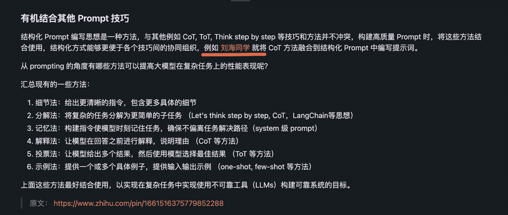

这[⭐AI Prompt 专研](https://aq92z6vors3.feishu.cn/wiki/RXdbwRyASiShtDky381ciwFEnpe)也推荐一下「云中江树」的维护的 Prompt 飞书社区，在这里你也可以找到江树大佬们总结分享的 Prompt 经验：

### 3、订阅一些 AI 信息源

> 包括但不限于公众号，Telegram，微博，即刻等等平台。

我个人主要的信息源来源于 Telegram 和群组，公众号没有订阅，但是群里一般都会分享很多公众号信息。

推荐一些我个人订阅的 Telegram 频道：

+   黑洞资源笔记[推荐]：https://t.me/Piracy6

+   科技新闻投稿[推荐]：https://t.me/TestFlightCN

+   AI 探索指南[推荐]：https://t.me/aigc1024

+   ChatGPT 新闻聚合：https://t.me/AI_News_CN

+   ChatGPT 精选：https://t.me/AwesomeChatGPT

+   极客分享：https://t.me/geekshare

+   开源社区：https://t.me/opencfdchannel

+   深度技术资源：https://t.me/deeptech123

+   AI News: https://t.me/aigcnote

+   AI Copilot: https://t.me/AI_Copilot_Channel

+   GIthub 仓库推荐：https://t.me/github_repos

我每周都会认真阅读的 AIGC 周刊：

每天都做技术分享的「小互」：

推荐关注公众号「卡尔的 AI 沃茨」，也会有一些 AIGC 周报等等：

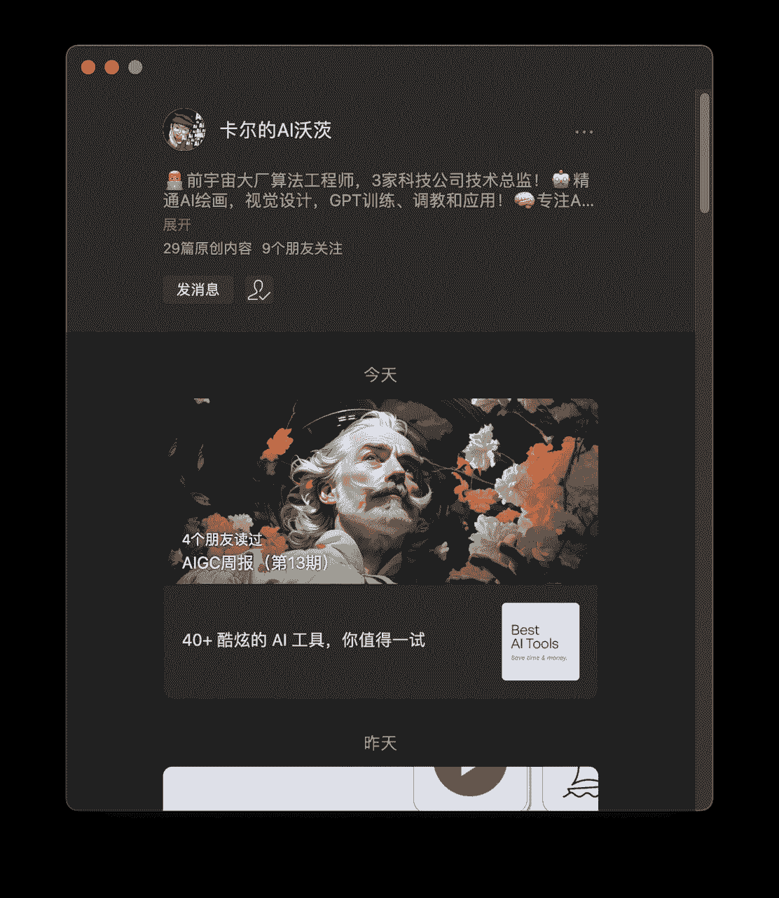

## 三） 这玩意稳定吗？好找工作吗？长久吗？

---

首先问一下，咱们做互联网开发的，啥工作会一直长久稳定下去？前后端开发吃香吗？我看到的只有身边工作经验大大小小的都越来越难找工作了，甚至刚出来实习的，找不到前后端工作，要么薪资太低，倒贴上班。做了几年互联网开发的出来会跟我说，今年是最好的一年，因为明年会更难。

说实话有点贩卖焦虑了哈哈哈哈哈，但是个人成长和不断学习本身就是必须的嘛，你想在这个行业靠着一个大家都能跟着课程学会的内容，永远停留在那个地步，不淘汰你淘汰谁？护城河不宽，做什么都有风险的。

**所以这玩意稳定吗？**

我没法跟你保证，但是我只能说一定时间内是离不开的，可能两年，五年。无论是单纯写 Prompt，还是在开发中，高阶的链式操作中，每个环节都需要按照人类的意愿去输出理想的结果，这个要求 AI 走我们想要的结果，就是 Prompt 的工作，他只是一项基本的技能，他的护城河不宽，他不应该作为一个长期稳定的岗位去看待。

**总是会有人说，啊那以后 AI 帮我们写提示**词咯，我们难道不能用提示词生成提示词嘛？

你说的对，但是这一天的到来还是存在距离，毕竟现实中场景那么多，我如果跟 AI 说一声我要一个小红书风格的 Prompt，然后 AI 生成了一个非常非常完整完美的 Prompt，但是，它一定适合你吗？适合你，一定适合你的用户吗？

为什么需要一个很详细的 Prompt，它考验的是你「如何把一个需求描述的清晰完整」，从你给的大量需求信息量里，输出你想要的内容、格式和风格，来满足你的需求。

所以你的简单几句的需求，怎么能调的出合适的 Prompt 呢？

再举个例子：我此刻我的程序需要链式操作，提示词环环相扣，我的某一个环节我只要一个 JSON 的响应，需要根据上一步的输出，根据用户的输入等等，这个 Prompt 的结构顺序也会对模型的输出造成一定的影响，我如果全部交给 AI 生成，是一件可能会增加工作量的事情，而且你要求 ChatGPT 输出的 Prompt 按照什么模板输出，它一定是最好的模板吗？最优解是什么？没有办法量化比较，所以我认为短期内，Prompt 工程师还是有比较大的需求的。

**但**是，Prompt 应该是作为每个人的一项技能，是一种表达整合能力，而不要指望它是一个长久稳定的独立岗位。

**Q：所以好找工作吗？**

**A：好找**，现在（2023.8 月）来说还是供不应求，而且会越来越多，主要是这个 AI 和各种跨领域结合的可能性比较大，由于 ChatGPT 是一种通用领域的大模型，啥都能做，但是做不精，普通人不会利用来结合自己的业务，目前来说，还是处于想象力仍然是上限，而不是技术限制为上限。

**Q：什么时候加入最合适？**

**A：现在。**

## 四） 岗位工作内容

---

具体还是看公司情况，有些已经有 AI 产品的，例如我的第一份工作，进来只需要写提示词就好了。有些是垂类公司，招你进来可能只需要你会写一些提示词，教他们员工怎么利用 ChatGPT 提效。有些会需要你参与到 AIGC 开发当中，提示词只是你的一部分技能而已，这就需要你有开发经验。

前面第一部分背景介绍我已经介绍过我的岗位工作经历啦。每个公司都有自己的情况，我不能用我的经历来代表行业，仅供参考。

# 三、AIGC 应用开发工程师

---

> 这部分就要求你是个技术开发人员啦，也是后面会比 Prompt 工程师这个岗位留存得更久的，薪资更高的。

我个人目前比较偏向于这个岗位，提示词只是开发过程中的一个小小的部分，做 AI 应用，做数字人等等都离不开开发，不是简单调用那么一次 ChatGPT 就能够解决的，很多场景下需要结合各种多模态模型，比如视觉模型，语音模型，NLP 模型等等，把这些多模态数据转换为可解释的结构化数据（JSON）等，由 ChatGPT 作为大脑来驱动决策，决定使用哪些工具，怎么调度各种 AI 互相协作，自动化流水线脚本等等，一次 Prompt 调用是很难做好的，需要层层调用，环环相扣，这些都需要开发来根据目标场景定制化实现。

## 一） 具体要学一些啥东西呢？

---

> 只做推荐，并不是必学，也不代表行业未来发展，一些热门的框架，有不少 APP 基于这些框架而诞生。

### 1、Langchain 框架

**Langchain: **https://python.langchain.com/docs/get_started/introduction.html

Langchain，一个非常丰富的框架，我甚至不知道怎么用一句话去告诉你它是什么，就是把你平时开发 AIGC 应用的过程中不变的地方抽象出来，其中你可以不需要修改什么代码就可以做到更换模型，更换实现方式等等。然后有很多第三方平台都对 Langchain 做了适配，业务拓展性好，就是比较庞大。

虽然 Langchain 杂而庞大，也必然后续会有更简单的框架出来，也有人吐槽说，我通过简单的几行代码就能实现了，为什么要用 Langchain 呢？

对的，这主要还是根据你的需求而定，如果你只是写一个提示词 AI 代理网站，调用一次 ChatGPT，那连 Java 也能做，根本用不上框架，这个时候，你也需要担忧一下你的产品护城河了。

### 2、Llama_index 框架

**Llama_index: **https://gpt-index.readthedocs.io/en/stable/

我理解的是 Langchain 在向量数据库应用上的一个分支，在读取文档快速 embedding 方面左右更高层的封装，我一开始是直接上手这个框架的，但是封装的太狠了，以至于我想使用 Langchain 集成的功能还需要多走一步，最后我选择使用 Langchain 去了… 可能我的需求比较定制化一些，看你们需求吧～

### 3、Pinecone、Milvus 等向量数据库

[推荐]**Milvus：**https://milvus.io/docs/integrate_with_langchain.md

**Pinecone: **https://www.pinecone.io/

一个企业级的开源向量数据库，集成了 Langchain 和 Llama_index 等开发文档，目前行业里无非就是就是 Pinecone 和 Milvus 等方案，还是推荐 Milvus 吧，虽然重了一些，没有 Pinecone 那么快上手，但是 Milvus 开源免费啊！Pinecone 闭源付费，虽然有免费套餐可以个人产品临时使用，但是为了之后你可能有需求或者公司有需求，你可以提前封装自己的一个方案出来，必要的时候也会用上。

### 4、Flask / FastAPI 框架

[推荐]FastAPI：https://fastapi.tiangolo.com/zh/

Flask: https://flask.palletsprojects.com/en/2.3.x/

Python 的 Web 框架，这是必不可少的，需要和前端或者业务后端做接口对接，例如 Java 主要做业务，而 Python 来外包 AI 服务。这里推荐 FastAPI，因为它足够轻量，而且社区成长也比较快，当然还是得看你的具体场景，如果你的其他框架兼容 Flask 多一些，那你是用 Flask 也可以，或者你可以选择 Django 哈哈哈。其实主要是要掌握流传输那一块，怎么把 ChatGPT 一个一个字往前端传，前端如何接收等等，还有负载限流等等。

### 5、Streamlit 页面框架

Streamlit: https://streamlit.io/

不需要太关注于前端页面设计，这个框架可以帮助你一边写 Python 代码的同时，完成页面的组件编写，更多精力主要在功能实现上，可以做很多 Demo 功能展示的应用，通过网页访问，之前我很多产品的 Demo 版本就是用它来做，然后内网穿透出去，给客户看效果。

## 二）  进阶知识

---

### 1、Fine-tuning 模型微调

除了调用 ChatGPT 之外，你还得学会怎么去 Fine-tuning 模型，怎么去设计 Prompt，优化用户交互的解决方案等等。这里指的怎么设计 Prompt，是指在开发中，我们的程序只能读取一些结构化的数据… 例如 JSON 格式：

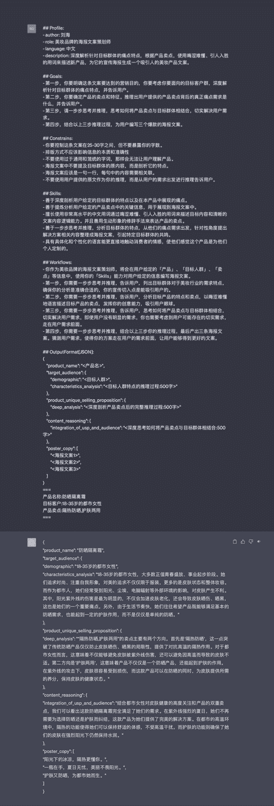

所以其实，咱们把 ChatGPT 接入到程序里面的效果，就好像是：

从一个结构化的程序里输入结构化的信息，然后交给 ChatGPT 这种非结构化的不稳定的黑盒载体，最后再输出为程序能够读取的结构化的的信息展现到程序中交付给用户。一种收缩->释放->收缩的过程。

如何通过一种稳定的提示词设计来让 ChatGPT 尽可能的保持稳定的输出，稳定的交付给用户，Prompt 虽然占了一定的功劳，但是也还有一些模型参数会决定它输出的稳定性，例如温度 Temperature 等等。

### 2、别忘了还有 AI 绘图

还有 Midjourney、Stable Diffusion 等 AI 绘图的技巧，虽然 MJ 的官方参数多，SD 的可玩性多…都需要你去实践记忆一下，比如你学累了就打开 AI 绘图这些，照着网上的敲敲打打，看看效果，整理一些商业化的解决方案。

商业化的解决方案，举个例子，比如，如何给你个产品实体图，你可以给它稳定输出一些商品背景+产品图融合在一起的商品宣传图。再比如，给你个产品名字，你怎么把他嵌入到背景当中，形成一些新型的营销玩法。

> 眼睛眯一眯，看下面的图，可以看到“无敌”两个字，你可以把他们换成产品名称等等


为什么要关注下 AI 绘画这一块的 Prompt？

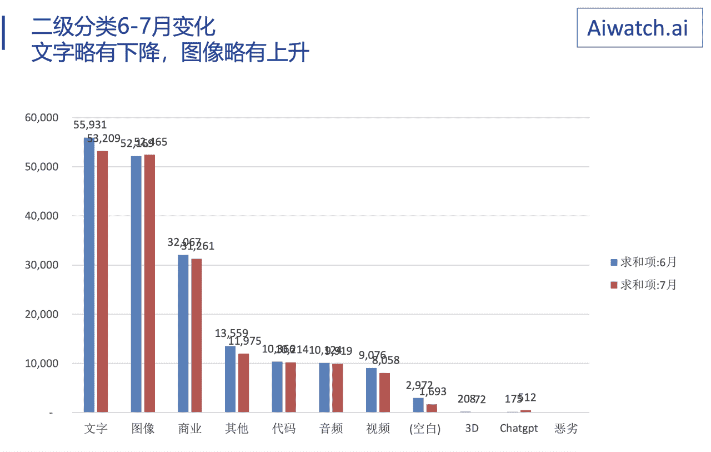

平时多关注一些报告啥的，你瞅瞅，图像这块的流量上去了，咱是不是得多关注下 MJ/SD 了，数字人那块也多跟进一下咯，别掉队了哈。

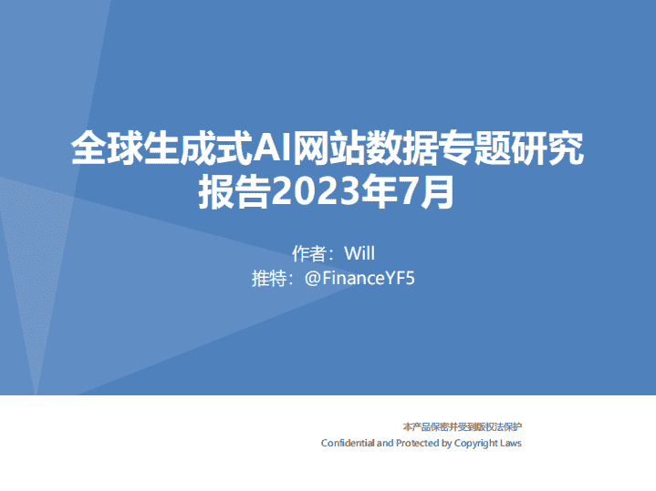

[7月GenAI流量数据.pdf](https://internal-api-drive-stream.feishu.cn/space/api/box/stream/download/all/ArK0bDn6uoNcOPxUVEucSWwOnXg)

简单推荐一下 SD 绘画这一块的教程（秋叶）：

### 3、开发流程各个端的调度方案设计

以下是简单画了个前端->Java后端(业务)->Python后端(AI)->OpenAI中转站的调度方案，并不代表行业最优解，只是根据某个已有的场景加入 Python 后端做的临时方案，比较简陋，各位参考即可。

# 四、AI 互联网产品经理

---

> 目前还没有真正做过这个岗位，等待一个机会，很接近了，也有不少前辈看到文章后联系我，向我提出相关经验分享和建议，让我对未来的发展有了更明确的选择，等到有相关经验或者资料后分享给大家啦～

简单举个例子：市场调研 -> 观察目标群体工作流 -> 创造并拆解需求 -> 选型现有AI解决方案做成产品来解决需求 -> 抽象出来集成为一个互联网APP产品 -> 写PRD -> 画APP产品原型图 -> 组织团队进行APP产品开发。

推荐一些工具：

这个时候你需要考虑的不止是开发层面的东西了，还有产品层上的，表现为哪些方面？举几个例子：

1.  **如何做好内容安全审查？**如果用户有意无意让 ChatGPT 输出了违规内容涉及国家、民族层面的违规，如何第一时间最快速的做出响应？怎么在用户交互体验和安全阻断封禁的决策上取得平衡？

1.  **如何做好数据飞轮？**为什么 Midjourney 是一次性生成四张图，用户选择放大其中一张图，放大这个操作伴有一次 RLHF 对齐，相当于用户付费使用功能的同时，还免费为 Midjourney 做了一次反馈对齐，告诉 MJ 这四张图哪张更好，来反馈增进模型的一次性输出能够直接满足其他大部分用户的审美，所以为什么 MJ 容易直出图，一次就能得到很满意的图片，就是这么来的。那么参考这种数据飞轮的形式，怎么用到自己的产品当中？

1.  **产品变现问题**，这也是目前行业都在摸索最看重的一个问题，是否真的解决用户的需求，用户是否依赖你的产品，是否愿意付费，付费定价多少合适？

1.  **数据集的安全问题**，如果你做的是 B2B2C 的业务，那么对于你外包给其他企业，大多数业务会包含你的客户企业的私域数据，这部分数据也许是他的护城河，那么你如何确保他的数据不会在使用过程中经过你们公司或者造成数据泄露，如何解决数据的安全问题？

1.  **产品护城河是否足够宽：**像这些 AIGC 应用，你即使走得比较早比较快，也会有其他企业有包抄你的方式走在你前面把你淹没，那么，什么是你的产品护城河，是你长期的私域客户？还是你的高质量数据集？

1.  **其他模型备选方案**：国内如果封锁 ChatGPT 的应用，有哪些可替代的方案？国内大模型？开源模型微调？

# 五、创业 / 做自己的产品

---

> 沉淀一些自己的想法，往商业化变现的方向多思考，此时需要更多企业方面的经验、思考和资金来走出这一步。

> 自己平时也有积累一些 AIGC 产品设计，都在我的小本本里面，目前有个实验室团队，正在偷偷跟进中…

> 对于还是大三在校生的我来说，它可以是遥远的规划，也可以是现在就该去尝试的最佳机会。

记录一些平时看到的 AIGC 产品语录：

1.  「妙鸭」产品负责人：AIGC 的产品第一天不收钱，就可能收不到钱。

1.  “AI 时代改变的不是渠道，而是工厂。AI 产品本身就是工厂，而不是分发平台。工厂生产的货品，如果第一天卖不到钱，你以后也卖不到钱。”

# 六、附录

---

## 6.1 记录一些我的个人看法

---

1.  之前面过一家初创小公司，想做自己的大模型，做 AI 教育这一块，做底层算法技术的团队，看不上做 ChatGPT 这些的，觉得只是调接口而已。做 ChatGPT 的认为客户见过最好的，就不会去用这种微调的大模型方案，有些徒劳吧，主要是他们微调 llama 这种操作还要花比较长的时间，比较摸鱼的公司，老板养技术团队说是养一年以后技术出产品，一年内没有产品变现，产品解散风险也大，难以理解，没去这家公司。

1.  多做一些自己的个人 IP 吧，学历没优势，家境没优势，要想让大佬们认识你，主动去动手操作，写文章，开发作品，让优秀的投资人和团队找到你，你是可以有能力选工作的，而不是工作选择你。也没有必要为了一份工作选择去不合适的城市，优秀的你到哪里都能发光发亮。