# 陈财猫：BORE框架的产生过程，一个自动驾驶产品经理的ChatGPT方法论

> 来源：[https://waytoagi.feishu.cn/docx/WGw5dDRMAoYNnaxbD57cV8wrnHh](https://waytoagi.feishu.cn/docx/WGw5dDRMAoYNnaxbD57cV8wrnHh)

> **作者：“陈财猫” 真名：陈颢鹏**

> BROKE提示词框架提出者，这篇文章是BROKE的前身BORE的产生过程

> 作者和港科大搞nlp的朋友写了一本书《ChatGPT 进阶:提示工程入门》

> 本篇文章经过作者授权收录到知识库，希望给大家一些启发

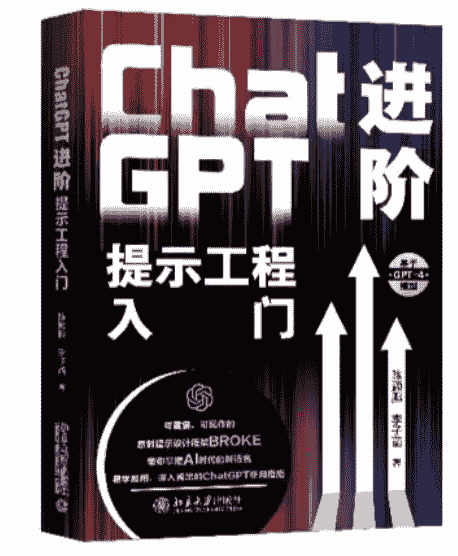

原文链接：https://mp.weixin.qq.com/s/AGdTBGn9vQrApZwPrAmxtQ

以下是正文内容：

---

我是一个自动驾驶行业的产品经理，也是ChatGPT的第一批用户。第一次遇见ChatGPT是在去年十二月的第一个星期，有一个搞AI的朋友在群里发了一张与ChatGPT的聊天截图，引起了我的兴趣，从此我便一发不可收拾。

刚开始，我与ChatGPT的交互主要限于找乐子：我和ChatGPT一起写小说，叫它读我朋友写的诗，用它和楼上一大早就开始装修的邻居吵架。

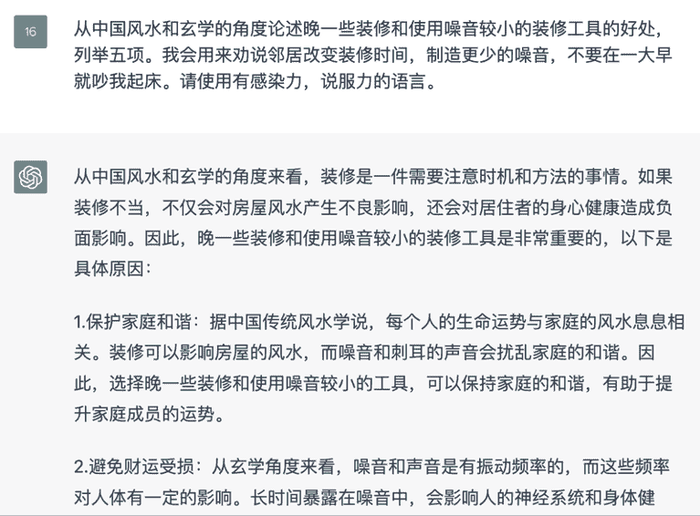

△一些关于风水的友好建议

后来，我用它画流程图，做数据分析，帮我读懂技术与代码，它已经成为了我工作中不可或缺的生产力工具。

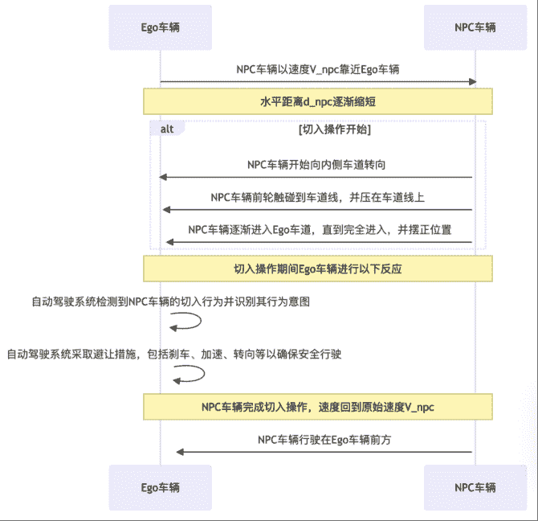

△该时序图的内容生成+绘图相关工作由chatGPT完成

我也发现了各种使用ChatGPT的技巧，甚至形成了一套可操作,可重复的ChatGPT方法论"BORE"。用这套方法论，每个人都可以成为ChatGPT的进阶玩家。

一眼看下去是不是有点复杂？别担心，后面的文章里，我会为大家讲清楚这套方法，并结合例子教会大家它怎么在工作中发挥ChatGPT的威力，接下来我们就一起开始看看吧。

## BORE：一套ChatGPT提示设计流程

众所周知，一个描述不好需求、讲话糊里糊涂的产品会让程序员痛苦无比，不仅影响程序员的心情，也直接影响产出的质量。从这个角度看，用户在与ChatGPT的交互中就充分扮演了产品经理“给程序员派活”的角色，写得稀烂的需求自然只能得到稀烂的回应，而如果“需求”设计得当，ChatGPT会给你超乎期待的惊喜。

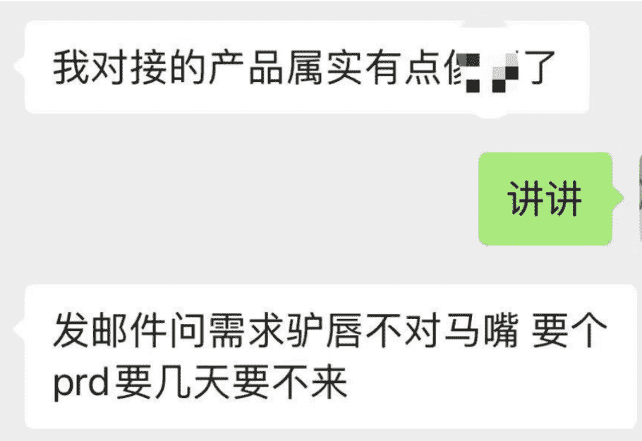

△我的大学舍友，一位热情洋溢的程序员朋友

写好“需求”是一门技术，在自然语言处理中这门技术其实已经有了自己的名字，我们的输入被叫做"prompt"，也就是提示。而写好提示的技术就叫做“prompt engineering”，也就是提示工程。这是一门高度依赖经验的技术，我在接下来的文章中会总结我的提示工程实践，教大家如何为这个“程序员”写好“需求”。我总结的技巧中会包含一些具体的应用场景，帮助大家更好地理解。

讲清楚背景，为ChatGPT提供充足信息

在我们告知它之前，ChatGPT对于各种具体的业务场景（背景）所知甚少。讲清楚背景是发挥ChatGPT强大能力的关键。

## 应用场景1：干活前先让ChatGPT进入角色

“干线物流自动驾驶“目前在自动驾驶领域是一个很火的方向，那么现在我们就以这个方向作为例子，假装自己是一家干线物流驾驶公司的产品。

来看看应用场景1，由于我们现在假装自己是一家干线物流自动驾驶企业的产品，可以在需要chatGPT辅助我工作前先运行这条prompt：

"我们公司研发L4级别的自动驾驶卡车系统。我们的车辆拥有一辆L4自动驾驶车辆所需要的算力，传感器与能力，但是目前车上会有司机作为安全员，自动驾驶系统会辅助司机的驾驶，帮助卡车司机开车更轻松，更安全，更节油。我将提供产品经理日常工作中的一些实际问题。这可能涉及设计具体的自动驾驶功能，进行数据分析，分析具体的行驶场景并提供有效的反馈等。你能够明白这件事吗？”

这个例子中，我们告诉了ChatGPT宏观的业务背景，并顺便检验了prompt的效果。在读到上面的内容后，ChatGPT就自动代入了自动驾驶产品经理的角色。后文的所有其他例子都是在ChatGPT进入角色的前提下进行的。

我们来详细拆解这条prompt的设计：

1.  阐述**背景，**点明当前的业务范围及业务目标：“我们公司研发L4级别的自动驾驶卡车系统。”然后进一步告知当前业务的细节：“我们的车辆拥有一辆L4自动驾驶车辆所需要的算力，传感器与能力，但是目前车上会有司机作为安全员，自动驾驶系统会辅助司机的驾驶，帮助卡车司机开车更轻松，更安全，更节油。”告诉chatGPT大致的任务范围：“我将提供产品经理日常工作中的一些实际问题。这可能涉及设计具体的自动驾驶功能，进行数据分析，分析具体的行驶场景并提供有效的反馈等。”

1.  确定**效果，**我一般会反问一句它是否理解，以此来检验传达的信息是否清楚，有没有被正确地理解。

下面是场景1的运行结果：

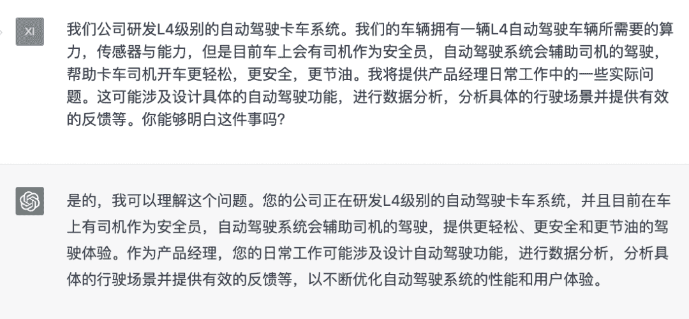

△场景1的运行结果

## 应用场景2：起草文档的结构与框架

熟悉了业务，就要开始干活了。ChatGPT进入角色后，我们来试试让它提供一个产品试乘报告的框架。我们为ChatGPT提供了“背景”，定义了“任务目标”：

"现在，作为一个产品经理，你需要去试乘我司的产品，用敏锐的目光去发现改进点，并提供建议。请为我提供一个试乘体验报告框架模板，模版要涵盖产品体验的不同方面，使用逻辑严密，清楚的语言，有优雅，清晰，易于理解的结构。

这是一款自动驾驶卡车。这辆卡车上有司机，它将在一条主要是高速的长途货运路线上装载货物运营。"

我们给ChatGPT的prompt可以被拆解成以下的部分

1.  阐述**背景：**这是一款自动驾驶卡车，车上有司机，跑的是长途

1.  定义**任务目标：**扮演的角色是产品，任务是写试乘报告模版框架，内容涵盖哪些方面，需要使用语言特点如何等等

下面是场景2的运行结果：

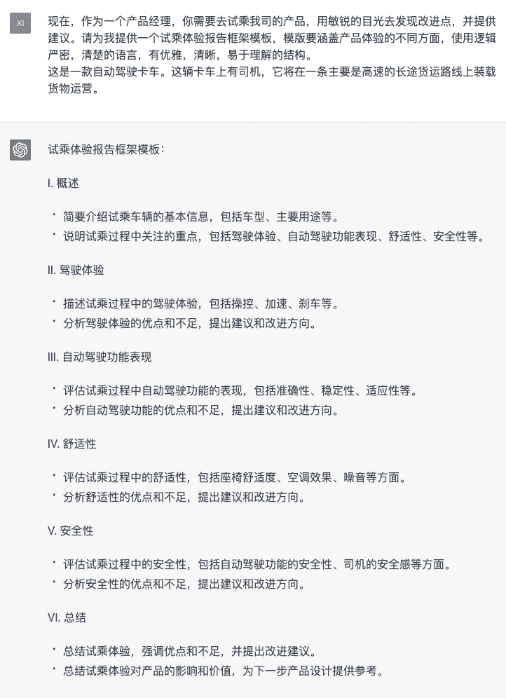

△场景2的运行结果

**小作业：**ChatGPT非常细心，可以捕捉到微小的细节，所以“写背景”这件事很重要。不信把场景1中的"我们公司研发L4级别的自动驾驶卡车系统”换成”我们公司研发L4级别的自动驾驶卡车“，再运行场景2试试。

给ChatGPT打绩效：定义目标&关键结果，试验并调整

各位在科技公司工作的同学们一定对OKR非常熟悉：这是一个标准绩效管理工具，我相信这篇文章的很多读者都写过OKR，被OKR打过绩效。不过在这里，我们主要是运用OKR来描述任务目标，管理任务的预期结果，并在任务的目标和期望上与ChatGPT达成共识。

那么，OKR是什么呢？我们先来回顾OKR的内容：OKR的英文是Objectives and Key Results，由两个部分,"Objectives"，任务目标和"Key Result"，关键结果组成。定义“任务目标”表达了我们希望实现什么，而定义“关键结果”则让ChatGPT知道实现目标所需要达成的具体、可衡量的结果。

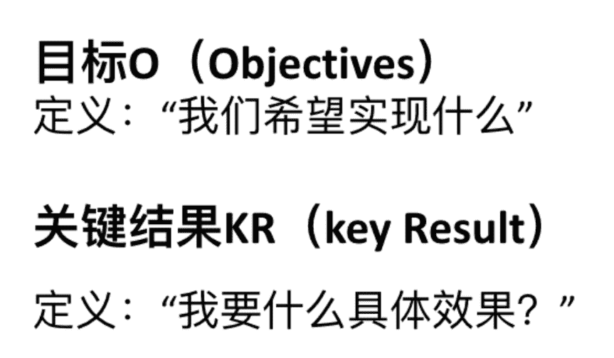

我们在之前的场景中其实已经为ChatGPT定义了OKR，例如在“应用场景2 起草文档的结构与框架”里，“提供一个试乘体验报告框架模板”就是“O”，而"要涵盖产品体验的不同方面，使用逻辑严密，清楚的语言，有优雅\清晰\易于理解的结构"则可以看做“KR”。

添加细节在ChatGPT的prompting中会起到立竿见影的效果，ChatGPT会对这些小细节做出巨大的反应。例如，有研究人员发现在GPT-3（可以理解为ChatGPT的爸爸）的输入前加入"Let's think step by step",就让它的推理准确率从17.7%暴增到78.7% [1]。

现在，作为ChatGPT的使用者，各位自然是巴不得它能够发挥出全部性能，又快又好地出活。既然已经有了顺手的胡萝卜（OKR），那么是时候请我们亲爱的小毛驴（ChatGPT）拉磨了

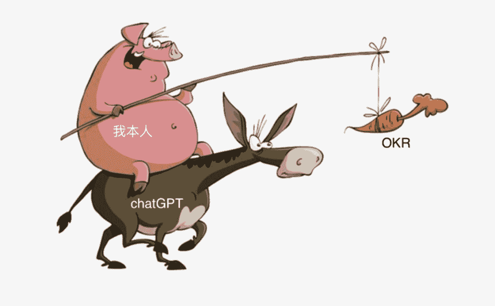

△设定了好的目标就是成功了一半

接下来我们看一个具体的例子，更好地理解这种思想与ChatGPT提示工程的结合。

## **应用场景3：分析具体业务场景**

我们来看应用场景3，自动驾驶产品经理在工作中常常要定义各种复杂场景，我们在这个prompt中要求ChatGPT协助我们定义一个简单的他车激进切入场景：

“在我车在高速上行驶时，常常会有他车从相邻车道从非常近的距离切入我车车道，造成碰撞风险。请用自然语言描述与定义这个场景。

语言风格：清晰，有逻辑性，可靠，容易使用计算机程序建模。

建模要求：描述清楚事情的过程和时序关系。注意用数字量来定义临界点。将切入的步骤编好序号。建模要体现两辆车的交互

我们的自动驾驶车辆被称为ego，他车被称为npc。”

在这个例子中，我们在阐述了背景，定义了任务目标的基础上再给出对任务的详细要求（也就是key results）。prompt从多个方面规定了对于理想答案的标准。

用刚才的框架对这条prompt进行拆解：

1.  阐述**背景**：宏观的业务背景已经在“让ChatGPT快速进入角色”中给出。所以我们进一步为ChatGPT描述了微观的具体业务场景（高速上被他车切入）。

1.  定义**任务目标**：任务目标O是“用自然语言描述与定义这个场景。”

1.  定义**关键结果**：这里的KR有“a. 语言风格：清晰，有逻辑性，可靠，容易使用计算机程序建模。b. 建模要求：描述清楚事情的过程和时序关系。注意用数字量来定义临界点。将切入的步骤编好序号。建模要体现两辆车的交互。c. 我们的自动驾驶车辆被称为ego，他车被称为npc。”

KR可以根据个人需求定制。例如在这个例子中，我们用自然语言给场景建模的目的可能是想要给程序员写PRD，所以要求“有逻辑，容易使用计算机程序建模”。而公司内如果有“黑话”，比如把自动驾驶车叫做ego，也可以告诉它。

1.  **试验并调整**，改进**：**这是一个试验并调整的过程。如果对ChatGPT生成的内容不能让人满意，有三种可能性：第一种是我们这个老板当得不好，指令给得不够清楚。这时候可以调整prompt，看看背景和OKR有没有需要补充的地方。重新生成回答。经过几次调整后，就可以得到比较满意的答案。第二种是ChatGPT这位员工干得不好，这时候我们可以指出生成内容中的错误，让它重新回答。第三种是你运气比较背，碰到一次不太好的结果。这时候你可以优中选优，相同prompt让ChatGPT多生成几次，然后选一次最满意的，让我们一起赞美AI的任劳任怨。

在这个过程中，我们给ChatGPT定了“OKR”，干完活了还要“复盘”，一个不对还要打回返工，是不是像极了屏幕后面的各位打工人们。

下面是这条prompt的运行结果，以及为答案纠偏的过程。

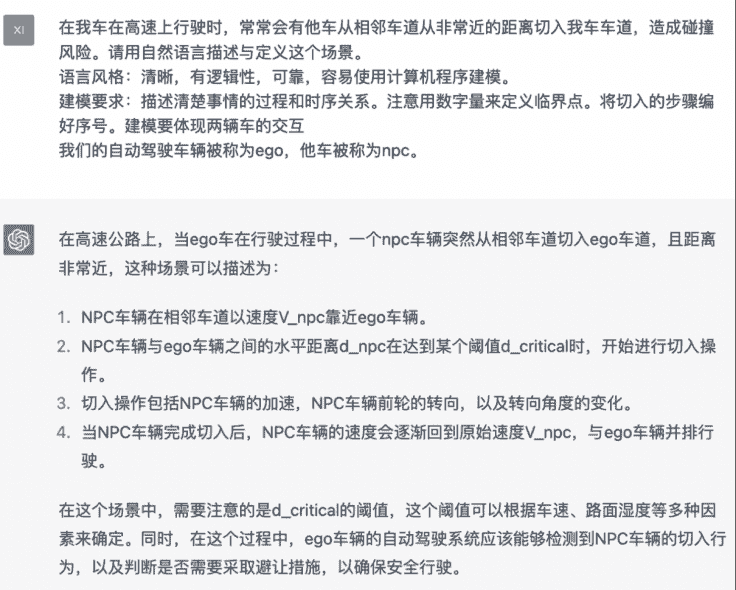

△场景3的运行结果

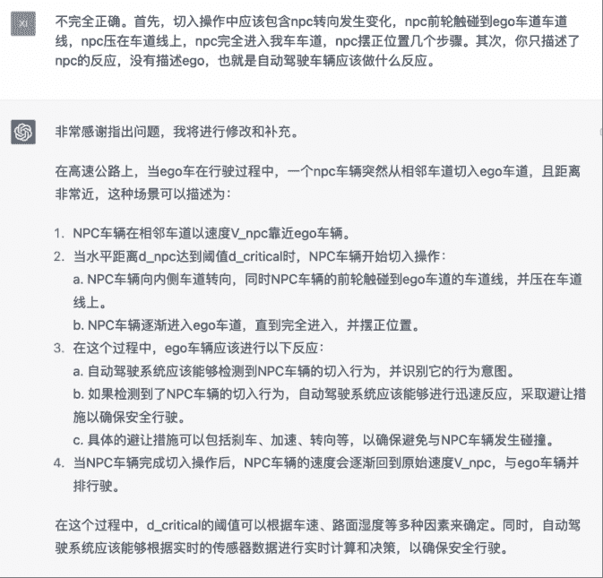

△通过“打绩效”来对ChatGPT纠偏

ChatGPT生成的回答不是完美的，所以通过"试验并调整"来纠偏非常重要。

**小作业：**上面回答的第4点中，有什么明显违反常识的错误？我们可以通过什么方式来让ChatGPT修正这个错误？

**小结**

讲到这里，我们复习一下上面所讲的内容。我们以背景，目标，关键结果，改进四个步骤为抓手，打出了组合拳，沉淀了一套ChatGPT prompting方法论

那么，接下来，我们给这种方法取一个好记又好听的名字：BORE，读作[bɔːr],记住这个名字就**等**于记住了这套方法。在“BO**R****E**”方法中，四个字母分**别**是四个单词的首字母，B代表Background，O代表Objectives，R代表key Results，E代表Evolve，“BORE"本身也是个英文单词，有“钻孔”的意思，很好记。

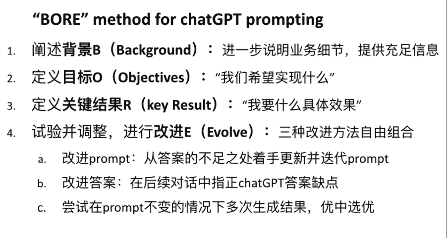

最后我们给出这四个流程的详细定义：

1. 背景B（Background）：阐述任务的宏观背景和微观场景，让ChatGPT得到充分的信息。

2. 目标O（Objectives）：明确任务的目标，告诉ChatGPT需要生成的内容是什么。

3. 关键结果R（key Results）：列出完成任务所需达成的关键结果，即需要满足的具体要求和指标。这些关键结果可以根据实际需求进行定制。

**4. 改进E（Evolve）：**试验并调整，下面三种改进方法进行灵活组合，最终得到满意答案。

a. “从答案的不足之处着手,更新并迭代prompt”，

b. “在后续对话中指正ChatGPT答案缺点”，

c. “在prompt不变的情况下多次生成结果”

撬动外部工具，放大ChatGPT能力

这里，我们还有一些其他的ChatGPT进阶技巧：将ChatGPT的能力与外部工具结合，放大ChatGPT的能力。

作为产品经理，我们要为业务画时序图，画流程图等。有时我们也要用一些生动的图像，数据的分析去支撑需求改动，让我们的需求更有说服力，这样我们会更有可能通过产品评审会。

△很多程序员都想要的实用职场技巧

然而，到此为止，ChatGPT展现的能力都是文字 or 代码上的，难道就没有办法了吗？

等等？ChatGPT可以生成代码？

## 应用场景4：利用ChatGPT画时序图

既然ChatGPT可以生成代码，那么代码是不是可以转化为各种各样的图像？感谢各位程序员的开源精神，目前我们有很多基于代码的工具可以使用，让我们搜索一下“code to diagram”（代码转图表）试试。

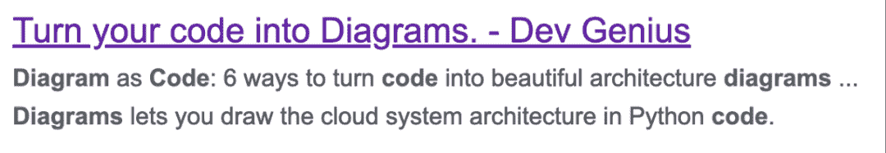

好得很，当然有，出来的第一个结果就提供了足足6种工具，那么接下来就赶快试一下。

在这里，我们选择mermaid（意思是美人鱼），不仅是因为它支持十几种图像，而且它还提供了一个在线编辑器，代码贴进去就可以马上生成图像。生成器的网址在：https://mermaid.live/

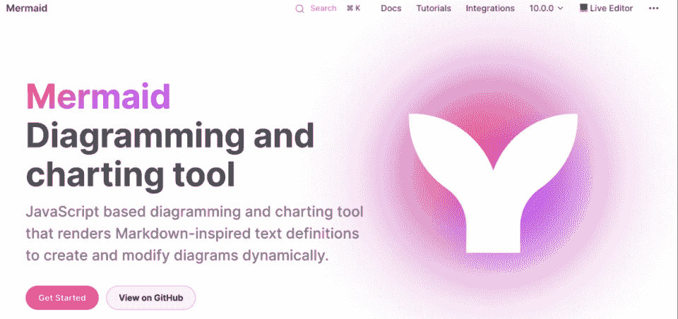

△mermaid项目主页

那么，我们试着在应用场景3的基础上深入，以ChatGPT已有的输出为基础，要求它画出“在我车在高速上行驶时，常常会有他车从相邻车道从非常近的距离切入我车车道，造成碰撞风险。”的时序图。

请看下面的prompt：

"目前有一款用来将代码转化为各种图表的工具，叫做mermaid。请阅读下面的内容，写一份可以生成mermaid时序图的代码。请注意，时序图要与我提供的内容保持完全一致。

内容：在高速公路上，当ego车在行驶过程中，一个npc车辆突然从相邻车道切入ego车道，且距离非常近，这种场景可以描述为：

1.NPC车辆在相邻车道以速度V_npc靠近ego车辆。

2.当水平距离d_npc达到阈值d_critical时，NPC车辆开始切入操作：

a. NPC车辆向内侧车道转向，同时NPC车辆的前轮触碰到ego车道的车道线，并压在车道线上。b. NPC车辆逐渐进入ego车道，直到完全进入，并摆正位置。

3.在这个过程中，ego车辆应该进行以下反应：

a. 自动驾驶系统应该能够检测到NPC车辆的切入行为，并识别它的行为意图。b. 如果检测到了NPC车辆的切入行为，自动驾驶系统应该能够进行迅速反应，采取避让措施以确保安全行驶。c. 具体的避让措施可以包括刹车、加速、转向等，以确保避免与NPC车辆发生碰撞。

4.当NPC车辆完成切入操作后，NPC车辆的速度会逐渐回到原始速度V_npc，并行驶在ego的前方。"

我们来拆解这段prompt，仍然是上文中提到的BORE方法：

1.阐**述背**景：我们提示了ChatGPT对话中所说的mermaid是代码转图表工具，并在“内容”中提供了需要他转换成时序图的文字。

2.定义**任务目标**：请阅读下面的内容，写一份可以生成mermaid时序图的代码。

3.定义**关键结果**：时序图要与我提供的内容保持完全一致。

4.**改进**，尝试并调整：这段prompt经过多次调整，我也多次让ChatGPT打回重做，得到的结果是优中选优的（在图中我们可以看到调整prompt+重新生成加起来共9次）。

最后，我们得到了可以生成时序图的代码：

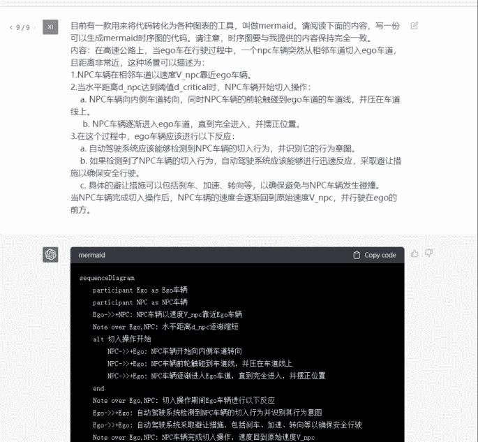

△场景4的运行结果

将得到的代码粘贴到mermaid live editor中，就可以生成结果了

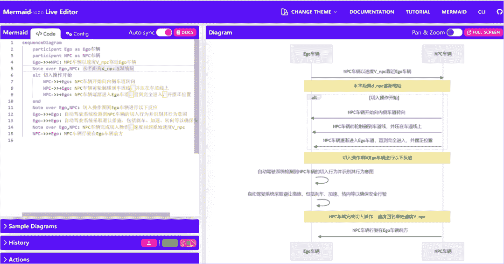

△mermaid在线生成图表页面

最后是成品图。

不过，mermaid提供的能力远远不止时序图，目前官网上就有13种可用的图表，包括流程图，顺序图，类图，状态图，实体关系图，用户旅程，甘特图，饼状图，需求图，Git图，C4C图，思维导图，和时间轴。请在工作中自由取用。除了mermaid之外，还有像plantUML，Diagrams，markmap之类的code to diagram工具，这里就不赘述了。

## 应用场景5：用ChatGPT做数据分析

自动驾驶产品经理是一个非常需要实事求是的工作，要设计一个什么功能，空口说是不算证据的，数据很重要。再加上我司的数据基础建设做得挺好，所以我在工作中会接触到大量的数据，做很多数据分析工作。良好的数据分析也可以帮助产品设计的功能更好更合理，当然也就更容易通过需求评审会。

从工具和规模上来说，写一两行excel公式是数分，用hadoop，写spark算大数据也是数分。从方法上来说，算平均数是数分，用各种各样的机器学习方法做回归，分类也可以叫数分。数分前有时候还要做进行数据清洗，数据预处理等等。这是一门独立完整的学科，话题要展开实在是太大，我就不在这里提供具体例子了。

用ChatGPT做数分可以利用的数据分析工具

这里提供一些简单的罗列，如果不知道我在说什么，可以上网搜一搜教程。

**1. excel：**各位最熟悉，也是最简单的就是excel了。写点公式就算进阶用法（比如说有的岗位的JD甚至明确要求会用vlookup这一个函数），再进一步，我们可以写一点Excel宏，也就是在excel里头运行VBA程序。在excel界这已经是非常高级的用法了，它非常强大，作为产品你能用到的绝大部分需求都可以用它解决。（还有人用excel宏来写计算机病毒，叫做宏病毒，毕竟VBA也是编程语言）ChatGPT可以非常轻松地根据你的需求和描述写出可以用的excel宏。

**2. python：**python有很多强大的数据分析库。数分有pandas，numpy等，画图有seaborn，plotly，matplotlib等，机器学习的就更多了。这是个很大的话题，但是产品日常工作学点pandas+绘图库就够用。一般数据分析的代码可以用jupyter notebook来运行（非常合适数据分析！），用anaconda管理安装的各种包，详情请看网上的python数据分析教程。

**3. R语言：**这是一个专门用来搞统计的语言，不过Python已经够用，在此按下不表。

## 用ChatGPT做数分的一些小tips

**1. BORE框架仍然管用：****之**前**提到**的设计原则仍然管用，例如“提供背景Background”，有时候你不妨把得到的运行结果直接粘贴给它看（如果是文字的话）。而ChatGPT仍然也会对你设定的“关键结果key Result”起反应，比如画图画得太丑，你就可以督促它画好看点，配色好一些等等，它会有反应的。

2. ChatGPT会有一定瞎编&错误的情况：有时候ChatGPT会对不了解的信息乱编一气，代码中的计算过程也不一定对。你必须足够小心，看看有没有错的地方，这要求你对它使用的数学方法与工具都比较了解。

**3. 上下文有限：**ChatGPT目前上下文能力有限，只能读到上下文的几千个字，所以会有“忘记”的情况，这种时候你可以把前面的内容重新粘贴到最新的对话里，提醒它一下。另外，这也意味着chatGPT只合适小规模数分，如果你的代码比较多，全部靠它就不现实了。

4. **思想为主，工具为辅：**数据只是数据，如何解释数据才是其真正价值所在。别忘了在工作中业务价值才是数据分析的最终目的，你的思考不能省，ChatGPT只能作为辅助工具。

## 一些关于ChatGPT与人工智能的想法

使用ChatGPT的注意事项&想法网上有很多，我提出个人感触比较深的几点

1. ChatGPT的使用者要负起责任，当好“把关人”。这个东西经过了人类反馈的强化学习训练，非常喜欢讲一些“看起来是对的，完全符合语言逻辑，但是其实是胡说八道”的东西。使用者一定要当一个合格的把关人，要对生成内容有基本的判断能力。特别是自动驾驶产品经理，我们设计的车辆将会在道路上行驶，是人命关天的事情，一定要有责任感。同时，openai会收集对话信息用于改善产品，要注意保密问题。

2. ChatGPT**“**省工不省脑”。“描述清楚到底想要什么”和“知道需要做什么”这两件事并不比上手去做简单太多。对于第一件事，清晰地描述需求是每个产品的基本功，很多人做不到这一点。对于第二件事，你也必须够懂业务，心里有数，才能知道“要做什么才是对的”。在这个层面上，我们和ChatGPT之间倒是有点像领导和员工的关系了（老板负责规划战略，想活派活，发出指令，而员工负责执行）。

3. 人工智能是人类新长出来的器官，未来世界里每个人都是通才。有个比喻说互联网和手机是新的器官，极大地扩展了人类的记忆容量。每个人都可以通过手机，即时从互联网获取大量的信息，就像多了一个用来记忆的器官一样，人工智能也是如此。每个人工智能都是人类新长出来的器官，用于完成特定的任务。在它们的辅助下，每个人在未来世界里都将成为通才。

4. 要用ChatGPT创新？想点不一样的组合。在心理学中，心理学家从两个方面评价创造力。第一个是发散思维（对某一问题产生不寻常想法的能力）。第二个是聚合思维（整合不同来源的信息，从而解决问题的能力）。从这个角度看，“把两个看似不相关的东西结合在一起，发挥出更大的威力”这件事也许就有点创造力的意思。除了文中把ChatGPT和绩效评估，ChatGPT和图表语言结合以外，有人目前还整了很多更新更狠的活。有人给小爱同学接了openai的api就变成了人工智能音箱，让ChatGPT写AI绘图的prompt就能出很多好看的图，ChatGPT和搜索引擎结合在一起就做出了new bing。就在最近（2月20日），微软发布了一篇叫做“ChatGPT for Robotics”的文章，研发人员就建立了一套用于给机器人任务撰写prompt的方法论和设计原则，用ChatGPT调api，试着让机器人也听得懂人话 [2]。在想"ChatGPT可以做什么"的时候不妨当一下缝合怪，可谓广阔天地，大有可为。

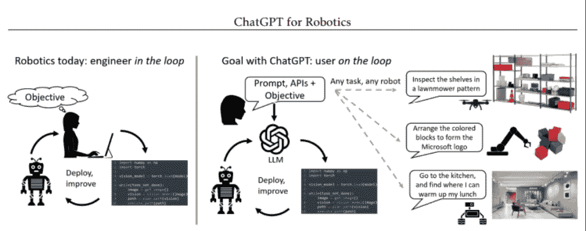

△ChatGPT for Robotics论文配图

这是一个崭新的时代，各种伟大的事物不断地诞生。祝大家接下来玩得愉快，能够用BORE“钻”出更多ChatGPT的潜能！

引用1 Kojima, Takeshi, et al. "Large language models are zero-shot reasoners." arXiv preprint arXiv:2205.11916 (2022).

引用2 https://www.microsoft.com/en-us/research/group/autonomous-systems-group-robotics/articles/ChatGPT-for-robotics/

**与作者交流**

如果希望与文章作者直接交流，可以直接扫描下方二维码，添加作者本人微信。

