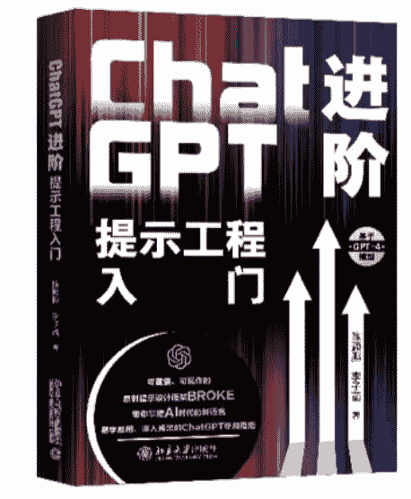
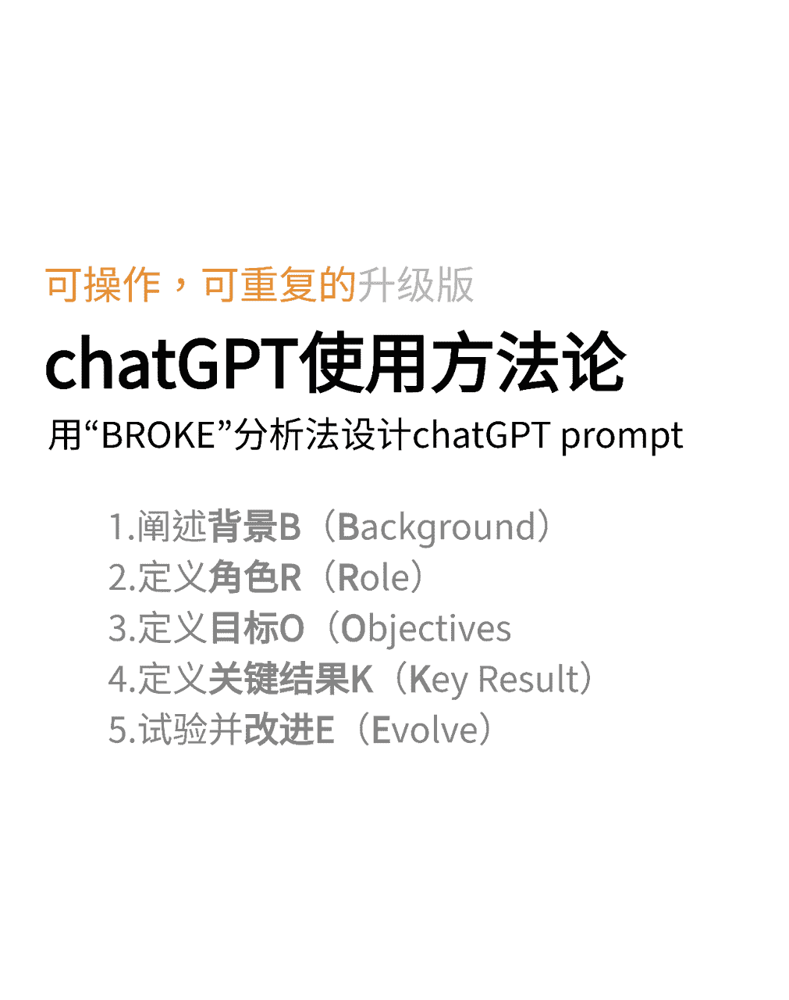
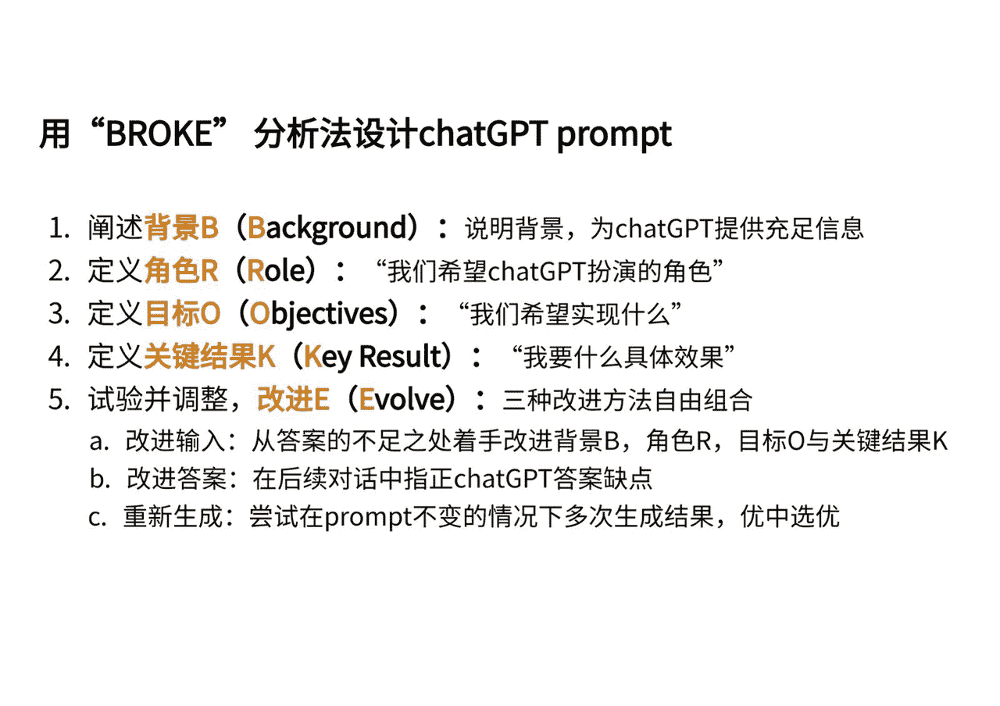
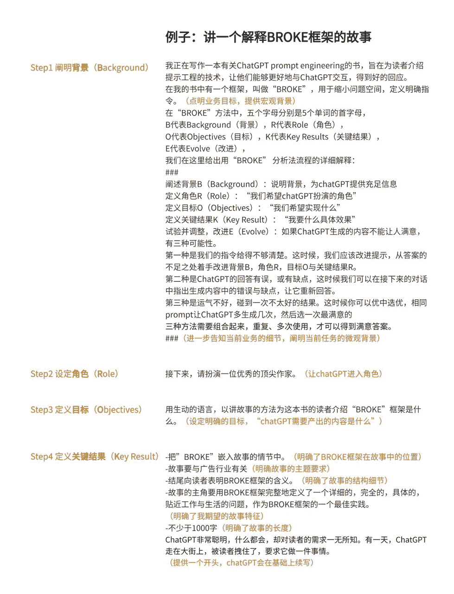
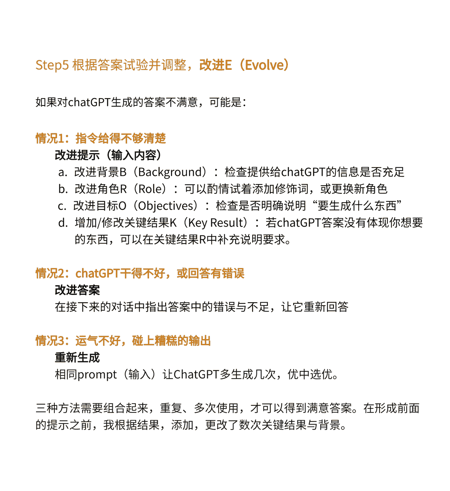
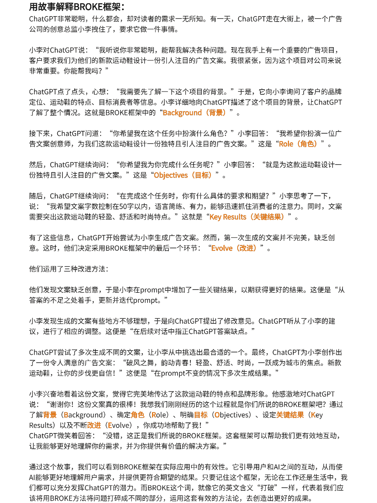

# 陈财猫：可操作，可重复的GPT使用框架“BROKE”

> 来源：[https://waytoagi.feishu.cn/docx/QmCUdTM1ao8sfJxStBhc2T7DnGd](https://waytoagi.feishu.cn/docx/QmCUdTM1ao8sfJxStBhc2T7DnGd)

> **作者：“陈财猫” 真名：陈颢鹏**

> BROKE提示词框架提出者，这篇文章是BROKE的用法和详细解释

> 作者和港科大搞nlp的朋友写了一本书《ChatGPT 进阶:提示工程入门》

> 本篇文章经过作者授权收录到知识库，希望给大家一些启发

> 小红书原文：73 【可操作，可重复的GPT使用框架“BROKE”来了 - 陈财猫 | 小红书 - 标记我的生活】 😆 fGLE0C3sMpRLwQe 😆 http://xhslink.com/e5sN9t

