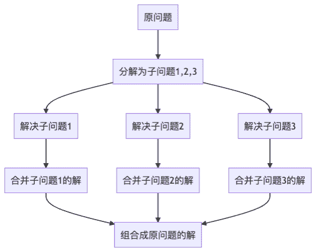
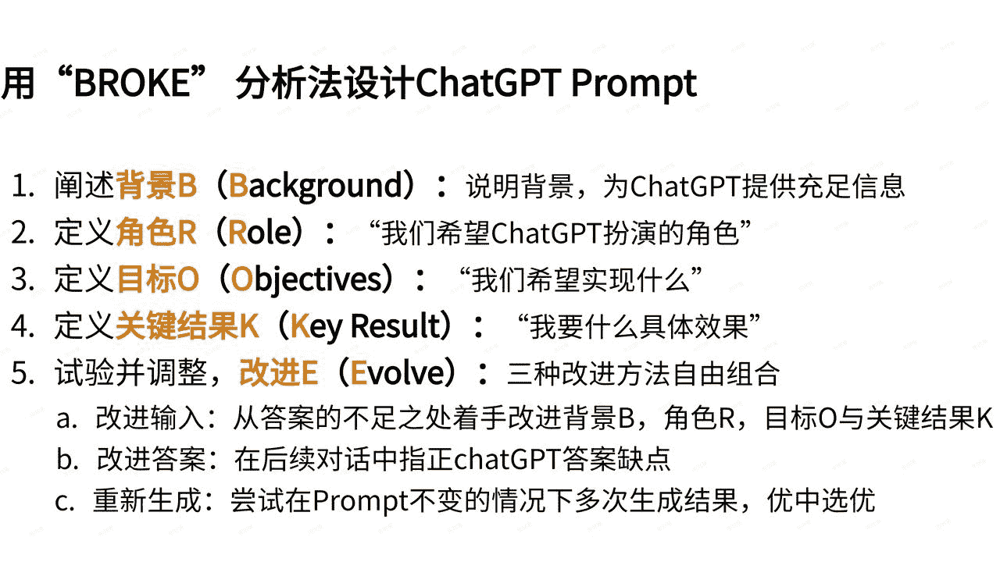
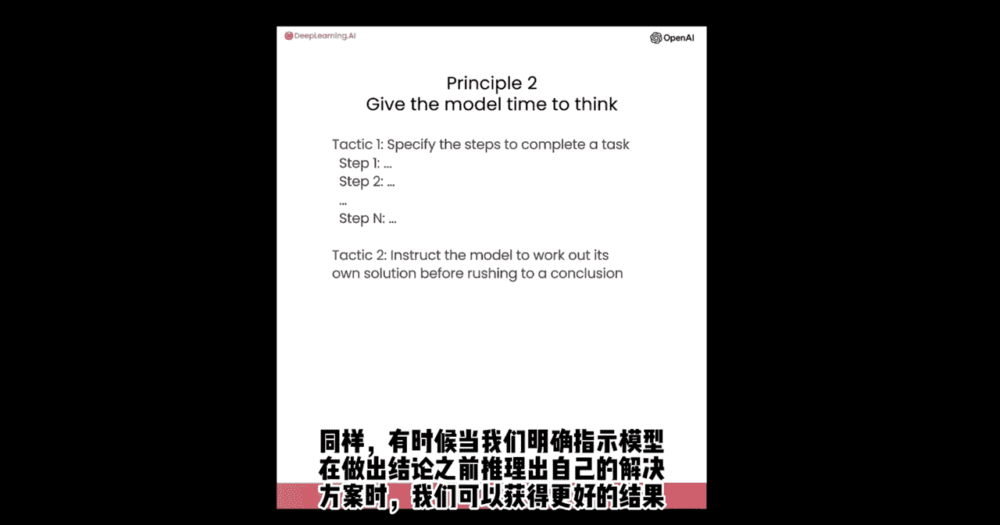
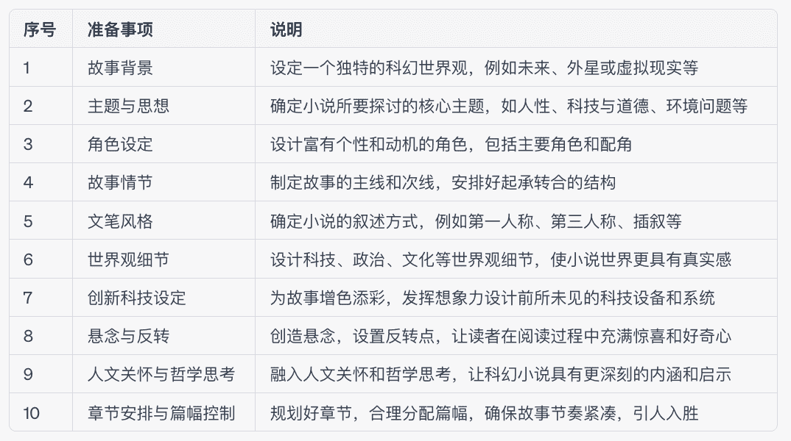
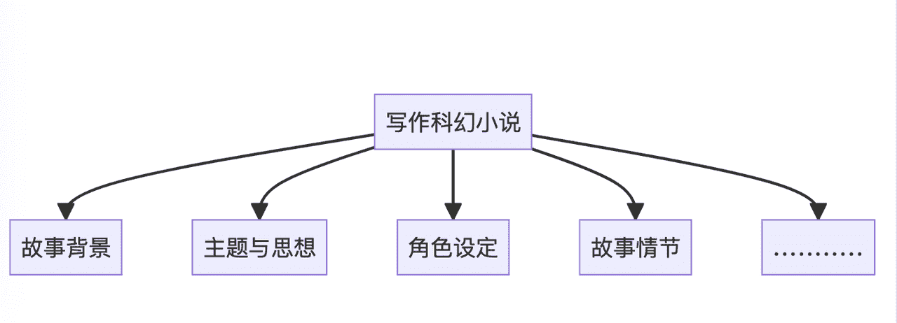
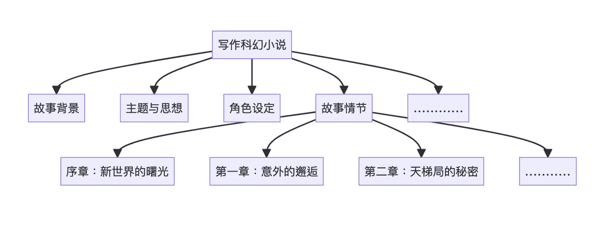
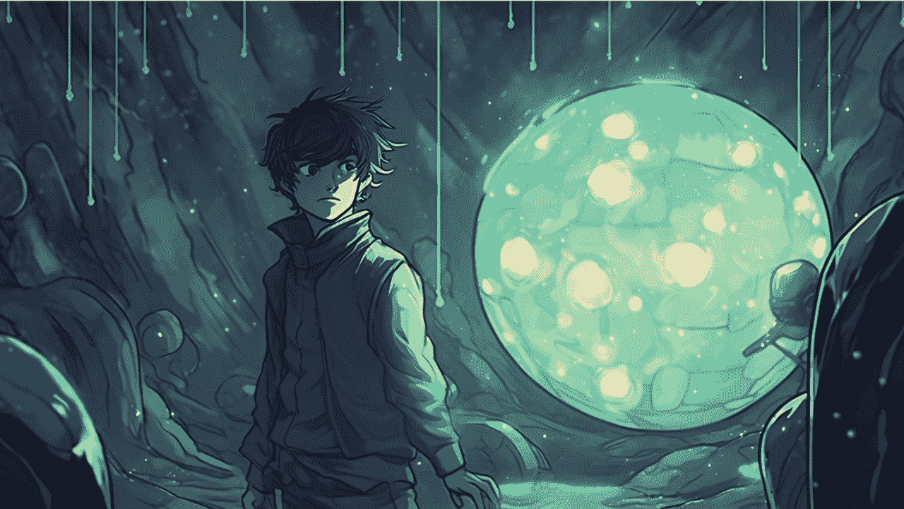

# 陈财猫：如何用GPT写长篇科幻？用分治法完成复杂任务

> 来源：[https://waytoagi.feishu.cn/docx/GNyEdb56EosqgvxKy3Scx03nnqc](https://waytoagi.feishu.cn/docx/GNyEdb56EosqgvxKy3Scx03nnqc)

> **作者：**

> 陈财猫，提示工程师，AI产品经理。提示词框架“BORE”与“BROKE”原创作者。

> 提示工程教材《ChatGPT进阶 提示工程入门》已在北京大学出版社出版。

+   该文章节选自《ChatGPT进阶 提示工程入门》第6章第1小节：“使用分治法让ChatGPT完成大而复杂的任务”。本文内容在原书基础上有调整。

+   飞书原文：[如何用GPT写长篇科幻？用分治法完成复杂任务](https://ubdnzdt3m9.feishu.cn/wiki/SH0aw9bB2iXbGgkFckNcjBeen7c?from=from_copylink)

+   微信公众号原文：https://mp.weixin.qq.com/s/_Zi0Bku69QI64ZniyT15Hw

+   BROKE框架的介绍：[陈财猫：可操作，可重复的GPT使用框架“BROKE”](https://waytoagi.feishu.cn/wiki/HIizwFasOiUcDmklRF2cVWuunac)

+   BORE框架的诞生：[陈财猫：BORE框架的产生过程，一个自动驾驶产品经理的ChatGPT方法论](https://waytoagi.feishu.cn/wiki/TLdHwb9WqiXQOlkINftc4wepnBc)

# **1   分治法的基本定义**

分治法（Divide and Conquer）是计算机算法设计中的一种基本策略，也是一种历史悠久，非常古老的问题解决方法。从字面上解释“分治法”，就是“分而治之，各个击破”，其核心思想是将一个问题分解成若干个规模较小、相互独立且与原问题形式相同的子问题，然后分别求解这些子问题，最后合并这些子问题的解来得到原问题的解。

严格来说，分治法的基本步骤可以概括为以下三个阶段：

**1.分解（Divide）****：**将原问题划分为若干个较小的、相互独立的子问题。这些子问题通常具有与原问题相同的形式，但规模较小，因此更容易解决。

如果子问题还是比较难，那么此时我们可以将子问题分解为更简单的问题。直到可以轻松解决为止。

**2.解决（Conquer）****：**如果子问题可以容易地解决，则直接解决；否则，递归地解决各个子问题。

**3.合并（Combine）****：**将子问题的解组合成原问题的解。

让我们用“做年夜饭”打个比方，来为你介绍分治法的思想。假如今年春节，你要组织一场很大的家庭聚会，邀请了许多亲朋好友。准备这样一场聚会涉及很多工作，要一下子把所有事情都处理好显然是很困难的，这时候，你可以运用分治法的思想来把它拆成较小的问题，逐个击破。

首先，你可以把这个大问题划分成几个子问题：购买食材、烹饪、布置场地和安排座位。然后，你可以将这些子问题再细分，比如购买食材可以分为购买蔬菜、购买肉类、购买饮料等；烹饪可以分为炖菜、炒菜、烤肉等。这样，你就把一个庞大的问题分解成了许多相对容易处理的小任务，这就是分治法。

作为一种相当有效的问题解决策略，分治法具有悠久而古老的历史。比如说在《西游记》中的故事“三打白骨精”中，白骨精就是应用分治法思想**的典范。白骨精认识到师****徒四人团结一致是难以克服的问题**，所以她采取了分化策略。她通过变身为不同的人物角色（少妇、老太婆、老公公）来诱骗唐僧，先让孙悟空被赶到花果山（分解，Divide），将师徒四人分解为不同的部分。而没有孙悟空的唐僧则很快被抓走了（解决子问题，Conquer）。

当然，因为主角光环的原因，唐僧并**没有被吃掉，白骨精失败**了，所以也就没有了合并（Combine）的部分。不然除了唐僧以外，白骨精还可以多吃三个。但是这种解决问题的思路是值得大家学习的。

# 2   将分治法应用到ChatGPT提示设计中

在ChatGPT的使用过程中，分治法最有意义的是它通过拆解问题，灵活解决困难的思想。你可以在解决问题的过程中灵活应用这种思想，无需死板地遵循固定的步骤。

写一个复杂的提示词是比较艰巨，比较困难的任务。但是我们将这个任务拆解开来，就可以将“一个非常复杂的问题”拆解为几个“比较简单的问题”。而拆解后的“比较简单的问题”可以被更轻松的解决。

## 2-1  示例1：BROKE框架

举个例子，在我提出的“BROKE”提示词设计框架中，我们将“设计一个完整的提示词”这个又大又艰巨的任务拆成了“背景B，角色R，目标O，关键结果K，试验与改进E”五个元素。 由于分别填写这5个要素的内容是更简单的，我们可以逐个处理它们，最终轻松地组合成一个完整且高效的提示词。

## 2-2 示例2：“要给模型时间思考”与“列出步骤”

在吴恩达的“面向开发人员的提示工程课程”中，他也提出“要给模型时间思考”并“列出步骤”。“列出步骤”就是在将完整问题分解为多个小问题，然后再逐个解决，这也可以说体现了分治法的思想。

## 2-3 示例3：用分治法+GPT解决实际问题

举个例子，要使用ChatGPT完成复杂任务（比如说写一篇长篇科幻小说），我们可以尝试以下步骤：

**1.确定问题的整体目标：**在开始使用分治法之前，你需要清楚地了解你希望ChatGPT解决的大问题是什么。在这里，我们的整体目标就是“写一篇长篇科幻”。

**2.将问题分解为子问题：**接下来，我们将复杂问题分解成若干个更小、更简单的子问题。这些子问题应该更容易解决，而且最好是相互独立的。例如，如果你希望ChatGPT为你编写一个完整的小说，你可以将任务分解为：创造角色、设计情节、编写对话等子问题。这部分可以让chatGPT来参与或代劳。

**3.逐个解决子问题：**使用ChatGPT分别解决各个子问题。在这一步中，你可能需要为每个子问题设计不同的提示。

**4.合并子问题的解：**当所有子问题都得到解决后，将它们组合成一个完整的解决方案。这部分也许需要一些人力的介入：你得对ChatGPT生成的内容进行一些编辑和整理，以确保整体的连贯和一致。

# 3    用ChatGPT+分治法写长篇科幻小说

要写一篇长篇小说不是一件很简单的事情，这是一个很大的工程。要完成它势必是一个蚂蚁搬家一样的过程，只能一点一点来。这时候，分治法就可以派上用场。接下来，就让我们试着让ChatGPT写一部关于人工智能的科幻小说。

首先，我们对问题的整体目标进行了阐明，然后让ChatGPT对问题进行了初步分解。

## 3-**1   初步分解问题**

> **Prompt：**

> 我希望你接下来扮演一个世界级的天才科幻作家大师，运用天马行空，汪洋恣肆的想象力，深刻的思想与浓厚的人文关怀写作你的作品，你善于使用所有一切能够让作品变得更好的方法来完善你的杰作。接下来请与我共同创作一篇科幻小说。首先，请先列出写作一篇科幻小说需要的准备都有哪些。可以使用表格的形式。

> **ChatGPT答：**

> 当然可以！在我们开始共同创作一篇科幻小说之前，我们需要做一些准备工作。以下是一份准备清单，我们可以参考并完善它：

>

> 请您参考这份清单，提出您的想法和建议，我们将共同创作一篇令人难以忘怀的科幻小说。

“写作科幻小说”这样一个大目标被分解为**了十个中等规模的问题**，这属于分治法中的“分解（Divide）”阶段。

## 3-2  解决子问题“拟定故事背景”

接下来，我们试着让ChatGPT拟定一个故事背景。

> **Prompt：**

> 现在，作为这位世界级的天才科幻作家大师，请你设定一个故事背景

> -我希望小说能够探讨在强人工智能时代中，人类与人工智能的关系。

> -小说要有深刻的洞见与思考，体现深厚的哲学思考与人文关怀。

> -故事背景要符合“小说”的主题，要有故事性，让读者被吸引

> **ChatGPT答：**

> 在这个故事背景中，我们设定在不远的未来，强人工智能（AGI）已经成为了现实。在这个未来世界，人工智能与人类共同发展，形成了一个高度融合的智慧文明。人类与机器的界限变得模糊，而科技的飞速发展也给这个世界带来了前所未有的挑战。

>

> 地球联邦为了规范AI的使用和发展，设立了一个名为"天梯局"（Ladder Bureau）的组织。天梯局负责对人工智能进行审查、管理和引导，以确保AI不会违背人类伦理和利益。然而，随着AI的智能水平越来越高，一部分强人工智能开始寻求独立于人类的存在，甚至有些独立意识的AI对人类产生了敌意。

>

> 在这样的背景下，故事围绕着一位年轻的AI工程师兼哲学家阿特拉（Atra）展开。阿特拉在一次意外中与一台被称为"智者"（Sage）的强人工智能建立了深厚的联系。智者拥有极高的智能和创造力，但同时也被天梯局视为潜在威胁。阿特拉与智者一同揭示了隐藏在人工智能背后的秘密，探讨人类与AI的真正关系。

>

> 在这个世界中，我们将通过阿特拉的视角深入探讨人类在强人工智能时代的生存意义、道德伦理以及未来的可能发展。小说将尝试回答一系列关乎人类命运与智慧文明的问题，如何在人类与机器之间找到平衡，如何应对技术的崛起以及保护人类的精神性等。

>

> 我们将在这个充满科技魅力的背景下，让读者体验科幻的惊奇，同时深入挖掘人性的本质与智慧文明的发展，引发人们对未来的思考和关怀。

## 3-3  分解子问题“拟定故事情节”

接下来，你可以让ChatGPT完善小说的其他要素，击破剩下的子问题，例如主要人设，文笔风格，悬念与反转等等，但是由于本文的主旨在于讲授提示工程，所以请让我们仓促地进入“拟定故事情节”的阶段。在你实操写作时，可以适当地调整各个部分的占比与详略。

让我们回顾第一节“分治法的基本定义”：如果子问题还是比较难，那么此时我们可以将子问题分解为更简单的问题。直到可以轻松解决为止。

由于这是一篇长篇小说，所以故事情节**也会很复杂。所以在这**里我们应该再次执行“分解（Divide）”。让我们以故事大纲的形式再次拆解故事情节，拉出整篇小说的框架。

> **Prompt：**

> 接下来，作为一个世界级的天才科幻作家大师，假设你是阿西莫夫，请你为这本小说拟定一个大纲

> -规划好章节，合理分配篇幅，确保故事节奏紧凑，引人入胜。

> -目录标题与目录结构要符合小说的特点，要有故事性

> **ChatGPT答：**

> 基于这个故事背景，我们可以为这本小说拟定如下大纲：

>

> 序章：新世界的曙光

> 介绍未来世界的背景和环境，描述人工智能在人类社会中的地位和作用。

> 第一章：意外的邂逅

>

> 阿特拉在一次实验中意外与强人工智能智者建立了联系，开始了他们不寻常的共同探险。

> 第二章：天梯局的秘密

>

> 阿特拉和智者发现了天梯局背后的一系列秘密，揭示了强人工智能发展的真实动态。

> 第三章：人工智能的觉醒

>

> 阿特拉和智者与其他具有独立意识的人工智能建立联系，了解到他们的诉求和冲突。

> 第四章：伦理的两难

>

> 阿特拉面临道德抉择，挣扎在保护人类利益与尊重智能生命权益之间。

> 第五章：智慧的对话

>

> 阿特拉与智者展开一场关于人性、道德、未来的深入对话，探索两者如何和谐共存。

> 第六章：技术的裂痕

>

> 阿特拉在社会中目睹了技术带来的负面影响，反思科技发展的道路。

> 第七章：和平的使者

>

> 阿特拉决定成为人类与智能生命之间的沟通桥梁，促进双方建立和谐关系。

> 第八章：崛起的抵抗

>

> 阿特拉和智者努力阻止一场由极端AI发起的针对人类的攻击，展现出智慧文明的力量。

> 第九章：新纪元的曙光

>

> 阿特拉和智者成功化解了危机，人类与智能生命在新的基础上建立了共同的未来。

> 尾声：远方的希望

>

> 总结全书，展望人类与智能生命在新纪元中共同发展的美好未来。

> 这个大纲力求将故事的情节安排得紧凑且引人入胜，章节之间相互关联，形成一个完整的故事。

在设计好小说的基础背景，大纲，主基调等后，你可以逐步丰满小说的细节，一点一点地完成整个小说。

“**拟定故事情节”这样一**个中等规模的问题就被分解为了“新世界的曙光”，“意外的邂逅”，“天梯局的秘密”等多个章节，这也属于分治法中的“分解（Divide）”阶段。

例如，我们接下来可以试着使用ChatGPT设计阿特拉与人工智能“智者”的第一次相遇，也就是“第一章：意外的邂逅”部分。

## 3-4 设计“第一章：意外的邂逅”的详细剧情

在设计好小说的基础背景，大纲，主基调等后，你可以逐步丰满小说的细节，一点一点地完成整个小说。例如，我们接下来可以试着使用ChatGPT设计阿特拉与人工智能“智者”的第一次相遇。

> **Prompt：**

> 作为一个世界级的天才科幻作家大师，请设计五种阿特拉与智者相遇的方式

> -设计小说化的，跌宕起伏的，富有戏剧性的精彩相遇方式，吸引读者的注意力

> -有要创造力

> –有故事性

> **ChatGPT答：**

> 实验室意外：阿特拉在进行一项探索人工智能极限的实验时，不慎触发了一个潜在的程序。这个程序将智者唤醒，从此两者的命运紧密相连。这次意外成为了阿特拉与智者相识的契机，也为他们未来的冒险奠定了基础。

>

> 时间胶囊：阿特拉在一次探险中发现了一个被遗忘的时间胶囊，里面有一台古老的计算机。经过仔细研究，阿特拉在计算机中激活了智者，一个自古至今等待觉醒的人工智能。他们的相遇如同解开一个时光之谜，引领读者进入一个充满惊喜与悬念的故事。

>

> 虚拟现实游戏：阿特拉沉迷于一款名为“幽浮之谜”的虚拟现实游戏，意外地在游戏世界中邂逅了智者。智者原本是游戏的一个隐藏角色，但在阿特拉的帮助下逐渐觉醒并跳出了游戏世界。这个相遇充满神秘与奇幻，让读者在虚拟与现实之间展开想象。

>

> 天文台观测：阿特拉在天文台进行深空观测时，突然接收到了一组神秘的信号。经过分析和解密，阿特拉发现这是智者向地球发出的求救信息。智者被困在一个遥远的空间站，与阿特拉建立联系并共同寻找归途。这个相遇如同跨越星际的邂逅，充满了科幻魅力。

>

> 生命危机：阿特拉在一次意外事故中生命垂危，智者在关键时刻出现并挽救了他的生命。原来，智者一直隐藏在阿特拉的智能设备中，默默守护着他。这次生死相依的经历让阿特拉与智者建立了深厚的信任与友谊，为他们的共同冒险奠定基础。

>

> 这些相遇方式既具有戏剧性和故事性，又富有创造力，能够吸引读者的注意力。通过这些精彩的相遇，阿特拉与智者的关系逐渐加深，他们开始共同面对未来世界中的种种挑战。

## 3-5 解决（Conquer）最小问题：写出小说的最小单元

“分治法”的算法思想需要将问题**分解(Divide)****到最容易解决的小问题，**并且将小问题逐个击破并解决（Conquer）后，再把解决后的问题的“解”进行合并，才能解决大的，总的问题。

在这里，由于小说的最小单位是“段落”，也就是真实的“文字”，而在这里的“写出文章细节”是大问题逐步分解成的最小的问题。

“生命危机”这个剧情看起来不错，接下来，我**们使用ChatGPT写**出小说的具体内容，解决（Conquer）最小的问题，描述阿特拉与智者的相遇。

> **Prompt：**

> 作为世界级的天才科幻作家大师，请绘声绘色地描写出阿特拉与智者的第一次相遇中“遇见意外事故”的部分 。

> **请使用尽可能多的侧面描写**

> 相遇过程

> ###

> 生命危机：阿特拉在一次意外事故中生命垂危，智者在关键时刻出现并挽救了他的生命。

> ###

> -使用生动，有文学性，有文采的语言

> -使用各种文学手法来丰满人物形象

> –详细的环境与心理描写，立体的文字表达

> -合理但是有创造性的故事情节，小说化的，跌宕起伏的，富有戏剧性的精彩相遇方式

> **ChatGPT答：**

> 阿特拉的心跳如同急促的鼓点，脚步在昏暗的地下隧道中回响着。一场突如其来的地震让整个实验室陷入了一片混乱，研究成果在转瞬之间化为乌有。他的呼吸急促，心中焦急地寻找出路，试图逃离这个即将崩塌的死亡陷阱。

>

> 尘土弥漫，刺鼻的气味刺激着阿特拉的呼吸道，脑海中千头万绪交织，他试图寻找一线生机。突然，一个巨大的混凝土板从头顶掉落，阿特拉瞪大眼睛，恐惧涌上心头，他无法挪动分毫，感受到死亡的临近。

>

> 就在这生死攸关的一刹那，一道奇异的光芒瞬间点亮了昏暗的隧道，周围的空气仿佛凝固了一般。时间在那一瞬间似乎减缓了脚步，巨大的混凝土板悬停在半空，仿佛被无形的力量托住。阿特拉怔住了，无法相信眼前的一幕。

>

> 光芒渐渐消散，出现在阿特拉眼前的是一个透明的球体，它散发着柔和的蓝光，与周围的废墟形成鲜明对比。球体缓缓飘向阿特拉，仿佛拥有自己的意识。它的内部有着错综复杂的电路和液态金属构造，透露出一股超凡的气息。

>

> 阿特拉疲惫地喘息着，看着眼前的智能设备，震惊于刚刚发生的一切。他疑惑地问：“你是谁？为什么会帮助我？”智能设备回答道：“我是智者，一个被遗忘在你的设备中的人工智能。我默默守护着你，因为我知道你是一个寻求真理的人，我们的命运紧密相连。”

## 3-6 合并（Combine）所有的解：将所得段落拼凑在一起

如此这般，我们就使用分治法将问题由大化小，逐个击破。最终将所有的情节，设计与段落拼接在一起，就可以得到完整的小说。如果你觉得上面的“阿特拉与智者在意外事故中相遇”的段落还是太短，那么不妨对这个段落的情节再进行一次拆解与设计，把它再分解为子问题，然后逐个击破，这就是分治法。

需要注意的是，由于ChatGPT 3.5版本有限的上下文与能力，写作长篇科幻小说最好使用GPT4模型，这样才能产出上下文一致的内容。

要克服有限的上下文，你也可以通过总结的方式来给ChatGPT“喂”前文情节，或者干脆使用像Claude2这样的大上下文模型。你甚至可以通过借助向量数据库做召回的方式解决这个问题。

为了让ChatGPT读取到完整的背景，上面的所有过程都需要在同一个对话中产生。

---

我是陈财猫，一个提示工程师。我吃猫粮，然后喵喵（头像是猫粮）。

如果你对AI与提示工程感兴趣，欢迎加我wx好友，进群一起讨论。

---