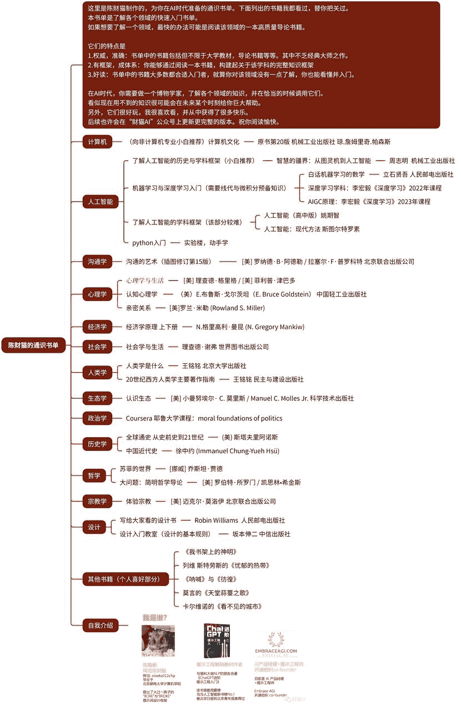
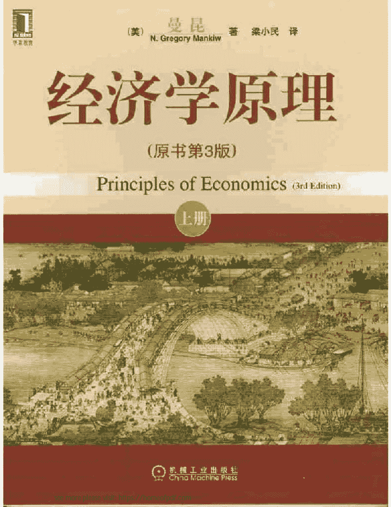
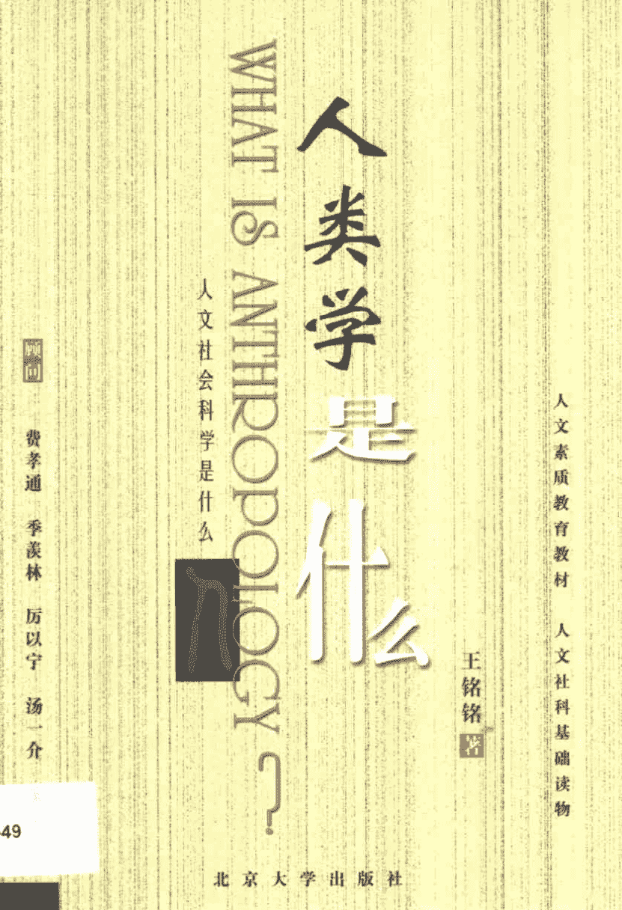
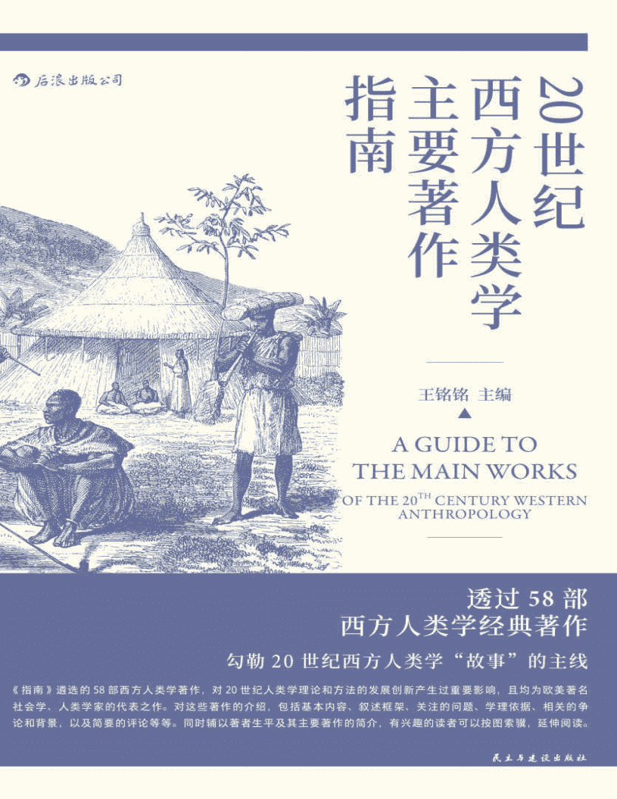
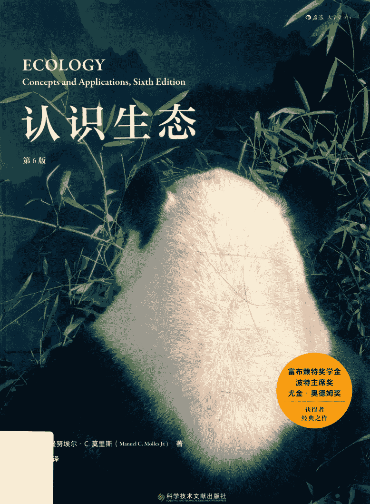
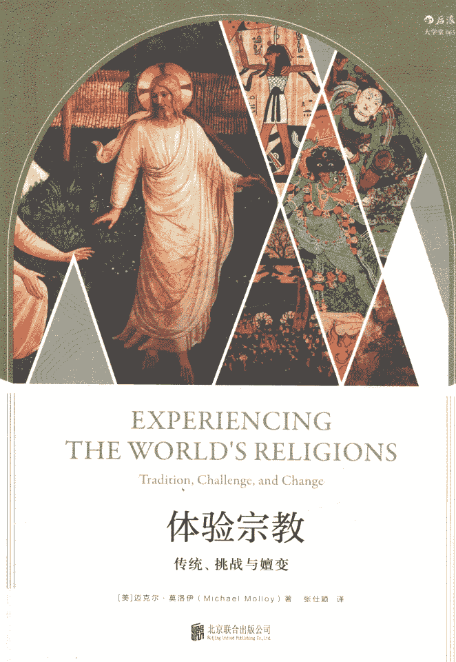
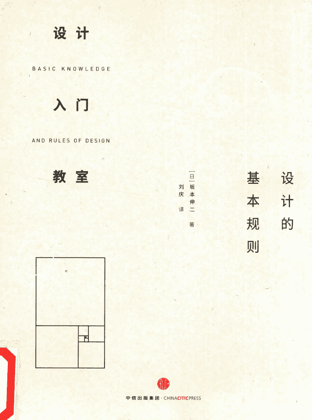
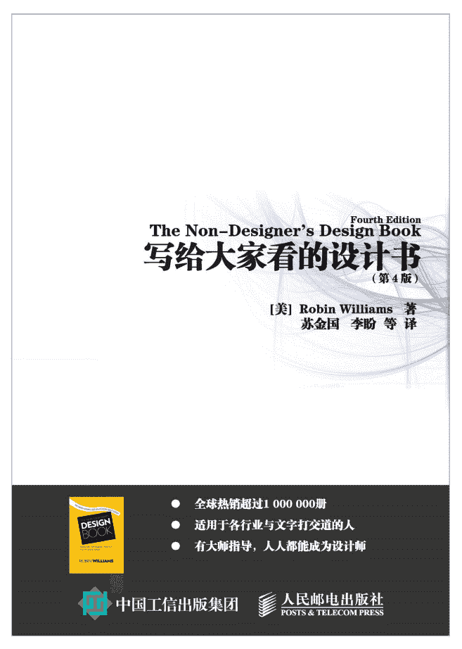

# 陈财猫：推荐书单--了解各个领域的知识，并在恰当的时候调用它们

> 来源：[https://waytoagi.feishu.cn/docx/GPEKdr3zXon219xRVdjctNZNn8e](https://waytoagi.feishu.cn/docx/GPEKdr3zXon219xRVdjctNZNn8e)

在AI时代，你需要做一个博物学家，了解各个领域的知识，并在恰当的时候调用它们。

本书单是了解各个知识领域的快速入门书单，包括但不限于心理学，人工智能，经济学，社会学，生态学，哲学，设计学等13个学科

看似现在用不到的知识很可能会在未来某个时刻给你巨大帮助。

它们的特点是

1.权威， 准确：书单中的书籍包括但不限于大学教材，导论书籍等等。其中不乏经典大师之作。

2.有框架，成体系：你能够通过阅读一本书籍，构建起关于该学科的完整知识框架

3.好读：下面列出的书籍我都看过，替你把关过。这些书是我为初学者精挑细选的。书单中的书籍大多数都合适入门者，就算你对该领域没有一点了解，你也能看懂并入门。

它们很好玩，我很喜欢看，并从中获得了很多快乐。祝你阅读愉快。

热心网友在zlibrary上找到了大部分

感谢Sailor 大雨

## 计算机（缺计算机文化）

## 人工智能（缺 人工智能高中版）

[智慧的疆界-从图灵机到人工智能 .epub](https://internal-api-drive-stream.feishu.cn/space/api/box/stream/download/all/TdHAbpGCIotsRNxmhtmcwaA7nKe)

[白话机器学习的数学（图灵图书） (立石贤吾 [立石贤吾]) (Z-Library).epub](https://internal-api-drive-stream.feishu.cn/space/api/box/stream/download/all/IgY9bbdmsogxTjx0Ya0coqzHnae)

【(强推)李宏毅2021/2022春机器学习课程-哔哩哔哩】 https://b23.tv/KhwgLna

【【授权】李宏毅2023春机器学习课程-哔哩哔哩】 https://b23.tv/2ocUNn0

https://www.lanqiao.cn/mobile/courses/1330

[人工智能（第4版） 现代方法.epub](https://internal-api-drive-stream.feishu.cn/space/api/box/stream/download/all/Tsi5bSgKEolhJLxM9YJcTCiRnah)

## 沟通学

[《沟通的艺术》- 罗纳德·阿德勒、拉塞尔·普罗克特.epub](https://internal-api-drive-stream.feishu.cn/space/api/box/stream/download/all/AGKsbX73UoGNvRx0yCnc9SrKnFH)

## 心理学

[亲密关系(第6版).epub](https://internal-api-drive-stream.feishu.cn/space/api/box/stream/download/all/U8a7bHn2Eob8koxgeAicpaVFnBd)

[心理学与生活（第19版）.epub](https://internal-api-drive-stream.feishu.cn/space/api/box/stream/download/all/UEwibu36PolLz5xRC4vcYI11n7d)

[认知心理学（第三版）（万千心理）.epub](https://internal-api-drive-stream.feishu.cn/space/api/box/stream/download/all/WHrDbsw3GoEQj8xxaSDcvcGdnyg)

## 经济学

[经济学原理上下册.pdf](https://internal-api-drive-stream.feishu.cn/space/api/box/stream/download/all/LDe6bJILcop391xbuq7ceh9cnCh)

## 社会学

[社会学与生活（插图第9版）.pdf](https://internal-api-drive-stream.feishu.cn/space/api/box/stream/download/all/GNDPbh5aUoqERzxdY4VcHUilnes)

## 人类学

[人类学是什么 (Unknown) (Z-Library).pdf](https://internal-api-drive-stream.feishu.cn/space/api/box/stream/download/all/Z8tGb6q7ao5cABxOcxfcH7jrnMb)

[20世纪西方人类学主要著作指南 (王铭铭) (Z-Library).pdf](https://internal-api-drive-stream.feishu.cn/space/api/box/stream/download/all/Gl24biciwo7bsXx5oqMcmirinFg)

## 生态学

[认识生态（第六版） (【美】小曼努埃尔·C·莫里斯) (Z-Library).pdf](https://internal-api-drive-stream.feishu.cn/space/api/box/stream/download/all/V2gLbJN9LoWolJxrywocpvYBnqd)

## 政治学

[The Moral Foundations of Politics (Ian Shapiro) (Z-Library).pdf](https://internal-api-drive-stream.feishu.cn/space/api/box/stream/download/all/SXqsbRdR0oD1D1xPZhkcg3Iwndc)

## 历史

[全球通史：从史前史到二十一世纪（上）.epub](https://internal-api-drive-stream.feishu.cn/space/api/box/stream/download/all/Nys0bMFAro7VYRxRm12cyG0endb)

[全球通史：从史前史到二十一世纪（下）.epub](https://internal-api-drive-stream.feishu.cn/space/api/box/stream/download/all/KwBlbf5iQomt2AxzV9ec6AZjnNg)

[中国近代史-徐中约.epub](https://internal-api-drive-stream.feishu.cn/space/api/box/stream/download/all/UuzWbwu9wo9Jbox4zPYcQKMJn8d)

## 哲学

[大问题：简明哲学导论.epub](https://internal-api-drive-stream.feishu.cn/space/api/box/stream/download/all/OotWbZXMVoncm5xCxNQcRp83nab)

[苏菲的世界.epub](https://internal-api-drive-stream.feishu.cn/space/api/box/stream/download/all/DATbb2VsDoApJPxoLo1cezvcn6g)

## 宗教学

[体验宗教 传统、挑战与嬗变 ([美] 迈克尔·莫洛伊) (Z-Library).pdf](https://internal-api-drive-stream.feishu.cn/space/api/box/stream/download/all/O0EibPCVnonkL8xe69mcA7annge)

## 设计

[设计入门教室 设计的基本规则 (坂本伸二) (Z-Library).pdf](https://internal-api-drive-stream.feishu.cn/space/api/box/stream/download/all/VxeibeTh6oqlZHxRMXJcWEiBnXc)

[写给大家看的设计书.第4版.pdf](https://internal-api-drive-stream.feishu.cn/space/api/box/stream/download/all/U6dGbV1bWoGhdQxnDZocIQvFn5o)