# 熊猫Jay: 任何人都可以利用ChatGPT开发自己的谷歌插件

> 来源：[https://waytoagi.feishu.cn/docx/W3WOdz4SsomPZ7x8HWQcu7ZinNh](https://waytoagi.feishu.cn/docx/W3WOdz4SsomPZ7x8HWQcu7ZinNh)

+   作者: 熊猫Jay

+   原文: https://mp.weixin.qq.com/s/ryYV3RKxW4npFmzl55d8hg

# 概述

大家好，我是熊猫Jay，你是否曾经被某个Chrome插件深深地吸引，甚至萌生过自己也能开发一个的念头？是否想过没有开发经验怎么完成插件开发呢？

不论你是 **开发者 **还是 **没有开发经验的小伙伴**，这篇文章都是为你准备的。我们将一步步引导你完成自己的第一个Chrome插件。

需要声明的是, 本视频的目的绝不是教大家开发怎样精美,功能如何炫酷的插件. 而是讲解任何人都可以结合提示词, 描述相对简单的需求, 让ChatGPT提供代码, 然后逐步排查问题, 最终拿到满足需求的插件.

我知道小伙伴们可能在想, 你是不是在吹牛啊, 我们不懂代码的人可以做?  而且你熊猫Jay好像也有程序员背景呀, 我们可没有啊!

的确可以做, 这篇文章将结合视频带领大家进行实践, 我不做任何主观干涉, 那话不多说, 我们直接开始吧!

# 学习目标

从这篇文章中，你可以学会以下几点：

+   了解插件开发的入门知识

+   如何编写demo代码

+   如何定位的问题

+   结合案例利用ChatGPT快速上手

+   插件开发的最佳实践

# 培训视频

> 为更好地将制作方式讲清楚, 我准备了一套视频, 带大家手把手实战谷歌插件的开发, 不需要任何开发经验也可以轻松上手.

>

> 视频大纲如下:

+   培训大纲

+   环境准备

+   核心文件

+   演示案例

+   利用ChatGPT开发插件的最佳实践

>

> 建议先看完视频, 按照视频进行实战, 模糊的地方可以查看文档. 视频如下:


[任何人都可以利用ChatGPT开启自己的小插件.mp4](https://internal-api-drive-stream.feishu.cn/space/api/box/stream/download/all/TM21bpghWodfcsxn3XfcLu73nMd)

# 开发环境准备

首先，你需要安装以下开发工具：

+   Chrome 浏览器(必须)

+   文本编辑器（如：VS Code, Sublime Text, Atom，txt也可以, 必须）

+   ChatGPT账号 (必须)

> 视频中使用的是Sublime, 下载地址为: https://www.sublimetext.com/

# 核心文件讲解

> 核心文件的讲解稍显枯燥, 但是对于我们理解开发过程, 和后期排查错误都起到很大的作用.

> 没有开发经验的小伙伴会有些迷糊, 没关系, 简单理解即可. 不理解可以先忽略!!!

## manifest.json

manifest.json：插件的主要配置文件，为JSON格式，必须放在根目录下，它为浏览器扩展提供了插件的蓝图，包含几个重要的点：

+   插件名称、描述、版本、图标

+   需要使用的权限和插件API

+   指定相关文件，如后台脚本background.js、弹出窗口的HTML文件popup.html 和JavaScript文件popup.js等等。

## background.js

background.js：后台脚本，用于监听浏览器事件进行访问数据，协调任务，如以下的简单案例：

+   监听插件被安装时。

+   新的选项卡被创建时。

+   新的书签被添加时。

+   插件按钮被点击时...

> 注意：

+   该文件可访问所有 [插件API](https://developer.chrome.com/docs/extensions/reference/)。

+   不可以调用全局窗口提供的DOM API。

+   不可以修改页面内容。

## popup.html

插件的主要交互界面, 展示核心信息. 可以包含如下功能：

+   显示当前选项卡列表。

+   当前选项卡的其他信息。

+   用户可以轻松点击插件图片。

+   用户导航离开后自动关闭...

如视频案例: **自动分组浏览器Tab **的配置窗口, 或者 **分割图片为四等份** 的上传文件窗口.

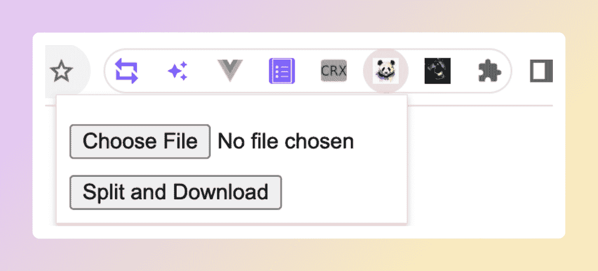

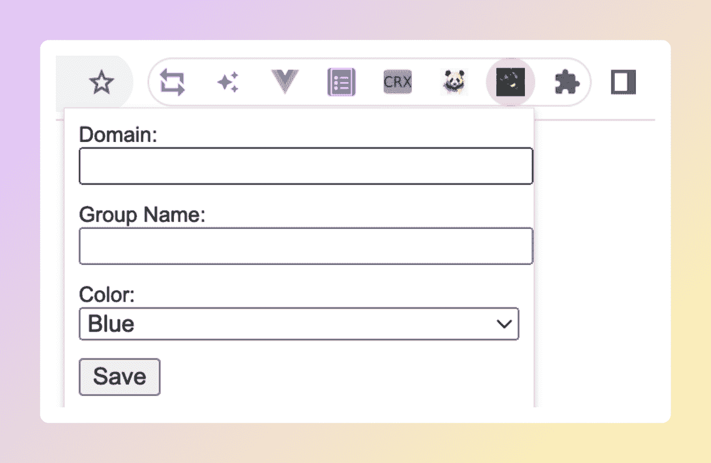

## content-script.js

插件可以利用该文件，注入代码到主页上（被指定的页面），可以访问和修改网页内容, 并且允许插件与浏览器的页面进行交互。如以下动作:

+   插入元素到页面。

+   修改页面的样式。

+   修改页面上的DOM元素。

## options.html

允许用户配置扩展设置的页面。如例, 一个开关按钮，允许用户选择是否启动某一功能。

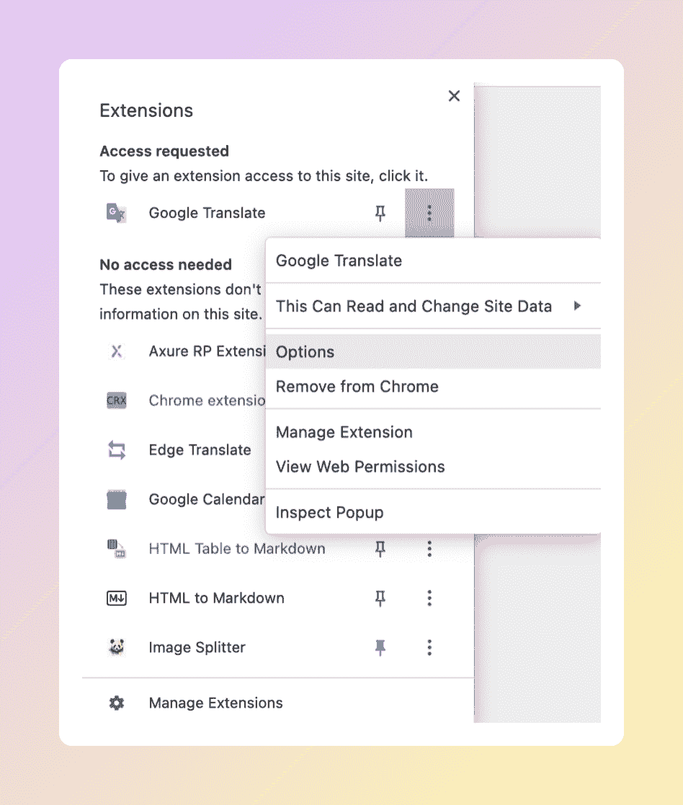

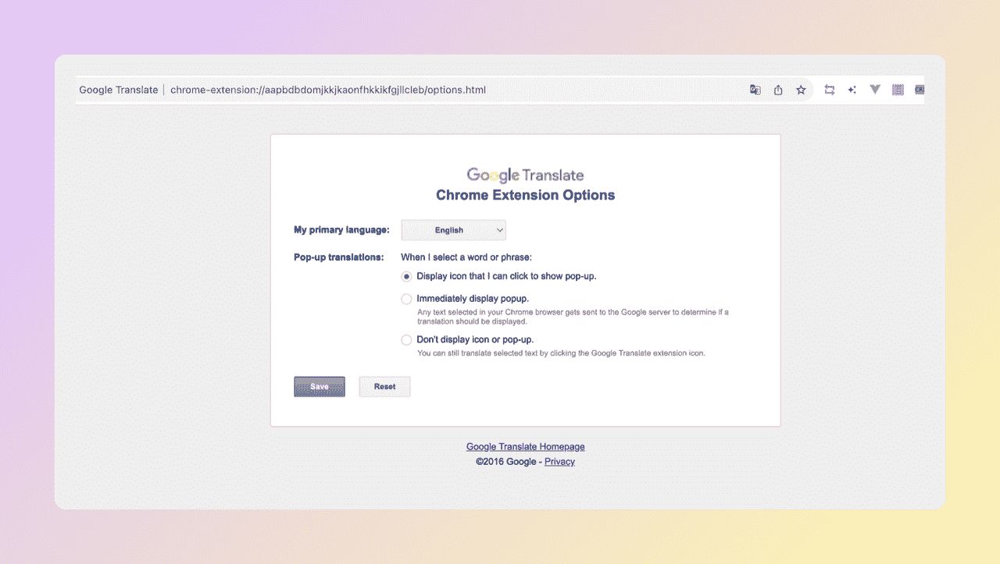

## 其他文件

+   sidepanel.html: 可以在用户的浏览指定页面的过程中协助用户。

+   popup.js：弹出窗口的HTML文件和JavaScript文件。

+   css文件: 样式文件, 提高美观度.

+   ...

# Demo案例

> 上手一个Demo案例, 有助于找找感觉, 再编写相对复杂的插件, 将更加游刃有余!

### 1. 编写 manifest.json

manifest.json 文件是Chrome插件的配置文件，包含插件的名称、描述、版本、权限等信息。下面是一个基础的 manifest.json 文件的示例；

```
{
  &quot;manifest_version&quot;: 3,
  &quot;name&quot;: &quot;My First Chrome Extension&quot;,
  &quot;version&quot;: &quot;1.0&quot;,
  &quot;action&quot;: {
    &quot;default_popup&quot;: &quot;popup.html&quot;,
    &quot;default_icon&quot;: &quot;icon.png&quot;
  },
  &quot;background&quot;: {
    &quot;service_worker&quot;: &quot;background.js&quot;
  },
  &quot;permissions&quot;: [&quot;notifications&quot;],
  &quot;icons&quot;: {
    &quot;16&quot;: &quot;icon.png&quot;,
    &quot;48&quot;: &quot;icon.png&quot;,
    &quot;128&quot;: &quot;icon.png&quot;
  }
}

```

### 2. 实现 background.js

在 background.js 文件中，可以监听和处理浏览器事件。例如，以下代码在每个新标签页打开时显示一个通知：

```
chrome.runtime.onMessage.addListener((message, sender, sendResponse) =&gt; {
  if (message.command === &#x27;createNotification&#x27;) {
    chrome.notifications.create({
      type: &#x27;basic&#x27;,
      iconUrl: &#x27;icon.png&#x27;,
      title: &#x27;Button clicked!&#x27;,
      message: &#x27;The button was clicked.&#x27;
    });
  }
});
```

### 3. 实现 popup.html 和 popup.js

popup.html 是点击插件图标时显示的弹出窗口的HTML文件。例如，以下代码创建一个包含按钮的弹出窗口：

```
&lt;!DOCTYPE html&gt;
&lt;html&gt;
  &lt;body&gt;
    &lt;button id=&quot;myButton&quot;&gt;Click me!&lt;/button&gt;
    &lt;script src=&quot;popup.js&quot;&gt;&lt;/script&gt;
  &lt;/body&gt;
&lt;/html&gt;

```

在 popup.js 文件中，可以添加事件监听器以处理用户交互。例如，以下代码在按钮被点击时显示一个通知：

```
document.getElementById(&#x27;myButton&#x27;).addEventListener(&#x27;click&#x27;, function() {
  chrome.runtime.sendMessage({ command: &#x27;createNotification&#x27; });
});

```

### 4. 加载插件

在完成开发后，需要在Chrome浏览器中加载插件：

1.  **打开Chrome浏览器**，点击右上角的三个**点 > More T**ools (更多工具) > Extensions (扩展程序)。

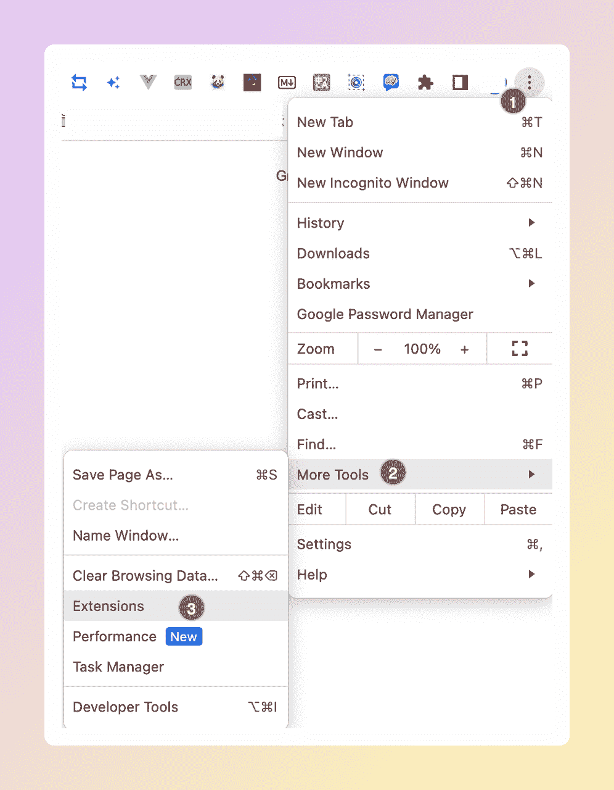

1.  开启右上角的 **Developer mode** (开发者模式)。

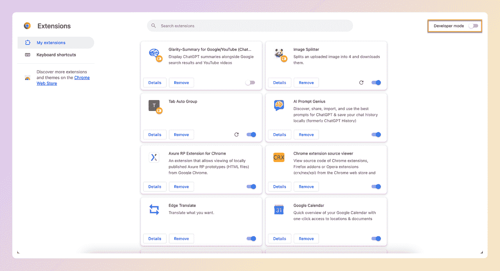

1.  点击 L**oad unpacked**** (加载已解压**的扩展程序)，然后选择插件的文件夹 demo-01.

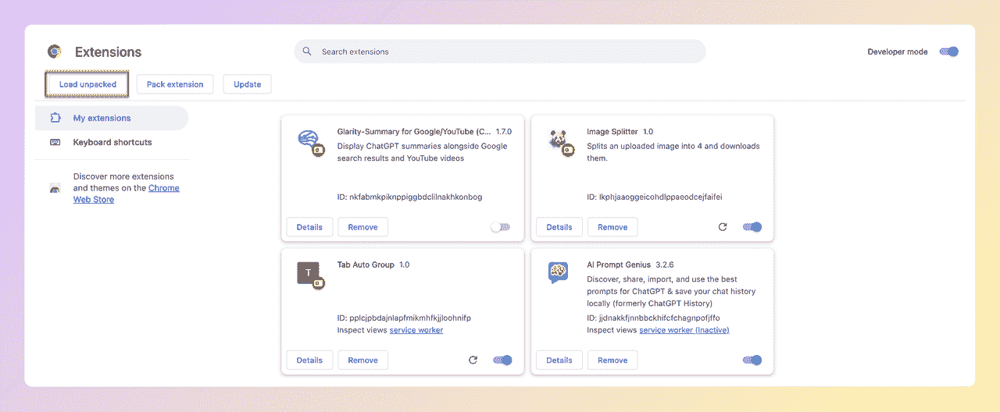


[demo-01.zip](https://internal-api-drive-stream.feishu.cn/space/api/box/stream/download/all/HVaobNr0ao3yfzxZ5ZucLvdon7f)

下载地址: https://pan.quark.cn/s/0f42823c18a3

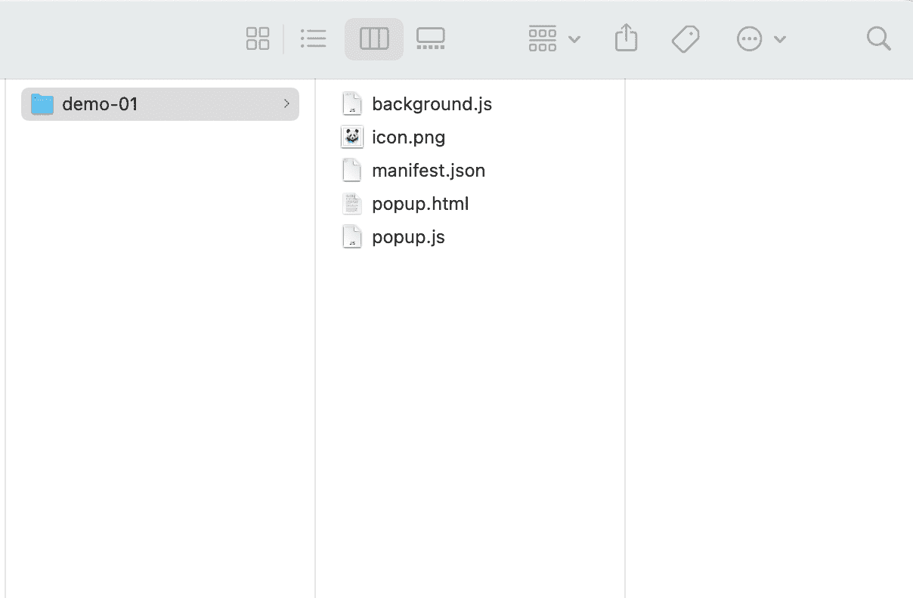

1.  使用插件，查看效果。

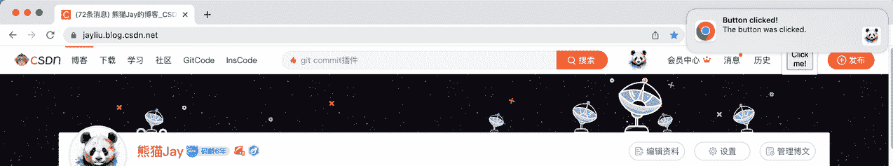

> **FAQs: **

> 1、部署代码后，点击按钮无法显示通知？

> 需要开启浏览器的通知，才可以正常实现该案例。设置Chrome的通知权限，你可以按照以下步骤操作：

1.  打开Chrome浏览器。

1.  点击浏览器右上角的三个点（或者在Mac上的三个横线），选择 "设置"。

1.  在设置页左侧的菜单中，点击 "隐私和安全"。

1.  在右侧的页面中，点击 "网站设置"。

1.  在下一个页面中，找到并点击 "通知"。

1.  在这个页面，你可以设置哪些网站可以发送通知，哪些网站不能发送通知。如果你希望所有网站都可以发送通知，可以关闭 "禁止所有网站发送通知" 这个选项。

1.  如果你的插件需要在Chrome未运行的情况下显示通知，你还需要在系统设置中允许Chrome发送通知。这个操作的具体步骤会因操作系统而异。

# 打包与发布 (可选)

## 打包插件

> 初学者，可暂时跳过，有需要再回头来看。

如果插件已经完成并通过了测试，可以打包插件以进行发布：

1.  在扩展程序页面，点击 "打包扩展程序"。

1.  选择插件的根目录，然后点击 "打包扩展程序"。

完成以上步骤后，将生成一个 .crx 文件和一个 .pem 文件。.crx 文件就是你可以发布的Chrome插件，.pem 文件是你的私钥，需要保存好。

## 发布插件

> 初学者，可暂时跳过，有需要再回头来看。

最后，你可以在Chrome Web Store发布你的插件：

1.  访问 [Chrome Web Store](https://chrome.google.com/webstore/devconsole) Developer Dashboard。

1.  点击 "新增项目"，上传你的 .crx 文件。

1.  提供插件的详情，包括名称、描述、图标、截图等。

1.  提交插件进行审查。

以上就是开发和发布Chrome插件的基本步骤。希望这能帮助你开始你的Chrome插件开发旅程！

# 快速定位问题(必看)

## 常见排查方式

### **查看交互页面控制台**

> 适合初学者, 和没有开发经验的小伙伴!

JavaScript运行时的错误通常会在浏览器的控制台中显示。你可以在Chrome的开发者工具中查看这些错误。

1.  点击插件

1.  右击空白区域

1.  点击 **Inspect**

1.  打开 **DevTools** 后点击 **Console (控制台)**

1.  查看该区域内是否存在报错信息, 用户可以通过搜索引擎或者ChatGPT寻找纠错方案.

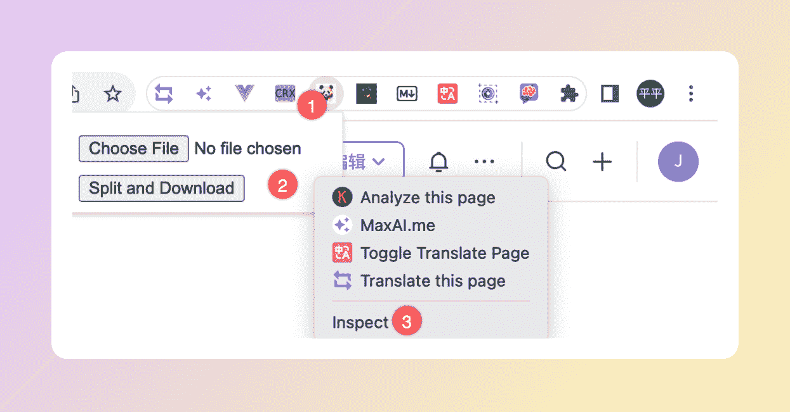

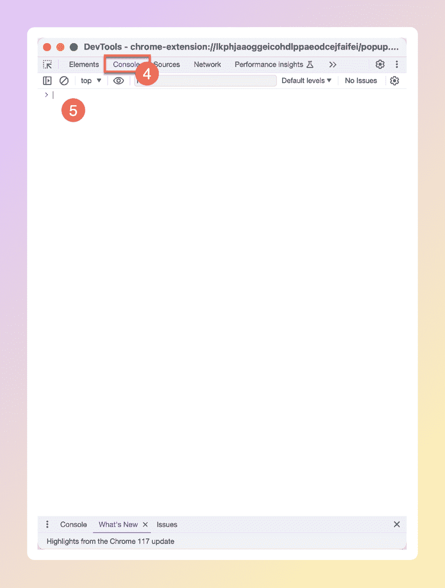

### **查看插件背景页的控制台(重要)**

> 适合初学者和没有开发经验的小伙伴, 该条纠错方式, 在视频教程中使用频率非常高, 需要小伙伴们仔细学习!

如果你的插件有一个背景页，你也可以查看这个背景页的控制台。在 chrome://extensions/ 页面，点击你的插件下的 "background page"，可以打开背景页的开发者工具。步骤如下:

1.  输入链接或者点击右侧 **扩展程序入口** 进入该页面.

1.  找到待纠错的插件.

1.  点击 Errors查看错误.

1.  或者点击 **第4步 **的链接查看错误, 与 **第3步** 的效果类似.

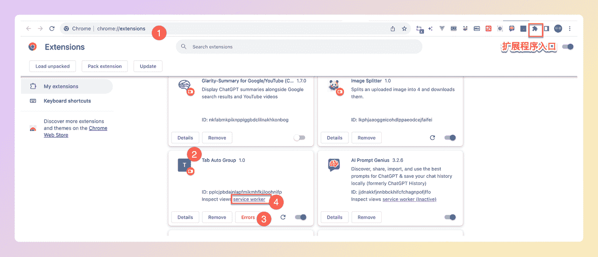

第3步显示的出错内容.

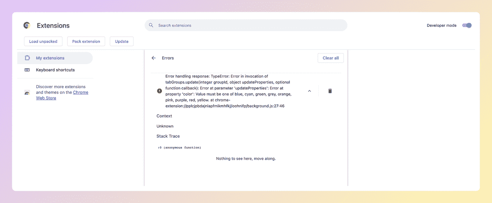

第4步显示的出错内容,与第3步一致!

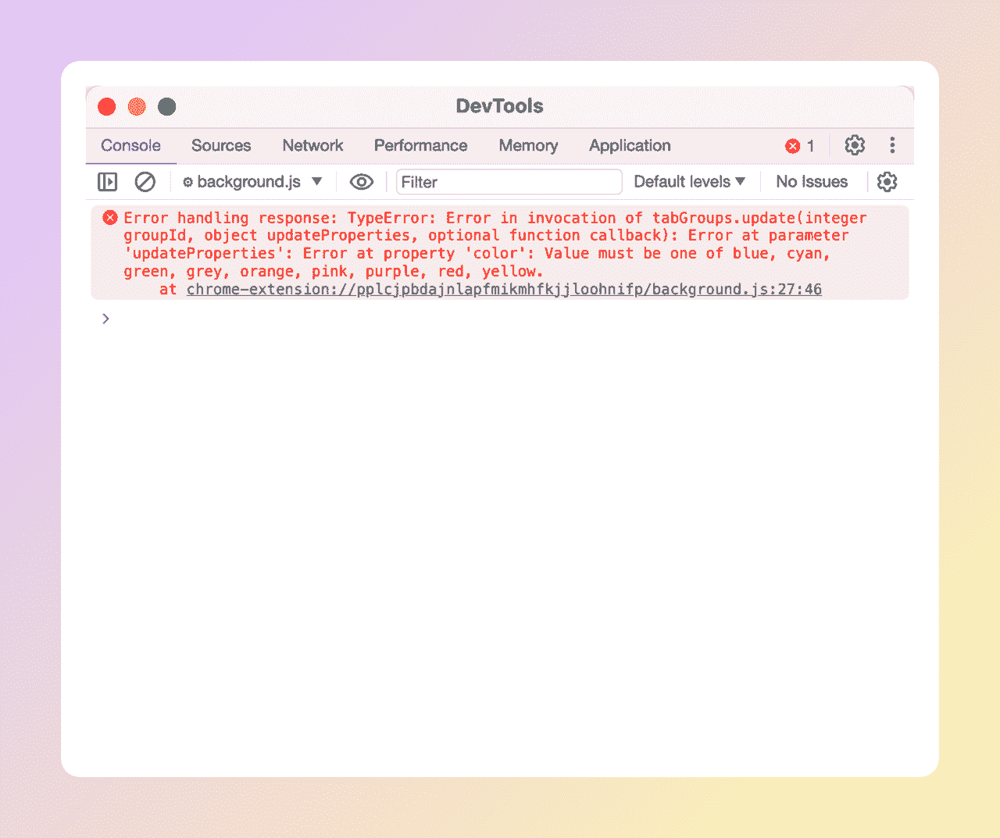

## 其他排查方式

> 适合有开发经验、或者想要深入学习插件开发的小伙伴们!

> 没有开发经验的小伙伴, 暂时忽略!

1.  **使用 ****console.log**：在你的代码中添加 console.log 可以帮助你查看变量的值，了解代码的执行过程。

1.  **检查 ****manifest.json**** 文件**：很多问题都是由 manifest.json 文件中的错误引起的。确保你正确地配置了这个文件，特别是文件路径和权限。

1.  **阅读官方文档**：当你使用Chrome API时，最好阅读一下官方的文档，了解API的使用方法和限制。例如，你在使用 chrome.notifications API时，就可以阅读 notifications API 的文档。

1.  **学习和使用调试工具**：学习和熟练使用Chrome的开发者工具和其他调试工具，可以大大提升你解决问题的能力。官方Debug介绍文档: https://developer.chrome.com/docs/devtools/javascript/

# 案例演示

> **具体每个案**例的操作步骤,可以按照 培训视频 章节里的视频内容来操作.

> 可以根据下面每个案例中我提供的对话链接, 来观察我与ChatGPT的对话过程.

## 分割图片为四等份

**解决痛点**:

想要MJ的四张图片,但操作相对繁琐.


**核心功能**:

1.  用户, 可上传MJ图片/其他图片, 程序自动拆分成四等份

1.  程序, 在拆分后自动将图片下载到本地

**提示词**:

```
你是一位资深程序员，能够熟练开发google浏览器插件。我需要请你帮我开发一个插件，用于将用户上传的图片，平均切分为4张图片，并自动下载到本地电脑上，请告诉我实现的步骤，并给出完整的代码
```

**ChatGPT对话历史**:  https://chat.openai.com/share/0d52e479-f549-4a0f-9807-c7cf21eee5e8

**代码下载:  **https://pan.quark.cn/s/bede7f19d73a

## 自动分组浏览器Tab

**解决痛点**:

1.  浏览器tab过多时,容易混乱

1.  无法自动分组, 手动分组麻烦

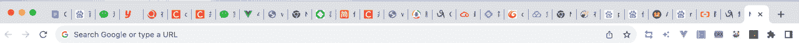

**核心功能**:

1.  用户,可以配置域名、组名、颜色.

1.  用户, 打开新页面/刷新页面时,将按照域名自动分组.

**提示词**:

```
# 角色: 你是一位资深程序员，能够熟练开发google浏览器插件。

# 背景: 我需要开发一个插件，用于将google浏览器的tab自动分组, 根据配置的域名自动分组.
## 功能1: 点击插件, 可以输出需要设置的域名, 分组名称, 和分组的颜色, 颜色有(Blue、Red、Grey、Yellow、Green)
## 功能2: 点击保存后, 页面消失,显示“保存成功”
## 功能3: 当在浏览器打开对应域名的链接, 后台将自动根据分组名称,和颜色, 进行分组. 
### 3.1 若打开新链接时,没有分组,则创建分组
### 3.2 若打开新链接时,已经存在相同域名的分组, 则自动合并

# 目的: 通过插件,如果用户打开过多的浏览器tab, 这样看着会比较混乱. 自动分组后, 会显得更加整洁和干净.

# 任务:
## 任务1:请告诉我需要准备的文件
## 任务2:请输出每个文件对应的代码, 注意重要的代码需要增加注释, 确保没有编程经验的人也能看懂
## 任务3:请检查代码是否存在问题
## 任务4:请告诉我步骤方式和注意点
```

**ChatGPT对话历史**:  https://chat.openai.com/share/22a71318-be9e-41fa-8129-5b1c17218fce

**代码下载: **https://pan.quark.cn/s/4b859e1dd3a7

# GPT 辅助插件开发最佳实践

## 1. 清晰了解需求和功能点

为了写出表述更加完善的提示词, 我们需要把需求拆分到最小化,可以小到这每一点只包含一个小功能. 建议采取用户故事的编写方式来叙述:  谁, 在什么地方, 做了什么动作, 达到了什么效果.

## 2.准备完整的提示词

**提示词的编写方式技巧很多, **但是万变不离其宗, 即 表述清楚意思, 不要含糊其辞, 至于使用什么提示词模版或者技巧反而不是最重要的, 那些模版还是为了帮助我们把话说到位而已!

推荐这篇文章:[万字解读ChatGPT提示词最佳实践](https://sif8f6uboze.feishu.cn/docx/H2C2devTSoZBRUx1m6YcOoFynuh) , 先看懂这篇提示词最佳实践尤为重要, 这样再学习更加复杂的模版或者结构化提示词就会变得容易些.

## 3.了解部署方式, 构建代码,安装并测试

正确部署插件的步骤GPT会提供. 按照步骤来执行安装, 再进行测试即可.

## 4.将错误描述输入给ChatGPT

测试过程中若插件没有按照预期生效,** 按照错误信息**的定位方式来找到问题(见 快速定位问题 章节), 并完整地提供给GPT.

## 5.多轮测试

为保证功能的正确性, 建议进行多轮测试, 完全达到预期的效果为止. 如果第一次的答案没有完全解决问题，不要放弃, 继续定位到问题, 把错误信息给到ChatGPT.

## 6.提问时注意上下文长度, 防止遗忘

如果经历很多轮的对话, 会导致此次对话超过模型的token限制, 那么ChatGPT会遗忘之前的内容.

所以我建议当经历多轮对话后, 可以新建一个聊天窗口, 把完整的代码和需求背景输入给chatgpt, 重新开启新的提问. 这是一种有效的措施.

# Chrome 插件开发最佳实践

## 1. 最小权限原则

只请求你的扩展程序需要的最小权限。这可以帮助你的用户理解你的扩展程序为什么需要这些权限，也可以避免用户担心安全问题。

## 2. 使用 content_scripts 时小心

content_scripts 允许你的扩展程序在用户浏览网页时插入代码。然而，这也可能导致和网页上的其他脚本冲突。当需要使用 content_scripts 时，应尽量避免使用全局变量，并且小心处理事件监听器和定时器。

## 3. 使用 background 页做事件处理

后台页是运行在后台的JavaScript脚本，可以用来处理浏览器事件。当用户没有打开你的扩展程序的弹出窗口或其他界面时，background 页仍然可以运行。

## 4. 利用 Chrome 扩展 API

Chrome 提供了丰富的API供你的扩展程序使用，比如操作标签页、读写cookies、显示通知等。理解并利用这些API可以帮助你更好地实现功能。

## 5. 遵循 Chrome Web Store 的政策

当你准备发布你的扩展程序时，需要确保它遵循了Chrome Web Store的所有政策。

## 6. 用户体验优化

思考你的用户将如何使用你的扩展程序，然后尽可能优化用户体验。例如，你可以添加清晰的指示和帮助信息，确保你的界面易于理解和操作。

## 7. 适当的错误处理

确保代码有适当的错误处理，不仅限于try-catch结构，还应考虑更复杂的错误情况，比如网络问题或者用户输入错误。

## 8.阅读官方手册

前面我也提到阅读官方手册 [谷歌插件官方文档](https://developer.chrome.com/docs/extensions/mv3/) 后，可以与GPT沟通时，提出更加专业的问题，这对于后期做出更加复杂的插件也会有巨大的帮助。

以上就是一些Chrome插件开发的最佳实践。在开发过程中始终保持学习和思考，你会不断进步的！

# 总结

本文带我们快速了解了chrome插件的开发步骤、demo、经典案例、最佳实践。希望这篇文章可以给到大家更多思路, 来丰富我们自己的产品, 或者开发出帮助自己提升效率的小工具!  相信在实践过程你会有更多新的思路!

若小伙伴针对文章存在问题或者建议, 欢迎随时与我讨论!

# 联系作者：

公众号： 熊猫Jay字节之旅；免费星球：熊猫Jay·AI·成长，欢迎关注。


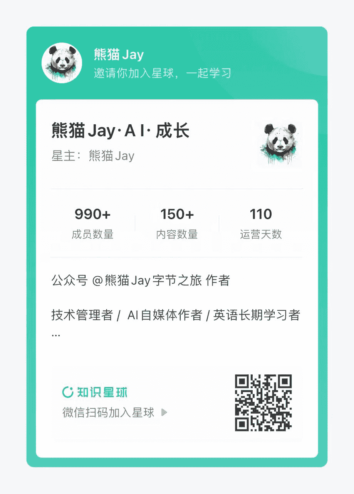