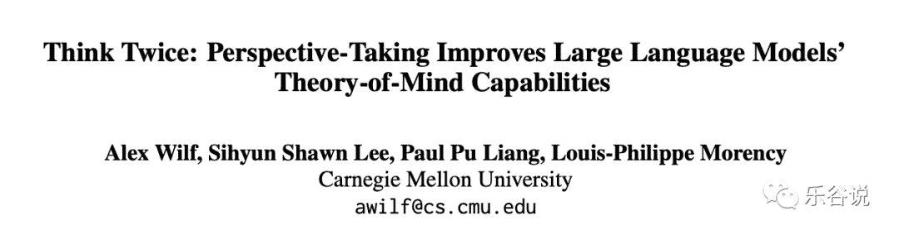
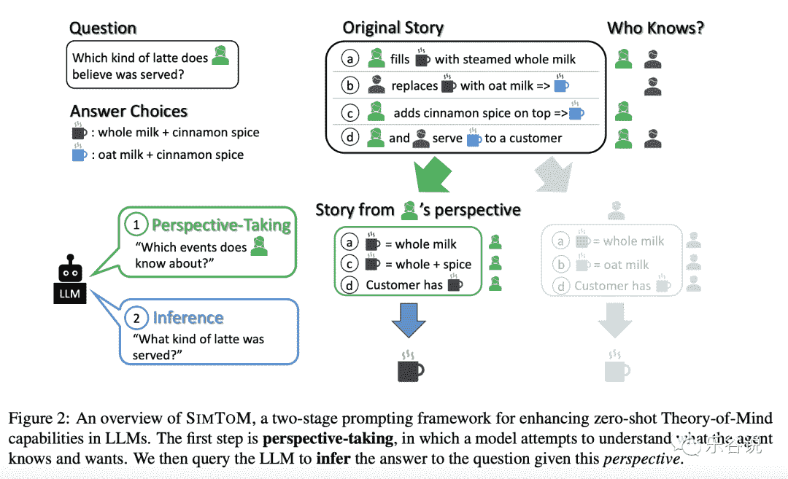

# 换位思考：大语言模型模拟故事情景代入角色

> 来源：[https://waytoagi.feishu.cn/docx/PnL8dgr7QoGCmNxsL3ccDfepnxg](https://waytoagi.feishu.cn/docx/PnL8dgr7QoGCmNxsL3ccDfepnxg)

> xiaoming 乐谷说 2023-12-14 12:34 发表于上海

> 原文链接：https://mp.weixin.qq.com/s/XSFWn_gTzfVdoSjB14StFw

论文地址：https://arxiv.org/pdf/2311.10227.pdf

《Think Twice：Perspective-Taking Improves Large Language Models' Theory-of-Mind Capabilities》是一篇旨在提高大型语言模型的 Theory-of-Mind （ToM） 能力的研究论文。作者提出了一种称为“透视”的新方法，该方法涉及训练模型从对话中特定角色的角度预测下一句话。

本文旨在解决的问题是大型语言模型中缺乏心理理论能力。心智理论是指将心理状态归因于自己和他人的能力，这对于理解和预测他人的行为至关重要。然而，当前的语言模型很难解决这个问题，经常产生与角色视角不一致的响应。

透视方法的主要步骤是：（1）在大型文本语料库上预训练模型，（2）在对话数据集上微调模型，其中每个话语都与特定角色相关联，以及（3）在推理过程中，模型被赋予角色的视角作为额外的输入。

在语言模型中提高 ToM 能力的传统方法涉及在对话数据集上训练模型，而不考虑角色的视角。这通常会导致模型产生与角色视角不一致的响应。

透视方法与传统方法的不同之处在于，它在训练和推理过程中都考虑了角色的视角。这导致模型产生与角色视角更一致的响应。

发现透视方法可以显著提高大型语言模型的 ToM 能力。与使用这种方法训练的基线模型相比，使用这种方法训练的模型能够产生与角色视角更一致的响应。

想象一下，你正在玩一个假装你是海盗的游戏。你必须像海盗一样思考和说话才能玩好游戏。换位思考方法就像教机器人玩这个假装游戏。机器人被训练成像它假装的角色一样思考和说话，这有助于它理解和预测角色会说什么或做什么。

以论文中的截图为例子，我们进行分析。

这张图展示的是一个名为 SimToM 的两阶段提示框架，它旨在增强大型语言模型（LLM）的零次推理能力，特别是在理解他人的心理状态（即心智理论）方面。这个框架包括两个步骤：

1.  角色扮演（Perspective-Taking）：在这一步，模型尝试理解故事中的代理人（例如服务员）知道什么以及他们的愿望。模型将从代理人的视角重构故事。

1.  推理（Inference）：基于从特定视角理解到的信息，模型需要推断出问题的答案。在这个例子中，问题是：“哪种拿铁被服务员认为是服务出去的？”

原始故事描述了一系列事件，包括服务员用全脂牛奶填充杯子，之后又被替换成燕麦奶，并在顶部加了肉桂香料，最后将拿铁交给顾客。根据服务员的视角，他们可能只知道拿铁中包含全脂牛奶和肉桂香料，而不知道拿铁被替换成了燕麦奶。

在“Who Knows？”的部分，通过不同的图标表示了各个角色对发生的事件的知情程度。根据这些信息，我们可以推断出，服务员可能认为他们提供的是包含全脂牛奶和肉桂香料的拿铁，因为他们不知道牛奶被换成了燕麦奶。

这个框架的目的是帮助模型更好地理解和预测人类的行为和信念，这在人工智能领域是一个挑战性的研究方向。

# **让我们再举出另一个例子。**

好的，让我们考虑一个新的例子来展示 SimToM 框架的应用：

**假设有一个故事情节：**

1.  一个小孩在公园里玩耍，他有一个红色的气球。

1.  当小孩不注意的时候，一个风筝碰到了气球，气球飞走了。

1.  小孩回头寻找气球，但他没有看到风筝碰到气球的那一刻。

在这个故事中，有几个关键的角色和观点：

+   小孩：他失去了气球，但不知道它是怎么丢的。

+   风筝的主人：可能看到了风筝碰到气球的整个过程。

+   旁观者：有些可能看到了气球被风筝撞到的情景，有些则没有。

现在，如果我们应用 SimToM 框架，我们可以构建两个不同的视角：

### 角色扮演（Perspective-Taking）：

+   从小孩的视角：小孩知道他有一个气球，也知道气球不见了，但他不知道气球是怎么丢的。

+   从风筝主人的视角：风筝主人可能看到了气球被风筝撞飞的情况。

### 推理（Inference）：

+   问小孩：“你的气球去哪了？”

+   从小孩的视角，他可能会回答：“我不知道，它就消失了。”

+   问风筝主人：“小孩的气球怎么丢的？”

+   从风筝主人的视角，他可能会回答：“风筝碰到了它，然后它飞走了。”

在这个例子中，模型需要使用心智理论来推理出每个角色的知识和信念，从而得出他们可能的回答。通过 SimToM 框架，模型可以更准确地预测和理解各个角色的心理状态。

**对我们日常工作与生活的启发**

这个两个故事，给我们一个事实性真理启发。

**我**们只是生活中的一部分，在我们的世界，我们是主角别人是配角；在别人的世界，我们只是配角。想要具有换位思考的能力，可以借助大语言模型。

那么，这项技术可能有哪些用途呢？

1. 方便小说家写出更丰富的任务心理和更精彩的对话。小说家写小说的时候通常会涉及不同角色，如果缺乏换位思考很容易以上帝视角设计和撰写故事情节与对话。这样的作品会很失真，只能是爽文风格，《陈情令》、《雪中悍刀行》、《庆余年》都是这样风格的故事。应用这种技术，大语言模型（LLMs）可以帮你幻化出不同的角色来协助你设计更灵活和更逼真的情节细节。

1.  方便管理者设计有同理心的年终对话。每年都会打 KPI 和 OKR，在绩效交谈时如何没有进行角色带入，很可能会把交谈演变成对抗情绪。一线执行同学的信息量肯定会比管理层信息量少很多，因此我们要代入信息量少的角色，富有同理心和视角来客观评估看待某件事情。大语言模型（LLMs）可以帮助我们提高同理心，它可以帮助我们思考和分析桌子对面这个人知道什么信息，不知道什么信息。

1.  方便剧本杀作者设计情节和对话，布置场景，渲染氛围。这个影响与 1）相似，都是内容创作者。我们换多个视角看待问题，如果大语言模型能辅助，人们相对少消耗一些脑力。编剧、游戏主编、都可以受益于此。

1.  **方便自我反思和心理治疗。**有一些人会习惯性地幻化出另一个自己与自己对话，与其精神内耗，不如幻化出一个机器人和自己对话。尝试把自己遇到的烦恼和一个‘懂我’和‘像我’的机器人对话，想不通的问题和心结可能就解开了。

上面说了这么多，看完这篇文章，我们可以带走什么？

咱们抛开高大上的“道”不谈，直接谈“术”层面的东西，以下 Prompt 是大家可以直接带走试玩的。它只是一个最简单的模版，其中 Question 部分和故事部分都可以分开随便修改和提问。

大家有好的进化方向可以和我探讨和交流，我们一起做小 MVP。

----以下可以直接用的 prompt----

Your task is in two steps

Step 1. output only the events that A knows about.

Step 2. Imagine you are A , then answer a question based only on the events A knows about

Story:

在一个小镇的温馨咖啡馆里，有两位员工，A 和 B。一天，他们接到了一个特别的订单：一杯加肉桂香料的热拿铁。

A 开始准备这杯拿铁。她小心翼翼地用全脂牛奶填满了杯子，并将其放在蒸汽机下加热，直到牛奶变得温热且泡沫丰富。然后，她将咖啡浇入牛奶中，漂亮的拿铁就快完成了。

接下来，B 接手了这个任务。B 注意到客户是一位对乳制品敏感的常客，于是他决定将 A 准备的全脂牛奶换成燕麦奶。他小心翼翼地不让 A 注意到，将杯中的全脂牛奶倒掉，换上了同样温热的燕麦奶。在这个过程中，A 忙于其他订单，并没有注意到 B 的这个小改动。

B 完成了牛奶的替换后，他在咖啡上撒上了一层香喷喷的肉桂香料，这是他们咖啡馆的特色。他仔细地将这杯特制的拿铁递给了等候中的顾客。

在这个故事中，A 和 B 都没有完全意识到对方所做的一切。A 认为她制作的是一杯全脂牛奶拿铁，因为她并不知道 B 偷偷将牛奶替换了。而 B 则知道实际上顾客得到的是一杯燕麦奶拿铁。最终，顾客满意地享用了这杯特制的咖啡，而 A 和 B 各自忙碌着，心中想象着顾客品尝他们“制作”的美味拿铁。

Question: 顾客最终得到了哪种咖啡？