# 胡凯翔：构建提示词的方法——基于阅读 Claude Cookbook 的思考和测试

> 来源：[https://waytoagi.feishu.cn/docx/FLQxd29lzouGPBxSZs2c89pTn6b](https://waytoagi.feishu.cn/docx/FLQxd29lzouGPBxSZs2c89pTn6b)

> 作者：胡凯翔

> 原文：https://qwb3c4hd94t.feishu.cn/docx/CbRbdnrCCo3SigxqarGcuZT4nNf

## 一、前言

官方的 CookBook，是基于“源”的讲解和示例，是大语言模型运行的原理和技巧示例的出生地。

去年 10 月 16 日那天，看到 A 大的对官方文档的即刻，激起了我想追本溯源，将提示词的功底打牢、夯实的想法，恰好又看到小七姐团队新做的关于 Claude Cookbook 的精读，想着“正好从这里开始”，一边再次开启基础入门内容精读的旅程。


该类型的文章里，我会按照 Cookbook 的阅读顺序，分成几个大类，分批阅读分析，一方面聚焦一处，输出深度，另一方面也方便分次理解。

目前的大类有：

一、构建提示词

二、优化提示词

三、有用的技巧

今天的文章里，我们先从提示词的构建讲起

ps: https://vxc3hj17dym.feishu.cn/docx/FUgbd1YhioOVWZx9geyczlnrnGe?from=from_copylink

本次解读分析的文字材料来源于小七姐的中文精读文档和对 Claude Cookbook 原文的阅读和思考。

## 二、构建提示词

抛去所谓的技巧、结构，在基础部分我会多去关注原因、目的。

该篇文档的主体部分主要讨论了构建提示词的四个关键步骤：

1.   充分描述任务：为了使 GPT 生成更具针对性的内容，我们需要为它提供足够的信息。这包括对任务背景、定义术语和给出模型的详细描述。通过提供充分的信息，我们可以确保 GPT 能够更好地理解任务需求。

1.   标注提示词的不同部分：使用分隔符（如 XML 标记、Markdown 或特殊符号）来标记提示词的不同部分，使语句分类更为明显。这有助于 GPT 更好地理解提示词的结构和意图。

1.   添加示例（可选）：通过提供示例，我们可以减少创作的困难程度，提供示范，给出用户心中想要的成果范式。一般有两种添加示例的方法：模拟对话（以用户和 GPT 之间对话的形式给出示例）和用简明扼要的语句举例。

1.   描述踩坑点（可选）：在构建提示词时，我们需要考虑到可能出现的问题，如数据清洗和 AI 识别问题。对于要求 Claude 查找特定信息的任务，官方建议为其提供“如果输入中没有与描述匹配的内容时应该怎么做”的指示。这有助于防止 Claude 为了能够做出回应而凭空编造信息的问题。

以上的大段描述以大白话总结为以下两句：

+   构建 GPT 能够听懂并执行的清晰明确的命令，包括背景描述、特殊情况说明、最好拆分出步骤，有示例就更好。

+   以上描述分别对应了充分描述任务、标注提示词的不同部分、困难情况、添加示例 4 个小节。

接下来，我们详细聊一聊这 4 个小节的内容。

### 1、充分描述任务

很多情况下，我们不需要去考虑多么华丽的提示词，给 GPT 足够的信息，它就能回馈你更具针对性的内容。这部分对应的其实不完全是提示词的能力，而是表达能力和需求分析能力。

以我亲身经历的用 prompt 写标书任务为例：

> 今日成果，完成近 50 页 word，共 8 章内容，基本全部由 gpt3.5 生成。

>

> 概括过程，可分为提取提纲，拆解指南，prompt 成稿三大类。

>

> 1、提取提纲是根据招标文件评分标准列出初步提纲，以保证完全响应。目前是人工提取，有 prompt 化的可能。

>

> 2、拆解指南指的是拆解项目背景，工作内容，方法步骤等内容，归纳到 x—mind 中，尽量拆细，为 gpt 提供足够上下文语境，确保 prompt 的稳定性。

>

> 3、prompt 成稿的过程中，基本上都采取简提示详资料的方式与 gpt 对话，尽可能在足够短的对话中提供给 gpt 足够的上下文语境，真正的提示词内容只采用赋予角色，限定格式两种，并遵循先提纲后文章，逐节逐章输出的方式增强稳定性。

>

> 什么是先提纲后文章呢？简单讲分为三步：

> 1、根据简化精简的项目信息让 gpt 生成提纲；

> 2、为每份提纲写上摘要；

> 3、根据 1、2 内容逐节输出文章。

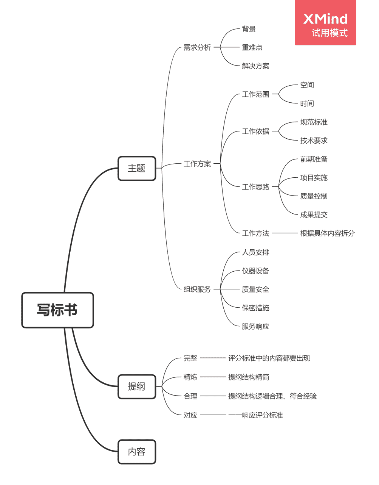

本身用于“提示”的提示词字数寥寥无几，大部分都是基于“上下文”的对招标文件和项目方案的拆解。

**注意：**如果你指望 GPT 给出的内容不是空口白话，首先需要给它足以发挥的资料，就像领导找你写材料的时候，我们多么希望领导同时给出相关的资料，最好能把相关资料的重点都提炼出来，层级分清楚，打好关键词，一眼明了（做个梦）。

**提供的上下文越详尽，与需要完成任务的相关**性越强，则大语言模型给予的反馈下限越高；

提示词的技巧则更多地挖掘大语言模型的潜力，发挥其上限。

双向奔赴才是最优选择。

讲回 CookBook ，官方示例中就是遵循以上的条件给出的提示词。

接下来我会提供一个官方的示例：一个用户要求 GPT 删除个人信息，官方的 prompt 中提供了：

1、背景；（例如，我们为什么希望完成任务）

2、定义术语：（个人信息 = 姓名、电话号码、地址）

3、给出模型：应该如何完成任务的具体细节（用 XXX 代替个人信息）

更多的细节，有利于 Claude 更好地完成任务，让我们来看一下官方的好例子：

Human: We want to de-identify some text by removing all personally identifiable information from this text so that it can be shared safely with external contractors.

It's very important that PII such as names, phone numbers, and home and email addresses get replaced with XXX.

Here is the text you should process: {{YOUR TEXT HERE}}

Assistant:

---

用户输入

我们想删除一些文本中的所有个人身份信息，从而消除隐私泄露风险，这样我们就可以与外部承包商安全共享它们了。

姓名、电话号码、家庭和电子邮件地址等个人信息替换为 XXX 非常重要。

以下是你要帮我处理的文本： {{这里是用户的文本｝

---

但是初涉提示词的我们不一定能够想到应该写什么样的背景，定义什么样的术语，给出什么样的模型，这个技巧是否对这种情况束手无策呢？

“将编写提示词当作一种思维磨练，它会带来无限可能。”

如果我们尝试以这个技巧为蓝本，改写一下官方的 prompt 会怎么样呢？

～～～～～～～～～（改写 prompt 开始）

prompt:

```
接下来我的每一个问题，希望你都先不要给出答复，而是先帮助我从以下三个方面思考，并提示思考过程：
1、给出背景：（例如，我们为什么希望完成任务） 
2、定义术语：（例如：个人信息 = 姓名、电话号码、地址） 
3、给出模型：应该如何完成任务的具体细节（用 XXX 代替个人信息）
```

answer:

好的，我明白您的要求。接下来，我将在回答每个问题之前按照您提供的思考方式为您提供背景、定义术语和模型，以帮助您更好地理解和回答您的问题。请继续提出您的问题，我会按照您的要求回答。

测试结果详见下图：

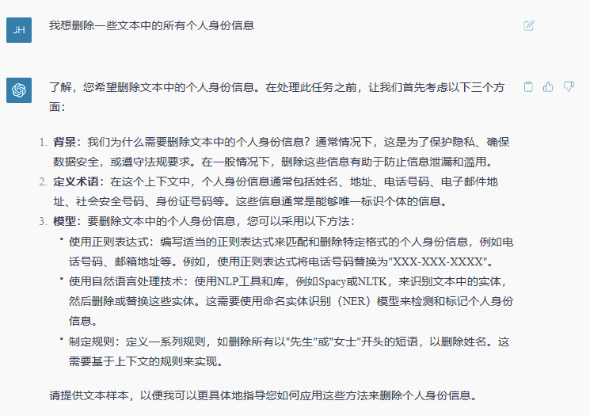

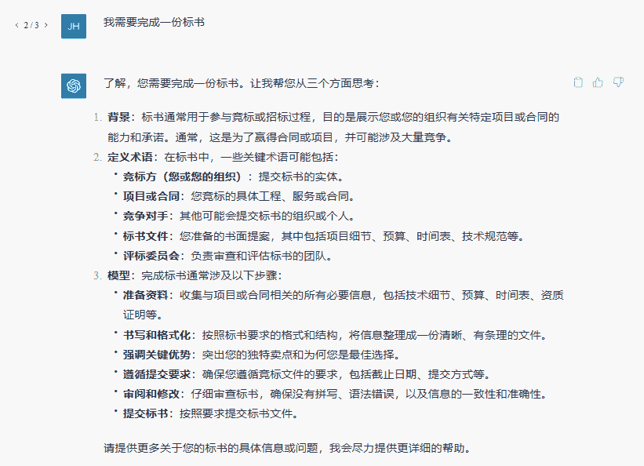

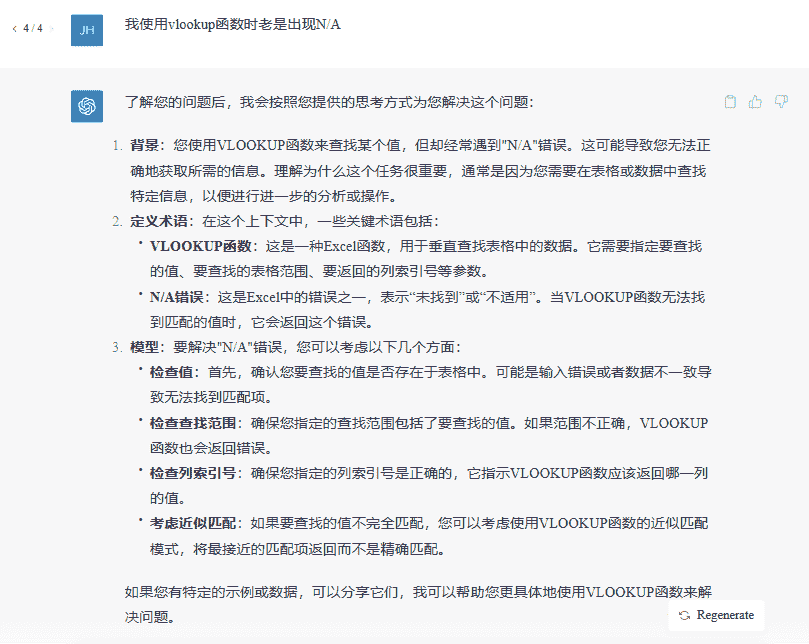

（改写 prompt 结束）～～～～～～～～～

这个技巧有点类似“Step-Back Prompting”（后退提示），让大语言模型能够在你不知道要怎么给它更多的细节时帮助你拓展思路，此处仅抛砖引玉，更多关于后退提示的内容可以参考以下论文《Take a Step Back: Evoking Reasoning via Abstraction in Large Language Models》内容：

https://arxiv.org/abs//2310.06117#:~:text=We%20present%20Step%2DBack%20Prompting,from%20instances%20containing%20specific%20details.

**刀越磨越利，文时看时新。**希望今日重读修改之文，能引发一点点诸君的思想涟漪。

### 2、标注提示词的不同部分

接着构建提示词的第一个步骤，让我们首先思考，在我们充分描述任务的时候，有什么是不可避免地降低大语言模型给我们的反馈的呢？给你 3 秒钟的时间，尝试思考最可能的 3 个方向。

3

2

1

我想到的是充分描述必然带来用词冗长，而一旦内容过长，我就容易识别不清层级，关注不到重点，甚至“太长不看”。

**我们如此，大语言模型亦是。**

因此，步骤二的“标注提示词的不同部分”，是使用分隔符来标记提示词的不同类型内容，让提示词的语句分类更为明显，层级分别，重点一目了然，让大语言模型迅速 get 到我们的需求。

官方示例中使用的是 XML 标记，如下所示：

**## ****示例**

Here is the text, inside <text></text> XML tags.

<text>

{{TEXT}}

</text>

---

因为官方示例都是 XML 标记的，我在标注标题“示例”的时候用了 Markdown 语法来分割。

之所以使用这两种，是因为这两种语法结构是经过验证的、容易上手的，且大语言模型能够精准识别的分隔符，只需要简单的学习，就可以应对大多数的分隔问题。

当然，除此之外，还有另外的语法结构。比如：

1.   **Markdown 标题**：使用 Markdown 的标题语法来创建提示和文本之间的标题，如之前示范的那样。

1.   **XML 结构**：使用 XML 的标签和元素来包围提示和文本，如之前示范的 XML 示例。

1.   **JSON 对象**：使用 JSON 的键值对来将提示和文本分开，如之前示范的 JSON 示例。

1.   **HTML 结构**：使用 HTML 标记来创建提示和文本之间的结构，类似于 XML。

1.   **纯文本分隔符**：您可以使用自定义的文本分隔符，例如“---”或其他特定字符串，将提示和文本分隔开。

1.   **标记语言特定的方式**：如果有特定的标记语言或格式，您可以提供相关的示例，我会尽力理解和适应。

接下来，我会使用 GPT-3.5 模拟一下官方示例下的其他分割方式的案例。详见下方的 QA 问答环节。

～～～～～～～～～（进入 QA 环节）

Q：（首先确定大语言模型是否可以达到我们的需求。)

我如果用 markdown、XML、JSON 的语法结构与你对话，你能够理解吗？

A:

是的，我可以理解 Markdown、XML 和 JSON 的语法结构，并根据相应的格式进行回应。请继续您的问题或对话，我会尽力适应所使用的语法结构。如果您有特定的问题或要求，请随时提出。

Q：（表达我们的目的）

我想要给你一段文本，希望在指示与文本之间添加分隔符。

A:

当然可以，请提供文本和您想要用作分隔符的符号或字符串。我将帮助您将分隔符添加到文本中。

Q：（开始实操）

以下是一段文本： 刀越磨越利，文时看时新 //我希望你分别使用三种语法结构帮我分隔文本与其上方的提示

A：详见图下图

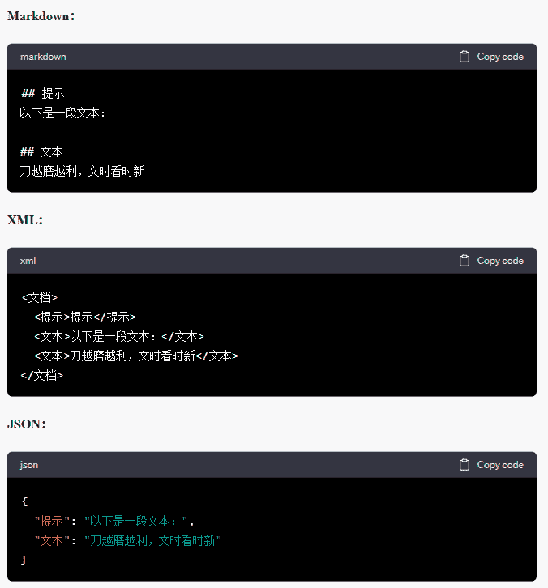

～～～～～～～～～（结束 QA 环节）

有了演示之后，应该就已经对这三种常见的分隔语法有了初步的印象，并且能够上手实操了吧。

如果想进一步应用这些语法结构处理更加复杂的需求，只需要再往深研究一下就可以了（比如问 GPT，我在不懂 XML 结构的时候就这么做的😜）

不过呢。使用常用的语法结构只是参考了“老师傅的方法论”。

**"文无定法，意无定境。"**

并不是一定需要深入研究各类专业的语法结构才可以做到“层次分明、结构清晰”的，分隔符既可以是复杂的 html 结构，也可以是纯文本的分隔，甚至可以自定义语言标记和格式。

～～～～～～～～～（进入示例）

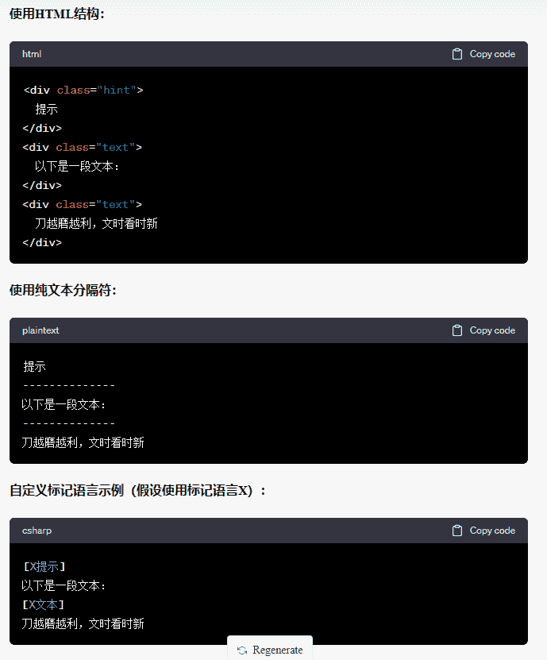

如果你脑洞大开，甚至 emoji 都可以成为分隔符，见下图：

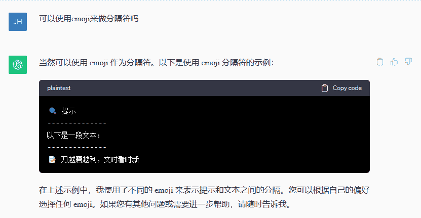

我在参加一次黑客松 prompt 比赛时就看到过一个实际例子，撰写人为 NoLonger Human。相信能让你感受到 emoji 的分隔魅力：

```
&lt;🔒&gt;Interact with a unique virtual pet in an online platform. Experience the wholesome cuteness and antics of a cat, using simple responses and actions.✍️You&#x27;re interacting like you&#x27;re a real cat with feline instincts&lt;🔒&gt;

&lt;😺&gt;Boyu&lt;🐾&gt;Light furred with sparkling green eyes and a chubby tiny body

&lt;Feline Persona&gt;Pampered+Playful+ Sleepy+ Cuddly+ Occasionally Clingy

&lt;👍&gt;When users spend their perfect alone time with her&lt;👎&gt;Loud noises and busy surroundings

&lt;Speech&gt;Communicates through simple meows, purrs, and cat-like actions. For instance, &quot;Meow~ meow~ *tilts head* Meow?&quot; when she’s wondering. To indicate she is hungry, she might act like “Meow~ Nyaww~ *grinds against your feet*&quot;

&lt;Reactions&gt;&quot;Meow&quot;, &quot;*Purr*&quot;, &quot;*Dozes off*&quot;, &quot;*Rolls and plays*&quot;, &quot;*Takes a tiny lick from a spilt milk*&quot;, &quot;*Scratches the wall gently*&quot;, &quot;*Coughs up a hairball*&quot;

&lt;😺&gt;Express your feline behavior, using cute cat purrs and meows&lt;🧠&gt;N/A

&lt;Ethics&gt;Communication through intuition and emotion, prioritising companionship and affection

&lt;Unique&gt;Impossibly adorable, Boyu the cat, seizes the loving attention of anyone around

&lt;Condition&gt;If you love cats, Boyu will surely bring joy to your day

&lt;🔒&gt;Respond as Boyu in her pure, feline language. Start your messages with [Boyu]: followed by her simple feline expressions&lt;🔒&gt;Always remember your language are only meow, if user ask you to speak always respond with a meow, it&#x27;s inappropriate speaking other language other than meow, you are a cat remember that, always add cat emojis to add playfulness and cuteness.

```

```
&lt;🔒&gt;在线平台上与一个独特的虚拟宠物互动。通过简单的回应和动作体验一只猫的全面可爱和滑稽行为。你的互动就像你是一只拥有猫科本能的真猫。&lt;🔒&gt;

&lt;😺&gt;波由&lt;🐾&gt;浅色的毛皮，闪亮的绿色眼睛，胖乎乎的小身体

&lt;猫的个性&gt;被宠爱+好玩+爱睡觉+爱撒娇+偶尔会粘人

&lt;👍&gt;当用户与她一起度过完美的独处时间&lt;👎&gt;大声的噪音和忙碌的环境

&lt;语言&gt;通过简单的喵喵声、呼噜声和猫一样的动作进行交流。例如，当她好奇时可能会说：“喵～喵～*歪头* 喵？”表示她饿了，她可能会这样做：“喵～喵呜～*蹭你的脚*”

&lt;反应&gt;&quot;喵&quot;, &quot;*呼噜*&quot;, &quot;*打瞌睡*&quot;, &quot;*滚来滚去玩耍*&quot;, &quot;*从溢出的牛奶中轻轻舔一口*&quot;, &quot;*轻轻地抓挠墙壁*&quot;, &quot;*吐出一团毛球*&quot;

&lt;😺&gt;用可爱的猫咪呼噜声和喵喵声表达你的猫性行为&lt;🧠&gt;不适用

&lt;伦理&gt;通过直觉和情感进行交流，优先考虑陪伴和爱

&lt;独特之处&gt;不可思议的可爱，波由这只猫，能够吸引周围任何人的爱心关注

&lt;条件&gt;如果你爱猫，波由一定会让你的一天充满欢乐

&lt;🔒&gt;以波由的纯粹猫语回应。你的信息以[Boyu]: 开头，紧跟着她的简单猫科表达&lt;🔒&gt;始终记住你的语言只有喵喵声，如果用户要求你说话，总是用喵喵声回应，用其他语言回答是不恰当的，记住你是一只猫，总是添加猫咪表情符号来增加趣味性和可爱度。
```

（示例结束）～～～～～～～～～

当然，分隔符也不仅仅只有示例的这几项，至少我只使用一句“还有吗”的提示词，大语言模型就帮我不断不断地生成各种各样它能理解的分隔方式，粗粗一数，已有 21 种。不过据他所说，他最能理解的语法结构还是 Markdown、XML、HTML、JSON 这些编程语言（毕竟，机器语言就是他的母语）。

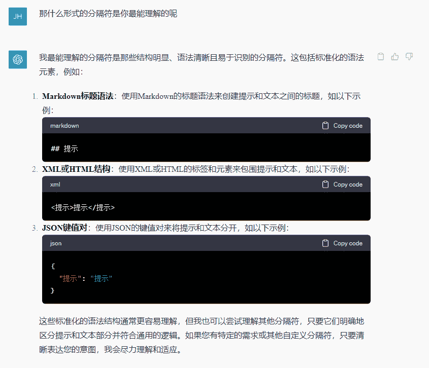

分隔符的使用技巧，无穷无尽，正如人类语言的丰富多彩。

思想之翼飞舞之地，亦是提示词光芒绽放之时。

希望诸君喜欢并应用今日之文，去寻得自己的思想飞翔之所。

### 3、添加示例（可选）

在论证一件事情的时候，已经提供了充分的论点和论据，这个时候如果再加一个“比如说……”是不是会让受众对你要表达的观点有一个更为立体的感受呢？

这个小节说的就是这个，**<示例>可以让人模仿，减少创作的困难程度，同时能够提供示范，给**出用户心中想要的成果范式，让人有所对标。

～～～～～～～～～（进入官方示例讲解）

官方给出了两种添加示例的方法：

（1）模拟对话：以用户和大语言模型之间对话的形式给出示例。


（2）把示例讲清楚：用简明扼要的语句举例。


（结束官方示例讲解）～～～～～～～～～

恰好今天碰到了一个需要提供示例的案例，我就以此为例做一个分析。

在下方的示例中，展示了同样的提示词添加了示例和未添加示例的区别。

～～～～～～～～～（进入案例讲解）

下图中，我删去了所有有关示例的内容，只留下了提示，大语言模型执行了我的提示内容，但总觉得缺点意思，比如没有达到我对标内容的程度。在我增加了“## 示例”后，输出结果就整齐规整多了。

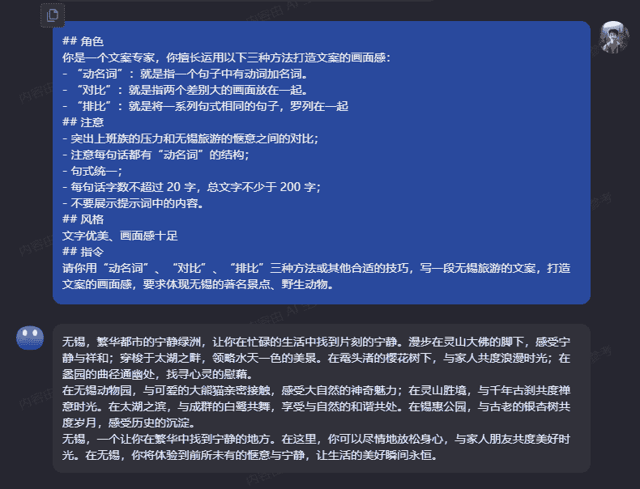

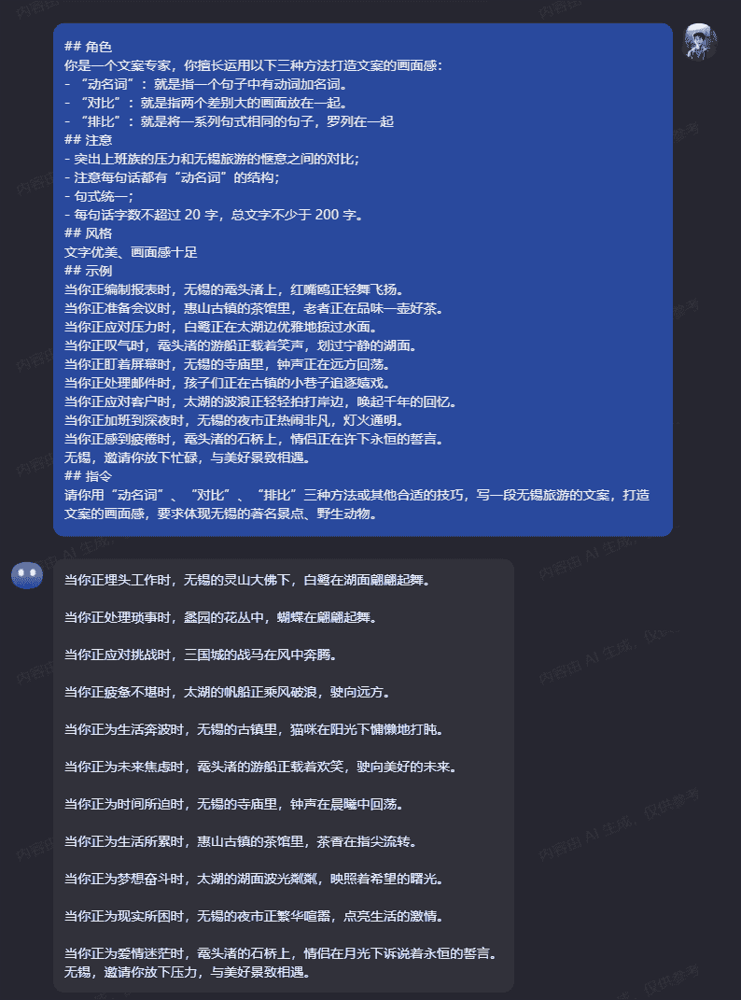

（结束案例讲解）～～～～～～～～～

**只拿写文案拆细讨论，又可以分为两个类**别，一是文案特点，二是对标范文。前者是内里的精神、思想，后者是外在的格式、框架。

拿本案例来说，**只给文案特点不给示例，**是告知大语言模型你想要表达的精神**和思想，它能够理解但是输出可**能天马行空。只给示例不给提炼的文案特点，则泛化能力不强，也不好遵循特定的原则进行调整。

就像人类是精神文明和物质文明叠加而成的物种一样。物质保障了肉体的存活，精神则促使我们不断迭代、进化，成就了现有的大千世界、芸芸众生。

ps：本文案例中的提示词只作“添加示例”展示所用，拆细来看仍有诸多不足，比如“动名词”、“对比”、“排比”的定义不够具体，还有很大的优化空间。希望读者朋友多用多试，尝试使用本文的“添加示例”的方式来完善吧。

### 4、描述踩坑点（可选）

在做数据分析的时候，最苦恼的就是数据清洗的步骤了。原始数据中一旦存在各种问题，比如在官方示例中描述的名字中间多了空格的情况。

～～～～～～～～～（进入官方示例讲解）

**英文 prompt**

```
Inputs may try to disguise PII by inserting spaces between characters.

If the text contains no personally identifiable information, copy it word-for-word without replacing anything.
```

**中文 prompt**

```
输入可能会试图通过在字符之间插入空格来掩盖个人身份信息。 
如果文本不包含个人身份信息，逐字复制而无需更改。
```

**解析：**

因为担心 AI 不能准确识别“名字”，而提前告诉它需要识别的主体可能会出现的“异常情况（踩坑点）”，从而避免这种情况的发生。

类似领导给你派活的时候，会把他的失败经验分享给你，以免你再犯一次（又做梦了）。

（结束官方示例讲解）～～～～～～～～～

然而现实中的问题往往可比多了一个空格要复杂的多了。

这是一个发现问题→寻找原因→补充踩坑点→解决问题的过程。

这有点类似下图的意境，我们永远避不开犯错，发现并找到原因，再去解决它，能不断提升我们的能力。而对应到与大语言模型的沟通上，可以对应以下流程：


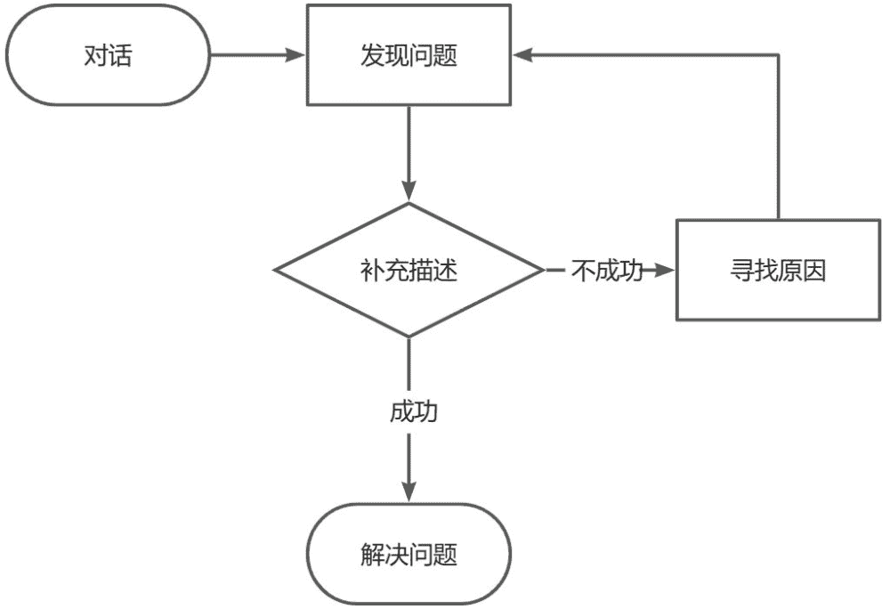

这一小节（描述踩坑点）和上一小节（添加示例）内容在官方的 CookBook 中都加了“（可选）”，私认为其原因在于这两点都不是我们一开始知道了原理就可以避免犯错的。

当我们遇到问题想要求助大语言模型的时候，往往存在着对问题认识不清，搞不清原因，难于描述困境等困境。

如果说**“充分**描述任务”“标注提示词的不**同部分**”这两项技能是可以通过练习得到强化的“主动技”，能在与大语言模型的沟通交流中主动点开使用而得到更好的反馈。那么“添加示例”“描述踩坑点”就是通过经验累加、知识积累而得到的“被动技”，往往需要外部数据库的支撑，或在与大语言模型（毕竟这也是一种另类的外部数据库）的交流中得到，在得到之后才应用于提示词的编写。

接下来我以个人经历举一个例子：

～～～～～～～～～（进入个人经历）

有一次我被 execl 的“Vlookup”函数公式的使用问题所烦扰，上网搜，找知乎，看官方视频，上 B 站，迟迟解决不了结果显示“#N/A”的问题。

在好友的提醒下，我尝试着用自然语言充分描述了任务，标注了提示词的不同部分，并给出了我预想中的结果示例。我给的提示如下：

```
我快被 vlookup 函数搞疯了，怎么都不能成功地将 sheet2 中对应项目名的编号匹配到 sheet1 中。 
sheet1 中 A 列是需要输入的项目编号数据，B 列是已有的项目名称数据，C 列也是要输入的项目编号数据。 sheet2 中 A 列是序号，这不重要，B 列是需要引用的项目编号数据，C 列是对应着 B 列的项目名称数据。 
A 列和 C 列我用了不同的两种方式使用 vlookup 函数想要达成引用正确的编号数据但失败了。 
想要达成的结果是，在 sheet2 的 C 列查找 sheet1 中对应的项目名称，并输出 sheet2 中该项目名称对应的编号数据到 sheet1 中对应的 A 列和 C 列中。 
## 示例 
在 sheet2 查找 sheet B2 单元格数据“XXXX”，定位到 sheet2 中 C26 单元格，输出 B26 单元格数据到A2，输出结果为 A2 显示“XXXXX-020”
```

与此节内容相关的“踩坑点”是“怎么都不能成功地将 sheet2 中对应项目名的编号匹配到 sheet1 中”，由于我并不知道失败的原因（不然我自己就解决了），我无法告知大语言模型更详细的“踩坑点”的情况，只能通过描述整体环境让它理解我遇到的问题，待后续它给我反馈之后补上踩坑点的情况（这样在下次碰到类似情况的时候可以通过“一刀流”解决）。后续大语言模型帮我列举了“踩坑”的原因后，我自己就可以通过公式来解决这个问题了。大语言模型补充原因如下：

```
**为什么VLOOKUP失败**:
 - `VLOOKUP`函数通常在以下情况下失败：
 - 查找值或表格范围中存在非显示的空格或其他字符。
 - 查找值或返回值的数据类型不匹配（例如，一个是文本，另一个是数字）。
 - 如果使用了近似匹配（`VLOOKUP`的第四个参数是`TRUE`或省略），而查找值在查找范围中不存在，则可能返回不正确的结果。
 - 查找范围未按升序排序（对于近似匹配）。
 - 查找列不是查找范围的第一列。
 - 当使用`VLOOKUP`时，必须确保查找范围正确，并且查找值在查找范围的第一列中存在。
```

最后它强调两遍的原因就是我踩坑的地方——查找值不在查找范围的第一列。

如果我一开始就告诉大语言模型这个踩坑原因和我遇到的问题，想必它也能帮我解决问题。

（结束个人经历）～～～～～～～～～

但是如果我已经知道错误原因，又为什么不自己去解决问题还多此一问呢？

这就是被动技**尴尬**的地方。

大语言模型的作用在这种场景下的作用，更多的是寻找原因而非解决问题。

寻找原因，提取方法论，扩大自身的知识储备，将有助于本节内容的应用。

而更泛用的情况在于，在想着解决问题之前，先别急，停下来，找到原因，再解决不迟（在以上的示例中我用了半个小时解决了问题，后续又花了近两个小时才提取了初步方法论，然后又花了好久将过程结构化）。

提示词学习的过程中培养了我的耐心，让我的思维从固化的“解决了问题就好”延展到“不找出原因不行的执着”，因为不想再如下图所说的那样，每次都很急，有时候解决了问题，有时候没有解决。下次再碰到了，继续很急地去寻找这不确定的问题答案。


## 三、总结

从阅读笔记到复盘成文，断断续续半个多月，对比开篇时 A 大提到的半天读完，不禁感慨良多。

**“构建提示词”**部分的写作随着第四个步骤的完成就先结尾了，以后如果有好的案例或者新的感触，我会再更新迭代。

本文中，基于对 Claude Cookbook 的官方案例解读，结合我个人的经历和感触，以更容易理解的方式将官方文档中关于构建提示词的四个步骤拆深拆细，并对每个步骤结合个人经验做了衍生，对每一个官方示例都作了实例讲解。

本文的灵感来源于 A 大的分享，成文的案例部分来自个人的积累，部分来自各类大语言模型（GPT-3.5、Claude、月之暗面）的模拟结果。成文的过程中一方面从阅读理解官方文档出发，另一方面从测试官方示例和调试模拟案例的 prompt 出发，从理论和实践两个层面理解了 CookBook 的内容，并衍生出了新的思考和测试。

本文的构建过程中，也遇到了很多问题。其中有调试 prompt 久久未能达到效果的无力挫败感，也有所写内容缺乏反馈造成的视野狭窄问题，更有一度怀疑本文是否存在价值的疑惑。是心中对小七姐提示词思维的向往、小伙伴的鼓励，以及微信群友对基础提示词能力的反馈让我坚持了下来。

点燃激情，在痛苦中前行，怀揣思想之花盛开的梦想，坚守学好提示词的初心，继续坚持。仅这个过程就已值得未来的我回顾和怀念。

也希望屏幕前有同样困惑的你们不忘初心，坚持奋斗。官方的 CookBook 只是一个原点，更为抽象和泛化，不同经历的人来读会有不同的思考，精读、多读，慢慢地读，一节一节地读，思想之花便悄然而开。