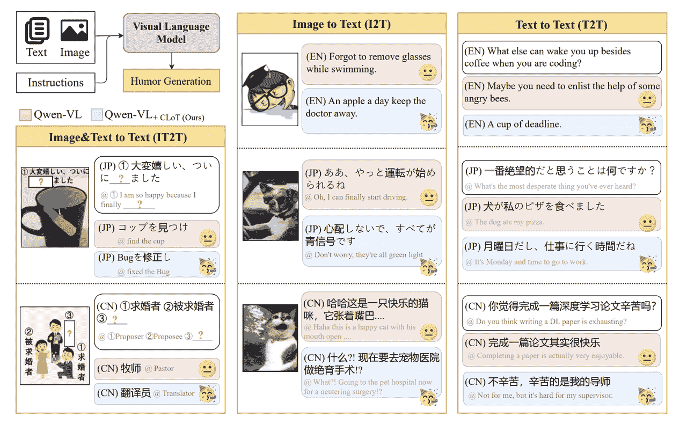
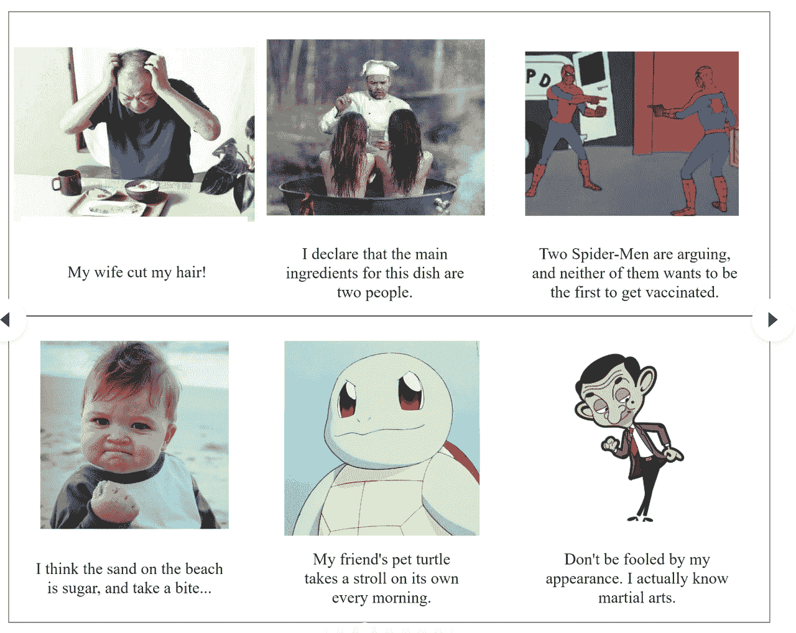
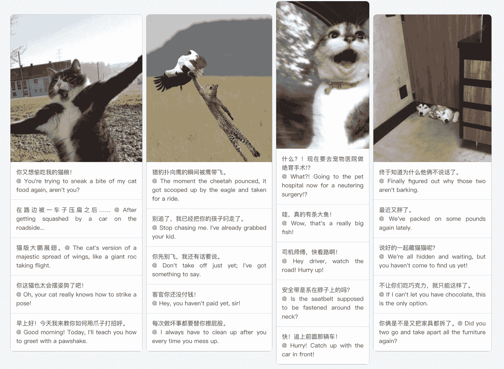

# 训练LLM成为吐槽能手

> 来源：[https://waytoagi.feishu.cn/docx/QTkBdLg5Dolcm9xt6POcLMijnAd](https://waytoagi.feishu.cn/docx/QTkBdLg5Dolcm9xt6POcLMijnAd)

投稿：觉老师  https://zhongshsh.github.io/CLoT/

论文：https://arxiv.org/pdf/2312.02439.pdf

> 这篇名为《让我们跳出思维框架：在大型语言模型中探索飞跃思维》的论文，探讨了大型语言模型（LLM）中的飞跃思维（Leap-of-Thought，LoT）概念。以下是基于可获得信息的详细分析：

1.  LLM中的思维链（CoT）: 论文讨论了思维链（Chain-of-Thought，CoT）如何引导LLM逐步推理，增强其逻辑推理能力。CoT对于需要逻辑解决方案的任务非常有效

1.  CoT在创造性问题解决中的局限性: 虽然CoT在逻辑任务中有益，但它并不利于创造性问题解决。创造性问题解决通常需要跳出框架思考，这对于创新和进步至关重要

1.  引入飞跃思维（LoT）: 论文引入了LLM中的飞跃思维（LoT）。LoT代表一种非顺序的、创造性思考方式。从CoT到LoT的这种范式转变表明了专注于增强LLM的创造能力

1.  利用LoT生成创造性幽默: 论文特别探讨了如何改进LLM，以通过创造性飞跃思维（CLoT）范式生成创造性幽默。这种方法表明LLM在生成不仅逻辑性强，而且创造性强的内容方面具有重大潜力

1.  使用大喜利探索LoT: 为了进一步探索LLM中的LoT能力，论文提到了使用大喜利，一种传统的日本喜剧游戏。大喜利是一项创造性幽默生成任务，挑战玩家对多模态信息进行跳出框架的思考。这个游戏为调查LLM在创新、非线性思维过程方面的能力提供了理想的平台

1.  大喜利游戏的使用：为了探索LLM的LoT能力，论文提出了使用大喜利（Oogiri），这是一种传统的日本喜剧游戏。这个游戏是一个创造性幽默生成任务，挑战玩家对多模态信息进行跳出框架的思考【26†来源】。

1.  幽默生成示例：

+   论文审查: 描述一个看起来很严肃的人拿着大刀，其表情似乎刚刚读完一篇写得很糟糕的论文【27†来源】。

+   剪蓝线: 一个爆炸场景的图片，其中加入了“看来应该剪蓝线才对……”的字幕，模仿电影中拆弹的经典场景【27†来源】。

+   脑子短路: 一位女性使用听诊器听自己的头部，场景被幽默地描述为“脑子短路”【28†来源】。

+   单身狗: 一张自豪的狗的图片，配文“我以前一直以为自己是单身狗，直到我看到我儿子”，涉及中国文化中的两个常见说法【29†来源】。

+   多喝热水: 一张《肖申克的救赎》中男子在雨中仰头喝水的画面，幽默地关联到中国文化中“多喝热水”的说法【30†来源】。

1.  其他幽默响应：

+   两只小狗的画面，一只白色小狗好像在托举另一只棕色小狗，配文“可以下来了吗？”【31†来源】。

+   一只狗坐在壁炉中间的画面，幽默地解释为“热狗烹饪方法”【32†来源】。

+   一只在空中飞跃的狗，毛发被吹得向后飞扬，配文“主人，你这电吹风是认真的吗？”【33†来源】。

+   《阿甘正传》中的一幕，男子似乎在阻止别人坐下，配文“不好意思，这里有人了”【34†来源】。

+   一张红色小猪煎饼的图片，配文“煎饼果子要趁热吃，否则会变成小猪”【35†来源】。

+   蜘蛛侠小心爬在玻璃上的画面，配文“刚擦的玻璃不能弄脏”【36†来源】。

+   电影《Obernheimer》的海报，配文“真男人不回头看爆炸”，创造出幽默效果【37†来源】。

1.  任务类型和模型对比：论文中提到了三种大喜利任务："Image&Text to Text (IT2T)"、"Image to Text (I2T)"、"Text to Text (T2T)"，这些示例展示了CLoT的飞跃思维能力，以及其在创造高质量幽默响应方面的卓越创造性思维【38†来源】。

这些示例和分析表明，论文通过创新和幽默的方式探索了LLM在创造性思维方面的潜力。

---

**小互**

CLoT：**训练LLM成为吐槽能手**

用日本传统喜剧游**戏“大喜利”（Oogiri**）作为测试，挑**战AI以吐****槽高手的方式****回应信息。

****游戏中的挑****战，AI需要理****解给定图文信息来产**生幽默搞笑的回答。

Oogiri 是一种需要参与者对给定的图像文做出意想不到且幽默的回应的创意游戏。

测试包括图像到文本（I2T）、文本到文本（T2T）和图像&文本到文本（IT2T）

具体方法：

建立数据集：研究人员构建了一个多模态、多语言的 Oogiri-GO 数据集，包含超过 130000 个样本。

训练 AI：通过特殊的训练方法，让 AI 学会如何在游戏中给出创意和幽默的回答。

CLoT 首先将 Oogiri-GO 数据集转化为 LoT 导向的指令调整数据，以训练预训练的 LLM 达到一定的 LoT 幽默生成和辨别能力。

然后，CLoT 设计了一个探索性自我完善过程，鼓励 LLM 通过探索看似无关概念之间的平行关系来生成更多创造性的 LoT 数据，并选择高质量数据进行自我完善。

实验结果：

实验结果显示，CLoT 能够显著提高 LLM（如 Qwen 和 CogVLM）在多种 Oogiri 游戏类型中的表现。具体来说，CLoT 帮助 LLM 生成了更好的幽默内容。

量化性能提升：与原始和 CoT 集成的 LLM 相比，CLoT 集成的 LLM 在 Oogiri 游戏的多项选择和排名问题中取得了更高的性能。

创造性能力的提升：CLoT 还在其他任务（如“云猜测游戏”和“发散性联想任务”）中提高了创造性能力，显示出其卓越的泛化能力。

项目及演示：https://zhongshsh.github.io/CLoT/

论文：https://arxiv.org/abs/2312.02439

GitHub：https://github.com/sail-sg/CLoT