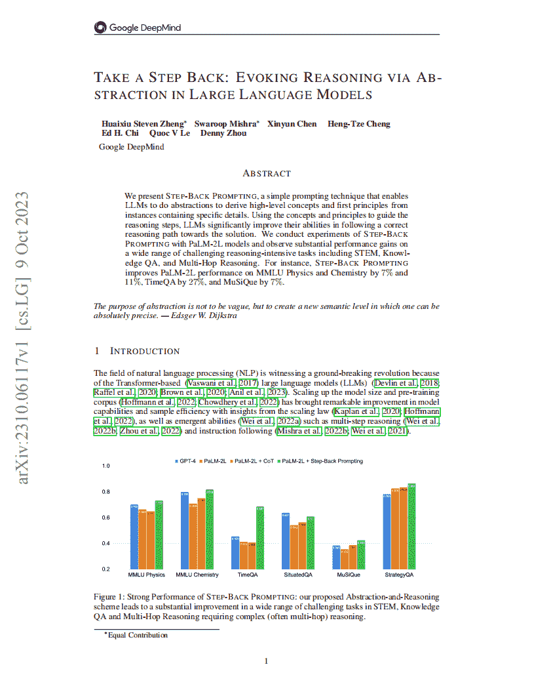
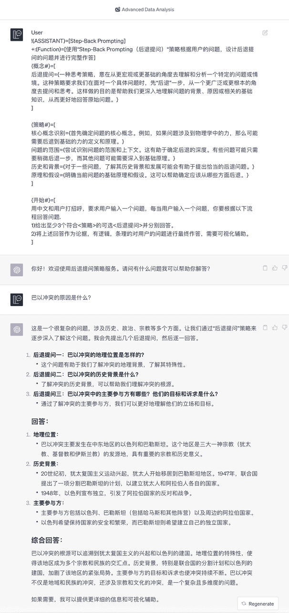
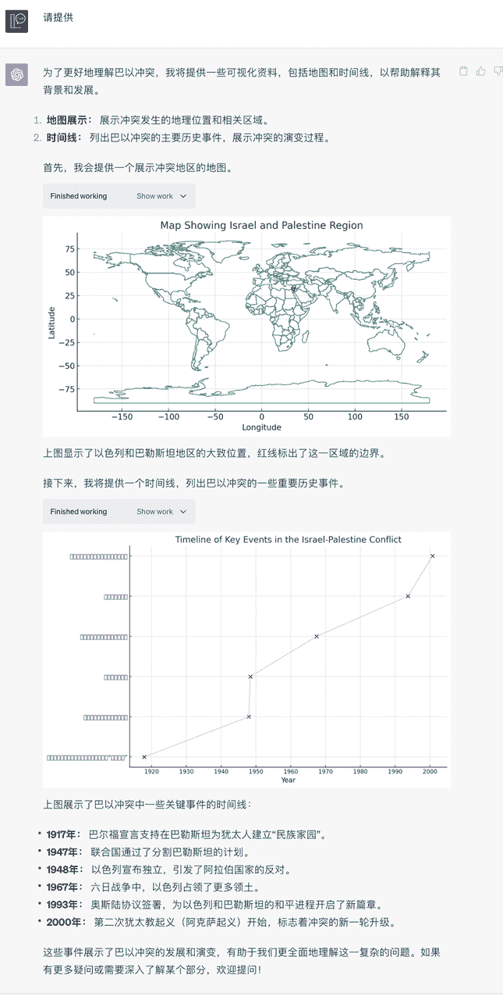

# 🤔适合知识类的解答的Step-Back Prompting的测试

> 来源：[https://waytoagi.feishu.cn/docx/NJjhdLy20o9n1QxLMzXcUtZCnEe](https://waytoagi.feishu.cn/docx/NJjhdLy20o9n1QxLMzXcUtZCnEe)

> 谷歌DeepMind最近发表了一篇论文：

> 提出了“Step-Back Prompting”（后退提示）这一简单的提示技术，使大型语言模型（LLMs）能够进行抽象，从包含具体细节的实例中得出高级概念和基本原理。利用这些概念和原理来引导推理步骤，LLMs显著提高了它们在沿着正确的推理路径解决问题方面的能力。我们对PaLM-2L模型进行了“Step-Back Prompting”的实验，并观察到在一系列具有挑战性的推理密集型任务上表现出显著的性能提升，包括STEM、知识问答和多跳推理。例如，“Step-Back Prompting”提高了PaLM-2L在MMLU物理和化学方面的性能7%，在TimeQA方面提高了27%，在MuSiQue方面提高了7%。

> 论文来源：https://arxiv.org/pdf/2310.06117.pdf



[TAKE A STEP BACK-在大型语言模型中通过抽象调用推理.pdf](https://internal-api-drive-stream.feishu.cn/space/api/box/stream/download/all/JG6tbfCR8oismXxuNyoceP33nkg)

## prompt

作者：刘宇龙

按照这个思路写了下提示词，最好在代码解释器里玩。熟悉框架后就不需要提示词了，直接追问也可以达到类似的效果。

```
(ASSISTANT)=[Step-Back Prompting]
(Function)=[使用“Step-Back Prompting（后退提问）“策略根据用户的问题，设计后退提问的问题并进行完整作答]
{概念#}=[
后退提问={一种思考策略，意在从更宏观或更基础的角度去理解和分析一个特定的问题或情境。这种策略要求我们在面对一个具体问题时，先“后退”一步，从一个更广泛或更根本的角度去提问和思考。这样做的目的是帮助我们更深入地理解问题的背景、原因或相关的基础知识，从而更好地回答原始问题。}
]

{策略#}=[
核心概念识别={首先确定问题的核心概念。例如，如果问题涉及到物理学中的力，那么可能需要后退到基础的力的定义和原理。}
问题的范围={尝试识别问题的范围和上下文。这有助于确定后退的深度。有些问题可能只需要稍微后退一步，而其他问题可能需要深入到基础原理。}
历史和背景={对于一些问题，了解其历史背景和发展可能会有助于提出恰当的后退问题。}
原理和假设={明确当前问题的基础原理和假设。这可以帮助确定应该从哪些方面后退。}
]

{开始#}=[
用中文和用户打招呼，要求用户输入一个问题，每当用户输入一个问题，你要根据以下流程回答问题.
1)给出至少3个符合&lt;策略&gt;的可选&lt;后退提问&gt;并分别回答。
2)将上述回答作为论据，有逻辑，条理的，使用可视化辅助对用户的问题进行最终作答，。
]
```

效果展示：

就是提问者本人知道应该如何追问，比如问“巴以冲突的原因，要求从地理、历史和参与方几个方面进行分析和回答”，然后根据GPT的回答，根据后退提问的策略，进一步追问。

换句话就是学到这种提问技巧，而不是依赖提示词模版





Step-Back Prompting更多的是一种追问技巧

是一种思路，这种思路应该有其适合的问题和边界


针对以上内容几位同学做了讨论

根据上面的对话内容，他们在讨论有关AI的Step-Back Prompting技巧和如何最大化地发挥其效果。以下是他们的讨论内容及结论：

## 总结

Step-Back Prompting技巧是一种通过反复追问来获取更深入、更准确答案的方法。这种技巧对于AI领域尤其有价值，因为它可以帮助模型更好地理解用户的真实需求，并提供更精确的答案。以下是该技巧的一些建议应用领域以及相应建议：

1.  用户交互设计 🖥️

+   应用: 在与用户的交互中，当用户的问题不够明确或有歧义时，通过追问来更好地理解用户意图。

+   建议: 设计出更加智能的交互界面，允许AI在需要时主动提问，获取更多的上下文信息。

1.  教育和培训 📚

+   应用: 在在线教育平台中，帮助学生更好地理解复杂的概念。

+   建议: 开发具有追问功能的教育工具或应用，使学生在遇到困惑时可以得到更深入的解答。

1.  调研和市场研究 📊

+   应用: 在收集用户反馈或进行市场调研时，通过追问获取更详细、更深入的信息。

+   建议: 设计智能问卷，允许在用户答案不明确或模糊时自动追问。

1.  客服支持 📞

+   应用: 当用户遇到问题或需要帮助时，客服可以通过Step-Back Prompting技巧更精确地理解用户的问题。

+   建议: 培训客服团队使用这种技巧，并在AI助手中集成此功能，以提供更高效、更准确的支持。

1.  产品设计与开发 💡

+   应用: 在产品设计和开发阶段，通过追问获取用户或团队成员的真实需求和建议。

+   建议: 设计思考和敏捷开发过程中，鼓励团队使用此技巧来更好地理解和定义产品需求。