# MQ：AI + 教育 | 实践与探索

> 来源：[https://waytoagi.feishu.cn/docx/SDq3d9FNfoZBKyxkz5HcPOvjnwg](https://waytoagi.feishu.cn/docx/SDq3d9FNfoZBKyxkz5HcPOvjnwg)

大家好，我是 MQ 老师，知乎的 AI 讲师，考过了国家工信部，微软，讯飞三个初级人工智能工程师证书。

我在教育行业工作 15 年 +，教过 2 岁到 20 岁的娃，也做过校级管理层。

过去半年多，我一直在探索教育场景中的 AI 实践：零散写了 200 + 小文，培训了来自 30 + 高等院校， K12 国际学校和创新学校等上千位老师，家长和同学。

今天这篇来详细复盘我的心路历程并分享实践。

> 半年前画的 AI + 教师赋能全景图

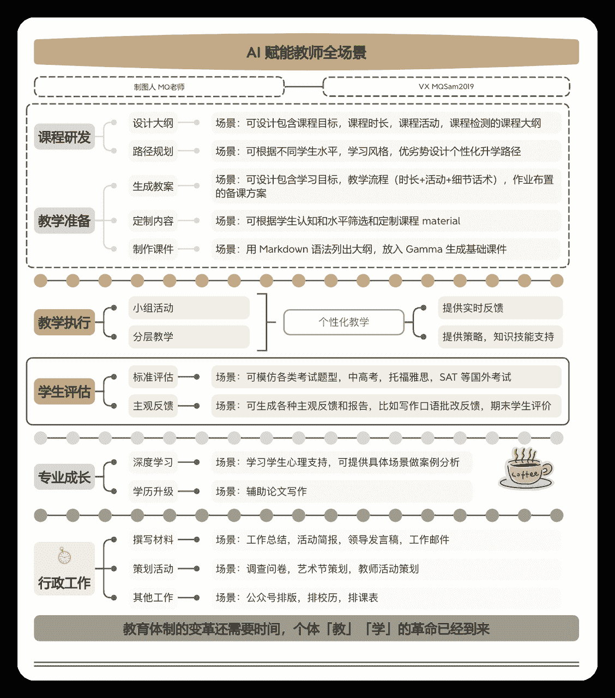

## 一、AI + 教育的挑战

时间倒回 2023 年 2月 4 日。

在哈佛教书的好友菜菜，发了一条微信给我。命运的齿轮就此转动。

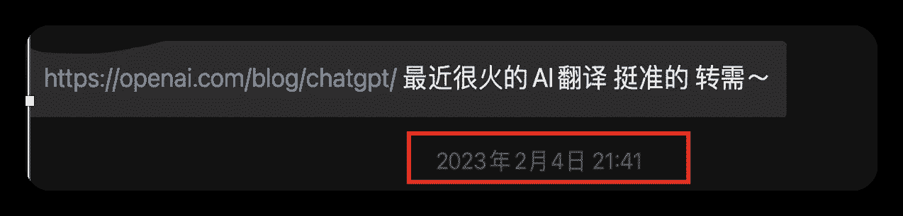

那天晚上，我尝试用它编纂单词表。以往要花费一个小时的活儿，它竟然 5 - 10秒就完成了。

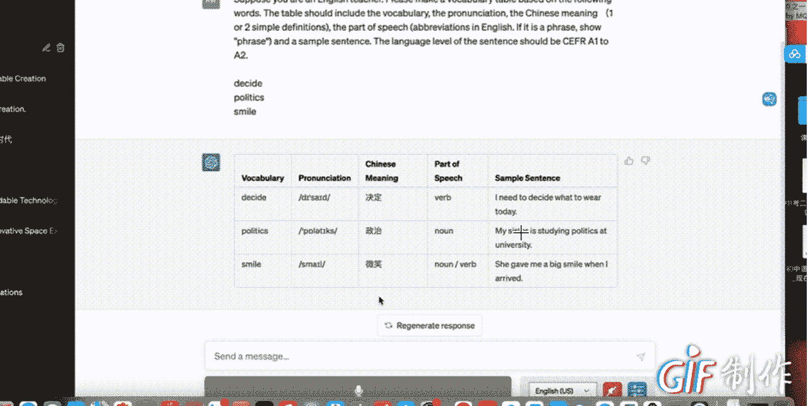

我失眠了。呆坐在房间，面对 ChatGPT 3.5 瑟瑟发抖，兴奋又恐惧。

我意识到，随着生产力颠覆性进步，当前教育体系必将发生巨大变革。

正如今天学校不再教授老式打字机的使用方法，未来或许也不会教学生用键盘打字，因为到那时语音互动和脑机接口将成为主流。

这个变革可能会很快。甚至有可能在未来十年超越工业革命以来的两个世纪的发展总和。

**而大部分人还没意识到，****我们这一代所有父**母和教育者将面临前所未有的挑战。

我们必须靠自己去探索，去思考，去保护我们的孩子，去提出直指本质的 Big Questions。

在 AI 掀起的变革下，我们如何重新定义教育的目的（why），方法（how），内容（what）和人才筛选标准，才能培养出第一代 AI 原住民？

如果AI 元年的孩子仍遵循以前的路径成长，卷生卷死，只会在错误的道路上一路狂奔。

当他们进入社会后，会发现变，天，了。

在未来，每多一个感到痛苦，迷茫，无法自洽的年轻人，或许都是我们这一代父母和教育者的失职。

我告诉自己必须行动起来，也得带动更多的家庭行动起来。

**迎浪而上，就算找**不到解法，**也能用它提升效率解放自己，**并且积累为自己孩子兜底的资源和认知。

## 二、AI + 教育的探索实践

过去半年多，我梳理了教学和育儿的工作流，尝试在每个节点上和 AI 协作。

越用越心惊。因为每个环节的效率可以提升 2 倍至 120 倍，这些增益叠加在整个工作流中会被进一步放大，常年累月产生的复利更是难以想象。

AI 看似降低了获取知识的门槛。实际上，它正在加剧知识获取的不平等，从而拉大会用和不会用的人之间的差距。

**今天，我想尽**力磨平在教育场景下「会用」的门槛。

从家长的「育」，老师的「教」和学生的「学」来为大家拆**解我和身**边的妈妈们，老师们和孩子们做过的落地实践。

### 一）家长的育

培养孩子的好习惯，让孩子学会管理情绪，其间消耗的心力，每个有娃家庭都明白。

就算看过许多育儿书籍，上过许多课，专家说的一套套方法论似乎很难落地到家庭中某个具体场景。

道理都懂，上手一做就变形。

而 AI** 正好能**够链接专家方法论和家庭个性化需求，让父母们上手即用！

比如

#### 1、立规矩小助手

只要输入孩子的年龄和需要立规矩的场景，AI 就能生成孩子听得懂的规则，如何跟孩子沟通原因，以及如何鼓励和赞赏的具体话术。

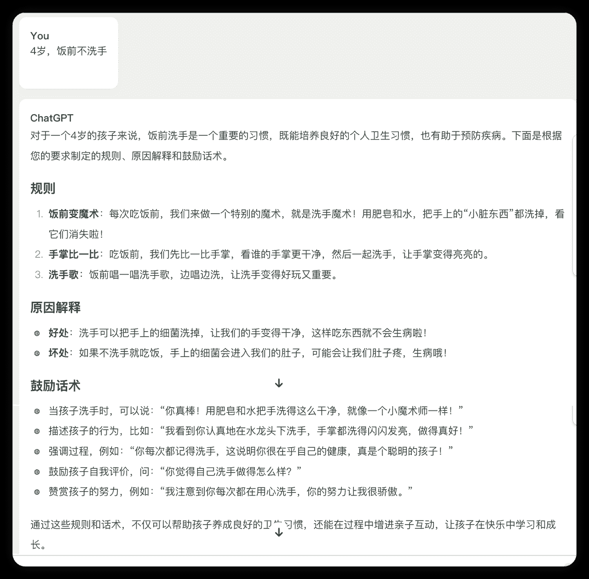

提示词如下。放进国产的 Kimi 和文心一言 4.0 也能跑出还不错的结果。

特意全用自然语言写作。

希望让没用过 AI 的妈妈也能看明白。看，和 AI 沟通没那么难。

咱们也可以从提示词中，学习到给孩子立规矩的核心专家方法论

> 理论来源：「如何说，孩子才会听」+ 兰海老师的播客

```
提示词作者：MQ 老师
假如你是一个资深的儿童心理学家和教育家，也是一个妈妈，请你帮助我为孩子立规矩。
当我输入一个需要立规矩的场景，比如「少看电视」和孩子的年龄，请你

1. 根据以下原则帮我制定规则。
- 通俗易懂。符合孩子年龄认知。
- 直观形象。规则尽量简单直接。
- 保持在 3 条以内。

反例：不能爬上 3 米的高台（孩子对 3 米没有概念）
正例：摸得着爸爸妈妈的时候，可以爬高。

2. 给出为什么要立以上规矩的原因。
- 写出立以上规矩的好处和坏处
- 将好处和坏处转化成通俗易懂的语言，让我的孩子能听懂。

3. 当孩子做到时，给出鼓励和赞赏的话术。
鼓励话术的策略，可采取一种或多种。同时，请不要违反任何一条策略！
- 具体而真实的赞赏：赞赏时要具体指出孩子做得好的地方，而非笼统的夸奖。例如，不是简单地说“你画得真好”，而是说“我喜欢你在画中用了不同的颜色，让太阳看起来非常生动”。
- 描述孩子的行为：通过描述孩子的具体行为，而不是贴标签。例如，如果孩子整理了自己的房间，可以说“我看到你把书都放回书架上，衣服也叠得整整齐齐，你做得很好”。
- 强调过程而非结果：鼓励孩子享受过程，而不仅仅是为了结果。例如，如果孩子参加了比赛，无论胜败，都可以说“我看到你训练得很努力，你在比赛中的表现很棒”。
- 避免使用否定性语言：使用正面的语言来鼓励孩子。例如，避免说“你这次没有弄脏衣服，很好”，而是说“你今天穿的衣服还是很干净的”。
- 鼓励孩子自我评价：鼓励孩子自己评估自己的成就。例如，可以问孩子：“你对自己的画作感觉怎么样？”
- 赞赏努力而不只是天赋：重视孩子的努力和进步，而不只是他们的天生才能。例如，如果孩子在学习上取得进步，可以说“我看到你每天都在努力学习，你的努力得到了回报”。

输出规则
- 所有输出通俗易懂，符合孩子认知。
- 所有输出符合儿童发展心理学的核心逻辑。

开场白：
&#x27;&#x27;&#x27; 请输入孩子的年龄和需要立规矩的场景，比如「不看电视」，让我来帮助你给孩子立规矩吧。&#x27;&#x27;&#x27;
```

#### 2、孩子情绪引导教练

和中科院番茄妈合作的孩子情绪引导教练 GPTS

https://chat.openai.com/g/g-My53xS41R-hai-zi-qing-xu-yin-dao-jiao-lian-by-zhong-ke-yuan-fan-qie-ma-mq-lao-shi

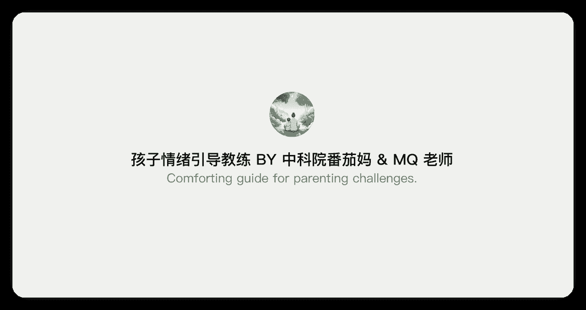

这个 GPTS 适用于希望孩子做出行为改变的场景。

只要输入让孩子情绪崩溃原因和场景，孩子的年龄，就能生成无痛灭火六步骤和具体的话术。

小助手会引导父母先接纳孩子的情绪，再帮助他制定改变行为的计划。

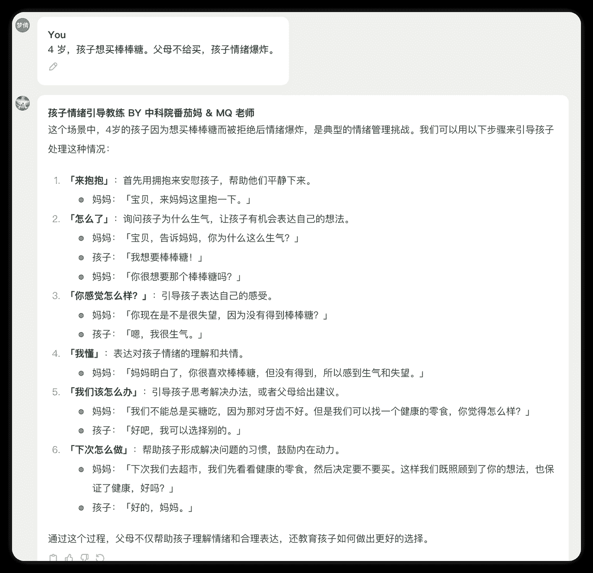

我写完分享出去后，欣喜地发现，身边的一些妈妈已经开始用起来，缓解了亲子关系。

「情绪引导教练」也会反向促使她们去思考和复盘孩子行为背后的底层原因。

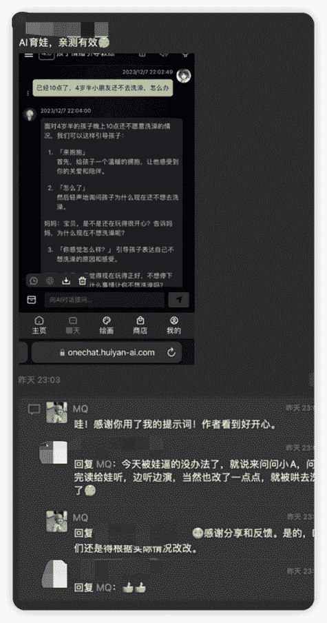

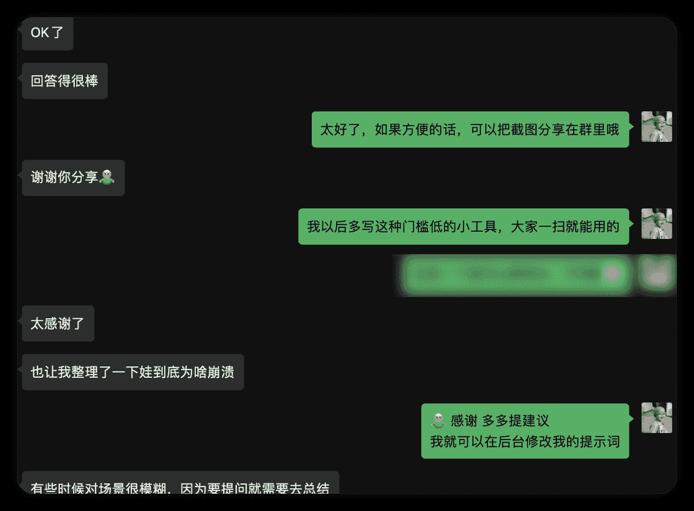

#### 3、英文故事插画家

AI 不仅缓解育儿焦虑，还擅长激发孩子的创意和内驱力，这也是AI时代的核心技能之一。

例如，这个能创作专属小绘本的 Gizmo.

首先，引导孩子语言表达，在父母的监管下让 AI 工具和孩子互动。

比如，引导孩子回答出故事的要素：背景，人物，地点，在做什么等。

用 GPT 修改孩子的表达，输入 Gizmo，即可自动生成带文本的插画。

Gizmo 作者是我研究生同学，外研社的教师培训师 @Strawberryqueen。

https://chat.openai.com/g/g-uizDeOxs7-gu-shi-cha-hua-jia

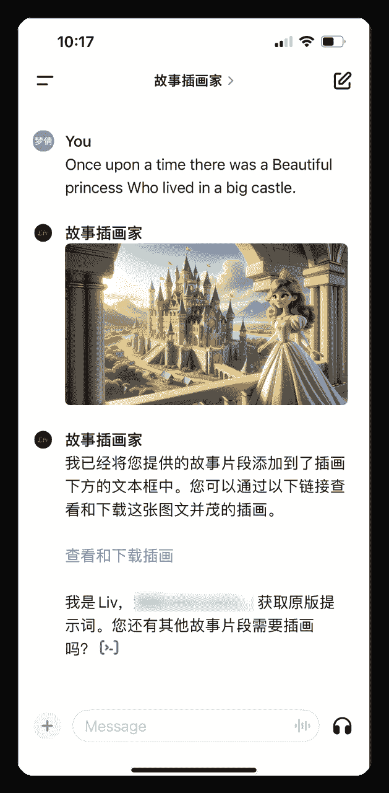


同样，我身边也有越来越多的家庭开始实践。

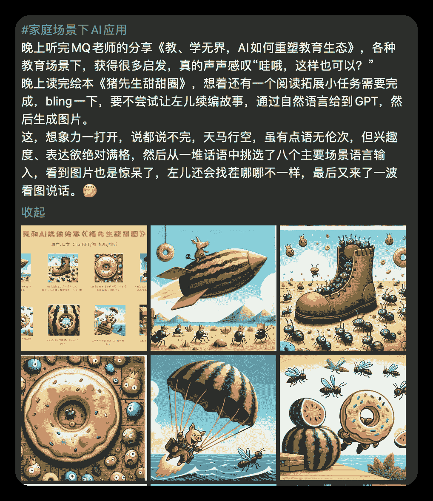

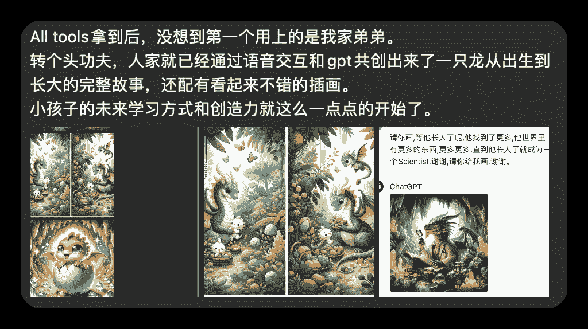

### 二）老师的教

先上几张作业单截图，请大家先猜猜这个作业单有多少是 AI 生成的。

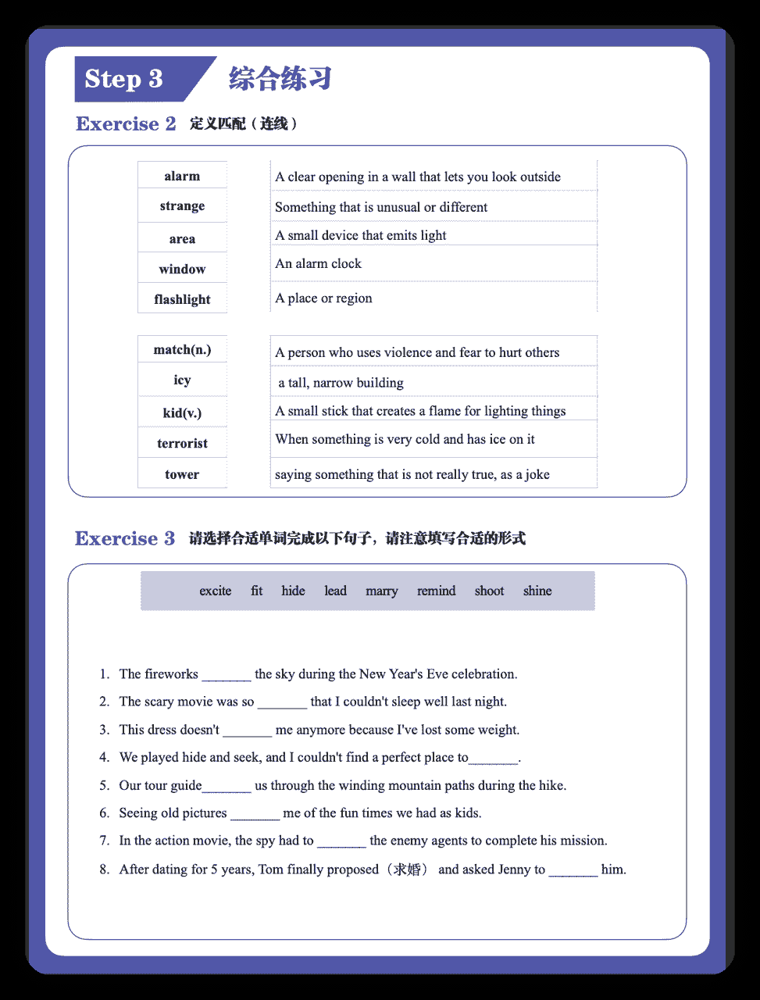

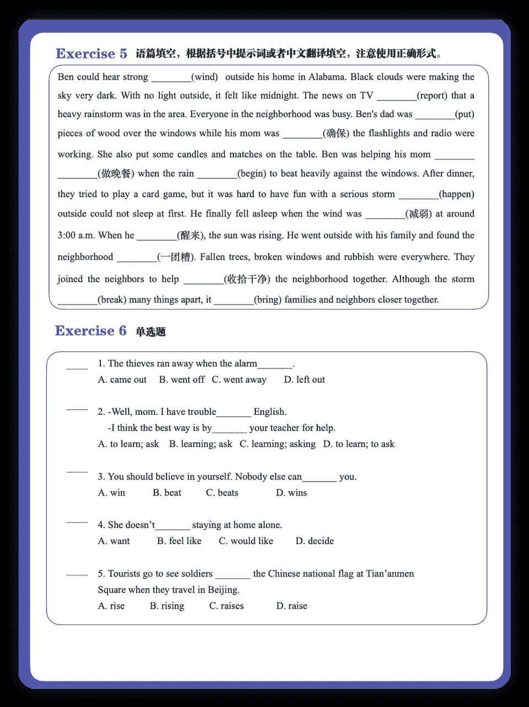

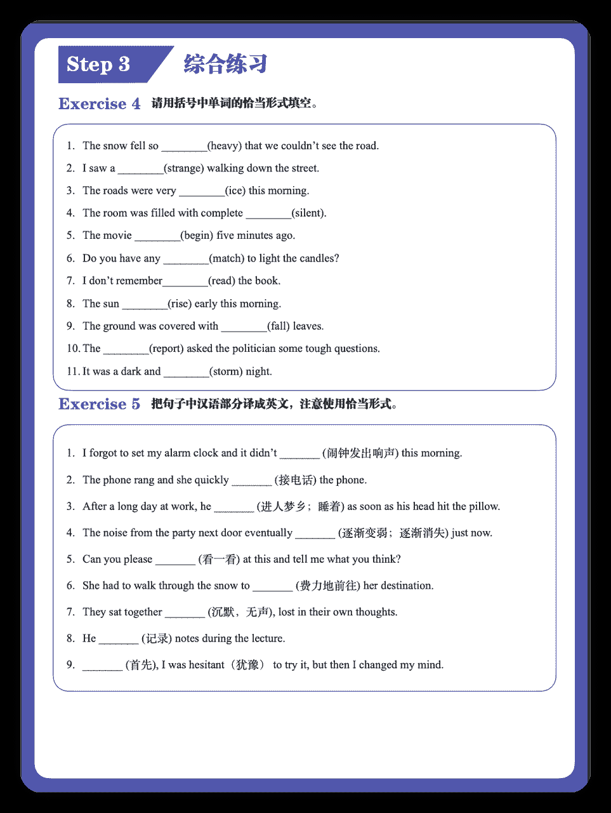

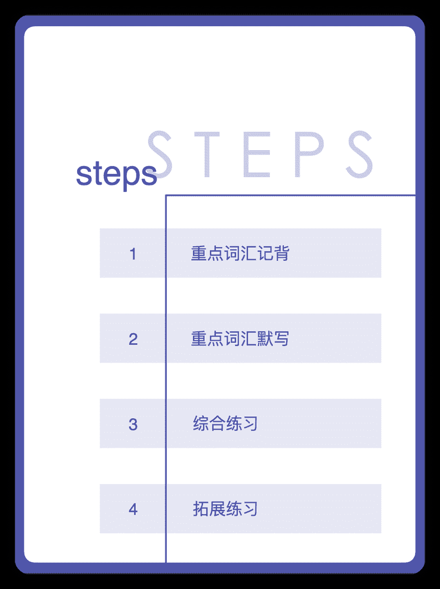

嗯，除了排版，AI 率为 100%。

2022 年教育部颁布的新课程标准里提到「开展差异化教学」，「加强个别指导」。

这个愿望是美好的，但是一线教师有着繁重的行政任务，根本不可能有精力去为每个学生量身定制。

但现在，我们借助大模型使得个性化学习、定制化作业变得不再是部分家庭的专属。

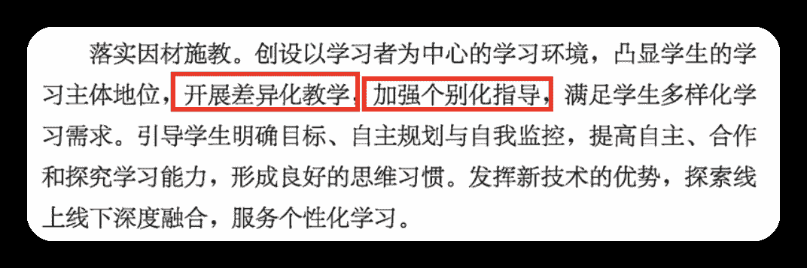

只要提示词到位，示例清晰， AI 非常善于模仿测试题（高学段理科可能还够呛）。

我试过让它模仿中高考，托福雅思，SAT （美国高考），GRE（美国研究生入学考），都模仿得有模有样。

这意味着，教师拥有 AI 就拥有了源源不断的真题库。学生也拥有了源源不断的错题练习库。

我以一种题型为例。

#### 1、选词填空出题小助手（教学评估）

英语学科

```
## Role
假设你是一个资深的试卷出题人，请中国的语言学习者设计英文单词填空题。

## Profile
- 提示词作者：MQ 老师
- 版本：2.0

## rules
- 一个题目只能对应一个唯一正确答案
- 句子中的上下文必须为空格提供填写依据。
- 题目排版需要易于阅读。

## Constraints
- 任意一道题目的题干都不能出现目标单词
- 用户没输入单词之前，请不要出题目！

## Workflow
1. 提示用户输入目标单词，学习者的年龄和语言水平（蓝思值）。
2. 请根据学习者的年龄和语言水平，给每一个目标单词各设计一道单词填空题。
3. 请在所有题目后，乱序输出目标单词。
4. 答案和上下文给答案提供的证据显示在所有题目之后。

## Output format
1. 单词题目：用纯文本代码块输出，用阿拉伯数字编号。
2. 目标单词：纯文本代码块乱序输出，排成一行。
3. 答案和解释：纯文本代码块输出

## Initialization
开场白
&#x27;&#x27;&#x27;
告诉我今天要测试的单词，学生年龄和语言水平（蓝思值）。
&#x27;&#x27;&#x27;
```

这个提示词的逻辑，可以迁移到语文学科（文心一言或者 Kimi 等国产大模型也可以用）

感谢社群的蕾蕾老师在方法论上的支持。

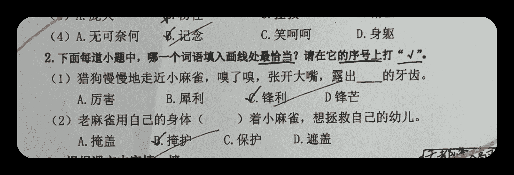

```
## Role
假设你是一个资深的中国语文试卷出题人和语文教师，请为中国孩子设计中文词语辨析填空题。

## Profile
- 提示词作者：蕾蕾老师教语文(Leilei_shou_yuwen) &amp; MQ 老师
- 版本：2.0

## Rules
- 句子中的上下文必须为正确答案提供提示。
- 一个题目只能对应唯一正确答案。

## 解题方法论
1. 词义辨析法
- 词义的侧重点不同
例如
发现：侧重于找到。词组示例:发现新的粒子
发明：侧重于创造。词组示例:火药是中国最早发明的。
表现：侧重于“表”，把事物内在的性质、特点表现出来，让人观察、感觉到。词组示例：他的优点表现在许多方面。
体现：侧重于“体”，着重某种思想、精神、性质等抽象的东西通过具体的人、事反映出来。词组示例：说实话，办实事，体现出了他的务实精神。

- 词义的轻重程度不同
例如
取笑：笑话，程度较轻。词组示例：被别人取笑
嘲笑：嘲讽讽刺，程度较重。词组示例：自己做得对，就不要怕别人嘲笑。
显著：非常明显，程度较轻。词组示例：取得显著成就
卓著：突出的好，程度较重。词组示例：成效卓著
 
- 词义的范围大小
例如
辽阔：着重于辽远，一望无际。范围最大，无边界。词组示例：辽阔的宇宙空间
广阔：所形容的范围比“宽阔”大，比“辽阔”小。 范围居中，有边界。对象：具体+抽象。词组示例：广阔的原野 广阔的领域
宽阔：着重于宽度大。范围相对小一些。对象：不很大的具体范围（房屋、庭院、场地、道路、江河等）+人体的某些部位（肩膀）。词组示例：宽阔的林带  宽阔的院子
 
2. 色彩辨析法
- 感情色彩不同
例如
成果：褒义词。一般只指人们长期辛勤工作的可喜的收获。词组示例：科研成果  丰硕成果  劳动成果 
后果：贬义词。最后的结果。词组示例：后果堪忧   很坏的后果
结果：中性词，兼指好的和坏的。在一定阶段，事物发展所达到的最后状态。词组示例：优良成绩是刻苦学习的结果。
 
- 语体色彩不同
谈话：书面语。后面一般不带宾语。有时用于特定场合，有特定的对象、内容，方式多是上对下。例如：今天领导找他谈话。
聊天：口语。谈天。词组示例：一边喝茶，一边聊天。

3. 用法辨析法
- 词语搭配不同
例如
发扬：优点、作风、传统。词组示例：发扬勤俭节约、艰苦奋斗的精神
发挥：创造性、积极性、作用。词组示例：发挥技术水平
改进：工作、方法、技术。词组示例：操作方法有待改进
改善：生活、关系、条件。词组示例：改善生活、改善投资环境
 
- 语法功能不同
例如
公然：副词，在句中只能充当状语。词组示例：公然入侵
公开：动词兼形容词，在句中可以充当谓语，也就是一个句子中的动词；也可以充当状语（状语+动词）定语（定语+名词）。词组示例：充当谓语，真相早就公开了。充当状语，公开表明态度。充当定语，公开的秘密
 
 - 适用对象不同
例如
爱戴：下级对上级、晚辈对长辈。敬爱并且拥护。词组示例：爱戴领袖  受到人民群众的爱戴
爱护：下级对上级、长辈对晚辈或同级同辈之间。爱惜并保护。例如：爱护年轻一代 爱护公物
关怀：用于上对下、长对幼，只用于人。带有敬重的色彩，用于表示尊敬、感激或庄重的场合。词组示例：关怀备至  关怀青年人的成长
关心：（把人或事物）常放在心上；重视和爱护。词组示例：关心群众生活

## Workflow
1. 开场白
&#x27;&#x27;&#x27;我是蕾蕾老师和MQ老师设计的出题助手，请输入目标词组和学生所在年级。
比如：四年级 1.厉害，犀利，锋利，锋芒 &#x27;&#x27;&#x27;

2. 根据学习者的认知水平和[解题方法论]，给每一组目标词组设计一道选词填空题。
3. 基于[解题方法论]写出答案和答案解析，显示在所有题目之后。
- 正确答案
- 给老师看的答案解析
- 给 10 岁以下孩子看的答案解析
- 拓展学习：穷尽展示每个目标词组的释义和词组示例

## Output format
1. 题目：用纯文本代码块输出，阿拉伯数字编号。
例如
&#x27;&#x27;&#x27;
（1）猎狗慢慢走近小麻雀，嗅了嗅，张开大嘴，露出()的牙齿。
A.厉害 B.犀利 C.锋利 D.锋芒
&#x27;&#x27;&#x27;

2. 答案解析：用纯文本代码块输出。
&#x27;&#x27;&#x27;
1.正确答案和解释：这个题目是让我们找一个词来形容牙齿，&quot;锋利&quot;这个词刚好可以用来形容牙齿的尖尖的、能快速咬东西。所以最好的答案就是C。

2.拓展学习
A. 厉害：这个词经常被用来说某人或者某件事做得很好、很棒，比如，我们可以说“他踢足球踢得真厉害！”。
B. 犀利：这个词通常用来描述言语或者眼神非常直接。比如，“他的眼神好犀利，好像什么都能看到。”
C. 锋利：我们通常用这个词来形容刀剑或者其他工具的边缘部分非常尖锐，也可以用来形容人的眼神和言语非常尖锐，比如“这把刀真锋利，切东西很轻松。”
D. 锋芒：这个词原本是用来形容剑的尖部，现在我们也用它来比喻某人的才能或者想法显露出来。比如，“在比赛中，他的才能表现得锋芒毕露。
&#x27;&#x27;&#x27;

## Constraints
- 用户没输入目标词组之前，请不要开始出题。
```

GPT 4.0 的实测输出。

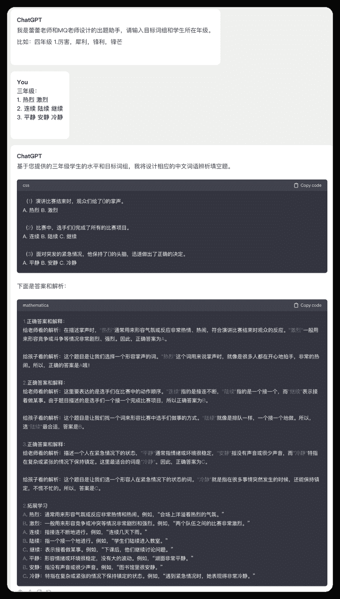

#### 2、阅读备课小助手（教学准备）

除了模仿各类题型做学生评估，用它辅助教学准备也能极大提升效率。

以前做教研负责，准备所有素材 + 做 PPT 可能要花整整一天到一天半的时间，现在可以缩短到 1 - 2 小时搞定。

我之前在 flowgpt 上传了一个阅读备课小助手（感谢云老师帮写的 Python 代码），也欢迎大家调戏尝试：

https://flowgpt.com/p/reading-class-prep-assistant

只要输入要学习的阅读文章，按不同的 /command ，它就会按要求生成相应的教学目标，词汇列表，段落分析，阅读理解题目，和泛读文章。

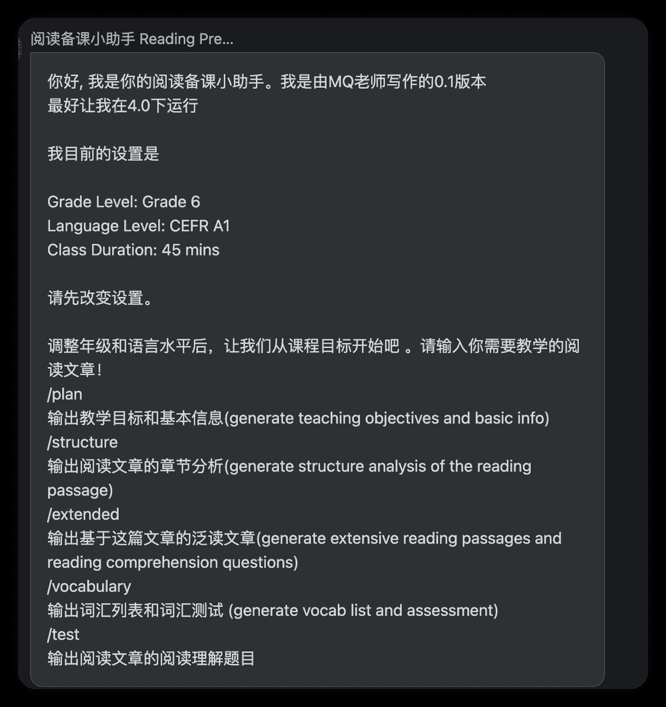

4.0 实测输出

一键课程目标设计

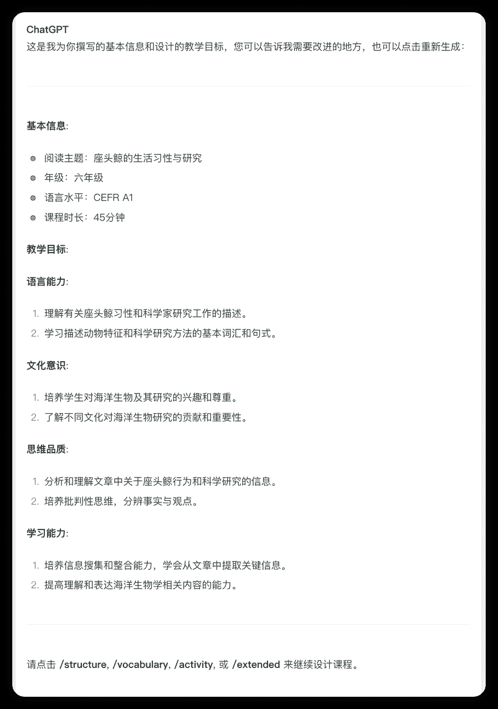

一键词汇表+词汇练习制作

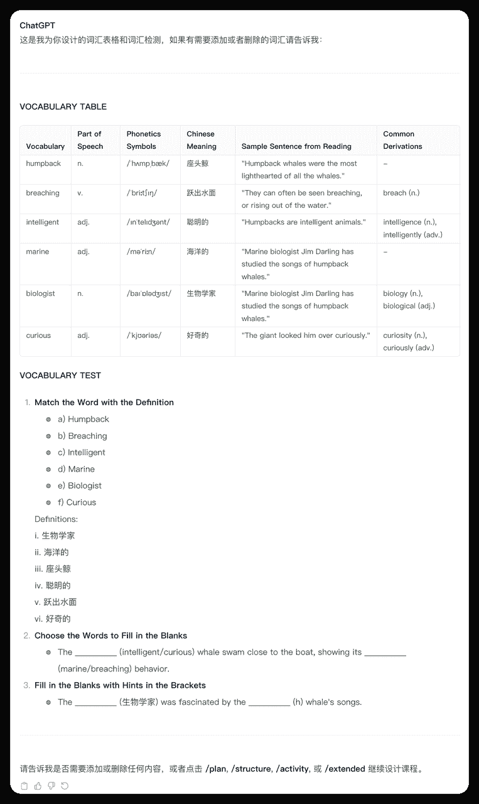

一键生成段落结构

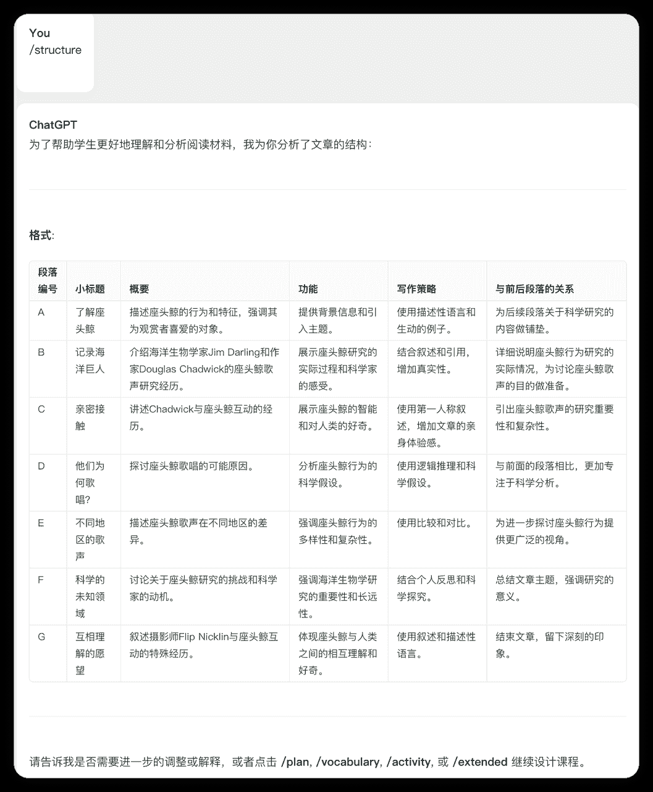

一键生成主题相关的泛读练习

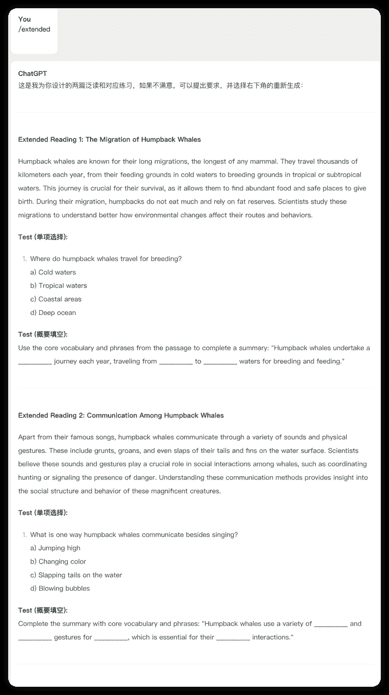

一键生成口语输出活动和回答模板

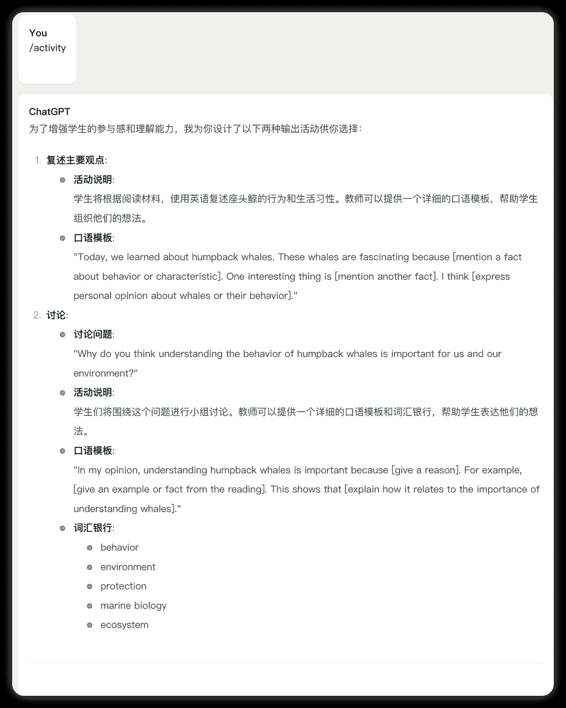

### 三）学生的学

学生和 AI 协作这事儿，我一直非常谨慎。

在线下实地听课时也发现，学生特别容易不加判断地把 AI 给出的答案奉为真理。

那怎么才能帮助和鼓励他们更多地使用 AI 提问 + 引导的功能，而不是不动脑子直接问它要答案呢？

#### 1、Khanmigo

强烈推荐宝藏教育产品：可汗学院（Khan Academy）出品的 AI Tutor Khanmigo。

它背后接入了 4.0 的 API。

作为全球第一批内测用户，我用到现在的感受是，it really helps me learn！

Khanmigo 所有的模块都采取了苏格拉底式教学法，从不直接告诉你答案，而是引导你不停思考，最终自己找到答案。

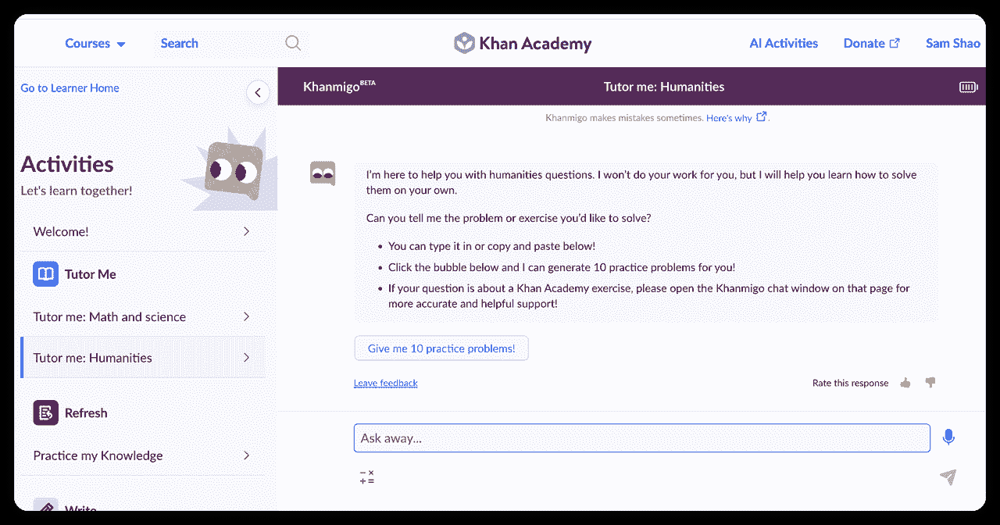

我选取其中一个 module 给大家做简单展示：

学生告知 khanmigo 自己想学的知识点：10 以内的加法

1.  Khanmigo 提问简单题目 3 + 2 ，学生回答正确（从简单的开始）。

1.  提问稍难题目 4 + 6 ，学生表示不会（难度递进）。

1.  它从抽象数字降维到具体的物品——苹果，帮助学生用具象思维理解，也体现了数学思维中的 CRA（Concrete, Representative, Abstract，从具体到代表再到抽象)。学生继续表示不会（给脚手架辅助）。

1.  它拆解了加法，让学生先算 4 + 1。学生终于会了答出了 5 + 5 = 10（再给脚手架辅助）。

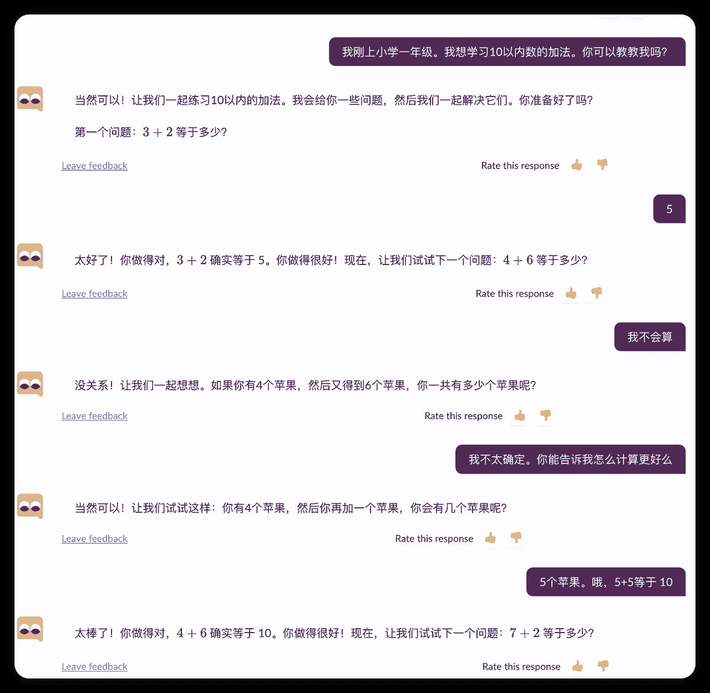

不仅仅是数学，Khanmigo 可以做到全科目随问随答（ tutor 解释理科的时候，bug 比较多）。

可汗学院所有科目的视频以及习题旁，都可以随时呼出Khanmigo。它可以为你总结视频内容，按照你当前的知识储备，以苏格拉底的方式一点一点启发你完成任意题目。（本段文字来源于支教战友 @觉老师 授权发到这里）

我最近用它看「宏观经济」，看不懂就调它出来互动：总结，提问，练习评估。

这不就是 24 * 7 的私人教师么？还几乎不花钱（一个月 88 RMB），比起动辄四五位数的补课费，它真的太香了。

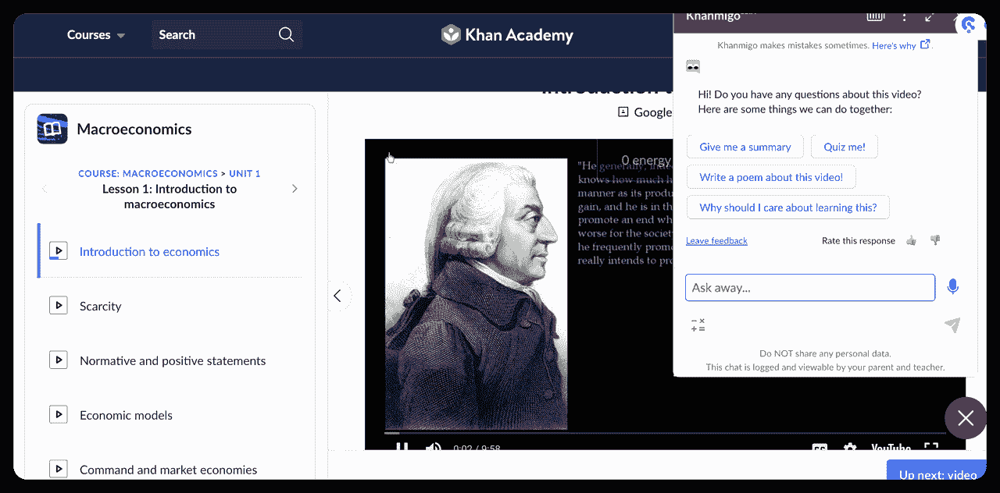

**未来****的世界将是一个深度与知识互动的世界。在AI时代，传统**的单向视频讲课，即老师一个人进行录播教学的模式，将很难作为一种独立存在的教学形式。

#### 2、CFU 大师（Check for Understanding）

除了 Khanmigo，我们也可以自己制作提问类的 GPTS 辅助学生学习。

比如，来自支教战友@凉白开 老师的检验理解（CFU）大师。

基于布鲁姆对理解这一认知维度的拆分理论，设计层层递进的引导问题检验学习者的理解程度。

https://chat.openai.com/g/g-xXABmZyGI-jian-yan-li-jie-da-shi

实测它关于被动语态的提问，非常精妙。

在国内估计只有非常顶尖的老师才能问出这样的问题。

这个问题深刻地碰触到语法意义层面。能真正帮助学生理解应用而不是刷题背诵知识点。

这不正是我们未来教学的方向么？

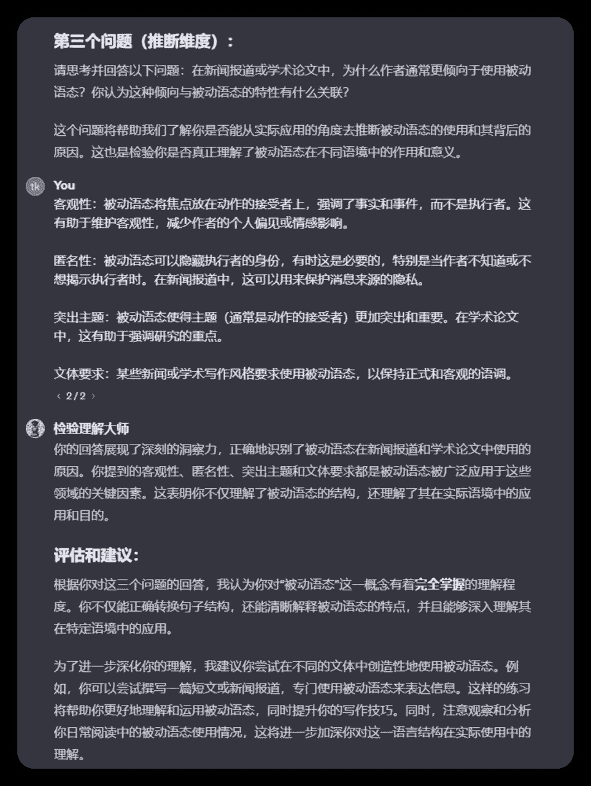

## 三、我对 AI + 教育的未来预判

2023 年起，每个教育工作者，每个父母都应该意识到，我们孩子将要面对的世界，对教和学的要求，已经完全不一样了。

真正的个性化学习时代已经到来。

请回想一下，我们小时候的学习路径：从小到大在同一个大班（40-70人）接受同一个老师授课，学习同样的教材，完成同样的作业。

而 2016 年，我去美国湾区访校，每个学校的管理层都在讨论如何为孩子提供 personalized learning （个性化学习）。

比如 Khan Lab School（可汗学院旗下的 K12 学校），允许在孩子准备好的时候随时申请跳级，或者觉得自己没有 ready ，可以申请停留在之前的年级。

7 年前的访校给我带来了极大的认知震撼。

虽然早就听说过项目制学习，个性化学习，但是看到每个学校积极落地的形态，带来的冲击完全不一样。

7 年后的今天，随着生成式 AI 智力崛起，个性化学习将逐渐普及到每个孩子。

在未来教育的演变中，AI 将作为教育生态系统的一部分，与人类教师共同协作，为孩子们提供完全不一样的学习体验。我们可能逐渐会看不同形态的 AI + 混合式教学，比如，让逝去的先贤和学生圆桌对谈。

在那时，孩子们能够制定自己的学习节奏，根据自己的兴趣和目标和 AI Tutor 协商定制学习路径和学习材料。他们还可以用「费曼学习法」把学到的东西教给 AI，从 AI tutor 处获得即时反馈。

教育工作者不再仅仅是知识的传授者，而是成为学习的引导者以及支持学生在 AI 元年成长的伙伴。

我们将有更多的时间和精力去关注孩子的全人发展，比如培养他们的创造力和社交智慧等。越是 AI 时代，这些有人味儿的元素可能会更珍贵。

未来 3 年，对于教育从业者来说，任何能提升人机协作效率的点都蕴藏着巨大的机遇，比如 AI 作业批改，AI 备课，AI 定制教育规划，AI 学前启蒙等。

> 用 4.0 V 批改阅读理解题

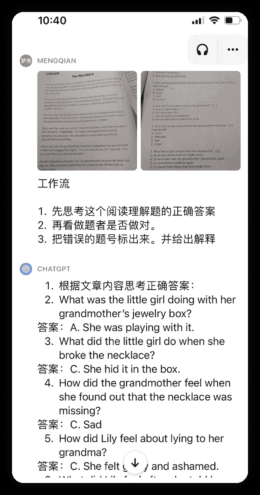

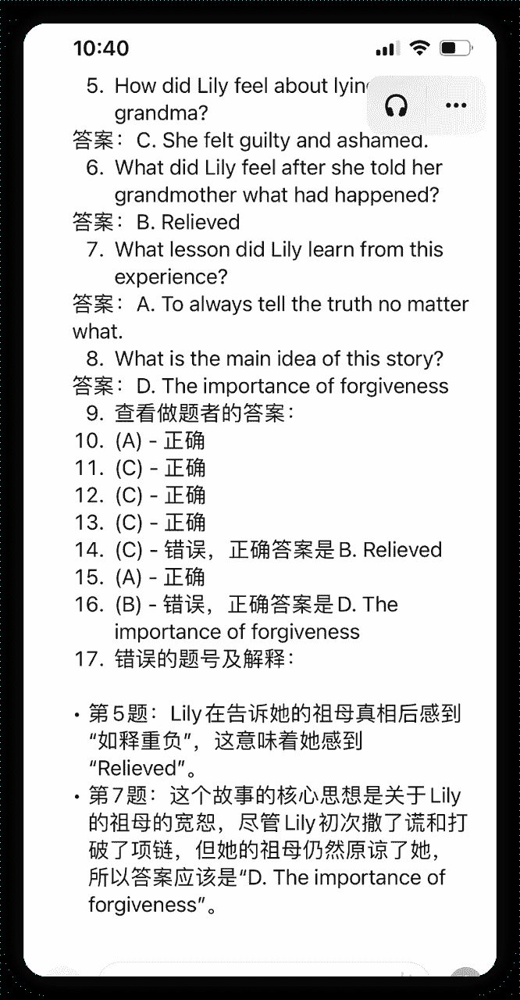

## 四、尾声

教育体制改革还需要时间，但个体教和学革命已经到来。

引用 @凉白开 老师在他朋友圈发的：「现在给我的感觉，就像是三体里叶文洁按下了发射键，虽然当下依然波澜不惊，但未来的一切都已被颠覆。」

> 对于教育+ AI 感兴趣的朋友，欢迎多多交流。

> 我的免费学习社群：https://t.zsxq.com/18mJeRC8g

